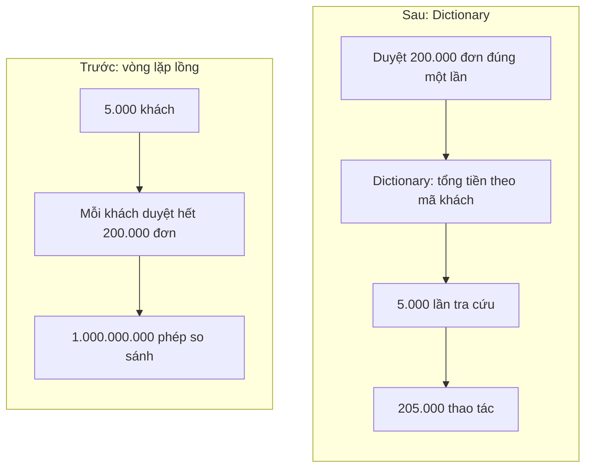

# 1.10 - Sự cố thực tế: vòng lặp lồng làm treo báo cáo

> **Tóm tắt:** Một đoạn code **6 dòng, hoàn toàn đúng về logic**, làm màn hình báo cáo treo hàng chục giây. Nó chạy tốt suốt một năm với 500 khách hàng, rồi hệ thống lên 5.000 khách và thời gian chạy tăng **khoảng 100 lần** chứ không phải 10 lần. Nguyên nhân là **vòng lặp lồng nhau** — mỗi khách hàng lại duyệt toàn bộ danh sách đơn hàng. Cách sửa chỉ là đổi cách tra cứu sang `Dictionary`: đo thật trên .NET 10, thời gian giảm từ hơn một giây xuống khoảng 2 mili giây. Điều đáng nhớ nhất: bug này **không bao giờ lộ ra ở môi trường phát triển**, vì với vài chục bản ghi thì cả hai cách đều chạy tức thì.

## Mục tiêu bài học

Sau bài này bạn có thể:

- Nhận ra vòng lặp lồng nhau trên hai tập dữ liệu lớn, kể cả khi vòng trong nấp sau một lời gọi LINQ.
- Chuyển tra cứu tuyến tính sang `Dictionary`, `HashSet` hoặc `ToLookup`.
- Giải thích vì sao O(n²) không lộ ra khi dữ liệu nhỏ, và đọc đúng một bảng số đo hiệu năng.
- Tự rà code tìm lỗi tương tự bằng công cụ tìm kiếm.

**Cần biết trước:** [bài 1.5](1.5-arrays-and-lists.md) (`Dictionary`, `HashSet`), [bài 1.7](1.7-data-structures-and-big-o.md) (Big-O, cách đo cho đúng).

## Nội dung bài học

Các đoạn code trong bài dùng ba kiểu dữ liệu sau (`record` là cách khai báo nhanh một kiểu chỉ chứa dữ liệu, xem [bài 1.8](1.8-advanced-notes.md)):

```csharp
record Customer(int Id, string Name);
record Order(int Id, int CustomerId, decimal Total);
record CustomerReport(string Name, decimal Total);
```

### 1.10.1 — Code gây ra sự cố

```csharp
// Tính tổng giá trị đơn hàng cho mỗi khách — LOGIC ĐÚNG, hiệu năng thảm hoạ
var report = new List<CustomerReport>();

foreach (var customer in customers)               // 5.000 khách
{
    decimal total = 0;
    foreach (var order in orders)                 // 200.000 đơn
    {
        if (order.CustomerId == customer.Id)
            total += order.Total;
    }
    report.Add(new CustomerReport(customer.Name, total));
}
```

Đếm số phép so sánh:

```text
5.000 khách x 200.000 đơn = 1.000.000.000 phép so sánh
```

Một tỷ phép so sánh. Trong câu chuyện này, máy chủ báo cáo cũ cộng thêm việc đọc dữ liệu từ database nên màn hình treo khoảng 40 giây (con số minh họa). Bài tập 1 cho bạn đo riêng phần vòng lặp trên máy mình.

Điều nguy hiểm: ở môi trường phát triển với 50 khách và 200 đơn, con số là **10.000** phép so sánh, chạy trong chưa tới một mili giây. Không ai thấy vấn đề gì.

### 1.10.2 — Vì sao tăng 10 lần dữ liệu lại chậm 100 lần

```text
500 khách   x  20.000 đơn  =      10.000.000 phép so sánh
5.000 khách x 200.000 đơn  =   1.000.000.000 phép so sánh
```

Dữ liệu tăng **10 lần** ở cả hai chiều, nhưng số phép so sánh tăng **100 lần** — vì 10 × 10 = 100. Đây là đặc trưng của độ phức tạp **O(n²)** ([bài 1.7](1.7-data-structures-and-big-o.md)). Đo thật ở Bài tập 1: 11 ms thành khoảng 1.300 ms.

Hệ quả thực tế: hệ thống trông ổn cho tới một ngưỡng nào đó rồi **đổ sập rất nhanh**. Không có giai đoạn "hơi chậm" đủ dài để bạn kịp nhận ra và xử lý.

### 1.10.3 — Sửa bằng Dictionary

```csharp
// Bước 1: gom đơn hàng theo mã khách — duyệt danh sách đơn ĐÚNG MỘT LẦN
var totalByCustomer = new Dictionary<int, decimal>();

foreach (var order in orders)                     // 200.000 lần
{
    if (totalByCustomer.ContainsKey(order.CustomerId))
        totalByCustomer[order.CustomerId] += order.Total;
    else
        totalByCustomer[order.CustomerId] = order.Total;
}

// Bước 2: duyệt khách, tra cứu TỨC THÌ
var report = new List<CustomerReport>();

foreach (var customer in customers)               // 5.000 lần
{
    decimal total = totalByCustomer.GetValueOrDefault(customer.Id, 0m);
    report.Add(new CustomerReport(customer.Name, total));
}
```

`GetValueOrDefault(khóa, 0m)` trả giá trị nếu có khóa, không có thì trả `0m`: khách chưa có đơn nào vẫn có dòng báo cáo với tổng bằng 0.

```text
200.000 + 5.000 = 205.000 thao tác
(trước: 1.000.000.000 phép so sánh)
```

Số thao tác giảm gần 5.000 lần. Thời gian đo thật giảm ít hơn, khoảng 600 lần (1.313 ms xuống 2,1 ms ở Bài tập 1), vì mỗi thao tác trên `Dictionary` (tính mã băm, nhảy tới ô) tốn hơn một phép so sánh số nguyên. Dù vậy, code cũng không dài hơn bao nhiêu.



Lý do `Dictionary` nhanh: nó dùng bảng băm, nên tra cứu theo khoá mất thời gian **không đổi** bất kể có 10 hay 10 triệu phần tử. Duyệt `List` để tìm thì phải xem từng phần tử ([bài 1.7](1.7-data-structures-and-big-o.md)).

**Viết gọn hơn với LINQ:**

```csharp
var totalByCustomer = orders
    .GroupBy(o => o.CustomerId)
    .ToDictionary(g => g.Key, g => g.Sum(o => o.Total));

var report = customers
    .Select(c => new CustomerReport(c.Name, totalByCustomer.GetValueOrDefault(c.Id, 0m)))
    .ToList();
```

Hai cách cho hiệu năng cùng bậc. Chọn cách nào là tuỳ đội — nhưng cả hai đều **nhanh hơn hẳn** vòng lặp lồng nhau, và đó mới là điều quan trọng.

### 1.10.4 — Cái bẫy tinh vi hơn

```csharp
// Nhìn KHÔNG thấy vòng lặp lồng — nhưng vẫn là O(n²)
foreach (var customer in customers)
{
    var customerOrders = orders.Where(o => o.CustomerId == customer.Id);   // duyệt HẾT
    report.Add(new CustomerReport(customer.Name, customerOrders.Sum(o => o.Total)));
}
```

`Where` **là** một vòng lặp, chỉ là nó không được viết ra. Mỗi lần gọi nó duyệt toàn bộ `orders`.

**Dấu hiệu nhận biết:** một lời gọi `Where`, `First`, `Any`, `Contains` hoặc `Sum` trên một tập lớn nằm **bên trong** vòng lặp chạy trên một tập lớn khác. Nhìn thì ngắn gọn, nhưng chi phí giống hệt vòng lặp lồng nhau.

Cùng một lỗi xuất hiện với `List.Contains`. Hai phiên bản dưới thay thế nhau:

```csharp
// CHẬM — Contains trên List duyệt tuyến tính
var processedList = new List<int>();
foreach (var order in orders)
{
    if (processedList.Contains(order.Id)) continue;   // O(n) mỗi lần gọi
    processedList.Add(order.Id);
}

// NHANH — HashSet tra cứu tức thì
var processedSet = new HashSet<int>();
foreach (var order in orders)
{
    if (!processedSet.Add(order.Id)) continue;    // Add trả về false nếu đã có
}
```

`HashSet.Add` vừa thêm vừa cho biết phần tử đã tồn tại chưa — gọn hơn và nhanh hơn cặp `Contains` + `Add`.

### 1.10.5 — Tự rà code

Tìm bằng công cụ chỉ cho ra **ứng viên**; bạn vẫn phải mở từng chỗ ra đọc. Hai cách dưới đều chạy được trên Windows, macOS và Linux.

**Cách 1: VS Code.** Mở **Find in Files** (`Ctrl+Shift+F`), bật biểu tượng `.*` (regex), ô "files to include" điền `*.cs`:

| Tìm gì | Gõ vào ô tìm kiếm |
|---|---|
| LINQ hoặc `Contains` được gọi ở đâu | `\.(Where\|First\|Any\|Contains\|Sum\|Count)\(` |
| `Contains` trên biến kiểu `List` | `List<.*>.*\.Contains\(` |

Với từng kết quả, xem nó có nằm trong thân một `foreach` không.

**Cách 2: PowerShell** (có sẵn trên Windows; macOS và Linux cài `pwsh`). Chạy ở thư mục gốc của code:

```powershell
# 1. foreach có một foreach khác trong vòng 5 dòng tiếp theo
Get-ChildItem -Recurse -Filter *.cs |
    Select-String -Pattern "foreach" -Context 0,5 |
    Where-Object { $_.Context.PostContext -match "foreach" } |
    ForEach-Object { "$($_.Path):$($_.LineNumber): $($_.Line.Trim())" }

# 2. foreach có lời gọi LINQ hoặc Contains trong vòng 3 dòng tiếp theo
Get-ChildItem -Recurse -Filter *.cs |
    Select-String -Pattern "foreach" -Context 0,3 |
    Where-Object { $_.Context.PostContext -match "\.(Where|First|Any|Contains|Sum|Count)\(" } |
    ForEach-Object { "$($_.Path):$($_.LineNumber): $($_.Line.Trim())" }
```

`Select-String -Context 0,5` lấy thêm 5 dòng sau mỗi dòng khớp, nên lệnh 1 bắt được vòng lặp lồng viết trên nhiều dòng. Đổi lại nó cũng báo nhầm hai vòng `foreach` **đứng liền nhau** chứ không lồng nhau. Đó là lý do mọi kết quả đều cần đọc lại.

Với mỗi kết quả, hỏi: **hai tập này có thể lớn tới mức nào?** Vòng lặp lồng trên 10 phần tử không sao; trên 10.000 thì có.

**Cách kiểm chứng nhanh nhất:** đo với dữ liệu gấp 10 lần. Nếu thời gian tăng khoảng 10 lần thì code là O(n) — bình thường. Nếu tăng khoảng 100 lần thì là O(n²) — cần sửa.

### 1.10.6 — Rà lại code của bạn

**Danh sách rà soát vòng lặp lồng nhau**

- [ ] Không có vòng lặp lồng nhau trên hai tập dữ liệu có thể lớn.
- [ ] Không gọi Where, First hay Any trên tập lớn bên trong vòng lặp.
- [ ] Tra cứu theo khoá dùng Dictionary, không duyệt List.
- [ ] Kiểm tra tồn tại dùng HashSet, không dùng List.Contains.
- [ ] Đã đo với lượng dữ liệu tương đương production, không chỉ dữ liệu mẫu.
- [ ] Đã kiểm chứng bằng cách tăng dữ liệu 10 lần và xem thời gian tăng bao nhiêu.
- [ ] Biết ước lượng tập dữ liệu lớn nhất có thể gặp.

## Bài tập áp dụng

#### Bài 1 — Đo hai cách

Tạo 5.000 khách và 200.000 đơn, chạy cả hai phiên bản và so sánh thời gian. Đo thêm ba mốc nhỏ hơn: 500 × 20.000, 1.000 × 40.000, 2.500 × 100.000.

**Tiêu chí hoàn thành:** bạn có **số đo của chính mình**, và đối chiếu được nó với con số trong bài — kể cả khi hai con số không khớp.

<details>
<summary><strong>Gợi ý và lời giải — Bài 1</strong></summary>

**Gợi ý.** Kiểm tra hai phiên bản cho cùng kết quả trước khi so sánh thời gian. Nếu kết quả khác nhau thì so sánh tốc độ là vô nghĩa. Chạy ở chế độ Release (`dotnet run -c Release`) và làm nóng JIT trước khi đo, như [bài 1.7](1.7-data-structures-and-big-o.md).

**Lời giải** — chương trình đầy đủ cho `Program.cs`:

```csharp
using System.Diagnostics;

Measure(100, 4_000);   // chạy nhỏ một lần để làm nóng JIT, bỏ kết quả

foreach (var (customerCount, orderCount) in new[] { (500, 20_000), (1_000, 40_000), (2_500, 100_000), (5_000, 200_000) })
{
    var (nested, dictionary) = Measure(customerCount, orderCount);
    Console.WriteLine($"{customerCount,5:N0} khách × {orderCount,7:N0} đơn | vòng lặp {nested,7:N0} ms | Dictionary {dictionary,5:N1} ms | {nested / dictionary,4:N0}×");
}

static (double nested, double dictionary) Measure(int customerCount, int orderCount)
{
    var rnd = new Random(42);                       // hạt cố định -> lặp lại được
    var customers = Enumerable.Range(1, customerCount)
        .Select(i => new Customer(i, $"Khách {i}")).ToList();
    var orders = Enumerable.Range(1, orderCount)
        .Select(i => new Order(i, rnd.Next(1, customerCount + 1), rnd.Next(100, 10_000))).ToList();

    // Cách 1: vòng lặp lồng nhau
    var sw = Stopwatch.StartNew();
    var report1 = new List<CustomerReport>(customerCount);
    foreach (var c in customers)
    {
        decimal total = 0;
        foreach (var o in orders)
            if (o.CustomerId == c.Id) total += o.Total;
        report1.Add(new CustomerReport(c.Name, total));
    }
    var nested = sw.Elapsed.TotalMilliseconds;

    // Cách 2: Dictionary
    sw.Restart();
    var totalByCustomer = new Dictionary<int, decimal>();
    foreach (var o in orders)
        totalByCustomer[o.CustomerId] = totalByCustomer.GetValueOrDefault(o.CustomerId) + o.Total;
    var report2 = customers.Select(c => new CustomerReport(c.Name, totalByCustomer.GetValueOrDefault(c.Id))).ToList();
    var dictionary = sw.Elapsed.TotalMilliseconds;

    // KIỂM TRA hai cách cho cùng kết quả — làm trước khi so sánh tốc độ
    if (report1.Sum(r => r.Total) != report2.Sum(r => r.Total))
        throw new Exception("Hai cách cho kết quả khác nhau!");

    return (nested, dictionary);
}

record Customer(int Id, string Name);
record Order(int Id, int CustomerId, decimal Total);
record CustomerReport(string Name, decimal Total);
```

`(int, int)` trong `new[] { (500, 20_000), ... }` là **tuple**: một cặp giá trị đi cùng nhau, `foreach (var (customerCount, orderCount) in ...)` tách cặp đó ra hai biến. Hàm `Measure` trả về một tuple hai số theo cách tương tự.

Kết quả đo thật trên .NET 10, chế độ Release, Intel Core Ultra 5 225H (máy đặt vùng Việt Nam):

```text
  500 khách ×  20.000 đơn | vòng lặp      11 ms | Dictionary   0,9 ms |   12×
1.000 khách ×  40.000 đơn | vòng lặp      41 ms | Dictionary   1,6 ms |   26×
2.500 khách × 100.000 đơn | vòng lặp     283 ms | Dictionary   2,0 ms |  140×
5.000 khách × 200.000 đơn | vòng lặp   1.313 ms | Dictionary   2,1 ms |  627×
```

Chạy thêm hai lần, mốc cuối cho 1.296 ms và 1.568 ms: dao động khoảng 20% giữa các lần là bình thường.

**Và đây là điều đáng nói: mục 1.10.1 kể chuyện một màn hình treo 40 giây. Riêng phần vòng lặp đo trên máy này chỉ khoảng 1,3 giây.**

```text
Vì sao chênh nhiều như vậy:
    - CPU hiện đại chạy hàng tỷ phép so sánh số nguyên đơn giản mỗi giây
      nếu dữ liệu nằm gọn trong bộ nhớ đệm
    - con số 40 giây của câu chuyện gồm cả việc khác: đọc dữ liệu từ database,
      so sánh chuỗi, gọi phương thức, máy chủ cũ và bận phục vụ request khác
```

**Nhưng kết luận của bài học KHÔNG đổi**, và đó mới là điều quan trọng:

```text
Vòng lặp lồng:  11 ms -> 1.313 ms khi dữ liệu tăng 10 lần  = khoảng 119 lần chậm hơn
Dictionary:    0,9 ms ->  2,1 ms                           = khoảng 2,3 lần chậm hơn
```

Hình dạng O(n²) được xác nhận đúng. Chỉ có hằng số nhân là khác máy.

**Ba điều rút ra về việc đọc số liệu hiệu năng:**

**1. Luôn tự đo lại trên máy của mình.**

```text
Con số trong tài liệu phụ thuộc: CPU, bộ nhớ đệm, phiên bản runtime,
                                 và kiểu dữ liệu được so sánh
-> dùng nó để hiểu HÌNH DẠNG, đừng dùng làm mục tiêu tuyệt đối
```

**2. Tỉ lệ đáng tin hơn con số tuyệt đối.**

```text
"1,3 giây" -> đổi theo máy
"khoảng 100 lần chậm hơn khi dữ liệu tăng 10 lần" -> đúng trên mọi máy
```

**3. Và 1,3 giây vẫn là một sự cố thật.**

```text
Một endpoint mất 1,3 giây chỉ riêng cho vòng lặp:
    - người dùng đã thấy rõ là chậm
    - chiếm một luồng CPU suốt thời gian đó
    - 10 request đồng thời -> 13 giây CPU -> máy chủ vài lõi bão hoà ngay
    - và dữ liệu tăng gấp đôi lần nữa thì thành khoảng 5 giây
```

Nên dù con số nhỏ hơn câu chuyện, kết luận vẫn giữ nguyên: đây là code phải sửa.

**Và một chi tiết đáng chú ý trong cột Dictionary:**

```text
Từ 500 lên 5.000 khách, dữ liệu tăng 10 lần, Dictionary chỉ chậm đi 2,3 lần
```

Với các phép đo dưới vài mili giây, chi phí cố định (cấp phát `Dictionary`, tạo danh sách báo cáo) và nhiễu (bộ thu gom rác, hệ điều hành xen việc khác) chiếm tỉ trọng lớn, nên tỉ lệ không đúng 10 như lý thuyết O(n). Cách xử lý: chạy mỗi mốc nhiều lần và lấy giá trị nhỏ nhất hoặc trung vị, hoặc dùng thư viện BenchmarkDotNet cho những phép đo nhỏ như vậy. Nhận ra một con số **không hợp quy luật** và gọi tên nó là nhiễu hay chi phí cố định — thay vì cố giải thích nó bằng Big-O — là một kỹ năng đọc số liệu quan trọng.

</details>

---

#### Bài 2 — Kiểm chứng O(n²)

Dùng bốn mốc đo của Bài 1, xác nhận thời gian của bản vòng lặp lồng tăng khoảng 100 lần từ mốc đầu tới mốc cuối.

**Tiêu chí hoàn thành:** bạn xác nhận được tỉ lệ, và giải thích được vì sao nó **không chính xác bằng đúng 100**.

<details>
<summary><strong>Gợi ý và lời giải — Bài 2</strong></summary>

**Gợi ý.** Đo ít nhất bốn mốc, không phải hai. Hai điểm thì đường nào cũng vẽ qua được.

**Lời giải — lập tỉ lệ giữa các mốc liên tiếp**, từ số đo ở Bài 1:

| Khách | Đơn | Phép so sánh | Vòng lặp | Tỉ lệ so với mốc trước | Lý thuyết |
|---:|---:|---:|---:|---:|---:|
| 500 | 20.000 | 10 triệu | 11 ms | — | — |
| 1.000 | 40.000 | 40 triệu | 41 ms | **3,7×** | 4× |
| 2.500 | 100.000 | 250 triệu | 283 ms | **6,9×** | 6,25× |
| 5.000 | 200.000 | 1 tỷ | 1.313 ms | **4,6×** | 4× |

```text
Từ mốc đầu tới mốc cuối:
    dữ liệu tăng 10 lần ở cả hai chiều
    phép so sánh tăng 100 lần   (10 × 10)
    thời gian tăng khoảng 119 lần  (11 -> 1.313 ms)
```

**Vì sao không đúng 100 — ba lý do:**

**1. Mốc nhỏ quá ngắn để đo chính xác.**

```text
11 ms là con số nhỏ. Sai 1 ms đã là lệch 9%.
Phần chi phí cố định (tạo danh sách báo cáo, cấp phát) chiếm tỉ trọng
lớn ở mốc nhỏ và nhỏ dần ở mốc lớn.
```

**2. Bộ nhớ đệm của CPU.**

```text
Mỗi Order là một object riêng trên heap, List chỉ giữ địa chỉ của chúng.
20.000 đơn  -> vài trăm KB dữ liệu -> phần lớn nằm trong bộ nhớ đệm của CPU
200.000 đơn -> vài MB              -> phải đọc từ RAM nhiều hơn

-> mỗi phép so sánh ở mốc lớn TỐN HƠN mỗi phép so sánh ở mốc nhỏ
-> thời gian tăng NHANH HƠN 100 lần
```

Đây là một hiệu ứng thật, không phải sai số đo: dữ liệu lớn thật sự chậm hơn trên mỗi phần tử. Kích thước chính xác mỗi object phụ thuộc runtime; điều quan trọng là xu hướng.

**3. Nhiễu từ hệ điều hành và bộ thu gom rác.**

```text
Cột tỉ lệ: 3,7× rồi 6,9× rồi 4,6×
Lý thuyết: (1000/500)² = 4, (2500/1000)² = 6,25, (5000/2500)² = 4
```

Cả ba bước đều gần lý thuyết, lệch trong khoảng 10 tới 15%. Chạy lại vài lần, bạn sẽ thấy các tỉ lệ này dao động quanh giá trị lý thuyết.

**Cách xác nhận O(n²) chắc chắn hơn: tăng n gấp đôi mỗi lần, nhìn tỉ lệ.**

```text
Nếu là O(n):       n tăng 2 lần -> thời gian tăng 2 lần
Nếu là O(n²):      n tăng 2 lần -> thời gian tăng 4 lần
Nếu là O(n log n): n tăng 2 lần -> thời gian tăng hơn 2 lần một chút
```

Đổi vòng `foreach` ở đầu chương trình Bài 1 thành các mốc gấp đôi nhau:

```csharp
foreach (var n in new[] { 500, 1_000, 2_000, 4_000 })
{
    var (nested, _) = Measure(n, n * 40);    // _ : bỏ giá trị thứ hai của tuple
    Console.WriteLine($"n={n,5} | {nested,8:F0} ms");
}
```

```text
Tỉ lệ ~4 giữa các mốc liên tiếp -> O(n²), rất rõ
Tỉ lệ ~2                        -> O(n)
```

**Và một cách kiểm chứng không cần đo thời gian chút nào: đếm.** Thêm một biến đếm vào vòng lặp lồng trong hàm `Measure`:

```csharp
long comparisons = 0;

foreach (var c in customers)
{
    decimal total = 0;
    foreach (var o in orders)
    {
        comparisons++;
        if (o.CustomerId == c.Id) total += o.Total;
    }
    report1.Add(new CustomerReport(c.Name, total));
}

Console.WriteLine($"Số phép so sánh: {comparisons:N0}");
```

```text
500 khách × 20.000 đơn    -> 10.000.000
5.000 khách × 200.000 đơn -> 1.000.000.000

Đúng 100 lần, không sai một chút nào — vì đây là ĐẾM, không phải ĐO.
```

Cách đếm này ổn định tuyệt đối: không phụ thuộc máy, không phụ thuộc bộ nhớ đệm, không có nhiễu. Khi cần chứng minh độ phức tạp cho người khác, nó thuyết phục hơn một biểu đồ thời gian — cùng lý do mà số trang dữ liệu đọc được ưa dùng hơn thời gian khi phân tích truy vấn database ở [Module 12](../../stage-04-database-production/module-12-sql-deep-dive/README.md).

</details>

---

#### Bài 3 — Rà code

Chạy hai lệnh PowerShell ở mục 1.10.5 (hoặc tìm bằng VS Code) trên một codebase C# đủ lớn: dự án CLB, bài tập lớn, hoặc một repo mã nguồn mở bất kỳ trên GitHub. Đếm số vị trí cần xem lại.

**Tiêu chí hoàn thành:** bạn có con số, đã phân loại, và phân biệt được kết quả **đáng lo** với kết quả **vô hại**.

<details>
<summary><strong>Gợi ý và lời giải — Bài 3</strong></summary>

**Gợi ý.** Vòng lặp lồng nhau trên hai tập nhỏ là hoàn toàn bình thường. Vấn đề chỉ xuất hiện khi cả hai tập đều lớn. Đếm số kết quả bằng cách bọc lệnh trong `( ... ).Count`.

**Lời giải — cách phân loại.** Các con số dưới đây là **ví dụ minh họa** cho một codebase CRM cỡ trung bình; con số của bạn sẽ khác. Giả sử lệnh 1 trả về 18 vị trí, lệnh 2 trả về 31 vị trí, và tìm `List<.*>.*\.Contains\(` ra 7 vị trí.

**Phân loại 18 vòng lặp lồng nhau:**

| Nhóm | Số | Đánh giá |
|---|---:|---|
| Báo nhầm: hai `foreach` đứng liền nhau, không lồng | 2 | Bỏ qua |
| Tập trong có tối đa vài chục phần tử | 9 | **Vô hại** |
| Tập ngoài nhỏ, tập trong lớn | 3 | Cần xem |
| **Cả hai tập đều lớn** | **4** | **Nguy hiểm** |

```csharp
// VÔ HẠI — tập trong luôn là 12 tháng
foreach (var employee in employees)              // vài trăm
    foreach (var month in months)                // 12
        AddToReport(employee, month);

// NGUY HIỂM — cả hai đều theo dữ liệu người dùng
foreach (var customer in customers)              // 5.000
    foreach (var order in orders)                // 200.000
        if (order.CustomerId == customer.Id) ...
```

**Câu hỏi phân loại, gói trong một dòng:**

```text
"Cả HAI tập có tăng theo dữ liệu người dùng không?"

Một tập cố định (12 tháng, 7 ngày, 5 trạng thái) -> vô hại
Cả hai đều tăng                                   -> cần sửa
```

**Phân loại 31 lời gọi LINQ bên trong vòng lặp — nhóm này hay bị bỏ sót hơn:**

```csharp
// NGUY HIỂM — Where duyệt toàn bộ orders cho MỖI khách
foreach (var customer in customers)
{
    var customerOrders = orders.Where(o => o.CustomerId == customer.Id);
    report.Add(new CustomerReport(customer.Name, customerOrders.Sum(o => o.Total)));
}
```

```text
Không có từ khoá foreach lồng nhau -> lệnh thứ nhất KHÔNG tìm ra
Nhưng chi phí giống hệt: 5.000 × 200.000
```

```csharp
// SỬA — gom trước một lần
var ordersByCustomer = orders.ToLookup(o => o.CustomerId);

foreach (var customer in customers)
    report.Add(new CustomerReport(customer.Name, ordersByCustomer[customer.Id].Sum(o => o.Total)));
```

`ToLookup` là công cụ đúng cho việc này: nó giống `GroupBy` nhưng trả về một cấu trúc tra cứu, và khoá không tồn tại trả về dãy rỗng thay vì ném lỗi.

**Và 7 lời gọi `Contains` trên `List`:**

```csharp
// CHẬM — Contains trên List duyệt tuyến tính
var processedList = new List<int>();
foreach (var order in orders)                      // 200.000
{
    if (processedList.Contains(order.Id)) continue;   // duyệt tới 200.000 phần tử
    processedList.Add(order.Id);
}
```

```text
Tổng chi phí: 200.000 × (trung bình 100.000) = 20 tỷ phép so sánh
```

```csharp
// NHANH — HashSet.Add vừa thêm vừa cho biết đã tồn tại chưa
var processedSet = new HashSet<int>();
foreach (var order in orders)
    if (!processedSet.Add(order.Id)) continue;
```

```text
Tổng chi phí: 200.000 thao tác
```

**Thứ tự nên sửa — theo số phần tử, không theo số lượng kết quả tìm được:**

```text
1. 4 vòng lặp lồng "cả hai tập lớn"  — ảnh hưởng lớn nhất
2. 7 chỗ Contains trên List          — sửa rất nhanh, đổi một kiểu
3. Các lời gọi LINQ trong vòng lặp trên tập lớn
4. Phần còn lại — ghi lại, không cần sửa ngay
```

**Và một cách kiểm tra rẻ hơn cả việc đọc code: thêm một dòng đo.**

```csharp
var sw = Stopwatch.StartNew();
var report = BuildReport(customers, orders);
Console.WriteLine($"Tạo báo cáo cho {customers.Count} khách, {orders.Count} đơn: {sw.ElapsedMilliseconds} ms");
```

Trong ứng dụng thật, dòng này ghi vào log thay vì in ra màn hình ([bài 8.7](../../stage-03-aspnet-core-backend/module-08-aspnet-core-fundamentals/8.7-logging-with-serilog.md)). Theo thời gian nó cho bạn số liệu thật, ví dụ (minh họa):

```text
hôm nay:      1.200 khách,  45.000 đơn,   180 ms
ba tháng sau: 3.400 khách, 140.000 đơn, 1.650 ms

-> thấy được xu hướng TRƯỚC khi nó thành sự cố
-> và nó chỉ ra đúng chỗ nào đang tăng nhanh hơn dữ liệu
```

Đây là cách phòng ngừa hiệu quả nhất cho loại lỗi này: không phải tìm ra mọi vòng lặp lồng nhau trong dự án, mà là **biết được chỗ nào đang chậm dần** trước khi người dùng phát hiện ra.

</details>

## Tự kiểm tra

<details>
<summary>Vì sao tăng dữ liệu 10 lần lại chậm 100 lần?</summary>

Vì vòng lặp lồng nhau có độ phức tạp O bình phương. Khi cả hai tập cùng tăng 10 lần, số phép so sánh tăng 10 nhân 10 tức 100 lần.

</details>

<details>
<summary>Vì sao lỗi này không lộ ra ở môi trường phát triển?</summary>

Vì với vài chục bản ghi, số phép so sánh chỉ vài nghìn và chạy trong chưa tới một mili giây. Vấn đề chỉ xuất hiện khi dữ liệu thật đủ lớn, và khi đó nó đổ sập rất nhanh chứ không có giai đoạn hơi chậm.

</details>

<details>
<summary>Vì sao Dictionary nhanh hơn duyệt List?</summary>

Vì Dictionary dùng bảng băm nên tra cứu theo khoá mất thời gian không đổi bất kể có mười hay mười triệu phần tử. Duyệt List để tìm thì phải xem từng phần tử.

</details>

<details>
<summary>Dấu hiệu nhận biết cái bẫy LINQ trong vòng lặp là gì?</summary>

Một lời gọi Where, First, Any, Contains hay Sum trên tập lớn nằm bên trong vòng lặp chạy trên tập lớn khác. Nhìn ngắn gọn nhưng chi phí giống hệt vòng lặp lồng nhau, vì bản thân Where cũng là một vòng lặp.

</details>

<details>
<summary>Vì sao nên dùng HashSet.Add thay cho cặp Contains và Add?</summary>

Vì Add trên HashSet vừa thêm vừa trả về false nếu phần tử đã tồn tại, nên gọn hơn. Và tra cứu trên HashSet mất thời gian không đổi, còn Contains trên List phải duyệt tuyến tính.

</details>

<details>
<summary>Cách kiểm chứng nhanh nhất một đoạn code có phải O bình phương không?</summary>

Đo với dữ liệu gấp mười lần. Nếu thời gian tăng khoảng mười lần thì là O tuyến tính, bình thường. Nếu tăng khoảng một trăm lần thì là O bình phương và cần sửa. Chắc chắn hơn nữa thì đếm số phép so sánh thay vì đo thời gian.

</details>

## Kết luận

Ba điều đáng nhớ nhất:

1. **Code đúng logic vẫn có thể không dùng được** khi dữ liệu đủ lớn.
2. **`Where` bên trong `foreach` là vòng lặp lồng nhau**, chỉ là không nhìn thấy.
3. **Đo với dữ liệu gấp 10 lần** là cách rẻ nhất để phát hiện O(n²).

## Tham khảo

- [Collections trong .NET](https://learn.microsoft.com/en-us/dotnet/standard/collections/)
- [Dictionary&lt;TKey,TValue&gt;](https://learn.microsoft.com/en-us/dotnet/api/system.collections.generic.dictionary-2)
- [Các kiểu collection thường dùng](https://learn.microsoft.com/en-us/dotnet/standard/collections/commonly-used-collection-types)
- [LINQ trong C#](https://learn.microsoft.com/en-us/dotnet/csharp/linq/)
- [Select-String](https://learn.microsoft.com/en-us/powershell/module/microsoft.powershell.utility/select-string) — tìm văn bản bằng PowerShell, tham số `-Context`

## Điều hướng

- **Bài trước:** [1.9 — Case study: tính hoa hồng theo bậc](1.9-mini-case-study.md)
- **Bài tiếp theo:** [1.11 — Ôn tập và đánh giá Module 1](1.11-review-and-assessment.md)
- **Về module:** [Trang mục lục](README.md)
