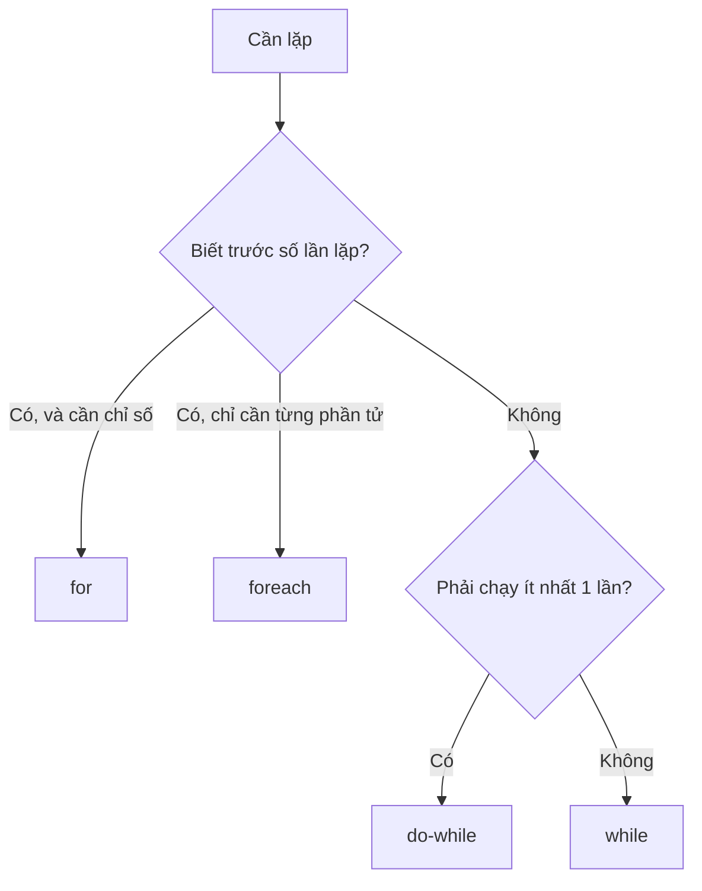

# 1.3 - Vòng lặp

> **Tóm tắt:** Bốn dạng vòng lặp của C# — `for`, `while`, `do-while`, `foreach` — khác nhau ở chỗ **bạn biết trước bao nhiêu về số lần lặp**. Nhưng phần quan trọng của bài này không phải cú pháp, mà là ba lỗi gần như ai cũng gặp ít nhất một lần: sửa collection ngay khi đang `foreach` qua nó (ném `InvalidOperationException`), lệch một đơn vị ở điều kiện dừng, và **gọi database bên trong vòng lặp** — cái cuối biến một màn hình danh sách thành 201 câu truy vấn.

## Mục tiêu bài học

Sau bài này bạn có thể:

- Chọn đúng dạng vòng lặp theo việc bạn biết trước gì về số lần lặp.
- Giải thích `foreach` thực chất gọi những gì, và vì sao không sửa được collection khi đang duyệt.
- Dùng `break`, `continue` và biết khi nào chúng làm code khó đọc hơn.
- Nhận ra ngay một vòng lặp đang gọi I/O bên trong, và biết cách sửa.
- Viết một hàm trả dữ liệu dần bằng `yield return`.

**Cần biết trước:** [bài 1.2](1.2-conditions.md) (điều kiện, cách dùng các kiểu `Customer`, `Order` và `Dictionary` ở mức đọc hiểu). `List<T>` dùng trong bài là danh sách tự co giãn, [bài 1.5](1.5-arrays-and-lists.md) dạy kỹ.

## Nội dung bài học

### 1.3.1 — Chọn dạng nào?



Đoạn dưới chỉ để so sánh hình dạng bốn vòng lặp; `orders`, `queue`, `Process`, `TryCall` là tên giả định, chưa chạy được ngay.

```csharp
// for — biết số lần, cần chỉ số
for (int i = 0; i < orders.Count; i++)
    Console.WriteLine($"{i + 1}. {orders[i].Code}");

// foreach — duyệt từng phần tử, không quan tâm chỉ số
foreach (var order in orders)
    Console.WriteLine(order.Code);

// while — lặp tới khi điều kiện sai, có thể không chạy lần nào
while (queue.TryDequeue(out var job))
    Process(job);

// do-while — chạy ít nhất một lần rồi mới kiểm tra
do
{
    attempt++;
    success = TryCall();
} while (!success && attempt < 3);
```

Quy tắc thực dụng: **mặc định dùng `foreach`**. Chỉ chuyển sang `for` khi thật sự cần chỉ số, hoặc cần sửa phần tử theo vị trí.

### 1.3.2 — `foreach` thực chất làm gì

`foreach` không phải phép màu. Trình biên dịch dịch nó thành:

```csharp
// foreach (var x in items) { ... }  tương đương với:
var enumerator = items.GetEnumerator();
try
{
    while (enumerator.MoveNext())
    {
        var x = enumerator.Current;
        // ...
    }
}
finally
{
    (enumerator as IDisposable)?.Dispose();
}
```

Hiểu điều này giải thích luôn hai chuyện:

1. Vì sao bất cứ thứ gì có phương thức `GetEnumerator()` đều `foreach` được, kể cả khi không cài đặt `IEnumerable`.
2. Vì sao **sửa collection khi đang duyệt** lại nổ — enumerator giữ một số phiên bản nội bộ, mọi thao tác thêm/xoá làm số đó đổi, và `MoveNext()` phát hiện ra.

### 1.3.3 — Lỗi 1: sửa collection khi đang duyệt

```csharp
// SAI — InvalidOperationException: Collection was modified
foreach (var customer in customers)
{
    if (customer.IsInactive)
        customers.Remove(customer);
}
```

Ba cách sửa, theo thứ tự nên dùng. Hai cách đầu dùng **lambda**, giải thích ngay bên dưới.

```csharp
// 1. Tạo danh sách mới (rõ ràng nhất)
var active = customers.Where(c => !c.IsInactive).ToList();

// 2. RemoveAll — một lời gọi, không cần vòng lặp
customers.RemoveAll(c => c.IsInactive);

// 3. Duyệt ngược bằng for — khi buộc phải xoá tại chỗ
for (int i = customers.Count - 1; i >= 0; i--)
{
    if (customers[i].IsInactive)
        customers.RemoveAt(i);
}
```

Cách 3 duyệt ngược vì xoá phần tử thứ `i` làm mọi phần tử sau nó dịch lên một chỗ — đi xuôi sẽ **bỏ sót** phần tử ngay sau phần tử vừa xoá.

> **Đọc nhanh: lambda và LINQ.** `c => !c.IsInactive` là một **lambda**, tức một hàm viết tắt không tên: nhận vào `c`, trả về `!c.IsInactive`. Đọc là "với mỗi `c`, giữ lại nếu `c` không ngưng hoạt động". `Where`, `Select`, `Sum`, `ToList` là các hàm của **LINQ**, bộ công cụ lọc, biến đổi và tổng hợp dữ liệu có sẵn trong .NET: `customers.Where(c => !c.IsInactive)` lọc ra khách còn hoạt động, `.ToList()` gom kết quả thành một `List` mới. Chừng này đủ để đọc code trong Module 1; [bài 1.8](1.8-advanced-notes.md) và [bài 5.3](../../stage-02-csharp-professional/module-05-advanced-csharp/5.3-linq.md) dạy LINQ kỹ hơn.

### 1.3.4 — Lỗi 2: lệch một đơn vị (off-by-one)

```csharp
// SAI — IndexOutOfRangeException ở vòng cuối
for (int i = 0; i <= items.Length; i++) { }

// ĐÚNG
for (int i = 0; i < items.Length; i++) { }
```

Mảng trong C# đánh chỉ số từ `0`, nên phần tử cuối có chỉ số `Length - 1`. Dùng `<` chứ không phải `<=`.

Cách tránh triệt để: dùng `foreach`, hoặc dùng chỉ số từ cuối và range của C# 8:

```csharp
var last      = items[^1];      // phần tử cuối
var lastThree = items[^3..];    // ba phần tử cuối
var middle    = items[1..^1];   // bỏ đầu và cuối
```

### 1.3.5 — Lỗi 3: gọi I/O bên trong vòng lặp

Đây là lỗi tốn kém nhất trong cả bài, và nó không ném exception nào — chỉ làm mọi thứ chậm đi.

Hai đoạn code dưới là **minh họa** viết bằng EF Core, thư viện truy cập database của .NET (`_db.Customers` là bảng khách hàng, `await` là chờ database trả lời). Bạn chưa cần chạy được chúng: EF Core học ở [bài 8.10](../../stage-03-aspnet-core-backend/module-08-aspnet-core-fundamentals/8.10-ef-core-minimal.md), `await` ở [Module 6](../../stage-02-csharp-professional/module-06-async-programming/README.md). Bài tập 2 cuối bài cho bạn tự tái hiện lỗi này bằng một database giả lập chỉ dùng vòng lặp.

```csharp
// SAI — mỗi đơn hàng là một lần đi tới database
foreach (var order in orders)          // 200 đơn hàng
{
    var customer = await _db.Customers
        .FirstAsync(c => c.Id == order.CustomerId);   // 200 câu query
    Console.WriteLine(customer.Name);
}
```

Một query để lấy danh sách, cộng thêm N query trong vòng lặp — đó là lý do nó có tên **N+1**. Với 200 đơn hàng, một màn hình danh sách bắn 201 câu truy vấn.

```csharp
// ĐÚNG — lấy một lần, tra cứu trong bộ nhớ
var customerIds = orders.Select(o => o.CustomerId).Distinct().ToList();
var customers = await _db.Customers
    .Where(c => customerIds.Contains(c.Id))
    .ToDictionaryAsync(c => c.Id);       // 1 câu query

foreach (var order in orders)
    Console.WriteLine(customers[order.CustomerId].Name);
```

Nguyên tắc: **vòng lặp để xử lý dữ liệu đã có trong bộ nhớ, không phải để đi lấy dữ liệu.** Lấy hết một lần trước, rồi mới lặp.

Bài [Vì sao EF Core bắn 201 query cho 1 màn hình danh sách?](https://tiennhm.io.vn/blog/ef-core-n-plus-1-query) đo cụ thể chi phí của lỗi này và chỉ cách phát hiện bằng log. Phần lý thuyết bên phía SQL nằm ở bài [hiệu năng truy vấn](https://sql-challenge.tiennhm.io.vn/lessons/20-query-performance).

### 1.3.6 — `break` và `continue`

```csharp
foreach (var order in orders)
{
    if (order.IsCancelled) continue;   // bỏ qua, sang phần tử tiếp theo
    if (order.Total > limit) break;    // dừng hẳn vòng lặp

    Process(order);
}
```

Dùng vừa phải thì chúng làm code phẳng hơn. Dùng quá tay — ba, bốn `break` rải rác trong một vòng lặp dài — thì không ai lần được luồng chạy nữa. Khi thấy nhiều `break`, hãy thử tách phần thân vòng lặp thành một hàm riêng.

Với vòng lặp lồng nhau, `break` chỉ thoát **vòng trong cùng**. Cần thoát cả hai thì tách thành hàm rồi `return`, đừng dùng `goto`.

### 1.3.7 — `yield return`: trả dữ liệu dần

```csharp
IEnumerable<Order> GetLargeOrders(IEnumerable<Order> orders, decimal min)
{
    foreach (var order in orders)
    {
        if (order.Total >= min)
            yield return order;      // trả từng cái một, không dựng cả danh sách
    }
}
```

`IEnumerable<Order>` nghĩa là "một thứ duyệt được bằng `foreach`, mỗi phần tử là một `Order`". Điểm mấu chốt: hàm này **không chạy gì cả** cho tới khi ai đó bắt đầu duyệt kết quả. Và nó không bao giờ giữ toàn bộ dữ liệu trong bộ nhớ — mỗi lần chỉ một phần tử.

Điều đó đúng cả với file mười triệu dòng:

```csharp
// Chỉ đọc tới dòng thứ 10 rồi dừng — không nạp cả file
foreach (var line in ReadLines("huge.csv").Take(10))
    Console.WriteLine(line);

IEnumerable<string> ReadLines(string path)
{
    using var reader = new StreamReader(path);   // using: tự đóng file khi hàm kết thúc
    string? line;
    while ((line = reader.ReadLine()) is not null)
        yield return line;
}
```

Mặt trái: vì chạy trễ, mọi ngoại lệ cũng xảy ra **lúc duyệt** chứ không phải lúc gọi hàm. Phần kiểm tra tham số đầu vào nên đặt trong một hàm bọc ngoài không có `yield`.

### 1.3.8 — Vòng lặp hay LINQ?

```csharp
// Cách 1: vòng lặp
decimal totalLoop = 0;
foreach (var o in orders)
    if (o.IsPaid) totalLoop += o.Total;

// Cách 2: LINQ — cùng kết quả, thay thế cho cách 1
decimal totalLinq = orders.Where(o => o.IsPaid).Sum(o => o.Total);
```

Với phép lọc, chiếu, tổng hợp — LINQ nói rõ **ý định** hơn. Với logic nhiều bước phụ thuộc lẫn nhau, vòng lặp thường dễ đọc hơn. Đừng ép mọi thứ thành một biểu thức LINQ dài.

Một cái bẫy hiệu năng cần biết: `IEnumerable` được đánh giá **lười**, nên duyệt hai lần là chạy lại từ đầu hai lần.

```csharp
var expensive = orders.Where(o => SlowCheck(o));   // chưa chạy gì
var count = expensive.Count();                     // chạy lần 1
var first = expensive.First();                     // chạy LẠI lần 2

var materialized = expensive.ToList();             // chạy đúng 1 lần
```

### 1.3.9 — Rà lại code của bạn

**Danh sách rà soát vòng lặp**

- [ ] Không có lời gọi database, HTTP hay đọc file nào nằm bên trong thân vòng lặp.
- [ ] Không sửa collection trong lúc foreach qua chính nó.
- [ ] Điều kiện dừng của for dùng &lt; chứ không phải &lt;=.
- [ ] Vòng lặp chỉ để duyệt và lọc thì đã cân nhắc chuyển sang LINQ.
- [ ] Không duyệt cùng một IEnumerable nhiều lần mà chưa ToList().
- [ ] Hàm dùng yield return có phần kiểm tra tham số tách ra hàm bọc ngoài.

## Bài tập áp dụng

#### Bài 1 — Tự gây ra lỗi sửa collection khi đang duyệt

Tạo một `List<int>` mười phần tử, dùng `foreach` duyệt và `Remove` các phần tử chẵn. Chạy, ghi lại thông báo lỗi đầy đủ. Sau đó sửa bằng cả ba cách ở mục 1.3.3 và so sánh.

**Tiêu chí hoàn thành:** cả ba cách sửa cho ra cùng một danh sách kết quả, và bạn nêu được vì sao cách 3 phải duyệt ngược.

<details>
<summary><strong>Gợi ý và lời giải — Bài 1</strong></summary>

**Gợi ý.** Lỗi này ném ngay ở vòng lặp **kế tiếp** sau lần xoá đầu tiên, không phải ngay tại dòng `Remove`. Lý do: `List<T>` giữ một bộ đếm phiên bản, tăng lên mỗi lần danh sách thay đổi, và trình duyệt kiểm tra bộ đếm đó mỗi lần lấy phần tử tiếp theo.

**Lời giải — tái hiện lỗi:**

```csharp
var numbers = Enumerable.Range(1, 10).ToList();

foreach (var n in numbers)
{
    if (n % 2 == 0) numbers.Remove(n);   // ném ở vòng lặp kế tiếp
}
```

Thông báo lỗi (chạy thật trên .NET 10):

```text
Unhandled exception. System.InvalidOperationException: Collection was modified; enumeration operation may not execute.
   at System.Collections.Generic.List`1.Enumerator.MoveNext()
   at Program.<Main>$(String[] args) in ...\Program.cs:line 3
```

Dòng `at ... MoveNext()` xác nhận điều đã nói ở mục 1.3.2: lỗi nổ khi `foreach` xin phần tử tiếp theo, không phải tại `Remove`.

**Ba cách sửa** (mỗi cách chạy trên một danh sách mới `Enumerable.Range(1, 10).ToList()`):

```csharp
// Cách 1 — tạo danh sách mới (rõ ràng nhất)
var odd = numbers.Where(n => n % 2 != 0).ToList();

// Cách 2 — RemoveAll (ngắn nhất, sửa tại chỗ)
numbers.RemoveAll(n => n % 2 == 0);

// Cách 3 — duyệt ngược bằng for (khi buộc phải xoá tại chỗ và cần chỉ số)
for (int i = numbers.Count - 1; i >= 0; i--)
{
    if (numbers[i] % 2 == 0) numbers.RemoveAt(i);
}
```

Cả ba cho `[1, 3, 5, 7, 9]`.

**Vì sao cách 3 phải duyệt ngược.** Xoá phần tử ở chỉ số `i` làm mọi phần tử phía sau **dịch lên một chỗ**. Đi xuôi thì phần tử vừa dịch vào vị trí `i` bị bỏ qua, vì vòng lặp tiếp theo đã sang `i+1`. Thử nghiệm nhanh cho thấy rõ: đi xuôi trên `[2, 4, 6]` chỉ xoá được `2` và `6`, còn sót `4`. Đi ngược thì phần chưa duyệt nằm ở phía trước chỉ số hiện tại nên không bị ảnh hưởng.

**Chọn cách nào.** Mặc định dùng cách 2 khi chỉ cần xoá theo điều kiện — nó ngắn, rõ ý định, và không có chỗ để viết sai. Dùng cách 1 khi muốn giữ nguyên danh sách gốc, chẳng hạn khi danh sách đó còn được dùng ở chỗ khác. Dùng cách 3 khi cần chỉ số trong quá trình xoá hoặc khi làm việc với kiểu tập hợp không có `RemoveAll`.

</details>

#### Bài 2 — Đếm số truy vấn của lỗi N+1

Chưa cần database thật. Lớp `FakeDb` dưới đây **giả lập** một database: mỗi lần gọi hàm của nó được tính là một truy vấn và phải chờ 5 ms, giống thời gian một câu lệnh đi tới database rồi quay về. Dán khối này vào cuối `Program.cs` (bạn chưa cần hiểu `static class`, chỉ cần biết cách gọi `FakeDb.GetCustomer(3)`):

```csharp
class Order    { public int Id; public int CustomerId; }
class Customer { public int Id; public string Name = ""; }

static class FakeDb
{
    public static int QueryCount;   // số truy vấn đã chạy

    public static List<Order> GetOrders(int count)
    {
        QueryCount++;
        Thread.Sleep(5);   // chờ 5 ms như một vòng đi về database
        var list = new List<Order>();
        for (int i = 1; i <= count; i++)
            list.Add(new Order { Id = i, CustomerId = i % 10 + 1 });   // 10 khách, mỗi khách 5 đơn
        return list;
    }

    public static Customer GetCustomer(int id)
    {
        QueryCount++;
        Thread.Sleep(5);
        return new Customer { Id = id, Name = $"Khách {id}" };
    }

    public static Dictionary<int, Customer> GetCustomers(List<int> ids)
    {
        QueryCount++;
        Thread.Sleep(5);
        var result = new Dictionary<int, Customer>();
        foreach (var id in ids)
            result[id] = new Customer { Id = id, Name = $"Khách {id}" };
        return result;
    }
}
```

Việc của bạn, viết ở phía trên khối đó:

1. Lấy 50 đơn bằng `FakeDb.GetOrders(50)`, rồi trong vòng lặp gọi `FakeDb.GetCustomer` cho từng đơn. In `FakeDb.QueryCount` và thời gian chạy.
2. Đặt lại `FakeDb.QueryCount = 0`, viết bản đúng: gom các `CustomerId` khác nhau vào một danh sách, gọi `FakeDb.GetCustomers` **một lần**, rồi tra trong `Dictionary` khi lặp. In lại hai con số.

Đo thời gian bằng `Stopwatch`: thêm `using System.Diagnostics;` ở dòng đầu file, rồi `var sw = Stopwatch.StartNew();` trước đoạn cần đo và đọc `sw.ElapsedMilliseconds` sau đó.

**Tiêu chí hoàn thành:** bạn có hai cặp số (số truy vấn, thời gian) và giải thích được tỉ lệ giữa chúng.

<details>
<summary><strong>Gợi ý và lời giải — Bài 2</strong></summary>

**Gợi ý.** Bản đúng có đúng hai lời gọi tới `FakeDb`, cả hai đều nằm **ngoài** vòng lặp. Để gom `CustomerId` không trùng, dùng `List.Contains` trước khi `Add`.

**Lời giải.**

```csharp
using System.Diagnostics;

// ----- Bản sai: N+1 -----
FakeDb.QueryCount = 0;
var sw = Stopwatch.StartNew();

var orders = FakeDb.GetOrders(50);                        // 1 truy vấn
foreach (var order in orders)
{
    var customer = FakeDb.GetCustomer(order.CustomerId);  // 1 truy vấn mỗi vòng
}
Console.WriteLine($"N+1   : {FakeDb.QueryCount} truy vấn, {sw.ElapsedMilliseconds} ms");

// ----- Bản đúng: lấy một lần, tra trong bộ nhớ -----
FakeDb.QueryCount = 0;
sw.Restart();

orders = FakeDb.GetOrders(50);                            // 1 truy vấn
var ids = new List<int>();
foreach (var order in orders)
    if (!ids.Contains(order.CustomerId)) ids.Add(order.CustomerId);

var customers = FakeDb.GetCustomers(ids);                 // 1 truy vấn
foreach (var order in orders)
{
    var customer = customers[order.CustomerId];           // tra trong bộ nhớ
}
Console.WriteLine($"Gộp   : {FakeDb.QueryCount} truy vấn, {sw.ElapsedMilliseconds} ms");

// ... khối Order, Customer, FakeDb ở đề bài đặt ở đây
```

Kết quả chạy thật trên máy tác giả (Windows, .NET 10):

```text
N+1   : 51 truy vấn, 816 ms
Gộp   : 2 truy vấn, 28 ms
```

**Vì sao 51 truy vấn lại mất tới 816 ms chứ không phải 51 × 5 = 255 ms.** Trên Windows, `Thread.Sleep(5)` thường ngủ khoảng 15 ms vì đồng hồ hệ thống chỉ "tích" khoảng 15,6 ms một lần. Trên Linux hay macOS con số sẽ gần 5 ms hơn. Con số tuyệt đối đổi theo máy, nhưng tỉ lệ thì không: thời gian tỉ lệ với **số lần đi về**, và 51 lần chờ tuần tự luôn tốn khoảng 25 lần so với 2 lần.

Database thật cũng vậy. Chi phí chính của một truy vấn nhỏ không nằm ở công sức database xử lý mà ở **vòng khứ hồi qua mạng**, cộng thêm việc mượn và trả kết nối. Điều khiến lỗi này nguy hiểm là nó **không ném ngoại lệ nào**. Với 50 bản ghi trên máy phát triển, trang vẫn tải trong chớp mắt. Với 5000 bản ghi trên production, cùng đoạn code đó chậm đi cả trăm lần.

**Cách phòng lâu dài.** EF Core không tự phát hiện N+1. Cách phòng: không bật lazy loading (tải dữ liệu liên quan tự động khi truy cập thuộc tính), dùng `Include` hoặc chỉ chọn đúng cột cần thiết, bật log SQL để đếm số câu lệnh mỗi request, và viết test đếm số truy vấn cho các màn hình quan trọng. Bài [Vì sao EF Core bắn 201 query cho 1 màn hình danh sách?](https://tiennhm.io.vn/blog/ef-core-n-plus-1-query) đo chi tiết chi phí, còn [Module 13](../../stage-04-database-production/module-13-entity-framework-core/README.md) trình bày các chiến lược tải dữ liệu. Học xong [bài 8.10](../../stage-03-aspnet-core-backend/module-08-aspnet-core-fundamentals/8.10-ef-core-minimal.md), hãy làm lại bài này với SQLite và bật log SQL để thấy 51 câu lệnh thật.

</details>

#### Bài 3 — Đo bộ nhớ của `yield return`

Viết hai hàm đọc một file văn bản lớn: một trả `List<string>`, một dùng `yield return`. Chạy mỗi hàm và in `GC.GetTotalMemory(true)` (số byte bộ nhớ chương trình đang dùng) trước và sau. Giải thích khác biệt.

**Tiêu chí hoàn thành:** bạn nêu được bộ nhớ của bản `yield` gần như không phụ thuộc kích thước file, còn bản `List` thì tỉ lệ thuận.

<details>
<summary><strong>Gợi ý và lời giải — Bài 3</strong></summary>

**Gợi ý.** Tạo file thử bằng chính C# thay vì đi tìm file lớn, đặt dòng này ở đầu `Program.cs`:

```csharp
if (!File.Exists("lon.txt"))
    File.WriteAllLines("lon.txt", Enumerable.Range(1, 2_000_000).Select(i => i.ToString()));
```

Lệnh tạo file 2 triệu dòng, khoảng 16 MB trên Windows (mỗi dòng kết thúc bằng hai ký tự `\r\n`).

Điểm dễ nhầm: nếu bạn gọi `.ToList()` lên kết quả của hàm `yield` thì mọi lợi ích biến mất, vì bạn vừa nạp lại toàn bộ vào bộ nhớ. Hãy duyệt trực tiếp bằng `foreach`.

**Lời giải.**

```csharp
static List<string> ReadAll(string path) => File.ReadAllLines(path).ToList();

static IEnumerable<string> ReadLazily(string path)
{
    using var reader = new StreamReader(path);
    string? line;
    while ((line = reader.ReadLine()) is not null)
        yield return line;
}

static void Measure(string label, Func<IEnumerable<string>> read)
{
    var before = GC.GetTotalMemory(true);
    int count = 0;
    foreach (var line in read()) count++;
    var after = GC.GetTotalMemory(false);
    Console.WriteLine($"{label,-8} {count} dòng, tăng {(after - before) / 1024 / 1024} MB");
}

Measure("List", () => ReadAll("lon.txt"));
Measure("yield", () => ReadLazily("lon.txt"));
```

`Func<IEnumerable<string>>` là kiểu của "một hàm không nhận gì, trả về thứ duyệt được", nhờ đó `Measure` đo được cả hai cách đọc. Các hàm có chữ `static` đứng trước vẫn chạy bình thường trong `Program.cs`, chữ đó chỉ cấm hàm dùng biến bên ngoài nó.

**Kết quả đo thật trên .NET 10 (Windows), file 16 MB gồm 2 triệu dòng:**

```text
List     2000000 dòng, tăng 122 MB
yield    2000000 dòng, tăng 3 MB
```

**Vì sao chênh nhiều hơn kích thước file.** File 16 MB nhưng bản `List` chiếm 122 MB, vì mỗi dòng trở thành một đối tượng `string` riêng trên heap: chuỗi trong .NET dùng UTF-16 nên mỗi ký tự chiếm 2 byte, cộng thêm phần tiêu đề đối tượng khoảng 22 byte mỗi chuỗi, cộng thêm mảng con trỏ của chính `List`. Con số cụ thể tuỳ máy, nhưng tỉ lệ khoảng 8 tới 10 lần kích thước file là bình thường.

Bản `yield` giữ đúng **một** dòng trong bộ nhớ tại mỗi thời điểm. Các dòng đã xử lý xong trở thành rác và được thu hồi, nên mức tiêu thụ gần như không đổi dù file 15 MB hay 15 GB. Con số 3 MB là bộ đệm của `StreamReader` cộng phần rác chưa kịp thu hồi, không phải dữ liệu tích luỹ.

**Cái giá của `yield`.** Nó không miễn phí. Mỗi lần duyệt là một lần đọc file mới, nên duyệt hai lần là đọc file hai lần. Bạn cũng không biết trước số phần tử, và không truy cập được theo chỉ số. Quy tắc chọn: **dùng `yield` khi dữ liệu lớn hoặc chỉ duyệt một lần; dùng `List` khi dữ liệu nhỏ hoặc cần duyệt nhiều lần.**

**Liên hệ về sau.** Đây chính là ý tưởng nền của `IAsyncEnumerable` mà [Module 6 bài 6.6](../../stage-02-csharp-professional/module-06-async-programming/6.6-async-patterns.md) dùng để stream dữ liệu lớn qua API mà không làm phình bộ nhớ máy chủ.

</details>

## Tự kiểm tra

<details>
<summary>Vì sao sửa collection khi đang foreach lại ném InvalidOperationException?</summary>

foreach làm việc qua một enumerator, và enumerator giữ một số phiên bản nội bộ của collection. Mọi thao tác thêm hay xoá làm số đó thay đổi, và lần gọi MoveNext() kế tiếp phát hiện ra rồi ném lỗi. Cách sửa: dùng RemoveAll, tạo danh sách mới bằng Where().ToList(), hoặc duyệt ngược bằng for.

</details>

<details>
<summary>Vì sao khi xoá phần tử tại chỗ phải duyệt ngược?</summary>

Vì xoá phần tử thứ i làm mọi phần tử phía sau dịch lên một vị trí. Nếu đi xuôi, phần tử vừa dịch vào vị trí i sẽ bị bỏ qua ở vòng lặp tiếp theo. Duyệt ngược từ cuối về đầu thì việc dịch không ảnh hưởng tới các chỉ số chưa xét.

</details>

<details>
<summary>Vấn đề N+1 là gì?</summary>

Là khi bạn chạy một query để lấy danh sách N bản ghi, rồi chạy thêm một query cho mỗi bản ghi trong vòng lặp — tổng cộng N+1 query. Với 200 đơn hàng, một màn hình danh sách bắn 201 câu truy vấn. Cách sửa là lấy toàn bộ dữ liệu phụ thuộc trong một query rồi tra cứu trong bộ nhớ, hoặc dùng Include của EF Core.

</details>

<details>
<summary>yield return khác gì với trả về một List?</summary>

Hàm có yield return không chạy gì cho tới khi ai đó bắt đầu duyệt kết quả, và mỗi lần chỉ giữ một phần tử trong bộ nhớ thay vì cả tập dữ liệu. Nhờ đó đọc được file rất lớn, hoặc dừng sớm mà không phí công. Đổi lại, ngoại lệ xảy ra lúc duyệt chứ không phải lúc gọi hàm.

</details>

<details>
<summary>Duyệt một IEnumerable hai lần có vấn đề gì?</summary>

LINQ trên IEnumerable được đánh giá lười, nên mỗi lần duyệt là một lần chạy lại toàn bộ chuỗi phép biến đổi từ đầu. Gọi Count() rồi First() trên cùng một biến là chạy hai lần. Nếu cần dùng nhiều lần, gọi ToList() để vật chất hoá kết quả một lần duy nhất.

</details>

<details>
<summary>Khi nào nên dùng for thay vì foreach?</summary>

Khi thật sự cần chỉ số — ví dụ để đánh số hiển thị, hoặc để sửa và xoá phần tử theo vị trí. Mọi trường hợp còn lại nên mặc định dùng foreach vì nó không có chỗ cho lỗi lệch một đơn vị.

</details>

## Kết luận

Ba điều đáng nhớ nhất:

1. **Vòng lặp để xử lý dữ liệu đã có, không phải để đi lấy dữ liệu.** Một lời gọi database nằm trong thân vòng lặp là sự cố hiệu năng đang chờ đủ dữ liệu để lộ ra.
2. **Không sửa collection khi đang duyệt nó.** Đã có `RemoveAll` và `Where().ToList()` cho việc đó.
3. **`yield return` đổi bộ nhớ lấy độ trễ.** Với dữ liệu lớn hoặc khi có thể dừng sớm, đó là cuộc đổi rất có lãi.

## Tham khảo

- [Iteration statements — for, foreach, do, while](https://learn.microsoft.com/en-us/dotnet/csharp/language-reference/statements/iteration-statements) — cú pháp đầy đủ
- [yield statement](https://learn.microsoft.com/en-us/dotnet/csharp/language-reference/statements/yield) — iterator và đánh giá lười
- [Jump statements — break, continue, return](https://learn.microsoft.com/en-us/dotnet/csharp/language-reference/statements/jump-statements)
- [LINQ overview](https://learn.microsoft.com/en-us/dotnet/csharp/linq/) — khi nào thay vòng lặp bằng truy vấn

## Điều hướng

- **Bài trước:** [1.2 — Điều kiện](1.2-conditions.md)
- **Bài tiếp theo:** [1.4 — Hàm](1.4-functions-methods.md)
- **Về module:** [Trang mục lục](README.md)

## Bài liên quan

- [Vì sao EF Core bắn 201 query cho 1 màn hình danh sách? Cách sửa N+1](https://tiennhm.io.vn/blog/ef-core-n-plus-1-query) — Một màn hình 200 dòng mà log SQL ghi 201 câu lệnh là dấu hiệu của N+1 query.
