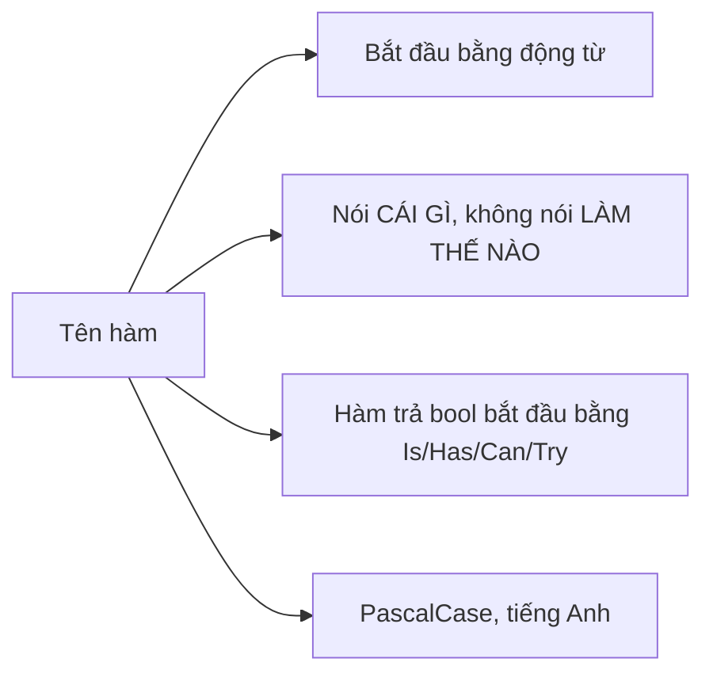

# 1.4 - Hàm

> **Tóm tắt:** Hàm không phải công cụ để **tiết kiệm dòng code** — nó là công cụ để **đặt tên cho một ý tưởng**. Một hàm tốt có thể gọi tên bằng một động từ, làm đúng một việc ở đúng một mức trừu tượng, và người đọc tin được cái tên mà không cần mở thân hàm ra xem. Nửa đầu bài dạy cú pháp: khai báo và gọi hàm, truyền tham số theo giá trị, overload, tham số mặc định, tham số đặt tên, `params`, `ref`/`out`/`in` và đệ quy. Nửa sau dạy cách viết hàm tốt: một mức trừu tượng, hàm thuần, local function, extension method, và mẫu `TryXxx` để trả về thất bại mà không ném ngoại lệ.

## Mục tiêu bài học

Sau bài này bạn có thể:

- Khai báo và gọi hàm trong `Program.cs`, giải thích truyền theo giá trị khác gì với truyền một object.
- Viết hàm với tham số mặc định, tham số đặt tên và `params`, và biết khi nào mỗi cái gây hại.
- Viết một hàm đệ quy có điểm dừng, và giải thích vì sao thiếu điểm dừng thì chương trình sập.
- Giải thích `ref`, `out`, `in` khác nhau ở đâu và vì sao nên thay chúng bằng tuple hoặc `record`.
- Nhận ra một hàm đang trộn nhiều mức trừu tượng, và phân biệt hàm thuần với hàm có tác dụng phụ.
- Chọn giữa ném ngoại lệ và trả về `bool` theo mẫu `TryXxx`.

**Cần biết trước:** [bài 1.3](1.3-loops.md) (vòng lặp, cách đọc lambda), [bài 1.1](1.1-variables-and-data-types.md) (kiểu giá trị và kiểu tham chiếu). Bài tập 3 dùng project test của [bài 0.4](../module-00-setup/0.4-solution-and-unit-test.md).

## Nội dung bài học

### 1.4.1 — Khai báo và gọi hàm

Một hàm gồm: **kiểu trả về**, **tên**, **danh sách tham số** trong ngoặc tròn, và **thân hàm** trong ngoặc nhọn. Trong `Program.cs`, bạn viết hàm thẳng giữa các câu lệnh và gọi nó ở bất kỳ đâu trong file, kể cả phía trên chỗ khai báo:

```csharp
decimal discount = CalculateDiscount(600_000m, 0.1m);   // gọi hàm
Console.WriteLine(discount);                            // 60000.0

PrintInvoiceLine("Áo thun", 2, 150_000m);               // Áo thun x2 = 300.000 đ

// Đầy đủ: kiểu trả về decimal, hai tham số
decimal CalculateDiscount(decimal total, decimal rate)
{
    return total * rate;   // return: trả kết quả và thoát hàm ngay
}

// Dạng biểu thức — dùng khi thân hàm chỉ có một biểu thức
decimal CalculateVat(decimal amount) => amount * 0.1m;

// void: hàm không trả về gì, chỉ làm một việc (ở đây là in ra màn hình)
void PrintInvoiceLine(string product, int quantity, decimal price)
{
    Console.WriteLine($"{product} x{quantity} = {quantity * price:N0} đ");
}
```

`{quantity * price:N0}` là định dạng số có dấu phân cách nghìn, không lấy chữ số thập phân. Máy đặt vùng Việt Nam in `300.000`, máy đặt vùng Mỹ in `300,000`.

Hàm viết thẳng trong `Program.cs` như trên gọi là **local function**. Trong dự án thật, hàm thường nằm trong một `class` và có thêm chữ như `public`, `static` phía trước, ví dụ `public static decimal CalculateDiscount(...)`. Ý nghĩa các chữ đó học ở [bài 4.6](../../stage-02-csharp-professional/module-04-csharp-core/4.6-access-modifiers.md). Bỏ chúng đi khi dán vào `Program.cs`: viết `public` trước một local function là lỗi biên dịch.

### 1.4.2 — Truyền theo giá trị

Khi gọi hàm, C# **sao chép** giá trị của đối số vào tham số. Hàm sửa tham số thì bản gốc không đổi:

```csharp
int points = 100;
AddBonus(points);
Console.WriteLine(points);   // 100 — biến points bên ngoài không đổi

void AddBonus(int p)
{
    p += 50;
    Console.WriteLine($"Trong hàm: {p}");   // Trong hàm: 150
}
```

Với object (kiểu tham chiếu, xem [bài 1.1](1.1-variables-and-data-types.md)), thứ được sao chép là **địa chỉ**. Hàm và bên gọi cùng trỏ tới một object, nên hàm sửa thuộc tính thì bên gọi thấy. Nhưng gán tham số sang object khác thì bên gọi không bị ảnh hưởng:

```csharp
var customer = new Customer { Name = "An" };

Rename(customer);
Console.WriteLine(customer.Name);   // Bình — hàm sửa thuộc tính của cùng object

Replace(customer);
Console.WriteLine(customer.Name);   // Bình — gán x sang object mới không đụng tới biến customer

void Rename(Customer x)  { x.Name = "Bình"; }
void Replace(Customer x) { x = new Customer { Name = "Chi" }; }

class Customer { public string Name { get; set; } = ""; }
```

### 1.4.3 — Overload: cùng tên, khác tham số

**Overload** (nạp chồng) là nhiều hàm cùng tên nhưng khác số lượng hoặc kiểu tham số. Trình biên dịch chọn bản phù hợp dựa trên đối số bạn truyền:

```csharp
Console.WriteLine(Money.Format(1_500_000m));          // 1.500.000 đ
Console.WriteLine(Money.Format(1_500_000m, "USD"));   // 1.500.000,00 USD

static class Money
{
    public static string Format(decimal amount) => $"{amount:N0} đ";
    public static string Format(decimal amount, string currency) => $"{amount:N2} {currency}";
}
```

Ví dụ phải đặt hai hàm trong một `static class` (một "hộp" chứa hàm, gọi bằng `Money.Format`), vì local function **không overload được**: hai local function cùng tên trong `Program.cs` gây lỗi `CS0128: A local variable or function named 'Format' is already defined in this scope`.

Overload hợp khi các bản làm **cùng một việc** với đầu vào khác nhau. Nếu chúng làm việc khác nhau, hãy đặt tên khác nhau.

### 1.4.4 — Tham số mặc định và tham số đặt tên

```csharp
decimal CalculateShipping(
    decimal orderTotal,
    bool isExpress = false,
    decimal freeThreshold = 500_000m)
{
    if (orderTotal >= freeThreshold) return 0m;
    return isExpress ? 60_000m : 30_000m;
}

Console.WriteLine(CalculateShipping(420_000m));                            // 30000
// Gọi với tham số đặt tên — người đọc hiểu ngay true nghĩa là gì
Console.WriteLine(CalculateShipping(420_000m, isExpress: true));           // 60000
// Bỏ qua isExpress, chỉ đổi freeThreshold
Console.WriteLine(CalculateShipping(420_000m, freeThreshold: 400_000m));   // 0
```

Hai cảnh báo thực tế:

1. **`true`/`false` trần trụi ở chỗ gọi là bẫy đọc hiểu.** `CalculateShipping(420_000m, true)` — `true` là gì? Dùng tham số đặt tên, hoặc dùng `enum` thay cho `bool`.
2. **Giá trị mặc định được nhúng vào chỗ gọi lúc biên dịch.** Nếu hàm nằm trong một thư viện riêng và bạn đổi giá trị mặc định, những assembly (file `.dll` đã biên dịch) dùng thư viện đó vẫn giữ giá trị cũ cho tới khi được build lại. Trong một solution thì không sao; giữa các thư viện phát hành riêng thì đây là một cái bẫy có thật.

### 1.4.5 — `params`: số lượng đối số tùy ý

`params` cho phép gọi hàm với bao nhiêu đối số cũng được, kể cả không có đối số nào. Bên trong hàm, chúng được gom thành một mảng:

```csharp
Console.WriteLine(Sum(100m, 200m, 300m));   // 600
Console.WriteLine(Sum());                   // 0

decimal[] amounts = { 1m, 2m };
Console.WriteLine(Sum(amounts));            // 3 — truyền thẳng một mảng cũng được

decimal Sum(params decimal[] amounts)
{
    decimal total = 0;
    foreach (var a in amounts) total += a;
    return total;
}
```

Quy tắc: `params` phải là tham số **cuối cùng**, và mỗi hàm chỉ có một. `Console.WriteLine("{0} {1}", a, b)` và `string.Join(", ", ...)` là hai hàm có sẵn dùng `params` mà bạn đã gặp.

Khi nào gây hại: `params` tạo một mảng mới ở **mỗi lần gọi**. Với hàm gọi hàng triệu lần trong vòng lặp nóng, chi phí đó cộng dồn. Từ C# 13, `params` nhận được cả `ReadOnlySpan<T>`, kiểu không phải cấp phát mảng; các hàm của .NET đã chuyển sang dạng này, code của bạn thì dùng `params T[]` là đủ.

### 1.4.6 — `ref`, `out`, `in`

Ba từ khóa này đổi cách truyền tham số từ "sao chép" thành "truyền chính biến đó":

```csharp
int counter = 0;
Increment(ref counter);
Increment(ref counter);
Console.WriteLine(counter);   // 2 — hàm sửa được biến bên ngoài

if (TryParseCustomerId("42", out int id))
    Console.WriteLine(id);    // 42

// ref — truyền vào và có thể bị hàm sửa
void Increment(ref int value) => value++;

// out — hàm buộc phải gán giá trị trước khi trả về
bool TryParseCustomerId(string input, out int id) => int.TryParse(input, out id);
```

`in` truyền theo tham chiếu nhưng **cấm** hàm sửa, dùng cho `struct` lớn để tránh sao chép. Bạn hiếm khi cần nó ở code nghiệp vụ.

Trong code backend hiện đại, `ref` và `out` phần lớn đã có cách thay tốt hơn. Ví dụ dưới (minh họa) trả hai giá trị bằng **tuple**, một nhóm giá trị có tên đi cùng nhau:

```csharp
// THAY VÌ out nhiều giá trị
void GetStats(List<Order> orders, out decimal total, out int count) { ... }

// DÙNG tuple — có tên, đọc được, không cần khai báo biến trước
(decimal Total, int Count) GetStats(List<Order> orders) =>
    (orders.Sum(o => o.Total), orders.Count);

var stats = GetStats(orders);
Console.WriteLine(stats.Total);
```

`out` vẫn còn đúng một chỗ dùng chuẩn mực: **mẫu `TryXxx`** ở mục 1.4.12.

### 1.4.7 — Đệ quy: hàm gọi lại chính nó

**Đệ quy** là khi một hàm gọi lại chính nó với một bài toán nhỏ hơn. Mọi hàm đệ quy cần hai phần:

- **Điểm dừng** (base case): trường hợp đủ nhỏ để trả lời ngay, không gọi tiếp.
- **Bước đệ quy**: thu nhỏ bài toán rồi gọi lại chính mình.

```csharp
Console.WriteLine(Factorial(5));   // 120

long Factorial(int n)
{
    if (n <= 1) return 1;            // điểm dừng
    return n * Factorial(n - 1);     // bước đệ quy: n! = n × (n-1)!
}
```

Mỗi lần gọi hàm, .NET đặt một **khung** (frame) lên **call stack**, vùng nhớ ghi lại "đang ở hàm nào, biến cục bộ là gì, xong thì quay về đâu". `Factorial(5)` chồng năm khung rồi gỡ dần:

```text
Factorial(5) = 5 * Factorial(4)        ← chờ
  Factorial(4) = 4 * Factorial(3)      ← chờ
    Factorial(3) = 3 * Factorial(2)    ← chờ
      Factorial(2) = 2 * Factorial(1)  ← chờ
        Factorial(1) = 1               ← điểm dừng, bắt đầu trả về
      = 2 * 1 = 2
    = 3 * 2 = 6
  = 4 * 6 = 24
= 5 * 24 = 120
```

Bạn xem được đúng chồng khung này trong cửa sổ **Call Stack** của debugger ([bài 0.3](../module-00-setup/0.3-debugging-basics.md)) nếu đặt breakpoint ở dòng `return 1`.

Quên điểm dừng, hoặc bước đệ quy không làm bài toán nhỏ lại, thì các khung chồng mãi tới khi call stack đầy và tiến trình bị hệ điều hành giết với `Stack overflow`. Lỗi này **không bắt được bằng `try/catch`**. Vì vậy đệ quy hợp với dữ liệu có độ sâu biết trước và giới hạn rõ (cây danh mục vài tầng, bình luận lồng nhau). Với dữ liệu do người dùng nhập có thể sâu bất thường hoặc có vòng, xem [bài 1.8](1.8-advanced-notes.md).

### 1.4.8 — Hàm là cái tên đặt cho một ý tưởng

Lý do thật sự để tách hàm không phải là "dùng lại được ở ba chỗ". Nhiều hàm giá trị nhất trong một codebase chỉ được gọi **đúng một lần**.

```csharp
// TRƯỚC — người đọc phải tự giải mã
if (order.Total >= 500_000m
    && order.Customer.RegisteredAt <= DateTimeOffset.UtcNow.AddYears(-1)
    && !order.Customer.HasOverduePayment)
{
    ApplyDiscount(order, 0.15m);
}

// SAU — cái tên đã nói hết
if (IsEligibleForLoyaltyDiscount(order))
{
    ApplyDiscount(order, 0.15m);
}
```

Hàm `IsEligibleForLoyaltyDiscount` có thể chỉ được gọi một lần. Nó vẫn đáng tồn tại, vì nó biến ba dòng điều kiện thành một khái niệm nghiệp vụ có tên.

### 1.4.9 — Một hàm, một mức trừu tượng

Đây là tiêu chí phân biệt hàm tốt với hàm dài, cụ thể hơn nhiều so với "hàm không nên quá 20 dòng".

Ví dụ dưới là **minh họa** code của một API thật: nó dùng `async`/`await` ([Module 6](../../stage-02-csharp-professional/module-06-async-programming/README.md)) và truy cập database, nên chưa chạy được. Chỉ cần đọc hình dạng của nó:

```csharp
// XẤU — trộn ba mức: nghiệp vụ, truy cập dữ liệu, và định dạng chuỗi
async Task ProcessOrder(int orderId)
{
    var conn = new NpgsqlConnection(connectionString);
    await conn.OpenAsync();
    var cmd = new NpgsqlCommand("SELECT * FROM \"Orders\" WHERE \"Id\" = @id", conn);
    // ... 20 dòng đọc dữ liệu ...

    if (order.Total >= 500_000m) order.Discount = 0.15m;   // nghiệp vụ

    var html = $"<p>Đơn {order.Code} đã xử lý</p>";        // trình bày
    await mailer.SendAsync(order.Customer.Email, html);
}

// TỐT — mỗi dòng ở cùng một mức trừu tượng, chi tiết đẩy xuống dưới
async Task ProcessOrder(int orderId)
{
    var order = await orders.GetByIdAsync(orderId);
    ApplyLoyaltyDiscount(order);
    await notifier.NotifyProcessedAsync(order);
}
```

Phép thử nhanh: đọc to thân hàm lên. Nếu các câu nhảy cóc giữa "gửi email cho khách" và "mở kết nối tới database", hàm đang trộn hai mức.

### 1.4.10 — Hàm thuần và tác dụng phụ

**Hàm thuần**: cùng đầu vào luôn cho cùng đầu ra, và không đụng gì bên ngoài.

```csharp
// Thuần — test được dễ dàng, gọi bao nhiêu lần cũng vậy
decimal CalculateVat(decimal amount, decimal rate) => amount * rate;

// Không thuần — đọc đồng hồ hệ thống và ghi ra màn hình
decimal CalculateVatAndLog(decimal amount)
{
    var rate = DateTimeOffset.UtcNow.Year >= 2026 ? 0.08m : 0.10m;   // đầu vào ẩn: thời gian
    Console.WriteLine($"Tính VAT cho {amount}");                    // tác dụng phụ
    return amount * rate;
}
```

Không phải mọi hàm đều thuần được — chương trình phải ghi database và gửi email thì mới có ích. Mục tiêu là **gom tác dụng phụ về một chỗ** và giữ phần tính toán ở dạng thuần, vì phần thuần là phần dễ kiểm thử nhất.

Mẹo áp dụng ngay: nhận `DateTimeOffset now` làm **tham số** thay vì gọi `DateTimeOffset.UtcNow` bên trong. Hàm lập tức trở nên kiểm thử được cho mọi mốc thời gian.

### 1.4.11 — Local function và extension method

Hàm có thể nằm **bên trong** một hàm khác, khi nó chỉ có nghĩa ở đó:

```csharp
Console.WriteLine(FormatReport(new[] { 120_000m, 80_000m }));

string FormatReport(decimal[] totals)
{
    var lines = new List<string>();
    foreach (var t in totals)
        lines.Add(FormatLine(t));
    return string.Join("\n", lines);

    // Hàm phụ chỉ dùng trong FormatReport
    static string FormatLine(decimal total) => $"- {total:N0} đ";
}
```

Thêm `static` cho local function khi nó không cần biến của hàm cha — trình biên dịch sẽ chặn việc vô tình dùng biến bên ngoài (gọi là closure), thứ gây cấp phát bộ nhớ ngoài ý muốn.

**Extension method** thêm phương thức cho một kiểu mà bạn không sở hữu, ví dụ `string`. Khai báo trong một `static class` đặt cuối file, tham số đầu có chữ `this`:

```csharp
Console.WriteLine("a@company.com".IsValidEmail());   // True
string? input = null;
Console.WriteLine(input.IsValidEmail());              // False

static class StringExtensions
{
    public static bool IsValidEmail(this string? value) =>
        !string.IsNullOrWhiteSpace(value) && value.Contains('@');
}
```

C# 14 có thêm cú pháp khối `extension(string? value) { ... }`, cho phép viết cả extension property. Cú pháp `this` ở trên vẫn dùng bình thường và là thứ bạn sẽ gặp nhiều nhất trong code hiện có.

Extension method rất tiện và cũng rất dễ bị lạm dụng. Quy tắc giữ mình: chỉ viết extension cho kiểu bạn **không sở hữu** (`string`, `DateTime`, `IEnumerable`). Kiểu của chính bạn thì thêm phương thức vào thẳng lớp đó.

### 1.4.12 — Ném ngoại lệ hay trả về `false`?

```csharp
var customers = new Dictionary<int, Customer> { { 1, new Customer { Name = "An" } } };

// Ném — khi thất bại là BẤT THƯỜNG
Customer GetById(int id) =>
    customers.TryGetValue(id, out var c) ? c : throw new KeyNotFoundException($"Không có khách hàng {id}");

// TryXxx — khi thất bại là BÌNH THƯỜNG và hay xảy ra
bool TryGetById(int id, out Customer? customer) =>
    customers.TryGetValue(id, out customer);

Console.WriteLine(GetById(1).Name);   // An

if (TryGetById(2, out var found))
    Console.WriteLine(found!.Name);
else
    Console.WriteLine("Không tìm thấy, mời nhập lại");

class Customer { public string Name { get; set; } = ""; }
```

`throw` **ném ngoại lệ**: dừng hàm ngay và báo lỗi lên chỗ gọi; nếu không ai bắt (bằng `try/catch`), chương trình dừng với thông báo lỗi như bạn đã gặp ở [bài 0.3](../module-00-setup/0.3-debugging-basics.md).

Tiêu chí chọn: **thất bại này có bình thường không?** Người dùng gõ sai định dạng ngày là chuyện bình thường — dùng `TryParse`. Database biến mất giữa chừng là bất thường — ném ngoại lệ.

Lý do kỹ thuật kèm theo: ném ngoại lệ tốn kém hơn trả về `bool` rất nhiều lần vì phải dựng stack trace. Trong một vòng lặp chạy hàng nghìn lần, dùng ngoại lệ cho luồng thông thường là một lỗi hiệu năng thật sự. Xem [Best practices for exceptions](https://learn.microsoft.com/en-us/dotnet/standard/exceptions/best-practices-for-exceptions).

### 1.4.13 — Đặt tên



| Tên xấu | Tên tốt | Vì sao |
|---|---|---|
| `Process()` | `ApplyLoyaltyDiscount()` | Xử lý *cái gì*? |
| `GetData()` | `GetOverdueInvoices()` | Dữ liệu *nào*? |
| `Check(order)` | `IsEligibleForRefund(order)` | Trả `bool` thì tên phải đọc như một câu hỏi |
| `DoItFast()` | `CalculateTotal()` | Tên nói cách làm, không nói việc làm |

Quy ước đầy đủ: [Names of type members](https://learn.microsoft.com/en-us/dotnet/standard/design-guidelines/names-of-type-members).

### 1.4.14 — Rà lại code của bạn

**Danh sách rà soát hàm**

- [ ] Mọi hàm gọi tên được bằng một động từ, và tên nói đúng việc nó làm.
- [ ] Mọi hàm đệ quy có điểm dừng, và mỗi lần gọi làm bài toán nhỏ lại.
- [ ] Không có hàm nào trộn nhiều mức trừu tượng trong cùng một thân.
- [ ] Tham số bool ở chỗ gọi đều có tham số đặt tên, hoặc đã đổi sang enum.
- [ ] Không dùng out cho nhiều giá trị trả về; đã thay bằng tuple có tên hoặc record.
- [ ] Hàm phụ thuộc thời gian nhận DateTimeOffset làm tham số, không gọi UtcNow bên trong.
- [ ] Ngoại lệ chỉ dùng cho tình huống bất thường, không dùng cho luồng chạy thông thường.
- [ ] Local function không dùng biến của hàm cha đều được khai static.

## Bài tập áp dụng

#### Bài 1 — Đặt tên cho một ý tưởng

Khối `if` dưới đây quyết định khách có được giảm giá thân thiết hay không. Tách điều kiện của nó thành một hàm `bool` mang **tên nghiệp vụ**. Đưa cho một bạn khác đọc: chỉ nhìn tên hàm, họ có đoán đúng nó kiểm tra gì không?

```csharp
if (customer.Status == CustomerStatus.Active
    && customer.RegisteredAt <= DateTimeOffset.UtcNow.AddYears(-1)
    && customer.TotalRevenue >= 50_000_000m
    && !customer.HasOverduePayment)
{
    Console.WriteLine("Áp dụng giảm giá thân thiết");
}

class Customer
{
    public CustomerStatus Status { get; set; }
    public DateTimeOffset RegisteredAt { get; set; }
    public decimal TotalRevenue { get; set; }
    public bool HasOverduePayment { get; set; }
}

enum CustomerStatus { Active, Suspended }
```

**Tiêu chí hoàn thành:** chương trình build được, và người đọc đoán đúng ý nghĩa mà không cần mở thân hàm.

<details>
<summary><strong>Gợi ý và lời giải — Bài 1</strong></summary>

**Gợi ý.** Tên hàm nên mô tả **điều kiện đó có nghĩa gì trong nghiệp vụ**, chứ không mô tả các phép so sánh bên trong. `CheckCustomerStatusAndDateAndAmount` là mô tả cơ chế; `IsEligibleForLoyaltyProgram` là mô tả ý nghĩa. Nếu bạn phải dùng chữ "And" trong tên, gần như chắc chắn hàm đang gộp hai ý và nên tách đôi.

**Lời giải.**

```csharp
var customer = new Customer
{
    Status = CustomerStatus.Active,
    RegisteredAt = DateTimeOffset.UtcNow.AddYears(-2),
    TotalRevenue = 80_000_000m,
};

if (IsEligibleForLoyaltyProgram(customer))
    Console.WriteLine("Áp dụng giảm giá thân thiết");

bool IsEligibleForLoyaltyProgram(Customer c) =>
    c.Status == CustomerStatus.Active
    && c.RegisteredAt <= DateTimeOffset.UtcNow.AddYears(-1)
    && c.TotalRevenue >= 50_000_000m
    && !c.HasOverduePayment;

// class Customer và enum CustomerStatus như đề bài, đặt ở cuối file
```

**Ba lợi ích, xếp theo mức quan trọng:**

1. **Chỗ gọi đọc được như một câu.** Người đọc luồng chính không cần biết "thân thiết" được định nghĩa thế nào; họ chỉ cần biết luồng làm gì. Khi cần chi tiết thì mở hàm ra xem.
2. **Quy tắc nằm ở đúng một chỗ.** Điều kiện này gần như chắc chắn còn xuất hiện ở chỗ khác — màn hình báo cáo, tác vụ gửi email, bộ lọc danh sách. Khi phòng kinh doanh đổi ngưỡng từ 50 triệu xuống 30 triệu, bạn sửa một dòng thay vì đi tìm khắp dự án.
3. **Kiểm thử được riêng.** Viết bài kiểm thử cho bốn trường hợp biên của điều kiện này là việc vài phút. Kiểm thử cùng điều kiện khi nó nằm lẫn trong một hàm 80 dòng thì khó hơn nhiều.

**Điểm dễ bỏ sót.** Hàm này nên là hàm thuần — chỉ đọc tham số, không đọc đồng hồ hệ thống ở dạng ngầm, không chạm database. Ở đây `DateTimeOffset.UtcNow` vẫn nằm bên trong, nên bài kiểm thử không kiểm soát được thời gian. Bài 3 dưới đây xử lý đúng vấn đề này.

</details>

#### Bài 2 — Bỏ `out`, dùng tuple và `record`

Viết một hàm nhận danh sách giá trị đơn hàng `List<decimal>` và trả về ba giá trị (số đơn, tổng, trung bình) bằng `out`. Viết lại bằng tuple có tên, rồi bằng `record`. So sánh **chỗ gọi** của ba phiên bản.

`record` là cách khai báo nhanh một kiểu chỉ để chứa dữ liệu: `record OrderStats(int Count, decimal Total, decimal Average);` tạo một kiểu có ba thuộc tính, in ra đọc được, so sánh theo giá trị. [Bài 4.7](../../stage-02-csharp-professional/module-04-csharp-core/4.7-records-and-value-objects.md) dạy kỹ.

**Tiêu chí hoàn thành:** ba phiên bản cùng nằm trong một file và chạy ra cùng con số; bạn nêu được tiêu chí chọn giữa ba cách, không phải kết luận cách nào "tốt nhất".

<details>
<summary><strong>Gợi ý và lời giải — Bài 2</strong></summary>

**Gợi ý.** Đừng so ở chỗ **khai báo** hàm — cả ba đều tương đương. Hãy so ở chỗ **gọi**: phiên bản nào đọc lên hiểu ngay, phiên bản nào bắt người đọc phải nhớ thứ tự tham số? Local function không overload được (mục 1.4.3), nên ba phiên bản cần ba tên khác nhau.

**Lời giải.**

```csharp
var totals = new List<decimal> { 100_000m, 250_000m, 400_000m };

// 1 — out: phải khai báo biến ở chỗ gọi, dễ hoán đổi nhầm hai tham số cùng kiểu decimal
AnalyzeOut(totals, out int c1, out decimal sum1, out decimal avg1);
Console.WriteLine($"{c1} {sum1} {avg1}");

// 2 — tuple: một dòng, tên đi kèm
var (count, total, average) = AnalyzeTuple(totals);
Console.WriteLine($"{count} {total} {average}");

// 3 — record: truyền tiếp được, so sánh được, in ra đọc được
var stats = AnalyzeRecord(totals);
Console.WriteLine(stats);

void AnalyzeOut(List<decimal> totals, out int count, out decimal total, out decimal average)
{
    count = totals.Count;
    total = totals.Sum();
    average = count == 0 ? 0 : total / count;
}

(int Count, decimal Total, decimal Average) AnalyzeTuple(List<decimal> totals)
{
    var count = totals.Count;
    var total = totals.Sum();
    return (count, total, count == 0 ? 0 : total / count);
}

OrderStats AnalyzeRecord(List<decimal> totals)
{
    var (count, total, average) = AnalyzeTuple(totals);
    return new OrderStats(count, total, average);
}

record OrderStats(int Count, decimal Total, decimal Average);
```

Kết quả:

```text
3 750000 250000
3 750000 250000
OrderStats { Count = 3, Total = 750000, Average = 250000 }
```

**Tiêu chí chọn:**

| Dùng | Khi |
|---|---|
| `out` | Gần như không bao giờ, trừ mẫu `TryXxx` đã thành quy ước của .NET như `TryGetValue`, `TryParse` |
| Tuple có tên | Kết quả chỉ dùng ngay tại chỗ gọi và không đi xa hơn |
| `record` | Kết quả được truyền qua nhiều tầng, lưu lại, so sánh, hoặc trả ra API |

**Vì sao `out` là lựa chọn kém nhất ở đây.** Ba lý do cụ thể: chỗ gọi buộc phải khai báo biến nên không viết được dưới dạng biểu thức; hai tham số cùng kiểu `decimal` đứng cạnh nhau nên hoán đổi nhầm mà trình biên dịch không phát hiện; và hàm `async` không được có tham số `out`, một hạn chế sẽ trở nên rất phiền từ [Module 6](../../stage-02-csharp-professional/module-06-async-programming/README.md) trở đi.

**Ngoại lệ chính đáng.** Mẫu `TryGetValue(key, out var value)` vẫn đúng và nên dùng, vì nó trả về hai thứ có bản chất khác nhau — một cờ thành công và một giá trị — và đã là quy ước ai cũng nhận ra trong .NET.

</details>

#### Bài 3 — Làm cho hàm thuần

Hàm dưới đây kiểm tra một gói dịch vụ đã hết hạn chưa:

```csharp
bool IsExpired(DateTimeOffset expiresAt) => expiresAt < DateTimeOffset.UtcNow;   // đầu vào ẩn
```

Đổi thời điểm hiện tại thành tham số. Đặt hàm vào thư viện `Crm.Core` của solution ở [bài 0.4](../module-00-setup/0.4-solution-and-unit-test.md) và viết một bài kiểm thử xUnit kiểm tra hành vi vào ngày 29/2 — điều mà phiên bản cũ không kiểm thử được.

**Tiêu chí hoàn thành:** `dotnet test` pass, và bài kiểm thử chạy được vào bất kỳ ngày nào trong năm, luôn cho cùng kết quả.

<details>
<summary><strong>Gợi ý và lời giải — Bài 3</strong></summary>

**Gợi ý.** Một hàm gọi `DateTimeOffset.UtcNow` bên trong có một **đầu vào ẩn** mà người gọi không kiểm soát được. Hệ quả: hàm cho kết quả khác nhau ở hai thời điểm khác nhau, nên không kiểm thử được một cách tất định. Cách sửa là biến đầu vào ẩn đó thành đầu vào tường minh.

**Lời giải — `src/Crm.Core/SubscriptionRules.cs`:**

```csharp
namespace Crm.Core;

public static class SubscriptionRules
{
    public static bool IsExpired(DateTimeOffset expiresAt, DateTimeOffset asOf)
        => expiresAt < asOf;              // mọi đầu vào đều tường minh
}
```

**Bài kiểm thử — `tests/Crm.Core.Tests/SubscriptionRulesTests.cs`:**

```csharp
using Crm.Core;

namespace Crm.Core.Tests;

public class SubscriptionRulesTests
{
    [Fact]
    public void IsExpired_OnFeb29_UsesGivenInstant()
    {
        var expiresAt = new DateTimeOffset(2028, 2, 29, 12, 0, 0, TimeSpan.Zero);

        Assert.False(SubscriptionRules.IsExpired(expiresAt, new DateTimeOffset(2028, 2, 29, 11, 59, 59, TimeSpan.Zero)));
        Assert.True(SubscriptionRules.IsExpired(expiresAt, new DateTimeOffset(2028, 2, 29, 12, 0, 1, TimeSpan.Zero)));
    }
}
```

```text
Passed!  - Failed:     0, Passed:     1, Skipped:     0, Total:     1
```

**Vì sao bản cũ không kiểm thử được điều này.** Muốn kiểm tra hành vi vào 29/2/2028, bạn phải đợi tới ngày đó, hoặc đổi đồng hồ hệ thống của máy chạy kiểm thử — cả hai đều không chấp nhận được trong một pipeline tự động.

**Định nghĩa hàm thuần.** Một hàm là thuần khi nó thoả hai điều: cùng đầu vào luôn cho cùng đầu ra, và nó không gây tác dụng phụ nào ra bên ngoài. Bốn nguồn phá vỡ tính thuần hay gặp nhất trong code backend là thời gian hiện tại, số ngẫu nhiên, truy cập database hoặc mạng, và biến tĩnh dùng chung.

**Mở rộng cho dự án thật.** Truyền thời gian làm tham số hợp lý cho hàm nhỏ, nhưng không tiện khi chuỗi gọi sâu. Từ .NET 8 có lớp `TimeProvider` cho đúng việc này: tiêm `TimeProvider` qua DI, dùng `TimeProvider.System` khi chạy thật và `FakeTimeProvider` (gói `Microsoft.Extensions.TimeProvider.Testing`) khi kiểm thử. [Module 7](../../stage-02-csharp-professional/module-07-dependency-injection/README.md) trình bày cơ chế tiêm phụ thuộc làm nền cho cách làm này.

**Điểm tự chấm.** Nếu bạn nhận ra rằng cùng lập luận đó cũng áp dụng cho `Guid.NewGuid()` và `Random`, bạn đã nắm đúng nguyên tắc chứ không chỉ nhớ một thủ thuật về thời gian.

</details>

## Tự kiểm tra

<details>
<summary>Hàm nhận một biến int rồi cộng thêm 50 vào tham số. Biến bên ngoài có đổi không?</summary>

Không. C# truyền tham số theo giá trị: hàm nhận một bản sao, sửa bản sao không ảnh hưởng tới biến gốc. Muốn hàm sửa được biến bên ngoài thì phải dùng ref, nhưng cách tốt hơn thường là cho hàm trả về giá trị mới.

</details>

<details>
<summary>Hàm đệ quy cần những phần nào, và thiếu điểm dừng thì chuyện gì xảy ra?</summary>

Cần điểm dừng (trường hợp trả lời ngay, không gọi tiếp) và bước đệ quy làm bài toán nhỏ lại. Thiếu điểm dừng thì mỗi lần gọi đặt thêm một khung lên call stack cho tới khi đầy, tiến trình bị dừng với Stack overflow và không bắt được bằng try/catch.

</details>

<details>
<summary>Chỉ gọi một lần thì có nên tách thành hàm riêng không?</summary>

Có, nếu việc tách đặt được tên cho một ý tưởng. Lý do tách hàm không phải là dùng lại, mà là đặt tên. Một điều kiện ba dòng khó hiểu, khi trở thành IsEligibleForLoyaltyDiscount(order), biến thành một khái niệm nghiệp vụ mà người đọc không cần giải mã.

</details>

<details>
<summary>Vì sao nên tránh out cho nhiều giá trị trả về?</summary>

Vì chỗ gọi phải khai báo biến trước, đọc rối, và không ghép chuỗi được với LINQ. Tuple có tên hoặc record cho cùng kết quả mà đọc rõ hơn. out chỉ còn một chỗ dùng chuẩn mực là mẫu TryXxx, nơi giá trị trả về bool mới là thông tin chính.

</details>

<details>
<summary>Một hàm ở một mức trừu tượng nghĩa là gì?</summary>

Nghĩa là mọi câu lệnh trong thân hàm nói chuyện ở cùng một tầng. Nếu một dòng nói 'gửi email cho khách' còn dòng kế bên nói 'mở kết nối tới database', hàm đang trộn hai mức. Cách sửa là đẩy chi tiết cấp thấp xuống các hàm con, giữ hàm cha như một bản tóm tắt đọc được.

</details>

<details>
<summary>Hàm thuần là gì và vì sao đáng theo đuổi?</summary>

Là hàm mà cùng đầu vào luôn cho cùng đầu ra và không đụng tới trạng thái bên ngoài. Nó test được dễ dàng, chạy song song không lo tranh chấp, và đọc hiểu được mà không cần nhìn chỗ khác. Không phải hàm nào cũng thuần được, nhưng nên gom tác dụng phụ về một chỗ và giữ phần tính toán ở dạng thuần.

</details>

<details>
<summary>Khi nào ném ngoại lệ, khi nào trả về bool theo mẫu TryXxx?</summary>

Hỏi xem thất bại đó có bình thường không. Người dùng gõ sai định dạng ngày là bình thường nên dùng TryParse. Database biến mất giữa chừng là bất thường nên ném ngoại lệ. Thêm một lý do kỹ thuật: ném ngoại lệ tốn kém vì phải dựng stack trace, nên dùng nó cho luồng thông thường trong vòng lặp là lỗi hiệu năng thật sự.

</details>

<details>
<summary>Vì sao nên khai static cho local function?</summary>

Vì static ngăn nó dùng biến của hàm cha. Khi local function dùng biến bên ngoài, trình biên dịch có thể phải tạo một closure và cấp phát bộ nhớ. Thêm static là để trình biên dịch báo lỗi nếu bạn vô tình dùng biến bên ngoài, tức là biến việc cấp phát ngoài ý muốn thành lỗi biên dịch.

</details>

## Kết luận

Ba điều đáng nhớ nhất:

1. **Tách hàm để đặt tên, không phải để tiết kiệm dòng.** Hàm chỉ gọi một lần vẫn có thể là hàm giá trị nhất trong file.
2. **Một hàm, một mức trừu tượng.** Đây là tiêu chí dùng được ngay, cụ thể hơn nhiều so với đếm số dòng.
3. **Nhận thời gian làm tham số.** Một thay đổi nhỏ biến hàm không test được thành hàm test được cho mọi mốc thời gian.

## Tham khảo

- [Methods — C# programming guide](https://learn.microsoft.com/en-us/dotnet/csharp/programming-guide/classes-and-structs/methods)
- [Method parameters — ref, out, in, params](https://learn.microsoft.com/en-us/dotnet/csharp/language-reference/keywords/method-parameters)
- [Local functions](https://learn.microsoft.com/en-us/dotnet/csharp/programming-guide/classes-and-structs/local-functions)
- [Extension members](https://learn.microsoft.com/en-us/dotnet/csharp/programming-guide/classes-and-structs/extension-methods)
- [Names of type members](https://learn.microsoft.com/en-us/dotnet/standard/design-guidelines/names-of-type-members) — quy ước đặt tên chính thức
- [Best practices for exceptions](https://learn.microsoft.com/en-us/dotnet/standard/exceptions/best-practices-for-exceptions)

## Điều hướng

- **Bài trước:** [1.3 — Vòng lặp](1.3-loops.md)
- **Bài tiếp theo:** [1.5 — Mảng và danh sách](1.5-arrays-and-lists.md)
- **Về module:** [Trang mục lục](README.md)
