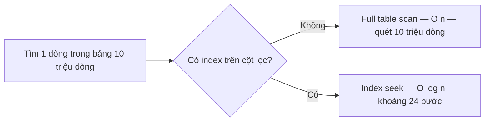

# 1.7 - Cấu trúc dữ liệu cơ bản và Big-O

> **Tóm tắt:** Big-O **không đo thời gian** — nó đo **tốc độ tăng** của khối lượng việc khi dữ liệu lớn dần. Đó là lý do một hàm `O(n²)` chạy ngon trên máy bạn với 100 bản ghi rồi treo hẳn trên production với 100.000 bản ghi: thời gian không tăng 1.000 lần mà tăng **một triệu** lần. Bài này đưa bảng độ phức tạp của các collection .NET, con số cụ thể cho từng mức tăng trưởng, và chỉ ra rằng `index` trong database chính là cùng một ý tưởng: đổi bộ nhớ lấy tốc độ tra cứu, biến `O(n)` thành `O(log n)`.

## Mục tiêu bài học

Sau bài này bạn có thể:

- Giải thích Big-O đo cái gì, và vì sao hằng số bị bỏ qua.
- Đọc bảng độ phức tạp và chọn collection theo thao tác chính.
- Tính nhẩm được một thuật toán `O(n²)` hỏng ở quy mô nào.
- Chỉ ra chỗ `O(n²)` ẩn trong code trông rất bình thường.
- Liên hệ Big-O với index trong database.

**Cần biết trước:** [bài 1.5](1.5-arrays-and-lists.md) (`List`, `Dictionary`, `HashSet`, bẫy `Contains` trong vòng lặp), [bài 1.6](1.6-problem-solving-mindset.md) (phương pháp chia đôi).

## Nội dung bài học

### 1.7.1 — Big-O đo tốc độ tăng, không đo giây

Hai câu hỏi rất khác nhau:

- *"Hàm này chạy mất bao lâu?"* → phụ thuộc CPU, dữ liệu, máy chủ. Phải đo.
- *"Dữ liệu tăng gấp 10 thì khối lượng việc tăng gấp mấy?"* → **đây mới là Big-O**, và trả lời được mà không cần chạy.

Vì thế Big-O bỏ qua hằng số. `5n + 100` và `n` đều là `O(n)`: cả hai đều tăng **tuyến tính**. Hằng số quan trọng khi `n` nhỏ, nhưng khi `n` lớn thì tốc độ tăng quyết định tất cả.

### 1.7.2 — Các mức tăng trưởng, bằng con số

Số thao tác cần làm, theo `n`:

| Mức | n = 10 | n = 1.000 | n = 1.000.000 | Ví dụ điển hình |
|---|---|---|---|---|
| `O(1)` | 1 | 1 | 1 | `dict[key]`, `list[i]` |
| `O(log n)` | 3 | 10 | 20 | Tìm nhị phân, tra index B-tree |
| `O(n)` | 10 | 1.000 | 1.000.000 | `list.Contains`, một vòng `foreach` |
| `O(n log n)` | 33 | 10.000 | 20.000.000 | `Sort()`, `OrderBy()` |
| `O(n²)` | 100 | 1.000.000 | **1.000.000.000.000** | Hai vòng lặp lồng nhau |

Hãy nhìn cột cuối. Với một triệu bản ghi, `O(log n)` cần **20** thao tác còn `O(n²)` cần **một nghìn tỉ**. Đó không phải khác biệt về tốc độ, đó là khác biệt giữa "xong ngay" và "không bao giờ xong".

Và chú ý dòng `O(n²)` ở cột `n = 10`: chỉ 100 thao tác. **Đó chính là lý do bug loại này lọt qua được vòng kiểm thử** — trên dữ liệu mẫu nó nhanh y như mọi thứ khác.

### 1.7.3 — Bảng độ phức tạp của collection .NET

| Thao tác | `T[]` | `List<T>` | `Dictionary<K,V>` | `HashSet<T>` | `SortedSet<T>` |
|---|---|---|---|---|---|
| Truy cập theo chỉ số | O(1) | O(1) | — | — | — |
| Tìm theo giá trị / khoá | O(n) | O(n) | **O(1)** | **O(1)** | O(log n) |
| Thêm vào cuối | — | O(1)* | O(1)* | O(1)* | O(log n) |
| Chèn vào đầu | — | O(n) | — | — | — |
| Xoá theo giá trị | — | O(n) | O(1)* | O(1)* | O(log n) |
| Giữ thứ tự sắp xếp | không | không | không | không | **có** |

\* trung bình khấu hao. `Dictionary` và `HashSet` có trường hợp xấu nhất `O(n)` khi nhiều khoá va chạm hash, nhưng với hàm băm tốt thì hiếm.

Bảng đầy đủ và hướng dẫn chọn: [Selecting a collection class](https://learn.microsoft.com/en-us/dotnet/standard/collections/selecting-a-collection-class).

### 1.7.4 — `O(n²)` trông như thế nào trong code thật

Nó hiếm khi lộ ra dưới dạng hai vòng `for` lồng nhau rõ ràng. Thường nó **trốn bên trong một lời gọi hàm**.

Hai đoạn dưới là phác thảo (`orders`, `activeCustomerIds`, `Process` là tên giả định); Bài tập 1 cho bạn chạy và đo thật.

```csharp
// Trông chỉ có MỘT vòng lặp — nhưng là O(n × m)
foreach (var order in orders)                    // n
{
    if (activeCustomerIds.Contains(order.CustomerId))   // m, quét tuyến tính
        Process(order);
}
```

`Contains` trên `List` là `O(m)`. Đặt nó trong vòng lặp `n` lần là `O(n × m)`.

```csharp
// Sửa: một dòng
var activeSet = activeCustomerIds.ToHashSet();   // O(m), làm một lần
foreach (var order in orders)
    if (activeSet.Contains(order.CustomerId))    // O(1)
        Process(order);
// Tổng: O(n + m)
```

Những chỗ khác cũng hay ẩn `O(n²)`:

| Viết thế này | Thật ra là | Nên dùng |
|---|---|---|
| `list.Contains(x)` trong vòng lặp | O(n × m) | `HashSet` |
| `list.Any(y => y.Id == x.Id)` trong vòng lặp | O(n × m) | `Dictionary` |
| `string s += item` trong vòng lặp | O(n²) do chép chuỗi | `StringBuilder` |
| `list.Insert(0, x)` trong vòng lặp | O(n²) do dịch phần tử | `Add` rồi đảo (`Reverse`), hoặc `LinkedList` |
| Query database trong vòng lặp | N+1 lần đi mạng | Lấy một lần, tra trong bộ nhớ |

Dòng cuối là tệ nhất, vì hằng số của nó — một vòng đi mạng — lớn hơn hàng nghìn lần một phép so sánh trong bộ nhớ. Chi tiết ở bài [EF Core bắn 201 query](https://tiennhm.io.vn/blog/ef-core-n-plus-1-query).

### 1.7.5 — `O(log n)`: vì sao chia đôi lại mạnh đến thế

```csharp
int[] sorted = { 1, 3, 5, 7, 9, 11, 13 };
int index = Array.BinarySearch(sorted, 11);   // 5 — tối đa 3 lần so sánh (ở đây 2), quét tuần tự cần 6
```

Lần so sánh đầu nhìn vào phần tử giữa là `7`; `11` lớn hơn nên bỏ hẳn nửa trái. Nửa phải còn `9, 11, 13`, phần tử giữa là `11`: tìm thấy ở chỉ số 5 sau 2 lần so sánh. Với 7 phần tử, trường hợp xấu nhất là 3 lần. Mỗi lần so sánh loại bỏ **một nửa** không gian còn lại. Một triệu phần tử chỉ cần 20 bước, vì `2²⁰ ≈ 1.000.000`.

Điều kiện bắt buộc: **dữ liệu phải được sắp xếp trước**. Và sắp xếp tốn `O(n log n)`. Nên:

- Tìm **một lần** trên dữ liệu chưa sắp xếp → quét tuyến tính `O(n)` là đúng.
- Tìm **nhiều lần** → bỏ công sắp xếp một lần rồi tìm nhị phân, hoặc dựng `Dictionary`.

Đây cũng chính là phương pháp chia đôi để tìm lỗi ở [bài 1.6](1.6-problem-solving-mindset.md), và là cách `git bisect` hoạt động.

### 1.7.6 — Index trong database là cùng một ý tưởng



Không có index, database phải quét toàn bảng: `O(n)`. Có index — thường là cây B-tree — nó tra như tìm nhị phân: `O(log n)`.

Và cái giá cũng giống hệt phía ứng dụng: **đổi bộ nhớ và chi phí ghi lấy tốc độ đọc**. Mỗi index là một cấu trúc phải được cập nhật ở mọi lệnh `INSERT`, `UPDATE`, `DELETE` — đúng như `HashSet` tốn thêm bộ nhớ so với `List`.

Hai bài đo cụ thể cái giá đó: [Thêm 4 index làm INSERT chậm 6 lần](https://tiennhm.io.vn/blog/chi-phi-ghi-cua-index) và [Có index rồi mà truy vấn vẫn quét toàn bảng?](https://tiennhm.io.vn/blog/sql-index-khong-duoc-dung-sargable). Phần lý thuyết nền nằm ở bài [Index](https://sql-challenge.tiennhm.io.vn/lessons/15-index) trong series học SQL 30 ngày.

### 1.7.7 — Khi nào Big-O **không** phải câu trả lời

Ba trường hợp mà Big-O đánh lừa bạn:

1. **`n` luôn nhỏ.** Với 20 phần tử, quét tuyến tính trên `List` thường **nhanh hơn** `Dictionary`, vì mảng nằm liền mạch trong bộ nhớ nên CPU cache hoạt động tốt, còn hash phải tính và nhảy con trỏ. Đừng dựng `Dictionary` cho một danh sách 10 phần tử.

2. **Hằng số chênh lệch quá lớn.** `O(1)` đi qua mạng vẫn chậm hơn `O(n)` trong RAM với `n` cỡ vài nghìn. Một chuyến đi database chừng 1 mili giây bằng khoảng một triệu phép so sánh trong bộ nhớ.

3. **Bạn chưa đo.** Big-O cho biết thứ gì **sẽ** trở thành vấn đề khi dữ liệu lớn. Nó không cho biết hôm nay chỗ nào đang chậm. Câu đó phải hỏi profiler.

### 1.7.8 — Rà lại code của bạn

**Danh sách rà soát độ phức tạp**

- [ ] Không có Contains hay Any trên danh sách nào nằm trong vòng lặp.
- [ ] Không nối chuỗi bằng += trong vòng lặp; đã dùng StringBuilder.
- [ ] Không gọi database, HTTP hay đọc file trong thân vòng lặp.
- [ ] Dữ liệu cần tra cứu nhiều lần đã được dựng thành Dictionary hoặc HashSet một lần.
- [ ] Cột dùng để lọc và join trong database đều đã có index.
- [ ] Chỗ nghi chậm đã được đo bằng profiler, không phải đoán.
- [ ] Không dựng Dictionary cho tập dữ liệu chỉ vài chục phần tử.

## Bài tập áp dụng

#### Bài 1 — Nhìn thấy đường cong

Viết một hàm O(n²) và một hàm O(n) giải **cùng một bài toán**. Chạy với `n` = 1.000, 5.000, 10.000, 50.000 và ghi thời gian vào bảng. Đối chiếu tỉ lệ tăng với lý thuyết.

**Tiêu chí hoàn thành:** khi `n` tăng gấp đôi, cột O(n²) phải tăng khoảng **bốn lần**. Nếu bạn không thấy con số đó, hãy đọc phần "đo cho đúng" trong lời giải.

<details>
<summary><strong>Gợi ý và lời giải — Bài 1</strong></summary>

**Gợi ý — đo cho đúng.** Ba sai lầm khiến số đo vô nghĩa:

1. **Chạy ở chế độ Debug.** Trình biên dịch tắt tối ưu, số đo lệch nhiều lần. Phải dùng `dotnet run -c Release`.
2. **Đo ngay lần chạy đầu.** Lần đầu gồm cả thời gian JIT biên dịch hàm sang mã máy. Hãy gọi hàm một lần để làm nóng trước khi bấm giờ.
3. **Chỉ đo một lần.** Bộ lập lịch của hệ điều hành và bộ thu gom rác gây nhiễu. Chạy vài lần và lấy giá trị **nhỏ nhất**, vì nhiễu chỉ làm chậm đi chứ không làm nhanh lên.

**Lời giải.** Chương trình đầy đủ, dán vào `Program.cs` rồi chạy `dotnet run -c Release`:

```csharp
using System.Diagnostics;

int[] sizes = { 1_000, 5_000, 10_000, 50_000 };

Console.WriteLine("       n   O(n²) ms   O(n) ms    tỉ lệ   O(n²) tăng");
double previous = 0;
foreach (var n in sizes)
{
    // a = 0..n-1, b = n/2..n/2+n-1: một nửa phần tử của a có trong b
    var a = Enumerable.Range(0, n).ToList();
    var b = Enumerable.Range(n / 2, n).ToList();

    double quadratic = Measure(() => Quadratic(a, b));
    double linear    = Measure(() => Linear(a, b));

    string growth = previous == 0 ? "—" : $"x{quadratic / previous:F1}";
    Console.WriteLine($"{n,8} {quadratic,10:F2} {linear,9:F2} {quadratic / linear,7:F0}x   {growth}");
    previous = quadratic;
}

// Chạy 1 lần làm nóng (JIT), rồi 5 lần đo, lấy lần nhanh nhất
static double Measure(Func<int> action)
{
    action();
    double best = double.MaxValue;
    for (int i = 0; i < 5; i++)
    {
        var sw = Stopwatch.StartNew();
        action();
        best = Math.Min(best, sw.Elapsed.TotalMilliseconds);
    }
    return best;
}

// Bài toán: đếm số phần tử của a cũng xuất hiện trong b
static int Quadratic(List<int> a, List<int> b)
{
    int c = 0;
    foreach (var x in a) if (b.Contains(x)) c++;      // O(n) trong O(n) -> O(n²)
    return c;
}

static int Linear(List<int> a, List<int> b)
{
    var h = new HashSet<int>(b);                      // O(n) một lần
    int c = 0;
    foreach (var x in a) if (h.Contains(x)) c++;      // O(1) mỗi lần -> O(n)
    return c;
}
```

`Func<int>` là kiểu của "một hàm không nhận gì, trả về `int`"; nhờ nó, `Measure` đo được bất kỳ đoạn code nào bạn truyền vào dưới dạng lambda `() => Quadratic(a, b)`.

**Kết quả đo thật trên .NET 10, chế độ Release, máy tác giả** (máy đặt vùng Việt Nam in dấu phẩy thập phân):

```text
       n   O(n²) ms   O(n) ms    tỉ lệ   O(n²) tăng
    1000       0.05      0.02       3x   —
    5000       1.01      0.07      15x   x19.9
   10000       3.86      0.11      35x   x3.8
   50000      65.47      0.39     167x   x17.0
```

**Đối chiếu với lý thuyết.** Dòng đáng chú ý nhất là `n` từ 5.000 lên 10.000 — tức gấp đôi. Lý thuyết nói thời gian O(n²) phải tăng `2² = 4` lần, và số đo cho **x3.8**. Hai bước còn lại là gấp 5 lần, lý thuyết cho `5² = 25`, số đo cho khoảng x17 tới x20. Thấp hơn lý thuyết vì máy thật không chỉ đếm phép so sánh: `List.Contains` của .NET so sánh nhiều số cùng lúc bằng lệnh SIMD, và bộ nhớ đệm (cache) của CPU làm mảng nhỏ được đọc rất nhanh. Big-O dự đoán **xu hướng**, không dự đoán con số chính xác.

**Điều quan trọng hơn cả con số.** Nhìn cột "tỉ lệ": **3x → 15x → 35x → 167x**. Bản thân tỉ lệ đang tăng lên. Đây là đặc trưng của việc so sánh hai mức tăng trưởng khác nhau, và là lý do vì sao câu "chậm hơn một chút thôi" luôn sai khi nói về O(n²).

**Hệ quả thực tế.** Với 1.000 bản ghi, hai phiên bản chênh nhau vài phần trăm mili-giây — không ai nhận ra. Với 50.000 bản ghi, chênh khoảng 65 mili-giây trên **mỗi lời gọi**. Nếu đoạn code đó nằm trong một endpoint API được gọi 100 lần mỗi giây, đó là 6,5 giây xử lý bị thêm vào mỗi giây — một CPU không gánh nổi. Toàn bộ [Module 19](../../stage-05-senior-engineering/module-19-performance-engineering/README.md) tồn tại để xử lý lớp vấn đề này.

</details>

#### Bài 2 — Săn `O(n²)` ẩn trong code

Tìm trong code của bạn (bài tập các bài trước, dự án CLB, hoặc một repo mã nguồn mở C# bất kỳ) một vòng lặp có gọi `Contains`, `Any`, `First` hoặc `Where` trên một tập hợp khác. Tính độ phức tạp thật. Sửa và đo lại. Chưa tìm được thì dùng đoạn "TRƯỚC" trong lời giải làm đề.

**Tiêu chí hoàn thành:** bạn chỉ ra được đoạn code, nêu đúng độ phức tạp trước và sau, và có số đo cho cả hai.

<details>
<summary><strong>Gợi ý và lời giải — Bài 2</strong></summary>

**Gợi ý — tìm bằng công cụ.** Mẫu này rất khó thấy khi đọc code vì mỗi dòng riêng lẻ đều trông hợp lý. Trong VS Code, mở **Find in Files** (`Ctrl+Shift+F`), bật biểu tượng `.*` (regex), gõ `\.(Contains|Any|First|Where)\(` và điền `*.cs` vào ô "files to include", rồi xem kết quả nào nằm trong thân một `foreach`. Dùng Git Bash, macOS hoặc Linux thì lệnh sau in các dòng gọi những hàm đó trong vòng 5 dòng sau một `foreach`:

```bash
grep -rn -A5 "foreach" --include=*.cs . | grep -E "\.Contains\(|\.Any\(|\.First\(|\.Where\("
```

Cả hai cách chỉ là bộ lọc thô: chúng chỉ ra chỗ **nghi ngờ**, bạn vẫn phải mở từng chỗ ra đọc.

Sau đó với mỗi kết quả, hỏi: **thứ bị gọi bên trong vòng lặp có phải một tập hợp khác không?** Nếu có, độ phức tạp là tích của hai kích thước.

**Lời giải — mẫu điển hình:**

```csharp
// TRƯỚC — O(n × m)
foreach (var lead in leads)                      // n = 5.000
{
    var owner = users.First(u => u.Id == lead.OwnerId);   // m = 500, quét tuần tự
    lead.OwnerName = owner.FullName;
}
```

5.000 × 250 (trung bình nửa danh sách) = **1,25 triệu phép so sánh**.

```csharp
// SAU — O(n + m)
var usersById = users.ToDictionary(u => u.Id);   // O(m), một lần

foreach (var lead in leads)                      // O(n)
    lead.OwnerName = usersById[lead.OwnerId].FullName;   // O(1) mỗi lần
```

5.500 thao tác. Giảm khoảng **227 lần**.

**Ba biến thể cùng bản chất, xếp theo mức tốn kém:**

| Dạng | Bên trong vòng lặp là | Chi phí mỗi lần | Mức nghiêm trọng |
|---|---|---|---|
| Tra cứu trong bộ nhớ | `List.Contains`, `First` | cỡ trăm nano-giây | Thấp, nhưng nhân lên nhanh |
| Đọc file | `File.ReadAllText` | cỡ mili-giây | Trung bình |
| Gọi database hoặc API | truy vấn EF Core, `HttpClient` | vài tới vài chục mili-giây | **Rất cao** |

Các con số trong bảng là bậc độ lớn để so sánh, không phải số đo cụ thể.

Dạng thứ ba chính là N+1, đã gặp ở [bài 1.3](1.3-loops.md) và sẽ gặp lại một cách hệ thống ở [Module 13](../../stage-04-database-production/module-13-entity-framework-core/README.md).

**Quy tắc rút ra, đáng thuộc.** *Bên trong một vòng lặp, chỉ nên có thao tác chi phí không đổi.* Mọi thứ cần đi tìm, đi đọc hay đi hỏi đều nên làm **một lần trước** vòng lặp, rồi tra cứu trong bộ nhớ.

**Khi nào không cần sửa.** Khi cả hai tập hợp đều nhỏ và chắc chắn không lớn lên — ví dụ đối chiếu 5 loại thuế với 3 khu vực. Sửa lúc đó chỉ làm code khó đọc hơn. Câu hỏi quyết định không phải "có phải O(n²) không" mà là **"n có thể lớn tới đâu trong hai năm tới?"**

</details>

#### Bài 3 — Đo cái giá của index (tùy chọn)

Bài này cần một database PostgreSQL. Bỏ qua được nếu bạn chưa cài Docker; quay lại sau [Module 12](../../stage-04-database-production/module-12-sql-deep-dive/README.md). Đã có Docker thì ở thư mục gốc của repo khóa học, chạy `docker compose up -d` để bật PostgreSQL 16 theo file [docker-compose.yml](../../../docker-compose.yml), rồi mở công cụ dòng lệnh `psql`:

```bash
docker compose exec postgres psql -U postgres -d crm
```

Trên một bảng thử 200.000 dòng, đo thời gian `INSERT` khi không có index và khi có bốn index. Đối chiếu với bài [chi phí ghi của index](https://tiennhm.io.vn/blog/chi-phi-ghi-cua-index).

**Tiêu chí hoàn thành:** bạn nêu được vì sao index làm `SELECT` nhanh lên nhưng làm `INSERT` chậm đi, bằng cùng một lập luận.

<details>
<summary><strong>Gợi ý và lời giải — Bài 3</strong></summary>

**Gợi ý.** Index là một cấu trúc dữ liệu **được sắp xếp** nằm song song với bảng. Vậy khi thêm một dòng mới vào bảng, database phải làm gì với cấu trúc đó? Và nếu có bốn index thì phải làm việc đó mấy lần?

**Lời giải — kịch bản đo**, dán vào `psql`:

```sql
-- Bảng không index (ngoài khóa chính)
CREATE TABLE "LeadNoIndex" (
    "Id"        integer GENERATED ALWAYS AS IDENTITY PRIMARY KEY,
    "Email"     varchar(200),
    "Phone"     varchar(20),
    "Region"    varchar(50),
    "CreatedAt" timestamptz
);

-- Bảng giống hệt, thêm bốn index phụ
CREATE TABLE "LeadIndexed" (
    "Id"        integer GENERATED ALWAYS AS IDENTITY PRIMARY KEY,
    "Email"     varchar(200),
    "Phone"     varchar(20),
    "Region"    varchar(50),
    "CreatedAt" timestamptz
);
CREATE INDEX "IX_LeadIndexed_Email"     ON "LeadIndexed" ("Email");
CREATE INDEX "IX_LeadIndexed_Phone"     ON "LeadIndexed" ("Phone");
CREATE INDEX "IX_LeadIndexed_Region"    ON "LeadIndexed" ("Region");
CREATE INDEX "IX_LeadIndexed_CreatedAt" ON "LeadIndexed" ("CreatedAt");

\timing on

-- generate_series(1, 200000) sinh 200.000 số, mỗi số thành một dòng dữ liệu giả
INSERT INTO "LeadNoIndex" ("Email", "Phone", "Region", "CreatedAt")
SELECT 'lead' || g || '@example.com',
       '09' || lpad(g::text, 8, '0'),
       (ARRAY['HN', 'HCM', 'DN', 'CT'])[1 + g % 4],
       now() - g * interval '1 minute'
FROM generate_series(1, 200000) AS g;

INSERT INTO "LeadIndexed" ("Email", "Phone", "Region", "CreatedAt")
SELECT 'lead' || g || '@example.com',
       '09' || lpad(g::text, 8, '0'),
       (ARRAY['HN', 'HCM', 'DN', 'CT'])[1 + g % 4],
       now() - g * interval '1 minute'
FROM generate_series(1, 200000) AS g;

SELECT pg_size_pretty(pg_total_relation_size('"LeadNoIndex"')) AS "NoIndex",
       pg_size_pretty(pg_total_relation_size('"LeadIndexed"')) AS "Indexed";
```

Tên bảng và cột đặt trong nháy kép vì PostgreSQL tự đổi tên không có nháy thành chữ thường; khóa học giữ kiểu viết hoa giống tên EF Core sinh ra. `\timing on` bảo `psql` in thời gian chạy sau mỗi lệnh.

**Kết quả chạy thật trên PostgreSQL 16 (Docker, máy tác giả), lấy lần chạy thứ hai trong ba lần:**

```text
INSERT 0 200000
Time: 284.107 ms
INSERT 0 200000
Time: 1276.964 ms (00:01.277)
 NoIndex | Indexed
---------+---------
 20 MB   | 48 MB
```

Bảng có bốn index chèn chậm hơn khoảng **4 tới 5 lần** và chiếm hơn gấp đôi dung lượng. Con số trên máy bạn sẽ khác, tỉ lệ thì tương tự. Chạy lại bài nhiều lần thì xóa bảng cũ trước: `DROP TABLE "LeadNoIndex", "LeadIndexed";`.

<details>
<summary>SQL Server</summary>

Chạy `docker compose --profile sqlserver up -d` để bật SQL Server 2022, rồi mở `sqlcmd`:

```bash
docker compose exec sqlserver /opt/mssql-tools18/bin/sqlcmd -S localhost -U sa -P "Crm@123456" -C
```

Tạo database thử trước (`CREATE DATABASE IndexLab;` rồi `GO`, sau đó `USE IndexLab;` rồi `GO`). Kịch bản tương đương:

```sql
CREATE TABLE LeadNoIndex (
    Id        INT IDENTITY PRIMARY KEY,
    Email     NVARCHAR(200),
    Phone     NVARCHAR(20),
    Region    NVARCHAR(50),
    CreatedAt DATETIMEOFFSET
);

CREATE TABLE LeadIndexed (
    Id        INT IDENTITY PRIMARY KEY,
    Email     NVARCHAR(200),
    Phone     NVARCHAR(20),
    Region    NVARCHAR(50),
    CreatedAt DATETIMEOFFSET
);
CREATE INDEX IX_LeadIndexed_Email     ON LeadIndexed (Email);
CREATE INDEX IX_LeadIndexed_Phone     ON LeadIndexed (Phone);
CREATE INDEX IX_LeadIndexed_Region    ON LeadIndexed (Region);
CREATE INDEX IX_LeadIndexed_CreatedAt ON LeadIndexed (CreatedAt);
GO

SET STATISTICS TIME ON;

-- GENERATE_SERIES có từ SQL Server 2022
INSERT INTO LeadNoIndex (Email, Phone, Region, CreatedAt)
SELECT CONCAT(N'lead', value, N'@example.com'),
       CONCAT(N'09', RIGHT(CONCAT(N'00000000', value), 8)),
       CHOOSE(1 + value % 4, N'HN', N'HCM', N'DN', N'CT'),
       DATEADD(MINUTE, -value, SYSDATETIMEOFFSET())
FROM GENERATE_SERIES(1, 200000);

INSERT INTO LeadIndexed (Email, Phone, Region, CreatedAt)
SELECT CONCAT(N'lead', value, N'@example.com'),
       CONCAT(N'09', RIGHT(CONCAT(N'00000000', value), 8)),
       CHOOSE(1 + value % 4, N'HN', N'HCM', N'DN', N'CT'),
       DATEADD(MINUTE, -value, SYSDATETIMEOFFSET())
FROM GENERATE_SERIES(1, 200000);

SET STATISTICS TIME OFF;
GO

EXEC sp_spaceused N'LeadNoIndex';
EXEC sp_spaceused N'LeadIndexed';
GO
```

Kết quả chạy thật trên SQL Server 2022 (Docker, máy tác giả): bảng không index mất khoảng 240 ms (`elapsed time = 238 ms`), bảng bốn index khoảng 1.200 ms (`elapsed time = 1209 ms`). `sp_spaceused` báo 19.720 KB so với 46.312 KB, trong đó 26.040 KB là index. Cùng kết luận: chậm hơn khoảng 5 lần, tốn hơn gấp đôi dung lượng.

</details>

**Vì sao — cùng một lập luận cho cả hai chiều.**

Index là một bản sao đã sắp xếp của một cột, tổ chức theo cây B-tree. Cây đó cho phép tìm một giá trị bằng cách chia đôi liên tục, tức **O(log n)** thay vì quét toàn bảng **O(n)**. Với 10 triệu dòng, đó là khoảng 3 tới 4 lần đọc trang thay vì 10 triệu — chính là lý do `SELECT` nhanh lên.

Nhưng để cây luôn ở trạng thái sắp xếp, **mỗi lần ghi phải cập nhật cây**. Thêm một dòng vào bảng có bốn index nghĩa là một lần ghi vào bảng cộng **bốn** lần chèn vào bốn cây, mỗi lần có thể kéo theo việc tách trang khi trang đã đầy.

**Đây là một đánh đổi, không phải một tối ưu.** Index không "làm database nhanh hơn"; nó **chuyển chi phí từ lúc đọc sang lúc ghi**. Với bảng đọc nhiều ghi ít — danh mục sản phẩm, bảng tra cứu — đánh đổi này rất có lợi. Với bảng ghi nhiều đọc ít — nhật ký hệ thống, bảng sự kiện — thêm index có thể khiến mọi thứ tệ đi.

**Ba điều đáng nhớ khi thiết kế index:**

1. Index chỉ giúp nếu **truy vấn thật sự dùng tới nó**. Index trên cột không bao giờ xuất hiện trong `WHERE`, `JOIN` hay `ORDER BY` là chi phí thuần.
2. **Thứ tự cột trong index ghép rất quan trọng** — index trên `(Region, CreatedAt)` không giúp gì cho truy vấn chỉ lọc theo `CreatedAt`.
3. Index thừa nguy hiểm hơn thiếu index, vì nó làm chậm mọi thao tác ghi mà không ai nhận ra nguyên nhân.

[Bài 12.4 — Indexing](../../stage-04-database-production/module-12-sql-deep-dive/12.4-indexing.md) trình bày đầy đủ cả ba điểm này kèm cách đọc kế hoạch thực thi để biết index có được dùng hay không.

</details>

## Tự kiểm tra

<details>
<summary>Big-O đo cái gì?</summary>

Đo tốc độ tăng của khối lượng việc khi dữ liệu lớn dần, không đo thời gian thực tế. Vì thế nó bỏ qua hằng số: 5n + 100 và n đều là O(n) vì cả hai đều tăng tuyến tính. Câu hỏi Big-O trả lời là dữ liệu tăng gấp 10 thì công việc tăng gấp mấy.

</details>

<details>
<summary>Vì sao lỗi O(n²) thường lọt qua vòng kiểm thử?</summary>

Vì với dữ liệu mẫu nhỏ, O(n²) rất nhanh — với n bằng 10 thì chỉ 100 thao tác, không khác gì O(n). Nó chỉ lộ ra khi dữ liệu thật lớn lên: n tăng 1.000 lần thì công việc tăng một triệu lần. Đó là lý do sự cố loại này luôn xuất hiện trên production chứ không phải trên máy lập trình viên.

</details>

<details>
<summary>Ở đâu trong code thường ẩn một O(n²)?</summary>

Thường không phải hai vòng for lồng nhau rõ ràng, mà là một lời gọi hàm tuyến tính nằm trong vòng lặp: Contains hay Any trên List, nối chuỗi bằng dấu cộng, Insert vào đầu danh sách, hoặc gọi database. Cách sửa phổ biến nhất là dựng sẵn HashSet hay Dictionary một lần rồi tra cứu trong đó.

</details>

<details>
<summary>Tìm nhị phân cần điều kiện gì và khi nào nên dùng?</summary>

Cần dữ liệu đã được sắp xếp, mà sắp xếp tốn O(n log n). Nên nếu chỉ tìm một lần trên dữ liệu chưa sắp xếp thì quét tuyến tính O(n) là đúng. Chỉ khi tìm nhiều lần thì mới bõ công sắp xếp một lần rồi tìm nhị phân, hoặc đơn giản hơn là dựng Dictionary.

</details>

<details>
<summary>Index trong database liên quan gì tới Big-O?</summary>

Đó là cùng một ý tưởng. Không có index, database quét toàn bảng theo O(n). Có index B-tree, nó tra như tìm nhị phân theo O(log n) — 10 triệu dòng còn khoảng 24 bước. Cái giá cũng giống hệt phía ứng dụng: tốn thêm bộ nhớ và làm chậm mọi lệnh ghi, vì mỗi index phải được cập nhật theo.

</details>

<details>
<summary>Khi nào Big-O đánh lừa mình?</summary>

Khi n luôn nhỏ — với 20 phần tử thì quét List thường nhanh hơn Dictionary nhờ CPU cache. Khi hằng số chênh lệch quá lớn — một chuyến đi database O(1) vẫn chậm hơn vòng lặp O(n) trong RAM với n vài nghìn. Và khi bạn chưa đo — Big-O nói cái gì sẽ thành vấn đề khi dữ liệu lớn, không nói hôm nay chỗ nào đang chậm.

</details>

## Kết luận

Ba điều đáng nhớ nhất:

1. **`O(n²)` luôn im lặng trên máy bạn.** Nó chỉ nói chuyện khi đã lên production với dữ liệu thật.
2. **Cái bẫy phổ biến nhất là một hàm tuyến tính nằm trong vòng lặp.** `Contains`, `Any`, hoặc một câu query — và cách sửa thường chỉ là một dòng.
3. **Index của database là Big-O áp dụng vào ổ đĩa.** Cùng ý tưởng, cùng cái giá: đổi bộ nhớ và tốc độ ghi lấy tốc độ đọc.

## Tham khảo

- [Selecting a collection class](https://learn.microsoft.com/en-us/dotnet/standard/collections/selecting-a-collection-class) — bảng chọn chính thức
- [Commonly used collection types](https://learn.microsoft.com/en-us/dotnet/standard/collections/commonly-used-collection-types) — độ phức tạp từng thao tác
- [`Array.BinarySearch`](https://learn.microsoft.com/en-us/dotnet/api/system.array.binarysearch) — tìm nhị phân dựng sẵn
- [`SortedSet<T>`](https://learn.microsoft.com/en-us/dotnet/api/system.collections.generic.sortedset-1) — giữ thứ tự với O(log n)
- [`HashSet<T>`](https://learn.microsoft.com/en-us/dotnet/api/system.collections.generic.hashset-1) — tra cứu O(1) trung bình

## Điều hướng

- **Bài trước:** [1.6 — Tư duy giải bài toán](1.6-problem-solving-mindset.md)
- **Bài tiếp theo:** [1.8 — LINQ, record và đệ quy an toàn](1.8-advanced-notes.md)
- **Về module:** [Trang mục lục](README.md)

## Bài liên quan

- [Thêm 4 index làm INSERT chậm 6 lần: cái giá không ai nhắc khi bảo bạn đánh index](https://tiennhm.io.vn/blog/chi-phi-ghi-cua-index) — Mọi hướng dẫn tối ưu đều bảo thêm index, rất ít bài nói về hoá đơn.
- [Có index rồi mà truy vấn vẫn quét toàn bảng? Sargability và một hàm bọc quanh cột](https://tiennhm.io.vn/blog/sql-index-khong-duoc-dung-sargable) — Cột đã có index, câu WHERE lọc đúng cột đó, nhưng execution plan vẫn là Seq Scan.
- [Vì sao EF Core bắn 201 query cho 1 màn hình danh sách? Cách sửa N+1](https://tiennhm.io.vn/blog/ef-core-n-plus-1-query) — Một màn hình 200 dòng mà log SQL ghi 201 câu lệnh là dấu hiệu của N+1 query.
