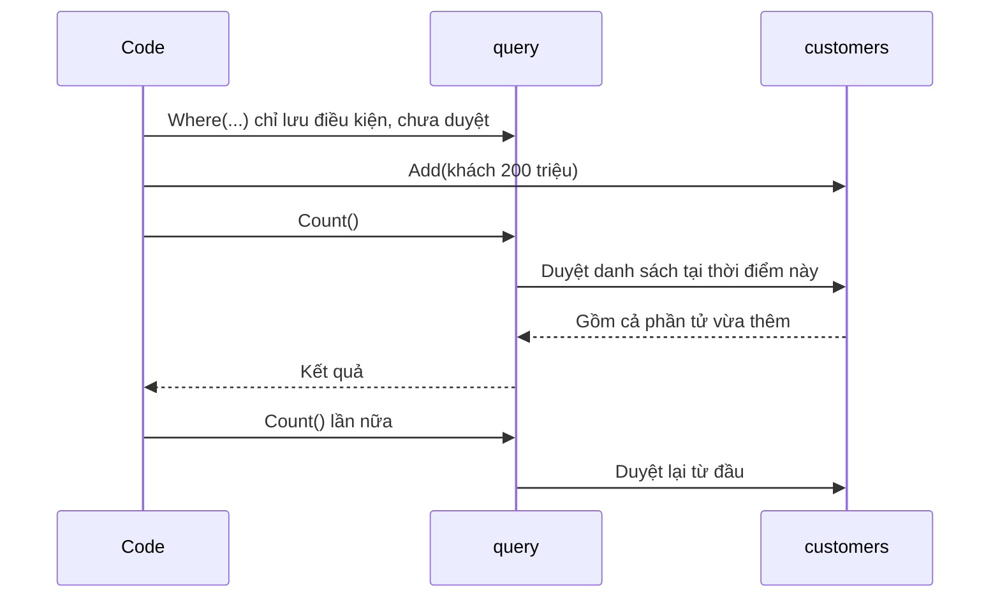

# 1.8 - LINQ, record và đệ quy an toàn

> **Tóm tắt:** Bài này đào sâu bốn chủ đề nối tiếp Module 1. Hai cái nên học **sớm** vì bạn sẽ gặp trong mọi codebase .NET hiện đại: **LINQ** (lọc, biến đổi, gom nhóm dữ liệu bằng vài dòng) và **pattern matching**. Cái bẫy lớn nhất của LINQ là **deferred execution**: truy vấn chạy lúc bạn đọc kết quả, không phải lúc bạn viết nó. Hai chủ đề còn lại là **`record`** cho dữ liệu bất biến, và **đệ quy an toàn**: đệ quy cơ bản đã học ở [bài 1.4](1.4-functions-methods.md), bài này chỉ ra chuyện gì xảy ra khi dữ liệu có vòng — `StackOverflowException`, lỗi **không bắt được bằng try/catch** và giết luôn tiến trình — và cách phòng.

## Mục tiêu bài học

Sau bài này bạn có thể:

- Dùng năm thao tác LINQ thường gặp và nhận ra khi nào vòng lặp vẫn tốt hơn.
- Giải thích deferred execution bằng một ví dụ chạy được, và chốt kết quả bằng `ToList()`.
- Nhận ra lỗi biến vòng `for` bị lambda "bắt chung" và sửa nó.
- Dùng `record` và biểu thức `with` cho dữ liệu chỉ mang giá trị.
- Phát hiện vòng trong dữ liệu dạng cây, bằng đệ quy có `HashSet` hoặc bằng stack tường minh.

**Cần biết trước:** [bài 1.3](1.3-loops.md) (vòng lặp, cách đọc lambda), [bài 1.4](1.4-functions-methods.md) (hàm, đệ quy cơ bản), [bài 1.5](1.5-arrays-and-lists.md) (`List`, `Dictionary`, `HashSet`), [bài 1.2](1.2-conditions.md) (switch expression).

## Nội dung bài học

### 1.8.1 — LINQ: học sớm

**Nên học ngay sau Module 1.** Bạn sẽ gặp nó trong mọi dự án .NET. Hai cách dưới thay thế nhau, cùng kết quả:

```csharp
// Cách 1: viết tay
var vipLoop = new List<Customer>();
foreach (var c in customers)
{
    if (c.TotalSpent > 100_000_000m)
        vipLoop.Add(c);
}
vipLoop.Sort((a, b) => b.TotalSpent.CompareTo(a.TotalSpent));

// Cách 2: LINQ
var vipLinq = customers
    .Where(c => c.TotalSpent > 100_000_000m)
    .OrderByDescending(c => c.TotalSpent)
    .ToList();
```

Năm thao tác dùng nhiều nhất:

| Thao tác | Việc làm |
|---|---|
| `Where` | Lọc theo điều kiện |
| `Select` | Biến đổi từng phần tử |
| `OrderBy` / `OrderByDescending` | Sắp xếp |
| `GroupBy` | Nhóm theo khoá |
| `Sum` / `Count` / `Average` | Tính tổng hợp |

**Cái bẫy quan trọng nhất — deferred execution:**

```csharp
var query = customers.Where(c => c.TotalSpent > 100_000_000m);
customers.Add(new Customer { TotalSpent = 200_000_000m });

var count = query.Count();      // TÍNH LẠI tại đây -> bao gồm cả phần tử vừa thêm
```

LINQ **không chạy ngay** khi bạn viết `Where` — nó chỉ mô tả truy vấn. Việc chạy xảy ra khi bạn duyệt kết quả hoặc gọi `ToList`, `Count`, `First`. Gọi hai lần là chạy hai lần.



```csharp
// Dùng ToList() khi cần kết quả CỐ ĐỊNH và dùng nhiều lần
var vipCustomers = customers.Where(c => c.TotalSpent > 100_000_000m).ToList();
```

Đây cũng là nền tảng để hiểu EF Core, vì truy vấn database dùng chính cơ chế này ([bài 13.5](../../stage-04-database-production/module-13-entity-framework-core/13.5-query-patterns.md)).

### 1.8.2 — Pattern matching: học sớm

Hai hàm dưới cùng kết quả; đặt tên khác nhau để cùng nằm được trong một file:

```csharp
// Chuỗi if dài
string RankWithIf(decimal totalSpent)
{
    if (totalSpent >= 500_000_000m) return "Kim cương";
    else if (totalSpent >= 100_000_000m) return "Vàng";
    else if (totalSpent >= 10_000_000m) return "Bạc";
    else return "Thường";
}

// Switch expression — ngắn hơn và dễ đọc hơn
string Rank(decimal totalSpent) => totalSpent switch
{
    >= 500_000_000m => "Kim cương",
    >= 100_000_000m => "Vàng",
    >= 10_000_000m  => "Bạc",
    _               => "Thường"
};
```

Lợi ích không chỉ là ngắn hơn: trình biên dịch **cảnh báo** nếu bạn bỏ sót trường hợp với kiểu enum, điều mà chuỗi `if` không làm được.

```csharp
// Khớp theo thuộc tính (Order ở đây có thêm Region và WeightKg)
decimal CalculateShippingFee(Order order) => order switch
{
    { Total: > 1_000_000m }        => 0,
    { Region: "HCM" or "HN" }      => 20_000m,
    { WeightKg: > 10 }             => 50_000m,
    _                              => 35_000m
};
```

**Lưu ý:** thứ tự các nhánh **quan trọng** — nhánh đầu tiên khớp sẽ được chọn. Đặt điều kiện hẹp nhất lên trước ([bài 1.2](1.2-conditions.md)).

### 1.8.3 — Đệ quy trên dữ liệu không đáng tin

[Bài 1.4](1.4-functions-methods.md) đã dạy đệ quy cơ bản: điểm dừng, bước đệ quy, call stack. Với cây có độ sâu biết trước, đệ quy là cách viết tự nhiên nhất:

```csharp
// Tổng giá trị của một danh mục và mọi danh mục con
decimal SumCategoryTree(Category category)
{
    decimal total = category.Value;
    foreach (var child in category.Children)
        total += SumCategoryTree(child);          // gọi chính nó
    return total;                                 // điểm dừng: danh mục không có con
}
```

Vấn đề cụ thể: nếu dữ liệu có **vòng** (A là con của B, B là con của A — chuyện xảy ra thật khi dữ liệu bị nhập sai), hàm này gọi mãi cho tới khi tràn stack.

Và đây là điểm nguy hiểm nhất: **`StackOverflowException` không bắt được bằng `try/catch`** trong .NET. Nó giết luôn tiến trình, kéo theo mọi request khác đang chạy trên cùng process.

```csharp
// Dùng stack tường minh — kiểm soát được, và phát hiện vòng
decimal SumCategoryTreeSafe(Category root)
{
    decimal total = 0;
    var visited = new HashSet<int>();
    var stack = new Stack<Category>();   // Stack: vào sau ra trước
    stack.Push(root);

    while (stack.Count > 0)
    {
        var category = stack.Pop();

        if (!visited.Add(category.Id))   // Add trả về false nếu Id đã có
            throw new InvalidOperationException($"Danh mục {category.Id} tạo vòng lặp");

        total += category.Value;
        foreach (var child in category.Children)
            stack.Push(child);
    }

    return total;
}
```

Dài hơn, nhưng nó **phát hiện được vòng** và không bao giờ làm tràn stack: danh sách việc cần làm nằm trong một `Stack<T>` trên heap chứ không nằm trên call stack.

Với dữ liệu cây trong database, thường tốt hơn nữa là để database làm việc đó bằng recursive CTE ([bài 12.3](../../stage-04-database-production/module-12-sql-deep-dive/12.3-advanced-queries.md)).

### 1.8.4 — Immutability và `record`

**Immutability** (bất biến) nghĩa là giá trị không đổi được sau khi tạo. `record` là cách khai báo nhanh một kiểu bất biến chỉ chứa dữ liệu:

```csharp
var a1 = new Address("12", "Nguyễn Huệ", "1", "HCM");
var a2 = new Address("12", "Nguyễn Huệ", "1", "HCM");

Console.WriteLine(a1 == a2);            // True — so sánh theo GIÁ TRỊ

// Muốn đổi thì tạo bản mới bằng with
var a3 = a1 with { District = "3" };
Console.WriteLine(a3);                  // Address { HouseNumber = 12, Street = Nguyễn Huệ, District = 3, City = HCM }

// Đặt cuối file
record Address(string HouseNumber, string Street, string District, string City);
```

Hai lợi ích thực tế: đối tượng bất biến **an toàn khi dùng đa luồng** (không ai đổi được nó giữa chừng), và code dễ suy luận hơn vì giá trị không thay đổi sau khi tạo.

Đây là nền tảng cho value object, học ở [bài 4.7](../../stage-02-csharp-professional/module-04-csharp-core/4.7-records-and-value-objects.md) và dùng trong DDD ở [bài 16.13](../../stage-05-senior-engineering/module-16-clean-architecture/16.13-advanced-notes.md).

### 1.8.5 — Bất biến vòng lặp

Một công cụ tư duy để viết vòng lặp đúng: **điều gì luôn đúng ở mỗi lần lặp?**

```csharp
var amounts = new List<decimal> { 120m, 450m, 80m, 300m };

// Bất biến: sau vòng lặp thứ i, "max" là giá trị lớn nhất trong amounts[0..i]
decimal max = amounts[0];
for (int i = 1; i < amounts.Count; i++)
{
    if (amounts[i] > max)
        max = amounts[i];
}
// Kết thúc: max là giá trị lớn nhất toàn danh sách
Console.WriteLine(max);   // 450
```

Phát biểu được bất biến nghĩa là bạn hiểu vòng lặp đang làm gì. Nó cũng giúp bắt hai lỗi phổ biến: khởi tạo sai (bắt đầu từ `i = 0` sẽ so sánh phần tử đầu với chính nó — vô hại ở đây nhưng không phải lúc nào cũng vậy; còn danh sách rỗng thì `amounts[0]` ném lỗi ngay) và điều kiện dừng sai (`<=` thay vì `<` gây lỗi vượt chỉ số).

Ít dùng trong code nghiệp vụ hàng ngày, nhưng rất hữu ích khi viết thuật toán hoặc khi một vòng lặp cho kết quả sai mà bạn không hiểu vì sao.

### 1.8.6 — Thứ tự nên học

| Ưu tiên | Chủ đề | Vì sao |
|---|---|---|
| **Cao** | LINQ | Gặp trong mọi codebase .NET |
| **Cao** | Pattern matching | Ngắn hơn, trình biên dịch kiểm tra giúp |
| Trung bình | Đệ quy | Cần cho môn học, phỏng vấn và dữ liệu dạng cây. Dùng được khi độ sâu có giới hạn rõ; với dữ liệu do người dùng nhập thì phát hiện vòng hoặc dùng stack tường minh |
| Trung bình | `record` và immutability | Nền tảng cho value object |
| Thấp | Bất biến vòng lặp | Công cụ tư duy, không phải cú pháp |

Sau Module 1, bước tiếp theo trong lộ trình là [Module 2 — Computer Science Basics](../module-02-computer-science-basics/README.md).

### 1.8.7 — Rà lại code của bạn

**Danh sách rà soát sau Module 1**

- [ ] Dùng được năm thao tác LINQ cơ bản.
- [ ] Hiểu deferred execution và biết khi nào cần ToList.
- [ ] Lambda tạo trong vòng for không dùng trực tiếp biến đếm i; đã chép sang biến cục bộ.
- [ ] Dùng switch expression thay chuỗi if dài.
- [ ] Biết thứ tự nhánh trong pattern matching là quan trọng.
- [ ] Đệ quy trên dữ liệu do người dùng nhập có phát hiện vòng, hoặc đã đổi sang stack tường minh.
- [ ] Biết StackOverflowException không bắt được bằng try catch.
- [ ] Dùng record cho đối tượng chỉ mang giá trị.

## Bài tập áp dụng

Các bài dưới dùng chung kiểu `Lead` (khách hàng tiềm năng) sau. Dán vào cuối `Program.cs`:

```csharp
class Lead
{
    public int Id { get; set; }
    public string FullName { get; set; } = "";
    public LeadStatus Status { get; set; }
    public int OwnerId { get; set; }        // nhân viên phụ trách
    public decimal Value { get; set; }      // giá trị dự kiến
}

enum LeadStatus { New, Contacted, Qualified, Won, Lost }
```

#### Bài 1 — Viết lại bằng LINQ

Viết ba vòng lặp trên một `List<Lead>` (lọc lead đã liên hệ, lấy tên viết hoa, tính tổng giá trị theo nhân viên), rồi viết lại bằng LINQ. So sánh số dòng.

**Tiêu chí hoàn thành:** cả ba bản LINQ cho **đúng kết quả** như bản vòng lặp, và bạn chỉ ra được ít nhất một vòng lặp mà LINQ **không** làm tốt hơn.

<details>
<summary><strong>Gợi ý và lời giải — Bài 1</strong></summary>

**Gợi ý.** Vòng lặp nào chỉ lọc, biến đổi hoặc gom nhóm thì LINQ gọn hơn hẳn. Vòng lặp nào có nhiều việc khác nhau bên trong thì chưa chắc.

**Lời giải — ba vòng lặp điển hình.** Mỗi cặp là hai phiên bản thay thế nhau nên mang tên khác nhau:

```csharp
var leads = new List<Lead>
{
    new() { Id = 1, FullName = "Nguyễn An",  Status = LeadStatus.Contacted, OwnerId = 7, Value = 300_000_000m },
    new() { Id = 2, FullName = "Trần Bình",  Status = LeadStatus.New,       OwnerId = 7, Value = 1_500_000_000m },
    new() { Id = 3, FullName = "Lê Chi",     Status = LeadStatus.Contacted, OwnerId = 9, Value = -20_000_000m },
};

// 1. LỌC — vòng lặp
var contactedLoop = new List<Lead>();
foreach (var lead in leads)
{
    if (lead.Status == LeadStatus.Contacted)
        contactedLoop.Add(lead);
}

// 1. LỌC — LINQ
var contactedLinq = leads
    .Where(l => l.Status == LeadStatus.Contacted)
    .ToList();
```

```text
6 dòng -> 3 dòng
```

```csharp
// 2. BIẾN ĐỔI — vòng lặp
var namesLoop = new List<string>();
foreach (var lead in leads)
    namesLoop.Add(lead.FullName.ToUpper());

// 2. BIẾN ĐỔI — LINQ
var namesLinq = leads.Select(l => l.FullName.ToUpper()).ToList();
```

```csharp
// 3. GOM NHÓM VÀ TÍNH TỔNG — vòng lặp
var totalByOwnerLoop = new Dictionary<int, decimal>();
foreach (var lead in leads)
{
    if (totalByOwnerLoop.ContainsKey(lead.OwnerId))
        totalByOwnerLoop[lead.OwnerId] += lead.Value;
    else
        totalByOwnerLoop[lead.OwnerId] = lead.Value;
}

// 3. GOM NHÓM VÀ TÍNH TỔNG — LINQ
var totalByOwnerLinq = leads
    .GroupBy(l => l.OwnerId)
    .ToDictionary(g => g.Key, g => g.Sum(l => l.Value));
```

```text
9 dòng -> 3 dòng
```

**Và đây là phần quan trọng hơn: một vòng lặp mà LINQ KHÔNG làm tốt hơn.**

```csharp
// Vòng lặp làm NHIỀU việc khác nhau cùng lúc
decimal total = 0;
int errorCount = 0;
var needsReview = new List<Lead>();

foreach (var lead in leads)
{
    if (lead.Value < 0)
    {
        errorCount++;
        Console.WriteLine($"Cảnh báo: lead {lead.Id} có giá trị âm");
        continue;
    }

    total += lead.Value;

    if (lead.Value > 1_000_000_000m)
        needsReview.Add(lead);
}
```

```text
Viết bằng LINQ: cần BA lần duyệt (một cho tổng, một cho đếm lỗi,
                một cho danh sách xem lại)
-> dài hơn, chậm hơn, và khó đọc hơn

Vòng lặp: một lần duyệt, mọi thứ rõ ràng.
```

**Ba trường hợp nên giữ vòng lặp:**

| Tình huống | Vì sao |
|---|---|
| Làm nhiều việc khác nhau trong một lần duyệt | LINQ buộc tách thành nhiều lần duyệt |
| Cần ghi log hoặc xử lý lỗi cho từng phần tử | Thân LINQ không phải chỗ cho tác dụng phụ |
| Cần `break` sớm với điều kiện phức tạp | `TakeWhile` không phải lúc nào cũng diễn đạt được |

**Và một điều đáng nhớ về LINQ: nó diễn đạt "cái gì", không phải "làm thế nào".** Bản vòng lặp nói *cách làm* (tạo danh sách rỗng, duyệt, kiểm tra, thêm vào); bản `leads.Where(l => l.Status == LeadStatus.Contacted)` nói *cái gì* (những lead đã liên hệ). Người đọc hiểu ngay ý định ở bản LINQ mà không phải đọc hết thân vòng lặp để suy ra. Đó là lợi ích thật, lớn hơn cả việc tiết kiệm mấy dòng.

</details>

---

#### Bài 2 — Chứng minh deferred execution

Tạo một truy vấn `Where`, thêm phần tử vào danh sách gốc, rồi gọi `Count` và giải thích kết quả. Sau đó tạo ba truy vấn trong một vòng `for`, mỗi truy vấn lọc `x > i`, và in kết quả của cả ba.

**Tiêu chí hoàn thành:** bạn **chạy và thấy** con số thay đổi, biết cách "chốt" kết quả lại khi không muốn nó thay đổi, và giải thích được vì sao ba truy vấn trong vòng `for` cho cùng một kết quả.

<details>
<summary><strong>Gợi ý và lời giải — Bài 2</strong></summary>

**Gợi ý.** `Where` không chạy lúc bạn viết nó. Nó chạy lúc bạn **đọc** kết quả. Lúc đọc, lambda dùng giá trị **hiện tại** của mọi biến nó nhắc tới.

**Lời giải — phần 1:**

```csharp
var numbers = new List<int> { 1, 2, 3 };

var query = numbers.Where(x => x > 1);            // chưa chạy gì cả

Console.WriteLine($"Count trước khi thêm : {query.Count()}");

numbers.Add(10);
numbers.Add(20);

Console.WriteLine($"Count sau khi thêm   : {query.Count()}");

var snapshot = numbers.Where(x => x > 1).ToList();   // CHỐT lại tại đây
numbers.Add(30);

Console.WriteLine($"Count sau khi ToList : {snapshot.Count}");
```

Kết quả chạy trên .NET 10:

```text
Count trước khi thêm : 2
Count sau khi thêm   : 4
Count sau khi ToList : 4
```

**Ba con số, ba điều cần hiểu:**

**1. `2` — lúc này danh sách có `{1, 2, 3}`, hai phần tử lớn hơn 1.**

**2. `4` — cùng một biến `query`, không gán lại, nhưng kết quả đổi.**

```text
query KHÔNG chứa kết quả.
Nó chứa CÔNG THỨC: "lấy những phần tử của numbers mà lớn hơn 1".

Mỗi lần gọi Count(), công thức đó chạy LẠI trên numbers hiện tại.
{1,2,3,10,20} -> bốn phần tử lớn hơn 1
```

**3. `4` sau khi thêm 30 — vì `ToList()` đã sao chép kết quả ra một danh sách mới.**

```text
ToList(), ToArray(), ToDictionary() -> CHẠY NGAY và chốt kết quả
Where(), Select(), OrderBy()        -> chỉ mô tả, chưa chạy
```

**Phần 2 — biến vòng `for` bị "bắt" vào công thức:**

```csharp
var data = new List<int> { 1, 2, 3, 4, 5 };

// SAI: cả ba lambda cùng dùng MỘT biến i
var queries = new List<IEnumerable<int>>();
for (int i = 0; i < 3; i++)
    queries.Add(data.Where(x => x > i));

foreach (var q in queries)
    Console.WriteLine(string.Join(", ", q));
```

Kết quả chạy trên .NET 10:

```text
4, 5
4, 5
4, 5
```

Bạn có thể đã chờ `1, 2, 3, 4, 5` rồi `2, 3, 4, 5` rồi `3, 4, 5`. Lý do: biến `i` của vòng `for` là **một biến duy nhất** dùng chung cho mọi vòng. Lambda không chép giá trị của `i` lúc tạo ra, nó giữ **chính biến `i`** (gọi là *bắt biến*, closure). Khi ba truy vấn thật sự chạy ở vòng `foreach` phía dưới, vòng `for` đã kết thúc và `i` bằng 3, nên cả ba đều lọc `x > 3`.

Cách sửa: chép `i` sang một biến khai báo **bên trong** thân vòng lặp. Mỗi vòng tạo một biến mới, nên mỗi lambda bắt một biến riêng:

```csharp
var fixedQueries = new List<IEnumerable<int>>();
for (int i = 0; i < 3; i++)
{
    int threshold = i;                                // biến mới ở mỗi vòng
    fixedQueries.Add(data.Where(x => x > threshold));
}
```

```text
1, 2, 3, 4, 5
2, 3, 4, 5
3, 4, 5
```

Từ C# 5, biến của `foreach` đã được tạo mới ở mỗi vòng nên `foreach (var t in new[] { 0, 1, 2 }) list.Add(data.Where(x => x > t));` cho kết quả đúng. Biến của `for` thì **không** đổi, vẫn dùng chung như trên.

**Vì sao điều này quan trọng — tình huống thật: truy vấn chạy nhiều lần mà không ai ngờ.**

```csharp
var bigLeads = leads.Where(l => l.Value > 1_000_000_000m);

Console.WriteLine($"Có {bigLeads.Count()} lead lớn");        // duyệt lần 1
foreach (var l in bigLeads) Console.WriteLine(l.FullName);   // duyệt lần 2
var first = bigLeads.First();                                // duyệt lần 3
```

```text
Ba lần duyệt toàn bộ danh sách, cho một việc lẽ ra chỉ cần một lần.

Với danh sách trong bộ nhớ: lãng phí.
Với truy vấn database (IQueryable của EF Core): BA lần gọi database.
```

```csharp
var bigLeadsList = leads.Where(l => l.Value > 1_000_000_000m).ToList();   // một lần
```

**Quy tắc thực dụng:**

```text
Dùng kết quả MỘT lần, ngay tại chỗ  -> để nguyên, không ToList
Dùng nhiều lần, hoặc trả ra ngoài   -> ToList() để chốt
Trả về từ một phương thức public    -> ToList(), vì người gọi không biết
                                       rằng nó chưa chạy
```

Quy tắc cuối tránh được một lỗi khó chịu khi làm với database: một phương thức trả về `IEnumerable<T>` chưa chạy, và người gọi duyệt nó **sau khi** kết nối database đã đóng — lúc đó chương trình ném lỗi ở một chỗ hoàn toàn không liên quan tới nguyên nhân.

</details>

---

#### Bài 3 — Đệ quy có vòng

Tạo dữ liệu "cây" có vòng và chạy hàm đệ quy duyệt nó, bọc lời gọi trong `try/catch`. Quan sát điều gì xảy ra với tiến trình. Sau đó sửa để hàm phát hiện vòng.

**Tiêu chí hoàn thành:** bạn thấy tiến trình **chết** dù có `try/catch`, hiểu vì sao, và bản sửa chạy hết không lỗi.

<details>
<summary><strong>Gợi ý và lời giải — Bài 3</strong></summary>

**Gợi ý.** "Cây" trong dữ liệu thật đôi khi không phải cây — nếu A là cha của B, B là cha của C, và C là cha của A.

**Lời giải:**

```csharp
// Không phải cây: A -> B -> C -> A
var children = new Dictionary<string, List<string>>
{
    ["A"] = ["B"], ["B"] = ["C"], ["C"] = ["A"],
};

int depth = 0;
void Visit(string name)
{
    depth++;
    if (depth % 1_000 == 0) Console.WriteLine($"  độ sâu = {depth:N0}");
    foreach (var child in children[name]) Visit(child);
}

Console.WriteLine("Bắt đầu duyệt cây có vòng lặp...");
try
{
    Visit("A");
}
catch (Exception)
{
    Console.WriteLine("Đã bắt được");   // KHÔNG BAO GIỜ chạy vào đây
}
Console.WriteLine("Không bao giờ tới đây");
```

`["B"]` là cách viết ngắn (collection expression, có từ C# 12) cho một danh sách gồm một phần tử `"B"`.

Kết quả chạy trên .NET 10, Windows, build Debug (đã cắt bớt):

```text
Bắt đầu duyệt cây có vòng lặp...
  độ sâu = 1.000
  độ sâu = 2.000
  ...
  độ sâu = 8.000
Stack overflow.
   at System.Collections.Generic.Dictionary`2[...].FindValue(System.__Canon)
   at System.Collections.Generic.Dictionary`2[...].get_Item(System.__Canon)
   at Program.<<Main>$>g__Visit|0_0(System.String, <>c__DisplayClass0_0 ByRef)
   at Program.<<Main>$>g__Visit|0_0(System.String, <>c__DisplayClass0_0 ByRef)
   ...
```

Mã thoát của tiến trình là `-1073741571`, tức `0xC00000FD`, mã `STATUS_STACK_OVERFLOW` của Windows. Chạy cùng chương trình trong container Linux (`mcr.microsoft.com/dotnet/sdk:10.0`) thì đi được tới khoảng 47.000 lần gọi, rồi in `Stack overflow.`, `Aborted (core dumped)` và thoát với mã `134`.

**Ba điều cần hiểu từ kết quả này:**

**1. Tiến trình bị huỷ, không phải ném ngoại lệ.**

```text
Linux: mã thoát 134 = 128 + 6 = tín hiệu SIGABRT, runtime tự huỷ tiến trình
Windows: mã thoát 0xC00000FD = STATUS_STACK_OVERFLOW

Dòng "Đã bắt được" và "Không bao giờ tới đây" không được in.
Mọi code dọn dẹp trong finally cũng KHÔNG chạy.
```

**2. `try/catch` không bắt được.**

```text
Từ .NET Framework 2.0 trở đi, StackOverflowException KHÔNG bắt được.

Lý do: khi stack đã đầy, runtime không còn chỗ để chạy chính khối catch.
-> cách an toàn duy nhất là huỷ tiến trình.
```

Đây là điều làm lỗi này nguy hiểm hơn các lỗi khác: một endpoint duy nhất gặp dữ liệu có vòng sẽ giết **cả tiến trình**, kéo theo mọi request khác đang chạy.

**3. Vì sao Windows dừng ở khoảng 8.000 còn Linux ở khoảng 47.000.**

```text
Kích thước stack của luồng chính phụ thuộc hệ điều hành:
  Windows: 1 MB
  Linux:   thường 8 MB (giá trị "ulimit -s" = 8192 KB trong container trên)
Luồng phụ do .NET tạo có stack riêng, mặc định khoảng 1,5 MB.

Mỗi khung gọi ở đây cỡ 100 tới 200 byte (địa chỉ trả về, thanh ghi được lưu,
biến cục bộ, enumerator của foreach...):
  1 MB / ~130 byte ≈ 8.000 lần gọi
  8 MB / ~180 byte ≈ 47.000 lần gọi
```

Con số chính xác đổi theo hệ điều hành, chế độ build và số biến cục bộ của hàm. Không nên dựa vào nó: điều cần nhớ là độ sâu tối đa chỉ cỡ vài nghìn tới vài chục nghìn lần gọi.

**Cách sửa — theo dõi những nút đã đi qua:**

```csharp
void VisitSafe(string name, HashSet<string> visited)
{
    if (!visited.Add(name))                   // Add trả về false nếu đã có
    {
        Console.WriteLine($"Phát hiện vòng lặp tại {name}, bỏ qua");
        return;
    }

    foreach (var child in children[name])
        VisitSafe(child, visited);
}

VisitSafe("A", new HashSet<string>());        // in: Phát hiện vòng lặp tại A, bỏ qua
```

**Hoặc bỏ đệ quy hoàn toàn, dùng một ngăn xếp tường minh:**

```csharp
var toVisit = new Stack<string>();
var visited = new HashSet<string>();
toVisit.Push("A");

while (toVisit.Count > 0)
{
    var name = toVisit.Pop();
    if (!visited.Add(name)) continue;

    foreach (var child in children[name])
        toVisit.Push(child);
}
```

```text
Không dùng stack của luồng -> không bao giờ tràn
-> giới hạn giờ là bộ nhớ heap, lớn hơn rất nhiều
-> và nếu hết heap thì ném OutOfMemoryException, thứ còn có cơ hội xử lý
```

**Ba chỗ dữ liệu "cây" thường có vòng trong thực tế:**

| Dữ liệu | Vòng xuất hiện khi |
|---|---|
| Sơ đồ tổ chức (nhân viên → quản lý) | A quản lý B, B quản lý A do nhập nhầm |
| Danh mục sản phẩm lồng nhau | Ai đó kéo một danh mục vào chính con của nó |
| Phụ thuộc giữa các công việc | Việc A chờ B, B chờ A |

Cả ba đều là **dữ liệu do người dùng nhập**, nên không thể giả định rằng nó luôn hợp lệ. Cách phòng vững nhất là chặn ngay lúc ghi:

```csharp
// managerOf[x] = quản lý của nhân viên x (không có quản lý thì không có khóa)
var managerOf = new Dictionary<int, int> { [2] = 1, [3] = 2 };

Console.WriteLine(WouldCreateCycle(1, 3));   // True: 1 -> 3 -> 2 -> 1
Console.WriteLine(WouldCreateCycle(4, 3));   // False

// Trước khi cho nhân viên employeeId nhận quản lý mới, kiểm tra có tạo vòng không
bool WouldCreateCycle(int employeeId, int newManagerId)
{
    int? current = newManagerId;
    var visited = new HashSet<int>();

    while (current is int id && visited.Add(id))
    {
        if (id == employeeId) return true;                  // quay về chính mình
        current = managerOf.TryGetValue(id, out var m) ? m : null;
    }
    return false;
}
```

Chặn lúc ghi tốt hơn chặn lúc đọc: dữ liệu sai không bao giờ vào được database, nên mọi đoạn code đọc nó về sau đều an toàn mà không phải tự bảo vệ.

</details>

## Tự kiểm tra

<details>
<summary>Deferred execution trong LINQ nghĩa là gì?</summary>

Truy vấn không chạy khi bạn viết Where mà chỉ mô tả việc cần làm. Nó chạy khi bạn duyệt kết quả hoặc gọi ToList, Count, First. Nên nếu dữ liệu gốc đổi giữa chừng, kết quả cũng đổi theo, và gọi hai lần là chạy hai lần.

</details>

<details>
<summary>Ba lambda x => x > i tạo trong vòng for (i từ 0 tới 2), chạy sau vòng lặp, lọc theo giá trị nào?</summary>

Cả ba đều lọc x > 3. Biến i của for là một biến duy nhất dùng chung; lambda giữ chính biến đó chứ không chép giá trị, và khi truy vấn chạy thì vòng lặp đã kết thúc với i bằng 3. Sửa bằng cách chép i sang một biến khai báo trong thân vòng lặp. Biến của foreach thì được tạo mới mỗi vòng (từ C# 5) nên không bị lỗi này.

</details>

<details>
<summary>Vì sao switch expression tốt hơn chuỗi if dài?</summary>

Ngắn hơn và dễ đọc hơn, nhưng quan trọng hơn là trình biên dịch cảnh báo khi bạn bỏ sót trường hợp với kiểu enum, điều mà chuỗi if không làm được.

</details>

<details>
<summary>Vì sao thứ tự nhánh trong pattern matching quan trọng?</summary>

Vì nhánh đầu tiên khớp sẽ được chọn, nên phải đặt điều kiện hẹp nhất lên trước. Đặt điều kiện rộng trước sẽ khiến các nhánh hẹp phía sau không bao giờ được chạy.

</details>

<details>
<summary>Khi nào đệ quy nguy hiểm trong backend .NET?</summary>

Khi dữ liệu có vòng hoặc sâu không kiểm soát được, thường là dữ liệu do người dùng nhập. Lúc đó hàm gây StackOverflowException, lỗi không bắt được bằng try catch, giết luôn tiến trình và kéo theo mọi request khác đang chạy. Với cây có độ sâu giới hạn rõ thì đệ quy vẫn là cách viết tự nhiên.

</details>

<details>
<summary>Dùng stack tường minh hơn gì so với đệ quy?</summary>

Danh sách việc cần làm nằm trên heap thay vì call stack, nên không bao giờ làm tràn stack của tiến trình. Kết hợp với một HashSet các nút đã thăm, nó phát hiện được vòng.

</details>

<details>
<summary>Hai lợi ích thực tế của immutability là gì?</summary>

Đối tượng bất biến an toàn khi dùng đa luồng vì không ai đổi được nó giữa chừng, và code dễ suy luận hơn vì giá trị không thay đổi sau khi tạo.

</details>

## Kết luận

Ba điều đáng nhớ nhất:

1. **LINQ và pattern matching nên học ngay** — bạn gặp chúng ở mọi nơi.
2. **Deferred execution là cái bẫy lớn nhất của LINQ**, và cũng là nền tảng của EF Core. Lambda chạy muộn thì dùng giá trị của biến **lúc chạy**, không phải lúc viết.
3. **Đệ quy dùng được khi độ sâu có giới hạn.** Với dữ liệu do người dùng nhập, phát hiện vòng hoặc dùng stack tường minh.

## Tham khảo

- [LINQ trong C#](https://learn.microsoft.com/en-us/dotnet/csharp/linq/)
- [Pattern matching trong C#](https://learn.microsoft.com/en-us/dotnet/csharp/fundamentals/functional/pattern-matching)
- [Records](https://learn.microsoft.com/en-us/dotnet/csharp/language-reference/builtin-types/record)
- [Lambda expressions — capture of outer variables](https://learn.microsoft.com/en-us/dotnet/csharp/language-reference/operators/lambda-expressions#capture-of-outer-variables-and-variable-scope-in-lambda-expressions)
- [StackOverflowException](https://learn.microsoft.com/en-us/dotnet/api/system.stackoverflowexception)

## Điều hướng

- **Bài trước:** [1.7 — Cấu trúc dữ liệu cơ bản và Big-O](1.7-data-structures-and-big-o.md)
- **Bài tiếp theo:** [1.9 — Case study: tính hoa hồng theo bậc](1.9-mini-case-study.md)
- **Về module:** [Trang mục lục](README.md)
