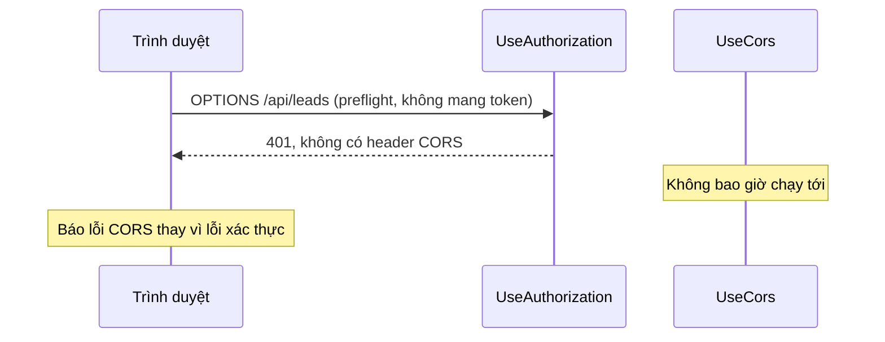

# 2.12 - CORS: đọc lỗi, preflight và thứ tự middleware

> **Tóm tắt:** Lỗi CORS (Cross-Origin Resource Sharing, cơ chế trình duyệt dùng để quyết định trang web ở origin này có được đọc phản hồi từ origin khác hay không) là thứ **mọi** lập trình viên backend đều gặp, và cũng là thứ bị hiểu sai nhiều nhất. Hiểu lầm phổ biến nhất: nghĩ rằng "server chặn request" — thực tế **server đã nhận và đã xử lý request**, chỉ là **trình duyệt** từ chối đưa phản hồi cho JavaScript vì thiếu một header. Hiểu lầm đó dẫn tới việc tìm sai chỗ hàng giờ. Bài này chỉ cách đọc thông điệp lỗi để biết **chính xác** thiếu gì, giải thích **preflight** — lý do khiến "GET thì được mà POST thì lỗi" — và ba cấu hình sai hay gặp, trong đó có một cấu hình **trông như đã bật CORS** nhưng thực ra không hoạt động.

## Mục tiêu bài học

Sau bài này bạn có thể:

- Đọc thông điệp lỗi CORS và biết chính xác thiếu gì.
- Giải thích preflight request và khi nào nó xảy ra.
- Cấu hình CORS đúng trong ASP.NET Core.
- Tránh ba cấu hình sai thường gặp.

**Cần biết trước:** [2.4 — HTTP/HTTPS](2.4-http-https.md) (method, header) và [2.7 — Authentication và Authorization](2.7-authentication-and-authorization.md) (`401`, token). Bài tập cần tạo được Web API như [bài 0.5](../module-00-setup/0.5-first-web-api.md). *Origin* của một trang là bộ ba giao thức, tên miền và cổng: `https://crm.company.com` và `https://api.company.com` là hai origin khác nhau.

## Nội dung bài học

### 2.12.1 — Thông điệp lỗi

```
Access to fetch at 'https://api.company.com/leads'
from origin 'https://crm.company.com' has been blocked by CORS policy:
No 'Access-Control-Allow-Origin' header is present on the requested resource.
```

Đọc từng phần:

| Phần | Nghĩa |
|---|---|
| `from origin 'https://crm.company.com'` | Trang web đang gọi |
| `at 'https://api.company.com/leads'` | Đích đến |
| `No 'Access-Control-Allow-Origin' header` | **Thiếu chính xác header này** |

Thông điệp nói thẳng thiếu gì. Ba biến thể khác bạn sẽ gặp:

```
... does not have HTTP ok status.
    -> Server trả về lỗi cho request preflight (OPTIONS)

... The value of the 'Access-Control-Allow-Origin' header is not equal to
    the supplied origin.
    -> Có header nhưng SAI giá trị origin

... Request header field authorization is not allowed by
    Access-Control-Allow-Headers.
    -> Thiếu khai báo header 'authorization' được phép
```

Mỗi biến thể chỉ ra một chỗ sửa khác nhau. Đọc kỹ tiết kiệm rất nhiều thời gian ([CORS trên MDN](https://developer.mozilla.org/en-US/docs/Web/HTTP/CORS)).

### 2.12.2 — Hiểu lầm lớn nhất

```
Hiểu SAI:  "Server từ chối request của tôi."
Thực tế:   Server ĐÃ NHẬN request, ĐÃ XỬ LÝ, ĐÃ TRẢ VỀ phản hồi.
           TRÌNH DUYỆT từ chối đưa phản hồi đó cho JavaScript.
```

Bằng chứng: chạy cùng request bằng `curl` sẽ **thành công**.

```bash
curl -i https://api.company.com/leads -H "Origin: https://crm.company.com"
# 200 OK — dữ liệu trả về bình thường
```

`curl` không phải trình duyệt nên không thực thi chính sách CORS.

Hệ quả quan trọng về **bảo mật**: CORS **không bảo vệ API của bạn**. Nó bảo vệ **người dùng** khỏi việc một trang web độc hại đọc dữ liệu từ một trang khác mà họ đang đăng nhập. Ai cũng gọi API của bạn được bằng `curl` hoặc Postman — nên xác thực và phân quyền vẫn là bắt buộc ([bài 2.7](2.7-authentication-and-authorization.md)).

### 2.12.3 — Preflight: vì sao GET được mà POST lỗi

Với một số request, trình duyệt gửi **trước** một request `OPTIONS` để hỏi xem có được phép không:

```
1. Trinh duyet -> OPTIONS /api/leads
                  Origin: https://crm.company.com
                  Access-Control-Request-Method: POST
                  Access-Control-Request-Headers: authorization, content-type

2. Server      -> 204 No Content
                  Access-Control-Allow-Origin: https://crm.company.com
                  Access-Control-Allow-Methods: GET, POST, PUT, DELETE
                  Access-Control-Allow-Headers: authorization, content-type
                  Access-Control-Max-Age: 3600

3. Trình duyệt -> POST /api/leads   (giờ mới gửi request thật)
```

**Khi nào có preflight:** khi request dùng method khác `GET`/`HEAD`/`POST`, hoặc có header tuỳ chỉnh (như `Authorization`), hoặc `Content-Type` là `application/json`.

Điều này giải thích triệu chứng rất hay gặp: **`GET` đơn giản thì chạy, nhưng `POST` với JSON thì lỗi** — vì cái sau kích hoạt preflight còn cái trước thì không.

**`Access-Control-Max-Age`** cho trình duyệt nhớ kết quả preflight, tránh gửi `OPTIONS` trước **mỗi** request. Thiếu nó nghĩa là số request tăng gấp đôi.

### 2.12.4 — Cấu hình đúng trong ASP.NET Core

```csharp
builder.Services.AddCors(options =>
{
    options.AddPolicy("CrmFrontend", policy =>
    {
        policy.WithOrigins(
                  "https://crm.company.com",
                  "http://localhost:5173")        // môi trường phát triển
              .AllowAnyHeader()
              .AllowAnyMethod()
              .AllowCredentials()                 // nếu dùng cookie
              .SetPreflightMaxAge(TimeSpan.FromHours(1));
    });
});

var app = builder.Build();

app.UseCors("CrmFrontend");     // PHẢI trước UseAuthentication và MapControllers
```

### 2.12.5 — Ba cấu hình sai thường gặp

**Sai 1 — `UseCors` đặt sai vị trí.**

```csharp
// SAI — CORS chạy SAU khi request có thể đã bị từ chối vì chưa xác thực
app.UseAuthentication();
app.UseAuthorization();
app.UseCors("CrmFrontend");     // quá muộn
app.MapControllers();
```

Middleware (các đoạn xử lý mà mọi request lần lượt đi qua, [bài 8.2](../../stage-03-aspnet-core-backend/module-08-aspnet-core-fundamentals/8.2-request-pipeline-and-middleware.md)) chạy **theo thứ tự đăng ký**. `UseAuthentication` chỉ xác định "bạn là ai" và không tự từ chối ai; chính `UseAuthorization` mới trả `401` khi endpoint yêu cầu đăng nhập mà request không có token. Khi đó `UseCors` không bao giờ chạy tới, nên phản hồi `401` thiếu header CORS, và trình duyệt báo lỗi CORS thay vì lỗi xác thực. Chạy thật trên .NET 10 (Bài 3), có hai mức độ:

- **Ứng dụng đặt `FallbackPolicy`**, tức mọi endpoint mặc định đều yêu cầu đăng nhập: chính request preflight `OPTIONS`, vốn không mang token, cũng nhận `401`. Trình duyệt không gửi request thật nữa.
- **Không có `FallbackPolicy`**: preflight vẫn qua, vì nó không khớp vào endpoint nào đòi đăng nhập. Nhưng mọi phản hồi lỗi `401` hoặc `403` của request thật đều thiếu header CORS, nên JavaScript không đọc được mã lỗi. Frontend thấy "lỗi CORS" trong khi vấn đề thật chỉ là token hết hạn.

Đây là cấu hình sai gây nhầm lẫn nhiều nhất.



**Sai 2 — `AllowAnyOrigin` cùng `AllowCredentials`.**

```csharp
// KHÔNG HOẠT ĐỘNG — đặc tả cấm tổ hợp này
policy.AllowAnyOrigin().AllowCredentials();
```

Đặc tả CORS **cấm** dùng `*` cho origin khi có `credentials`, vì như vậy bất kỳ trang web nào cũng đọc được dữ liệu của người dùng đang đăng nhập. ASP.NET Core ném exception ngay lúc khởi động. Chạy thật trên .NET 10:

```text
System.InvalidOperationException: The CORS protocol does not allow specifying a wildcard (any) origin and credentials at the same time. Configure the CORS policy by listing individual origins if credentials needs to be supported.
```

Phải liệt kê origin cụ thể:

```csharp
policy.WithOrigins("https://crm.company.com").AllowCredentials();
```

**Sai 3 — `AllowAnyOrigin` trên production.**

```csharp
// SAI tren production
policy.AllowAnyOrigin().AllowAnyHeader().AllowAnyMethod();
```

Nó "sửa được lỗi" ngay nên rất hấp dẫn, nhưng nó cho **mọi** trang web gọi API của bạn từ trình duyệt của người dùng. Với API công khai không có xác thực thì chấp nhận được; với API nội bộ thì không.

Cách đúng: đọc danh sách origin từ cấu hình theo môi trường.

```csharp
policy.WithOrigins(builder.Configuration.GetSection("Cors:Origins").Get<string[]>()!)
```

### 2.12.6 — Tự kiểm tra trong vài phút

**1. Xem preflight có thành công không:**

```bash
curl -i -X OPTIONS https://api.company.com/leads \
  -H "Origin: https://crm.company.com" \
  -H "Access-Control-Request-Method: POST" \
  -H "Access-Control-Request-Headers: authorization,content-type"
```

Phải trả về `204` hoặc `200` **kèm** các header `Access-Control-Allow-*`. Nếu trả về `401` hoặc `404`, vấn đề nằm ở thứ tự middleware hoặc route.

**2. Kiểm tra thứ tự middleware:**

```bash
grep -n "UseCors\|UseAuthentication\|UseAuthorization\|MapControllers" Program.cs
```

`UseCors` phải đứng **trước** cả ba cái còn lại.

**3. Kiểm tra origin khớp chính xác:**

```
https://crm.company.com   va   https://crm.company.com/   -> KHAC NHAU
http://localhost:5173     va   http://127.0.0.1:5173      -> KHAC NHAU
```

So khớp origin là **chính xác từng ký tự**, không có dấu `/` ở cuối, và `localhost` khác `127.0.0.1` dù trỏ cùng một chỗ.

### 2.12.7 — Danh sách rà soát cho dự án thật

**Danh sách rà soát CORS**

- [ ] UseCors đặt trước UseAuthentication, UseAuthorization và MapControllers.
- [ ] Không dùng AllowAnyOrigin trên production cho API có xác thực.
- [ ] Origin liệt kê cụ thể và đọc từ cấu hình theo môi trường.
- [ ] Origin viết chính xác, không thừa dấu gạch chéo cuối.
- [ ] Đã đặt SetPreflightMaxAge để giảm số request OPTIONS.
- [ ] Đã thử request OPTIONS bằng curl và xác nhận trả về header đúng.
- [ ] Hiểu rằng CORS không bảo vệ API, nên vẫn có xác thực và phân quyền.

## Bài tập áp dụng

#### Bài 1 — Tái hiện lỗi

Dựng một API ASP.NET Core không bật CORS và gọi nó từ một trang HTML ở origin khác. Đọc thông điệp lỗi trong console.

**Tiêu chí hoàn thành:** bạn thấy lỗi trong console trình duyệt **nhưng cũng thấy máy chủ trả về 200** — và giải thích được vì sao cả hai điều đó cùng đúng.

<details>
<summary><strong>Gợi ý và lời giải — Bài 1</strong></summary>

**Gợi ý.** Dùng `curl` với header `Origin` để xem máy chủ thật sự trả về gì. Kết quả sẽ khác với điều bạn thấy trong trình duyệt.

**Lời giải — API có CORS cho một origin duy nhất.** Tạo project `dotnet new web -n CorsLab`, thay `Program.cs`:

```csharp
var builder = WebApplication.CreateBuilder(args);

builder.Services.AddCors(o => o.AddPolicy("web", p => p
    .WithOrigins("http://localhost:3000")
    .AllowAnyHeader()
    .AllowAnyMethod()));

var app = builder.Build();
app.UseCors("web");

app.MapGet("/api/leads/8842", () => Results.Ok(new { id = 8842 }));
app.MapPost("/api/leads", (object body) => Results.Ok(body));

app.Run();
```

Chạy bằng `dotnet run --urls http://127.0.0.1:5288`. Bài 2 dùng lại API này.

**Gọi từ origin ĐƯỢC PHÉP:**

```bash
curl -s -D - -o /dev/null -H "Origin: http://localhost:3000" \
  http://127.0.0.1:5288/api/leads/8842
```

Kết quả chạy thật trên .NET 10:

```text
HTTP/1.1 200 OK
Content-Type: application/json; charset=utf-8
Date: Sat, 17 Oct 2026 15:22:12 GMT
Server: Kestrel
Access-Control-Allow-Origin: http://localhost:3000
Transfer-Encoding: chunked
```

**Gọi từ origin KHÔNG được phép:**

```bash
curl -s -D - -o /dev/null -H "Origin: http://evil.example" \
  http://127.0.0.1:5288/api/leads/8842
```

```text
HTTP/1.1 200 OK
Content-Type: application/json; charset=utf-8
Date: Sat, 17 Oct 2026 15:22:12 GMT
Server: Kestrel
Transfer-Encoding: chunked
```

**Hai phản hồi này là toàn bộ bài học của bài tập.**

```text
Origin không được phép -> máy chủ VẪN trả 200
                       -> máy chủ VẪN gửi đầy đủ body
                       -> chỉ THIẾU header Access-Control-Allow-Origin
```

Trong khi đó, trình duyệt Chrome báo một thông điệp có dạng:

```text
Access to fetch at 'http://127.0.0.1:5288/api/leads/8842' from origin
'http://evil.example' has been blocked by CORS policy: No 'Access-Control-Allow-Origin'
header is present on the requested resource.
```

**Vì sao cả hai cùng đúng:**

```text
Máy chủ KHÔNG chặn gì cả. Nó xử lý request và trả kết quả bình thường.

TRÌNH DUYỆT nhận phản hồi, không thấy header cho phép,
và từ chối đưa dữ liệu đó cho JavaScript của trang.

-> dữ liệu ĐÃ đi qua mạng
-> chỉ là JavaScript không đọc được nó
```

Đây chính là hiểu lầm ở mục 2.12.2, và nó dẫn tới ba hệ quả thực tế:

**1. CORS không phải một cơ chế bảo mật cho máy chủ.**

```text
curl, Postman, một script Python, một backend khác
-> KHÔNG có khái niệm origin -> CORS không ảnh hưởng gì

Muốn bảo vệ dữ liệu: cần XÁC THỰC và PHÂN QUYỀN.
CORS chỉ bảo vệ NGƯỜI DÙNG khỏi việc một trang web lạ
đọc dữ liệu của họ bằng phiên đăng nhập của chính họ.
```

**2. Nếu request đã gây tác dụng phụ, tác dụng đó ĐÃ xảy ra.**

```text
POST /api/leads/8842/xoa từ origin lạ
-> preflight thất bại -> trình duyệt KHÔNG gửi request thật
-> an toàn

Nhưng với một request ĐƠN GIẢN (xem bài 2 dưới đây):
-> không có preflight -> request THẬT được gửi
-> máy chủ xử lý -> dữ liệu bị đổi
-> trình duyệt chỉ chặn việc ĐỌC phản hồi
```

Đây là lý do CSRF là một vấn đề **khác** với CORS, và cần biện pháp riêng.

**3. Gỡ lỗi CORS phải nhìn vào HEADER, không nhìn vào mã trạng thái.**

```bash
# Câu hỏi đúng: phản hồi có header cho phép không?
curl -sI -H "Origin: https://crm.vn" https://api.crm.vn/api/leads \
  | grep -i access-control
```

```text
Không có dòng nào -> máy chủ không cho phép origin đó
Có dòng Access-Control-Allow-Origin -> vấn đề nằm ở chỗ khác
```

**Và một điểm hay gây nhầm trong cấu hình:**

```csharp
// SAI — dấu gạch chéo ở cuối làm origin không khớp
.WithOrigins("https://crm.vn/")

// ĐÚNG — origin gồm giao thức + tên miền + cổng, KHÔNG có đường dẫn
.WithOrigins("https://crm.vn")
```

```text
Origin là một chuỗi so khớp CHÍNH XÁC:
    https://crm.vn        khác  https://www.crm.vn
    https://crm.vn        khác  http://crm.vn
    https://crm.vn        khác  https://crm.vn:8443
```

Ba dòng này giải thích phần lớn trường hợp "tôi đã cấu hình rồi mà vẫn lỗi".

</details>

---

#### Bài 2 — Quan sát preflight

Gọi `GET` rồi gọi `POST` với JSON, xem tab Network và đếm số request thực tế được gửi.

**Tiêu chí hoàn thành:** bạn đếm được **một** request cho `GET` và **hai** cho `POST` JSON, và nêu được chính xác điều gì kích hoạt preflight.

<details>
<summary><strong>Gợi ý và lời giải — Bài 2</strong></summary>

**Gợi ý.** Không phải phương thức quyết định, mà là **tổ hợp** phương thức, header và kiểu nội dung.

**Lời giải — gọi preflight bằng `curl`:**

```bash
curl -s -D - -o /dev/null -X OPTIONS \
  -H "Origin: http://localhost:3000" \
  -H "Access-Control-Request-Method: POST" \
  -H "Access-Control-Request-Headers: content-type" \
  http://127.0.0.1:5288/api/leads
```

Kết quả chạy thật trên .NET 10:

```text
HTTP/1.1 204 No Content
Date: Sat, 17 Oct 2026 15:22:12 GMT
Server: Kestrel
Access-Control-Allow-Headers: content-type
Access-Control-Allow-Methods: POST
Access-Control-Allow-Origin: http://localhost:3000
```

Rồi request thật:

```bash
curl -s -D - -o /dev/null -X POST \
  -H "Origin: http://localhost:3000" \
  -H "Content-Type: application/json" \
  -d '{"fullName":"Nguyen Van A"}' \
  http://127.0.0.1:5288/api/leads
```

```text
HTTP/1.1 200 OK
Content-Type: application/json; charset=utf-8
Date: Sat, 17 Oct 2026 15:22:12 GMT
Server: Kestrel
Access-Control-Allow-Origin: http://localhost:3000
Transfer-Encoding: chunked
```

Trong tab Network của trình duyệt, hai dòng đó hiện ra đại ý như sau:

```text
Name          Method    Status   Type
-----------   -------   ------   --------
leads         OPTIONS   204      preflight
leads         POST      200      fetch
```

Còn `GET` đơn giản chỉ có một dòng:

```text
leads/8842    GET       200      fetch
```

**Điều gì kích hoạt preflight — một request được coi là "đơn giản" khi thoả CẢ BA:**

| Điều kiện | Giá trị được phép |
|---|---|
| Phương thức | `GET`, `HEAD`, `POST` |
| Header tự đặt | Chỉ vài header cơ bản (`Accept`, `Accept-Language`, `Content-Language`, `Content-Type`) |
| `Content-Type` | `text/plain`, `multipart/form-data`, `application/x-www-form-urlencoded` |

```text
Thiếu MỘT trong ba -> preflight.
```

**Đây là lý do `GET` được mà `POST` JSON thì lỗi:**

```text
GET không header đặc biệt          -> đơn giản   -> không preflight
POST với Content-Type: text/plain  -> đơn giản   -> không preflight
POST với Content-Type: application/json -> KHÔNG đơn giản -> preflight
```

```text
Chính application/json kích hoạt preflight, không phải POST.
```

Và một trường hợp hay gặp không kém:

```javascript
// GET, nhưng CÓ preflight — vì có header tự đặt
fetch('/api/leads', {
  headers: { 'Authorization': 'Bearer ...' }     // header không nằm trong danh sách cơ bản
});
```

```text
-> mọi lời gọi API có Bearer token đều kích hoạt preflight
-> tức gần như MỌI lời gọi trong một ứng dụng có đăng nhập
```

**Cái giá của preflight, và cách giảm:**

```text
Mỗi lời gọi API = HAI vòng khứ hồi thay vì một
Với độ trễ mạng 50 ms -> thêm 50 ms cho mỗi lời gọi
Một trang gọi 12 API -> thêm 600 ms
```

```csharp
builder.Services.AddCors(o => o.AddPolicy("web", p => p
    .WithOrigins("https://crm.vn")
    .AllowAnyHeader()
    .AllowAnyMethod()
    .SetPreflightMaxAge(TimeSpan.FromHours(24))));    // <- quan trọng
```

```text
Access-Control-Max-Age: 86400
-> trình duyệt lưu kết quả preflight 24 giờ
-> chỉ lời gọi ĐẦU TIÊN tới mỗi endpoint phải preflight
```

```text
Lưu ý: trình duyệt có trần riêng cho giá trị này.
Chrome giới hạn ở 2 giờ, Firefox ở 24 giờ.
-> đặt 24 giờ vẫn đúng, chỉ là Chrome sẽ dùng 2 giờ.
```

**Và cách loại bỏ preflight hoàn toàn: đặt API cùng origin với web.**

```text
Trước: web ở https://crm.vn, API ở https://api.crm.vn
       -> khác origin -> CORS -> preflight

Sau:   web ở https://crm.vn, API ở https://crm.vn/api
       -> CÙNG origin -> không có CORS, không có preflight
       -> và cookie gửi tự nhiên, không cần cấu hình gì thêm
```

Cách này thường được dựng bằng một reverse proxy định tuyến `/api` sang backend. Nó bỏ được cả một lớp cấu hình — nên nếu kiến trúc cho phép, đây là lựa chọn đơn giản hơn hẳn việc cấu hình CORS cho đúng.

</details>

---

#### Bài 3 — Thử sai thứ tự

Dựng một API mà mọi endpoint đều yêu cầu đăng nhập, đặt `UseCors` sau `UseAuthentication` và `UseAuthorization`, rồi gửi preflight. Sau đó đổi lại thứ tự đúng và gửi lại.

**Tiêu chí hoàn thành:** bạn thấy mã trạng thái của preflight đổi giữa hai thứ tự, giải thích được vì sao trình duyệt khi đó báo lỗi CORS chứ không báo lỗi xác thực, và biết thứ tự đúng của các middleware liên quan.

<details>
<summary><strong>Gợi ý và lời giải — Bài 3</strong></summary>

**Gợi ý.** Preflight là một request `OPTIONS` **không có** token. Nghĩ xem điều gì xảy ra nếu middleware kiểm tra quyền chạy trước middleware CORS.

**Lời giải — thứ tự sai.** Tạo project `dotnet new web -n CorsOrder`, thay `Program.cs`:

```csharp
using Microsoft.AspNetCore.Authorization;

var builder = WebApplication.CreateBuilder(args);

builder.Services.AddCors(o => o.AddPolicy("web", p => p
    .WithOrigins("http://localhost:3000")
    .AllowAnyHeader()
    .AllowAnyMethod()));
builder.Services.AddAuthentication().AddBearerToken();
builder.Services.AddAuthorization(o =>
    // mọi endpoint đều yêu cầu đăng nhập, trừ khi ghi rõ AllowAnonymous()
    o.FallbackPolicy = new AuthorizationPolicyBuilder().RequireAuthenticatedUser().Build());

var app = builder.Build();

app.UseAuthentication();     // <- chạy TRƯỚC
app.UseAuthorization();
app.UseCors("web");          // <- quá muộn

app.MapPost("/api/leads", (object body) => Results.Ok(body));

app.Run();
```

`AddBearerToken()` là một kiểu xác thực bằng token có sẵn trong ASP.NET Core, dùng ở đây cho gọn; bài này không cần đăng nhập thật. Chạy bằng `dotnet run --urls http://127.0.0.1:5288`, rồi gửi preflight:

```bash
curl -s -D - -o /dev/null -X OPTIONS \
  -H "Origin: http://localhost:3000" \
  -H "Access-Control-Request-Method: POST" \
  -H "Access-Control-Request-Headers: authorization,content-type" \
  http://127.0.0.1:5288/api/leads
```

Kết quả chạy thật trên .NET 10:

```text
HTTP/1.1 401 Unauthorized
Content-Length: 0
Date: Sat, 17 Oct 2026 15:22:23 GMT
Server: Kestrel
WWW-Authenticate: Bearer
```

```text
Preflight OPTIONS /api/leads   (không có header Authorization)
-> UseAuthorization thấy chính sách mặc định yêu cầu đăng nhập
-> trả 401 NGAY, không đi tiếp
-> UseCors không bao giờ chạy -> phản hồi 401 KHÔNG có header CORS
```

Trình duyệt Chrome báo một thông điệp có dạng:

```text
Access to fetch at 'https://api.crm.vn/api/leads' from origin 'https://crm.vn'
has been blocked by CORS policy: Response to preflight request doesn't pass
access control check: No 'Access-Control-Allow-Origin' header is present.
```

**Và đây là chỗ gây hiểu nhầm:**

```text
Thông điệp nói: "lỗi CORS"
Nguyên nhân thật: middleware kiểm tra quyền chặn preflight

-> người sửa đi kiểm tra cấu hình CORS, thấy nó ĐÚNG
-> mất hàng giờ tìm ở nhầm chỗ
```

```text
Manh mối phân biệt: nhìn MÃ TRẠNG THÁI của request OPTIONS trong tab Network

204 hoặc 200 + thiếu header  -> cấu hình CORS sai
401 hoặc 403                 -> middleware chặn trước khi CORS chạy
```

**Thứ tự đúng.** Đổi ba dòng middleware thành:

```csharp
app.UseCors("web");          // <- TRƯỚC xác thực
app.UseAuthentication();
app.UseAuthorization();
```

Chạy lại, gửi lại đúng lệnh preflight trên, rồi thử thêm một `POST` thật không kèm token:

```text
HTTP/1.1 204 No Content
Date: Sat, 17 Oct 2026 15:22:27 GMT
Server: Kestrel
Access-Control-Allow-Headers: authorization,content-type
Access-Control-Allow-Methods: POST
Access-Control-Allow-Origin: http://localhost:3000
```

```text
HTTP/1.1 401 Unauthorized
Content-Length: 0
Date: Sat, 17 Oct 2026 15:22:27 GMT
Server: Kestrel
Access-Control-Allow-Origin: http://localhost:3000
WWW-Authenticate: Bearer
```

```text
Preflight OPTIONS -> UseCors nhận ra đây là preflight
                  -> trả 204 kèm header CORS NGAY, kết thúc chuỗi middleware
                  -> không bao giờ tới UseAuthorization

POST thật không token -> vẫn 401, nhưng giờ CÓ header CORS
                      -> JavaScript đọc được mã 401 và chuyển người dùng tới trang đăng nhập
```

Ở thứ tự sai, chính request `POST` không token đó cũng nhận `401` **không** kèm `Access-Control-Allow-Origin`, nên kể cả khi không có `FallbackPolicy` và preflight đi qua được, frontend vẫn chỉ thấy "lỗi CORS" mỗi khi token hết hạn.

**Thứ tự đầy đủ của các middleware hay dùng, và lý do từng vị trí:**

```csharp
app.UseExceptionHandler("/error");   // ngoài cùng: bắt mọi lỗi của các tầng trong
app.UseHsts();
app.UseHttpsRedirection();
app.UseStaticFiles();                // tệp tĩnh: trả sớm, không qua xác thực
app.UseRouting();                    // xác định endpoint -> các tầng sau cần biết
app.UseCors();                       // TRƯỚC xác thực, SAU routing
app.UseAuthentication();             // xác định "anh là ai"
app.UseAuthorization();              // xác định "anh được làm gì"
app.UseRateLimiter();                // sau xác thực: giới hạn theo người dùng
app.MapControllers();
```

**Ba quy tắc đứng sau thứ tự này:**

**1. `UseCors` phải nằm giữa `UseRouting` và `UseAuthentication`.**

```text
Sau UseRouting: vì chính sách CORS có thể gắn theo endpoint
Trước UseAuthentication: vì preflight không mang token
```

**2. `UseExceptionHandler` nằm ngoài cùng.**

```text
Nó chỉ bắt được ngoại lệ của những tầng NẰM TRONG nó.
Đặt nó ở giữa -> lỗi của các tầng trước không được xử lý
```

**3. `UseRateLimiter` sau `UseAuthentication`.**

```text
Trước xác thực: chỉ giới hạn được theo địa chỉ IP
Sau xác thực:   giới hạn được theo NGƯỜI DÙNG hoặc theo tenant
```

**Và một cách kiểm chứng thứ tự mà không phải nhớ: viết test.** Tạo project test xUnit ([bài 0.4](../module-00-setup/0.4-solution-and-unit-test.md)) cạnh `CorsOrder`, tham chiếu tới nó và thêm package `Microsoft.AspNetCore.Mvc.Testing` (dựng API ngay trong bộ nhớ để test gọi vào, [bài 9.8](../../stage-03-aspnet-core-backend/module-09-web-api-professional/9.8-api-testing.md) dạy kỹ):

```bash
dotnet new xunit -n CorsOrder.Tests
cd CorsOrder.Tests
dotnet add reference ../CorsOrder/CorsOrder.csproj
dotnet add package Microsoft.AspNetCore.Mvc.Testing
```

```csharp
using System.Net;
using Microsoft.AspNetCore.Mvc.Testing;

public class CorsOrderTests(WebApplicationFactory<Program> factory)
    : IClassFixture<WebApplicationFactory<Program>>
{
    [Fact]
    public async Task Preflight_khong_bi_chan_boi_xac_thuc()
    {
        var client = factory.CreateClient();
        var req = new HttpRequestMessage(HttpMethod.Options, "/api/leads");
        req.Headers.Add("Origin", "http://localhost:3000");
        req.Headers.Add("Access-Control-Request-Method", "POST");
        req.Headers.Add("Access-Control-Request-Headers", "authorization,content-type");

        var res = await client.SendAsync(req);

        // preflight không mang token, nên UseCors phải trả lời nó trước khi tới UseAuthorization
        Assert.Equal(HttpStatusCode.NoContent, res.StatusCode);
        Assert.True(res.Headers.Contains("Access-Control-Allow-Origin"));
    }
}
```

Từ .NET 10, `WebApplicationFactory<Program>` dùng được ngay với `Program.cs` viết kiểu top-level, không cần khai báo thêm `public partial class Program`. Chạy `dotnet test` với thứ tự đúng rồi với thứ tự sai, kết quả thật:

```text
Passed!  - Failed:     0, Passed:     1, Skipped:     0, Total:     1, Duration: 492 ms - CorsOrder.Tests.dll (net10.0)
```

```text
   Assert.Equal() Failure: Values differ
Expected: NoContent
Actual:   Unauthorized
Failed!  - Failed:     1, Passed:     0, Skipped:     0, Total:     1, Duration: 212 ms - CorsOrder.Tests.dll (net10.0)
```

Test này chạy trong vài trăm mili giây và bắt được đúng loại hồi quy khó chịu nhất: ai đó sắp xếp lại `Program.cs` cho "gọn hơn", và ứng dụng web ngừng gọi được API — trong khi mọi lần thử API bằng `curl` vẫn chạy, vì `curl` không gửi preflight.

</details>

## Tự kiểm tra

<details>
<summary>Hiểu lầm lớn nhất về CORS là gì?</summary>

Nghĩ rằng server chặn request. Thực tế server đã nhận, đã xử lý và đã trả về phản hồi, chỉ là trình duyệt từ chối đưa phản hồi đó cho JavaScript vì thiếu header. Chạy cùng request bằng curl sẽ thành công.

</details>

<details>
<summary>CORS bảo vệ ai?</summary>

Nó bảo vệ người dùng khỏi việc một trang web độc hại đọc dữ liệu từ một trang khác mà họ đang đăng nhập. Nó không bảo vệ API, vì ai cũng gọi API được bằng curl hay Postman. Xác thực và phân quyền vẫn là bắt buộc.

</details>

<details>
<summary>Khi nào trình duyệt gửi preflight?</summary>

Khi request dùng method khác GET, HEAD hoặc POST, hoặc có header tuỳ chỉnh như Authorization, hoặc Content-Type là application/json. Đó là lý do GET đơn giản thì chạy mà POST với JSON thì lỗi.

</details>

<details>
<summary>Vì sao UseCors phải đứng trước UseAuthentication và UseAuthorization?</summary>

Vì UseAuthorization có thể trả 401 hoặc 403 rồi dừng, và khi UseCors đứng sau thì phản hồi lỗi đó thiếu header CORS, nên trình duyệt báo lỗi CORS thay vì lỗi xác thực. Nếu ứng dụng đặt FallbackPolicy yêu cầu đăng nhập cho mọi endpoint, chính request OPTIONS của preflight (không mang token) cũng bị 401. Đặt UseCors trước cả UseAuthentication là cách an toàn nhất.

</details>

<details>
<summary>Vì sao không dùng được AllowAnyOrigin cùng AllowCredentials?</summary>

Vì đặc tả CORS cấm tổ hợp đó: nếu cho phép mọi origin kèm credentials thì bất kỳ trang web nào cũng đọc được dữ liệu của người dùng đang đăng nhập. ASP.NET Core ném exception ngay lúc khởi động.

</details>

<details>
<summary>Vì sao cần SetPreflightMaxAge?</summary>

Để trình duyệt nhớ kết quả preflight trong một khoảng thời gian, tránh gửi request OPTIONS trước mỗi lời gọi. Thiếu nó thì số request thực tế tăng gấp đôi.

</details>

## Kết luận

Ba điều đáng nhớ nhất:

1. **CORS là chính sách của trình duyệt**, không phải của server — `curl` vẫn gọi được.
2. **Thứ tự middleware là nguyên nhân số một** của lỗi CORS khó hiểu.
3. **CORS không thay thế xác thực.** Nó bảo vệ người dùng, không bảo vệ API.

## Tham khảo

- [CORS trên MDN](https://developer.mozilla.org/en-US/docs/Web/HTTP/CORS)
- [HTTP trên MDN](https://developer.mozilla.org/en-US/docs/Web/HTTP)
- [Enable CORS in ASP.NET Core](https://learn.microsoft.com/en-us/aspnet/core/security/cors) — thứ tự `UseCors` so với các middleware khác
- [RFC 9110 — HTTP Semantics](https://datatracker.ietf.org/doc/html/rfc9110)

## Điều hướng

- **Bài trước:** [2.11 — Ca chẩn đoán: đăng nhập được nhưng mọi trang báo 401](2.11-mini-case-study.md)
- **Bài tiếp theo:** [2.13 — Ôn tập và đánh giá Module 2](2.13-review-and-assessment.md)
- **Về module:** [Trang mục lục](README.md)
