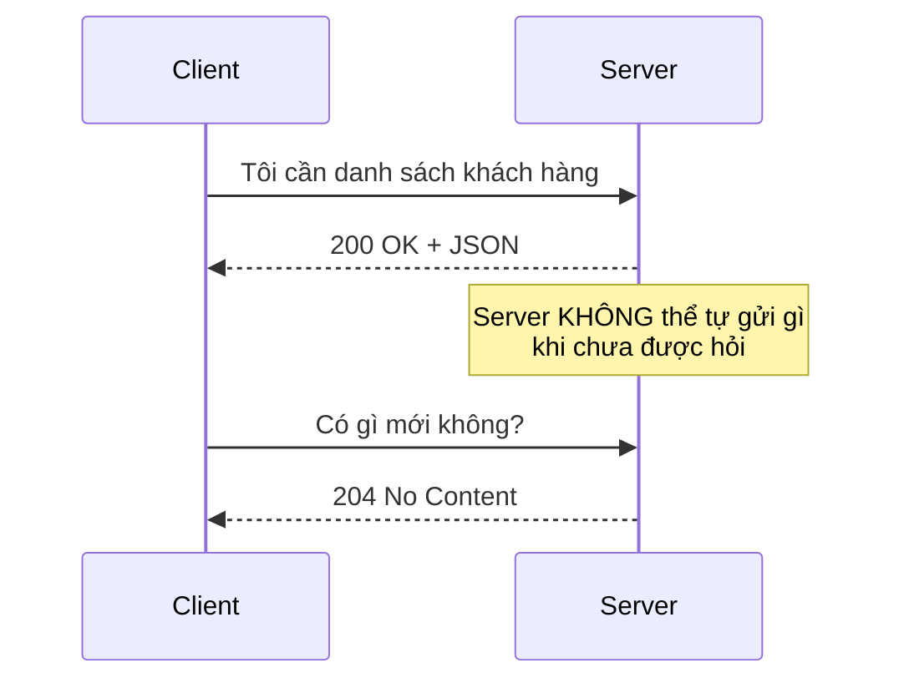
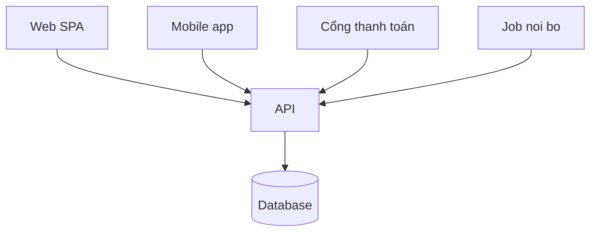

# 2.3 - Client - Server Model

> **Tóm tắt:** Mô hình client–server có hai luật chi phối gần như mọi quyết định thiết kế backend. Thứ nhất: **client luôn là bên bắt chuyện** — máy chủ không tự gọi tới trình duyệt được, và đó là lý do tồn tại của polling, WebSocket và SignalR. Thứ hai, và quan trọng hơn: **HTTP không nhớ gì giữa hai request**, nên máy chủ không mặc nhiên biết request này đến từ ai — đó là lý do sinh ra cookie, session và JWT. Cộng thêm một nguyên tắc an toàn không có ngoại lệ: mọi byte đến từ client đều là **dữ liệu do người lạ gửi**, kể cả khi chính bạn viết ra cái client đó.

## Mục tiêu bài học

Sau bài này bạn có thể:

- Giải thích vì sao máy chủ không chủ động gửi dữ liệu tới client được, và ba cách vượt qua giới hạn đó.
- Nêu ý nghĩa của "HTTP là stateless" và hệ quả của nó lên thiết kế đăng nhập.
- Chỉ ra vì sao kiểm tra ở phía client không bao giờ là bảo mật.
- Thiết kế API phục vụ nhiều loại client mà không phá vỡ client cũ.
- Dựng API thực hành CrmLab và gọi nó bằng `curl` kèm token.

**Cần biết trước:** [2.2 — Internet hoạt động như thế nào](2.2-how-the-internet-works.md), và đã tạo, chạy, gọi được một Web API ở [bài 0.5](../module-00-setup/0.5-first-web-api.md).

## Nội dung bài học

### 2.3.1 — Ai bắt chuyện trước



Trong HTTP thuần, **máy chủ không bao giờ nói trước**. Nó chỉ trả lời. Muốn đẩy dữ liệu xuống client theo thời gian thực thì phải dùng một trong ba cách:

| Cách | Nguyên lý | Dùng khi |
|---|---|---|
| **Polling** | Client hỏi lại theo chu kỳ | Đơn giản, dữ liệu đổi chậm |
| **Server-Sent Events** | Một kết nối mở, server đẩy một chiều | Thông báo, luồng sự kiện |
| **WebSocket** | Kết nối hai chiều, giữ mở | Chat, cộng tác thời gian thực |

Trong .NET, cả ba đều gói lại trong SignalR, và nó tự chọn cách tốt nhất mà môi trường cho phép — chủ đề của Module 11.

### 2.3.2 — HTTP không nhớ gì

Đây là đặc tính bị bỏ qua nhiều nhất, và nó giải thích rất nhiều thứ.

> Mỗi request HTTP là một tờ giấy trắng. Máy chủ không biết request này đến từ ai, trừ khi chính request đó mang theo bằng chứng.

Vì thế mới có:

```http
# Request 1 — đăng nhập
POST /api/auth/login
{ "email": "a@company.com", "password": "..." }

→ 200 OK
  { "token": "eyJhbGciOi..." }

# Request 2 — hoàn toàn độc lập với request 1
GET /api/customers
Authorization: Bearer eyJhbGciOi...
   ↑ phải tự mang theo bằng chứng, server không tự nhớ
```

Không có dòng `Authorization` đó, máy chủ coi bạn là người lạ — kể cả khi bạn vừa đăng nhập một giây trước.

Đánh đổi của tính stateless: máy chủ không cần nhớ gì, nên **đặt bao nhiêu máy chủ cũng được** và request đi vào máy nào cũng xử lý được như nhau. Đó là nền tảng của việc mở rộng ngang. Cái giá là mỗi request nặng hơn vì phải mang theo thông tin xác thực.

### 2.3.3 — Client không đáng tin. Không có ngoại lệ.

Đây là điều quan trọng nhất trong cả bài.

```javascript
// Phía client — JavaScript trong trình duyệt
if (user.role === 'admin') {
    showDeleteButton();       // chỉ là TRẢI NGHIỆM NGƯỜI DÙNG
}
```

Đoạn trên **không phải bảo mật**. Nó chỉ là ẩn một cái nút. Người dùng có thể mở DevTools, sửa biến, hoặc bỏ qua giao diện hoàn toàn:

```bash
curl -X DELETE https://api.company.com/customers/42 \
     -H "Authorization: Bearer <token của tài khoản thường>"
```

Nếu máy chủ không tự kiểm tra quyền, bản ghi đó bị xoá.

Danh sách những thứ **không bao giờ** được tin, dù client là do chính bạn viết:

- Giá tiền gửi lên từ giỏ hàng — luôn tính lại từ database.
- `userId` trong body request — luôn lấy từ token đã xác thực.
- Kết quả kiểm tra form phía client — luôn kiểm tra lại ở máy chủ.
- Việc một nút bị ẩn — luôn kiểm tra quyền ở endpoint.

Lỗ hổng sinh ra từ việc tin `id` mà client gửi lên có tên riêng: **IDOR** (Insecure Direct Object Reference), [bài 2.7](2.7-authentication-and-authorization.md) đi sâu. Bài [Đổi id trên URL ra dữ liệu người khác](https://tiennhm.io.vn/blog/idor-broken-access-control-aspnet-core) mổ xẻ nó và chỉ cách chặn ở một tầng duy nhất. Nó thuộc nhóm Broken Access Control, hạng mục A01 đứng đầu [OWASP Top 10:2025](https://owasp.org/Top10/).

### 2.3.4 — Một máy chủ, nhiều loại client



Hệ quả thiết kế: **không được đổi API theo kiểu phá vỡ tương thích**, vì bạn không ép được người dùng cập nhật ứng dụng di động ngay hôm nay.

Đổi an toàn và đổi phá vỡ:

| An toàn | Phá vỡ |
|---|---|
| Thêm trường mới vào response | Xoá hoặc đổi tên trường đang có |
| Thêm endpoint mới | Đổi kiểu dữ liệu của trường |
| Thêm tham số **tuỳ chọn** | Thêm tham số **bắt buộc** |
| Nới lỏng kiểm tra đầu vào | Siết chặt kiểm tra đầu vào |

Khi buộc phải phá vỡ, cách làm là đánh phiên bản (`/api/v2/customers`) và giữ bản cũ sống tới khi không còn ai dùng.

### 2.3.5 — Client dày hay client mỏng

| | Client mỏng (SSR) | Client dày (SPA) |
|---|---|---|
| Nơi render | Máy chủ | Trình duyệt |
| Lần tải đầu | Nhanh | Chậm hơn (phải tải bundle JS) |
| Thao tác sau đó | Mỗi lần tải lại trang | Nhanh, chỉ gọi API |
| SEO | Sẵn sàng | Cần xử lý thêm |
| Tải trên máy chủ | Cao hơn | Thấp hơn |

Không có phương án đúng tuyệt đối. Nhưng chú ý dòng SEO: nội dung chỉ render ở client thì crawler phải chạy JavaScript mới thấy — cùng cơ chế khiến sơ đồ Mermaid trong chính trang tài liệu này không xuất hiện trong HTML tĩnh.

### 2.3.6 — Chuẩn bị API thực hành CrmLab

Nhiều bài tập trong module cần một API có đăng nhập, có hai loại tài khoản và có dữ liệu thuộc về từng người. CrmLab là API nhỏ như vậy, chạy trên máy bạn, dữ liệu nằm trong bộ nhớ nên không cần database. Nó **cố ý chứa vài lỗi** để bạn tự tìm ra trong các bài tập ở bài này, bài 2.4, 2.5 và 2.7.

Bạn chưa cần hiểu từng dòng code. Đăng nhập bằng JWT học ở [Module 10](../../stage-03-aspnet-core-backend/module-10-authentication-authorization/README.md), minimal API học ở [Module 8](../../stage-03-aspnet-core-backend/module-08-aspnet-core-fundamentals/README.md).

**Bước 1 — tạo project:**

```bash
dotnet new web -n CrmLab
cd CrmLab
dotnet add package Microsoft.AspNetCore.Authentication.JwtBearer
```

**Bước 2 — thay toàn bộ `Program.cs`:**

<details>
<summary>Mã nguồn <code>Program.cs</code> của CrmLab</summary>

```csharp
// CrmLab: API thực hành cho Module 2.
// API này CỐ Ý chứa vài lỗi bảo mật và lỗi thiết kế để bạn tìm trong bài tập.
// Đừng dùng làm mẫu cho dự án thật.
using System.Security.Claims;
using System.Text;
using Microsoft.AspNetCore.Authentication.JwtBearer;
using Microsoft.IdentityModel.JsonWebTokens;
using Microsoft.IdentityModel.Tokens;

var key = new SymmetricSecurityKey(
    Encoding.UTF8.GetBytes("khoa-bi-mat-chi-dung-de-thuc-hanh-it-nhat-32-byte"));

var users = new List<User>
{
    new(1, "an@crm.local", "Pass@123", "Sales"),
    new(2, "binh@crm.local", "Pass@123", "Sales"),
    new(3, "admin@crm.local", "Pass@123", "Admin"),
};
var customers = new List<Customer>
{
    new(101, "Cong ty Anh Duong", OwnerId: 1),
    new(102, "Cua hang Minh Phat", OwnerId: 1),
    new(103, "Nha sach Hoa Mai", OwnerId: 2),
    new(9007199254740993, "Khach co ma lon", OwnerId: 2),
};

var builder = WebApplication.CreateBuilder(args);
builder.Services.AddAuthentication(JwtBearerDefaults.AuthenticationScheme)
    .AddJwtBearer(o =>
    {
        o.MapInboundClaims = false;
        o.TokenValidationParameters = new TokenValidationParameters
        {
            ValidateIssuer = false,
            ValidateAudience = false,
            IssuerSigningKey = key,
            RoleClaimType = "role",
        };
    });
builder.Services.AddAuthorization(o =>
    o.AddPolicy("AdminOnly", p => p.RequireRole("Admin")));

var app = builder.Build();
app.UseAuthentication();
app.UseAuthorization();

app.MapGet("/", () => "CrmLab dang chay");

app.MapPost("/auth/login", (LoginRequest req) =>
{
    var user = users.FirstOrDefault(u => u.Email == req.Email && u.Password == req.Password);
    if (user is null) return Results.Unauthorized();

    var token = new JsonWebTokenHandler().CreateToken(new SecurityTokenDescriptor
    {
        Subject = new ClaimsIdentity(
        [
            new Claim("sub", user.Id.ToString()),
            new Claim("email", user.Email),
            new Claim("role", user.Role),
        ]),
        Expires = DateTime.UtcNow.AddMinutes(15),
        SigningCredentials = new SigningCredentials(key, SecurityAlgorithms.HmacSha256),
    });
    return Results.Ok(new { accessToken = token, expiresIn = 900 });
});

// Danh sách khách hàng của người đang đăng nhập
app.MapGet("/api/customers", (ClaimsPrincipal user) =>
{
    var userId = int.Parse(user.FindFirstValue("sub")!);
    return user.IsInRole("Admin") ? customers : customers.Where(c => c.OwnerId == userId).ToList();
}).RequireAuthorization();

app.MapGet("/api/customers/{id:long}", (long id) =>
    customers.FirstOrDefault(c => c.Id == id) is { } c ? Results.Ok(c) : Results.NotFound())
   .RequireAuthorization();

app.MapGet("/api/customers/search", (string name) =>
{
    var found = customers.Where(c => c.Name.Contains(name, StringComparison.OrdinalIgnoreCase)).ToList();
    return found.Count > 0
        ? Results.Ok(new { success = true, data = found })
        : Results.Ok(new { success = false, message = "Khong tim thay khach hang" });
}).RequireAuthorization();

app.MapDelete("/api/customers/{id:long}", (long id) =>
    customers.RemoveAll(c => c.Id == id) > 0 ? Results.NoContent() : Results.NotFound())
   .RequireAuthorization("AdminOnly");

app.MapDelete("/api/users/{id:int}", (int id) =>
    users.RemoveAll(u => u.Id == id) > 0 ? Results.NoContent() : Results.NotFound())
   .RequireAuthorization();

app.Run();

record User(int Id, string Email, string Password, string Role);
record Customer(long Id, string Name, int OwnerId);
record LoginRequest(string Email, string Password);
```

</details>

**Bước 3 — chạy ở cổng cố định 5000** để các lệnh trong module dùng chung một địa chỉ:

```bash
dotnet run --urls http://localhost:5000
```

```text
info: Microsoft.Hosting.Lifetime[14]
      Now listening on: http://localhost:5000
```

Ba tài khoản có sẵn, cùng mật khẩu `Pass@123`:

| Email | Vai trò | Sở hữu khách hàng |
|---|---|---|
| `an@crm.local` | Sales | 101, 102 |
| `binh@crm.local` | Sales | 103, 9007199254740993 |
| `admin@crm.local` | Admin | (xem được tất cả) |

Dữ liệu nằm trong bộ nhớ: tắt API rồi chạy lại là mọi thứ trở về như ban đầu.

**Bước 4 — đăng nhập lấy token.** Mở một terminal **khác** (terminal đầu đang chạy API). Lệnh dưới đây viết cho Git Bash (cài cùng Git, xem [bài 3.2](../module-03-git-developer-workflow/3.2-git-install-config.md)) hoặc terminal của macOS, Linux:

```bash
TOKEN=$(curl -s -X POST http://localhost:5000/auth/login \
  -H "Content-Type: application/json" \
  -d '{"email":"an@crm.local","password":"Pass@123"}' \
  | sed 's/.*"accessToken":"\([^"]*\)".*/\1/')
echo ${#TOKEN}     # in ra độ dài token
```

```text
215
```

Lệnh `sed` cắt lấy giá trị `accessToken` trong JSON trả về và cất vào biến `TOKEN`. Độ dài khác 0 nghĩa là đã đăng nhập được.

Dùng PowerShell thì viết như sau. Trong Windows PowerShell, `curl` là tên gọi tắt của một lệnh khác, nên phải gõ `curl.exe`:

```powershell
$TOKEN = (Invoke-RestMethod -Method Post http://localhost:5000/auth/login `
  -ContentType "application/json" `
  -Body '{"email":"an@crm.local","password":"Pass@123"}').accessToken
curl.exe -i http://localhost:5000/api/customers -H "Authorization: Bearer $TOKEN"
```

### 2.3.7 — Danh sách rà soát cho dự án thật

**Danh sách rà soát client - server**

- [ ] Mọi endpoint đều tự kiểm tra quyền, không dựa vào việc giao diện đã ẩn nút.
- [ ] userId lấy từ token đã xác thực, không lấy từ body hay query string.
- [ ] Giá tiền và số tiền luôn tính lại ở máy chủ, không nhận từ client.
- [ ] Mọi kiểm tra ở form phía client đều có bản kiểm tra tương ứng ở máy chủ.
- [ ] API chưa từng xoá hay đổi tên trường mà không đánh phiên bản mới.
- [ ] Tính năng thời gian thực dùng SignalR hoặc SSE thay vì polling dày đặc.

## Bài tập áp dụng

Bài 1 và Bài 2 dùng CrmLab ở mục 2.3.6, đang chạy ở `http://localhost:5000`.

#### Bài 1 — Bỏ qua giao diện

Giả sử giao diện web của CrmLab chỉ hiện nút "Xoá khách hàng" và "Xoá người dùng" cho Admin. Đăng nhập bằng tài khoản **thường** `an@crm.local`, rồi gọi thẳng hai endpoint xoá bằng `curl`:

- `DELETE /api/customers/103`
- `DELETE /api/users/2`

**Tiêu chí hoàn thành:** bạn ghi lại mã trạng thái của cả hai, chỉ ra endpoint nào kiểm tra quyền đúng và endpoint nào có lỗ hổng.

> [!WARNING]
> **Chỉ làm trên hệ thống bạn có quyền**
>
> Bài này là kiểm thử bảo mật trên API của chính bạn. Đừng chạy nó lên hệ thống của người khác khi chưa được cho phép bằng văn bản.

<details>
<summary><strong>Gợi ý và lời giải — Bài 1</strong></summary>

**Gợi ý.** Giao diện ẩn một nút đi **không** làm endpoint biến mất. Trình duyệt chỉ là một client; `curl` là một client khác, và máy chủ không phân biệt được hai thứ đó.

**Lời giải.** Lấy token của `an@crm.local` như bước 4 ở mục 2.3.6, rồi:

```bash
curl -s -i -X DELETE http://localhost:5000/api/customers/103 \
  -H "Authorization: Bearer $TOKEN" | head -1
curl -s -i -X DELETE http://localhost:5000/api/users/2 \
  -H "Authorization: Bearer $TOKEN" | head -1
```

Kết quả chạy thật:

```text
HTTP/1.1 403 Forbidden
HTTP/1.1 204 No Content
```

| Endpoint | Mã trả về | Nghĩa là |
|---|---|---|
| `DELETE /api/customers/103` | `403 Forbidden` | Đúng: server biết bạn là ai và từ chối vì bạn không phải Admin |
| `DELETE /api/users/2` | `204 No Content` | **Lỗ hổng**: một nhân viên Sales vừa xoá được tài khoản của đồng nghiệp |

Mở `Program.cs` của CrmLab để thấy khác biệt nằm ở đâu:

```csharp
app.MapDelete("/api/customers/{id:long}", ...).RequireAuthorization("AdminOnly"); // kiểm tra vai trò
app.MapDelete("/api/users/{id:int}", ...).RequireAuthorization();                 // chỉ kiểm tra đã đăng nhập
```

Endpoint thứ hai chỉ hỏi "bạn đã đăng nhập chưa", không hỏi "bạn có phải Admin không". Gọi lại `DELETE /api/users/2` lần nữa sẽ nhận `404`, vì tài khoản đã bị xoá thật. Tắt CrmLab và chạy lại để khôi phục dữ liệu.

**Vì sao lỗi này phổ biến hơn người ta tưởng.** Lập trình viên frontend ẩn nút "Xoá" với người không phải quản trị viên, thấy chức năng hoạt động đúng, và coi như xong. Không ai nghĩ rằng phần kiểm tra ở backend là **bắt buộc riêng**, vì khi thử bằng giao diện thì không có cách nào gọi tới endpoint đó mà không qua nút.

Lỗ hổng dạng này nằm trong nhóm **Broken Access Control**, hạng mục A01 của [OWASP Top 10:2025](https://owasp.org/Top10/), đứng đầu bảng từ bản 2021.

**Hai biến thể cần kiểm tra thêm:**

1. **Truy cập tài nguyên của người khác.** Với token của `an@crm.local`, gọi `GET /api/customers/103`, khách hàng thuộc về `binh@crm.local`. CrmLab trả về dữ liệu: đó là lỗi IDOR mà [bài 2.7](2.7-authentication-and-authorization.md) sẽ phân tích, còn [bài 10.6](../../stage-03-aspnet-core-backend/module-10-authentication-authorization/10.6-resource-based-authorization.md) chỉ cách sửa bài bản.
2. **Gửi trường không được phép sửa.** Nếu API có endpoint `PATCH /api/users/me`, thử gửi kèm `{"role":"Admin"}`. Nếu server nhận cả trường `role`, người dùng tự nâng quyền cho mình. Cách phòng là dùng DTO (lớp chỉ chứa các trường được phép nhận) thay vì gắn thẳng dữ liệu vào thực thể.

**Quy tắc rút ra.** Giao diện là **trải nghiệm người dùng**, không phải **cơ chế bảo mật**. Mọi kiểm tra quyền phải có ở phía máy chủ, kể cả khi giao diện đã kiểm rồi.

</details>

#### Bài 2 — Chứng minh tính phi trạng thái

Gọi `GET /api/customers` của CrmLab hai lần: một lần có header `Authorization`, một lần không. Quan sát mã trạng thái. Giải thích vì sao máy chủ không "nhớ" bạn giữa hai lần gọi.

**Tiêu chí hoàn thành:** bạn nêu được nơi trạng thái đăng nhập thật sự được lưu, và vì sao thiết kế như vậy lại cần thiết để mở rộng hệ thống.

<details>
<summary><strong>Gợi ý và lời giải — Bài 2</strong></summary>

**Gợi ý.** Nếu máy chủ thật sự "nhớ" bạn, thì thông tin đó nằm ở đâu? Và nếu hệ thống có ba máy chủ đứng sau một bộ cân bằng tải, điều gì xảy ra khi lần gọi thứ hai rơi vào máy khác?

**Lời giải.**

```bash
# Lần 1 — có token
curl -s -o /dev/null -w "%{http_code}\n" http://localhost:5000/api/customers \
  -H "Authorization: Bearer $TOKEN"

# Lần 2 — cùng endpoint, bỏ token
curl -s -i http://localhost:5000/api/customers | grep -E "HTTP/|WWW-Authenticate"
```

Kết quả chạy thật:

```text
200
HTTP/1.1 401 Unauthorized
WWW-Authenticate: Bearer
```

Header `WWW-Authenticate: Bearer` là cách server nói "hãy gửi kèm một bearer token".

**Vì sao.** HTTP là giao thức **phi trạng thái**: mỗi request được xử lý độc lập, và máy chủ không giữ thông tin gì về các request trước đó. Danh tính người gọi **không** nằm trên máy chủ mà nằm trong chính request — cụ thể là trong header `Authorization`. Bỏ header đi thì request trở thành ẩn danh, bất kể một giây trước bạn vừa gọi thành công.

**Vì sao thiết kế này cần thiết.** Giả sử máy chủ ghi nhớ phiên đăng nhập trong bộ nhớ của nó. Ba hệ quả:

1. **Không mở rộng theo chiều ngang được.** Thêm máy chủ thứ hai thì người dùng đăng nhập ở máy A sẽ bị coi là ẩn danh khi request rơi vào máy B. Phải thêm cơ chế dính phiên hoặc kho phiên dùng chung — cả hai đều là phức tạp thêm.
2. **Khởi động lại là mất hết.** Mỗi lần triển khai phiên bản mới, toàn bộ người dùng bị đăng xuất.
3. **Bộ nhớ tăng theo số người dùng đồng thời**, tạo ra một giới hạn khó dự đoán.

Token tự chứa thông tin giải quyết cả ba: mọi máy chủ đều xác minh được token bằng khoá chung mà không cần tra cứu ở đâu, nên thêm máy chủ chỉ là thêm máy chủ.

**Cái giá của phi trạng thái.** Không có gì miễn phí. Vì máy chủ không lưu phiên, nó cũng **không thu hồi được token đã cấp**. Một token bị lộ vẫn dùng được tới khi hết hạn. Đó là lý do token truy cập nên có thời gian sống ngắn, thường 5 tới 15 phút, và đi kèm cơ chế làm mới — chủ đề của [bài 10.3](../../stage-03-aspnet-core-backend/module-10-authentication-authorization/10.3-refresh-token.md).

**Phân biệt với cookie.** Cookie cũng được gửi kèm mỗi request, nên về bản chất vẫn là phi trạng thái ở tầng HTTP. Khác biệt nằm ở chỗ **trình duyệt tự động gửi** cookie, còn header `Authorization` thì code phải chủ động thêm. Chính tính tự động đó sinh ra lớp tấn công giả mạo yêu cầu liên trang, và là lý do API dùng token thường ít bị ảnh hưởng hơn.

</details>

#### Bài 3 — Phân loại thay đổi API

Nhóm phát triển CrmLab định làm sáu thay đổi sau. Xếp từng thay đổi vào bảng ở mục 2.3.4. Với những thay đổi phá vỡ tương thích, trả lời: ứng dụng di động phiên bản cũ có còn chạy được không?

1. Thêm trường `phone` vào mỗi khách hàng trong `GET /api/customers`.
2. Đổi tên trường `name` thành `fullName`.
3. Đổi `id` của khách hàng từ số sang chuỗi để tránh lỗi số lớn ở [bài 2.5](2.5-api-and-json.md).
4. Thêm endpoint mới `GET /api/deals`.
5. Bắt buộc gửi thêm trường `tenant` khi đăng nhập.
6. `GET /api/customers/search` trả thẳng danh sách (mảng rỗng `[]` khi không tìm thấy) thay vì bọc trong `{"success": ..., "data": ...}`.

**Tiêu chí hoàn thành:** bạn phân loại đúng cả sáu, và nhận ra ít nhất một thay đổi tưởng vô hại (hoặc thậm chí là sửa lỗi) nhưng thực ra phá vỡ tương thích.

<details>
<summary><strong>Gợi ý và lời giải — Bài 3</strong></summary>

**Gợi ý.** Tiêu chí phân loại chỉ có một câu: *một client viết theo phiên bản cũ, không sửa gì, có còn chạy đúng không?* Nếu câu trả lời là không thì đó là thay đổi phá vỡ, bất kể nó nhỏ tới đâu.

Điểm mấu chốt cần nhớ: ứng dụng web thì bạn triển khai phiên bản mới là mọi người dùng nhận ngay. **Ứng dụng di động thì không** — người dùng phải tự cập nhật, và một phần đáng kể sẽ không cập nhật trong nhiều tháng.

**Lời giải — sáu thay đổi của CrmLab:**

| # | Thay đổi | Phá vỡ? | Vì sao |
|---|---|---|---|
| 1 | Thêm `phone` | Không | Client cũ bỏ qua trường nó không biết |
| 2 | `name` thành `fullName` | **Có** | Client cũ đọc `name`, nhận `null` hoặc lỗi |
| 3 | `id` từ số sang chuỗi | **Có** | Code client đang coi `id` là số sẽ hỏng khi giải mã |
| 4 | Thêm `GET /api/deals` | Không | Client cũ không gọi tới |
| 5 | Bắt buộc `tenant` khi đăng nhập | **Có** | Client cũ không gửi, nhận `400`, không ai đăng nhập được |
| 6 | Bỏ lớp bọc `success`/`data` | **Có** | Đúng chuẩn hơn ([bài 2.4](2.4-http-https.md)), nhưng client cũ đang đọc `success` và `data` sẽ không tìm thấy hai trường đó |

Thay đổi 3 và 6 đều là **sửa lỗi** mà vẫn phá vỡ client cũ. Sửa đúng cách là phát hành ở phiên bản API mới, như đoạn cuối lời giải này.

**Bảng phân loại tổng quát:**

| Thay đổi | Phá vỡ? | Vì sao |
|---|---|---|
| Thêm một trường vào phản hồi | Không | Client cũ bỏ qua trường nó không biết |
| Thêm một tham số truy vấn **tuỳ chọn** | Không | Không gửi thì dùng giá trị mặc định |
| Thêm một endpoint mới | Không | Client cũ không gọi tới |
| **Đổi tên một trường** | **Có** | Client cũ đọc tên cũ và nhận `null` |
| **Đổi kiểu dữ liệu của một trường** | **Có** | Chuỗi thành số làm hỏng phần giải mã |
| **Thêm một trường bắt buộc vào request** | **Có** | Client cũ không gửi, nhận `400` |
| **Thắt chặt quy tắc xác thực** | **Có** | Dữ liệu trước đây hợp lệ nay bị từ chối |
| **Đổi mã trạng thái trả về** | **Có** | Client cũ xử lý nhánh lỗi khác đi |

**Ba thay đổi hay bị đánh giá nhầm là vô hại:**

1. **Thắt chặt xác thực.** Thêm giới hạn "số điện thoại tối đa 15 ký tự" nghe như một cải thiện chất lượng dữ liệu. Nhưng mọi client đang gửi số dài hơn bỗng nhận `400`, và họ không hề biết trước.
2. **Đổi `200` thành `204` cho phản hồi rỗng.** Đúng hơn về mặt ngữ nghĩa, nhưng client nào đang cố đọc thân phản hồi sẽ hỏng.
3. **Bỏ một trường không ai dùng.** Vấn đề là bạn không có cách nào chắc chắn không ai dùng. Với ứng dụng di động, "không ai dùng" chỉ có nghĩa là *không ai bạn biết*.

**Trả lời câu hỏi của đề.** Với ứng dụng di động, một thay đổi phá vỡ khiến các phiên bản cũ ngừng hoạt động cho tới khi người dùng cập nhật. Dữ liệu thực tế cho thấy quá trình này kéo dài nhiều tháng, và một phần người dùng không bao giờ cập nhật. Vì vậy quy tắc là **không bao giờ thay đổi phá vỡ trên một phiên bản API đang phục vụ**; thay vào đó phát hành `v2` và giữ `v1` chạy song song.

[Bài 9.2 — API Versioning](../../stage-03-aspnet-core-backend/module-09-web-api-professional/9.2-api-versioning.md) trình bày cách chạy song song hai phiên bản, và cách báo hiệu ngừng hỗ trợ bằng header `Sunset` để client biết trước thay vì bị cắt đột ngột.

</details>

## Tự kiểm tra

<details>
<summary>Vì sao máy chủ không tự gửi dữ liệu xuống client được?</summary>

Vì trong HTTP, client luôn là bên mở kết nối và đặt câu hỏi; máy chủ chỉ trả lời. Muốn đẩy dữ liệu theo thời gian thực thì phải dùng polling, Server-Sent Events hoặc WebSocket. Trong .NET, SignalR gói cả ba lại và tự chọn cách tốt nhất mà môi trường cho phép.

</details>

<details>
<summary>HTTP là stateless nghĩa là gì?</summary>

Nghĩa là mỗi request độc lập hoàn toàn với request trước, máy chủ không tự nhớ bạn là ai. Vì thế request nào cần xác thực đều phải tự mang theo bằng chứng, thường là cookie hoặc JWT trong header Authorization. Đổi lại, máy chủ không giữ trạng thái nên thêm bao nhiêu máy chủ cũng được — đó là nền tảng của mở rộng ngang.

</details>

<details>
<summary>Kiểm tra ở phía client có phải là bảo mật không?</summary>

Không. Nó chỉ là trải nghiệm người dùng. Người dùng có thể mở DevTools sửa biến, hoặc bỏ qua giao diện hoàn toàn và gọi thẳng API bằng curl. Mọi kiểm tra quyền và kiểm tra dữ liệu phải được làm lại ở máy chủ, kể cả khi client là do chính bạn viết.

</details>

<details>
<summary>Những dữ liệu nào từ client không bao giờ được tin?</summary>

Giá tiền gửi lên từ giỏ hàng, userId trong body request, kết quả kiểm tra form phía client, và việc một nút đã bị ẩn trên giao diện. Giá phải tính lại từ database, userId phải lấy từ token đã xác thực, kiểm tra phải làm lại ở máy chủ, và mọi endpoint phải tự kiểm tra quyền.

</details>

<details>
<summary>Thay đổi API nào là phá vỡ tương thích?</summary>

Xoá hoặc đổi tên trường đang có, đổi kiểu dữ liệu của trường, thêm tham số bắt buộc, và siết chặt kiểm tra đầu vào. Ngược lại, thêm trường mới vào response, thêm endpoint mới, thêm tham số tuỳ chọn và nới lỏng kiểm tra đều an toàn. Khi buộc phải phá vỡ thì đánh phiên bản mới và giữ bản cũ sống tới khi không còn ai dùng.

</details>

<details>
<summary>IDOR là gì?</summary>

Là lỗ hổng xảy ra khi máy chủ nhận một id từ request rồi đọc hoặc sửa bản ghi đó mà không kiểm tra người gọi có quyền với bản ghi hay không. Đổi số trên URL là xem được dữ liệu người khác. Nó thuộc nhóm Broken Access Control, hạng mục đứng đầu OWASP Top 10:2025.

</details>

## Kết luận

Ba điều đáng nhớ nhất:

1. **Client luôn hỏi trước.** Mọi tính năng thời gian thực đều là cách đi vòng quanh giới hạn này.
2. **HTTP không nhớ gì, và đó là tính năng.** Nhờ vậy mới mở rộng ngang được; cái giá là mỗi request phải tự mang theo danh tính.
3. **Kiểm tra ở client là giao diện, kiểm tra ở server mới là bảo mật.** Cái nút bị ẩn không chặn được `curl`.

## Tham khảo

- [HTTP — MDN](https://developer.mozilla.org/en-US/docs/Web/HTTP) — mô hình request/response
- [OWASP Top 10:2025](https://owasp.org/Top10/) — Broken Access Control đứng đầu danh sách
- [Authorization in ASP.NET Core](https://learn.microsoft.com/en-us/aspnet/core/security/authorization/introduction) — kiểm tra quyền ở đúng chỗ
- [ASP.NET Core Web API](https://learn.microsoft.com/en-us/aspnet/core/web-api/) — thiết kế API cho nhiều loại client

## Điều hướng

- **Bài trước:** [2.2 — Internet hoạt động như thế nào](2.2-how-the-internet-works.md)
- **Bài tiếp theo:** [2.4 — HTTP/HTTPS](2.4-http-https.md)
- **Về module:** [Trang mục lục](README.md)

## Bài liên quan

- [Đổi id trên URL ra dữ liệu người khác? Chặn IDOR ở một tầng duy nhất](https://tiennhm.io.vn/blog/idor-broken-access-control-aspnet-core) — IDOR xảy ra khi API nhận id từ request rồi đọc thẳng bản ghi mà không hỏi xem người gọi có sở hữu bản ghi đó không.
