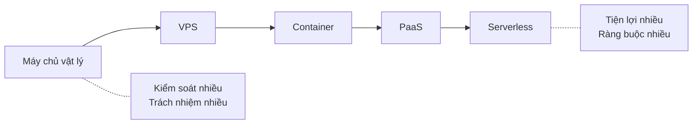
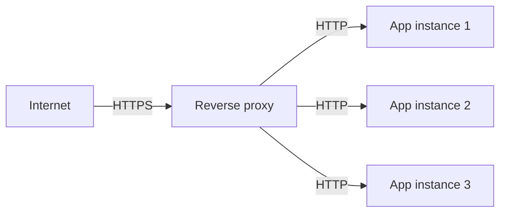

# 2.8 - Hosting và Cloud cơ bản

> **Tóm tắt:** Mọi lựa chọn hosting đều nằm trên **một trục duy nhất: đổi quyền kiểm soát lấy sự tiện lợi**. Máy chủ vật lý cho bạn toàn quyền và toàn bộ trách nhiệm; serverless lo hộ gần hết nhưng bắt bạn viết theo cách của nó. Bài này đi qua năm nấc trên trục đó, vai trò của **reverse proxy** (kết thúc TLS, định tuyến, cân bằng tải — thứ mà gần như mọi hệ thống production đều có), và hai bài học rút từ sự cố thật: **chọn base image sai làm ứng dụng chết lúc chạy chứ không phải lúc build**, và **gia hạn chứng chỉ tự động hỏng theo cách rất khó nhận ra**.

## Mục tiêu bài học

Sau bài này bạn có thể:

- Xếp năm mô hình hosting theo trục kiểm soát và tiện lợi, và chọn theo hoàn cảnh.
- Nêu ba việc một reverse proxy làm và vì sao không nên để ứng dụng tự làm.
- Giải thích image khác container ở đâu, và vì sao base image quyết định ứng dụng có chạy được không.
- Nêu điều kiện để mở rộng ngang, và vì sao lưu file lên đĩa cục bộ phá vỡ điều kiện đó.
- Cấu hình ứng dụng qua biến môi trường thay vì nhúng cứng.

**Cần biết trước:** [2.3 — Client - Server Model](2.3-client.md) (tính phi trạng thái) và [2.6 — Cơ sở dữ liệu là gì](2.6-what-is-a-database.md) (chạy PostgreSQL bằng Docker, dùng ở Bài 3).

## Nội dung bài học

### 2.8.1 — Năm nấc trên một trục



| Mô hình | Bạn lo | Nhà cung cấp lo | Hợp khi |
|---|---|---|---|
| Máy chủ vật lý | Tất cả | Điện, mạng | Yêu cầu đặc thù, dữ liệu nhạy cảm |
| VPS | Hệ điều hành trở lên | Phần cứng, ảo hoá | Chi phí thấp, cần toàn quyền |
| Container | Ứng dụng và image | Máy chủ chạy container | Chuẩn hoá môi trường, CI/CD |
| PaaS | Chỉ mã nguồn | Mọi thứ khác | Đội nhỏ, muốn đi nhanh |
| Serverless | Từng hàm | Mọi thứ, kể cả co giãn | Tải rời rạc, xử lý theo sự kiện |

Không có nấc nào "đúng" hơn nấc nào. Serverless rẻ khi tải rời rạc và đắt khi tải đều; VPS rẻ nhưng bạn phải tự vá lỗi bảo mật hệ điều hành lúc nửa đêm.

### 2.8.2 — Reverse proxy: thứ đứng trước ứng dụng

Gần như mọi hệ thống production đều có một lớp đứng giữa Internet và ứng dụng: Nginx, Traefik, Caddy, hoặc một load balancer của nhà cung cấp cloud.



Ba việc nó làm:

1. **Kết thúc TLS.** Chứng chỉ nằm ở proxy; ứng dụng chỉ nói HTTP trong mạng nội bộ. Nhờ vậy gia hạn chứng chỉ chỉ làm ở một chỗ.
2. **Định tuyến.** `api.company.com` đi tới dịch vụ này, `admin.company.com` đi tới dịch vụ kia — trên cùng một địa chỉ IP.
3. **Cân bằng tải.** Chia request cho nhiều instance, và ngừng gửi tới instance đã chết.

Hệ quả cần nhớ: vì proxy đứng giữa, **ứng dụng không còn thấy IP thật của người dùng**. Nó thấy IP của proxy. Thông tin gốc nằm trong các header `X-Forwarded-For`, `X-Forwarded-Proto`. Cấu hình `ForwardedHeaders` cho đúng là việc bắt buộc — và làm sai thì thành lỗ hổng, vì header có thể bị giả mạo. Bài [Forward header trong ASP.NET Core](https://tiennhm.io.vn/blog/forward-http-header-an-toan-aspnet-core) phân tích vì sao "forward hết" là một lỗi kiến trúc.

Chứng chỉ tự động cũng là chỗ dễ hỏng âm thầm: bài [Traefik + Cloudflare: vì sao cert hết hạn đồng loạt sau 60 ngày](https://tiennhm.io.vn/blog/traefik-cloudflare-https-tu-dong-vps) là một sự cố thật, nơi mọi thứ trông vẫn bình thường cho tới lúc không còn bình thường nữa.

### 2.8.3 — Container: image và container khác nhau

```
Image     = bản đóng gói bất biến (lớp hệ điều hành + runtime + ứng dụng)
Container = một tiến trình đang chạy từ image đó
```

Quan hệ giống như class và instance: một image sinh ra bao nhiêu container cũng được.

```dockerfile
# Dòng FROM là dòng quan trọng nhất
FROM mcr.microsoft.com/dotnet/aspnet:10.0
WORKDIR /app
COPY --from=build /app/publish .
ENTRYPOINT ["dotnet", "MyApp.dll"]
```

Dòng `FROM` chọn image nền, và nó quyết định nhiều hơn vẻ ngoài. Nó chọn **thư viện C chuẩn** mà mọi thư viện native bên dưới sẽ liên kết tới, và chọn có hay không dữ liệu ngôn ngữ:

- `mcr.microsoft.com/dotnet/aspnet:10.0` — nền Ubuntu 24.04, dùng **glibc**, có đủ dữ liệu ngôn ngữ. Từ .NET 10 tag mặc định là Ubuntu, không còn là Debian.
- `...:10.0-alpine` — nền Alpine, dùng **musl**, mặc định không có dữ liệu ngôn ngữ.
- `...:10.0-noble-chiseled` — Ubuntu rút gọn tối đa, không có shell, mặc định không có dữ liệu ngôn ngữ. Bản `-extra` có thêm phần đó.

Rất nhiều thư viện native chỉ phát hành bản dựng sẵn cho glibc. Chọn Alpine vì nó nhẹ, rồi ứng dụng **build thành công**, container **khởi động thành công**, và chỉ chết đúng lúc nạp thư viện đó. Bài [ONNX Runtime chết trên Alpine](https://tiennhm.io.vn/blog/onnx-runtime-alpine-ld-linux-x86-64-so-2) là một ca như vậy, kèm lý do `libc6-compat` không cứu được.

Dữ liệu ngôn ngữ cũng vậy: trên Alpine và chiseled, `new CultureInfo("vi-VN")` ném ngoại lệ lúc chạy (Bài 2 đo thật).

Bài học chung: **image nhỏ không phải mục tiêu**. Image chạy được mới là mục tiêu.

### 2.8.4 — Cấu hình: biến môi trường, không nhúng cứng

```csharp
// SAI — chuỗi kết nối nằm trong mã nguồn, đi thẳng lên git
var connectionString = "Server=prod-db;Password=P@ssw0rd";

// ĐÚNG — đọc từ cấu hình, giá trị đến từ môi trường
var connectionString = builder.Configuration.GetConnectionString("Default");
```

ASP.NET Core đọc cấu hình theo thứ tự ưu tiên tăng dần: `appsettings.json` → `appsettings.{Environment}.json` → biến môi trường → tham số dòng lệnh. Nhờ vậy cùng một image chạy được ở mọi môi trường, chỉ khác biến truyền vào.

Ba quy tắc:

- **Bí mật không bao giờ nằm trong git.** Dùng user-secrets khi phát triển, và một kho bí mật khi chạy thật.
- **Một image, nhiều môi trường.** Nếu phải build lại image để deploy lên production thì bạn đang thử nghiệm một thứ và chạy một thứ khác.
- **Đổi cấu hình không cần build lại.**

### 2.8.5 — Mở rộng: dọc và ngang

| | Mở rộng dọc | Mở rộng ngang |
|---|---|---|
| Cách làm | Máy mạnh hơn | Nhiều máy hơn |
| Giới hạn | Trần phần cứng | Gần như không |
| Chi phí | Tăng phi tuyến | Tăng tuyến tính |
| Điều kiện | Không có | **Ứng dụng phải stateless** |

Dòng cuối là điều kiện then chốt. "Stateless" nghĩa là request đi vào **instance nào cũng xử lý được như nhau**. Ba thứ phá vỡ nó:

1. **Lưu file lên đĩa cục bộ.** Người dùng tải ảnh lên instance 1, lần sau request vào instance 2 và ảnh không có ở đó. Dùng object storage.
2. **Session trong bộ nhớ.** Đăng nhập ở instance 1, request sau vào instance 2 thành người lạ. Dùng Redis hoặc token.
3. **Cache trong bộ nhớ tiến trình.** Mỗi instance một bản, và chúng lệch nhau. Dùng cache phân tán.

Đây cũng chính là lý do tính stateless của HTTP ở [bài 2.3](2.3-client.md) lại quan trọng đến thế.

### 2.8.6 — Health check: để hệ thống tự biết mình hỏng

```csharp
builder.Services.AddHealthChecks()
    .AddCheck("self", () => HealthCheckResult.Healthy(), tags: ["live"])
    .AddNpgSql(connectionString, name: "postgres", tags: ["ready"], timeout: TimeSpan.FromSeconds(3));

// tiến trình còn sống không? Chỉ chạy kiểm tra gắn tag "live"
app.MapHealthChecks("/health/live", new HealthCheckOptions
{
    Predicate = c => c.Tags.Contains("live")
});

// đã sẵn sàng nhận request chưa? Chạy kiểm tra gắn tag "ready", gồm database
app.MapHealthChecks("/health/ready", new HealthCheckOptions
{
    Predicate = c => c.Tags.Contains("ready")
});
```

`AddNpgSql` không có sẵn trong ASP.NET Core mà đến từ package cộng đồng `AspNetCore.HealthChecks.NpgSql` (`dotnet add package AspNetCore.HealthChecks.NpgSql`). Kiểm tra Redis thì dùng `AspNetCore.HealthChecks.Redis`, SQL Server dùng `AspNetCore.HealthChecks.SqlServer`.

Phần `Predicate` là chỗ quan trọng. Thiếu nó, cả hai endpoint chạy **mọi** kiểm tra, tức endpoint liveness cũng kiểm tra database, đúng lỗi mà đoạn dưới cảnh báo.

Phân biệt hai loại là quan trọng:

- **Liveness** — tiến trình còn sống không? Hỏng thì khởi động lại.
- **Readiness** — đã kết nối được database, đã nạp xong cache chưa? Chưa sẵn sàng thì **tạm ngừng gửi request tới**, nhưng đừng khởi động lại.

Nhầm hai cái này gây ra vòng lặp khởi động lại liên tục: database chậm một chút, liveness fail, container bị giết, khởi động lại, lại chậm.

### 2.8.7 — Danh sách rà soát cho dự án thật

**Danh sách rà soát hosting**

- [ ] Không có bí mật nào nằm trong mã nguồn hay trong file đã commit.
- [ ] Cùng một image chạy được ở mọi môi trường, chỉ khác biến truyền vào.
- [ ] Ứng dụng không ghi file lên đĩa cục bộ để dùng lại về sau.
- [ ] Session và cache nằm ở nơi dùng chung, không nằm trong bộ nhớ tiến trình.
- [ ] Đã cấu hình ForwardedHeaders và giới hạn proxy tin cậy.
- [ ] Có endpoint health check tách riêng liveness và readiness.
- [ ] Base image đã được xác nhận chạy được với mọi thư viện native mà dự án dùng.
- [ ] Chứng chỉ TLS gia hạn tự động, và có cảnh báo khi sắp hết hạn.

## Bài tập áp dụng

Ba bài dưới đây cần Docker Desktop (Windows, macOS) hoặc Docker Engine (Linux). Docker được dạy kỹ ở [Module 15](../../stage-04-database-production/module-15-docker-deployment/README.md); ở đây bạn chỉ cần chép file và chạy lệnh.

#### Bài 1 — Phá vỡ tính phi trạng thái

Chạy hai thể hiện của một API nhỏ sau một reverse proxy. API có một endpoint ghi file vào thư mục tạm và một endpoint đọc lại. Gọi luân phiên vài lần và quan sát lỗi.

**Tiêu chí hoàn thành:** bạn giải thích được vì sao lỗi xuất hiện **xen kẽ** chứ không phải lần nào cũng lỗi, và nêu được nơi nên lưu file thay cho đĩa cục bộ.

<details>
<summary><strong>Gợi ý và lời giải — Bài 1</strong></summary>

**Gợi ý.** Mỗi thể hiện có hệ thống file riêng. Reverse proxy phân phối request theo vòng, nên request ghi và request đọc có thể rơi vào hai máy khác nhau.

**Lời giải — dựng bằng Docker Compose.** Cấu trúc thư mục:

```text
statelab/
├── compose.yaml
├── nginx.conf
└── NoteApi/          <- tạo bằng: dotnet new web -n NoteApi
    ├── Dockerfile
    ├── .dockerignore
    ├── NoteApi.csproj
    └── Program.cs
```

`NoteApi/Program.cs`:

```csharp
var builder = WebApplication.CreateBuilder(args);
var app = builder.Build();

var path = Path.Combine(Path.GetTempPath(), "note.txt");

app.MapPost("/save", async () =>
{
    await File.WriteAllTextAsync(path, "xin chào");
    return Results.Ok(new { machine = Environment.MachineName });
});

app.MapGet("/read", () =>
    File.Exists(path)
        ? Results.Ok(new { machine = Environment.MachineName, content = File.ReadAllText(path) })
        : Results.NotFound(new { machine = Environment.MachineName }));

app.Run();
```

`NoteApi/Dockerfile` (giải thích từng dòng ở [Module 15](../../stage-04-database-production/module-15-docker-deployment/README.md)):

```dockerfile
FROM mcr.microsoft.com/dotnet/sdk:10.0 AS build
WORKDIR /src
COPY NoteApi.csproj .
RUN dotnet restore
COPY . .
RUN dotnet publish -c Release -o /app --no-restore

FROM mcr.microsoft.com/dotnet/aspnet:10.0
WORKDIR /app
COPY --from=build /app .
USER $APP_UID
ENTRYPOINT ["dotnet", "NoteApi.dll"]
```

`NoteApi/.dockerignore` gồm hai dòng `bin/` và `obj/`, để Docker không chép thư mục build trên máy bạn vào image.

`nginx.conf`, cấu hình Nginx chia request cho hai thể hiện:

```nginx
events {}

http {
    upstream api {
        server api1:8080;
        server api2:8080;
    }

    server {
        listen 80;
        location / {
            proxy_pass http://api;
            proxy_http_version 1.1;
        }
    }
}
```

Dòng `proxy_http_version 1.1` cần thiết. Nginx mặc định chuyển tiếp request tới backend bằng HTTP/1.0; khi chạy thử thiếu dòng này, lệnh `POST /save` không có body bên dưới nhận `400 Bad Request`.

`compose.yaml`:

```yaml
services:
  api1:
    build: ./NoteApi
    hostname: api1
  api2:
    build: ./NoteApi
    hostname: api2
  nginx:
    image: nginx:1.27
    ports: ["8088:80"]
    volumes: ["./nginx.conf:/etc/nginx/nginx.conf:ro"]
    depends_on: [api1, api2]
```

Chạy và gọi thử từ thư mục `statelab`:

```bash
docker compose up -d --build
curl -s -X POST localhost:8088/save -w "  <- %{http_code}\n"
for i in $(seq 1 6); do curl -s -w "  <- %{http_code}\n" localhost:8088/read; done
```

Kết quả chạy thật:

```text
{"machine":"api1"}  <- 200
{"machine":"api2"}  <- 404
{"machine":"api1","content":"xin chào"}  <- 200
{"machine":"api2"}  <- 404
{"machine":"api1","content":"xin chào"}  <- 200
{"machine":"api2"}  <- 404
{"machine":"api1","content":"xin chào"}  <- 200
```

File được ghi trên `api1`. Mọi request đọc rơi vào `api2` đều nhận `404`. Dọn dẹp bằng `docker compose down`.

**Vì sao lỗi xen kẽ.** Reverse proxy phân phối luân phiên, nên khoảng một nửa số request rơi vào máy không có file. Đây là dấu hiệu đặc trưng của **trạng thái cục bộ** trong hệ thống nhiều thể hiện: lỗi xuất hiện với tỉ lệ xấp xỉ `(n−1)/n` với `n` là số thể hiện, và **không bao giờ** tái hiện được khi chạy một thể hiện trên máy phát triển.

**Bốn loại trạng thái cục bộ hay gặp:**

| Trạng thái | Triệu chứng | Nơi nên chuyển sang |
|---|---|---|
| File tải lên lưu trên đĩa | Tải lên xong không xem lại được | Kho đối tượng như S3, Azure Blob |
| Bộ nhớ đệm trong tiến trình | Dữ liệu cũ mới lẫn lộn tuỳ máy | Redis |
| Phiên đăng nhập trong bộ nhớ | Đang dùng thì bị đăng xuất | Token tự chứa, hoặc kho phiên chung |
| Bộ đếm hoặc hạn mức trong biến tĩnh | Hạn mức bị nhân lên theo số máy | Redis với phép tăng nguyên tử |

**Cách sửa cho bài này:** lưu file vào kho đối tượng (object storage) mà mọi thể hiện cùng đọc được. Đoạn dưới chỉ là phác thảo: `IBlobStorage` là một interface bạn tự định nghĩa, phía sau là thư viện của S3 hoặc Azure Blob.

```csharp
// Phác thảo: IBlobStorage là interface tự định nghĩa, không có sẵn trong .NET
app.MapPost("/save", async (IBlobStorage blob, CancellationToken ct) =>
{
    await blob.SaveAsync("note.txt", "xin chào", ct);
    return Results.Ok();
});
```

**Vì sao "dính phiên" không phải giải pháp tốt.** Nhiều người sửa bằng cách cấu hình proxy luôn gửi cùng một người dùng về cùng một máy. Cách này che triệu chứng nhưng giữ nguyên bệnh: máy đó khởi động lại là mất dữ liệu, tải phân bố không đều, và không thể thu nhỏ số máy khi lượng truy cập giảm.

**Quy tắc.** Một ứng dụng sẵn sàng mở rộng ngang phải thoả điều kiện: **tắt bất kỳ thể hiện nào bất kỳ lúc nào cũng không mất dữ liệu gì**. Đây là nguyên tắc số sáu trong [Twelve-Factor App](https://12factor.net/processes), và [Module 15](../../stage-04-database-production/module-15-docker-deployment/README.md) xây dựng toàn bộ phần triển khai dựa trên nó.

</details>

#### Bài 2 — So sánh các base image

Build cùng một API với bốn base image `aspnet:10.0`, `aspnet:10.0-alpine`, `aspnet:10.0-noble-chiseled` và `aspnet:10.0-noble-chiseled-extra`. So sánh kích thước image, và kiểm tra API có định dạng ngày, tiền và so sánh chuỗi tiếng Việt được không.

**Tiêu chí hoàn thành:** bạn có bảng kích thước bốn image, và nêu được một trường hợp cụ thể mà image nhỏ nhất **không** phải lựa chọn đúng.

<details>
<summary><strong>Gợi ý và lời giải — Bài 2</strong></summary>

**Gợi ý.** Alpine dùng thư viện C tên là musl thay vì glibc như các bản Linux phổ biến. Bản Alpine và bản chiseled còn bỏ bớt dữ liệu ngôn ngữ (ICU) để nhẹ hơn. Hầu hết code .NET thuần không quan tâm, nhưng thư viện gọi xuống mã máy native, hoặc code xử lý tiếng Việt, thì có.

**Lời giải — API kiểm tra tiếng Việt** (`dotnet new web -n CultureApp`, thay `Program.cs`):

```csharp
using System.Globalization;

var builder = WebApplication.CreateBuilder(args);
var app = builder.Build();

app.MapGet("/culture", () =>
{
    try
    {
        var vi = new CultureInfo("vi-VN");
        return Results.Ok(new
        {
            date = new DateTime(2026, 9, 24).ToString("D", vi),
            money = 12345.678m.ToString("C", vi),
            compare = string.Compare("Đà Nẵng", "Hà Nội", vi, CompareOptions.None)
        });
    }
    catch (CultureNotFoundException ex)
    {
        return Results.Problem(ex.Message);
    }
});

app.Run();
```

**Dockerfile nhận base image qua tham số `BASE`:**

```dockerfile
ARG BASE=mcr.microsoft.com/dotnet/aspnet:10.0
FROM mcr.microsoft.com/dotnet/sdk:10.0 AS build
WORKDIR /src
COPY CultureApp.csproj .
RUN dotnet restore
COPY . .
RUN dotnet publish -c Release -o /app --no-restore

FROM ${BASE}
WORKDIR /app
COPY --from=build /app .
ENTRYPOINT ["dotnet", "CultureApp.dll"]
```

```bash
for t in 10.0 10.0-alpine 10.0-noble-chiseled 10.0-noble-chiseled-extra; do
  docker build -q --build-arg BASE=mcr.microsoft.com/dotnet/aspnet:$t -t crm-culture:$t .
done
docker image ls crm-culture

docker run -d --rm -p 8081:8080 crm-culture:10.0-alpine
curl -s localhost:8081/culture
```

**Kết quả chạy thật** (image `aspnet` bản 10.0.13, kích thước theo `docker image ls` của Docker Desktop trên Windows):

| Base image | Hệ điều hành | Kích thước | `/culture` trả về |
|---|---|---|---|
| `aspnet:10.0` | Ubuntu 24.04, glibc | 340 MB | `{"date":"Thứ Năm, 24 tháng 9, 2026","money":"12.346 ₫","compare":-1}` |
| `aspnet:10.0-alpine` | Alpine 3.24, musl | 186 MB | **500**: `Only the invariant culture is supported in globalization-invariant mode.` |
| `aspnet:10.0-noble-chiseled` | Ubuntu tối giản | 180 MB | **500**, cùng lỗi như Alpine |
| `aspnet:10.0-noble-chiseled-extra` | Ubuntu tối giản, có ICU | 237 MB | giống bản đầy đủ |

Từ .NET 10, tag mặc định `aspnet:10.0` dựa trên Ubuntu 24.04 chứ không còn là Debian như các bản trước.

**Vì sao Alpine và chiseled lỗi.** Hai image này đặt sẵn biến môi trường `DOTNET_SYSTEM_GLOBALIZATION_INVARIANT=true` và không có thư viện ICU. Ở chế độ này .NET chỉ biết một "văn hoá trung lập", nên `new CultureInfo("vi-VN")` ném `CultureNotFoundException`. Ứng dụng **build thành công, khởi động thành công**, và chỉ chết lúc chạy tới dòng đó.

Muốn dùng Alpine mà vẫn xử lý tiếng Việt, phải cài ICU và tắt chế độ trên:

```dockerfile
FROM mcr.microsoft.com/dotnet/aspnet:10.0-alpine
USER root
RUN apk add --no-cache icu-libs icu-data-full
ENV DOTNET_SYSTEM_GLOBALIZATION_INVARIANT=false
USER $APP_UID
```

Chạy thật: image thành 239 MB và `/culture` trả kết quả đúng. Phần dung lượng tiết kiệm được so với bản chiseled-extra không còn.

**Khi nào image nhỏ nhất *không* phải lựa chọn đúng** — đây là phần chính của bài:

1. **Ứng dụng xử lý tiếng Việt** — định dạng ngày, tiền, sắp xếp theo tên. Như bảng trên, Alpine và chiseled mặc định ném lỗi lúc chạy.
2. **Thư viện native biên dịch cho glibc.** Một số gói xử lý ảnh, mã hoá, hoặc trình điều khiển database bản cũ chỉ có bản dựng cho glibc. Trên Alpine chúng ném `DllNotFoundException`, và thường chỉ ném lúc chạy tới đoạn code đó.
3. **Cần công cụ chẩn đoán.** Bản chiseled không có cả shell, nên không `docker exec ... sh` vào xem được.

**Vì sao kích thước image quan trọng, và không quan trọng như người ta tưởng.** Nó rút ngắn thời gian kéo image khi triển khai và khi tự động mở rộng, đồng thời giảm bề mặt tấn công vì có ít gói hệ thống hơn. Nhưng nó **không** làm ứng dụng chạy nhanh hơn: sau khi khởi động, thời gian xử lý mỗi request gần như y hệt.

**Khuyến nghị thực dụng.** Mặc định dùng `aspnet:10.0`. Muốn image nhỏ và ít bề mặt tấn công thì dùng `10.0-noble-chiseled-extra` nếu có xử lý ngôn ngữ, `10.0-noble-chiseled` nếu chắc chắn không. Alpine chỉ nên dùng sau khi đã kiểm tra đủ ba điểm trên.

</details>

#### Bài 3 — Tách liveness và readiness

Cài health check cho database. Tắt database và quan sát: endpoint nào chuyển sang không khoẻ, và hệ thống điều phối phản ứng ra sao với mỗi loại.

**Tiêu chí hoàn thành:** bạn nêu được hậu quả cụ thể nếu gộp hai loại làm một.

<details>
<summary><strong>Gợi ý và lời giải — Bài 3</strong></summary>

**Gợi ý.** Hai loại kiểm tra trả lời hai câu hỏi khác nhau, và hệ thống điều phối phản ứng khác nhau với mỗi câu:

- *Tiến trình này còn sống không?* → nếu không thì **khởi động lại**.
- *Tiến trình này sẵn sàng nhận request chưa?* → nếu chưa thì **ngừng gửi request tới**, nhưng vẫn để nó chạy.

**Lời giải.** Bật PostgreSQL bằng `docker compose up -d` ở gốc repo như [bài 2.6](2.6-what-is-a-database.md), rồi tạo project:

```bash
dotnet new web -n HealthLab
cd HealthLab
dotnet add package AspNetCore.HealthChecks.NpgSql
```

`Program.cs` giống đoạn ở mục 2.8.6, thêm `using` và chuỗi kết nối:

```csharp
using Microsoft.AspNetCore.Diagnostics.HealthChecks;
using Microsoft.Extensions.Diagnostics.HealthChecks;

var builder = WebApplication.CreateBuilder(args);
var connectionString = builder.Configuration.GetConnectionString("Crm")!;

builder.Services.AddHealthChecks()
    .AddCheck("self", () => HealthCheckResult.Healthy(), tags: ["live"])
    .AddNpgSql(connectionString, name: "postgres", tags: ["ready"], timeout: TimeSpan.FromSeconds(3));

var app = builder.Build();

app.MapHealthChecks("/health/live", new HealthCheckOptions
{
    Predicate = c => c.Tags.Contains("live")
});
app.MapHealthChecks("/health/ready", new HealthCheckOptions
{
    Predicate = c => c.Tags.Contains("ready")
});

app.Run();
```

Chạy với chuỗi kết nối truyền qua dòng lệnh:

```bash
dotnet run --urls http://localhost:5000 \
  --ConnectionStrings:Crm="Host=localhost;Port=5432;Database=crm;Username=postgres;Password=postgres"
```

**Gọi hai endpoint khi database đang chạy, rồi khi database không truy cập được** (`docker stop dotnet-course-postgres`):

```bash
curl -s -w " live:%{http_code}\n" localhost:5000/health/live
curl -s -w " ready:%{http_code}\n" localhost:5000/health/ready
```

Kết quả chạy thật:

```text
# database đang chạy
Healthy live:200
Healthy ready:200

# database không truy cập được
Healthy live:200
Unhealthy ready:503
```

`live` vẫn `200` vì tiến trình hoàn toàn khoẻ mạnh — nó chỉ không có database để làm việc. `ready` trả `503` nên bộ cân bằng tải ngừng gửi request tới. Bật lại database bằng `docker start dotnet-course-postgres`.

**Hậu quả nếu gộp hai loại làm một.** Đây là phần quan trọng nhất. Giả sử chỉ có một endpoint kiểm tra cả database và dùng nó cho cả hai mục đích. Database gặp sự cố tạm thời 30 giây:

```text
1. Mọi thể hiện báo không khoẻ
2. Hệ thống điều phối hiểu là tiến trình hỏng -> khởi động lại TOÀN BỘ
3. Khởi động lại đồng loạt tạo ra một đợt kết nối mới đổ vào database
4. Database vốn đang yếu nay bị quá tải thật
5. Kiểm tra lại thất bại -> khởi động lại lần nữa -> vòng lặp
```

Một sự cố 30 giây biến thành gián đoạn kéo dài, và nguyên nhân là chính cơ chế lẽ ra để bảo vệ. Hiện tượng này gọi là *crash loop*, và nó xảy ra đủ thường xuyên để trở thành một lỗi cấu hình kinh điển.

**Ba nguyên tắc khi viết health check:**

1. **Liveness phải rất đơn giản.** Chỉ trả lời tiến trình có phản hồi được không. Không kiểm tra phụ thuộc bên ngoài, vì phụ thuộc hỏng không phải lý do để khởi động lại.
2. **Readiness kiểm tra phụ thuộc bắt buộc.** Nhưng chỉ những thứ mà thiếu nó thì ứng dụng **không làm được gì**. Một dịch vụ gửi email hỏng không nên khiến toàn bộ API ngừng nhận request.
3. **Đặt thời gian chờ ngắn.** Health check gọi database mà không đặt thời gian chờ sẽ tự nó bị treo, và hệ thống điều phối hiểu nhầm là tiến trình chết. Tham số `timeout` ở trên làm việc đó.

**Loại thứ ba.** Kubernetes còn có startup probe, dành cho ứng dụng khởi động chậm. Nó hoãn liveness cho tới khi ứng dụng khởi động xong, tránh việc bị giết ngay trong lúc còn đang nạp. [Bài 8.9](../../stage-03-aspnet-core-backend/module-08-aspnet-core-fundamentals/8.9-health-checks.md) đi sâu vào health check trong ASP.NET Core, [Module 15](../../stage-04-database-production/module-15-docker-deployment/README.md) trình bày cấu hình khi triển khai.

</details>

## Tự kiểm tra

<details>
<summary>Reverse proxy làm những việc gì?</summary>

Ba việc chính: kết thúc TLS để chứng chỉ chỉ nằm ở một chỗ và ứng dụng chỉ nói HTTP nội bộ; định tuyến nhiều tên miền về nhiều dịch vụ trên cùng một IP; và cân bằng tải giữa các instance, đồng thời ngừng gửi request tới instance đã chết.

</details>

<details>
<summary>Vì sao ứng dụng phía sau proxy không thấy IP thật của người dùng?</summary>

Vì kết nối tới ứng dụng là do proxy mở, nên ứng dụng thấy IP của proxy. IP gốc nằm trong header X-Forwarded-For. Phải cấu hình ForwardedHeaders để ASP.NET Core đọc header đó, nhưng chỉ tin những proxy đã khai báo — vì header này có thể bị giả mạo nếu tin tất cả.

</details>

<details>
<summary>Image và container khác nhau thế nào?</summary>

Image là bản đóng gói bất biến gồm lớp hệ điều hành, runtime và ứng dụng. Container là một tiến trình đang chạy từ image đó. Quan hệ giống class và instance: một image sinh ra bao nhiêu container cũng được.

</details>

<details>
<summary>Vì sao chọn base image lại quan trọng đến thế?</summary>

Vì nó quyết định thư viện C chuẩn mà mọi thư viện native sẽ liên kết tới, và có hay không dữ liệu ngôn ngữ. Bản mặc định (Ubuntu) dùng glibc, bản Alpine dùng musl. Nhiều thư viện native chỉ có bản dựng cho glibc, và Alpine hay chiseled mặc định không xử lý được vi-VN. Trong cả hai trường hợp, build vẫn thành công, container vẫn khởi động, và ứng dụng chỉ chết lúc chạy tới đoạn code đó.

</details>

<details>
<summary>Điều kiện để mở rộng ngang là gì?</summary>

Ứng dụng phải stateless, nghĩa là request đi vào instance nào cũng xử lý được như nhau. Ba thứ phá vỡ điều đó: ghi file lên đĩa cục bộ, giữ session trong bộ nhớ, và cache trong bộ nhớ tiến trình. Cách xử lý lần lượt là object storage, Redis hoặc token, và cache phân tán.

</details>

<details>
<summary>Liveness và readiness khác nhau ra sao?</summary>

Liveness hỏi tiến trình còn sống không; hỏng thì khởi động lại. Readiness hỏi đã sẵn sàng nhận request chưa, ví dụ đã kết nối được database; chưa sẵn sàng thì tạm ngừng gửi request tới nhưng không khởi động lại. Nhầm hai cái này gây vòng lặp khởi động lại liên tục khi database chỉ chậm một chút.

</details>

## Kết luận

Ba điều đáng nhớ nhất:

1. **Mọi lựa chọn hosting là một cuộc đổi chác.** Không có nấc nào đúng tuyệt đối, chỉ có nấc phù hợp với đội và tải của bạn.
2. **Image nhỏ không phải mục tiêu.** Base image sai thì build thành công rồi chết lúc chạy.
3. **Stateless là điều kiện, không phải lời khuyên.** Ghi một file lên đĩa cục bộ là đủ để chặn việc mở rộng ngang.

## Tham khảo

- [Host and deploy ASP.NET Core](https://learn.microsoft.com/en-us/aspnet/core/host-and-deploy/)
- [Web servers trong ASP.NET Core](https://learn.microsoft.com/en-us/aspnet/core/fundamentals/servers/) — Kestrel và reverse proxy
- [Configuration trong ASP.NET Core](https://learn.microsoft.com/en-us/aspnet/core/fundamentals/configuration/) — thứ tự ưu tiên
- [Health checks](https://learn.microsoft.com/en-us/aspnet/core/host-and-deploy/health-checks) — liveness và readiness
- [Docker get started](https://docs.docker.com/get-started/)

## Điều hướng

- **Bài trước:** [2.7 — Authentication và Authorization](2.7-authentication-and-authorization.md)
- **Bài tiếp theo:** [2.9 — .NET Runtime và Ecosystem](2.9-dotnet-runtime-and-ecosystem.md)
- **Về module:** [Trang mục lục](README.md)

## Bài liên quan

- [ONNX Runtime chết trên Alpine: lỗi ld-linux-x86-64.so.2 và vì sao libc6-compat không cứu được](https://tiennhm.io.vn/blog/onnx-runtime-alpine-ld-linux-x86-64-so-2) — Container Node.js build xong, chạy lên, rồi chết ngay khi nạp model: Error loading shared library ld-linux-x86-64.so.2.
- [Traefik + Cloudflare: vì sao cert hết hạn đồng loạt sau 60 ngày?](https://tiennhm.io.vn/blog/traefik-cloudflare-https-tu-dong-vps) — Một VPS, 14 container, 13 hostname, tất cả nằm sau Cloudflare và đều cần HTTPS tự động.
- [Forward header trong ASP.NET Core: vì sao 'forward hết' là một lỗi kiến trúc](https://tiennhm.io.vn/blog/forward-http-header-an-toan-aspnet-core) — Vòng lặp copy mọi header từ request đi vào sang lời gọi HttpClient đi ra là đoạn code trông vô hại nhất mà tôi từng thấy gây sự cố production.
