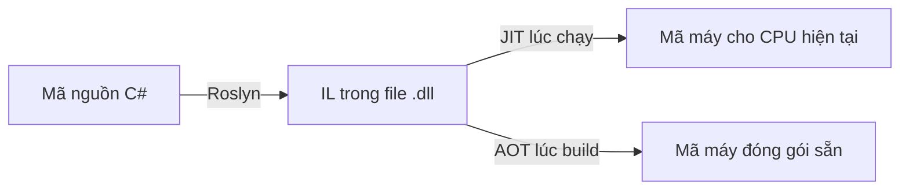

# 2.9 - .NET Runtime và Ecosystem

> **Tóm tắt:** Code C# của bạn không chạy trực tiếp. Nó được biên dịch thành **IL** — một ngôn ngữ trung gian — rồi tới lúc chạy mới được **JIT** dịch tiếp thành mã máy của đúng CPU đang chạy. Hai hệ quả đáng nhớ: lần gọi đầu tiên của một phương thức luôn chậm hơn các lần sau, và cùng một file `.dll` chạy được trên mọi nền tảng. Phần thứ hai của bài là **bộ thu gom rác**, nơi có một hành vi khiến rất nhiều người hoảng: .NET ở chế độ Server GC **cố tình giữ lại bộ nhớ đã cấp phát**, nên biểu đồ RAM của container có thể leo rất cao rồi đứng yên — trong khi ứng dụng hoàn toàn khoẻ mạnh. Từ .NET 9, cơ chế DATAS làm chuyện này nhẹ đi nhiều, và bài đo thật để thấy khác biệt.

## Mục tiêu bài học

Sau bài này bạn có thể:

- Mô tả đường đi từ mã C# tới mã máy, và vị trí của IL, JIT, AOT.
- Giải thích thế hệ của GC và vì sao đối tượng sống ngắn lại rẻ.
- Nêu khác biệt giữa Workstation GC và Server GC, và khi nào đổi.
- Chọn phiên bản .NET theo lịch LTS thay vì theo số mới nhất.
- Đánh giá một gói NuGet trước khi đưa vào dự án.

**Cần biết trước:** tạo và chạy được project console ([bài 0.2](../module-00-setup/0.2-first-csharp-program.md)). Bài 3 dùng Docker như [bài 2.8](2.8-hosting-and-cloud-basics.md).

## Nội dung bài học

### 2.9.1 — Từ C# tới mã máy



**Bước 1 — biên dịch.** `dotnet build` dùng Roslyn dịch C# thành **IL (Intermediate Language)**, đóng vào file `.dll`. IL không phụ thuộc CPU hay hệ điều hành.

**Bước 2 — JIT.** Lúc chạy, mỗi phương thức được dịch sang mã máy **ngay trước lần gọi đầu tiên**, rồi kết quả được giữ lại cho các lần sau.

Hai điều suy ra từ đây:

- **Lần gọi đầu luôn chậm hơn.** Đây là một phần của hiện tượng "khởi động nguội", và là lý do endpoint đầu tiên sau khi deploy hay có độ trễ cao bất thường.
- **JIT biết CPU thật.** Nó có thể dùng tập lệnh mà máy đang chạy hỗ trợ — điều mà biên dịch sẵn từ trước không làm được.

**Native AOT** là hướng ngược lại: dịch thẳng sang mã máy lúc build. Đổi lấy khởi động gần như tức thì và bộ nhớ thấp, nhưng mất khả năng dùng reflection tự do và phải cố định nền tảng đích. Hợp với công cụ dòng lệnh và serverless; xem [Native AOT deployment](https://learn.microsoft.com/en-us/dotnet/core/deploying/native-aot/).

### 2.9.2 — Bộ thu gom rác

Bạn không gọi `free()` trong C#. GC tự tìm những đối tượng không còn ai tham chiếu tới và thu hồi.

Nó chia bộ nhớ thành **ba thế hệ**, dựa trên một quan sát: **phần lớn đối tượng chết rất trẻ**.

| Thế hệ | Chứa gì | Dọn thường xuyên | Chi phí |
|---|---|---|---|
| Gen 0 | Đối tượng mới sinh | Rất thường xuyên | Rất rẻ |
| Gen 1 | Sống sót qua một lần dọn Gen 0 | Thỉnh thoảng | Trung bình |
| Gen 2 | Sống lâu | Hiếm | **Đắt** |

Đối tượng lớn hơn 85.000 byte đi thẳng vào **Large Object Heap**, vốn được dọn cùng Gen 2 và không được nén mặc định.

Đường đi của một đối tượng qua các thế hệ:


<small>File gốc: [nền sáng](../../../diagrams/stage-01-foundation/module-02-computer-science-basics/gc-generations.html) · [nền tối](../../../diagrams/stage-01-foundation/module-02-computer-science-basics/gc-generations-dark.html)</small>

Hệ quả thực tế: **đối tượng sống ngắn gần như miễn phí**. Tạo nhiều object nhỏ trong một request rồi vứt đi là chuyện bình thường. Thứ gây đau là đối tượng sống lâu vô ý — một cache tĩnh phình mãi, một sự kiện quên gỡ đăng ký — vì chúng leo lên Gen 2 và làm mỗi lần dọn Gen 2 nặng thêm.

Chi tiết: [Fundamentals of garbage collection](https://learn.microsoft.com/en-us/dotnet/standard/garbage-collection/fundamentals).

### 2.9.3 — Workstation GC và Server GC

Đây là chỗ sinh ra một trong những báo động giả phổ biến nhất khi chạy .NET trong container.

| | Workstation GC | Server GC |
|---|---|---|
| Số heap | 1 | Tối đa một heap cho mỗi CPU |
| Mục tiêu | Độ trễ thấp | Thông lượng cao |
| Bộ nhớ dùng | Ít | Nhiều hơn, và giữ lại |
| Mặc định cho | Ứng dụng console, desktop | **ASP.NET Core** |

Server GC cố tình **không trả bộ nhớ lại cho hệ điều hành ngay**, vì trả rồi xin lại rất tốn. Trên .NET 8 trở về trước, nó tạo sẵn một heap cho mỗi CPU, nên biểu đồ RAM của container hay leo lên rất cao rồi nằm yên, kể cả khi ứng dụng đang rảnh. Nhìn vào dashboard thì trông như rò rỉ bộ nhớ. Nó **không phải** rò rỉ, nhưng vẫn có thể khiến container bị giết vì vượt giới hạn RAM.

**DATAS, từ .NET 9.** DATAS (Dynamic Adaptation To Application Sizes) được bật mặc định cho Server GC từ .NET 9. Với DATAS, Server GC bắt đầu với ít heap và tăng dần theo tải thật, rồi co lại khi tải giảm, thay vì chiếm sẵn một heap cho mỗi CPU. Tắt nó bằng biến môi trường `DOTNET_GCDynamicAdaptationMode=0`.

Đo thật trên .NET 10: một API nhỏ chạy trong container giới hạn 512 MB, máy có 14 CPU, nhận 3.000 request rồi để rảnh 5 giây (cách đo ở Bài 3):

| Cấu hình | RAM container (`docker stats`) |
|---|---|
| Server GC, DATAS bật (mặc định của .NET 10) | 38,7 MiB |
| Server GC, DATAS tắt (giống .NET 8) | 118 MiB |
| Workstation GC | 44,2 MiB |

Bài [Vì sao .NET ngốn 96% RAM container dù app đang rảnh?](https://tiennhm.io.vn/blog/dotnet-workstation-gc-giam-ram-container) là một ca thật trên .NET 9 với ứng dụng lớn hơn nhiều, và đo tác động của việc chuyển sang Workstation GC:

```xml
<PropertyGroup>
  <ServerGarbageCollection>false</ServerGarbageCollection>
  <ConcurrentGarbageCollection>true</ConcurrentGarbageCollection>
</PropertyGroup>
```

Đây là đánh đổi có thật — bớt bộ nhớ, giảm thông lượng — nên hãy đo trước khi đổi. Trên .NET 9 và 10, việc đầu tiên khi thấy RAM cao là kiểm tra DATAS có đang bật không, trước khi tính tới Workstation GC.

### 2.9.4 — SDK, Runtime, và cách đóng gói

```
SDK     = công cụ build + runtime.  Cần trên máy lập trình viên và máy CI.
Runtime = chỉ đủ để chạy.           Cần trên máy chủ production.
```

Hai cách đóng gói khi publish:

| | Framework-dependent | Self-contained |
|---|---|---|
| Kích thước | Nhỏ (vài MB) | Lớn (60 MB trở lên) |
| Yêu cầu máy đích | Phải cài .NET runtime | Không cần gì |
| Vá lỗi bảo mật | Cập nhật runtime là xong | **Phải build lại và deploy lại** |

Dòng cuối là điều người ta hay quên. Self-contained tiện khi triển khai, nhưng mỗi lỗ hổng trong runtime đều bắt bạn phát hành lại ứng dụng.

Xem [.NET application deployment](https://learn.microsoft.com/en-us/dotnet/core/deploying/).

### 2.9.5 — Chọn phiên bản: LTS hay mới nhất

.NET phát hành **mỗi tháng 11**, xen kẽ hai loại:

- **LTS** (Long Term Support, số chẵn: 8, 10...) — hỗ trợ **3 năm**.
- **STS** (Standard Term Support, số lẻ: 9, 11...) — hỗ trợ **24 tháng**. Trước .NET 9 con số này là 18 tháng; Microsoft kéo dài lên 24 tháng từ năm 2025.

Vì thay đổi đó, .NET 8 và .NET 9 hết hỗ trợ **cùng một ngày**:

| Phiên bản | Loại | Phát hành | Hết hỗ trợ |
|---|---|---|---|
| .NET 8 | LTS | 11/2023 | 10/11/2026 |
| .NET 9 | STS | 11/2024 | 10/11/2026 |
| .NET 10 | LTS | 11/2025 | 11/2028 |

Khoá học này dùng **.NET 10**. Với hệ thống nghiệp vụ chạy nhiều năm, chọn **LTS**. Với dự án cần tính năng mới nhất và sẵn sàng nâng cấp mỗi năm, STS cũng được — miễn là đội biết hạn hỗ trợ.

Lịch chính thức: [.NET support policy](https://dotnet.microsoft.com/en-us/platform/support/policy/dotnet-core). Chạy phiên bản đã hết hỗ trợ nghĩa là không còn nhận bản vá bảo mật — đó là rủi ro, không phải sự bất tiện.

### 2.9.6 — Hệ sinh thái

| Tầng | Thành phần |
|---|---|
| Runtime | CLR, GC, JIT |
| Thư viện cơ sở | `System.*`, LINQ, `System.Text.Json` |
| Web | ASP.NET Core, SignalR, Minimal API |
| Dữ liệu | Entity Framework Core, Dapper |
| Framework ứng dụng | ABP Framework, Orchard Core |
| Kiểm thử | xUnit, NUnit, Moq, Testcontainers |
| Đóng gói | NuGet |

**Đánh giá một gói NuGet trước khi thêm vào:** mỗi gói là một phụ thuộc bạn phải bảo trì lâu dài.

- Lần phát hành gần nhất cách đây bao lâu? Hai năm không cập nhật là dấu hiệu xấu.
- Có hỗ trợ phiên bản .NET bạn đang dùng không?
- Giấy phép có dùng được trong bối cảnh thương mại không? Giấy phép **có thể đổi giữa hai phiên bản**: FluentAssertions từ v8, MediatR từ v13 và AutoMapper từ v15 chuyển sang giấy phép thương mại, không còn miễn phí cho mọi trường hợp. Khoá học dùng thay thế miễn phí: `Assert` có sẵn của xUnit, tự viết mediator đơn giản, map tay.
- Nó kéo theo bao nhiêu phụ thuộc gián tiếp?
- Việc này có thể viết bằng thư viện chuẩn trong 50 dòng không?

Câu cuối đáng hỏi nhất. Một phụ thuộc là một thứ có thể hỏng, có thể có lỗ hổng, và có thể bị bỏ rơi.

### 2.9.7 — Danh sách rà soát cho dự án thật

**Danh sách rà soát runtime và hệ sinh thái**

- [ ] Phiên bản .NET đang dùng vẫn còn trong thời hạn hỗ trợ.
- [ ] Dự án chạy trong container đã kiểm tra DATAS có bật không, và có số đo trước khi đổi chế độ GC.
- [ ] Không có cache tĩnh nào phình vô hạn, và mọi đăng ký sự kiện đều được gỡ.
- [ ] Máy chủ production chỉ cài runtime, không cài SDK.
- [ ] Nếu dùng self-contained, có quy trình build lại khi runtime có bản vá bảo mật.
- [ ] Mọi gói NuGet trong dự án đều còn được bảo trì và tương thích phiên bản đang dùng.
- [ ] Đã đo thời gian khởi động nguội, và cân nhắc AOT nếu nó là vấn đề.

## Bài tập áp dụng

#### Bài 1 — Nhìn thấy IL

Build một ứng dụng console nhỏ, mở file `.dll` bằng ILSpy hoặc `ildasm`. Tìm phương thức `Main` và đọc IL của nó. Đối chiếu từng dòng với mã C# gốc.

**Tiêu chí hoàn thành:** bạn chỉ ra được ít nhất một chỗ mà IL **không** tương ứng một-một với C#.

<details>
<summary><strong>Gợi ý và lời giải — Bài 1</strong></summary>

**Gợi ý.** Không cần cài công cụ nặng. Trang [sharplab.io](https://sharplab.io/) hiển thị IL ngay trên trình duyệt khi bạn gõ C#. Chọn chế độ *IL* ở menu bên phải.

**Lời giải — C# gốc:**

```csharp
int a = 5;
int b = 3;
int c = a + b;
Console.WriteLine(c);
```

IL tương ứng, build ở chế độ Debug trên .NET 10 rồi xem bằng `ilspycmd -il` (chú thích bên phải do mình thêm):

```text
void '<Main>$' (string[] args)
.locals init ([0] int32, [1] int32, [2] int32)

IL_0000: ldc.i4.5        // đẩy hằng số 5 lên ngăn xếp
IL_0001: stloc.0         // lưu vào biến cục bộ 0  (a)
IL_0002: ldc.i4.3        // đẩy 3
IL_0003: stloc.1         // lưu vào biến cục bộ 1  (b)
IL_0004: ldloc.0         // nạp a
IL_0005: ldloc.1         // nạp b
IL_0006: add             // cộng hai giá trị trên đỉnh ngăn xếp
IL_0007: stloc.2         // lưu vào biến cục bộ 2  (c)
IL_0008: ldloc.2         // nạp c
IL_0009: call void [System.Console]System.Console::WriteLine(int32)
IL_000e: nop             // lệnh rỗng, chỉ có ở bản Debug để đặt điểm dừng
IL_000f: ret
```

Tên `<Main>$` là phương thức `Main` mà trình biên dịch tự sinh cho code viết thẳng ở đầu file (top-level statements). Build ở chế độ Release thì IL ngắn hơn hẳn, vì trình biên dịch bỏ bớt biến trung gian:

```text
IL_0000: ldc.i4.5
IL_0001: ldc.i4.3
IL_0002: stloc.0
IL_0003: ldloc.0
IL_0004: add
IL_0005: call void [System.Console]System.Console::WriteLine(int32)
IL_000a: ret
```

**Ba điều đọc ra được.**

1. **IL là máy ngăn xếp.** Không có thanh ghi. Mọi phép toán lấy toán hạng từ đỉnh ngăn xếp và đẩy kết quả trở lại. Đây là lý do IL độc lập với kiến trúc CPU — nó không giả định gì về số thanh ghi của máy thật.

2. **Tên biến biến mất.** `a`, `b`, `c` trở thành biến cục bộ số 0, 1, 2. Tên chỉ còn trong file `.pdb`, và đó là lý do thiếu file đó thì dấu vết ngăn xếp không có số dòng.

3. **Nhiều thứ trong C# không có trong IL.** Đây là phần chính của bài — các cấu trúc sau đều được trình biên dịch **biến đổi** trước khi sinh IL:

| Cấu trúc C# | Thực chất trong IL |
|---|---|
| `foreach` | Gọi `GetEnumerator`, vòng `while`, khối `try/finally` gọi `Dispose` |
| `using` | Khối `try/finally` gọi `Dispose` |
| `async/await` | Một **máy trạng thái** dạng struct, với phương thức `MoveNext` |
| `yield return` | Một lớp máy trạng thái cài `IEnumerator` |
| Biểu thức lambda | Một lớp ẩn danh chứa các biến bị bắt |
| `string` nội suy | Gọi `string.Format` hoặc `DefaultInterpolatedStringHandler` |

**Bài thử đáng làm nhất.** Dán một phương thức `async` vào sharplab và xem IL. Bạn sẽ thấy trình biên dịch sinh ra một struct riêng với một trường `<>1__state` và phương thức `MoveNext`. Đây chính là bằng chứng cụ thể cho câu "async không tạo luồng" mà [Module 6](../../stage-02-csharp-professional/module-06-async-programming/README.md) sẽ giải thích: `await` chỉ là một điểm mà máy trạng thái tạm dừng và ghi nhớ vị trí, không có luồng nào bị chiếm.

**Vì sao nên biết điều này.** Không phải để viết IL, mà để hiểu rằng **C# và thứ thật sự chạy là hai thứ khác nhau**. Khi bạn đọc một dấu vết ngăn xếp có tên như `MoveNext` hoặc `<GetLeadsAsync>d__12`, bạn sẽ biết đó là máy trạng thái do trình biên dịch sinh ra chứ không phải lỗi lạ.

</details>

#### Bài 2 — Đo khởi động nguội và ảnh hưởng của JIT

Gọi cùng một tác vụ 10 lần liên tiếp ngay sau khi khởi động, ghi thời gian từng lần. Chỉ ra ảnh hưởng của JIT ở vài lần đầu.

**Tiêu chí hoàn thành:** bạn có bảng 10 dòng và giải thích được vì sao lần đầu chậm hơn hẳn.

<details>
<summary><strong>Gợi ý và lời giải — Bài 2</strong></summary>

**Gợi ý.** Để hiệu ứng rõ, tác vụ phải gọi tới nhiều phương thức chưa từng chạy — LINQ, tuần tự hoá JSON, so sánh chuỗi. Nếu chỉ cộng hai số thì gần như không thấy gì.

**Lời giải.** Tạo project console (`dotnet new console -n JitDemo`) rồi thay `Program.cs`:

```csharp
using System.Diagnostics;
using System.Text.Json;

var rnd = new Random(42);
var leads = Enumerable.Range(1, 5_000)
    .Select(i => new Lead(i, rnd.Next(0, 5_000), new DateTime(2026, 1, 1).AddDays(rnd.Next(0, 365))))
    .ToList();

Console.WriteLine("lần   thời gian (ms)");
for (int i = 1; i <= 10; i++)
{
    var sw = Stopwatch.StartNew();
    Process(leads);
    sw.Stop();
    Console.WriteLine($"{i,3}   {sw.Elapsed.TotalMilliseconds,8:F2}");
}

static string Process(List<Lead> leads)
{
    var top = leads.Where(l => l.Value > 1000)
                   .OrderByDescending(l => l.Value)
                   .GroupBy(l => l.CreatedAt.Month)
                   .Select(g => new { Month = g.Key, Total = g.Sum(x => x.Value), Count = g.Count() })
                   .ToList();
    return JsonSerializer.Serialize(top);
}

record Lead(int Id, int Value, DateTime CreatedAt);
```

Chạy ở chế độ Release: `dotnet run -c Release`. Code LINQ (`Where`, `OrderBy`...) học ở [bài 5.3](../../stage-02-csharp-professional/module-05-advanced-csharp/5.3-linq.md); ở đây chỉ cần biết nó gọi tới rất nhiều phương thức chưa từng chạy.

**Kết quả chạy thật trên .NET 10, 5.000 bản ghi** (máy định dạng số tiếng Việt nên dấu phẩy là phần thập phân):

```text
lần   thời gian (ms)
  1      24,35        <- chậm gấp khoảng 35 lần
  2       0,70
  3       0,64
  4       0,61
  5       0,66
  6       0,59
  7       0,60
  8       0,63
  9       0,88
 10       0,66
```

**Ba thứ xảy ra trong khoảng 24 mili giây đầu tiên:**

1. **JIT biên dịch.** Mỗi phương thức được dịch từ IL sang mã máy **lần đầu tiên nó được gọi**. Ở đây gồm cả phương thức của bạn lẫn hàng chục phương thức nội bộ của LINQ và `System.Text.Json`.
2. **Nạp assembly.** Các thư viện liên quan được đọc từ đĩa và chuẩn bị.
3. **Sinh mã cho generic.** Mỗi kiểu giá trị dùng với generic cần một bản mã riêng, sinh ra lúc chạy.

Từ lần thứ hai, mã máy đã nằm trong bộ nhớ nên chỉ còn chi phí thực thi thật.

**Còn nhanh thêm được nữa không.** Có, nhờ *tiered compilation*. .NET biên dịch nhanh và thô ở tầng 0 để chương trình chạy sớm, rồi âm thầm biên dịch lại ở tầng 1 với đầy đủ tối ưu cho những phương thức được gọi nhiều (từ khoảng 30 lần gọi trở lên). Mười lần gọi là chưa đủ để thấy rõ bước này; chạy vòng lặp vài trăm lần sẽ thấy thời gian giảm thêm một chút.

**Hệ quả thực tế — bốn điểm:**

1. **Đo hiệu năng phải bỏ qua các lần chạy đầu.** Đây chính là lý do mọi bài benchmark trong giáo trình này đều làm nóng trước, và là lý do công cụ `BenchmarkDotNet` tồn tại.
2. **Request đầu tiên sau khi triển khai luôn chậm.** Người dùng xui xẻo nhận được nó. Cách xử lý là gửi vài request làm nóng trước khi đưa thể hiện mới vào vòng phục vụ — phần readiness probe ở [bài 2.8](2.8-hosting-and-cloud-basics.md) chính là chỗ móc vào.
3. **Với hàm serverless, đây là vấn đề lớn.** Mỗi lần khởi động nguội trả lại toàn bộ chi phí này, và người dùng cảm nhận trực tiếp.
4. **Có cách giảm.** *ReadyToRun* biên dịch sẵn một phần mã lúc publish, đổi lại image lớn hơn. *Native AOT* biên dịch thẳng sang mã máy, khởi động gần như tức thì nhưng không dùng được với mọi thư viện.

</details>

#### Bài 3 — So sánh các chế độ thu gom rác

Chạy cùng một API trong container giới hạn 512 MB với ba cấu hình: Server GC mặc định, Server GC tắt DATAS, và Workstation GC. Gửi cùng một lượng request rồi so sánh RAM của container.

**Tiêu chí hoàn thành:** bạn có bảng ba dòng số đo, nêu được tiêu chí chọn giữa các chế độ, và một trường hợp mà chế độ mặc định **không** phù hợp.

<details>
<summary><strong>Gợi ý và lời giải — Bài 3</strong></summary>

**Gợi ý.** Khác biệt cốt lõi: Workstation GC dùng **một** heap; Server GC dùng tới **một heap cho mỗi CPU**, và DATAS quyết định thực tế dùng bao nhiêu. Hãy nghĩ xem điều đó ảnh hưởng thế nào tới bộ nhớ khi rảnh.

**Lời giải — API thử** (`dotnet new web -n GcApi`, thay `Program.cs`):

```csharp
using System.Runtime;

var builder = WebApplication.CreateBuilder(args);
var app = builder.Build();

app.MapGet("/work", () =>
{
    // giả lập một request cấp phát nhiều đối tượng ngắn hạn
    var list = new List<byte[]>();
    for (int i = 0; i < 200; i++) list.Add(new byte[10_000]);
    return list.Count;
});

app.MapGet("/gc", () => new
{
    server = GCSettings.IsServerGC,
    cpus = Environment.ProcessorCount,
    datas = GC.GetConfigurationVariables()["GCDynamicAdaptationMode"],
    committedMb = GC.GetGCMemoryInfo().TotalCommittedBytes / 1024 / 1024,
    workingSetMb = Environment.WorkingSet / 1024 / 1024
});

app.Run();
```

Đóng gói bằng Dockerfile nhiều tầng như [bài 2.8](2.8-hosting-and-cloud-basics.md) (đổi tên `NoteApi` thành `GcApi`), build thành image `gc-api`. Ba cấu hình chỉ khác nhau ở biến môi trường, nên không phải build lại:

```bash
run() {
  name=$1; port=$2; shift 2
  docker run -d --rm --name $name -m 512m -p $port:8080 "$@" gc-api >/dev/null
  sleep 4
  for i in $(seq 1 3000); do curl -s -o /dev/null localhost:$port/work; done
  sleep 5
  echo "== $name"; curl -s localhost:$port/gc; echo
  docker stats --no-stream --format "{{.MemUsage}}" $name
  docker stop $name >/dev/null
}
run gc-datas   18101
run gc-nodatas 18102 -e DOTNET_GCDynamicAdaptationMode=0
run gc-ws      18103 -e DOTNET_gcServer=0
```

**Kết quả chạy thật trên .NET 10** (Docker Desktop, máy 14 CPU):

```text
== gc-datas
{"server":true,"cpus":14,"datas":1,"committedMb":11,"workingSetMb":84}
38.7MiB / 512MiB
== gc-nodatas
{"server":true,"cpus":14,"datas":0,"committedMb":92,"workingSetMb":166}
118MiB / 512MiB
== gc-ws
{"server":false,"cpus":14,"datas":1,"committedMb":17,"workingSetMb":92}
44.21MiB / 512MiB
```

Dòng thứ hai của mỗi khối là RAM container mà `docker stats` thấy, cũng là con số mà hệ thống điều phối dùng để quyết định có giết container hay không.

**Đọc kết quả:**

| | Workstation GC | Server GC, DATAS tắt | Server GC, DATAS bật |
|---|---|---|---|
| Số heap | 1 | 1 cho mỗi CPU, ngay từ đầu | Bắt đầu ít, tăng theo tải |
| RAM sau tải nhẹ (đo trên) | 44 MiB | 118 MiB | 39 MiB |
| Thông lượng khi tải cao | Thấp hơn | Cao | Cao, sau khi đã tăng đủ heap |
| Mặc định của | Ứng dụng console, desktop | ASP.NET Core .NET 8 trở về trước | ASP.NET Core .NET 9 trở đi |

**Trường hợp mặc định không phù hợp.** Trên .NET 8, hoặc khi DATAS bị tắt, Server GC trong container nhỏ dễ phản tác dụng:

```text
Container 512 MB trên máy chủ 16 nhân, .NET 8 (hoặc DATAS tắt)
-> Server GC tạo 16 heap
-> Bộ nhớ nền chiếm phần lớn hạn mức
-> Ứng dụng bị hệ điều hành giết vì hết bộ nhớ, dù xử lý rất ít việc
```

Triệu chứng đặc trưng là container bị kết thúc với mã `OOMKilled` trong khi biểu đồ cho thấy lưu lượng rất thấp. Với .NET 10 và DATAS, tình huống này hiếm hơn nhiều; điều đáng lo lúc đó là ngược lại: ứng dụng cần thông lượng tối đa ngay từ request đầu tiên, khi DATAS chưa kịp tăng số heap.

**Cách xử lý:**

```bash
# Cách 1: dùng Workstation GC cho container nhỏ
DOTNET_gcServer=0

# Cách 2: giữ Server GC nhưng giới hạn số heap
DOTNET_GCHeapCount=2

# Cách 3: đặt hạn mức bộ nhớ cứng cho heap, GC tự điều chỉnh theo
DOTNET_GCHeapHardLimit=0x10000000   # 256 MB, viết theo hệ 16
```

**Hai điều cần biết thêm:**

1. **.NET nhận biết giới hạn của container** từ .NET Core 3.0 trở đi, nên nó đọc được hạn mức bộ nhớ của container thay vì nhìn RAM của máy chủ. Nhưng số **nhân CPU** thì vẫn nhìn thấy toàn bộ máy chủ nếu bạn không đặt giới hạn CPU — như `"cpus":14` trong kết quả trên. Vì vậy hãy đặt cả `--cpus` chứ không chỉ `-m`.
2. **Đừng chỉnh GC trước khi đo.** Phần lớn vấn đề bộ nhớ trong ứng dụng .NET không phải do GC mà do cấp phát quá nhiều đối tượng ngắn hạn, hoặc do rò rỉ vì giữ tham chiếu không cần thiết. Chỉnh GC khi chưa biết nguyên nhân là đoán mò.

**Cách đo cho đúng.** Dùng `dotnet-counters` để xem tần suất thu gom theo từng thế hệ và tổng thời gian dừng, rồi mới quyết định:

```bash
dotnet-counters monitor --process-id <pid> --counters System.Runtime
```

[Module 19](../../stage-05-senior-engineering/module-19-performance-engineering/README.md) trình bày quy trình chẩn đoán đầy đủ, và [Module 15](../../stage-04-database-production/module-15-docker-deployment/README.md) bàn về cấu hình khi triển khai container.

</details>

## Tự kiểm tra

<details>
<summary>Mã C# đi qua những bước nào trước khi thành mã máy?</summary>

Roslyn biên dịch C# thành IL và đóng vào file .dll; IL không phụ thuộc CPU hay hệ điều hành. Lúc chạy, JIT dịch từng phương thức sang mã máy ngay trước lần gọi đầu tiên rồi giữ lại kết quả. Vì vậy lần gọi đầu luôn chậm hơn, và cùng một .dll chạy được trên nhiều nền tảng.

</details>

<details>
<summary>Vì sao đối tượng sống ngắn lại rẻ?</summary>

Vì GC chia bộ nhớ thành ba thế hệ dựa trên quan sát rằng phần lớn đối tượng chết rất trẻ. Gen 0 được dọn rất thường xuyên và rất rẻ. Thứ đắt là Gen 2, nơi chứa đối tượng sống lâu. Nên tạo nhiều object nhỏ trong một request rồi vứt đi là bình thường; thứ gây đau là cache tĩnh phình mãi hoặc sự kiện quên gỡ đăng ký.

</details>

<details>
<summary>Vì sao container .NET hay hiển thị mức RAM rất cao?</summary>

Vì ASP.NET Core mặc định dùng Server GC, chế độ này dùng tới một heap cho mỗi CPU và cố tình không trả bộ nhớ lại cho hệ điều hành ngay, do trả rồi xin lại rất tốn. Trên .NET 8 trở về trước, biểu đồ RAM vì thế hay leo cao rồi nằm yên. Đó không phải rò rỉ, nhưng vẫn có thể khiến container bị giết. Từ .NET 9, DATAS cho Server GC bắt đầu với ít heap và co giãn theo tải, nên mức RAM khi rảnh thấp hơn nhiều.

</details>

<details>
<summary>Khi nào nên chuyển sang Workstation GC?</summary>

Khi chạy trong container bị giới hạn RAM chặt và mức bộ nhớ đang là vấn đề thật, đã đo được, và DATAS (nếu dùng .NET 9 trở lên) không giải quyết được. Đây là đánh đổi có thật: bớt bộ nhớ nhưng giảm thông lượng, vì chỉ còn một heap. Nên đo cả hai chỉ số trước khi quyết định.

</details>

<details>
<summary>Framework-dependent và self-contained khác nhau thế nào?</summary>

Framework-dependent cho gói nhỏ vài MB nhưng máy đích phải cài sẵn .NET runtime. Self-contained đóng gói cả runtime nên chạy ở đâu cũng được, đổi lại nặng hơn 60 MB và quan trọng hơn: mỗi lỗ hổng bảo mật trong runtime đều bắt bạn build lại và deploy lại ứng dụng.

</details>

<details>
<summary>Nên chọn phiên bản .NET nào?</summary>

Với hệ thống nghiệp vụ chạy nhiều năm thì chọn bản LTS, tức các số chẵn, được hỗ trợ 3 năm; hiện tại là .NET 10, hỗ trợ tới 11/2028. Bản STS số lẻ được hỗ trợ 24 tháng (từ .NET 9). .NET 8 và .NET 9 cùng hết hỗ trợ ngày 10/11/2026. Chạy phiên bản đã hết hỗ trợ nghĩa là không còn nhận bản vá bảo mật, nên đó là rủi ro chứ không chỉ là bất tiện.

</details>

## Kết luận

Ba điều đáng nhớ nhất:

1. **JIT giải thích vì sao lần gọi đầu luôn chậm.** Biết điều này thì không còn hoảng khi thấy request đầu tiên sau deploy có độ trễ cao.
2. **RAM cao trong container .NET thường không phải rò rỉ.** Đó là Server GC đang giữ bộ nhớ đúng như thiết kế; từ .NET 9, DATAS giảm chuyện này đáng kể.
3. **Mỗi gói NuGet là một cam kết bảo trì.** Câu hỏi đáng giá nhất trước khi thêm: thư viện chuẩn làm được việc này không?

## Tham khảo

- [Introduction to .NET](https://learn.microsoft.com/en-us/dotnet/core/introduction) — tổng quan nền tảng
- [Fundamentals of garbage collection](https://learn.microsoft.com/en-us/dotnet/standard/garbage-collection/fundamentals) — thế hệ và LOH
- [.NET application deployment](https://learn.microsoft.com/en-us/dotnet/core/deploying/) — framework-dependent và self-contained
- [Native AOT deployment](https://learn.microsoft.com/en-us/dotnet/core/deploying/native-aot/)
- [.NET support policy](https://dotnet.microsoft.com/en-us/platform/support/policy/dotnet-core) — lịch LTS và STS
- [.NET CLI](https://learn.microsoft.com/en-us/dotnet/core/tools/) — `dotnet build`, `publish`, `add package`

## Điều hướng

- **Bài trước:** [2.8 — Hosting và Cloud cơ bản](2.8-hosting-and-cloud-basics.md)
- **Bài tiếp theo:** [2.10 — Đào sâu: cache HTTP, container, HTTP/2 và HTTP/3](2.10-advanced-notes.md)
- **Về module:** [Trang mục lục](README.md)

## Bài liên quan

- [Vì sao .NET ngốn 96% RAM container dù app đang rảnh? Server GC và cách giảm 65% bộ nhớ](https://tiennhm.io.vn/blog/dotnet-workstation-gc-giam-ram-container) — Một container .NET 9 chiếm 987 MiB trên trần 1 GiB dù suốt 2 giờ không có request nào.
