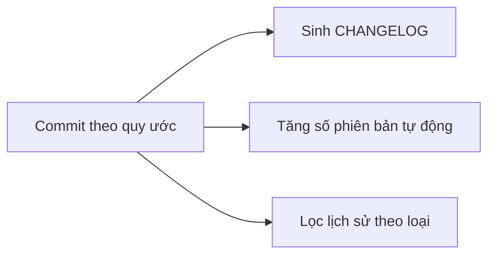

# 3.10 - Conventional Commits

> **Tóm tắt:** Conventional Commits là một quy ước rất nhỏ — thêm một tiền tố kiểu `feat:` hay `fix:` vào dòng đầu commit message. Giá trị nằm ở chỗ nó biến lịch sử Git từ **văn bản cho người đọc** thành **dữ liệu máy đọc được**, và từ đó ba thứ tự động hoá được: sinh changelog, tăng số phiên bản theo SemVer, và lọc lịch sử theo loại thay đổi. Phần đáng chú ý nhất là quy tắc **breaking change**: một dấu `!` hoặc một footer `BREAKING CHANGE:` là tín hiệu để công cụ tăng số major — tức là quy ước này gắn trực tiếp vào hợp đồng bạn cam kết với người dùng API.

## Mục tiêu bài học

Sau bài này bạn có thể:

- Viết commit message theo đúng cấu trúc Conventional Commits.
- Chọn đúng loại trong `feat`, `fix`, `refactor`, `chore`, `docs`, `test`, `perf`.
- Đánh dấu breaking change và biết nó ảnh hưởng gì tới số phiên bản.
- Cấu hình commitlint để quy ước được ép tự động.
- Dùng quy ước này cùng squash merge trên GitHub.

**Cần biết trước:** [bài 3.4](3.4-basic-git-workflow.md) (commit message), [bài 3.6](3.6-github-and-pull-request.md) (pull request, squash merge, GitHub Actions). Bài tập 2 và 3 cần Node.js (bản LTS) để chạy `npm`, vì commitlint và công cụ sinh changelog viết bằng JavaScript.

## Nội dung bài học

### 3.10.1 — Cấu trúc

```
<loại>[phạm vi tuỳ chọn]: <mô tả>

[thân tuỳ chọn]

[footer tuỳ chọn]
```

```
feat(orders): add revenue report grouped by branch

The old report aggregated the whole company and could not be split by
branch, so it was useless for judging each location. The new query
groups by branch_id and reuses the existing (branch_id, created_at)
index.

Closes #142
```

Bốn quy tắc cho dòng đầu:

1. **Thể mệnh lệnh** — `add`, không phải `added`.
2. **Dưới 72 ký tự.**
3. **Không viết hoa** chữ đầu mô tả, **không chấm** cuối câu.
4. **Phạm vi** trong ngoặc là tuỳ chọn, nên là tên module hoặc vùng chức năng.

### 3.10.2 — Các loại và ảnh hưởng lên phiên bản

| Loại | Nghĩa | Ảnh hưởng SemVer |
|---|---|---|
| `feat` | Tính năng mới | **MINOR** (1.2.0 → 1.3.0) |
| `fix` | Sửa lỗi | **PATCH** (1.2.3 → 1.2.4) |
| `perf` | Cải thiện hiệu năng | PATCH |
| `refactor` | Đổi cấu trúc, **không đổi hành vi** | Không |
| `docs` | Chỉ sửa tài liệu | Không |
| `test` | Thêm hoặc sửa test | Không |
| `build` | Hệ thống build, phụ thuộc | Không |
| `ci` | Cấu hình CI | Không |
| `chore` | Việc vặt khác | Không |
| `style` | Format, dấu cách — **không đổi logic** | Không |

Ranh giới hay gây tranh cãi nhất là `refactor` và `fix`. Tiêu chí dứt khoát: **hành vi quan sát được từ bên ngoài có đổi không?** Đổi thì là `fix` hoặc `feat`; không đổi thì là `refactor`.

### 3.10.3 — Breaking change

Hai cách đánh dấu, cả hai đều làm công cụ tăng số **MAJOR**:

```
feat(api)!: change response format of the /orders endpoint

The `total` field changes from number to string to avoid precision
loss on large integers in JavaScript.
```

```
feat(api): change response format of the /orders endpoint

BREAKING CHANGE: the `total` field changes from number to string.
Clients reading this field must parse it again.
```

Dấu `!` gọn hơn; footer `BREAKING CHANGE:` cho phép mô tả dài và hướng dẫn di trú. Với thay đổi lớn, dùng footer.

Lưu ý: `fix!` cũng là breaking change. Sửa một lỗi theo cách làm đổi hợp đồng API vẫn buộc tăng major — [SemVer](https://semver.org/) tính theo **tương thích**, không tính theo ý định.

### 3.10.4 — Ba thứ được mở khoá



**1. Changelog tự động.** Công cụ đọc lịch sử và nhóm theo loại:

```markdown
## 1.3.0 (2026-09-24)

### Features
* **orders:** add revenue report grouped by branch (a1b2c3d)

### Bug Fixes
* **orders:** reject orders with negative total (e4f5g6h)
```

**2. Tăng phiên bản tự động.** Có `feat` từ lần phát hành trước → tăng minor. Chỉ có `fix` → tăng patch. Có breaking change → tăng major. Không ai phải quyết định thủ công, và không ai quên.

**3. Lịch sử tra cứu được:**

```bash
git log --oneline --grep="^feat"           # mọi tính năng mới
git log --oneline --grep="^fix(orders)"    # mọi bản sửa trong module orders
git log --oneline --grep="BREAKING"        # mọi thay đổi phá vỡ tương thích
```

Câu cuối rất có giá trị khi ai đó hỏi "vì sao client cũ hỏng sau lần nâng cấp tháng trước".

### 3.10.5 — Ép quy ước bằng commitlint

Quy ước không được ép thì sau ba tuần sẽ có người viết `update code`. **commitlint** là công cụ kiểm tra commit message theo luật; **husky** là công cụ cài **Git hook** — script Git tự chạy ở một thời điểm nhất định, ở đây là hook `commit-msg` chạy ngay sau khi bạn viết message ([bài 3.11](3.11-advanced-notes.md) nói kỹ về hook).

```bash
npm init -y
npm install --save-dev @commitlint/cli @commitlint/config-conventional husky
npx husky init
rm .husky/pre-commit                       # xem giải thích bên dưới
echo 'npx --no -- commitlint --edit "$1"' > .husky/commit-msg
```

```javascript
// commitlint.config.mjs
export default {
  extends: ['@commitlint/config-conventional'],
  rules: {
    'header-max-length': [2, 'always', 72],   // mặc định là 100
  },
};
```

Đuôi `.mjs` báo cho Node.js đây là file ES module, nên cú pháp `export default` luôn chạy, không phụ thuộc vào `package.json`.

**Vì sao xoá `.husky/pre-commit`.** `npx husky init` tự tạo hook `pre-commit` chạy `npm test`. Trong kho vừa `npm init -y`, script `test` mặc định là `echo "Error: no test specified" && exit 1`, nên **mọi** commit đều bị chặn, kể cả commit đúng quy ước:

```text
> test
> echo "Error: no test specified" && exit 1

"Error: no test specified"
husky - pre-commit script failed (code 1)
```

Xoá file đó, hoặc thay nội dung bằng một lệnh có ý nghĩa với dự án .NET như `dotnet format --verify-no-changes`.

Từ đó, một commit sai quy ước bị **từ chối ngay tại máy**, trước khi lên kho:

```text
⧗   --- input ---
update code
✖   subject may not be empty [subject-empty]
✖   type may not be empty [type-empty]
```

Với dự án .NET thuần không muốn thêm Node.js, có thể kiểm ở CI bằng một bước chạy commitlint trên các commit của PR, hoặc đơn giản là kiểm tra **tiêu đề PR** — cách này hợp với mục tiếp theo.

### 3.10.6 — Dùng với squash merge

Khi GitHub **squash merge**, message của commit duy nhất trên `main` mặc định được lấy như sau:

- PR có **một** commit: lấy message của chính commit đó.
- PR có **nhiều** commit: lấy **tiêu đề PR**, kèm danh sách message các commit bên trong ở phần thân.

Quản trị kho có thể đặt mặc định luôn là **tiêu đề PR** (*Settings > General > Pull Requests > Allow squash merging > Default commit message*). Khi nhóm làm vậy:

> Trong nhóm dùng squash merge, thứ cần theo Conventional Commits là **tiêu đề PR**.

Điều này thực ra dễ chịu hơn: các commit trong nhánh cứ thoải mái `wip`, `fix again`, `address review`. Chỉ tiêu đề PR là thứ đi vào lịch sử `main`.

Cách ép: bật kiểm tra tiêu đề PR trong CI.

```yaml
# .github/workflows/pr-title.yml
name: Check PR title
on:
  pull_request:
    types: [opened, edited, synchronize]
jobs:
  lint:
    runs-on: ubuntu-latest
    steps:
      - uses: amannn/action-semantic-pull-request@v6
        env:
          GITHUB_TOKEN: ${{ secrets.GITHUB_TOKEN }}
```

### 3.10.7 — Rà lại quy ước của đội

**Danh sách rà soát Conventional Commits**

- [ ] Mọi commit message bắt đầu bằng một loại hợp lệ.
- [ ] Dòng đầu ở thể mệnh lệnh, dưới 72 ký tự, không chấm cuối câu.
- [ ] Phân biệt đúng refactor với fix theo tiêu chí hành vi bên ngoài có đổi không.
- [ ] Breaking change được đánh dấu bằng ! hoặc footer BREAKING CHANGE.
- [ ] Có commitlint chạy ở hook commit-msg, hoặc kiểm tra tiêu đề PR ở CI.
- [ ] Nếu nhóm dùng squash merge, quy ước áp lên tiêu đề PR.
- [ ] Thân commit message giải thích vì sao, không kể lại diff.
- [ ] CHANGELOG được sinh tự động, không viết tay.

## Bài tập áp dụng

#### Bài 1 — Phân loại lịch sử cũ

Dưới đây là 9 commit message lấy từ một kho chưa có quy ước. Gán cho mỗi cái một loại Conventional Commits, **chỉ dựa vào message**, không được đoán thêm. Đếm bao nhiêu cái bạn **không phân loại nổi**. Nếu đã có kho của riêng mình, làm thêm với `git log --oneline -30 --no-merges`.

```text
Thêm endpoint xuất báo cáo Excel
Sửa lỗi tính sai doanh thu khi có đơn huỷ
update
fix bug
Cập nhật theo yêu cầu anh Nam
final
Tối ưu truy vấn danh sách khách hàng
Nâng EF Core lên 10.0.0
abc
```

**Tiêu chí hoàn thành:** bạn có tỉ lệ cụ thể, và giải thích được vì sao những commit không phân loại nổi là phần lịch sử đã mất giá trị.

<details>
<summary><strong>Gợi ý và lời giải — Bài 1</strong></summary>

**Gợi ý.** Quy tắc "chỉ đọc message" mô phỏng đúng tình huống của người tra lịch sử sáu tháng sau: họ đọc `git log --oneline`, không mở từng diff.

**Lời giải:**

| Message | Loại | Phân loại được? |
|---|---|---|
| `Thêm endpoint xuất báo cáo Excel` | `feat` | Có |
| `Sửa lỗi tính sai doanh thu khi có đơn huỷ` | `fix` | Có |
| `update` | ? | **Không** |
| `fix bug` | `fix` | Một nửa — biết là sửa lỗi, không biết lỗi gì |
| `Cập nhật theo yêu cầu anh Nam` | ? | **Không** |
| `final` | ? | **Không** |
| `Tối ưu truy vấn danh sách khách hàng` | `perf` | Có |
| `Nâng EF Core lên 10.0.0` | `build` (hoặc `chore`) | Có |
| `abc` | ? | **Không** |

4 trên 9 không phân loại nổi, thêm 1 chỉ phân loại được một nửa.

**Ý nghĩa của con số đó.** Nó không phải điểm số về sự cẩn thận. Nó là **phần lịch sử đã mất giá trị**: với những commit ấy, `git log` không giúp gì cả, và bạn buộc phải mở diff ra đọc từng cái để hiểu điều gì đã xảy ra.

Hệ quả cụ thể ở ba tình huống:

1. **Khi cần biết phiên bản này có gì mới.** Phải đọc từng diff thay vì đọc danh sách message.
2. **Khi `git bisect` chỉ ra một commit.** Message `update` không cho biết commit đó **định** làm gì, nên bạn không biết bản sửa của mình có phá hỏng ý định ban đầu không.
3. **Khi có người mới vào dự án.** Lịch sử lẽ ra là tài liệu tốt nhất về việc *vì sao code thành ra như hiện nay*.

**Bảy loại hay dùng nhất:**

| Loại | Dùng khi | Ảnh hưởng phiên bản |
|---|---|---|
| `feat` | Thêm tính năng | MINOR |
| `fix` | Sửa lỗi | PATCH |
| `docs` | Chỉ sửa tài liệu | Không |
| `refactor` | Đổi code, không đổi hành vi | Không |
| `perf` | Cải thiện hiệu năng | PATCH |
| `test` | Thêm hoặc sửa test | Không |
| `chore` / `build` | Công việc phụ trợ, nâng gói | Không |

**Không cần sửa lịch sử cũ.** Viết lại message cũ nghĩa là đổi mã băm của toàn bộ lịch sử — cái giá quá lớn so với lợi ích. Bắt đầu áp dụng từ commit tiếp theo là đủ.

</details>

#### Bài 2 — Dựng commitlint

Cài commitlint vào một kho thử. Thử commit với message `update code` và ghi lại thông báo từ chối.

**Tiêu chí hoàn thành:** commit bị chặn **trước khi** được tạo, và bạn giải thích được vì sao chặn lúc commit tốt hơn chặn lúc review.

<details>
<summary><strong>Gợi ý và lời giải — Bài 2</strong></summary>

**Gợi ý.** commitlint chạy như một Git hook — một script Git tự gọi ở những thời điểm nhất định. Hook cần dùng ở đây là `commit-msg`, chạy sau khi bạn viết message nhưng trước khi commit được tạo.

**Lời giải — cài đặt** (output thật với commitlint 21.2 và husky 9.1):

```bash
mkdir commitlint-lab && cd commitlint-lab && git init -q -b main
npm init -y
npm install --save-dev @commitlint/cli @commitlint/config-conventional husky
printf 'node_modules/\n' > .gitignore

echo "export default { extends: ['@commitlint/config-conventional'] };" > commitlint.config.mjs

npx husky init
rm .husky/pre-commit
echo 'npx --no -- commitlint --edit "$1"' > .husky/commit-msg

git add . && git commit -m "chore: set up commitlint"
```

Bỏ dòng `rm .husky/pre-commit` thì ngay commit này đã bị chặn bởi `npm test`, như giải thích ở mục 3.10.5.

**Thử với message sai:**

```bash
echo x > a.txt && git add a.txt
git commit -m "update code"
```

```text
⧗   --- input ---
update code
✖   subject may not be empty [subject-empty]
✖   type may not be empty [type-empty]

✖   found 2 problems, 0 warnings
ⓘ   Get help: https://github.com/conventional-changelog/commitlint/#what-is-commitlint

husky - commit-msg script failed (code 1)
```

Commit **không được tạo**. Kiểm chứng bằng `git log --oneline` — vẫn chỉ có commit `chore: set up commitlint`.

**Với message đúng:**

```bash
git commit -m "fix: skip cancelled orders when summing revenue"
```

```text
[main 3220c04] fix: skip cancelled orders when summing revenue
 1 file changed, 1 insertion(+)
 create mode 100644 a.txt
```

Thử thêm `git commit -m "Feat: Add Something."` để thấy commitlint bắt cả chữ hoa và dấu chấm cuối:

```text
✖   subject must not be sentence-case [subject-case]
✖   subject may not end with full stop [subject-full-stop]
✖   type must be lower-case [type-case]
✖   type must be one of [build, chore, ci, docs, feat, fix, perf, refactor, revert, style, test] [type-enum]
```

**Vì sao chặn lúc commit tốt hơn chặn lúc review:**

| Chặn ở đâu | Chi phí sửa |
|---|---|
| Lúc commit | Gõ lại message, 10 giây |
| Lúc CI | Chờ CI xong, sửa, force push, chờ lại — 15 phút |
| Lúc review | Người khác mất công nhắc, bạn phải rebase — nửa giờ và một lần phiền người khác |
| Không bao giờ | Lịch sử hỏng vĩnh viễn |

Nguyên tắc chung: **phản hồi càng sớm càng rẻ**, và chênh lệch không tuyến tính mà theo cấp số.

**Một cái bẫy của hook phía client.** `.husky/` nằm trong kho nên được chia sẻ, nhưng hook chỉ hoạt động sau khi người dùng chạy `npm install`. Người chưa chạy thì hook không tồn tại. Vì vậy hook là **lớp tiện lợi**, không phải lớp bảo đảm.

**Lớp bảo đảm nằm ở CI:**

```yaml
- uses: actions/checkout@v7
  with:
    fetch-depth: 0          # cần lịch sử đầy đủ để có commit gốc của PR
- run: npm ci
- name: Check commit messages
  run: npx commitlint --from ${{ github.event.pull_request.base.sha }} --to HEAD
```

Hai lớp bổ sung cho nhau: hook bắt lỗi sớm và rẻ cho người có cài; CI bảo đảm không có gì lọt qua.

**Với nhóm dùng squash merge.** Message của các commit bên trong nhánh không quan trọng lắm, vì chúng bị gộp lại. Thứ đi vào `main` là message của commit squash, mà nhóm thường đặt mặc định bằng **tiêu đề pull request** (mục 3.10.6). Lúc đó nên kiểm tra tiêu đề PR thay vì từng commit:

```yaml
- uses: amannn/action-semantic-pull-request@v6
```

Chọn đúng chỗ để kiểm tra quan trọng hơn việc kiểm tra nhiều chỗ.

</details>

#### Bài 3 — Sinh changelog tự động

Dựng kho luyện tập có 9 commit sau tag `v1.2.0`, trong đó có vài commit sai quy ước, rồi sinh changelog. Đối chiếu với lịch sử và chỉ ra commit nào không xuất hiện, vì sao.

```bash
mkdir changelog-lab && cd changelog-lab && git init -q -b main
echo '{ "name": "crm", "version": "1.2.0", "private": true }' > package.json
printf 'node_modules/\n' > .gitignore
git add . && git commit -q -m "chore: init project" && git tag v1.2.0

c() { echo "$1" >> log.txt; git add log.txt; git commit -q -m "$1"; }
c "feat: add Excel export for revenue report"
c "fix: skip cancelled orders when summing revenue"
c "update"
c "feat(customers): filter customers by multiple branches"
c "sửa lỗi phân trang"
c "perf: add index for lead list query"
c "feature: add lead import"
c "fix(paging): return empty page instead of 404 on last page"
c "docs: update README"

npm install --save-dev conventional-changelog conventional-changelog-conventionalcommits
```

**Tiêu chí hoàn thành:** bạn xác định được **vì sao** từng commit không xuất hiện trong changelog, và chỉ ra một commit mà công cụ sinh changelog chấp nhận nhưng commitlint ở Bài 2 sẽ chặn.

<details>
<summary><strong>Gợi ý và lời giải — Bài 3</strong></summary>

**Gợi ý.** Công cụ sinh changelog chỉ đọc những commit có **tiền tố nó hiểu**. Commit không đúng quy ước bị bỏ qua hoàn toàn — không cảnh báo, không báo lỗi. Gói `conventional-changelog-cli` cũ đã ngừng phát triển; dùng gói `conventional-changelog` kèm preset `conventionalcommits`.

**Lời giải** (output thật với `conventional-changelog` 8.1):

```bash
npx conventional-changelog -p conventionalcommits -u --stdout
```

`-u` (`--output-unreleased`) in phần chưa phát hành kể từ tag gần nhất, `--stdout` in ra màn hình thay vì ghi file.

```markdown
## [Unreleased](compare/v1.2.0...b0acd8b65db8dcab7fc57048111f1a8546520140) (2026-10-17)

### Features

* add Excel export for revenue report 281fa22
* add lead import cad742f
* **customers:** filter customers by multiple branches 59f7982

### Bug Fixes

* **paging:** return empty page instead of 404 on last page b0acd8b
* skip cancelled orders when summing revenue 450f4d4

### Performance Improvements

* add index for lead list query f115feb
```

**Đối chiếu.** 9 commit, changelog có 6 dòng. Ba commit vắng mặt:

| Commit | Vì sao vắng mặt |
|---|---|
| `update` | Không có tiền tố, công cụ không biết là loại gì |
| `sửa lỗi phân trang` | Không có tiền tố |
| `docs: update README` | Đúng quy ước, nhưng preset ẩn `docs`, `chore`, `test`... khỏi changelog vì người dùng không quan tâm |

Liệt kê những commit **sai quy ước** bằng `grep` (khớp với danh sách loại của commitlint):

```bash
git log v1.2.0..HEAD --format=%s --no-merges \
  | grep -vE '^(feat|fix|docs|style|refactor|perf|test|build|ci|chore|revert)(\(.+\))?!?: '
```

```text
feature: add lead import
sửa lỗi phân trang
update
```

**Điểm bất ngờ: `feature:`.** Preset `conventionalcommits` coi `feature` là tên khác của `feat`, nên `feature: add lead import` vẫn vào mục *Features*. Nhưng commitlint với `config-conventional` thì chặn nó:

```text
⧗   --- input ---
feature: add lead import
✖   type must be one of [build, chore, ci, docs, feat, fix, perf, refactor, revert, style, test] [type-enum]
```

Hai công cụ có luật hơi khác nhau. Bài học: chọn **một** nguồn luật (commitlint) để ép từ lúc commit, đừng trông vào việc công cụ phía sau "chắc sẽ hiểu".

**Ba thứ Conventional Commits mở khoá, và đây là lý do thật để dùng nó:**

1. **Changelog tự động.** Không ai phải ngồi viết tay, nên nó luôn đầy đủ và luôn cập nhật.
2. **Tự quyết số phiên bản theo chuẩn SemVer.** `fix` tăng số cuối, `feat` tăng số giữa, thay đổi phá vỡ tăng số đầu:

   ```text
   fix:                 1.2.3 -> 1.2.4
   feat:                1.2.3 -> 1.3.0
   feat!: hoặc BREAKING CHANGE trong phần thân
                        1.2.3 -> 2.0.0
   ```

3. **Lọc lịch sử theo loại.** `git log --grep="^feat"` cho biết mọi tính năng đã thêm; `--grep="^perf"` cho biết mọi lần tối ưu.

**Đánh dấu thay đổi phá vỡ — hai cách:**

```text
feat!: change response format of /api/v1/customers

# hoặc, rõ ràng hơn và nên dùng:
feat: change response format of /api/v1/customers

BREAKING CHANGE: the `name` field is renamed to `fullName`. Old clients
will receive null. See docs/migration-v2.md for the migration guide.
```

Cách thứ hai tốt hơn vì phần `BREAKING CHANGE` được đưa nguyên văn vào changelog, nên người đọc biết **phải làm gì**, không chỉ biết là có thay đổi.

**Tự động hoá toàn bộ.** `semantic-release` gộp cả ba việc: đọc commit, tính số phiên bản, sinh changelog, tạo thẻ Git và phát hành — chạy trong CI sau mỗi lần merge vào `main`. Lúc đó quy ước commit message không còn là thủ tục nữa mà trở thành **đầu vào của quy trình phát hành**.

</details>

## Tự kiểm tra

<details>
<summary>Conventional Commits mang lại lợi ích gì cụ thể?</summary>

Nó biến lịch sử Git từ văn bản cho người đọc thành dữ liệu máy đọc được, từ đó tự động hoá ba thứ: sinh changelog nhóm theo loại thay đổi, tăng số phiên bản theo SemVer mà không ai phải quyết định thủ công, và lọc lịch sử theo loại bằng git log --grep.

</details>

<details>
<summary>Phân biệt refactor với fix thế nào?</summary>

Theo một tiêu chí duy nhất: hành vi quan sát được từ bên ngoài có thay đổi không. Nếu người dùng hoặc client API nhận kết quả khác đi thì đó là fix hoặc feat. Nếu chỉ cấu trúc code bên trong thay đổi còn đầu vào đầu ra giữ nguyên thì đó là refactor.

</details>

<details>
<summary>Đánh dấu breaking change bằng cách nào?</summary>

Hai cách: thêm dấu chấm than sau loại, ví dụ feat(api)!, hoặc thêm footer BREAKING CHANGE với mô tả. Dấu chấm than gọn hơn; footer cho phép viết dài và kèm hướng dẫn di trú nên hợp với thay đổi lớn. Cả hai đều khiến công cụ tăng số major.

</details>

<details>
<summary>Một commit fix có thể là breaking change không?</summary>

Có. Sửa lỗi theo cách làm thay đổi hợp đồng API vẫn buộc tăng số major, vì SemVer tính theo tính tương thích chứ không tính theo ý định. Trong trường hợp đó viết fix với dấu chấm than, hoặc thêm footer BREAKING CHANGE.

</details>

<details>
<summary>Khi đội dùng squash merge thì áp quy ước ở đâu?</summary>

Ở tiêu đề pull request. Với PR nhiều commit, GitHub mặc định lấy tiêu đề PR làm dòng đầu của commit squash (PR một commit thì lấy message của commit đó), và quản trị kho có thể đặt mặc định luôn là tiêu đề PR. Các commit bên trong nhánh cứ thoải mái wip hay fix again. Cách ép là thêm một bước CI kiểm tra tiêu đề PR.

</details>

<details>
<summary>Vì sao cần commitlint thay vì chỉ thống nhất miệng?</summary>

Vì quy ước không được ép thì sau vài tuần sẽ có người viết update code, và chỉ cần vài commit sai là công cụ sinh changelog bỏ sót thay đổi, còn việc tăng số phiên bản tự động cho ra kết quả sai. Commitlint chạy ở hook commit-msg từ chối ngay tại máy, trước khi commit lên kho.

</details>

## Kết luận

Ba điều đáng nhớ nhất:

1. **Quy ước nhỏ, lợi ích tự động.** Một tiền tố đổi lấy changelog, số phiên bản và khả năng tra cứu.
2. **Breaking change gắn với hợp đồng, không gắn với ý định.** `fix` vẫn có thể phá vỡ tương thích.
3. **Dùng squash merge thì quy ước thuộc về tiêu đề PR.** Đây là chi tiết hay bị bỏ sót nhất khi áp dụng.

## Tham khảo

- [Conventional Commits 1.0.0](https://www.conventionalcommits.org/en/v1.0.0/) — đặc tả gốc
- [Semantic Versioning](https://semver.org/) — quy tắc MAJOR.MINOR.PATCH
- [GitHub Pull requests](https://docs.github.com/en/pull-requests) — tuỳ chọn squash merge
- [GitHub Actions](https://docs.github.com/en/actions) — nơi đặt kiểm tra tiêu đề PR

## Điều hướng

- **Bài trước:** [3.9 — Debugging Workflow](3.9-debugging-workflow.md)
- **Bài tiếp theo:** [3.11 — Git hook, cherry-pick và worktree](3.11-advanced-notes.md)
- **Về module:** [Trang mục lục](README.md)
