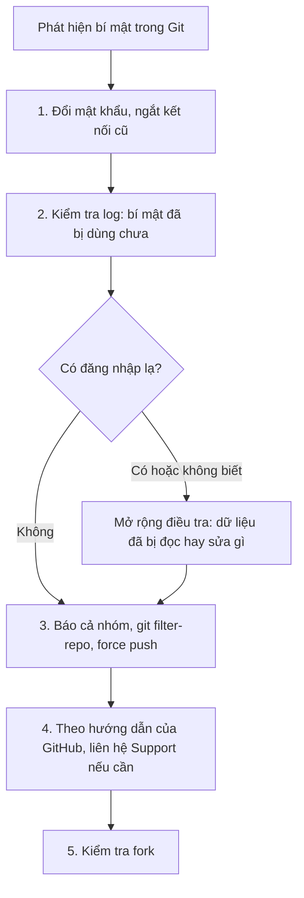

# 3.12 - Mini case study: lộ mật khẩu database lên GitHub

> **Tóm tắt:** Sự cố Git tốn kém nhất và cũng dễ xảy ra nhất: file `appsettings.json` chứa **chuỗi kết nối database production** bị commit và push lên một kho **công khai**. Điều quan trọng nhất phải hiểu ngay: **xoá commit không đủ**. Kể từ lúc push, phải coi như **bí mật đã bị lộ** — các dịch vụ quét tự động có thể đã đọc được, và bất kỳ ai `fork` hay `clone` đều có bản sao. Thứ tự xử lý quyết định mức thiệt hại: **đổi mật khẩu trước, dọn lịch sử sau**. Bài này đi từng bước, chạy thật `git filter-repo` và gitleaks, và cho thấy điều gì xảy ra khi một thành viên `pull` nhầm sau khi lịch sử đã được viết lại.

## Mục tiêu bài học

Sau bài này bạn có thể:

- Xử lý sự cố lộ bí mật theo đúng thứ tự ưu tiên, kể cả đổi mật khẩu database và ngắt các kết nối đang mở.
- Chứng minh vì sao xoá file ở commit mới không xoá được bí mật khỏi lịch sử.
- Viết lại lịch sử bằng `git filter-repo` và biết cả nhóm phải làm gì sau đó.
- Dựng ba lớp phòng thủ và biết giới hạn của công cụ quét bí mật.

**Cần biết trước:** [bài 3.2](3.2-git-install-config.md) (`.gitignore`, user secrets, quy trình khi lỡ commit bí mật), [bài 3.4](3.4-basic-git-workflow.md) (`git log -S`, remote), [bài 3.11](3.11-advanced-notes.md) (hook). Phần câu lệnh SQL chỉ cần đọc hiểu; database được dạy kỹ từ [Module 12](../../stage-04-database-production/module-12-sql-deep-dive/README.md).

## Nội dung bài học

### 3.12.1 — Tình huống

```text
14:32  Thành viên mới commit "chore: add environment config"
14:33  git push origin main
14:35  Nhận email từ GitHub: phát hiện có thể có bí mật trong kho
14:36  Kiểm tra: appsettings.json chứa chuỗi kết nối PostgreSQL production,
       đăng nhập bằng tài khoản postgres kèm mật khẩu
```

Kho là **công khai**. Bí mật đã ở trên mạng vài phút. (Dòng thời gian là minh hoạ.)

Chi tiết "tài khoản `postgres`" đáng chú ý riêng: đó là tài khoản **quản trị cao nhất** (superuser) của PostgreSQL. Ứng dụng **không bao giờ** được kết nối bằng tài khoản này; nó phải có tài khoản riêng chỉ đủ quyền trên database của mình (ở đây gọi là `crm_app`). Lộ mật khẩu của `crm_app` là sự cố; lộ mật khẩu superuser là mất cả máy chủ database.

Phản ứng đầu tiên của nhiều người — và là phản ứng **sai**:

```bash
# SAI — làm việc này đầu tiên
git rm --cached appsettings.json
git commit -m "chore: remove config file"
git push
```

Việc này **không bảo vệ được gì**: commit cũ vẫn nằm trong lịch sử, và mật khẩu vẫn dùng được.

### 3.12.2 — Thứ tự đúng

**Bước 1 (ngay lập tức) — đổi mật khẩu, ngắt kết nối cũ.**

```sql
ALTER ROLE crm_app WITH PASSWORD 'mat-khau-moi-rat-manh';
```

Đổi mật khẩu **không** ngắt các kết nối đang mở. Kẻ xấu đã đăng nhập từ trước vẫn ở lại. Đoạn sau cho thấy điều đó, rồi ngắt các phiên cũ (chạy bằng tài khoản quản trị):

```sql
-- 1. Xem các phiên đang mở của tài khoản bị lộ
SELECT pid, usename, client_addr, application_name, backend_start
FROM pg_stat_activity
WHERE usename = 'crm_app';

-- 2. Đổi mật khẩu (câu lệnh ở trên)
ALTER ROLE crm_app WITH PASSWORD 'mat-khau-moi-rat-manh';

-- 3. Đếm lại: đổi mật khẩu xong, phiên cũ còn không?
SELECT count(*) AS van_con_ket_noi
FROM pg_stat_activity
WHERE usename = 'crm_app';

-- 4. Ngắt mọi phiên cũ
SELECT pg_terminate_backend(pid)
FROM pg_stat_activity
WHERE usename = 'crm_app';
```

Kết quả thật trên PostgreSQL 16 khi chạy lần lượt bốn câu trên, lúc đang có một phiên mở:

```text
 pid  | usename | client_addr | application_name |         backend_start
------+---------+-------------+------------------+-------------------------------
 1348 | crm_app | 127.0.0.1   | psql             | 2026-10-17 21:37:26.966137+07
(1 row)

ALTER ROLE
 van_con_ket_noi
-----------------
               1
(1 row)

 pg_terminate_backend
----------------------
 t
(1 row)
```

Dòng `van_con_ket_noi = 1` (đếm lại sau `ALTER ROLE`) cho thấy phiên cũ vẫn sống cho tới khi bị `pg_terminate_backend`. Sau đó cập nhật mật khẩu mới vào nơi lưu bí mật của ứng dụng (biến môi trường, vault) và khởi động lại ứng dụng — ứng dụng thật của bạn cũng bị ngắt kết nối ở bước này.

Đây là việc **duy nhất** thật sự chặn được thiệt hại. Mọi thứ khác chỉ là dọn dẹp. Nếu bí mật là khoá API, thu hồi khoá ở nhà cung cấp. Nếu là khoá ký JWT, đổi khoá — chấp nhận việc mọi người dùng bị đăng xuất.

<details>
<summary>SQL Server</summary>

```sql
ALTER LOGIN crm_app WITH PASSWORD = 'mat-khau-moi#Rat-Manh1';

-- Phiên đang mở của login đó, kèm địa chỉ IP (client_net_address nằm ở dm_exec_connections)
SELECT s.session_id, s.login_name, c.client_net_address, s.program_name, s.login_time
FROM sys.dm_exec_sessions AS s
JOIN sys.dm_exec_connections AS c ON c.session_id = s.session_id
WHERE s.login_name = 'crm_app';

-- Ngắt từng phiên theo session_id ở kết quả trên
KILL 53;
```

Kết quả thật trên SQL Server 2022 (phiên vẫn còn sau `ALTER LOGIN`, giống PostgreSQL):

```text
session_id|login_name|client_net_address|program_name|login_time
----------|----------|------------------|------------|----------
53|crm_app|172.19.0.1|SQLCMD|2026-10-17 14:37:41.047
```

Ứng dụng cũng không bao giờ được dùng login `sa`; tạo login riêng chỉ có quyền trên database của ứng dụng.

</details>

**Bước 2 — kiểm tra bí mật đã bị dùng chưa.**

`pg_stat_activity` chỉ cho thấy các phiên **đang mở**, không có lịch sử. Lịch sử đăng nhập chỉ có trong **log của máy chủ**, và phụ thuộc cấu hình:

| Sự kiện | PostgreSQL ghi log mặc định? | Muốn có thì |
|---|---|---|
| Đăng nhập **sai** mật khẩu | Có: `FATAL: password authentication failed for user "crm_app"` | — |
| Đăng nhập **thành công** | Không | Bật `log_connections = on` (ghi cả địa chỉ IP) |

Database trên dịch vụ đám mây (Azure, AWS...) có trang nhật ký kiểm toán riêng; xem tài liệu của dịch vụ. Nếu thấy kết nối thành công từ địa chỉ lạ trong khoảng thời gian bí mật bị lộ, phạm vi sự cố rộng hơn nhiều — phải kiểm tra dữ liệu đã bị đọc hay sửa gì. Nếu chưa từng bật ghi log đăng nhập thành công, bạn **không có cách nào biết chắc**, và phải xử lý như thể đã bị dùng.

<details>
<summary>SQL Server</summary>

`sys.dm_exec_sessions` cũng chỉ có phiên đang mở. SQL Server mặc định chỉ ghi **đăng nhập thất bại** vào error log (*Login auditing: Failed logins only*). Đọc bằng:

```sql
EXEC xp_readerrorlog 0, 1, N'Login failed', N'crm_app';
```

```text
2026-10-17 14:37:47.440|Logon|Login failed for user 'crm_app'. Reason: Password did not match that for the login provided. [CLIENT: 172.19.0.1]
```

Muốn có lịch sử đăng nhập **thành công**, bật *Login auditing: Both failed and successful logins* trong thuộc tính server, hoặc dùng SQL Server Audit; Azure SQL có Auditing riêng.

</details>

**Bước 3 — xoá file khỏi lịch sử.**

```bash
pip install git-filter-repo          # hoặc: brew install git-filter-repo
git clone --mirror https://github.com/<ten>/<kho>.git kho-mirror   # làm trên bản sao
cd kho-mirror
git filter-repo --path appsettings.json --invert-paths
```

`git filter-repo` là công cụ được chính tài liệu Git khuyên dùng thay cho `git filter-branch` cũ. Nó **xoá remote `origin`** sau khi chạy (để bạn không lỡ đẩy nhầm), nên phải thêm lại rồi mới đẩy:

```bash
git remote add origin https://github.com/<ten>/<kho>.git
git push origin --force --all
git push origin --force --tags
```

**Cảnh báo:** đây là **viết lại lịch sử**. Mọi người trong nhóm phải xoá bản sao cũ và clone lại. Thông báo cho cả nhóm **trước khi** chạy. Bài 3 cho thấy chuyện gì xảy ra nếu có người `pull` thay vì clone lại.

**Bước 4 — liên hệ GitHub.** Ngay cả sau force push, commit cũ có thể vẫn truy cập được qua đường dẫn chứa mã băm, và có thể nằm trong các pull request đã mở. Xem hướng dẫn [Removing sensitive data from a repository](https://docs.github.com/en/authentication/keeping-your-account-and-data-secure/removing-sensitive-data-from-a-repository) và liên hệ GitHub Support nếu cần xoá hẳn.

**Bước 5 — kiểm tra fork.** Nếu kho đã bị fork, các fork đó **vẫn giữ** lịch sử cũ và bạn không xoá được chúng. Đây là lý do bước 1 quan trọng hơn mọi bước còn lại.



### 3.12.3 — Vì sao xoá commit không đủ

```text
14:33  Push commit chứa bí mật
14:33  Commit xuất hiện trong luồng sự kiện công khai của GitHub
14:33  Bot quét bí mật đọc thấy
14:34  Bot thử kết nối bằng thông tin vừa lấy được
14:35  Bạn nhận cảnh báo
14:40  Bạn xoá commit  <- đã muộn
```

Dòng thời gian trên là minh hoạ, nhưng cơ chế là thật: các bot quét kho công khai chạy liên tục. Khoảng thời gian từ lúc push tới lúc bạn phát hiện, dù chỉ vài phút, là đủ.

Kể cả với kho **riêng tư**, vẫn phải đổi mật khẩu: bất kỳ ai có quyền đọc kho đều thấy được, kể cả người đã rời nhóm nhưng chưa bị thu hồi quyền.

**Quy tắc: bí mật đã vào Git là bí mật đã lộ.** Không có ngoại lệ.

### 3.12.4 — Ba lớp phòng thủ

**Lớp 1 — không để bí mật vào thư mục dự án.** Theo [bài 3.2](3.2-git-install-config.md): `appsettings.json` và `appsettings.Development.json` được commit nhưng chỉ chứa giá trị **không bí mật**; bí mật khi phát triển nằm trong user secrets (ngoài thư mục dự án), khi triển khai nằm trong biến môi trường hoặc vault ([bài 15.4](../../stage-04-database-production/module-15-docker-deployment/15.4-environment-and-secrets.md)). `.gitignore` chặn thêm `.env`, `*.pfx`, `appsettings.*.Local.json`.

```bash
dotnet user-secrets init
dotnet user-secrets set "ConnectionStrings:Crm" "Host=localhost;Username=crm_app;Password=..."
```

```csharp
// Production: đọc từ biến môi trường ConnectionStrings__Crm
var connectionString = builder.Configuration.GetConnectionString("Crm");
```

**Lớp 2 — chặn tại máy trước khi commit.** Hook tự viết như ở [bài 3.11](3.11-advanced-notes.md), hoặc tốt hơn là [gitleaks](https://github.com/gitleaks/gitleaks) chạy ở hook `pre-commit`:

```bash
gitleaks git --pre-commit --staged    # gitleaks v8.19 trở lên
```

**Lớp 3 — chặn ở GitHub và CI.** Bật *Secret scanning* và *Push protection* trong *Settings > Code security* của kho: GitHub từ chối lệnh push có chứa khoá của các dịch vụ nó nhận ra. Thêm bước quét toàn bộ lịch sử trong CI:

```yaml
# .github/workflows/secret-scan.yml
name: Secret scan
on: [pull_request]
jobs:
  gitleaks:
    runs-on: ubuntu-latest
    steps:
      - uses: actions/checkout@v7
        with: { fetch-depth: 0 }        # cần toàn bộ lịch sử
      - uses: gitleaks/gitleaks-action@v3
        env:
          GITHUB_TOKEN: ${{ secrets.GITHUB_TOKEN }}
```

`fetch-depth: 0` là bắt buộc: mặc định `actions/checkout` chỉ lấy **một** commit, nên quét lịch sử không thấy gì mà CI vẫn xanh. Lưu ý giấy phép: `gitleaks-action` miễn phí cho kho của **tài khoản cá nhân**; kho thuộc **organization** cần đăng ký một license key (miễn phí) trên trang gitleaks.io và đặt vào secret `GITLEAKS_LICENSE`. Bản thân công cụ dòng lệnh gitleaks là mã nguồn mở, dùng tự do.

**Giới hạn của công cụ quét.** Gitleaks và Secret scanning nhận ra tốt các khoá **có định dạng riêng** (token GitHub `ghp_...`, khoá AWS...). Một mật khẩu tự đặt trong chuỗi kết nối như `Password=MatKhauThat123!` thì **không có định dạng gì đặc biệt**, và bộ luật mặc định của gitleaks có thể bỏ sót — Bài 2 chứng minh điều đó. Công cụ là lưới an toàn, không thay được lớp 1.

### 3.12.5 — Lỗi thường gặp

| Sai lầm | Hậu quả | Thay bằng |
|---|---|---|
| Xoá file, commit, push rồi coi như xong | Bí mật vẫn trong lịch sử, vẫn dùng được | Đổi mật khẩu trước |
| Đổi mật khẩu nhưng không ngắt phiên cũ | Kẻ đã đăng nhập vẫn ở lại | `pg_terminate_backend` / `KILL` |
| Ứng dụng dùng tài khoản superuser (`postgres`, `sa`) | Lộ một chuỗi kết nối là mất cả máy chủ | Tài khoản riêng, quyền tối thiểu |
| Viết lại lịch sử mà không báo nhóm | Có người pull và đẩy lịch sử cũ lên lại (Bài 3) | Báo trước, yêu cầu clone lại |
| Tin rằng có gitleaks là đủ | Mật khẩu không có định dạng riêng lọt qua | User secrets + biến môi trường |

Còn các sự cố Git "mất commit" (reset nhầm, commit vào sai nhánh) thì xem [bài 3.3](3.3-git-safety-checklist.md).

**Danh sách rà soát an toàn bí mật**

- [ ] Không file nào được Git theo dõi chứa mật khẩu, token hay khoá riêng.
- [ ] Môi trường phát triển dùng user secrets; production đọc từ biến môi trường hoặc vault.
- [ ] Ứng dụng kết nối database bằng tài khoản riêng, quyền tối thiểu.
- [ ] Có quét bí mật trước khi commit và trong CI (lịch sử đầy đủ).
- [ ] Đã bật Secret scanning và Push protection cho kho trên GitHub.
- [ ] Nhóm biết quy trình khi lộ bí mật: đổi mật khẩu và ngắt phiên trước, dọn lịch sử sau.

## Bài tập áp dụng

#### Bài 1 — Chứng minh bí mật vẫn còn, rồi xoá thật

Tạo một kho thử, commit một file chứa chuỗi giả làm mật khẩu, rồi "xoá" nó theo cách thông thường. Chứng minh mật khẩu vẫn đọc được. Sau đó xoá nó khỏi toàn bộ lịch sử bằng `git filter-repo` và xác nhận.

**Tiêu chí hoàn thành:** trước khi dùng `filter-repo`, bạn **chứng minh được** bí mật vẫn đọc được sau `git rm`; sau đó `git grep` trên mọi commit không còn kết quả.

<details>
<summary><strong>Gợi ý và lời giải — Bài 1</strong></summary>

**Gợi ý.** Làm phần "chứng minh nó vẫn còn" trước. Đó mới là phần dạy được nhiều nhất.

**Lời giải — dựng kho có bí mật rồi xoá bằng cách thông thường** (output thật):

```bash
mkdir thu-bi-mat && cd thu-bi-mat && git init -q -b main

echo '{ "App": "crm" }' > appsettings.json
git add -A && git commit -q -m "chore: init"

printf '{ "App": "crm",\n  "ConnectionStrings": { "Crm": "Host=db;Username=crm_app;Password=MatKhauThat123!" } }\n' > appsettings.json
git add -A && git commit -q -m "feat: add database connection"

echo "tính năng A" > a.txt && git add -A && git commit -q -m "feat: add feature A"

# "Xoá" theo cách nhiều người nghĩ là đủ
git rm -q appsettings.json && git commit -q -m "chore: remove config file"
```

```bash
ls
grep -rn "MatKhauThat123" . --exclude-dir=.git || echo "  không tìm thấy"
```

```text
a.txt
  không tìm thấy
```

**Trông như đã xong. Nhưng chưa:**

```bash
git log --all --oneline -- appsettings.json
```

```text
d55dca0 chore: remove config file
205eb1c feat: add database connection
5ebd5a1 chore: init
```

```bash
git log -S 'MatKhauThat123' --all --oneline
```

```text
d55dca0 chore: remove config file
205eb1c feat: add database connection
```

```bash
git show 205eb1c:appsettings.json
```

```text
{ "App": "crm",
  "ConnectionStrings": { "Crm": "Host=db;Username=crm_app;Password=MatKhauThat123!" } }
```

**Mật khẩu vẫn đọc được bằng một lệnh, bởi bất kỳ ai clone được kho.** Cách tìm mạnh nhất — quét mọi commit cùng lúc:

```bash
git grep -n "MatKhauThat123" $(git rev-list --all)
```

```text
8f464fb40f35ea0f106199eab51f8f25b7561112:appsettings.json:2:  "ConnectionStrings": { "Crm": "Host=db;Username=crm_app;Password=MatKhauThat123!" } }
205eb1ce4169efb353d33c49d61983ed5c688b75:appsettings.json:2:  "ConnectionStrings": { "Crm": "Host=db;Username=crm_app;Password=MatKhauThat123!" } }
```

Đây chính là điều [bài 3.1](3.1-git-intro-and-motivation.md) nói: **commit là bất biến.** Xoá file ở commit mới chỉ thêm một commit nói "file này không còn nữa" — nó không chạm được vào commit cũ.

**Xoá thật bằng `git-filter-repo`** (bản 2.47):

```bash
pip install git-filter-repo

cd ..
git clone -q --mirror thu-bi-mat thu-bi-mat-mirror     # LUÔN làm trên bản sao
cd thu-bi-mat-mirror
git filter-repo --path appsettings.json --invert-paths
```

```text
NOTICE: Removing 'origin' remote; see 'Why is my origin removed?'
        in the manual if you want to push back there.
        (was .../thu-bi-mat)
Parsed 4 commits
New history written in 0.14 seconds; now repacking/cleaning...
Repacking your repo and cleaning out old unneeded objects
Completely finished after 0.35 seconds.
```

Xác nhận:

```bash
git log --all --oneline -- appsettings.json     # không in gì
git grep "MatKhauThat123" $(git rev-list --all) # không in gì, mã thoát 1
git log --oneline --all
```

```text
534f7b9 feat: add feature A
```

Ba commit kia chỉ còn thay đổi ở `appsettings.json`, nên sau khi bỏ file đó chúng thành rỗng và bị `filter-repo` loại luôn. Mã băm của commit còn lại cũng đổi (`8f464fb` thành `534f7b9`), vì cha của nó đã khác.

**Hoặc giữ file nhưng thay nội dung nhạy cảm:**

```bash
printf 'MatKhauThat123!==>***REMOVED***\n' > ../thay-the.txt
git filter-repo --replace-text ../thay-the.txt
```

Cách này giữ lại lịch sử của file, chỉ thay chuỗi bí mật.

</details>

#### Bài 2 — Quét bằng gitleaks và tìm giới hạn của nó

Cài gitleaks (Windows: `winget install Gitleaks.Gitleaks`; macOS: `brew install gitleaks`; hoặc chạy qua Docker như lời giải). Quét kho `thu-bi-mat` của Bài 1 (bản gốc, chưa filter). Sau đó tạo kho mới có **hai** bí mật — mật khẩu database như Bài 1 và một token có định dạng giống token GitHub — rồi quét lại.

```bash
mkdir gl-lab && cd gl-lab && git init -q -b main
echo '{ "App": "crm" }' > appsettings.json && git add . && git commit -q -m "chore: init"
TOK="ghp_$(head -c 300 /dev/urandom | LC_ALL=C tr -dc 'A-Za-z0-9' | head -c 36)"   # token GIẢ, ngẫu nhiên
printf '{ "App": "crm",\n  "ConnectionStrings": { "Crm": "Host=db;Username=crm_app;Password=MatKhauThat123!" },\n  "GitHub": { "Token": "%s" } }\n' "$TOK" > appsettings.json
git commit -q -am "feat: add integrations"
git rm -q appsettings.json && git commit -q -m "chore: remove config"
```

**Tiêu chí hoàn thành:** bạn có output của hai lần quét, chỉ ra bí mật nào bị phát hiện, bí mật nào bị bỏ sót, và giải thích vì sao.

<details>
<summary><strong>Gợi ý và lời giải — Bài 2</strong></summary>

**Gợi ý.** `gitleaks git` quét lịch sử commit; `gitleaks dir` quét file trong thư mục. Thêm `--redact` để không in bí mật ra màn hình (nên làm khi quét kho thật).

**Lời giải** (output thật với gitleaks v8.30.1, chạy bằng image Docker chính thức; cài bằng winget/brew thì bỏ phần `docker run ... -v ...` và chạy `gitleaks git . -v --redact`):

```bash
docker run --rm -v "$PWD:/repo:ro" ghcr.io/gitleaks/gitleaks:v8.30.1 git /repo -v --redact --no-banner
```

**Lần 1 — kho `thu-bi-mat`, chỉ có mật khẩu database:**

```text
INF 3 commits scanned.
INF scanned ~135 bytes (135 bytes) in 154ms
INF no leaks found
```

**Lần 2 — kho `gl-lab`, có thêm token dạng GitHub:**

```text
Finding:     ...itHub": { "Token": "REDACTED" } }
Secret:      REDACTED
RuleID:      github-pat
Entropy:     4.453056
File:        appsettings.json
Line:        3
Commit:      129c1e7777e0bb49fbbf06c0557cc9f4143fbdf7
Author:      An Nguyen
Email:       an@example.com
Date:        2026-10-17T14:39:38Z
Fingerprint: 129c1e7777e0bb49fbbf06c0557cc9f4143fbdf7:appsettings.json:github-pat:3

INF 2 commits scanned.
INF scanned ~190 bytes (190 bytes) in 242ms
WRN leaks found: 1
```

**Phát hiện và bỏ sót:**

| Bí mật | Kết quả | Vì sao |
|---|---|---|
| Token `ghp_...` | **Phát hiện** (luật `github-pat`) | Có tiền tố và độ dài riêng, luật nhận ra chắc chắn |
| `Password=MatKhauThat123!` trong chuỗi kết nối | **Bỏ sót**, cả hai lần | Chỉ là một chuỗi tự đặt; luật chung dựa trên tên biến và độ "ngẫu nhiên" (entropy) của chuỗi, mật khẩu này không đủ để bị coi là bí mật |

Mã thoát của gitleaks là `1` khi có phát hiện, `0` khi không — đó là cách CI biết để chặn.

**Điều rút ra.** Bộ quét bắt rất tốt những thứ có định dạng (token GitHub, khoá AWS, khoá riêng PEM) — đúng loại bí mật mà bot tấn công cũng tìm dễ nhất. Nhưng mật khẩu database tự đặt thì phải được chặn từ gốc: không bao giờ để nó trong file của dự án. Có thể viết thêm luật riêng trong file `.gitleaks.toml` (ví dụ bắt mọi `Password=` trong chuỗi kết nối), đánh đổi bằng nhiều báo động giả hơn. Với mỗi phát hiện, hỏi bốn câu: chuỗi này dùng được để truy cập cái gì thật không, còn hiệu lực không, trỏ tới `localhost` hay hệ thống thật, nằm trong thư mục test hay mã chạy production.

</details>

#### Bài 3 — Một thành viên `pull` sau khi lịch sử đã viết lại

Giả lập nhóm hai người với một kho trung tâm (`--bare`). Bình đã clone kho có bí mật từ trước và có thêm một commit riêng. An viết lại lịch sử bằng `filter-repo` và force push. Bình không clone lại mà `git pull`. Quan sát chuyện gì xảy ra với bí mật trên kho trung tâm.

**Tiêu chí hoàn thành:** bạn tái hiện được tình huống bí mật **quay lại** kho trung tâm, và nêu được việc cả nhóm phải làm để tránh.

<details>
<summary><strong>Gợi ý và lời giải — Bài 3</strong></summary>

**Gợi ý.** Sau `filter-repo`, mọi commit đều có mã băm mới — kể cả commit đầu tiên — nên với Git, lịch sử mới và lịch sử cũ **không có chung tổ tiên**.

**Lời giải** (output thật; dùng lại kho `thu-bi-mat` gốc của Bài 1):

```bash
mkdir rewrite-lab && cd rewrite-lab
git clone -q --bare ../thu-bi-mat central.git     # "GitHub"
git clone -q central.git binh                     # Bình clone từ trước
cd binh && echo b > b.txt && git add . && git commit -q -m "feat: add B" && cd ..

git clone -q central.git an && cd an               # An viết lại lịch sử
git filter-repo --path appsettings.json --invert-paths
git remote add origin ../central.git
git push -q --force origin main
cd ../binh
git pull --no-rebase
```

```text
From .../rewrite-lab/central
 + d55dca0...534f7b9 main       -> origin/main  (forced update)
fatal: refusing to merge unrelated histories
```

Git đã chặn. Nhưng khi gặp lỗi, người ta hay tìm trên mạng và thấy cờ "sửa được":

```bash
git pull --no-rebase --allow-unrelated-histories --no-edit
git log --oneline --graph
```

```text
*   e984744 Merge branch 'main' of .../rewrite-lab/central
|\
| * 534f7b9 feat: add feature A
* 5484866 feat: add B
* d55dca0 chore: remove config file
* 8f464fb feat: add feature A
* 205eb1c feat: add database connection
* 5ebd5a1 chore: init
```

Lịch sử cũ — kể cả commit `205eb1c` chứa mật khẩu — giờ nằm trong nhánh của Bình. Bình `git push`:

```bash
git push -q origin main
git --git-dir=../central.git grep -l MatKhauThat123 $(git --git-dir=../central.git rev-list main)
```

```text
8f464fb40f35ea0f106199eab51f8f25b7561112:appsettings.json
205eb1ce4169efb353d33c49d61983ed5c688b75:appsettings.json
```

**Bí mật đã quay lại kho trung tâm.** Toàn bộ công sức của bước 3 mất trắng.

**Việc cả nhóm phải làm sau khi viết lại lịch sử:**

1. Người viết lại thông báo **trước**, kèm thời điểm.
2. Mỗi người đẩy hết việc dở lên một nhánh riêng **trước** thời điểm đó, hoặc lưu thành file vá (`git format-patch`).
3. Sau khi lịch sử mới được đẩy lên: **xoá bản clone cũ và clone lại**, rồi áp lại việc dở lên lịch sử mới (`git cherry-pick` từng commit, như [bài 3.11](3.11-advanced-notes.md)).
4. Không bao giờ dùng `--allow-unrelated-histories` khi không hiểu vì sao Git từ chối.

Có một lớp bảo vệ nữa: bật branch protection không cho force push lên `main` ([bài 3.6](3.6-github-and-pull-request.md)), và chỉ tạm tắt đúng lúc người phụ trách đẩy lịch sử mới.

</details>

## Tự kiểm tra

<details>
<summary>Vì sao đổi mật khẩu phải làm trước khi dọn lịch sử?</summary>

Vì đổi mật khẩu là việc duy nhất thật sự chặn được thiệt hại. Dọn lịch sử mất nhiều thời gian và không lấy lại được các bản sao đã bị clone, fork hay bị bot đọc; trong lúc đó mật khẩu cũ vẫn dùng được. Mọi thao tác Git chỉ là dọn dẹp.

</details>

<details>
<summary>Đổi mật khẩu database xong thì kẻ đã đăng nhập từ trước có bị đá ra không?</summary>

Không. Cả PostgreSQL và SQL Server đều giữ nguyên các phiên đang mở khi đổi mật khẩu. Phải tìm và ngắt chúng: pg_stat_activity rồi pg_terminate_backend trên PostgreSQL, sys.dm_exec_sessions rồi KILL trên SQL Server.

</details>

<details>
<summary>pg_stat_activity có cho biết ai đã đăng nhập hôm qua không?</summary>

Không. Nó chỉ liệt kê các phiên đang mở. Lịch sử đăng nhập chỉ có trong log của máy chủ: PostgreSQL mặc định ghi đăng nhập thất bại, còn đăng nhập thành công chỉ được ghi khi bật log_connections. Chưa bật thì không có cách nào biết chắc.

</details>

<details>
<summary>Kho riêng tư thì có cần đổi mật khẩu không?</summary>

Có. Bất kỳ ai có quyền đọc kho đều thấy được, kể cả người đã rời nhóm nhưng chưa bị thu hồi quyền. Quy tắc là bí mật đã vào Git là bí mật đã lộ.

</details>

<details>
<summary>Đã có gitleaks trong CI, sao vẫn phải dùng user secrets?</summary>

Vì công cụ quét chỉ bắt tốt các khoá có định dạng riêng như token GitHub. Một mật khẩu tự đặt trong chuỗi kết nối có thể lọt qua bộ luật mặc định, như Bài 2 cho thấy. User secrets và biến môi trường giữ bí mật ra khỏi thư mục dự án từ đầu.

</details>

<details>
<summary>Sau khi viết lại lịch sử, các thành viên khác phải làm gì?</summary>

Xoá bản clone cũ và clone lại, rồi áp lại việc dở lên lịch sử mới. Nếu ai đó pull và merge bằng --allow-unrelated-histories rồi push, lịch sử cũ chứa bí mật sẽ quay lại kho chung.

</details>

## Kết luận

Ba điều đáng nhớ nhất:

1. **Đổi mật khẩu và ngắt phiên cũ trước, dọn lịch sử sau.** Thứ tự này quyết định mức thiệt hại.
2. **Bí mật đã vào Git là bí mật đã lộ**, kể cả kho riêng tư.
3. **Viết lại lịch sử là việc của cả nhóm.** Một người pull nhầm là bí mật quay lại.

## Tham khảo

- [Removing sensitive data from a repository](https://docs.github.com/en/authentication/keeping-your-account-and-data-secure/removing-sensitive-data-from-a-repository) — hướng dẫn của GitHub
- [git-filter-repo](https://github.com/newren/git-filter-repo)
- [Gitleaks](https://github.com/gitleaks/gitleaks)
- [PostgreSQL: pg_stat_activity](https://www.postgresql.org/docs/16/monitoring-stats.html#MONITORING-PG-STAT-ACTIVITY-VIEW) · [log_connections](https://www.postgresql.org/docs/16/runtime-config-logging.html#GUC-LOG-CONNECTIONS)
- [ALTER ROLE](https://www.postgresql.org/docs/16/sql-alterrole.html)
- [Safe storage of app secrets in development](https://learn.microsoft.com/en-us/aspnet/core/security/app-secrets) — user secrets

## Điều hướng

- **Bài trước:** [3.11 — Git hook, cherry-pick và worktree](3.11-advanced-notes.md)
- **Bài tiếp theo:** [3.13 — Xung đột ở file sinh tự động](3.13-quick-real-world-example.md)
- **Về module:** [Trang mục lục](README.md)
