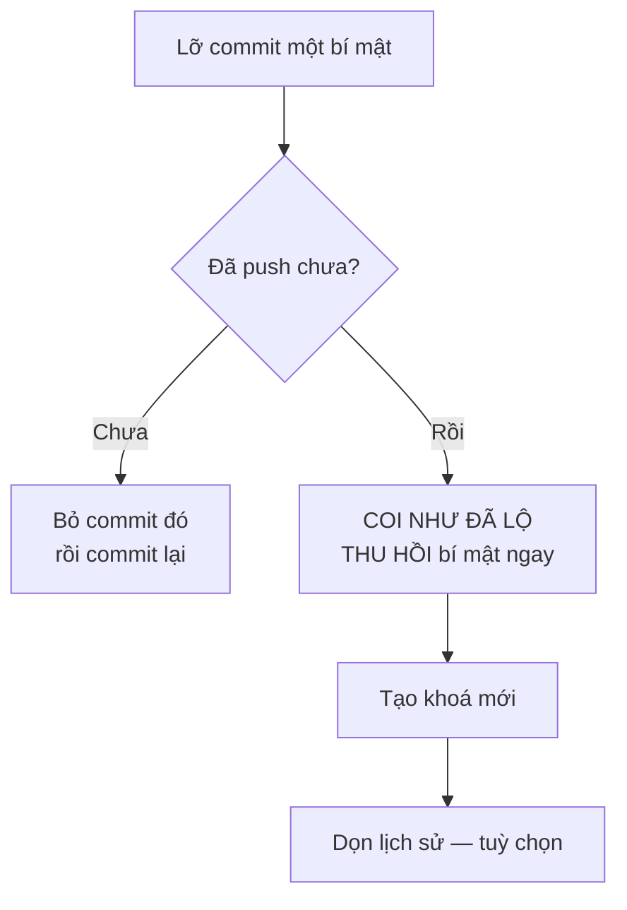

# 3.2 - Cài đặt và cấu hình Git

> **Tóm tắt:** Bài này đưa bạn từ máy chưa có Git tới lúc đẩy được commit đầu tiên lên GitHub. Sau khi cài, có bốn thứ cấu hình một lần rồi dùng mãi. **Danh tính** quyết định tên hiện trong lịch sử. **Ký tự xuống dòng** cấu hình sai giữa Windows và macOS/Linux sẽ khiến `git diff` báo "toàn bộ file đã đổi" dù chỉ sửa một dòng. **Cách đăng nhập GitHub** (HTTPS hoặc SSH) quyết định bạn có push được không. **`.gitignore`** chặn `bin/`, `obj/` và quan trọng hơn là chặn file bí mật. Điều cần nhớ nhất: **bí mật đã push lên thì xoá đi vẫn còn trong lịch sử**, việc đầu tiên phải làm là thu hồi nó.

## Mục tiêu bài học

Sau bài này bạn có thể:

- Cài Git trên Windows, macOS hoặc Linux và kiểm tra bằng `git --version`.
- Cấu hình danh tính ở mức toàn cục và ghi đè theo từng kho.
- Chọn đúng `core.autocrlf` cho hệ điều hành của bạn và giải thích vì sao `.gitattributes` đáng tin hơn.
- Kết nối với GitHub bằng HTTPS (Git Credential Manager) hoặc SSH key.
- Viết `.gitignore` đúng cho dự án .NET và xử lý đúng khi lỡ commit một bí mật.

**Cần biết trước:** [bài 3.1](3.1-git-intro-and-motivation.md) (commit, ba vùng làm việc). Bạn cần biết mở terminal như ở [bài 0.1](../module-00-setup/0.1-install-dotnet-sdk-and-ide.md).

## Nội dung bài học

### 3.2.1 — Cài Git

**Windows.** Cách nhanh nhất là dùng `winget` (có sẵn trên Windows 10/11), mở PowerShell và chạy:

```powershell
winget install --id Git.Git -e
```

Hoặc tải bộ cài từ [git-scm.com](https://git-scm.com/downloads/win). Bộ cài Git for Windows hỏi khá nhiều câu. Phần lớn để mặc định là được, chỉ cần để ý bốn câu:

| Màn hình trong bộ cài | Nên chọn | Vì sao |
|---|---|---|
| Choosing the default editor | Visual Studio Code | Trình soạn thảo mặc định là Vim, người mới rất khó thoát ra |
| Adjusting the name of the initial branch | *Override... : `main`* | Mặc định vẫn là `master`, trong khi GitHub và khóa học dùng `main` |
| Configuring the line ending conversions | *Checkout Windows-style, commit Unix-style* (mặc định) | Đặt `core.autocrlf=true`, giải thích ở mục 3.2.3 |
| Choose a credential helper | Git Credential Manager (mặc định) | Đăng nhập GitHub qua trình duyệt, không phải gõ mật khẩu |

Bộ cài cũng cài **Git Bash**, một terminal giống Linux. Các lệnh trong module này chạy được trong Git Bash, terminal của macOS và Linux. Trong PowerShell, đa số lệnh `git` vẫn chạy, nhưng các lệnh phụ như `echo ... >>`, `grep`, `cat` thì nên chạy trong Git Bash.

**macOS.** Chạy `xcode-select --install` (cài Git kèm bộ công cụ dòng lệnh của Apple), hoặc `brew install git` nếu bạn đã có Homebrew.

**Linux (Ubuntu, Debian).**

```bash
sudo apt update && sudo apt install git
```

**Kiểm tra.** Mở terminal **mới** (terminal đang mở từ trước chưa biết đường dẫn tới Git) rồi chạy:

```bash
git --version
# git version 2.52.0.windows.1   <- số phiên bản trên máy bạn có thể khác
```

Cuối cùng, tạo tài khoản tại [github.com](https://github.com) nếu chưa có. Sinh viên nên đăng ký thêm [GitHub Education](https://education.github.com/pack): gói này cho dùng GitHub Pro miễn phí, ví dụ để bật bảo vệ nhánh cho kho riêng tư ([bài 3.6](3.6-github-and-pull-request.md)). Bài tập trong khoá dùng kho công khai nên gói này không bắt buộc.

### 3.2.2 — Danh tính: làm ngay sau khi cài

```bash
git config --global user.name  "Nguyen Van A"
git config --global user.email "a@example.com"
```

Hai giá trị này được ghi **vào từng commit**, vĩnh viễn. Dùng email trùng với email tài khoản GitHub để GitHub nhận ra commit là của bạn. Đặt sai thì lịch sử ghi sai, và muốn sửa phải viết lại lịch sử, việc rất phiền khi đã đẩy lên chung.

Nếu bạn dùng chung một máy cho việc ở CLB và dự án cá nhân, ghi đè theo từng kho:

```bash
cd ~/projects/my-project
git config user.email "toi@gmail.com"     # không có --global: chỉ áp dụng cho kho này
```

Xem giá trị đang có hiệu lực và nó đến từ file nào:

```bash
git config --list --show-origin | grep user
```

Git đọc cấu hình từ ba nơi theo thứ tự: **system** (cho mọi người dùng trên máy), **global** (cho bạn, file `~/.gitconfig`), **local** (cho một kho, file `.git/config`). Nơi sau ghi đè nơi trước.

### 3.2.3 — Ký tự xuống dòng: cái bẫy đa nền tảng

Windows kết thúc dòng bằng `CRLF` (`\r\n`), còn Linux và macOS dùng `LF` (`\n`). Git có thể tự đổi qua lại bằng cấu hình `core.autocrlf`:

```bash
# Trên Windows — bộ cài Git for Windows đã đặt sẵn giá trị này ở mức system
git config --global core.autocrlf true     # đổi sang LF khi commit, sang CRLF khi lấy file ra

# Trên Linux / macOS
git config --global core.autocrlf input    # đổi sang LF khi commit, giữ nguyên khi lấy file ra
```

Hai cấu hình trên đều đưa file vào kho ở dạng `LF`, nên một người Windows đặt `true` và một người macOS đặt `input` làm việc chung **không** gây rắc rối. Rắc rối đến khi **có người không chuẩn hoá**: ví dụ một bạn trên Windows đặt `core.autocrlf false`, editor lưu `CRLF`, và commit nguyên như vậy vào kho.

Kiểm tra máy bạn đang dùng giá trị nào, lấy từ đâu:

```bash
git config --show-origin --get core.autocrlf
# file:C:/Program Files/Git/etc/gitconfig	true      <- kết quả trên một máy Windows
```

Cách bền vững hơn là để **kho tự quy định**, không phụ thuộc cấu hình từng máy. Tạo file `.gitattributes` ở gốc kho:

```gitattributes
* text=auto
*.sh  text eol=lf
*.cs  text diff=csharp
*.png binary
```

File này đi theo kho, nên mọi người trong nhóm hành xử giống nhau dù cấu hình cá nhân ra sao. Với dự án có cả Windows lẫn Linux (backend .NET chạy trong container Linux thì luôn như vậy), đây gần như là bắt buộc.

### 3.2.4 — Kết nối với GitHub: HTTPS hoặc SSH

GitHub không nhận mật khẩu tài khoản khi bạn `git push`. Có hai cách đăng nhập.

**Cách 1 — HTTPS với Git Credential Manager (khuyên dùng khi mới học).** Git for Windows cài sẵn công cụ này. Lần đầu bạn push lên một địa chỉ `https://github.com/...`, một cửa sổ trình duyệt mở ra để đăng nhập GitHub. Sau đó Git Credential Manager lưu thông tin vào kho mật khẩu của hệ điều hành, lần sau không hỏi lại. Trên macOS và Linux, cài [Git Credential Manager](https://github.com/git-ecosystem/git-credential-manager) hoặc dùng [GitHub CLI](https://cli.github.com/) (`gh auth login`).

**Cách 2 — SSH key.** Hợp khi bạn làm việc nhiều trên terminal, hoặc trên máy chủ không có trình duyệt.

```bash
ssh-keygen -t ed25519 -C "a@example.com"
# Enter để dùng đường dẫn mặc định
# Đặt passphrase — đây là lớp bảo vệ nếu máy bị mất

cat ~/.ssh/id_ed25519.pub     # khoá CÔNG KHAI, dán vào GitHub > Settings > SSH and GPG keys
```

Hai file cần phân biệt rõ:

- `id_ed25519.pub` — khoá **công khai**, dán lên GitHub, ai thấy cũng không sao.
- `id_ed25519` — khoá **riêng tư**, không bao giờ rời khỏi máy bạn. Không commit, không gửi qua chat, không chép lên máy chủ.

Kiểm tra kết nối:

```bash
ssh -T git@github.com
# Hi username! You've successfully authenticated...
```

Địa chỉ kho dùng SSH có dạng `git@github.com:<tên>/<kho>.git`, dùng HTTPS có dạng `https://github.com/<tên>/<kho>.git`. Cách kết nối kho trên máy với kho trên GitHub được dạy ở [bài 3.4](3.4-basic-git-workflow.md).

### 3.2.5 — `.gitignore` cho .NET

Cách nhanh nhất: chạy `dotnet new gitignore` ở gốc kho, lệnh này sinh sẵn một file đầy đủ cho .NET và Visual Studio. Phần cốt lõi của nó trông như sau, kèm vài dòng nên thêm:

```gitignore
# Kết quả build
bin/
obj/
[Dd]ebug/
[Rr]elease/

# IDE
.vs/
.idea/
*.user
*.suo

# Bí mật và cấu hình riêng của máy (thêm vào file sinh sẵn)
appsettings.*.Local.json
.env
*.pfx
```

Ba nguyên tắc:

1. **Không commit thứ build ra được.** `bin/` và `obj/` tái tạo được từ mã nguồn, và chúng gây xung đột liên tục.
2. **Không commit cấu hình riêng của máy.** `.vs/`, `*.user` là thiết lập cá nhân.
3. **Không commit bí mật.** Mật khẩu database, khoá API, chứng chỉ.

Còn `appsettings.Development.json` thì sao? Theo quy ước .NET, file này **được commit**, chứa cấu hình chung cho môi trường phát triển (mức log, địa chỉ database chạy trên máy). Bí mật thì **không** để trong đó mà để trong **user secrets**, một kho cấu hình nằm ngoài thư mục dự án:

```bash
dotnet user-secrets init
dotnet user-secrets set "ConnectionStrings:Crm" "Host=localhost;Username=postgres;Password=..."
```

[Bài 8.6](../../stage-03-aspnet-core-backend/module-08-aspnet-core-fundamentals/8.6-configuration-system.md) dạy kỹ cách ASP.NET Core gộp các nguồn cấu hình này.

Một điểm hay bị vấp: **`.gitignore` chỉ có tác dụng với file chưa được theo dõi**. File đã commit rồi thì thêm vào `.gitignore` cũng vô ích:

```bash
# Gỡ khỏi theo dõi nhưng giữ lại trên đĩa
git rm --cached .env
git commit -m "chore: stop tracking local .env file"
```

### 3.2.6 — Lỡ commit bí mật thì làm gì

Đây là phần quan trọng nhất của bài, và câu trả lời thường khiến người ta khó chịu.



> Bí mật đã được đẩy lên thì **coi như đã lộ**. Việc đầu tiên và bắt buộc là **thu hồi nó**, không phải xoá commit.

Lý do: giữa lúc push và lúc bạn phát hiện, bí mật đó đã có thể được clone về máy khác, được CI đọc, bị công cụ quét tự động tìm thấy, hoặc nằm trong cache của GitHub. Xoá commit không lấy lại được những bản sao đó.

Thứ tự việc phải làm:

1. **Thu hồi và tạo khoá mới** — đổi mật khẩu database, huỷ token API. Làm ngay.
2. Dọn lịch sử bằng `git filter-repo` — **tuỳ chọn**, và chỉ để tránh lộ thêm. [Bài 3.12](3.12-mini-case-study.md) làm việc này từng bước.
3. Thêm vào `.gitignore` để không tái diễn.
4. Cân nhắc bật quét bí mật tự động.

Nếu **chưa push**, mọi thứ đơn giản hơn nhiều:

```bash
git reset --soft HEAD~1     # bỏ commit cuối, giữ nguyên thay đổi trong staging
# xoá bí mật khỏi file, chuyển sang user-secrets
git commit -m "feat: add config file without secrets"
```

`HEAD~1` nghĩa là "commit ngay trước commit hiện tại". [Bài 3.4](3.4-basic-git-workflow.md) giải thích kỹ `reset --soft`.

### 3.2.7 — Vài cấu hình đáng bật

```bash
# Nhánh mặc định tên main thay vì master
git config --global init.defaultBranch main

# Khi pull mà nhánh đã phân kỳ, rebase thay vì tạo merge commit
git config --global pull.rebase true

# Tự dọn nhánh theo dõi đã bị xoá trên remote
git config --global fetch.prune true

# Trình soạn thảo cho commit message
git config --global core.editor "code --wait"
```

`pull.rebase true` đáng chú ý nhất. Không có nó, mỗi lần `git pull` khi cả bạn và người khác đều có commit mới, các bản Git gần đây dừng lại với lỗi `fatal: Need to specify how to reconcile divergent branches` (bản cũ hơn thì đẻ ra một merge commit kiểu "Merge branch 'main' of github.com..."). Rebase là gì và vì sao nó cho lịch sử thẳng được dạy ở [bài 3.5](3.5-branching-and-merging.md). Nhánh theo dõi (`origin/main`) và `fetch` được dạy ở [bài 3.4](3.4-basic-git-workflow.md).

### 3.2.8 — Lỗi thường gặp

| Triệu chứng | Nguyên nhân | Cách sửa |
|---|---|---|
| `git: command not found` / `'git' is not recognized` | Terminal mở trước khi cài, chưa nhận PATH mới | Đóng hẳn terminal rồi mở lại |
| Commit lên GitHub hiện tên lạ, không có ảnh đại diện | `user.email` khác email tài khoản GitHub | Đặt lại `user.email`, thêm email đó vào GitHub |
| Gõ `git commit` thì kẹt trong màn hình đen lạ | Editor mặc định là Vim | Gõ `Esc`, rồi `:q!` và Enter; sau đó đặt `core.editor` |
| `Permission denied (publickey)` khi push | Dùng địa chỉ SSH nhưng chưa thêm khoá lên GitHub | Thêm khoá, hoặc đổi sang địa chỉ HTTPS |
| Diff hiện cả file đổi dù sửa một dòng | Ký tự xuống dòng không thống nhất | Thêm `.gitattributes`, chạy `git add --renormalize .` |

**Danh sách rà soát cấu hình Git**

- [ ] `git --version` chạy được trong terminal mới.
- [ ] `user.name` và `user.email` đã đặt đúng, email trùng với tài khoản GitHub.
- [ ] Đẩy được lên GitHub bằng HTTPS (Credential Manager) hoặc SSH key có passphrase.
- [ ] Kho có `.gitattributes` quy định ký tự xuống dòng cho cả nhóm.
- [ ] `.gitignore` đã chặn `bin/`, `obj/`, `.env` và các file cấu hình riêng của máy.
- [ ] Không có file bí mật nào đang được Git theo dõi (kiểm tra bằng `git ls-files`).
- [ ] Biết quy trình phải làm khi lỡ đẩy một bí mật lên.

## Bài tập áp dụng

#### Bài 1 — Tìm bí mật đang bị theo dõi

Chạy lệnh quét dưới đây trong các kho bạn có (chưa có kho nào thì làm bài này sau [bài 3.4](3.4-basic-git-workflow.md)). Với mỗi kết quả, trả lời: file này có chứa giá trị thật không?

**Tiêu chí hoàn thành:** bạn có danh sách file cần xử lý, và biết thứ tự đúng để xử lý chúng.

<details>
<summary><strong>Gợi ý và lời giải — Bài 1</strong></summary>

**Gợi ý.** `git ls-files` liệt kê file **đang được theo dõi**, khác hẳn `ls`. Một file nằm trong `.gitignore` nhưng đã lỡ commit từ trước thì vẫn tiếp tục được theo dõi — `.gitignore` chỉ có tác dụng với file **chưa** được theo dõi bao giờ.

**Lời giải — quét:**

```bash
git ls-files | grep -iE "\.env|secret|appsettings\..*\.json|\.pfx|\.pem|\.key|credentials"
```

Quét cả **lịch sử**, vì file đã xoá vẫn còn trong các commit cũ:

```bash
git log --all --name-only --format="" | sort -u | grep -iE "\.env|secret|\.pfx"
```

**Bảng phân loại kết quả:**

| File | Thường có giá trị thật? | Xử lý |
|---|---|---|
| `appsettings.json` | Không nên có | Giữ, nhưng rà lại chuỗi kết nối |
| `appsettings.Development.json` | Không nên có, nhưng hay bị nhét mật khẩu vào | Giữ file, chuyển mật khẩu sang user secrets |
| `appsettings.Production.json` | **Gần như chắc chắn có** | Bỏ theo dõi ngay, thu hồi mọi bí mật trong đó |
| `.env` | **Có** | Bỏ theo dõi, thêm vào `.gitignore` |
| `*.pfx`, `*.pem`, `*.key` | **Có** — là khoá riêng | Thu hồi chứng chỉ, phát hành lại |

**Bỏ theo dõi mà vẫn giữ file trên máy:**

```bash
git rm --cached appsettings.Production.json
echo "appsettings.Production.json" >> .gitignore
git commit -m "chore: stop tracking production config"
```

**Điều quan trọng nhất, và hay bị làm sai thứ tự.** Lệnh trên **không** xoá bí mật khỏi lịch sử — nó vẫn nằm trong mọi commit cũ, và ai clone kho cũng đọc được. Thứ tự đúng là:

```text
1. THU HỒI bí mật ngay — đổi mật khẩu, xoá token, phát hành lại chứng chỉ
2. Bỏ theo dõi file và thêm vào .gitignore
3. Dọn lịch sử nếu cần (git filter-repo)
4. Thông báo cho mọi người clone lại kho
```

**Bước 1 trước tiên, không có ngoại lệ.** Dọn lịch sử mất nhiều thời gian và có thể không triệt để — kho đã được fork, đã có bản sao trên máy người khác. Trong khi đó, thu hồi một token chỉ mất vài thao tác trên trang quản trị và làm cho mọi bản sao trở thành vô dụng.

</details>

#### Bài 2 — Tự tạo lỗi ký tự xuống dòng

Trên một kho thử, đặt `core.autocrlf false`, tạo file có `CRLF`, commit. Đổi sang `input` rồi chạy `git add --renormalize .` và `git diff --cached --stat`. Sau đó viết `.gitattributes` cho kho.

**Tiêu chí hoàn thành:** bạn giải thích được vì sao `.gitattributes` đáng tin hơn `core.autocrlf`.

<details>
<summary><strong>Gợi ý và lời giải — Bài 2</strong></summary>

**Gợi ý.** `core.autocrlf` là cấu hình **của từng máy**. `.gitattributes` là file **nằm trong kho**. Hãy nghĩ xem điều gì xảy ra khi một nhóm có người dùng Windows, người dùng macOS, người dùng Linux.

**Lời giải — tái hiện** (chạy trong Git Bash hoặc terminal macOS/Linux):

```bash
mkdir eol-test && cd eol-test && git init -q
git config core.autocrlf false

printf 'line 1\r\nline 2\r\n' > win.txt      # CRLF
git add . && git commit -q -m "chore: add CRLF file"

git config core.autocrlf input               # đổi cấu hình
git add --renormalize .
git diff --cached --stat
```

```text
 win.txt | 4 ++--
 1 file changed, 2 insertions(+), 2 deletions(-)
```

Không có chữ nào trong nội dung thật sự đổi, nhưng Git báo **mọi dòng** đều thay đổi, vì `\r\n` đã thành `\n`.

**Chuyện này gây hại thế nào trong nhóm.** Bạn A dùng Windows nhưng đặt `core.autocrlf false`, editor lưu `CRLF`, nên A commit file ở dạng `CRLF`. Bạn B dùng macOS, editor lưu `LF`. Mỗi lần một người sửa **một** dòng rồi commit, toàn bộ ký tự xuống dòng của file bị đổi theo máy người đó. Trên một file 3 dòng, A chỉ sửa dòng 2 nhưng Git báo:

```text
 f.txt | 6 +++---
 1 file changed, 3 insertions(+), 3 deletions(-)
```

Hệ quả:

- Diff trong pull request hiện hàng trăm dòng trong khi thật ra chỉ đổi một dòng — không ai review được.
- `git blame` trỏ mọi dòng về commit đổi ký tự xuống dòng gần nhất, nên mất khả năng truy nguồn.
- Xung đột phát sinh ở những chỗ không ai đụng vào.

Lưu ý: nếu **mọi người** đều chuẩn hoá về LF khi commit (Windows đặt `true`, macOS/Linux đặt `input`) thì không có vấn đề. Lỗi chỉ xảy ra khi có một người không chuẩn hoá, hoặc kho đã chứa sẵn file `CRLF`. Và bạn không kiểm soát được cấu hình máy của người khác.

**Cách sửa — `.gitattributes` đặt trong kho:**

```text
# Chuẩn hoá mọi file văn bản về LF trong kho
* text=auto

# File bắt buộc phải là CRLF trên đĩa
*.bat  text eol=crlf
*.cmd  text eol=crlf
*.ps1  text eol=crlf

# File bắt buộc phải là LF
*.sh   text eol=lf

# File nhị phân — không đụng vào
*.png  binary
*.pfx  binary
*.dll  binary
```

Áp dụng cho toàn bộ kho sau khi thêm file:

```bash
git add --renormalize .
git commit -m "chore: normalize line endings via .gitattributes"
```

**Vì sao `.gitattributes` đáng tin hơn:**

| | `core.autocrlf` | `.gitattributes` |
|---|---|---|
| Phạm vi | Một máy | Toàn kho, mọi người |
| Nằm trong Git | Không | **Có** — được commit và chia sẻ |
| Người mới vào nhóm | Phải tự cấu hình đúng | Tự động áp dụng |
| Phân biệt theo loại file | Không | **Có** — `.sh` và `.bat` khác nhau |

Điểm thứ hai là quyết định. Cấu hình nào phụ thuộc vào việc **mỗi người nhớ đặt đúng** thì sớm muộn cũng có người quên.

**Với dự án .NET**, hai loại file đáng chú ý: tập lệnh `.sh` phải là LF, nếu không sẽ lỗi khi chạy trong container Linux; `.bat` nên là CRLF để Windows chạy đúng. Dòng `* text=auto` một mình không xử lý được hai trường hợp này, nên phải khai báo riêng.

</details>

#### Bài 3 — Diễn tập thu hồi bí mật

Tạo một Personal Access Token thử trên GitHub (Settings > Developer settings > Personal access tokens > Fine-grained tokens), cho quyền thấp nhất và hết hạn sau 1 ngày. Dán nó vào một file trong kho **riêng tư** của bạn, commit, push. Sau đó thực hiện đủ quy trình: thu hồi trước, dọn sau. Bấm giờ từ lúc "phát hiện" tới lúc token bị vô hiệu.

**Tiêu chí hoàn thành:** token bị vô hiệu trong **dưới 5 phút** (thử gọi `curl -H "Authorization: Bearer <token>" https://api.github.com/user` và nhận `401`). Nếu lâu hơn, quy trình của bạn đang sai thứ tự.

> [!WARNING]
> **Dùng token thử, kho riêng**
>
> Tạo token với quyền thấp nhất và trên kho riêng tư của bạn. Đừng dùng token thật đang phục vụ hệ thống. GitHub có thể tự phát hiện và thu hồi token bị đẩy lên kho công khai, nên bài tập này dùng kho riêng tư.

<details>
<summary><strong>Gợi ý và lời giải — Bài 3</strong></summary>

**Gợi ý.** Bấm giờ từ lúc bạn "phát hiện" tới lúc token thật sự không dùng được nữa. Đừng tính thời gian dọn lịch sử vào con số đó — đó là bước sau, và nó không làm token an toàn hơn.

**Lời giải — quy trình bốn bước, theo đúng thứ tự.**

**Bước 1 — Thu hồi. Làm ngay, trước mọi thứ khác.**

```text
GitHub token : Settings > Developer settings > Personal access tokens > Delete
Database     : đổi mật khẩu tài khoản mà ứng dụng dùng (xem bài 3.12)
Dịch vụ khác : vào trang quản trị của dịch vụ, xoá khoá cũ và tạo khoá mới
```

Bấm giờ dừng ở đây. Từ giây phút này, giá trị nằm trong Git trở thành vô hại.

**Bước 2 — Ngăn tái diễn.**

```bash
git rm --cached token.txt
echo "token.txt" >> .gitignore
git add .gitignore
git commit -m "chore: stop tracking token file"
git push
```

**Bước 3 — Dọn lịch sử, nếu kho sẽ còn được chia sẻ.** Dùng `git filter-repo` như [bài 3.12](3.12-mini-case-study.md) hướng dẫn, rồi force push.

**Bước 4 — Thông báo.** Mọi người phải **clone lại**, không `git pull`. Lịch sử đã viết lại nên bản sao cũ của họ mâu thuẫn với kho; bài 3.12 cho thấy chuyện gì xảy ra khi có người pull nhầm.

**Vì sao thứ tự này là bắt buộc.** Từ lúc bạn push một bí mật lên kho công khai, đồng hồ bắt đầu chạy cho **mọi người khác**:

- Các bot quét kho công khai liên tục, nên phải giả định bí mật bị tìm thấy rất nhanh.
- Kho đã được fork thì bản fork **giữ nguyên lịch sử cũ**, và bạn không xoá được nó.
- Commit "đã xoá" vẫn có thể truy cập được qua mã băm trên GitHub một thời gian.
- Ai đã clone trước đó thì có bản sao đầy đủ trên máy họ.

Dọn lịch sử **không** giải quyết được bất kỳ điểm nào ở trên. Chỉ có thu hồi mới giải quyết được tất cả cùng lúc.

**Phòng ngừa — tốt hơn nhiều so với xử lý.**

```bash
# 1. Bật Secret scanning và Push protection trong Settings > Code security của kho
# 2. Quét phần đã stage trước khi commit bằng gitleaks (v8.19 trở lên)
gitleaks git --pre-commit --staged
# 3. Dùng user secrets khi phát triển, biến môi trường khi triển khai
dotnet user-secrets set "ApiKey" "the-real-value"
```

Bản gitleaks cũ dùng lệnh `gitleaks protect --staged`; từ v8.19 lệnh này bị đánh dấu deprecated và thay bằng `gitleaks git --pre-commit --staged`. [Bài 3.12](3.12-mini-case-study.md) chạy gitleaks thật và cho thấy nó bắt được gì, bỏ sót gì.

</details>

## Tự kiểm tra

<details>
<summary>Vì sao phải đặt user.name và user.email trước khi commit?</summary>

Vì hai giá trị này được ghi vĩnh viễn vào từng commit. Đặt sai thì toàn bộ lịch sử từ đó tới lúc phát hiện đều mang tên sai, và sửa lại đòi viết lại lịch sử — việc rất phiền khi đã đẩy lên kho chung.

</details>

<details>
<summary>Người Windows đặt autocrlf=true làm chung với người macOS đặt autocrlf=input thì có bị diff cả file không?</summary>

Không. Cả hai cấu hình đều đổi về LF khi commit, nên trong kho mọi file đều là LF. Rắc rối xảy ra khi có người đặt autocrlf=false trên Windows và commit nguyên CRLF, hoặc kho đã chứa sẵn file CRLF. Vì không kiểm soát được cấu hình máy người khác, nên dùng .gitattributes trong kho.

</details>

<details>
<summary>Nên dùng HTTPS hay SSH để push lên GitHub?</summary>

Khi mới học, HTTPS với Git Credential Manager là đơn giản nhất: lần đầu push thì đăng nhập qua trình duyệt, sau đó không hỏi lại. SSH key hợp khi làm việc nhiều trên terminal hoặc trên máy không có trình duyệt. GitHub không nhận mật khẩu tài khoản khi push trong cả hai cách.

</details>

<details>
<summary>appsettings.Development.json có nên đưa vào .gitignore không?</summary>

Thường là không. Theo quy ước .NET, file này được commit và chứa cấu hình chung cho môi trường phát triển. Bí mật như mật khẩu database thì không để trong đó mà để trong user secrets, nằm ngoài thư mục dự án nên không thể lọt vào Git.

</details>

<details>
<summary>Thêm file vào .gitignore sau khi đã commit thì có tác dụng không?</summary>

Không. .gitignore chỉ có tác dụng với file chưa được Git theo dõi. File đã commit vẫn tiếp tục được theo dõi. Phải gỡ bằng git rm --cached để ngừng theo dõi mà vẫn giữ file trên đĩa, rồi commit thay đổi đó.

</details>

<details>
<summary>Lỡ đẩy một bí mật lên thì việc đầu tiên phải làm là gì?</summary>

Thu hồi bí mật đó và tạo cái mới — đổi mật khẩu database, huỷ token API. Không phải xoá commit. Lý do là giữa lúc push và lúc phát hiện, bí mật đã có thể được clone về máy khác hoặc bị công cụ quét tìm thấy. Dọn lịch sử là việc làm sau và chỉ để tránh lộ thêm.

</details>

## Kết luận

Ba điều đáng nhớ nhất:

1. **`.gitattributes` mạnh hơn cấu hình cá nhân.** Nó bắt cả nhóm hành xử giống nhau.
2. **`.gitignore` không hồi tố.** File đã theo dõi thì phải `git rm --cached`.
3. **Bí mật đã push là bí mật đã lộ.** Thu hồi trước, dọn lịch sử sau.

## Tham khảo

- [Pro Git — Getting Started: Installing Git](https://git-scm.com/book/en/v2/Getting-Started-Installing-Git)
- [git-config](https://git-scm.com/docs/git-config) — danh sách đầy đủ các tuỳ chọn
- [gitattributes](https://git-scm.com/docs/gitattributes) — `text`, `eol`, `binary`
- [gitignore](https://git-scm.com/docs/gitignore) — cú pháp và thứ tự ưu tiên
- [Git Credential Manager](https://github.com/git-ecosystem/git-credential-manager)
- [Connecting to GitHub with SSH](https://docs.github.com/en/authentication/connecting-to-github-with-ssh)

## Điều hướng

- **Bài trước:** [3.1 — Git là gì và tại sao cần](3.1-git-intro-and-motivation.md)
- **Bài tiếp theo:** [3.3 — Checklist an toàn khi làm Git](3.3-git-safety-checklist.md)
- **Về module:** [Trang mục lục](README.md)
