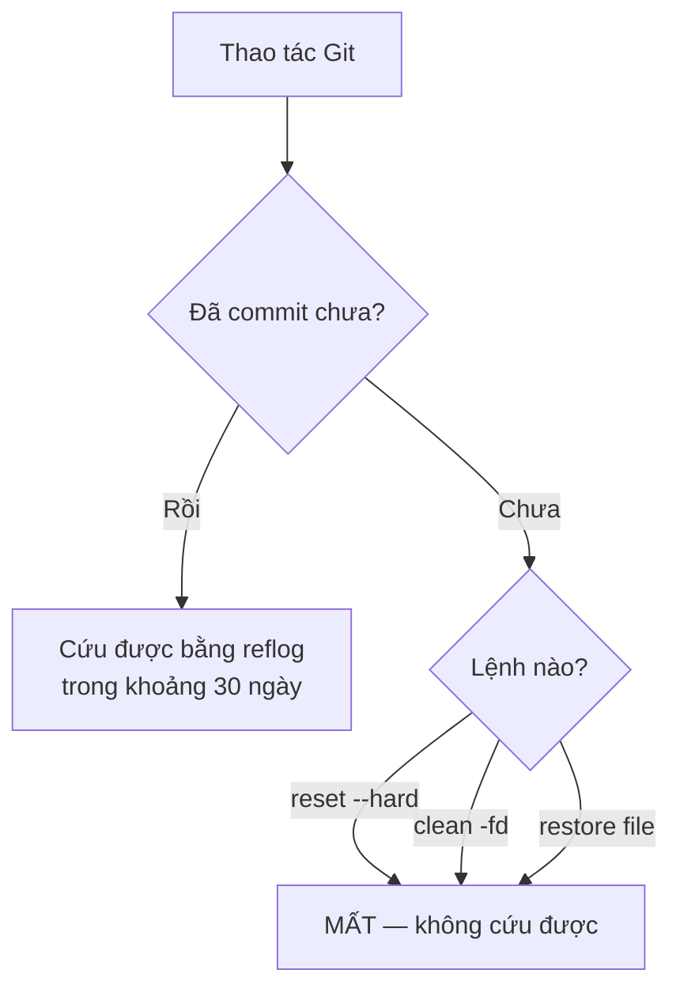

# 3.3 - Checklist an toàn khi làm Git

> **Tóm tắt:** Vì commit là bất biến, **gần như mọi sai lầm trong Git đều hoàn tác được** — `git reflog` ghi lại mọi lần `HEAD` di chuyển, nên commit "mất" sau `reset` hay `rebase` vẫn tìm lại được trong khoảng **30 ngày**. Điều đáng học không phải là "cẩn thận", mà là biết **chính xác ba thứ không cứu được**: thay đổi chưa commit bị `reset --hard` xoá, file chưa theo dõi bị `clean -fd` xoá, và lịch sử chung bị `push --force` ghi đè trên máy người khác. Mọi thứ khác đều có công thức khôi phục, và bài này liệt kê chúng.

> **Thứ tự đọc:** bài này dùng commit, nhánh, `push` và `rebase`. Nếu bạn mới học Git, hãy đọc [bài 3.4](3.4-basic-git-workflow.md) và [bài 3.5](3.5-branching-and-merging.md) trước rồi quay lại đây. Những gì cần cho bài này đều có ở hai bài đó.

## Mục tiêu bài học

Sau bài này bạn có thể:

- Dùng `git reflog` để tìm lại commit sau một thao tác sai.
- Nêu ba trường hợp thực sự mất dữ liệu và cách phòng.
- Chọn `--force-with-lease` thay cho `--force` và giải thích khác biệt.
- Khôi phục đúng cho bốn tình huống hay gặp nhất.
- Dùng `git stash` để cất việc dở mà không mất thay đổi.

**Cần biết trước:** [bài 3.1](3.1-git-intro-and-motivation.md) (commit bất biến), [bài 3.4](3.4-basic-git-workflow.md) (commit, `reset`, `push`, remote), [bài 3.5](3.5-branching-and-merging.md) (nhánh, `rebase`).

## Nội dung bài học

### 3.3.1 — Lưới an toàn: `git reflog`

`reflog` (reference log) là nhật ký ghi lại **mọi lần `HEAD` di chuyển** trên máy bạn: commit, chuyển nhánh, reset, rebase, merge. Ví dụ sau khi lỡ `reset --hard` lùi ba commit:

```text
$ git reflog
c9f3241 HEAD@{0}: reset: moving to HEAD~3
3b676f2 HEAD@{1}: commit: commit 3          <- tưởng đã mất
d8a35ed HEAD@{2}: commit: commit 2
c56b8fd HEAD@{3}: commit: commit 1
c9f3241 HEAD@{4}: commit (initial): commit 0
```

Quay về bất kỳ điểm nào trong đó:

```bash
git reset --hard 3b676f2                      # đưa nhánh hiện tại về đúng commit đó
# hoặc an toàn hơn:
git branch rescue/lost-commit 3b676f2         # tạo nhánh mới trỏ vào, không đụng nhánh hiện tại
```

Cách thứ hai nên là phản xạ: **tạo nhánh trước, xem xét sau**. Nó không phá gì cả.

**Giữ được bao lâu.** Mặc định, Git dọn mục reflog theo hai hạn:

| Loại mục reflog | Hạn mặc định | Cấu hình |
|---|---|---|
| Trỏ tới commit vẫn còn nằm trên nhánh | 90 ngày | `gc.reflogExpire` |
| Trỏ tới commit đã mất tham chiếu (sau `reset`, `rebase`, `--amend`) | **30 ngày** | `gc.reflogExpireUnreachable` |

Commit "mất" mà bạn muốn cứu thuộc loại thứ hai, nên hãy nhớ con số **30 ngày**. Sau khi mục reflog hết hạn, object mồ côi còn bị dọn thêm theo `gc.pruneExpire` (mặc định 2 tuần). Thực tế bạn có khoảng một tháng, quá đủ nếu biết `reflog` tồn tại.

Ba giới hạn cần biết:

- `reflog` là **cục bộ**. Nó không được đẩy lên, và máy của người khác có reflog riêng.
- Xoá một nhánh thì **reflog của nhánh đó bị xoá theo**, chỉ còn reflog của `HEAD` (đủ để tìm lại nếu bạn từng đứng trên nhánh đó).
- `reflog` không cứu được thứ **chưa bao giờ commit**.

### 3.3.2 — Ba thứ thật sự không cứu được

Hai thứ đầu đều là dữ liệu **chưa commit**. Sơ đồ dưới đây cho thấy ranh giới: đã commit thì `reflog` cứu được, chưa commit thì ba lệnh `reset --hard`, `clean -fd` và `restore <file>` xoá là mất (mục 3.3.6 gọi chúng là "ba lệnh phá dữ liệu chưa commit").



**1. Thay đổi chưa commit bị `git reset --hard` xoá.**

```bash
git reset --hard HEAD     # mọi sửa đổi chưa commit biến mất, không hỏi lại
```

Không có bản sao nào. `reflog` không giúp được vì chưa từng có commit nào. (Ngoại lệ nhỏ: phần bạn đã `git add` thì còn tìm lại được, xem Bài 2.)

**2. File chưa theo dõi bị `git clean -fd` xoá.**

```bash
git clean -fd             # xoá mọi file và thư mục Git chưa theo dõi
```

Git chưa bao giờ biết những file đó tồn tại. Luôn chạy thử trước:

```bash
git clean -nd             # -n = chỉ LIỆT KÊ, không xoá
```

**3. Lịch sử chung bị `push --force` ghi đè.**

Commit của **bạn** vẫn còn trong `reflog` của bạn. Nhưng commit của **người khác** bị ghi đè trên máy chủ, và nếu đồng nghiệp đã `pull` phiên bản cũ và đang làm việc trên đó, một cú force push đặt họ vào trạng thái phân kỳ rất khó gỡ.

### 3.3.3 — `--force-with-lease` thay cho `--force`

Sau khi rebase hay `--amend` một commit đã push, `git push` thường bị từ chối và bạn phải "push cưỡng bức".

```bash
git push --force              # NGUY HIỂM: đè lên mọi thứ trên remote
git push --force-with-lease   # AN TOÀN HƠN: từ chối nếu remote đã có commit mà bạn chưa thấy
```

`--force-with-lease` kiểm tra rằng nhánh trên remote vẫn đang ở đúng chỗ mà máy bạn ghi nhận (nhánh theo dõi `origin/<tên>`). Nếu ai đó vừa push thêm, lệnh **thất bại** thay vì xoá công sức của họ.

Không có lý do nào để dùng `--force` khi đã có `--force-with-lease`. Đặt alias cho nó:

```bash
git config --global alias.pushf "push --force-with-lease --force-if-includes"
```

`--force-if-includes` (Git 2.30 trở lên) vá một lỗ hổng của `--force-with-lease`, được chứng minh ở Bài 3.

### 3.3.4 — Bốn công thức khôi phục

**Lỡ commit vào sai nhánh** (chưa push)

```bash
# Đang ở main, lẽ ra phải ở feature/abc
git branch feature/abc        # tạo nhánh giữ commit lại
git reset --hard HEAD~1       # đưa main về trạng thái trước commit
git switch feature/abc        # sang nhánh đúng, commit vẫn còn
```

Thứ tự quan trọng: tạo nhánh **trước**, reset **sau**.

**Lỡ `reset --hard` và mất commit**

```bash
git reflog                    # tìm mã commit trước khi reset
git reset --hard <mã đó>
```

**Lỡ xoá nhánh chưa merge**

```bash
git reflog                    # tìm commit cuối của nhánh đã xoá (reflog của HEAD)
git branch <tên-nhánh> <mã>
```

Lúc xoá, Git cũng in ra mã đó: `Deleted branch feature/abc (was 8f22eea).`

**Rebase hỏng**

```bash
git rebase --abort            # đang giữa chừng: quay về trạng thái trước khi rebase

# Đã rebase xong mới thấy sai, và chưa làm thao tác nào khác đổi HEAD:
git reset --hard ORIG_HEAD    # ORIG_HEAD = vị trí của nhánh trước lần rebase

# Hoặc dùng reflog của chính nhánh đó: vị trí ngay trước lần thay đổi gần nhất
git reset --hard feature/abc@{1}
```

Không dùng `HEAD@{5}` đoán chừng: một lần rebase sinh ra nhiều mục reflog, chỉ số đếm ngược rất dễ lệch. Muốn chắc chắn thì đọc `git reflog`, tìm dòng `rebase (start)` và lấy mã băm của dòng ngay dưới nó.

### 3.3.5 — Cất việc dở: `git stash`

Tình huống quen thuộc: đang làm dở một tính năng thì có lỗi khẩn cấp cần sửa ngay.

```bash
git stash push -u -m "wip: revenue report"   # cất tạm, -u cất cả file mới chưa theo dõi
git switch -c hotfix/urgent-bug main
# ... sửa, commit, push ...
git switch feature/revenue-report
git stash pop                                # lấy lại thay đổi
```

Ba điều cần biết về `stash`:

- `git stash list` xem những gì đang cất.
- `pop` lấy ra và **xoá** khỏi danh sách; `apply` lấy ra mà **giữ lại**.
- Mặc định `stash` **không** cất file chưa theo dõi. Thêm `-u` để cất cả chúng — đây là chỗ hay làm người ta mất file.

Khi việc khẩn cấp kéo dài, `git worktree` (mở thêm một thư mục làm việc cho nhánh khác) tiện hơn `stash`; [bài 3.11](3.11-advanced-notes.md) hướng dẫn cách dùng.

### 3.3.6 — Lệnh nguy hiểm, xếp theo mức độ

| Lệnh | Rủi ro | Trước khi chạy |
|---|---|---|
| `git clean -fd` | **Mất vĩnh viễn** file chưa theo dõi | Chạy `git clean -nd` xem trước |
| `git reset --hard` | **Mất vĩnh viễn** thay đổi chưa commit | `git stash -u` trước |
| `git restore <file>` (hay `git checkout -- <file>` kiểu cũ) | **Mất vĩnh viễn** sửa đổi trong file đó | Xem `git diff` trước |
| `git push --force` | Đè lịch sử người khác | Dùng `--force-with-lease` |
| `git rebase` trên nhánh chung | Mọi người phân kỳ | Chỉ rebase nhánh riêng của bạn |
| `git filter-repo` | Viết lại toàn bộ lịch sử | Làm trên bản sao, báo cả nhóm trước |

Quy tắc bao trùm: **ba lệnh đầu là ba lệnh phá được dữ liệu chưa commit.** Nhớ ba cái tên đó là đủ để cẩn thận đúng chỗ.

### 3.3.7 — Lỗi thường gặp

| Sai lầm | Hậu quả | Thay bằng |
|---|---|---|
| Reset nhánh trước rồi mới tạo nhánh cứu | Commit thành mồ côi, phải lục reflog | Tạo nhánh trước, reset sau |
| `git stash` rồi chuyển nhánh, tưởng đã cất hết | File mới vẫn nằm ngoài, dễ bị ghi đè | `git stash -u` |
| Dùng `HEAD@{n}` đoán chừng khi đang hoảng | Quay về sai chỗ | Đọc `git reflog`, dùng mã băm hoặc `ORIG_HEAD` |
| `git fetch` ngay trước `--force-with-lease` | Lớp bảo vệ mất tác dụng | Thêm `--force-if-includes` |

**Thói quen an toàn với Git**

- [ ] Commit sớm và thường xuyên — commit là thứ reflog cứu được.
- [ ] Chạy `git status` trước mọi lệnh có chữ reset, clean hay restore.
- [ ] Luôn dùng `git clean -nd` trước khi dùng `git clean -fd`.
- [ ] Luôn dùng `--force-with-lease` thay cho `--force`.
- [ ] Chỉ rebase nhánh chưa ai khác dùng.
- [ ] Khi hoảng, tạo nhánh cứu hộ trước rồi mới xử lý tiếp.
- [ ] Dùng `git stash -u` khi cần cất cả file chưa theo dõi.

## Bài tập áp dụng

#### Bài 1 — Tự làm mất rồi tự cứu

Trên một kho thử: tạo bốn commit (`commit 0` tới `commit 3`), chạy `git reset --hard HEAD~3`, rồi dùng `reflog` khôi phục cả ba commit vừa mất. Ghi lại từng lệnh đã dùng.

**Tiêu chí hoàn thành:** khôi phục xong, `git log --oneline` hiện lại đủ bốn commit với **đúng mã băm cũ**.

<details>
<summary><strong>Gợi ý và lời giải — Bài 1</strong></summary>

**Gợi ý.** `reset --hard` chỉ dời con trỏ nhánh. Các commit vẫn nằm trong kho, chỉ là không còn tên nào trỏ tới chúng nữa. `reflog` ghi lại **mọi lần `HEAD` di chuyển**, nên nó vẫn nhớ vị trí cũ. Vì sao cần bốn commit? `HEAD~3` nghĩa là "lùi ba bậc cha". Kho chỉ có ba commit thì không có bậc cha thứ ba, và Git báo `fatal: ambiguous argument 'HEAD~3': unknown revision or path not in the working tree.`

**Lời giải** (output thật; mã băm trên máy bạn sẽ khác):

```bash
mkdir thu && cd thu && git init -q -b main
echo 0 > f.txt && git add . && git commit -q -m "commit 0"
echo 1 >> f.txt && git commit -q -am "commit 1"
echo 2 >> f.txt && git commit -q -am "commit 2"
echo 3 >> f.txt && git commit -q -am "commit 3"
git log --oneline
```

```text
3b676f2 commit 3
d8a35ed commit 2
c56b8fd commit 1
c9f3241 commit 0
```

```bash
git reset --hard HEAD~3
git log --oneline
```

```text
HEAD is now at c9f3241 commit 0
c9f3241 commit 0
```

Khôi phục:

```bash
git reflog
```

```text
c9f3241 HEAD@{0}: reset: moving to HEAD~3
3b676f2 HEAD@{1}: commit: commit 3
d8a35ed HEAD@{2}: commit: commit 2
c56b8fd HEAD@{3}: commit: commit 1
c9f3241 HEAD@{4}: commit (initial): commit 0
```

```bash
git reset --hard 3b676f2        # hoặc: git reset --hard HEAD@{1}
git log --oneline
```

```text
HEAD is now at 3b676f2 commit 3
3b676f2 commit 3
d8a35ed commit 2
c56b8fd commit 1
c9f3241 commit 0
```

**Vì sao mã băm không đổi.** Bạn không "tạo lại" ba commit — chúng chưa bao giờ biến mất. Bạn chỉ trỏ nhánh `main` về lại commit `3b676f2`, và vì commit là bất biến (xem [bài 3.1](3.1-git-intro-and-motivation.md)) nên toàn bộ chuỗi cha con phía sau nó còn nguyên.

**Hai cách viết, và khi nào dùng cái nào:**

| Cách | Ưu | Nhược |
|---|---|---|
| `git reset --hard 3b676f2` | Chỉ đích danh, không đổi theo thời gian | Phải sao chép mã băm |
| `git reset --hard HEAD@{1}` | Gõ nhanh | Chỉ số **dịch chuyển** mỗi khi `HEAD` di chuyển thêm |

Sau khi chạy vài lệnh nữa, `HEAD@{1}` đã trỏ vào chỗ khác. Vì vậy khi xử lý sự cố thật, hãy dùng mã băm.

**Xem hạn giữ reflog trên máy bạn.** `git config gc.reflogExpireUnreachable` không in gì nếu bạn chưa đặt — nghĩa là Git đang dùng giá trị mặc định 30 ngày như bảng ở mục 3.3.1.

**Một lệnh nữa đáng biết.** Khi `reflog` không đủ — ví dụ reflog đã hết hạn nhưng object chưa bị dọn — dùng:

```bash
git fsck --lost-found
```

Nó liệt kê các object không còn tham chiếu trong kho (`dangling commit`, `dangling blob`).

</details>

#### Bài 2 — Chứng minh giới hạn của `reflog`

Trên kho của Bài 1: thêm một dòng vào `f.txt` nhưng **không** `add`, chạy `git reset --hard`. Thử tìm lại thay đổi đó. Sau đó làm lại, nhưng lần này `git add` trước khi reset.

**Tiêu chí hoàn thành:** bạn nêu đúng điều kiện để Git còn giữ được một thay đổi, và lấy lại được nội dung ở lần thứ hai.

<details>
<summary><strong>Gợi ý và lời giải — Bài 2</strong></summary>

**Gợi ý.** `reflog` ghi lại lịch sử di chuyển của **các tham chiếu** — tức là của `HEAD` và các nhánh. Một thay đổi chưa commit thì chưa có tham chiếu nào trỏ tới nó. Nhưng `git add` có tạo ra object trong kho không?

**Lời giải — lần 1, chưa `add`:**

```bash
echo "dòng mới chưa add" >> f.txt
git reset --hard -q
tail -1 f.txt
git fsck --lost-found
```

```text
3
```

Dòng vừa thêm đã mất, và `git fsck` không in ra gì: Git chưa từng lưu nội dung đó.

**Lần 2, đã `add`:**

```bash
echo "dòng mới đã add" >> f.txt
git add f.txt
git reset --hard -q
git fsck --lost-found
```

```text
dangling blob 37d3c06fd9b6ea9f45ef91e362020aba961356b7
```

```bash
git cat-file -p 37d3c06 | tail -2
```

```text
3
dòng mới đã add
```

**Vì sao.** Git chỉ giữ những gì đã được đưa vào **cơ sở dữ liệu object**. Khi bạn `git add`, Git tạo một object `blob` chứa nội dung file. Blob đó không có tên nào trỏ tới, nhưng `git fsck` vẫn tìm được. Một thay đổi chỉ tồn tại trong thư mục làm việc thì chỉ là byte trên đĩa, và `reset --hard` ghi đè lên nó.

**Những thứ `reflog` không cứu được** (khác với "ba thứ" ở mục 3.3.2, bảng này chỉ nói về dữ liệu trên máy bạn):

| Mất gì | Vì sao |
|---|---|
| Thay đổi chưa `add` bao giờ | Chưa từng có object Git nào |
| File chưa được theo dõi, bị `git clean -fd` xoá | Git chưa từng biết tới chúng |
| Nội dung stash đã `stash drop` quá lâu | Cũng là object mồ côi, bị dọn rác |

**Thói quen rút ra.** Commit sớm và thường xuyên, kể cả commit dang dở với message tạm bợ. Lịch sử luôn dọn lại được bằng `rebase -i` hoặc `--amend`; công việc chưa commit thì không cứu lại được. Ngoài Git, VS Code có **Timeline** và JetBrains Rider có **Local History** lưu các lần bạn bấm lưu file — đôi khi đó là lối thoát cuối cùng.

</details>

#### Bài 3 — So sánh hai kiểu force

Dựng một kho trung tâm và hai bản clone A, B (giả lập hai người). Từ A push một commit, rồi từ B (chưa biết A vừa push) thử `push`, `push --force-with-lease`, `push --force`. Ghi lại thông báo khác nhau.

**Tiêu chí hoàn thành:** bạn xác nhận được rằng `--force-with-lease` **bảo vệ** commit của A, còn `--force` thì xoá nó; và chỉ ra được trường hợp `--force-with-lease` cũng không bảo vệ được.

<details>
<summary><strong>Gợi ý và lời giải — Bài 3</strong></summary>

**Gợi ý.** `--force-with-lease` so sánh trạng thái **thật** trên máy chủ với trạng thái mà **máy bạn tưởng** là đang có (nhánh theo dõi `origin/main`). Hai thứ đó khác nhau khi ai đó vừa push mà bạn chưa `fetch`. Một "máy chủ" chỉ cần là một kho `--bare` (kho không có thư mục làm việc) trên chính máy bạn.

**Lời giải — dựng kịch bản:**

```bash
git init -q --bare -b main central
git init -q -b main A && cd A
echo base > f.txt && git add . && git commit -q -m "base"
git remote add origin ../central && git push -q origin main

cd .. && git clone -q central B      # B chụp lại trạng thái lúc này

cd A && echo a >> f.txt && git commit -q -am "commit from A" && git push -q origin main
cd ../B && echo b >> f.txt && git commit -q -am "commit from B"
```

Giờ B có một commit dựa trên trạng thái **cũ**, và chưa biết A đã push.

**Kết quả thật của ba lệnh** (đã rút gọn đường dẫn):

```text
=========== B: git push ===========
 ! [rejected]        main -> main (fetch first)
error: failed to push some refs to '.../central'
hint: Updates were rejected because the remote contains work that you do not
hint: have locally. ...

=========== B: git push --force-with-lease ===========
 ! [rejected]        main -> main (stale info)
error: failed to push some refs to '.../central'

=========== B: git push --force ===========
 + 1d133cb...ea5bd61 main -> main (forced update)
```

**Trạng thái máy chủ sau mỗi lệnh:**

| Sau lệnh | Lịch sử trên central |
|---|---|
| `push` bị từ chối | `commit from A`, `base` — nguyên vẹn |
| `push --force-with-lease` bị từ chối | `commit from A`, `base` — **vẫn nguyên vẹn** |
| `push --force` thành công | `commit from B`, `base` — **commit của A đã biến mất** |

Công việc của A bị xoá khỏi máy chủ, và A không nhận được cảnh báo nào.

**Hai thông báo từ chối khác nhau ở đâu:**

- `(fetch first)` — máy chủ có commit mà bạn không có. Đây là cơ chế bảo vệ mặc định.
- `(stale info)` — bạn **cố ý** ghi đè, nhưng Git phát hiện `origin/main` trên máy bạn đã lỗi thời so với máy chủ, nên từ chối.

**Cái bẫy của `--force-with-lease`.** Nếu B chạy `git fetch` ngay trước khi force push, `origin/main` được cập nhật và `--force-with-lease` **không còn thấy gì bất thường**:

```text
$ git fetch -q
$ git push --force-with-lease
 + 1d133cb...ea5bd61 main -> main (forced update)
```

Commit của A vẫn bị xoá. Các công cụ như VS Code tự `fetch` định kỳ, nên bẫy này xảy ra thật. Thêm `--force-if-includes` để vá: Git kiểm tra thêm rằng commit mới nhất trên remote đã từng nằm trong nhánh của bạn.

```text
$ git fetch -q
$ git push --force-with-lease --force-if-includes
 ! [rejected]        main -> main (remote ref updated since checkout)
hint: Updates were rejected because the tip of the remote-tracking branch has
hint: been updated since the last checkout. ...
```

**Vì sao đây là lựa chọn mặc định đúng.** Sau khi rebase nhánh của mình, bạn **bắt buộc** phải force push vì mã băm đã đổi. `--force-with-lease --force-if-includes` cho bạn làm việc đó, đồng thời chặn đúng tình huống nguy hiểm là ghi đè lên công việc của người khác.

</details>

## Tự kiểm tra

<details>
<summary>git reflog cứu được những gì, và trong bao lâu?</summary>

Nó ghi lại mọi lần HEAD di chuyển trên máy bạn — commit, chuyển nhánh, reset, rebase, merge. Nhờ đó tìm lại được commit sau khi reset nhầm, khôi phục nhánh đã xoá, hoặc quay về trước một lần rebase hỏng. Commit đã mất tham chiếu được giữ trong reflog khoảng 30 ngày theo mặc định (mục reflog của commit còn trên nhánh thì 90 ngày). Reflog là dữ liệu cục bộ, không được đẩy lên.

</details>

<details>
<summary>Ba thứ nào thật sự không cứu được trong Git?</summary>

Thay đổi chưa commit bị git reset --hard xoá; file chưa được theo dõi bị git clean -fd xoá; và lịch sử chung bị push --force ghi đè trên máy người khác. Hai cái đầu mất vĩnh viễn vì Git chưa bao giờ lưu chúng (trừ phần đã git add). Cái thứ ba thì commit của bạn vẫn còn trong reflog, nhưng commit của người khác bị ghi đè trên máy chủ.

</details>

<details>
<summary>--force-with-lease khác --force ở đâu, và khi nào nó không bảo vệ được?</summary>

--force đè lên remote bất kể có gì ở đó. --force-with-lease chỉ ghi đè khi nhánh trên remote vẫn ở đúng vị trí mà origin/main trên máy bạn ghi nhận. Nếu bạn vừa git fetch ngay trước đó thì origin/main đã cập nhật, và lớp bảo vệ mất tác dụng; thêm --force-if-includes để vá.

</details>

<details>
<summary>Lỡ commit vào sai nhánh (chưa push) thì xử lý thế nào?</summary>

Tạo nhánh đúng ngay tại vị trí hiện tại để giữ commit lại, rồi đưa nhánh sai về trạng thái trước commit bằng reset, sau đó chuyển sang nhánh đúng: git branch tên-đúng, git reset --hard HEAD~1, git switch tên-đúng. Tạo nhánh trước, reset sau.

</details>

<details>
<summary>Rebase xong mới thấy kết quả sai thì quay lại thế nào?</summary>

Nếu chưa làm thao tác nào khác, git reset --hard ORIG_HEAD đưa nhánh về vị trí trước rebase. Hoặc dùng reflog của nhánh, ví dụ tên-nhánh@{1}. Muốn chắc chắn thì đọc git reflog, tìm dòng rebase (start) và lấy mã băm ngay trước đó. Đừng đoán HEAD@{5}.

</details>

<details>
<summary>Vì sao git stash hay làm người ta mất file?</summary>

Vì mặc định stash không cất file chưa được Git theo dõi. Người dùng tưởng đã cất hết rồi chuyển nhánh, và những file mới tạo vẫn nằm nguyên ở thư mục làm việc, dễ bị ghi đè hoặc bị clean xoá. Phải thêm tuỳ chọn -u để cất cả file chưa theo dõi.

</details>

## Kết luận

Ba điều đáng nhớ nhất:

1. **Commit sớm là hình thức bảo hiểm rẻ nhất.** `reflog` cứu được thứ đã từng là commit, trong khoảng 30 ngày.
2. **Chỉ ba lệnh phá được dữ liệu chưa commit:** `reset --hard`, `clean -fd`, `restore <file>`.
3. **Khi hoảng, tạo nhánh trước.** `git branch rescue/lost-commit <mã>` không phá gì và cho bạn thời gian suy nghĩ.

## Tham khảo

- [git-reflog](https://git-scm.com/docs/git-reflog) — lưới an toàn chính
- [git-gc](https://git-scm.com/docs/git-gc) — `gc.reflogExpire`, `gc.reflogExpireUnreachable`, `gc.pruneExpire`
- [git-push](https://git-scm.com/docs/git-push) — `--force-with-lease`, `--force-if-includes`
- [Pro Git — Reset Demystified](https://git-scm.com/book/en/v2/Git-Tools-Reset-Demystified)
- [git-stash](https://git-scm.com/docs/git-stash)

## Điều hướng

- **Bài trước:** [3.2 — Cài đặt và cấu hình Git](3.2-git-install-config.md)
- **Bài tiếp theo:** [3.4 — Workflow cơ bản](3.4-basic-git-workflow.md)
- **Về module:** [Trang mục lục](README.md)
