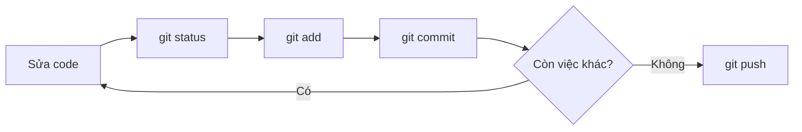
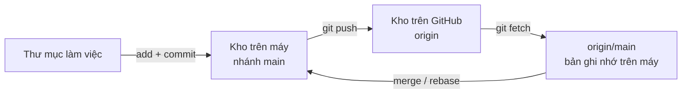

# 3.4 - Workflow cơ bản

> **Tóm tắt:** Vòng lặp hằng ngày chỉ có bốn lệnh: `status`, `add`, `commit`, `push`. Bài này dạy cả vòng lặp đó lẫn phần **remote**: kho trên GitHub, `clone`, `push`, `fetch`, `pull` và nhánh theo dõi `origin/main`. Phần khó không nằm ở cú pháp mà ở **chia commit cho đúng**. Một commit tốt là commit **hoàn tác được độc lập** — nếu `git revert` nó, hệ thống vẫn chạy và chỉ mất đúng một thay đổi. Message phải trả lời **vì sao** chứ không phải *cái gì*, vì *cái gì* thì `git diff` đã nói rồi.

## Mục tiêu bài học

Sau bài này bạn có thể:

- Tạo kho, chạy trôi chảy vòng lặp `status` → `add` → `commit` → `push`.
- Kết nối kho trên máy với GitHub, phân biệt `clone`, `fetch`, `pull`, `push` và giải thích `origin/main` là gì.
- Áp dụng tiêu chí "hoàn tác được độc lập" để quyết định chia commit, dùng `git add -p` để tách thay đổi.
- Viết commit message trả lời được câu hỏi *vì sao*.
- Đọc lịch sử bằng `log`, `show`, `blame`, và chọn đúng lệnh để hoàn tác (`restore`, `reset`, `revert`).

**Cần biết trước:** [bài 3.1](3.1-git-intro-and-motivation.md) (ba vùng làm việc), [bài 3.2](3.2-git-install-config.md) (đã cài Git, cấu hình danh tính và đăng nhập được GitHub).

## Nội dung bài học

### 3.4.1 — Kho đầu tiên

```bash
mkdir crm-notes && cd crm-notes
git init -b main                  # tạo kho mới, nhánh đầu tiên tên main
echo "# CRM notes" > README.md
git status                        # README.md đang ở trạng thái "Untracked"
git add README.md                 # đưa vào staging
git commit -m "docs: add README"  # ghi vào lịch sử
git log --oneline                 # xem lịch sử
```

`git init` tạo thư mục ẩn `.git` — đó chính là kho. Xoá `.git` là xoá toàn bộ lịch sử, thư mục còn lại chỉ là file bình thường. Cờ `-b main` đặt tên nhánh đầu tiên là `main`; thiếu nó thì Git dùng giá trị `init.defaultBranch`, trên nhiều máy vẫn là `master`.

### 3.4.2 — Vòng lặp hằng ngày



```bash
git status                       # đang có gì thay đổi?
git diff                         # cụ thể đổi những dòng nào?
git add src/OrderService.cs      # chọn phần sẽ commit
git diff --staged                # kiểm tra lại đúng thứ mình định commit
git commit -m "fix: reject orders with negative total"
git push
```

Dòng `git diff --staged` là thói quen đáng tập nhất trong nhóm này. Nó là lần kiểm tra cuối trước khi thứ gì đó đi vào lịch sử — và nó bắt được rất nhiều `Console.WriteLine` bỏ quên.

### 3.4.3 — Làm việc với remote: GitHub, `push`, `fetch`, `pull`

**Remote** là một bản sao khác của kho, thường nằm trên GitHub. Theo quy ước, remote chính tên là `origin`. Kho trên máy bạn và kho trên GitHub là **hai kho độc lập**; chúng chỉ đồng bộ khi bạn ra lệnh.



**Đưa kho có sẵn lên GitHub.** Trên GitHub bấm **New repository**, đặt tên, **không** tick "Add a README" (để kho trống). GitHub hiện ra địa chỉ kho, rồi:

```bash
git remote add origin https://github.com/<ten-ban>/crm-notes.git
git remote -v                     # xem các remote đã khai báo
git push -u origin main
```

```text
origin	https://github.com/<ten-ban>/crm-notes.git (fetch)
origin	https://github.com/<ten-ban>/crm-notes.git (push)
branch 'main' set up to track 'origin/main'.
To https://github.com/<ten-ban>/crm-notes.git
 * [new branch]      main -> main
```

`-u` (viết đầy đủ `--set-upstream`) ghi nhớ rằng nhánh `main` trên máy gắn với `main` trên `origin`. Từ lần sau chỉ cần `git push` và `git pull`.

**Lấy một kho có sẵn về máy:**

```bash
git clone https://github.com/<ten-ban>/crm-notes.git
```

`clone` tải **toàn bộ** lịch sử, tự đặt remote `origin` và tự gắn `main` với `origin/main`.

**`origin/main` là gì.** Đó là **nhánh theo dõi** (remote-tracking branch): bản ghi nhớ trên máy bạn về vị trí của `main` trên GitHub **tại lần cuối bạn liên lạc**. Nó không tự cập nhật.

| Lệnh | Làm gì | Đổi file của bạn? |
|---|---|---|
| `git fetch` | Tải commit mới từ remote, cập nhật `origin/main` | Không |
| `git pull` | `fetch` rồi gộp `origin/main` vào nhánh hiện tại | Có |
| `git push` | Gửi commit của bạn lên remote | Không |

`git status` so sánh nhánh của bạn với `origin/main`, nên nó chỉ đúng tới lần `fetch` gần nhất:

```text
On branch main
Your branch is behind 'origin/main' by 1 commit, and can be fast-forwarded.
  (use "git pull" to update your local branch)
```

```text
On branch main
Your branch is ahead of 'origin/main' by 1 commit.
  (use "git push" to publish your local commits)
```

`git branch -vv` cho biết mỗi nhánh đang gắn với nhánh nào trên remote. Khi cả bạn và người khác đều có commit mới (hai bên "phân kỳ"), `pull` phải gộp hai dòng lịch sử; [bài 3.5](3.5-branching-and-merging.md) dạy merge và rebase, [bài 3.7](3.7-git-conflicts.md) dạy giải xung đột.

**Muốn thử mà chưa có GitHub?** Một kho `--bare` (kho không có thư mục làm việc) trên chính máy bạn đóng vai GitHub rất tốt:

```bash
git init --bare -b main ../github-gia.git
git remote add origin ../github-gia.git
```

Nhiều bài tập trong module dùng cách này để giả lập hai người.

### 3.4.4 — Chia commit: tiêu chí duy nhất cần nhớ

Câu hỏi "commit bao nhiêu là vừa" có một câu trả lời dùng được:

> Một commit tốt là commit mà bạn **hoàn tác riêng nó được** mà hệ thống vẫn chạy.

Thử tưởng tượng sáu tháng sau có người phát hiện tính năng X gây lỗi. Họ chạy `git revert <commit của X>`. Nếu lệnh đó gỡ đúng tính năng X và không kéo theo gì khác, commit của bạn đã chia đúng.

```bash
# XẤU — ba việc không liên quan trong một commit
git add .
git commit -m "update"
# Muốn gỡ mỗi phần đổi tên biến? Không tách ra được.

# TỐT — ba commit, mỗi cái hoàn tác riêng được
git add src/OrderValidator.cs
git commit -m "fix: reject orders with negative total"

git add src/ReportService.cs
git commit -m "feat: add revenue report by branch"

git add src/Utils.cs
git commit -m "refactor: rename variables for clarity"
```

Hai quy tắc phụ đi kèm:

- **Mỗi commit phải build được.** Lịch sử có commit làm hỏng build thì `git bisect` (công cụ tìm commit gây lỗi, [bài 3.9](3.9-debugging-workflow.md)) khó dùng.
- **Đừng trộn đổi format với đổi logic.** Một commit chỉ chạy formatter, một commit khác đổi hành vi. Trộn lại thì phần diff logic chìm trong hàng trăm dòng đổi dấu cách.

**Ngoại lệ chính đáng.** Một số thay đổi **buộc phải** đi cùng nhau để hệ thống còn chạy, ví dụ thêm cột database cùng với code dùng cột đó. Khi đó gộp là đúng, hoặc dùng mẫu "mở rộng rồi thu hẹp" (thêm cột mới, ghi cả hai, chuyển sang đọc cột mới, rồi mới xoá cột cũ) mà [bài 12.8](../../stage-04-database-production/module-12-sql-deep-dive/12.8-database-migration-strategy.md) trình bày.

### 3.4.5 — `git add -p`: tách ngay cả trong một file

Bạn sửa hai việc trong cùng một file. Vẫn tách được:

```bash
git add -p src/OrderService.cs
# Git hiện từng khối thay đổi (hunk) và hỏi:
#   y = đưa khối này vào staging
#   n = bỏ qua khối này
#   s = chia khối này nhỏ hơn nữa
#   q = thoát
```

Đây là công cụ biến "tôi lỡ sửa lẫn lộn hết rồi" thành một lịch sử sạch. VS Code làm được việc tương tự bằng giao diện: trong tab Source Control, mở file, bôi đen các dòng rồi chọn **Stage Selected Ranges**.

### 3.4.6 — Commit message: trả lời *vì sao*

Phần *cái gì* đã nằm trong `git diff`. Message nên dùng chỗ của nó cho thứ diff không nói được.

```text
❌ "fix bug"
❌ "update code"
❌ "changes requested by the boss"

✅ "fix: reject orders with negative total

A negative quantity in the order form produced a negative total and
the system still created the order. The check now lives in the domain
layer rather than the controller, because orders are also created from
the API and from the data-import job."
```

Cấu trúc một message đầy đủ:

```text
<loại>: <tóm tắt, dưới 72 ký tự, thể mệnh lệnh>
<dòng trống>
<vì sao cần thay đổi này, bối cảnh, đánh đổi đã cân nhắc>
<dòng trống>
<tham chiếu issue nếu có>
```

**Quy ước của khóa học:** commit message viết **bằng tiếng Anh**, dòng tóm tắt ở **thể mệnh lệnh** — `add`, `fix`, `remove`, không phải `added` hay `adds`. Lý do: chính Git cũng viết vậy khi tự sinh message (`Merge branch...`, `Revert...`), và đa số công cụ, dự án nguồn mở dùng tiếng Anh. Nếu nhóm của bạn thống nhất dùng tiếng Việt thì viết **có dấu** đầy đủ, và cả nhóm dùng chung một ngôn ngữ.

Quy ước đặt tên loại (`feat`, `fix`, `refactor`...) là chủ đề của [bài 3.10](3.10-conventional-commits.md).

### 3.4.7 — Đọc lịch sử

```bash
# Gọn, mỗi commit một dòng, kèm đồ thị nhánh
git log --oneline --graph --decorate -20

# Lịch sử của một file
git log --follow -p src/OrderService.cs

# Xem một commit cụ thể
git show a1b2c3d

# Ai sửa dòng này, ở commit nào
git blame src/OrderService.cs

# Tìm commit nào từng thêm hoặc xoá một chuỗi
git log -S "CalculateDiscount" --oneline
```

`git log -S` tìm những commit làm **thay đổi số lần xuất hiện** của một chuỗi trong code — tức là commit thêm vào hoặc xoá đi. Khác với `git log --grep`, vốn chỉ tìm trong commit message. Đây là cách nhanh nhất để trả lời "đoạn code này ra đời từ đâu".

`git blame` không phải để đổ lỗi. Nó để tìm **commit** chứa dòng đó, từ đó đọc message và hiểu bối cảnh.

### 3.4.8 — Hoàn tác: `restore`, `reset`, `revert`

Từ Git 2.23 có hai lệnh mới tách việc của `git checkout` cũ cho dễ hiểu: `git switch` để chuyển nhánh, `git restore` để khôi phục file. Tài liệu cũ vẫn dùng `checkout` cho cả hai việc; nó vẫn chạy, nhưng khóa học dùng hai lệnh mới.

```bash
# Bỏ sửa đổi CHƯA add trong một file (mất luôn, không cứu được)
git restore src/OrderService.cs

# Lỡ add, muốn đưa file ra khỏi staging (giữ nguyên sửa đổi)
git restore --staged src/OrderService.cs

# Quên một file, hoặc muốn sửa message của commit VỪA tạo
git add file-quen.cs
git commit --amend --no-edit        # giữ nguyên message
git commit --amend -m "fix: correct typo" # đổi message

# Bỏ commit cuối nhưng GIỮ thay đổi trong staging
git reset --soft HEAD~1

# Bỏ commit cuối, giữ thay đổi ở thư mục làm việc (chưa add)
git reset HEAD~1
```

`HEAD~1` là "commit cha của commit hiện tại", `HEAD~2` là ông, cứ thế.

Quy tắc an toàn: **chỉ amend và reset commit chưa push**. Sau khi đẩy lên, hãy dùng `git revert` — nó tạo một commit **mới** đảo ngược thay đổi, không viết lại lịch sử:

```bash
git revert a1b2c3d     # an toàn trên nhánh chung
```

### 3.4.9 — Lỗi thường gặp

| Triệu chứng | Nguyên nhân | Cách xử lý |
|---|---|---|
| `error: src refspec main does not match any` | Chưa có commit nào, hoặc nhánh tên `master` | Commit trước; xem tên nhánh bằng `git branch` |
| `! [rejected] main -> main (fetch first)` | Trên GitHub có commit bạn chưa có | `git pull` rồi push lại |
| `fatal: not a git repository` | Đang đứng ngoài thư mục kho | `cd` vào đúng thư mục |
| `nothing added to commit but untracked files present` | Quên `git add` | `git add <file>` trước khi commit |
| Commit lỡ chứa file `bin/`, `obj/` | Thiếu `.gitignore` | `dotnet new gitignore`, rồi `git rm -r --cached bin obj` |

**Danh sách rà soát workflow**

- [ ] Luôn chạy `git diff --staged` trước khi commit.
- [ ] Mỗi commit hoàn tác riêng được mà hệ thống vẫn chạy, và đều build được.
- [ ] Không trộn đổi format với đổi logic trong cùng một commit.
- [ ] Message bằng tiếng Anh, thể mệnh lệnh, dưới 72 ký tự, phần thân trả lời được vì sao.
- [ ] Chỉ amend và reset những commit chưa push; đã push thì dùng revert.
- [ ] Không dùng `git add .` mà không xem `git status` trước.
- [ ] Biết `git status` chỉ so với `origin/main` tại lần fetch gần nhất.

## Bài tập áp dụng

#### Bài 1 — Đưa kho lên GitHub và đồng bộ hai bản clone

Tạo kho `crm-notes` như mục 3.4.1, đẩy lên một kho trống trên GitHub. Sau đó clone kho đó vào một thư mục **thứ hai** (giả làm máy của bạn cùng nhóm), commit một file mới từ đó và push. Quay về thư mục đầu, dùng `fetch` rồi `pull` để lấy commit đó về.

**Tiêu chí hoàn thành:** sau `git fetch`, `git status` ở thư mục đầu báo `behind 'origin/main' by 1 commit`; sau `git pull`, nó báo `up to date`, và `git log --oneline` ở hai thư mục giống hệt nhau.

<details>
<summary><strong>Gợi ý và lời giải — Bài 1</strong></summary>

**Gợi ý.** Thư mục thứ hai phải là kết quả của `git clone`, không phải chép tay. Chưa đăng nhập được GitHub thì dùng kho `--bare` trên máy như cuối mục 3.4.3; kết quả giống hệt.

**Lời giải** (output thật khi dùng kho bare `github-gia.git`; với GitHub thì chỉ khác địa chỉ):

```bash
# "GitHub giả" (bỏ qua bước này nếu dùng GitHub thật)
git init --bare -b main github-gia.git

# Thư mục 1
mkdir crm && cd crm && git init -b main
echo "# CRM" > README.md && git add . && git commit -m "docs: add README"
git remote add origin ../github-gia.git    # hoặc địa chỉ https://github.com/...
git push -u origin main
```

```text
branch 'main' set up to track 'origin/main'.
To ../github-gia.git
 * [new branch]      main -> main
```

```bash
# Thư mục 2 — "bạn cùng nhóm"
cd .. && git clone github-gia.git crm-binh && cd crm-binh
echo "ghi chú" > notes.md && git add . && git commit -m "docs: add notes"
git push
```

```bash
# Quay về thư mục 1
cd ../crm
git fetch
git status
```

```text
From ../github-gia
   ef1bcb5..299f55c  main       -> origin/main
On branch main
Your branch is behind 'origin/main' by 1 commit, and can be fast-forwarded.
  (use "git pull" to update your local branch)
```

```bash
git pull
git status
```

```text
 notes.md | 1 +
 1 file changed, 1 insertion(+)
 create mode 100644 notes.md
On branch main
Your branch is up to date with 'origin/main'.
```

**Điều rút ra.** `fetch` chỉ cập nhật `origin/main` — bản ghi nhớ — nên an toàn để chạy bất cứ lúc nào. `pull` mới đụng vào nhánh và file của bạn. Thói quen tốt: `fetch` rồi xem `git log --oneline main..origin/main` (những commit có trên GitHub mà bạn chưa có) trước khi `pull`.

</details>

#### Bài 2 — Tách bằng `git add -p`

Sửa **hai việc không liên quan trong cùng một file**. Dùng `git add -p` tách thành hai commit. Kiểm tra bằng `git show --stat` rằng mỗi commit chỉ chứa phần của nó.

**Tiêu chí hoàn thành:** hai commit tách bạch, và sau commit thứ nhất `git diff` vẫn còn hiện phần việc thứ hai.

<details>
<summary><strong>Gợi ý và lời giải — Bài 2</strong></summary>

**Gợi ý.** `git add -p` đi qua **từng đoạn thay đổi** (hunk) và hỏi bạn có đưa nó vào staging không. Nếu hai việc nằm quá gần nhau và Git gộp thành một đoạn, nhấn `s` để chia nhỏ, hoặc `e` để chọn tay từng dòng. File dùng để luyện không cần biên dịch được, chỉ cần là văn bản.

**Lời giải.**

```csharp
// CustomerService.cs — hai việc lẫn trong một file
public class CustomerService
{
    public async Task<Customer?> GetAsync(int id, CancellationToken ct)
    {
        _logger.LogInformation("Đang lấy khách hàng {Id}", id);   // việc A: thêm log
        return await _repo.FindAsync(id, ct);
    }

    public async Task<decimal> CalculateRevenueAsync(int id, CancellationToken ct)
    {
        var orders = await _repo.GetOrdersAsync(id, ct);
        return orders.Where(o => !o.IsCancelled).Sum(o => o.Total);  // việc B: bỏ đơn huỷ
    }
}
```

```bash
git add -p CustomerService.cs
```

Git hiện đoạn thứ nhất (thêm dòng log):

```text
@@ -8,6 +8,7 @@ public class CustomerService
     public async Task<Customer?> GetAsync(int id, CancellationToken ct)
     {
+        _logger.LogInformation("Đang lấy khách hàng {Id}", id);
         return await _repo.FindAsync(id, ct);
Stage this hunk [y,n,q,a,d,s,e,?]?
```

Nhấn `y`. Đoạn thứ hai hiện ra, nhấn `n`. Rồi:

```bash
git commit -m "chore: log when fetching a customer"
git diff                     # vẫn còn hiện việc B
git add CustomerService.cs
git commit -m "fix: skip cancelled orders when summing revenue"
```

Kiểm tra:

```bash
git show --stat HEAD~1   # 1 file, 1 dòng thêm
git show --stat HEAD     # 1 file, 1 dòng sửa
```

**Bảng phím của `add -p`:**

| Phím | Nghĩa |
|---|---|
| `y` | Đưa đoạn này vào staging |
| `n` | Bỏ qua |
| `s` | **Chia đoạn này thành các đoạn nhỏ hơn** |
| `e` | Sửa tay chính xác dòng nào được đưa vào |
| `d` | Bỏ qua đoạn này và mọi đoạn còn lại trong file |
| `?` | Xem trợ giúp |

Phím `s` là phím dùng nhiều nhất. Git gộp các dòng gần nhau thành một đoạn, nên hai việc cách nhau ba dòng thường nằm chung một đoạn; `s` tách chúng ra.

**Về phím `e`.** Nó mở trình soạn thảo với nội dung đoạn. Quy tắc: xoá dòng bắt đầu bằng `+` để **không** đưa dòng đó vào; đổi dòng bắt đầu bằng `-` thành dấu cách để **giữ lại** dòng đó.

</details>

#### Bài 3 — Truy nguồn một dòng code

Clone một kho .NET nguồn mở, ví dụ ứng dụng mẫu [dotnet/eShop](https://github.com/dotnet/eShop) của Microsoft. Chọn một dòng khó hiểu (một con số, một điều kiện). Dùng `git blame` tìm commit, đọc message, rồi tìm pull request tương ứng.

**Tiêu chí hoàn thành:** bạn ghi lại được: mã commit, message, số pull request, và một câu đánh giá "message và PR có giải thích được vì sao dòng đó tồn tại không".

<details>
<summary><strong>Gợi ý và lời giải — Bài 3</strong></summary>

**Gợi ý.** `git blame` cho biết commit **cuối cùng chạm vào** một dòng — không nhất thiết là commit **tạo ra** nó. Một lần định dạng lại code hay đổi tên biến sẽ che mất thông tin đó. Có cờ để bỏ qua các thay đổi chỉ về khoảng trắng.

**Lời giải — các lệnh:**

```bash
# --filter=blob:none: tải lịch sử commit đầy đủ nhưng chỉ tải nội dung file khi cần, nhanh hơn
git clone --filter=blob:none https://github.com/dotnet/eShop.git
cd eShop

# Bỏ qua thay đổi khoảng trắng (-w), theo dõi code bị di chuyển giữa các file (-C)
git blame -w -C -L 40,45 <đường-dẫn-file>
git show <mã-commit>
```

Kho dùng **squash merge** thì message thường kết thúc bằng số PR, ví dụ `(#123)`. Kho dùng merge commit thì tìm commit merge chứa nó:

```bash
git log --merges --ancestry-path <mã-commit>..main --oneline | tail -1
# Merge pull request #142 from ...
```

Trên GitHub, mở file, bấm **Blame** để làm điều tương tự bằng giao diện, kèm đường dẫn sang PR.

**Ba mức chất lượng của thông tin bạn tìm được:**

| Message tìm được | Đủ hiểu chưa |
|---|---|
| `update` hoặc `fix` | Không — hoàn toàn vô dụng |
| `fix: add order approval threshold` | Một nửa — biết *cái gì*, không biết *vì sao* là con số đó |
| `fix: require manager approval for orders above 50M VND` kèm mô tả PR dẫn tới quy định nội bộ | Đủ |

**Vì sao mức thứ ba đáng giá.** Sáu tháng sau, ai đó nhìn con số 50.000.000 và tự hỏi có nên sửa không. Với message mức một, họ có ba lựa chọn đều tệ: đoán, đi hỏi khắp nơi, hoặc để nguyên vì sợ. Với message mức ba, họ biết đó là quy định nghiệp vụ chứ không phải con số tuỳ tiện.

**Ba việc làm cho `blame` hữu ích hơn trong kho của bạn:**

1. **Định dạng lại code thành một commit riêng,** rồi ghi mã băm của nó vào file `.git-blame-ignore-revs` và chạy `git config blame.ignoreRevsFile .git-blame-ignore-revs`. GitHub cũng tự đọc file này.
2. **Viết message trả lời "vì sao".**
3. **Dẫn chiếu tới nguồn quyết định:** mã issue, đường dẫn tài liệu. Một dòng `Refs: #142` biến message thành điểm khởi đầu để tra tiếp.

**Dùng `git log -S` khi `blame` không đủ.** Khi dòng code đã bị di chuyển hoặc viết lại nhiều lần, tìm theo nội dung:

```bash
git log -S "RequireManagerApproval" --oneline    # mọi commit thêm hoặc bớt chuỗi này
```

Commit cũ nhất trong danh sách là commit **đầu tiên** đưa khái niệm đó vào, thường là commit chứa lời giải thích thật.

</details>

## Tự kiểm tra

<details>
<summary>git fetch và git pull khác nhau thế nào?</summary>

fetch tải commit mới từ remote và cập nhật nhánh theo dõi origin/main, không đụng vào nhánh và file của bạn. pull làm fetch rồi gộp origin/main vào nhánh hiện tại, nên có thể đổi file và gây xung đột. Vì vậy fetch an toàn để chạy bất cứ lúc nào.

</details>

<details>
<summary>origin/main là gì, và vì sao git status có thể báo "up to date" dù GitHub đã có commit mới?</summary>

origin/main là bản ghi nhớ trên máy bạn về vị trí của nhánh main trên remote origin, tại lần cuối bạn fetch hoặc pull. git status so sánh với bản ghi nhớ đó chứ không hỏi GitHub, nên nếu chưa fetch thì nó không biết có commit mới.

</details>

<details>
<summary>Chia commit thế nào là đúng?</summary>

Một commit tốt là commit mà bạn hoàn tác riêng nó được mà hệ thống vẫn chạy. Tưởng tượng sáu tháng sau có người git revert đúng commit đó — nếu nó gỡ đúng một thay đổi và không kéo theo gì khác thì bạn đã chia đúng. Kèm theo: mỗi commit phải build được và không trộn đổi format với đổi logic.

</details>

<details>
<summary>Commit message nên viết gì?</summary>

Trả lời vì sao, vì phần cái gì đã nằm trong git diff. Bối cảnh, lý do chọn cách này, đánh đổi đã cân nhắc — đó là thứ diff không nói được. Theo quy ước khóa học, viết bằng tiếng Anh, dòng tóm tắt ở thể mệnh lệnh và dưới 72 ký tự.

</details>

<details>
<summary>git restore, git reset và git revert dùng khi nào?</summary>

restore bỏ sửa đổi trong file (hoặc đưa file ra khỏi staging với --staged), không đụng tới lịch sử. reset dời nhánh về commit trước, dùng cho commit chưa push. revert tạo commit mới đảo ngược một commit cũ, dùng cho commit đã push lên nhánh chung vì không viết lại lịch sử.

</details>

<details>
<summary>git log -S khác git log --grep ở chỗ nào?</summary>

git log -S tìm commit mà phần code thay đổi có thêm hoặc bớt chuỗi đó. --grep chỉ tìm trong commit message. -S là cách nhanh nhất để biết một hàm được thêm vào khi nào.

</details>

## Kết luận

Ba điều đáng nhớ nhất:

1. **Kho trên máy và kho trên GitHub là hai kho riêng.** `push` gửi đi, `fetch` lấy về bản ghi nhớ, `pull` mới gộp vào nhánh của bạn.
2. **"Hoàn tác riêng được" là tiêu chí chia commit.** Message dùng để nói *vì sao*.
3. **`git diff --staged` trước mỗi commit.** Thói quen rẻ nhất, bắt được nhiều lỗi nhất.

## Tham khảo

- [Pro Git — Git Basics](https://git-scm.com/book/en/v2/Git-Basics-Getting-a-Git-Repository) — chương 2, vòng lặp cơ bản
- [Pro Git — Working with Remotes](https://git-scm.com/book/en/v2/Git-Basics-Working-with-Remotes)
- [git-restore](https://git-scm.com/docs/git-restore) · [git-switch](https://git-scm.com/docs/git-switch)
- [Conventional Commits](https://www.conventionalcommits.org/en/v1.0.0/) — quy ước đặt tên loại commit

## Điều hướng

- **Bài trước:** [3.3 — Checklist an toàn khi làm Git](3.3-git-safety-checklist.md)
- **Bài tiếp theo:** [3.5 — Branching và Merging](3.5-branching-and-merging.md)
- **Về module:** [Trang mục lục](README.md)
