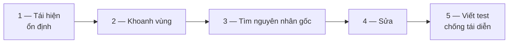
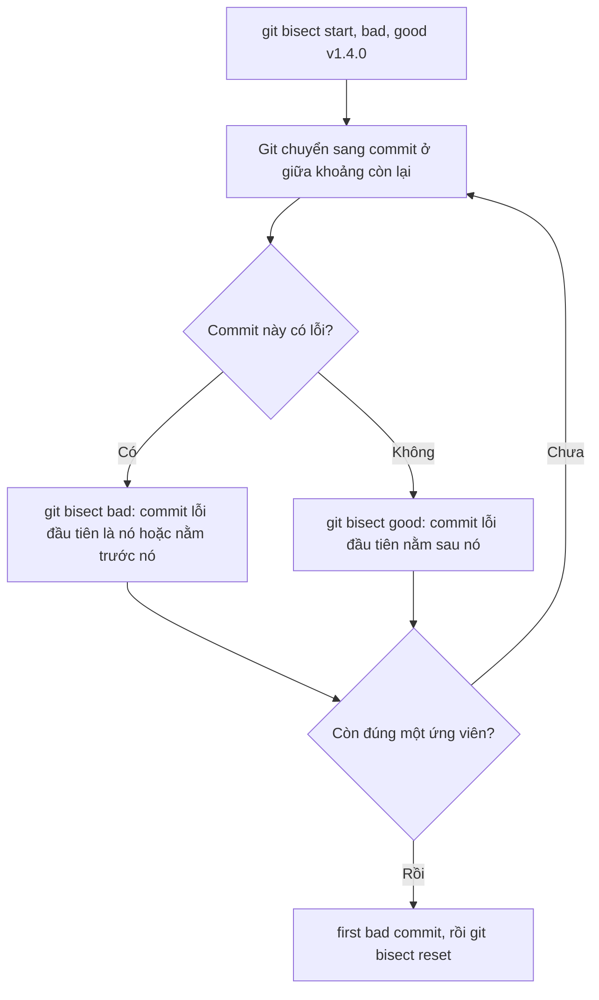

# 3.9 - Debugging Workflow

> **Tóm tắt:** Sửa lỗi có một thứ tự đúng, và bước đầu tiên không phải là mở debugger — mà là **tái hiện lỗi một cách ổn định**. Không tái hiện được thì không biết mình đã sửa hay chỉ vô tình che đi. Khi đã tái hiện được, công cụ mạnh nhất Git cho bạn là **`git bisect`**: nó chia đôi lịch sử để tìm commit gây lỗi, nên **10.000 commit chỉ cần khoảng 14 lần thử**. Viết được lệnh kiểm tra tự động thì `git bisect run` làm hết phần còn lại. Bài này cũng nhắc lại cách dùng debugger cho đúng: breakpoint có điều kiện thay vì bấm Continue hàng trăm lần.

## Mục tiêu bài học

Sau bài này bạn có thể:

- Đi theo năm bước sửa lỗi có thứ tự, thay vì đọc mò.
- Dùng `git bisect` để khoanh vùng commit gây lỗi, cả thủ công lẫn tự động bằng `git bisect run`.
- Viết script kiểm tra cho `bisect run` biết bỏ qua commit không build được (mã thoát 125).
- Đặt breakpoint có điều kiện và logpoint thay vì bấm Continue nhiều lần.
- Viết log có cấu trúc với đúng mức log.

**Cần biết trước:** [bài 0.3](../module-00-setup/0.3-debugging-basics.md) (breakpoint, chạy từng bước), [bài 1.7](../module-01-programming-logic/1.7-data-structures-and-big-o.md) (Big-O, `O(log n)`), [bài 3.4](3.4-basic-git-workflow.md) (commit, `git log`).

## Nội dung bài học

### 3.9.1 — Năm bước, đúng thứ tự



Bước 1 quan trọng nhất và hay bị bỏ qua nhất. **Không tái hiện được thì không xác nhận được là đã sửa.** Bạn sẽ đổi một thứ, thấy lỗi biến mất, và không bao giờ biết đó là do bản sửa hay do may mắn.

Tái hiện ổn định nghĩa là trả lời được: dữ liệu đầu vào nào, trạng thái nào, thứ tự thao tác nào thì **lần nào cũng** ra lỗi.

Bước 5 cũng hay bị bỏ. Một test tái hiện đúng lỗi vừa sửa (ví dụ một test xUnit như ở [bài 0.4](../module-00-setup/0.4-solution-and-unit-test.md)) là thứ bảo đảm nó không quay lại sau sáu tháng. Test đó cũng chính là "lệnh kiểm tra" mà `git bisect run` cần.

### 3.9.2 — `git bisect`: chia đôi lịch sử

Tình huống: tính năng chạy tốt ở bản phát hành tháng trước (có tag `v1.4.0`), giờ hỏng. Giữa hai mốc có 800 commit.

```bash
git bisect start
git bisect bad                    # commit hiện tại: có lỗi
git bisect good v1.4.0            # bản này: không lỗi

# Git tự chuyển sang commit ở giữa. Bạn kiểm tra rồi trả lời:
git bisect good                   # commit này ổn
# hoặc
git bisect bad                    # commit này đã có lỗi

# Lặp lại. Sau khoảng 10 lần, Git chỉ đúng commit đầu tiên gây lỗi.
git bisect reset                  # LUÔN chạy khi xong: quay về nhánh ban đầu
```

Mỗi câu trả lời loại bỏ **một nửa** số commit còn lại, nên số lần thử khoảng ⌈log₂ n⌉:

| Số commit | Số lần thử (khoảng) |
|---|---|
| 100 | 7 |
| 1.000 | 10 |
| 10.000 | **14** |
| 1.000.000 | 20 |

Đây chính là `O(log n)` của tìm kiếm nhị phân trong [bài 1.7](../module-01-programming-logic/1.7-data-structures-and-big-o.md), áp dụng vào lịch sử commit. Thực tế số lần có thể lệch một bước, vì lịch sử có nhánh rẽ và Git chọn điểm giữa theo số commit còn lại.



### 3.9.3 — `git bisect run`: để Git tự kiểm tra

Khi có một lệnh phân biệt được tốt/xấu, giao hết cho Git:

```bash
git bisect start HEAD v1.4.0      # xấu trước, tốt sau
git bisect run dotnet test --filter "FullyQualifiedName~OrderTotalTests"
```

Git chạy lệnh trên từng commit và đọc **mã thoát** (exit code):

| Mã thoát | Git hiểu là |
|---|---|
| `0` | good |
| `1` tới `127`, trừ `125` | bad |
| `125` | không kiểm tra được, bỏ qua commit này (như `git bisect skip`) |

Hai cái bẫy, cả hai đều cho ra **câu trả lời sai mà không báo lỗi**:

1. **Commit không build được bị tính là bad.** Lệnh build hỏng trả mã khác 0, nên Git kết luận commit làm hỏng build chính là "commit gây lỗi". Cách chữa: script kiểm tra build trước, hỏng thì `exit 125` (Bài 2 chứng minh bằng output thật).
2. **Script kiểm tra nằm trong kho nhưng mới được thêm gần đây.** Khi bisect chuyển về commit cũ, file script không tồn tại ở đó, lệnh lỗi, Git tính là bad. Đặt script **ngoài** kho và gọi bằng đường dẫn tuyệt đối, hoặc chỉ dùng test đã có từ trước mốc "good".

Đây là lý do **mỗi commit phải build được** như [bài 3.4](3.4-basic-git-workflow.md) đã nói.

### 3.9.4 — Debugger: dùng cho đúng

[Bài 0.3](../module-00-setup/0.3-debugging-basics.md) đã dạy đặt breakpoint và chạy từng bước. Khi vòng lặp chạy 10.000 lần mà lỗi chỉ xảy ra ở một lần, bấm Continue liên tục là lãng phí. Bốn tính năng đáng dùng hơn:

| Tính năng | Dùng khi |
|---|---|
| **Conditional breakpoint** | Chỉ muốn dừng khi một điều kiện đúng, ví dụ `order.Total < 0` |
| **Hit count** | Dừng ở lần chạy qua thứ n |
| **Logpoint** (Visual Studio gọi là tracepoint) | Muốn in giá trị mà **không dừng** chương trình |
| **Exception settings** | Dừng ngay khi ngoại lệ được ném, trước khi bị `catch` nuốt |

Trong VS Code: nhấp chuột phải vào lề trái của dòng, chọn **Add Conditional Breakpoint...**, rồi chọn *Expression*, *Hit Count* hoặc *Log Message*. Ngoại lệ thì bật ở mục **Breakpoints** trong tab Run and Debug (*All Exceptions*).

Cái cuối cùng cứu rất nhiều thời gian: khi một ngoại lệ bị một khối `catch` ở tầng trên nuốt mất, dừng ngay lúc ném cho bạn thấy nó ở đúng nơi phát sinh, kèm đầy đủ giá trị biến lúc đó.

### 3.9.5 — Khi không dừng được chương trình: log có cấu trúc

Trên server đang phục vụ người dùng, bạn không gắn debugger và dừng tiến trình được. Log là thứ thay thế — nhưng chỉ khi nó có cấu trúc.

```csharp
// Không truy vấn được — chuỗi phẳng
_logger.LogInformation($"Xử lý đơn {order.Id} cho khách {customerId}");

// Truy vấn được — tham số có tên
_logger.LogInformation("Xử lý đơn {OrderId} cho khách {CustomerId}",
    order.Id, customerId);
```

Cách thứ hai cho phép công cụ gom log lưu `OrderId` thành một trường riêng, nên bạn lọc được `OrderId = 4729` thay vì tìm chuỗi bằng regex. `_logger` ở đây là một `ILogger` mà ASP.NET Core cung cấp; [bài 8.7](../../stage-03-aspnet-core-backend/module-08-aspnet-core-fundamentals/8.7-logging-with-serilog.md) dạy cách cài và dùng.

Bốn mức log hay dùng:

- `Debug` — chi tiết, chỉ bật khi đang điều tra
- `Information` — mốc nghiệp vụ: đơn được tạo, thanh toán thành công
- `Warning` — bất thường nhưng xử lý được: thử lại lần 2, phản hồi chậm
- `Error` — thất bại cần người xem

Tránh `Information` cho mọi thứ. Log quá nhiều cũng mù như log quá ít, chỉ tốn tiền lưu trữ hơn.

Khi hệ thống lớn hơn, bạn sẽ cần thêm hai thứ mà bài này chỉ nêu tên: **correlation id** để ghép log của cùng một request qua nhiều dịch vụ ([bài 8.7](../../stage-03-aspnet-core-backend/module-08-aspnet-core-fundamentals/8.7-logging-with-serilog.md) và [bài 8.8](../../stage-03-aspnet-core-backend/module-08-aspnet-core-fundamentals/8.8-global-exception-handling.md)), và bộ công cụ `dotnet-counters`, `dotnet-trace`, `dotnet-dump` để khám một tiến trình đang chạy ([bài 19.3](../../stage-05-senior-engineering/module-19-performance-engineering/19.3-dotnet-server-profiling.md)).

### 3.9.6 — Lỗi thường gặp

| Sai lầm | Hậu quả | Thay bằng |
|---|---|---|
| Sửa trước khi tái hiện được | Không biết đã sửa thật hay chưa | Viết test tái hiện lỗi trước |
| Quên `git bisect reset` | Kẹt ở trạng thái *detached HEAD*, commit tiếp theo không thuộc nhánh nào | Luôn `reset` khi xong |
| `bisect run` với lệnh không phân biệt commit hỏng build | Kết luận sai commit | Script build trước, hỏng thì `exit 125` |
| Đảo thứ tự trong `git bisect start <bad> <good>` | Git báo lỗi hoặc tìm ngược | Nhớ: **xấu trước, tốt sau** |
| Nội suy chuỗi trong log (`$"..."`) | Log không lọc được theo trường | Dùng template có tên tham số |

**Danh sách rà soát debugging**

- [ ] Luôn tái hiện lỗi ổn định trước khi sửa bất cứ thứ gì.
- [ ] Mọi lỗi đã sửa đều có một test tái hiện đúng tình huống đó.
- [ ] Biết dùng `git bisect`, kể cả `git bisect run` với script biết `exit 125`.
- [ ] Mọi commit trong lịch sử đều build được, để bisect dùng được.
- [ ] Dùng conditional breakpoint hoặc logpoint thay vì bấm Continue nhiều lần.
- [ ] Log dùng tham số có tên, không nội suy chuỗi.

## Bài tập áp dụng

#### Bài 1 — Bisect tự động trên 100 commit

Dựng kho có 100 commit bằng script dưới đây (chạy trong Git Bash, macOS hoặc Linux; cần .NET 10 vì dùng **file-based app** — chạy thẳng một file `.cs` bằng `dotnet run tong.cs`, không cần tạo project). Một commit ở giữa đã làm sai hàm tính tổng. Dùng `git bisect run` tìm ra nó, ghi số lần Git phải thử và so với log₂(số commit).

```bash
mkdir thu-bisect && cd thu-bisect && git init -q -b main
cat > tong.cs <<'EOF'
decimal[] gia = [120_000m, 80_000m, 300_000m];
var tong = TinhTong(gia);
Console.WriteLine($"Tổng: {tong}");
return tong == 500_000m ? 0 : 1;   // 0 = đúng, khác 0 = sai

static decimal TinhTong(decimal[] gia) => gia.Sum();
EOF
git add . && git commit -q -m "feat: add order total calculation" && git tag v1.0
for i in $(seq 2 100); do
  msg="chore: update notes $i"
  if [ $i -eq 63 ]; then
    sed -i 's/gia.Sum()/gia.Skip(1).Sum()/' tong.cs     # macOS: sed -i '' 's/.../.../' tong.cs
    msg="refactor: simplify total calculation"
  fi
  echo "ghi chú $i" >> ghi-chu.txt
  git add . && git commit -q -m "$msg"
done
dotnet run tong.cs; echo "mã thoát: $?"
```

**Tiêu chí hoàn thành:** `git bisect run` chỉ ra đúng commit `refactor: simplify total calculation` mà bạn không phải gõ `good`/`bad` lần nào, và số lần thử nằm trong khoảng log₂(100) ≈ 6,6 làm tròn lên.

<details>
<summary><strong>Gợi ý và lời giải — Bài 1</strong></summary>

**Gợi ý.** File `tong.cs` trả mã thoát `0` khi tổng đúng và `1` khi sai — đúng quy ước mà `git bisect run` cần. Lệnh cuối của script in `Tổng: 380000` và `mã thoát: 1`, xác nhận HEAD đang hỏng.

**Lời giải — output thật** (mã băm trên máy bạn sẽ khác):

```bash
git bisect start HEAD v1.0
git bisect run dotnet run tong.cs
```

```text
Bisecting: 49 revisions left to test after this (roughly 6 steps)
[14d157728cd4a53417b98f41bc09405604522325] chore: update notes 50
running 'dotnet' 'run' 'tong.cs'
Tổng: 500000
Bisecting: 24 revisions left to test after this (roughly 5 steps)
[4e5a1379c7fe1dde28532e46db2ab77bafa67b1b] chore: update notes 75
running 'dotnet' 'run' 'tong.cs'
Tổng: 380000
Bisecting: 12 revisions left to test after this (roughly 4 steps)
[f478e5f190c67814a6916a95c6bad19d10f287f1] chore: update notes 62
running 'dotnet' 'run' 'tong.cs'
Tổng: 500000
Bisecting: 6 revisions left to test after this (roughly 3 steps)
[0cfe9e933de0c339216d5b1c91c3f7b10f20badc] chore: update notes 68
running 'dotnet' 'run' 'tong.cs'
Tổng: 380000
Bisecting: 2 revisions left to test after this (roughly 2 steps)
[42045f9acca80d0e911368b4cae03243ddc12c82] chore: update notes 65
running 'dotnet' 'run' 'tong.cs'
Tổng: 380000
Bisecting: 0 revisions left to test after this (roughly 1 step)
[4cbc4cb8e5cd4bf3f7b8fff889f6623de641e49c] chore: update notes 64
running 'dotnet' 'run' 'tong.cs'
Tổng: 380000
Bisecting: 0 revisions left to test after this (roughly 0 steps)
[a1a15bf67ea1ba3ef12d37a6a09a568a9d7bb884] refactor: simplify total calculation
running 'dotnet' 'run' 'tong.cs'
Tổng: 380000
a1a15bf67ea1ba3ef12d37a6a09a568a9d7bb884 is the first bad commit
commit a1a15bf67ea1ba3ef12d37a6a09a568a9d7bb884
Author: An Nguyen <an@example.com>
Date:   Sat Oct 17 21:33:02 2026 +0700

    refactor: simplify total calculation

 ghi-chu.txt | 1 +
 tong.cs     | 2 +-
 2 files changed, 2 insertions(+), 1 deletion(-)
bisect found first bad commit
```

```bash
git show a1a15bf -- tong.cs    # xem đúng dòng gây lỗi
git bisect reset
```

**Đối chiếu với lý thuyết.** Git chạy lệnh **7 lần** cho 99 commit nằm giữa hai mốc; log₂(100) ≈ 6,6. Tìm tuần tự từ commit mới nhất lùi dần thì phải thử 38 lần.

**Để ý message.** Commit gây lỗi tự nhận là `refactor` — tức "không đổi hành vi". Bisect không tin message, nó chỉ tin kết quả chạy. Đây cũng là lý do commit nhỏ làm `bisect` có giá trị: commit này chỉ đổi đúng một dòng trong `tong.cs`, nên bạn có câu trả lời ngay.

**Ba lệnh phụ đáng biết:**

```bash
git bisect skip          # commit này không kiểm tra được, bỏ qua (khi làm thủ công)
git bisect log           # xem lại các bước đã làm
git bisect replay b.txt  # chạy lại từ một file log đã lưu
```

</details>

#### Bài 2 — Khi có commit không build được

Dựng lại kho như Bài 1, nhưng thêm một đoạn lịch sử **không build được**: commit 48 lỡ xoá dấu `;`, commit 53 mới thêm lại, và lỗi tính tổng xuất hiện ở commit 60. Chạy `git bisect run dotnet run tong.cs` và xem nó chỉ ra commit nào. Sau đó viết một script kiểm tra **đặt ngoài kho**, trả `125` khi không build được, và chạy lại.

Trong vòng `for` của Bài 1, thay khối `if` bằng:

```bash
  if [ $i -eq 48 ]; then sed -i 's/=> gia.Sum();/=> gia.Sum()/' tong.cs; msg="refactor: tidy up total calculation"; fi
  if [ $i -eq 53 ]; then sed -i 's/=> gia.Sum()$/=> gia.Sum();/' tong.cs; msg="fix: add missing semicolon"; fi
  if [ $i -eq 60 ]; then sed -i 's/gia.Sum()/gia.Skip(1).Sum()/' tong.cs; msg="refactor: simplify total calculation"; fi
```

**Tiêu chí hoàn thành:** bạn có output của cả hai lần chạy, chỉ ra lần nào sai và vì sao, và lần chạy bằng script tìm đúng commit `refactor: simplify total calculation`.

<details>
<summary><strong>Gợi ý và lời giải — Bài 2</strong></summary>

**Gợi ý.** `dotnet run` trả mã khác 0 cả khi chương trình tính sai **lẫn** khi không biên dịch được. Git không phân biệt được hai trường hợp đó — trừ khi bạn tách bước build ra.

**Lời giải — lần 1, chạy thẳng `dotnet run`** (output thật, đã lược bớt):

```text
running 'dotnet' 'run' 'tong.cs'
tong.cs(6,52): error CS1002: ; expected

The build failed. Fix the build errors and run again.
Bisecting: 24 revisions left to test after this (roughly 5 steps)
[f4a807b...] chore: update notes 25
...
[b5bd9ab...] refactor: tidy up total calculation
tong.cs(6,52): error CS1002: ; expected
[6a16847...] chore: update notes 47
Tổng: 500000
b5bd9abdbfc151fe35e38c5d4881b1bd10112516 is the first bad commit
bisect found first bad commit
```

Commit đầu tiên Git thử (commit 50) không build được, `dotnet run` trả mã khác 0, Git tính là **bad** và đi tìm ở nửa trước. Kết quả: Git chỉ vào commit 48 — commit làm hỏng build — chứ không phải commit làm sai phép tính. Không có cảnh báo nào.

**Lần 2, với script ngoài kho.** Tạo file `~/kiem-tra.sh` (ngoài thư mục kho):

```bash
#!/bin/sh
# Mã thoát 125 = "commit này không kiểm tra được, bỏ qua"
dotnet build tong.cs > /dev/null || exit 125
dotnet run --no-build tong.cs
```

```bash
git bisect reset
git bisect start HEAD v1.0
git bisect run sh ~/kiem-tra.sh
```

```text
running 'sh' '.../kiem-tra.sh'
Bisecting: 48 revisions left to test after this (roughly 6 steps)
[afe4042...] chore: update notes 51
running 'sh' '.../kiem-tra.sh'
Bisecting: 48 revisions left to test after this (roughly 6 steps)
[0b7465f...] chore: update notes 89
running 'sh' '.../kiem-tra.sh'
Tổng: 380000
...
[862d969...] refactor: simplify total calculation
running 'sh' '.../kiem-tra.sh'
Tổng: 380000
862d96929d1623086b1cf68919db8efb14273baf is the first bad commit
bisect found first bad commit
```

Hai commit đầu (50 rồi 51) không build được, script trả `125`, Git bỏ qua và chọn commit khác. Lần này kết quả đúng, sau 9 lần chạy (2 lần bị bỏ qua).

**Vì sao script phải nằm ngoài kho.** Nếu `kiem-tra.sh` được commit vào kho ở commit 100, thì khi bisect chuyển về commit 50, file đó không tồn tại; `sh` báo lỗi và trả `127`, Git tính là bad cho **mọi** commit cũ, và kết quả sai hoàn toàn. Chạy thử script trên HEAD (phải khác 0) và trên `v1.0` (phải bằng 0) trước khi bắt đầu là cách rẻ nhất để bắt lỗi này.

</details>

#### Bài 3 — Breakpoint có điều kiện

Tạo project console (`dotnet new console -n DoanhThu`), thêm file `Order.cs` và thay nội dung `Program.cs` bằng hai đoạn dưới đây. Tổng doanh thu in ra thấp hơn mong đợi vì có một đơn bị âm. Không sửa code, không thêm `Console.WriteLine`: dùng **conditional breakpoint** trong VS Code để dừng đúng ở đơn đó, đọc `order.Id`. Sau đó đổi breakpoint thành **logpoint** in ra `Đơn {order.Id}: {order.Total}` chỉ cho các đơn có tổng âm.

```csharp
// Order.cs
record Order(int Id, decimal Total);
```

```csharp
// Program.cs
static decimal Process(Order order) => order.Total;

var orders = Enumerable.Range(1, 10_000)
    .Select(id => new Order(id, id == 4729 ? -150_000m : 1_000m))
    .ToList();

decimal total = 0;
foreach (var order in orders)
{
    total += Process(order);   // đặt breakpoint ở dòng này
}
Console.WriteLine($"Tổng doanh thu: {total:N0}");
```

**Tiêu chí hoàn thành:** debugger dừng **đúng một lần** và bạn đọc được `order.Id` của đơn âm; logpoint in ra đúng một dòng.

<details>
<summary><strong>Gợi ý và lời giải — Bài 3</strong></summary>

**Gợi ý.** Đừng đặt điều kiện theo mã đơn (bạn chưa biết nó). Đặt theo **triệu chứng**: tổng âm.

**Lời giải.**

1. Mở thư mục `DoanhThu` trong VS Code (đã cài C# Dev Kit như [bài 0.1](../module-00-setup/0.1-install-dotnet-sdk-and-ide.md)). Chạy thử `dotnet run`:

   ```text
   Tổng doanh thu: 9.849.000
   ```

   (Dấu phân cách hàng nghìn phụ thuộc cài đặt ngôn ngữ của máy; máy để tiếng Anh sẽ in `9,849,000`.) Mong đợi là 10.000 đơn × 1.000 = 10.000.000, nên có gì đó sai.

2. Nhấp chuột phải vào lề trái dòng 11 của `Program.cs`, chọn **Add Conditional Breakpoint...**, chọn *Expression*, gõ `order.Total < 0`, Enter.
3. Bấm F5 (hoặc *Run and Debug*). Debugger dừng **một lần**; trong khung *Variables*, `order` là `{ Id = 4729, Total = -150000 }`.
4. Gỡ breakpoint, thêm lại ở cùng dòng bằng **Add Logpoint...** với nội dung `Đơn {order.Id}: {order.Total}`. Logpoint không có điều kiện thì in 10.000 dòng; nhấp chuột phải vào nó, chọn **Edit Logpoint...**, đổi ô thả xuống sang *Expression* và nhập `order.Total < 0` (thông điệp log vẫn được giữ). Chạy lại: khung *Debug Console* in đúng một dòng `Đơn 4729: -150000`, và chương trình không dừng.

**Vì sao đáng tập.** Không có điều kiện, bạn phải bấm Continue 4.728 lần. Lỗi thật trên dự án thường giống hệt: một bản ghi trong hàng nghìn bản ghi. Biết đặt điều kiện theo triệu chứng là kỹ năng dùng hằng ngày, kể cả khi đã có log tốt.

</details>

## Tự kiểm tra

<details>
<summary>Vì sao bước đầu tiên khi sửa lỗi là tái hiện chứ không phải đọc code?</summary>

Vì không tái hiện được thì không xác nhận được là đã sửa. Bạn đổi một thứ, thấy lỗi biến mất, và không bao giờ biết đó là nhờ bản sửa hay chỉ do may mắn. Tái hiện ổn định nghĩa là trả lời được dữ liệu nào, trạng thái nào, thứ tự thao tác nào thì lần nào cũng ra lỗi.

</details>

<details>
<summary>git bisect hoạt động ra sao và mạnh cỡ nào?</summary>

Bạn đánh dấu một commit tốt và một commit xấu, Git chuyển sang commit ở giữa để bạn kiểm tra. Mỗi câu trả lời loại bỏ một nửa số commit còn lại, nên số lần thử khoảng log₂ của số commit: 100 commit khoảng 7 lần, 10.000 commit khoảng 14 lần.

</details>

<details>
<summary>git bisect run hiểu mã thoát như thế nào?</summary>

0 là good, 125 là bỏ qua commit này, các mã từ 1 tới 127 còn lại là bad. Vì vậy một commit không build được mà lệnh trả mã khác 0 sẽ bị tính nhầm là bad; script kiểm tra nên build trước và exit 125 nếu build hỏng.

</details>

<details>
<summary>Vì sao script dùng cho bisect run nên đặt ngoài kho?</summary>

Vì bisect chuyển thư mục làm việc về trạng thái của các commit cũ. Nếu script được thêm vào kho gần đây thì ở commit cũ nó không tồn tại, lệnh lỗi, và Git tính mọi commit cũ là bad, cho ra kết quả sai mà không cảnh báo.

</details>

<details>
<summary>Conditional breakpoint và logpoint khác nhau thế nào?</summary>

Conditional breakpoint dừng chương trình khi điều kiện đúng, để bạn xem toàn bộ trạng thái. Logpoint không dừng, chỉ in ra một dòng vào Debug Console mỗi lần chạy qua (có thể kèm điều kiện). Dùng logpoint khi muốn quan sát nhiều lần mà không sửa code.

</details>

<details>
<summary>Log có cấu trúc khác log chuỗi phẳng thế nào?</summary>

Log có cấu trúc dùng tham số có tên trong template thay vì nội suy chuỗi. Nhờ đó công cụ gom log lưu từng tham số thành một trường riêng và bạn lọc được theo OrderId bằng 4729, thay vì phải tìm chuỗi bằng regex.

</details>

## Kết luận

Ba điều đáng nhớ nhất:

1. **Tái hiện trước, sửa sau.** Không có bước một thì không có cách nào biết bước bốn đã thành công.
2. **`git bisect run` là công cụ bị dùng ít nhất so với sức mạnh của nó** — miễn là script kiểm tra biết `exit 125` cho commit không build được.
3. **Đặt điều kiện theo triệu chứng.** Breakpoint có điều kiện thay cho hàng nghìn lần bấm Continue.

## Tham khảo

- [git-bisect](https://git-scm.com/docs/git-bisect) — kèm chế độ `run` và ý nghĩa mã thoát
- [Debugging trong VS Code](https://code.visualstudio.com/docs/debugtest/debugging) — conditional breakpoint, logpoint
- [Logging trong .NET](https://learn.microsoft.com/en-us/dotnet/core/extensions/logging) — log có cấu trúc và mức log
- [File-based apps trong .NET 10](https://learn.microsoft.com/en-us/dotnet/core/sdk/file-based-apps) — chạy thẳng một file `.cs`

## Điều hướng

- **Bài trước:** [3.8 — Developer Workflow thực tế](3.8-real-world-developer-workflow.md)
- **Bài tiếp theo:** [3.10 — Conventional Commits](3.10-conventional-commits.md)
- **Về module:** [Trang mục lục](README.md)
