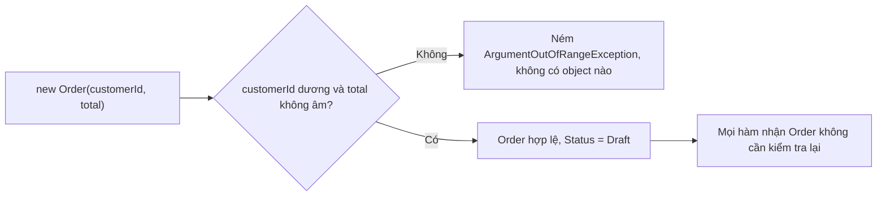
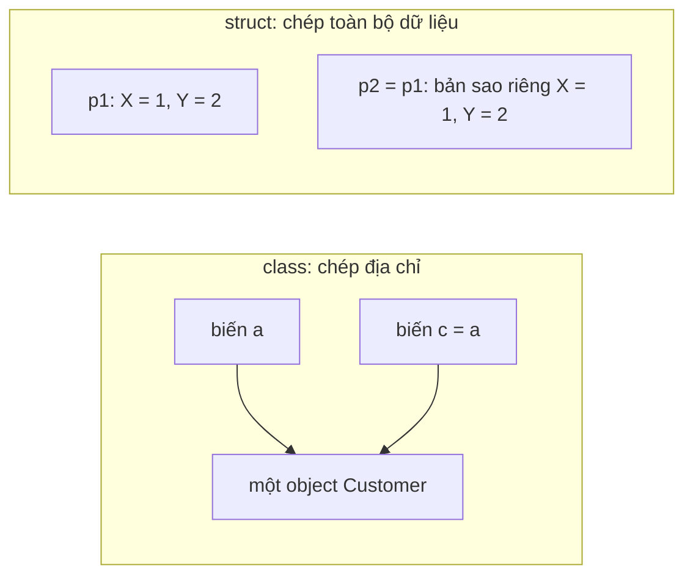

# 4.1 - Class và Object

> **Tóm tắt:** Class là khuôn, object là thứ đúc ra từ khuôn đó. Nhưng điều đáng học không nằm ở cú pháp mà ở một nguyên tắc: **object phải hợp lệ ngay từ khoảnh khắc nó được tạo ra**. Constructor tồn tại để bảo đảm điều đó — nó là cơ hội **duy nhất** bạn có để từ chối một object sai. Bỏ qua cơ hội này thì hệ thống phải mang theo một loại object luôn có thể đang ở trạng thái nửa vời, và mọi phương thức dùng nó đều phải kiểm tra lại. Bài này cũng làm rõ khác biệt giữa `class` và `struct`, một quyết định ảnh hưởng tới cách object được sao chép và so sánh.

## Mục tiêu bài học

Sau bài này bạn có thể:

- Khai báo class với field, property và constructor cho đúng vai trò từng thứ.
- Viết constructor bảo đảm object không bao giờ tồn tại ở trạng thái không hợp lệ.
- Chọn giữa `class` và `struct` theo tiêu chí rõ ràng.
- Dùng `init` và `required` để bất biến hoá mà vẫn khởi tạo linh hoạt.
- Nhận ra và tránh mẫu "object nửa vời".

**Cần biết trước:** tạo và chạy project console ([bài 0.2](../../stage-01-foundation/module-00-setup/0.2-first-csharp-program.md)), kiểu giá trị và kiểu tham chiếu ([bài 1.1](../../stage-01-foundation/module-01-programming-logic/1.1-variables-and-data-types.md)), `List<T>` ([bài 1.5](../../stage-01-foundation/module-01-programming-logic/1.5-arrays-and-lists.md)). Mọi ví dụ trong bài chạy được bằng cách dán vào `Program.cs` của một project `dotnet new console`; nhớ đặt khai báo `class`, `struct`, `enum` **sau** code chạy.

## Nội dung bài học

### 4.1.1 — Class là khuôn, object là sản phẩm

```csharp
// Object — thứ đúc ra từ khuôn
var a = new Customer(1, "Nguyen Van A");
var b = new Customer(2, "Tran Thi B");
a.RecordPurchase(500_000m);
Console.WriteLine($"{a.Name}: {a.TotalSpent:N0}");   // b không bị ảnh hưởng

// Khuôn — mô tả một khách hàng TRÔNG như thế nào và LÀM được gì
public class Customer
{
    public int Id { get; }
    public string Name { get; private set; }
    public decimal TotalSpent { get; private set; }

    public Customer(int id, string name)
    {
        Id = id;
        Name = name;
    }

    public void RecordPurchase(decimal amount) => TotalSpent += amount;
}
```

`a` và `b` dùng chung một khuôn nhưng là **hai vùng nhớ độc lập**. Sửa `a` không đụng tới `b` — vì đây là kiểu tham chiếu, và như [bài 1.1](../../stage-01-foundation/module-01-programming-logic/1.1-variables-and-data-types.md) đã nói, phép gán `var c = a;` mới là chỗ cần cẩn thận.

### 4.1.2 — Field hay property?

**Field** là biến khai báo trong class, giữ trạng thái của object. **Property** trông như field khi dùng (`order.Total`), nhưng bên trong là hai phương thức `get` và `set` nên chèn được logic.

```csharp
public class Order
{
    private decimal _total;              // field: trạng thái nội bộ
    public decimal Total => _total;      // property: cách bên ngoài nhìn vào

    public string Code { get; init; } = "";        // auto-property, chỉ gán lúc khởi tạo
    public int LineCount { get; private set; }     // đọc công khai, ghi nội bộ
}
```

Quy tắc dùng được ngay: **field luôn `private`, property là thứ công khai**.

Lý do không phải hình thức. Property là một **điểm chặn**: sau này bạn thêm được kiểm tra, ghi log, hoặc tính toán lười mà **không phá vỡ code đang gọi**. Field công khai thì không có chỗ nào để chèn những thứ đó, và đổi nó thành property là một thay đổi phá vỡ tương thích nhị phân (assembly đã biên dịch dựa trên field phải build lại).

```csharp
// Hôm nay
public decimal Total { get; private set; }

// Sáu tháng sau — thêm kiểm tra, code gọi KHÔNG phải sửa
private decimal _total;
public decimal Total
{
    get => _total;
    private set => _total = value >= 0 ? value : throw new ArgumentException("Tổng tiền không được âm.");
}
```

### 4.1.3 — Constructor: cơ hội duy nhất để từ chối

Đây là ý quan trọng nhất của bài.

```csharp
// YẾU — object có thể tồn tại ở trạng thái vô nghĩa
public class Order
{
    public int CustomerId { get; set; }
    public decimal Total { get; set; }
}

var order = new Order();       // CustomerId = 0, Total = 0 — đơn hàng của ai?
```

Object trên **hợp lệ về mặt cú pháp nhưng vô nghĩa về mặt nghiệp vụ**. Và vì nó tồn tại được, mọi hàm nhận `Order` đều phải phòng thủ: kiểm tra `CustomerId > 0`, kiểm tra `Total`, kiểm tra lại ở tầng sau nữa.

```csharp
// MẠNH — không có cách nào tạo ra một Order vô nghĩa
public class Order
{
    public int CustomerId { get; }
    public decimal Total { get; private set; }
    public OrderStatus Status { get; private set; }

    public Order(int customerId, decimal total)
    {
        if (customerId <= 0)
            throw new ArgumentOutOfRangeException(nameof(customerId));
        if (total < 0)
            throw new ArgumentOutOfRangeException(nameof(total));

        CustomerId = customerId;
        Total = total;
        Status = OrderStatus.Draft;
    }
}

public enum OrderStatus { Draft, Confirmed, Shipped, Delivered, Cancelled }
```

Lợi ích lan ra toàn hệ thống: **mọi hàm nhận `Order` giờ được bảo đảm nó hợp lệ**, nên chúng không cần kiểm tra lại. Đây là cách giảm số lượng `if` trong codebase nhiều nhất trên mỗi dòng bỏ ra.

Nguyên tắc chung: **làm cho trạng thái sai không biểu diễn được**, thay vì kiểm tra trạng thái sai ở khắp nơi.

Constructor là cửa duy nhất để một `Order` ra đời:



### 4.1.4 — `init` và `required`

```csharp
var c = new Customer { Name = "A", Email = "a@company.com" };
// c.Name = "B";                         // Lỗi biên dịch CS8852 — init chỉ gán được lúc khởi tạo
// var bad = new Customer { Name = "A" }; // Lỗi biên dịch CS9035 — thiếu Email

public class Customer
{
    public required string Name { get; init; }   // C# 11: bắt buộc phải gán
    public required string Email { get; init; }
    public string? Phone { get; init; }          // tuỳ chọn
}
```

Bỏ dấu `//` ở hai dòng giữa và build, bạn nhận đúng hai lỗi:

```text
error CS8852: Init-only property or indexer 'Customer.Name' can only be assigned in an object initializer, or on 'this' or 'base' in an instance constructor or an 'init' accessor.
error CS9035: Required member 'Customer.Email' must be set in the object initializer or attribute constructor.
```

Bộ đôi này cho bạn **cú pháp khởi tạo bằng object initializer** (`new Customer { Name = ... }`) mà vẫn giữ được hai bảo đảm của constructor: không thiếu trường bắt buộc, và không sửa được sau khi tạo.

Khi nào dùng cái nào:

- **Constructor** khi việc tạo object cần kiểm tra giá trị (email phải có `@`), kiểm tra chéo giữa nhiều trường, hoặc cần tính toán. `required` chỉ bảo đảm trường **được gán**, không kiểm tra giá trị **đúng hay sai**.
- **`required` + `init`** khi chỉ cần gán thẳng và số trường nhiều (constructor 8 tham số rất khó đọc ở chỗ gọi).

### 4.1.5 — `class` hay `struct`

| | `class` | `struct` |
|---|---|---|
| Loại kiểu | Tham chiếu | Giá trị |
| Phép gán | Chép địa chỉ | **Chép toàn bộ dữ liệu** |
| Toán tử `==` | Có sẵn, so sánh tham chiếu | **Không có sẵn**: `p1 == p2` là lỗi CS0019 nếu bạn không tự định nghĩa |
| `Equals` mặc định | So sánh tham chiếu | So sánh từng field, nhưng qua reflection nên chậm |
| Có thể `null` | Có | Không (trừ `Nullable<T>`, viết `Point?`) |
| Kế thừa | Có | Không |

Dòng `==` hay gây bất ngờ. Với `struct Point { public int X; public int Y; }`, câu `Console.WriteLine(p1 == p2);` không biên dịch:

```text
error CS0019: Operator '==' cannot be applied to operands of type 'Point' and 'Point'
```

Muốn có `==` so sánh theo giá trị thì dùng `record struct` ([bài 4.7](4.7-records-and-value-objects.md)), hoặc tự cài `IEquatable<T>` cùng `operator ==`.

Khác biệt ở dòng "Phép gán" khi viết `var c = a;`:



Tiêu chí chọn `struct`, cần **đủ cả bốn**:

1. Kích thước nhỏ, thường dưới 16 byte.
2. Bất biến về mặt logic.
3. Sẽ được tạo ra rất nhiều.
4. Không cần kế thừa.

Trong code nghiệp vụ backend, câu trả lời gần như luôn là `class`. `struct` thuộc về những chỗ nhạy hiệu năng — toạ độ, khoảng thời gian, định danh nhỏ.

Cảnh báo về `struct` có thể thay đổi:

```csharp
var list = new List<Point> { new() { X = 1, Y = 2 } };
// list[0].X = 99;    // Lỗi biên dịch CS1612 — list[0] trả về một BẢN SAO

struct Point { public int X; public int Y; }
```

Đây là nguồn nhầm lẫn kinh điển. Nếu bạn định làm `struct`, hãy làm nó bất biến — hoặc dùng `readonly record struct`.

### 4.1.6 — `static`: thuộc về class, không thuộc về object

```csharp
var o = Order.CreateDraft(42);      // gọi trên CLASS, không cần object

public class Order
{
    private static int _counter;                     // dùng chung mọi object
    public static Order CreateDraft(int customerId)  // factory method: hàm tĩnh tạo object
        => new Order(customerId, 0m);

    public int SequenceNumber { get; }               // riêng từng object

    private Order(int customerId, decimal total)
    {
        SequenceNumber = ++_counter;
    }
}
```

`static` hợp cho hàm tiện ích thuần tuý và factory method. Nhưng **trạng thái `static` có thể thay đổi là nguồn lỗi khó lần nhất khi nhiều luồng chạy song song**: mọi luồng dùng chung một biến. Ứng dụng web là trường hợp điển hình, vì mỗi request có thể chạy trên một luồng riêng.

```csharp
// SAI khi có nhiều luồng — tranh chấp giữa các luồng
public static List<Order> Cache = new();
```

Nếu cần trạng thái dùng chung trong ứng dụng web, hãy đi qua dependency injection với vòng đời được khai báo rõ — chủ đề của [Module 7](../module-07-dependency-injection/README.md) và của bài [Singleton, Scoped hay Transient](https://tiennhm.io.vn/blog/singleton-scoped-transient-captive-dependency).

### 4.1.7 — Rà lại code của bạn

**Danh sách rà soát class và object**

- [ ] Mọi field đều private; bên ngoài chỉ thấy property.
- [ ] Constructor từ chối mọi tham số làm object rơi vào trạng thái vô nghĩa.
- [ ] Không có class nghiệp vụ nào có constructor rỗng cộng toàn bộ property set công khai.
- [ ] Trường bắt buộc dùng required hoặc nằm trong constructor, không để người gọi quên.
- [ ] Trường không đổi sau khi tạo dùng init hoặc chỉ có getter.
- [ ] Không có trạng thái static có thể thay đổi nào trong code chạy song song.
- [ ] struct nếu có thì bất biến; không có struct nào có field public settable.

## Bài tập áp dụng

#### Bài 1 — Đếm phòng thủ thừa

Cho class `Customer` và ba hàm dùng nó dưới đây. Đếm số câu kiểm tra mà các hàm phải tự làm vì `Customer` không chặn dữ liệu sai. Viết lại `Customer` để chặn từ constructor, rồi viết lại ba hàm và đếm số `if` xoá được.

```csharp
public class Customer
{
    public string Name { get; set; } = "";
    public string Email { get; set; } = "";
    public decimal Revenue { get; set; }
}

static void SendWelcomeEmail(Customer c)
{
    if (string.IsNullOrWhiteSpace(c.Email)) return;
    if (!c.Email.Contains('@')) return;
    Console.WriteLine($"Gửi tới {c.Email}: Chào {(string.IsNullOrWhiteSpace(c.Name) ? "bạn" : c.Name)}");
}

static string GetDisplayName(Customer c)
{
    if (string.IsNullOrWhiteSpace(c.Name)) return "(chưa có tên)";
    return c.Name;
}

static decimal CalculateCommission(Customer c)
{
    if (c.Revenue < 0) return 0;
    return c.Revenue * 0.05m;
}
```

**Tiêu chí hoàn thành:** bạn có hai con số — trước và sau — và nêu được vì sao cách mới **không thể** bị bỏ sót.

<details>
<summary><strong>Gợi ý và lời giải — Bài 1</strong></summary>

**Gợi ý.** Với mỗi câu `if`, hỏi: nếu `Customer` không bao giờ được phép có giá trị này, câu `if` còn cần không?

**Trước: 5 kiểm tra** — email rỗng, email thiếu `@`, tên rỗng (hai lần, trong `SendWelcomeEmail` và `GetDisplayName`), doanh thu âm.

**Sau — chặn tại constructor:**

```csharp
public class Customer
{
    public string Name { get; }
    public string Email { get; }
    public decimal Revenue { get; private set; }

    public Customer(string name, string email)
    {
        if (string.IsNullOrWhiteSpace(name))
            throw new ArgumentException("Tên khách hàng không được rỗng.", nameof(name));
        if (string.IsNullOrWhiteSpace(email) || !email.Contains('@'))
            throw new ArgumentException($"Email không hợp lệ: {email}", nameof(email));

        Name = name;
        Email = email.Trim();
    }

    public void RecordRevenue(decimal amount)
    {
        if (amount <= 0)
            throw new ArgumentOutOfRangeException(nameof(amount), "Doanh thu phải dương.");
        Revenue += amount;
    }
}
```

Các hàm dùng nó rút gọn lại:

```csharp
static void SendWelcomeEmail(Customer c) => Console.WriteLine($"Gửi tới {c.Email}: Chào {c.Name}");
static string GetDisplayName(Customer c) => c.Name;
static decimal CalculateCommission(Customer c) => c.Revenue * 0.05m;
```

**Kết quả: 5 kiểm tra xuống 0.** Hai câu kiểm tra vẫn tồn tại, nhưng chúng nằm **một lần** trong constructor thay vì rải ở mọi hàm. [Bài 4.7](4.7-records-and-value-objects.md) sẽ nâng cấp `string email` thành kiểu `Email` riêng, để quy tắc "email phải có `@`" đi theo chính giá trị email.

**Vì sao cách mới không thể bị bỏ sót — và đây mới là điểm chính.** Chuyển kiểm tra vào constructor không chỉ giảm số dòng. Nó đổi **bản chất** của bảo đảm:

| | Kiểm tra rải rác | Kiểm tra trong constructor |
|---|---|---|
| Ai chịu trách nhiệm | Mọi người dùng lớp | Chính lớp đó |
| Quên một chỗ | Rất dễ, và không ai biết | **Không có chỗ nào để quên** |
| Thêm hàm mới | Phải nhớ kiểm tra lại | Không cần nghĩ tới |
| Bằng chứng | Không có | Tồn tại một `Customer` là bằng chứng nó hợp lệ |

Dòng cuối là điều đáng giá nhất. Khi constructor là **lối vào duy nhất** và nó từ chối dữ liệu sai, thì **sự tồn tại của đối tượng chính là bằng chứng nó hợp lệ**. Người đọc code không cần tự hỏi "chỗ này `Name` có thể rỗng không" nữa.

**Ba điều cần có để bảo đảm này không bị thủng:**

1. **Không có constructor rỗng công khai.** Có một cái là mọi bảo đảm mất hiệu lực.
2. **Không có setter công khai.** Nếu không, người ta tạo hợp lệ rồi gán sai sau.
3. **Thay đổi trạng thái qua phương thức có tên nghiệp vụ** (`RecordRevenue`), và mỗi phương thức tự kiểm tra phần của nó.

**Xem trước — EF Core.** Khi lưu `Customer` vào database bằng EF Core (thư viện ánh xạ object sang bảng, học ở [bài 8.10](../../stage-03-aspnet-core-backend/module-08-aspnet-core-fundamentals/8.10-ef-core-minimal.md)), EF Core cần một constructor để dựng lại object. Giải pháp là thêm `private Customer() { }`: code thường không gọi được, còn EF Core vẫn dùng được. [Bài 13.2](../../stage-04-database-production/module-13-entity-framework-core/13.2-dbcontext-and-entity-configuration.md) trình bày chi tiết.

</details>

#### Bài 2 — Chứng minh bản sao của `struct`

Tạo một `struct` có field công khai, đưa vào `List`, rồi thử sửa qua chỉ số. Ghi lại lỗi biên dịch. Làm lại với mảng, rồi đổi `struct` sang `class` và làm lại.

**Tiêu chí hoàn thành:** bạn ghi lại được **mã lỗi** và giải thích vì sao mảng thì sửa được còn `List` thì không.

<details>
<summary><strong>Gợi ý và lời giải — Bài 2</strong></summary>

**Gợi ý.** Bộ chỉ mục của `List<T>` là một **phương thức** trả về giá trị. Với kiểu giá trị, thứ trả về là một **bản sao**. Sửa một bản sao vừa được trả về thì có ý nghĩa gì?

**Lời giải.**

```csharp
var points = new List<Point> { new Point { X = 1 } };
points[0].X = 99;        // LỖI BIÊN DỊCH

public struct Point { public int X; public int Y; }
```

**Lỗi thật trên .NET 10:**

```text
error CS1612: Cannot modify the return value of 'List<Point>.this[int]' because it is not a variable
```

**Nhưng mảng thì được:**

```csharp
var array = new Point[] { new Point { X = 1 } };
array[0].X = 99;
Console.WriteLine(array[0].X);   // 99
```

**Vì sao khác nhau:**

- `List<T>` có bộ chỉ mục là một **phương thức**. Với `struct`, nó trả về một **bản sao**. Nếu C# cho phép sửa bản sao đó, thay đổi sẽ biến mất ngay lập tức mà không báo gì — nên trình biên dịch chặn thẳng.
- Mảng thì khác: `array[0]` được trình biên dịch dịch thành **truy cập trực tiếp vào ô nhớ** của phần tử, không qua bản sao. Vì vậy sửa được, và sửa có tác dụng thật.

Đổi `struct Point` thành `class Point` thì cả hai cách đều sửa được, vì `points[0]` trả về một **tham chiếu** tới cùng object.

**Cách sửa phần tử `struct` trong `List`:**

```csharp
using System.Runtime.InteropServices;   // cần cho CollectionsMarshal

// Cách 1 — lấy ra, sửa, gán lại
var temp = points[0];
temp.X = 99;
points[0] = temp;

// Cách 2 — dùng CollectionsMarshal (nhanh, nhưng phải hiểu rủi ro)
ref var r = ref CollectionsMarshal.AsSpan(points)[0];
r.X = 99;
```

Cách 2 lấy tham chiếu thẳng tới bộ nhớ nội bộ của `List`. Nó nhanh nhưng **tham chiếu đó trở nên không hợp lệ** nếu `List` thay đổi kích thước, nên chỉ dùng trong vòng lặp nóng và khi bạn chắc chắn không thêm bớt phần tử. Người mới dùng cách 1 là đủ.

**Bài học lớn hơn cả lỗi biên dịch này.** `struct` là kiểu giá trị, nên **mọi** phép gán, mọi lần truyền tham số, mọi lần trả về đều tạo bản sao. Điều đó dẫn tới một quy tắc:

> **`struct` nên là bất biến.** Khai báo `readonly struct` và chỉ dùng thuộc tính `init`.

`struct` có thể thay đổi là nguồn của một lớp lỗi rất khó tìm, vì bạn sửa một bản sao mà tưởng đang sửa bản gốc. Trình biên dịch bắt được trường hợp `List` ở trên, nhưng không bắt được mọi trường hợp — ví dụ truyền `struct` vào một hàm rồi hàm đó sửa nó.

**Khi nào dùng `struct`.** Khi đối tượng nhỏ (dưới 16 byte), bất biến, và được tạo với số lượng rất lớn — ví dụ toạ độ, khoảng thời gian. Ngoài ra thì `class` là mặc định đúng. [Bài 4.7](4.7-records-and-value-objects.md) bàn về `record struct`, kết hợp tính bất biến với so sánh theo giá trị.

</details>

#### Bài 3 — Đua trên trạng thái `static`

Viết một `static List<string>`, rồi dùng `Parallel.For` để 100.000 lượt cùng `Add` vào nó từ nhiều luồng. In ra `Count` sau mỗi lần chạy, chạy năm lần. `Parallel.For(0, N, i => ...)` giống vòng `for` nhưng chia các lượt cho nhiều luồng chạy cùng lúc; [Module 6](../module-06-async-programming/README.md) dạy kỹ.

**Tiêu chí hoàn thành:** bạn tái hiện được lỗi, và nêu được vì sao nó **không xuất hiện** khi dùng vòng `for` thường.

<details>
<summary><strong>Gợi ý và lời giải — Bài 3</strong></summary>

**Gợi ý.** `List<T>` **không an toàn khi truy cập đồng thời**. Khi hai luồng cùng `Add` một lúc, chúng có thể cùng đọc một giá trị kích thước, cùng ghi vào một ô, hoặc gặp nhau giữa lúc mảng nội bộ đang được cấp phát lại.

**Lời giải.**

```csharp
const int N = 100_000;

for (int run = 1; run <= 5; run++)
{
    TempStore.Names.Clear();
    try
    {
        Parallel.For(0, N, i => TempStore.Names.Add($"lead-{i}"));
        Console.WriteLine($"Lần {run}: Count = {TempStore.Names.Count} (mong đợi {N})");
    }
    catch (AggregateException ex)
    {
        Console.WriteLine($"Lần {run}: {ex.InnerException!.GetType().Name}: {ex.InnerException.Message}");
    }
}

public static class TempStore
{
    public static readonly List<string> Names = new();
}
```

**Kết quả chạy thật trên .NET 10 (`dotnet run -c Release`):**

```text
Lần 1: ArgumentException: Source array was not long enough. Check the source index, length, and the array's lower bounds. (Parameter 'sourceArray')
Lần 2: Count = 65540 (mong đợi 100000)
Lần 3: Count = 66550 (mong đợi 100000)
Lần 4: Count = 65409 (mong đợi 100000)
Lần 5: Count = 63103 (mong đợi 100000)
```

Con số trên máy bạn sẽ khác, và khác cả giữa các lần chạy. Điều đáng sợ là **kết quả không ổn định**: có lần ném ngoại lệ, có lần mất gần một phần ba dữ liệu mà không báo gì.

| Triệu chứng | Nguyên nhân |
|---|---|
| `Count` nhỏ hơn 100.000 | Hai luồng ghi đè cùng một ô |
| `ArgumentException` hoặc `IndexOutOfRangeException` | Ghi trong lúc mảng nội bộ đang được cấp phát lại |

**Vì sao không xuất hiện với vòng `for` thường.** Vòng `for` chạy từng lượt một trên một luồng, nên không bao giờ có hai lượt cùng ở trong `Add` tại một thời điểm. Lỗi đua chỉ xuất hiện khi các thao tác **chồng lấn nhau về thời gian**, và xác suất đó tăng theo tải. Trong ứng dụng web, mỗi request là một "lượt" như vậy: thử bằng tay từng request một thì không thấy lỗi, lên production với trăm request đồng thời thì lỗi xuất hiện. Đây là lý do cả nhóm lỗi này hay được gọi là "lỗi chỉ có trên production".

**Ba cách sửa, theo thứ tự nên cân nhắc:**

```csharp
using System.Collections.Concurrent;   // cần cho ConcurrentBag

// Cách 1 — ĐỪNG dùng trạng thái static. Gần như luôn là câu trả lời đúng.
//   Dữ liệu cần chia sẻ -> database.

// Cách 2 — nếu buộc phải giữ trong bộ nhớ, dùng kiểu an toàn đồng thời
var safe = new ConcurrentBag<string>();
Parallel.For(0, N, i => safe.Add($"lead-{i}"));        // Count = 100000

// Cách 3 — khoá tường minh, khi cần thao tác phức hợp
var names = new List<string>();
var gate = new Lock();                                  // kiểu Lock có từ .NET 9
Parallel.For(0, N, i => { lock (gate) { names.Add($"lead-{i}"); } });   // Count = 100000
```

Chạy thử cả hai cách 2 và 3 đều cho đúng `Count = 100000`.

**Vì sao cách 1 gần như luôn đúng.** Ngay cả khi bạn làm cho `static List` an toàn về mặt đồng thời, trong ứng dụng web nó vẫn còn ba vấn đề:

1. **Mất khi khởi động lại.** Mỗi lần triển khai là dữ liệu bay hết.
2. **Không dùng chung giữa các thể hiện.** Chạy hai bản ứng dụng là có hai danh sách khác nhau — đúng vấn đề đã chứng minh ở [bài 2.8](../../stage-01-foundation/module-02-computer-science-basics/2.8-hosting-and-cloud-basics.md).
3. **Tăng vô hạn.** Không có gì dọn nó, nên bộ nhớ chỉ có tăng.

**Trạng thái `static` chấp nhận được khi nào.** Khi nó **bất biến** và chỉ đọc: bảng tra hằng số, cấu hình nạp một lần lúc khởi động, biểu thức chính quy đã biên dịch. Đặc điểm chung là **không ai ghi vào nó sau khi khởi tạo**.

```csharp
using System.Text.RegularExpressions;

// An toàn — bất biến, chỉ đọc
private static readonly IReadOnlyDictionary<string, decimal> ShippingFeeByRegion =
    new Dictionary<string, decimal> { ["HN"] = 25_000m, ["HCM"] = 30_000m };

private static readonly Regex EmailPattern =
    new(@"^[^@\s]+@[^@\s]+$", RegexOptions.Compiled);
```

[Module 7](../module-07-dependency-injection/README.md) trình bày cách thay trạng thái `static` bằng service có vòng đời rõ ràng, và vì sao `Singleton` giữ trạng thái người dùng lại là cùng một lỗi này dưới dạng khác.

</details>

## Tự kiểm tra

<details>
<summary>Vì sao field nên private còn property mới là thứ công khai?</summary>

Vì property là một điểm chặn: sau này bạn thêm được kiểm tra, ghi log hoặc tính toán lười mà không phá vỡ code đang gọi. Field công khai không có chỗ nào để chèn những thứ đó, và đổi nó thành property là một thay đổi phá vỡ tương thích nhị phân.

</details>

<details>
<summary>Vì sao constructor quan trọng đến thế?</summary>

Vì nó là cơ hội duy nhất để từ chối một object sai. Nếu constructor không kiểm tra, hệ thống phải mang theo một loại object luôn có thể đang ở trạng thái nửa vời, và mọi hàm dùng nó đều phải kiểm tra lại. Chặn từ constructor là cách giảm số lượng if trong codebase nhiều nhất trên mỗi dòng bỏ ra.

</details>

<details>
<summary>required và init giải quyết vấn đề gì, và không giải quyết vấn đề gì?</summary>

Chúng cho bạn cú pháp object initializer dễ đọc mà vẫn giữ hai bảo đảm: required buộc phải gán trường bắt buộc (thiếu là lỗi CS9035), init chỉ cho gán lúc khởi tạo nên object không sửa được sau đó (gán sau là lỗi CS8852). Nhưng required không kiểm tra giá trị: gán Email = "abc" vẫn biên dịch được. Muốn từ chối giá trị sai thì vẫn cần constructor có kiểm tra.

</details>

<details>
<summary>Hai biến struct có cùng dữ liệu, viết p1 == p2 thì sao?</summary>

Lỗi biên dịch CS0019: struct tự định nghĩa không có sẵn toán tử ==. Equals mặc định thì có và so sánh từng field, nhưng chạy qua reflection nên chậm. Muốn có == theo giá trị thì dùng record struct hoặc tự cài IEquatable cùng operator ==.

</details>

<details>
<summary>Vì sao không sửa được phần tử struct qua chỉ số của List?</summary>

Vì struct là kiểu giá trị, nên list[0] trả về một bản sao chứ không phải tham chiếu tới phần tử trong danh sách. Sửa bản sao đó không có ý nghĩa gì nên trình biên dịch chặn luôn bằng lỗi CS1612. Mảng thì sửa được vì array[0] truy cập thẳng ô nhớ. Đây là lý do struct nên bất biến, hoặc dùng readonly record struct.

</details>

<details>
<summary>Vì sao trạng thái static có thể thay đổi lại nguy hiểm khi có nhiều luồng?</summary>

Vì mọi luồng dùng chung nó, nên các thao tác có thể chồng lấn nhau: List mất phần tử hoặc ném ngoại lệ, và kết quả khác nhau giữa các lần chạy nên rất khó tái hiện. Trong ứng dụng web, nếu cần trạng thái dùng chung thì phải đi qua dependency injection với vòng đời khai báo rõ ràng, hoặc lưu vào database.

</details>

## Kết luận

Ba điều đáng nhớ nhất:

1. **Constructor là cơ hội duy nhất để từ chối.** Dùng nó, và mọi hàm phía sau bớt được một tầng phòng thủ.
2. **Làm cho trạng thái sai không biểu diễn được** thay vì kiểm tra nó ở khắp nơi.
3. **`static` có thể thay đổi là bom hẹn giờ khi có nhiều luồng.** Mọi luồng dùng chung một biến.

## Tham khảo

- [Object-oriented programming in C#](https://learn.microsoft.com/en-us/dotnet/csharp/fundamentals/object-oriented/)
- [Properties](https://learn.microsoft.com/en-us/dotnet/csharp/properties) — auto-property, `init`, `required`
- [Structure types](https://learn.microsoft.com/en-us/dotnet/csharp/language-reference/builtin-types/struct) — `struct`, `readonly struct`
- [Records](https://learn.microsoft.com/en-us/dotnet/csharp/fundamentals/types/records) — khi cần bất biến theo giá trị
- [Framework design guidelines](https://learn.microsoft.com/en-us/dotnet/standard/design-guidelines/) — quy ước thiết kế kiểu

## Điều hướng

- **Bài trước:** Không có (bài mở đầu module).
- **Bài tiếp theo:** [4.2 — Encapsulation](4.2-encapsulation.md)
- **Về module:** [Trang mục lục](README.md)

## Bài liên quan

- [Singleton, Scoped hay Transient? Chọn sai là DbContext sống mãi](https://tiennhm.io.vn/blog/singleton-scoped-transient-captive-dependency) — Ba lifetime trong DI container của ASP.NET Core khác nhau ở thời điểm tạo và thời điểm dispose instance.
