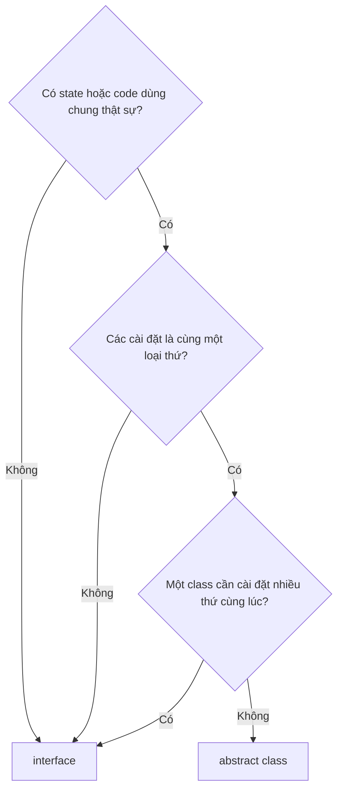

# 4.5 - Abstraction

> **Tóm tắt:** Trừu tượng hoá là quyết định **giấu cái gì và giữ lại cái gì**. Một trừu tượng tốt cho phép bạn dùng nó mà **không cần biết bên dưới ra sao** — và phép thử rõ ràng nhất là: nếu đổi cài đặt bên dưới mà code gọi phải sửa, thì trừu tượng đó đã **rò rỉ**. Bài này đưa ra tiêu chí chọn giữa `interface` và `abstract class`, ba dấu hiệu rò rỉ thường gặp trong code .NET thật, và một lời cảnh báo quan trọng không kém: **trừu tượng hoá quá sớm còn tốn hơn là không trừu tượng hoá**, vì bạn đang đoán một tương lai chưa tới.

## Mục tiêu bài học

Sau bài này bạn có thể:

- Đánh giá một trừu tượng bằng phép thử "đổi cài đặt thì code gọi có phải sửa không".
- Chọn giữa `interface` và `abstract class` theo tiêu chí rõ ràng.
- Nhận ra ba dấu hiệu trừu tượng bị rò rỉ.
- Quyết định thời điểm nên trừu tượng hoá, thay vì làm từ đầu.
- Đặt tên trừu tượng theo năng lực thay vì theo công nghệ.

**Cần biết trước:** [bài 4.4](4.4-interface.md) (interface, đảo ngược phụ thuộc, ba câu hỏi "khi nào cần interface"). Bài này dùng vài kiểu của thư viện truy cập database (`DataTable`, `IQueryable`, `PostgresException`) làm ví dụ về thứ **không nên** lọt qua interface; bạn chỉ cần biết chúng đến từ thư viện database, chưa cần biết cách dùng.

## Nội dung bài học

### 4.5.1 — Giấu cái gì, giữ cái gì

```csharp
// RÒ RỈ — người gọi buộc phải biết bên dưới là SQL
public interface IOrderRepository
{
    Task<DataTable> ExecuteQueryAsync(string sql);
}

// KÍN — người gọi chỉ cần biết mình muốn gì
public interface IOrderRepository
{
    Task<Order?> GetByIdAsync(int id, CancellationToken ct);
    Task<IReadOnlyList<Order>> GetOverdueAsync(DateTimeOffset asOf, CancellationToken ct);
}
```

Phiên bản đầu không giấu gì. Đổi sang MongoDB thì mọi chỗ gọi đều phải viết lại, vì chúng đang cầm chuỗi SQL và `DataTable`.

Phép thử rõ ràng nhất cho một trừu tượng:

> Nếu thay cài đặt bên dưới, code **gọi** có phải sửa không?

Phải sửa → trừu tượng đã rò rỉ.

### 4.5.2 — `interface` hay `abstract class`

| | `interface` | `abstract class` |
|---|---|---|
| Số lượng cài đặt được | Nhiều cùng lúc | **Chỉ một** |
| Chứa được state (field) | Không | **Có** |
| Chứa code dùng chung | Hạn chế | **Có** |
| Constructor | Không | Có |
| Quan hệ diễn đạt | **"làm được"** | **"là một"** |

Tiêu chí chọn, theo thứ tự hỏi:

1. Có **state hoặc code dùng chung** thật sự không? Không → `interface`.
2. Các cài đặt có phải là **cùng một loại thứ** không? Không → `interface`.
3. Một class có cần **cài đặt nhiều thứ** cùng lúc không? Có → `interface`.

Trong code .NET hiện đại, `interface` là lựa chọn mặc định — vì nó ghép tốt với dependency injection và không tiêu mất "suất kế thừa" duy nhất của class.

Ba câu hỏi trên, theo thứ tự:



Khi cả hai đều hợp lý, một mẫu hay dùng là kết hợp:

```csharp
public interface IReportGenerator
{
    Task<byte[]> GenerateAsync(ReportRequest r, CancellationToken ct);
}

// Lớp cơ sở cho phần dùng chung, nhưng người gọi vẫn chỉ biết interface
public abstract class ReportGeneratorBase : IReportGenerator
{
    public async Task<byte[]> GenerateAsync(ReportRequest r, CancellationToken ct)
    {
        Validate(r);                                   // chung
        var data = await FetchDataAsync(r, ct);        // riêng từng loại
        return Render(data);                           // riêng từng loại
    }

    protected abstract Task<ReportData> FetchDataAsync(ReportRequest r, CancellationToken ct);
    protected abstract byte[] Render(ReportData data);
    private void Validate(ReportRequest r) { /* ... */ }
}
```

Người gọi phụ thuộc vào `IReportGenerator`; lớp cơ sở chỉ là chi tiết cài đặt.

### 4.5.3 — Ba dấu hiệu trừu tượng bị rò rỉ

**1. Kiểu của công nghệ bên dưới lọt ra ngoài**

```csharp
// RÒ RỈ — SqlParameter là kiểu của ADO.NET
Task<List<Order>> FindAsync(SqlParameter[] parameters);

// RÒ RỈ — IQueryable kéo theo cả ngữ nghĩa của LINQ provider
IQueryable<Order> Query();
```

`IQueryable` là trường hợp gây tranh cãi và đáng nói riêng: nó trông như một trừu tượng, nhưng cái gì dịch được sang SQL lại **phụ thuộc vào provider**. Người gọi viết một biểu thức chạy tốt với EF Core rồi đổi provider là nhận `NotSupportedException` lúc chạy. Trừu tượng mà hành vi phụ thuộc cài đặt thì không phải trừu tượng.

**2. Người gọi phải biết thứ tự hoặc điều kiện ẩn**

```csharp
var svc = new ReportService();
svc.Initialize();          // quên dòng này là nổ, nhưng không gì bắt buộc
svc.Generate();
```

Nếu có một thứ tự bắt buộc mà kiểu dữ liệu không thể hiện, trừu tượng đang rò rỉ qua tài liệu. Cách sửa: gộp vào constructor, hoặc dùng factory trả về object đã sẵn sàng.

**3. Ngoại lệ mang đặc trưng của cài đặt**

```csharp
try { await _repo.SaveAsync(order); }
catch (PostgresException ex) when (ex.SqlState == "23505") { /* trùng khoá */ }
```

`PostgresException` là ngoại lệ của thư viện Npgsql (driver PostgreSQL cho .NET), và `23505` là mã lỗi "vi phạm ràng buộc duy nhất" của PostgreSQL. Người gọi vừa phải biết bên dưới là PostgreSQL, vừa biết cả mã lỗi của nó. Repository nên bắt và dịch sang một ngoại lệ của miền nghiệp vụ, ví dụ `DuplicateOrderCodeException`.

<details>
<summary>SQL Server</summary>

Với SQL Server, cùng lỗi đó là `SqlException` (thư viện `Microsoft.Data.SqlClient`) với số lỗi 2627 (vi phạm unique constraint) hoặc 2601 (trùng giá trị trong unique index):

```csharp
catch (SqlException ex) when (ex.Number is 2627 or 2601) { /* trùng khoá */ }
```

</details>

### 4.5.4 — Đừng trừu tượng hoá quá sớm

```csharp
// Có ĐÚNG MỘT cài đặt, và chưa ai biết cái thứ hai sẽ trông ra sao
public interface IEmailTemplateRenderer { string Render(string name, object model); }
public interface IEmailAddressValidator { bool IsValid(string email); }
public interface IEmailQueue { Task EnqueueAsync(EmailMessage m); }
public interface IEmailRetryPolicy { TimeSpan GetDelay(int attempt); }
```

Bốn interface, bốn file, bốn dòng đăng ký với DI container — cho một tính năng gửi email chưa có yêu cầu thứ hai nào. Chạy ba câu hỏi ở [mục 4.4.4](4.4-interface.md) cho từng cái: không cái nào vượt ranh giới hạ tầng ngoài `IEmailQueue`, không cái nào có cài đặt thứ hai.

Vấn đề không phải là thừa việc. Vấn đề là **bạn đang đoán trục thay đổi tương lai**, và khi yêu cầu thật đến, nó thường cắt ngang theo một trục khác. Lúc đó bạn phải phá bỏ bốn trừu tượng sai để dựng lại — tốn hơn là bắt đầu từ một class rồi tách ra khi đã biết.

Quy tắc thực dụng: **trừu tượng hoá khi bạn đã có cài đặt thứ hai trước mặt**, hoặc khi cần vượt một ranh giới hạ tầng để kiểm thử. Hai trường hợp đó là thông tin thật, không phải phỏng đoán.

Ngoại lệ hợp lý: ranh giới hạ tầng (database, HTTP, hàng đợi, đồng hồ) nên trừu tượng ngay từ đầu, vì bạn **biết chắc** sẽ cần thay bằng bản giả khi viết test.

### 4.5.5 — Đặt tên theo năng lực

```csharp
// Theo CÔNG NGHỆ — tên chết cứng, đổi công nghệ là tên sai
public interface IPostgresOrderRepository { }
public interface IRedisCache { }
public interface ISendGridMailer { }

// Theo NĂNG LỰC — tên sống lâu hơn công nghệ
public interface IOrderRepository { }
public interface IDistributedCache { }
public interface IEmailSender { }
```

Tên nói *làm được gì*, không nói *dùng gì để làm*. Class cài đặt mới là chỗ ghi tên công nghệ: `PostgresOrderRepository : IOrderRepository`.

Quy ước .NET: interface bắt đầu bằng `I`. Điều này không phổ biến ở các ngôn ngữ khác nhưng là chuẩn trong hệ sinh thái .NET — hãy theo nó.

### 4.5.6 — Rà lại code của bạn

**Danh sách rà soát trừu tượng**

- [ ] Đổi cài đặt bên dưới thì code gọi không phải sửa.
- [ ] Không có kiểu đặc trưng công nghệ (SqlParameter, DataTable, IQueryable) trong chữ ký interface.
- [ ] Không có trừu tượng nào đòi người gọi nhớ một thứ tự gọi bắt buộc.
- [ ] Ngoại lệ ném ra là ngoại lệ của miền nghiệp vụ, không phải PostgresException hay SqlException.
- [ ] Không có interface nào tạo ra chỉ vì dự đoán một cài đặt thứ hai chưa tồn tại.
- [ ] Tên interface nói năng lực, không nói công nghệ.
- [ ] Ranh giới hạ tầng (DB, HTTP, hàng đợi, đồng hồ) đều có trừu tượng.

## Bài tập áp dụng

#### Bài 1 — Chạy phép thử rò rỉ

Interface dưới đây đang được cài đặt bằng EF Core. Giả định đội quyết định đổi sang Dapper (một thư viện truy cập database khác, viết SQL tay). Với từng phương thức, trả lời: code **gọi** interface có phải sửa không, và vì sao? Rồi viết lại interface để đổi công nghệ không ảnh hưởng tới người gọi.

```csharp
public interface IOrderRepository
{
    IQueryable<Order> Query();
    Task<Order> GetAsync(int id, CancellationToken ct);
    Task SaveAsync(CancellationToken ct);
    Task<EntityEntry<Order>> AddAsync(Order o, CancellationToken ct);
}
```

**Tiêu chí hoàn thành:** bạn chỉ ra được **kiểu dữ liệu hoặc khái niệm nào** trong chữ ký interface đang gây rò rỉ, và bản viết lại không còn kiểu nào của EF Core.

<details>
<summary><strong>Gợi ý và lời giải — Bài 1</strong></summary>

**Gợi ý.** Rò rỉ hầu như luôn nằm ở **kiểu dữ liệu xuất hiện trong chữ ký**, không nằm ở tên phương thức. Hãy đọc từng chữ ký và hỏi: kiểu này đến từ thư viện nào?

**Lời giải — interface rò rỉ:**

```csharp
public interface IOrderRepository
{
    IQueryable<Order> Query();                                    // rò rỉ 1
    Task<Order> GetAsync(int id, CancellationToken ct);
    Task SaveAsync(CancellationToken ct);                          // rò rỉ 2
    Task<EntityEntry<Order>> AddAsync(Order o, CancellationToken ct);   // rò rỉ 3
}
```

**Ba chỗ rò rỉ và vì sao:**

| Chỗ | Vấn đề |
|---|---|
| `IQueryable<Order>` | Người gọi viết truy vấn LINQ, và **những truy vấn đó chỉ EF Core dịch được**. Đổi sang Dapper là mọi nơi gọi đều hỏng. |
| `SaveAsync()` | Phơi bày khái niệm `SaveChanges` của EF Core. Một kho dữ liệu dạng khác có thể không có khái niệm "lưu tất cả cùng lúc". |
| `EntityEntry<Order>` | Kiểu này **thuộc về EF Core**. Tầng nghiệp vụ buộc phải tham chiếu EF Core chỉ để biên dịch. |

**Chạy phép thử trong dự án thật:** tìm (Ctrl+Shift+F trong IDE) các chuỗi `.Query()`, `IQueryable<`, `EntityEntry<` trong project nghiệp vụ. Mỗi file service hay handler xuất hiện trong kết quả — tức là **ngoài lớp cài đặt** — là một chỗ phải sửa khi đổi công nghệ.

**Sau khi sửa:**

```csharp
public interface IOrderRepository
{
    Task<Order?> GetByIdAsync(int id, CancellationToken ct);
    Task<IReadOnlyList<Order>> GetByCustomerAsync(int customerId, CancellationToken ct);
    Task<IReadOnlyList<Order>> FindUnpaidAsync(DateTime beforeDate, CancellationToken ct);
    Task AddAsync(Order order, CancellationToken ct);
}
```

Mọi kiểu trong chữ ký đều thuộc về **miền nghiệp vụ** hoặc thư viện chuẩn: `Order`, `IReadOnlyList`, `DateTime`, `CancellationToken`. Không có gì của EF Core. Giờ đổi sang Dapper chỉ cần viết một lớp cài đặt mới.

**Đánh đổi phải thừa nhận.** Bản không rò rỉ đòi hỏi **một phương thức cho mỗi kiểu truy vấn**. Với hệ thống nhiều loại truy vấn, interface sẽ phình to, và bạn mất khả năng ghép điều kiện linh hoạt mà `IQueryable` cho phép.

Vì vậy hãy quyết định có ý thức, đừng theo giáo điều:

| Tình huống | Nên chọn |
|---|---|
| Ứng dụng nhỏ, chắc chắn dùng EF Core lâu dài | Dùng thẳng `DbContext`, đừng bọc |
| Cần kiểm thử tầng nghiệp vụ không cần database | Bọc bằng interface không rò rỉ |
| Nhiều nguồn dữ liệu, hoặc dự định đổi công nghệ | Bọc, và bọc kỹ |
| Truy vấn báo cáo phức tạp, nhiều tổ hợp điều kiện | Tách riêng, cho phép dùng `IQueryable` **chỉ ở phía đọc** |

Dòng cuối là một mẫu thực dụng đáng biết: tách phía **ghi** (bọc kỹ, giữ bất biến nghiệp vụ) khỏi phía **đọc** (cho phép truy vấn linh hoạt, vì đọc không phá vỡ quy tắc nào). Đây là ý tưởng nền của CQRS mà [Module 16](../../stage-05-senior-engineering/module-16-clean-architecture/README.md) trình bày.

</details>

#### Bài 2 — Dịch ngoại lệ ở ranh giới

`CustomerService.CreateAsync` trong phần "trước" của lời giải nằm ở tầng nghiệp vụ nhưng lại bắt `PostgresException` với mã lỗi `23505`. Thêm bước dịch sang ngoại lệ của miền nghiệp vụ ở repository, và xoá kiến thức về mã lỗi khỏi tầng nghiệp vụ.

**Tiêu chí hoàn thành:** tầng nghiệp vụ không còn tham chiếu tới kiểu ngoại lệ nào của thư viện hạ tầng.

<details>
<summary><strong>Gợi ý và lời giải — Bài 2</strong></summary>

**Gợi ý.** Trong dự án thật, tìm các chỗ `catch (PostgresException`, `catch (DbUpdateException`, `catch (HttpRequestException` trong project nghiệp vụ. Mỗi kết quả là một chỗ mà tầng nghiệp vụ đang **biết quá nhiều** về cách dữ liệu được lưu.

**Lời giải — trước:**

```csharp
// Crm.Application/CustomerService.cs
public async Task<int> CreateAsync(string name, string email, CancellationToken ct)
{
    try
    {
        var c = new Customer(name, email);
        await _repo.AddAsync(c, ct);
        return c.Id;
    }
    catch (PostgresException ex) when (ex.SqlState == "23505")   // mã lỗi của PostgreSQL
    {
        throw new InvalidOperationException("Email đã tồn tại");
    }
}
```

Hai vấn đề: tầng nghiệp vụ phải tham chiếu thư viện `Npgsql`, và nó chứa kiến thức về mã lỗi `23505` — thứ sẽ thành vô nghĩa nếu đổi sang database khác.

**Sau — dịch ở ranh giới hạ tầng.** `DomainException` là lớp ngoại lệ gốc bạn tự định nghĩa cho mọi lỗi nghiệp vụ, ví dụ `public class DomainException(string message) : Exception(message);`. `DbUpdateException` là ngoại lệ EF Core ném khi lưu thất bại; lỗi gốc của database nằm trong `InnerException` của nó.

```csharp
// Crm.Application/Exceptions/DuplicateEmailException.cs
public class DuplicateEmailException : DomainException
{
    public string Email { get; }
    public DuplicateEmailException(string email)
        : base($"Email {email} đã được sử dụng") => Email = email;
}

// Crm.Infrastructure/EfCustomerRepository.cs  <- NƠI DUY NHẤT biết về mã lỗi
public async Task AddAsync(Customer c, CancellationToken ct)
{
    try
    {
        _db.Customers.Add(c);
        await _db.SaveChangesAsync(ct);
    }
    catch (DbUpdateException ex) when (IsUniqueViolation(ex))
    {
        throw new DuplicateEmailException(c.Email);
    }
}

private static bool IsUniqueViolation(DbUpdateException ex) =>
    ex.InnerException is PostgresException { SqlState: PostgresErrorCodes.UniqueViolation };
```

`PostgresErrorCodes.UniqueViolation` là hằng số có sẵn trong Npgsql, giá trị `"23505"`, đọc dễ hơn một chuỗi số.

<details>
<summary>SQL Server</summary>

Repository dùng SQL Server kiểm tra `SqlException` thay vì `PostgresException`:

```csharp
private static bool IsUniqueViolation(DbUpdateException ex) =>
    ex.InnerException is SqlException { Number: 2627 or 2601 };
```

</details>

Tầng nghiệp vụ giờ chỉ còn:

```csharp
public async Task<int> CreateAsync(string name, string email, CancellationToken ct)
{
    var c = new Customer(name, email);
    await _repo.AddAsync(c, ct);      // ném DuplicateEmailException nếu trùng
    return c.Id;
}
```

**Ba lợi ích:**

1. **Kiến thức hạ tầng nằm ở đúng một chỗ.** Đổi database chỉ cần sửa `IsUniqueViolation` trong repository.
2. **Ngoại lệ mang ngữ nghĩa nghiệp vụ.** `DuplicateEmailException` nói rõ chuyện gì xảy ra; `PostgresException` với mã `23505` thì không.
3. **Ánh xạ sang mã HTTP trở nên tự nhiên.** Tầng API bắt `DuplicateEmailException` và trả `409 Conflict`, không cần biết gì về database:

   [Bài 8.8](../../stage-03-aspnet-core-backend/module-08-aspnet-core-fundamentals/8.8-global-exception-handling.md) trình bày cách cài đặt ánh xạ này một lần cho toàn ứng dụng.

**Nguyên tắc chung.** Mỗi ranh giới kiến trúc nên **dịch** ngoại lệ, không cho chúng đi xuyên qua. Ngoại lệ đi xuyên ranh giới mang theo chi tiết cài đặt, và chính điều đó biến một trừu tượng đẹp trên giấy thành một trừu tượng rò rỉ trong thực tế.

**Một lưu ý về hiệu năng.** Đừng dùng ngoại lệ cho luồng bình thường. Nếu "email đã tồn tại" là tình huống xảy ra thường xuyên chứ không phải ngoại lệ, hãy trả về `Result<T>` như [Module 5](../module-05-advanced-csharp/README.md) trình bày — ném và bắt ngoại lệ tốn kém hơn nhiều so với trả về một giá trị.

</details>

#### Bài 3 — Đếm trừu tượng chỉ có một cài đặt

Một dự án CRM có tám interface, mỗi cái chỉ có một lớp cài đặt trong project chính: `IEmailSender` (cài bằng SMTP), `IFileStorage` (lưu file lên cloud), `IOrderRepository` (EF Core), `IPaymentGateway` (gọi VNPay), `ICustomerMapper` (chép dữ liệu từ entity sang DTO), `IPriceCalculator` (tính giá, logic thuần), `IValidationHelper` (hàm tiện ích kiểm tra chuỗi), `IClock` (trả về giờ hiện tại). Dùng ba câu hỏi ở [mục 4.4.4](4.4-interface.md) để chia chúng thành nhóm "giữ" và "xoá được". Với mỗi cái, trả lời: xoá nó đi thì mất gì?

**Tiêu chí hoàn thành:** bạn phân loại được cả tám cái, kèm lý do cho từng cái.

<details>
<summary><strong>Gợi ý và lời giải — Bài 3</strong></summary>

**Gợi ý.** Với mỗi interface, hỏi theo thứ tự: nó có chạm tới thứ gì **bên ngoài** chương trình không (database, mạng, file, đồng hồ)? Có cài đặt thứ hai ở đâu đó không, kể cả bản giả cho môi trường phát triển? Nếu cả hai đều "không", nó là ứng viên để xoá.

**Lời giải — ba nhóm:**

**Nhóm 1 — giữ, vì vượt ranh giới hạ tầng.**

```csharp
public interface IEmailSender { }       // cài đặt: SmtpEmailSender
public interface IFileStorage { }       // cài đặt: S3FileStorage
public interface IOrderRepository { }   // cài đặt: EfOrderRepository
public interface IClock { }             // cài đặt: SystemClock (hoặc dùng luôn TimeProvider có sẵn)
```

Dù chỉ có một cài đặt, chúng vẫn đáng giá vì:

- Cho phép kiểm thử tầng nghiệp vụ mà không cần SMTP, S3, database.
- Đảo chiều phụ thuộc như bài 1 ở [bài 4.4](4.4-interface.md) đã phân tích.
- Đánh dấu một **ranh giới kiến trúc có chủ ý**.

**Nhóm 2 — giữ, vì có cài đặt thứ hai dùng cho môi trường phát triển.**

```csharp
public interface IPaymentGateway { }
// cài đặt thật:  VnPayGateway
// cài đặt giả:   FakePaymentGateway  (dùng ở môi trường Development)
```

Đây thực ra là hai cài đặt, chỉ là bản giả nằm ở project khác nên dễ bị đếm sót. Nó cũng vượt ranh giới hạ tầng (gọi mạng), nên giữ vì cả hai lý do.

**Nhóm 3 — xoá được.**

```csharp
public interface ICustomerMapper { }    // cài đặt: CustomerMapper — chỉ ánh xạ DTO
public interface IPriceCalculator { }   // cài đặt: PriceCalculator — logic thuần
public interface IValidationHelper { }  // cài đặt: ValidationHelper — hàm tiện ích
```

Cả ba đều là **logic thuần tuý** không chạm tới thứ gì bên ngoài. Xoá interface đi thì:

- Kiểm thử vẫn viết được bình thường — chúng vốn đã tất định, không cần bản giả.
- Không có ranh giới kiến trúc nào bị phá vỡ.
- **Lợi được**: bớt một file phải mở mỗi khi muốn xem code thật làm gì.

Ngoài ba câu hỏi ở mục 4.4.4, còn một lý do chính đáng thứ tư để giữ interface: **đánh dấu ranh giới kiến trúc có chủ ý** giữa hai tầng hoặc hai module. Không thuộc lý do nào thì lớp cụ thể là đủ.

**Về lập luận "để sau này dễ thay".** Đây là lý do được viện dẫn nhiều nhất và đúng ít nhất. Trong thực tế, khi cài đặt thứ hai thật sự xuất hiện, interface viết từ trước thường **không vừa** — vì nó được thiết kế quanh cài đặt duy nhất đang có. Bạn vẫn phải sửa nó. Trong khi đó, trình soạn thảo hiện đại trích xuất interface từ một lớp cụ thể chỉ bằng vài phím.

Nói cách khác: chi phí **thêm** interface khi cần là rất thấp; chi phí **mang theo** hàng chục interface vô ích suốt vòng đời dự án thì không.

**Một dấu hiệu nhận biết nhanh.** Interface đặt tên bằng cách thêm chữ `I` vào trước tên lớp — `ICustomerMapper` cho `CustomerMapper` — gần như luôn thuộc nhóm 3. Interface có giá trị thường được đặt tên theo **năng lực** chứ không theo lớp cài đặt: `IEmailSender`, `IFileStorage`, `IClock`.

</details>

## Tự kiểm tra

<details>
<summary>Phép thử nào cho biết một trừu tượng có tốt không?</summary>

Hỏi xem nếu thay cài đặt bên dưới thì code gọi có phải sửa không. Nếu phải sửa thì trừu tượng đã rò rỉ. Một interface nhận chuỗi SQL và trả về DataTable không giấu được gì, vì đổi sang cơ sở dữ liệu khác là mọi chỗ gọi phải viết lại.

</details>

<details>
<summary>Chọn interface hay abstract class theo tiêu chí nào?</summary>

Hỏi ba câu: có state hoặc code dùng chung thật sự không, các cài đặt có phải cùng một loại thứ không, và một class có cần cài đặt nhiều thứ cùng lúc không. Trong .NET hiện đại interface là mặc định vì nó ghép tốt với dependency injection và không tiêu mất suất kế thừa duy nhất của class.

</details>

<details>
<summary>Vì sao IQueryable bị coi là trừu tượng rò rỉ?</summary>

Vì cái gì dịch được sang SQL lại phụ thuộc vào provider. Người gọi viết một biểu thức chạy tốt với EF Core, đổi provider thì nhận NotSupportedException lúc chạy. Một trừu tượng mà hành vi phụ thuộc vào cài đặt bên dưới thì không thật sự là trừu tượng.

</details>

<details>
<summary>Ba dấu hiệu trừu tượng rò rỉ là gì?</summary>

Kiểu của công nghệ bên dưới lọt vào chữ ký, ví dụ SqlParameter hay DataTable. Người gọi phải nhớ một thứ tự hoặc điều kiện ẩn mà kiểu dữ liệu không thể hiện. Và ngoại lệ ném ra mang đặc trưng cài đặt, buộc tầng nghiệp vụ phải biết mã lỗi của SQL Server.

</details>

<details>
<summary>Vì sao trừu tượng hoá quá sớm lại tốn hơn không trừu tượng hoá?</summary>

Vì bạn đang đoán trục thay đổi tương lai, mà khi yêu cầu thật đến nó thường cắt ngang theo một trục khác. Lúc đó phải phá bỏ những trừu tượng sai để dựng lại, tốn hơn là bắt đầu từ một class rồi tách ra khi đã biết hình dạng thật của vấn đề.

</details>

<details>
<summary>Khi nào thì nên trừu tượng ngay từ đầu?</summary>

Khi vượt ranh giới hạ tầng: database, HTTP, hàng đợi, file, đồng hồ. Ở những chỗ đó bạn biết chắc sẽ cần thay bằng bản giả khi viết test, nên đó là thông tin thật chứ không phải phỏng đoán. Ngoài ra thì chờ tới khi có cài đặt thứ hai thật sự trước mặt.

</details>

## Kết luận

Ba điều đáng nhớ nhất:

1. **Phép thử duy nhất: đổi cài đặt thì code gọi có phải sửa không.**
2. **Trừu tượng hoá quá sớm là đoán tương lai.** Chờ tới khi có cài đặt thứ hai, trừ khi đó là ranh giới hạ tầng.
3. **Tên nói năng lực, không nói công nghệ.** `IEmailSender`, không phải `ISendGridMailer`.

## Tham khảo

- [Interfaces — C#](https://learn.microsoft.com/en-us/dotnet/csharp/fundamentals/types/interfaces)
- [Object-oriented programming in C#](https://learn.microsoft.com/en-us/dotnet/csharp/fundamentals/object-oriented/) — phần abstraction
- [Framework design guidelines](https://learn.microsoft.com/en-us/dotnet/standard/design-guidelines/) — chọn giữa interface và abstract class
- [Access modifiers](https://learn.microsoft.com/en-us/dotnet/csharp/language-reference/keywords/access-modifiers)

## Điều hướng

- **Bài trước:** [4.4 — Interface](4.4-interface.md)
- **Bài tiếp theo:** [4.6 — Access Modifiers](4.6-access-modifiers.md)
- **Về module:** [Trang mục lục](README.md)
