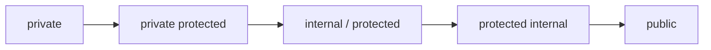

# 4.6 - Access Modifiers

> **Tóm tắt:** C# có **sáu** mức truy cập dùng cho thành viên và kiểu, cộng thêm `file` (C# 11) chỉ dùng cho kiểu. Điều đáng nhớ nhất không phải danh sách mà là **mức mặc định khi bạn không viết gì**: thành viên của class mặc định là `private`, còn kiểu ở cấp namespace mặc định là `internal`. Nghĩa là một `class Order` không có từ khoá nào **không** dùng được từ project khác — nguồn của câu hỏi "vì sao tôi không thấy class này". Bài này cũng làm rõ cặp dễ nhầm nhất, `protected internal` (là **HOẶC**) và `private protected` (là **VÀ**), cùng cách mở cửa cho unit test mà không biến mọi thứ thành `public`.

## Mục tiêu bài học

Sau bài này bạn có thể:

- Liệt kê sáu mức truy cập và phạm vi của từng mức.
- Nói được mức mặc định trong từng ngữ cảnh khi không viết từ khoá nào.
- Phân biệt `protected internal` với `private protected`.
- Cho test truy cập thành viên `internal` mà không phải đổi sang `public`.
- Chọn mức truy cập theo nguyên tắc đóng trước, mở sau.

**Cần biết trước:** [bài 4.4](4.4-interface.md) (interface, đảo ngược phụ thuộc) và solution nhiều project ở [bài 0.4](../../stage-01-foundation/module-00-setup/0.4-solution-and-unit-test.md). **Assembly** là file `.dll` (hoặc `.exe`) mà một project biên dịch ra; mỗi project trong solution là một assembly riêng.

## Nội dung bài học

### 4.6.1 — Sáu mức

| Mức | Ai truy cập được |
|---|---|
| `private` | Chỉ trong chính kiểu đó |
| `protected` | Kiểu đó và các lớp con |
| `internal` | Mọi nơi trong **cùng assembly** |
| `protected internal` | Cùng assembly **HOẶC** lớp con ở assembly khác |
| `private protected` | Lớp con **VÀ** phải cùng assembly |
| `public` | Mọi nơi |

Hai dòng giữa là chỗ hay nhầm:

```csharp
public class Base
{
    protected internal int A;   // rộng hơn: cùng assembly HOẶC lớp con bất kỳ
    private protected  int B;   // hẹp hơn: lớp con VÀ cùng assembly
}
```

Mẹo nhớ: đọc dấu cách giữa hai từ như một phép toán. `protected internal` = `protected` **hoặc** `internal`. `private protected` = giao của hai điều kiện, nên hẹp nhất trong nhóm.

Trong thực tế `private protected` rất hiếm dùng; `protected internal` cũng vậy. Đừng dùng chúng chỉ vì chúng tồn tại.

Mức thứ bảy, `file` (C# 11), chỉ đặt được trước một **kiểu** (`file class Helper { }`) và giới hạn kiểu đó trong đúng file mã nguồn chứa nó. Nó chủ yếu dành cho code do công cụ sinh ra (source generator), nên [bài 4.10](4.10-advanced-notes.md) chỉ nhắc qua.

### 4.6.2 — Mức mặc định: nguồn của nhiều bối rối

```csharp
class Order { }                 // internal — KHÔNG thấy từ project khác

public class Customer
{
    int _id;                    // private
    void Calculate() { }        // private
    public string Name { get; } // public, vì đã viết rõ
}

interface IRepository
{
    void Save();                // public — mặc định của thành viên interface
}
```

Từ C# 8, thành viên interface **có thể** khai báo `private`, `protected` hay `internal` (dùng cho phương thức có thân sẵn trong interface, xem [mục 4.4.6](4.4-interface.md)). Nhưng không viết gì thì nó là `public`, và phương thức không có thân mà lớp cài đặt phải viết thì gần như luôn để `public`.

Bảng mặc định khi bạn không viết gì:

| Ngữ cảnh | Mặc định |
|---|---|
| Kiểu ở cấp namespace (class, record, interface, enum) | `internal` |
| Thành viên của class / struct | `private` |
| Thành viên của interface | `public` (có thể khai báo mức khác từ C# 8) |
| Thành viên của enum | `public` |

Câu hỏi "vì sao project kia không thấy class của tôi" gần như luôn có cùng một câu trả lời: bạn quên chữ `public`, và nó đang là `internal`.

### 4.6.3 — `internal`: ranh giới của assembly

`internal` là mức bị dùng ít hơn mức nó đáng được dùng.

```csharp
// Trong project MyApp.Infrastructure
public interface IOrderRepository { /* ... */ }        // hợp đồng — public

internal class EfOrderRepository : IOrderRepository    // cài đặt — internal
{
    // Project khác không new được class này.
    // Chúng chỉ lấy được qua một điểm public, dưới dạng IOrderRepository.
}

// Điểm public duy nhất: nằm trong assembly này nên được phép new EfOrderRepository
public static class InfrastructureFactory
{
    public static IOrderRepository CreateOrderRepository() => new EfOrderRepository();
}
```

Trong ứng dụng ASP.NET Core, "điểm public duy nhất" ấy thường là một hàm đăng ký với dependency injection (`services.AddScoped<IOrderRepository, EfOrderRepository>()`), học ở [Module 7](../module-07-dependency-injection/README.md). Ý tưởng vẫn y hệt.

Mẫu này rất đáng dùng: **hợp đồng `public`, cài đặt `internal`**. Nó biến ranh giới kiến trúc thành thứ trình biên dịch ép buộc, thay vì chỉ là quy ước trong tài liệu. Một người viết code ở tầng khác **không thể** vô tình phụ thuộc vào lớp cài đặt, vì nó không nhìn thấy được.

### 4.6.4 — Cho test truy cập `internal`

Vấn đề quen thuộc: bạn muốn test một class `internal` nhưng project test là assembly khác.

Cách sai là đổi nó thành `public` — bạn vừa phơi chi tiết cài đặt ra cho toàn bộ giải pháp chỉ vì lý do kiểm thử.

Cách đúng:

```xml
<!-- Trong .csproj của project cần test -->
<ItemGroup>
  <InternalsVisibleTo Include="MyApp.Infrastructure.Tests" />
</ItemGroup>
```

Hoặc dạng attribute cũ hơn, đặt trong `AssemblyInfo.cs`:

```csharp
[assembly: InternalsVisibleTo("MyApp.Infrastructure.Tests")]
```

Chỉ đúng assembly được nêu tên mới nhìn thấy. Phần còn lại của giải pháp vẫn bị chặn.

Một lưu ý về triết lý: nếu bạn thường xuyên phải mở `internal` ra để test, hãy tự hỏi có phải mình đang test **chi tiết cài đặt** thay vì test **hành vi qua API công khai**. Đôi khi câu trả lời là có, và bài test đó sẽ vỡ mỗi lần refactor dù hành vi không đổi.

### 4.6.5 — Mức truy cập của accessor

```csharp
public class Order
{
    public decimal Total { get; private set; }      // đọc công khai, ghi nội bộ
    public string Code { get; init; }                // chỉ gán lúc khởi tạo
    protected internal int Version { get; private set; }
}
```

Quy tắc: mức của accessor phải **hẹp hơn hoặc bằng** mức của property.

```csharp
private decimal Total { get; public set; }   // Lỗi biên dịch: set rộng hơn property
```

```text
error CS0273: The accessibility modifier of the 'Order.Total.set' accessor must be more restrictive than the property or indexer 'Order.Total'
```

`{ get; private set; }` là dạng hữu dụng nhất trong nhóm này: bên ngoài đọc được giá trị nhưng chỉ phương thức của class mới thay đổi được — tức là mọi thay đổi đều đi qua một quy tắc, đúng tinh thần [đóng gói ở bài 4.2](4.2-encapsulation.md).

### 4.6.6 — Đóng trước, mở sau



Nguyên tắc: **bắt đầu ở mức đóng nhất, chỉ mở khi có nhu cầu thật**.

Lý do thực dụng, không phải triết lý:

- **Mở rộng quyền truy cập là thay đổi tương thích ngược.** `private` → `public` không phá vỡ code nào.
- **Siết lại thì phá vỡ mọi chỗ đang gọi.** `public` → `internal` có thể làm hỏng cả những project bạn không kiểm soát.

Nói cách khác, bạn luôn mở ra được, nhưng đóng lại thì rất tốn. Nên mặc định chọn chặt.

Với thư viện dùng chung, điều này còn quan trọng hơn: **mọi thứ `public` là một lời hứa** bạn phải giữ ở các phiên bản sau, và phá vỡ nó buộc tăng số major theo [SemVer](https://semver.org/).

### 4.6.7 — Rà lại code của bạn

**Danh sách rà soát mức truy cập**

- [ ] Không có class nào public chỉ vì quên nghĩ; mỗi public là một quyết định.
- [ ] Lớp cài đặt của interface được khai internal khi không cần dùng ngoài assembly.
- [ ] Không có field nào public; chỉ có property.
- [ ] Test truy cập internal qua InternalsVisibleTo, không bằng cách đổi thành public.
- [ ] Property nghiệp vụ dùng { get; private set; } thay vì { get; set; }.
- [ ] Không dùng protected internal hay private protected nếu không có lý do cụ thể.
- [ ] Thư viện dùng chung có API public tối thiểu, vì mỗi public là một cam kết.

## Bài tập áp dụng

#### Bài 1 — Đếm `public` thừa

Project `Crm.Infrastructure` của một đội có các class `public` sau. Cột bên phải cho biết project khác (`Crm.Api`, `Crm.Application`) có dùng trực tiếp class đó không. Quyết định class nào nên đổi thành `internal`, và class nào phải giữ `public`.

| Class trong `Crm.Infrastructure` | Project khác dùng trực tiếp? |
|---|---|
| `EfOrderRepository` (cài `IOrderRepository`) | Không, chỉ dùng qua interface |
| `SmtpEmailSender` (cài `IEmailSender`) | Không, chỉ dùng qua interface |
| `DbErrorMapper` (dịch mã lỗi database) | Không |
| `CrmDbContext` | Không |
| `ServiceCollectionExtensions` (hàm đăng ký mọi thứ ở trên) | Có, `Crm.Api` gọi lúc khởi động |

**Tiêu chí hoàn thành:** bạn chọn đúng những class đổi được, giải thích vì sao class cuối phải giữ `public`, và nêu được lợi ích ngoài chuyện "gọn hơn". Nếu đã làm Bài 2, thử đổi thật trong solution của Bài 2 và build lại cho xanh.

<details>
<summary><strong>Gợi ý và lời giải — Bài 1</strong></summary>

**Gợi ý.** Trong dự án thật, cách nhanh nhất để biết một class có bị project khác dùng không là đổi nó thành `internal` rồi build: project nào dùng nó sẽ báo lỗi CS0122. IDE cũng có "Find All References" (Shift+F12).

**Lời giải.** Bốn class đầu không project nào dùng trực tiếp, nên đổi được:

```csharp
internal sealed class EfOrderRepository : IOrderRepository { }
internal sealed class SmtpEmailSender : IEmailSender { }
internal static class DbErrorMapper { }
internal sealed class CrmDbContext : DbContext { }
```

Interface vẫn `public` vì tầng nghiệp vụ cần chúng — nhưng interface nằm ở `Crm.Application`, không nằm ở đây, đúng như [bài 4.4](4.4-interface.md) đã phân tích. Vậy thứ duy nhất `Crm.Infrastructure` cần công khai là **lớp đăng ký** mà `Crm.Api` gọi lúc khởi động (cú pháp đăng ký dependency injection học ở [Module 7](../module-07-dependency-injection/README.md), ở đây chỉ cần thấy nó là điểm `public` duy nhất):

```csharp
public static class ServiceCollectionExtensions
{
    public static IServiceCollection AddCrmInfrastructure(
        this IServiceCollection services, IConfiguration config)
    {
        services.AddScoped<IOrderRepository, EfOrderRepository>();
        services.AddScoped<IEmailSender, SmtpEmailSender>();
        return services;
    }
}
```

**Ba lợi ích ngoài chuyện gọn:**

1. **Trình biên dịch trở thành người canh gác kiến trúc.** Một lập trình viên mới muốn `new EfOrderRepository()` thẳng từ controller sẽ nhận lỗi biên dịch, chứ không phải một lời nhắc trong code review mà có thể bị bỏ qua.

2. **Tự do sửa đổi bên trong.** Thứ `internal` chỉ có thể bị dùng trong cùng assembly, nên bạn đổi tên, đổi chữ ký, tách lớp mà không sợ làm hỏng chỗ nào ngoài tầm mắt. Đây là lợi ích lớn nhất về lâu dài.

3. **Trình biên dịch tối ưu tốt hơn.** Kết hợp `internal sealed`, JIT biết chắc không có lớp con nào, nên có thể nội tuyến các lời gọi phương thức ảo. Lợi ích nhỏ nhưng miễn phí.

**Quy tắc thực dụng: đóng trước, mở sau.**

| Bắt đầu bằng | Nâng lên khi |
|---|---|
| `private` | Lớp khác trong cùng file cần |
| `internal` | Project khác thật sự cần |
| `public` | Có người dùng bên ngoài giải pháp |

Hạ một thành viên từ `public` xuống `internal` là **thay đổi phá vỡ** với mọi người đang dùng. Nâng từ `internal` lên `public` thì không phá vỡ gì. Vì vậy chiều an toàn là bắt đầu chặt rồi nới ra.

**Một trường hợp cần chú ý.** Nếu bạn phát hành thư viện qua NuGet, `public` là **hợp đồng công khai** theo đúng nghĩa: mọi thứ `public` đều phải giữ tương thích theo quy tắc phiên bản ngữ nghĩa. Lúc đó việc giữ bề mặt công khai nhỏ không còn là chuyện gọn gàng mà là chuyện giảm gánh nặng bảo trì trong nhiều năm.

</details>

#### Bài 2 — Dựng ranh giới bằng trình biên dịch

Dựng một solution ba project như [bài 0.4](../../stage-01-foundation/module-00-setup/0.4-solution-and-unit-test.md): `Crm.Application` (class library, chứa interface), `Crm.Infrastructure` (class library, chứa lớp cài đặt, tham chiếu `Crm.Application`) và `Crm.Api` (console, tham chiếu cả hai). Đặt lớp repository là `internal`, chỉ để interface `public`. Thử `new` lớp repository từ `Crm.Api` và ghi lại lỗi biên dịch.

```bash
dotnet new sln -n Crm
dotnet new classlib -n Crm.Application -o src/Crm.Application
dotnet new classlib -n Crm.Infrastructure -o src/Crm.Infrastructure
dotnet new console -n Crm.Api -o src/Crm.Api
dotnet sln add src/Crm.Application src/Crm.Infrastructure src/Crm.Api
dotnet add src/Crm.Infrastructure reference src/Crm.Application
dotnet add src/Crm.Api reference src/Crm.Application src/Crm.Infrastructure
```

**Tiêu chí hoàn thành:** bạn ghi lại được **mã lỗi**, và nêu được vì sao cách này mạnh hơn quy ước của đội.

<details>
<summary><strong>Gợi ý và lời giải — Bài 2</strong></summary>

**Gợi ý.** Ranh giới kiến trúc chỉ có giá trị khi nó **không thể vượt qua**. Quy ước ghi trong tài liệu thì ai cũng vượt được — vô tình hoặc lúc gấp.

**Lời giải.**

```csharp
// src/Crm.Application/IOrderRepository.cs
namespace Crm.Application;

public interface IOrderRepository
{
    string? FindCode(int id);
}
```

```csharp
// src/Crm.Infrastructure/EfOrderRepository.cs
using Crm.Application;

namespace Crm.Infrastructure;

internal sealed class EfOrderRepository : IOrderRepository
{
    public string? FindCode(int id) => id == 1 ? "DH-001" : null;   // tạm thời, chưa có database
}

public static class InfrastructureFactory
{
    public static IOrderRepository CreateOrderRepository() => new EfOrderRepository();
}
```

Thử từ `Crm.Api`:

```csharp
// src/Crm.Api/Program.cs
using Crm.Application;
using Crm.Infrastructure;

IOrderRepository repo = InfrastructureFactory.CreateOrderRepository();   // hợp lệ
Console.WriteLine(repo.FindCode(1));

var direct = new EfOrderRepository();                                    // lỗi
```

**Lỗi biên dịch thật trên .NET 10:**

```text
Program.cs(7,18): error CS0122: 'EfOrderRepository' is inaccessible due to its protection level
```

Cách duy nhất còn lại để lấy được nó là qua điểm `public` mà `Crm.Infrastructure` chủ động mở ra, tức là qua interface. Xoá dòng lỗi đi thì chương trình in `DH-001`.

**Vì sao mạnh hơn quy ước của đội:**

| | Quy ước trong tài liệu | Ranh giới bằng trình biên dịch |
|---|---|---|
| Phát hiện vi phạm | Khi có người để ý trong review | **Ngay khi gõ** |
| Người mới vào đội | Phải đọc tài liệu và nhớ | Không thể sai |
| Lúc gấp, 2 giờ sáng | Dễ bị bỏ qua | Không bỏ qua được |
| Sau hai năm | Thường đã bị quên | Vẫn nguyên hiệu lực |

Nguyên tắc chung: **biến quy ước thành ràng buộc kỹ thuật bất cứ khi nào có thể**. Đây là cùng một ý với việc bọc `string` thành kiểu riêng ở [bài 4.7](4.7-records-and-value-objects.md), và dùng constructor để chặn dữ liệu sai ở [bài 4.1](4.1-class-and-object.md) — đẩy việc kiểm tra từ "phải nhớ" sang "không thể sai".

**Ba mức ranh giới, từ yếu tới mạnh:**

1. **Tài liệu** — yếu nhất, dựa hoàn toàn vào kỷ luật.
2. **`internal` trong assembly riêng** — trình biên dịch ép buộc. Đây là mức thực dụng nhất cho phần lớn dự án.
3. **Kiểm tra kiến trúc tự động** — mạnh nhất, kiểm được cả những ràng buộc mà `internal` không diễn đạt được. Xem trước một bài kiểm thử dùng thư viện `NetArchTest.Rules` (giấy phép MIT):

   ```csharp
   [Fact]
   public void ApplicationLayer_MustNotDependOnEfCore()
   {
       var result = Types.InAssembly(typeof(OrderService).Assembly)
           .ShouldNot().HaveDependencyOn("Microsoft.EntityFrameworkCore")
           .GetResult();

       Assert.True(result.IsSuccessful,
           $"Vi phạm: {string.Join(", ", result.FailingTypeNames ?? [])}");
   }
   ```

   Ràng buộc kiến trúc trở thành bài kiểm thử chạy trong CI. [Module 16](../../stage-05-senior-engineering/module-16-clean-architecture/README.md) dùng kỹ thuật này để bảo vệ quy tắc phụ thuộc của Clean Architecture.

**Chi phí cần cân nhắc.** Tách thành nhiều assembly làm thời gian build tăng lên và cấu trúc giải pháp phức tạp hơn. Với dự án nhỏ một người, chi phí đó có thể lớn hơn lợi ích. Với dự án nhiều người và sống lâu, nó gần như luôn đáng.

</details>

#### Bài 3 — Mở cửa đúng cách cho project test

Trong solution của Bài 2, thêm project test `tests/Crm.Infrastructure.Tests` (`dotnet new xunit`, tham chiếu `Crm.Infrastructure`) và một lớp `internal static class DbErrorMapper` vào `Crm.Infrastructure`. Thêm `InternalsVisibleTo` cho project test, viết một bài kiểm thử chạm vào `DbErrorMapper`. Sau đó thử dùng `DbErrorMapper` từ `Crm.Api` và xác nhận nó vẫn bị chặn.

**Tiêu chí hoàn thành:** project test truy cập được, project thứ ba vẫn bị chặn, và bạn nêu được khi nào **không nên** dùng cách này.

<details>
<summary><strong>Gợi ý và lời giải — Bài 3</strong></summary>

**Gợi ý.** `InternalsVisibleTo` mở quyền truy cập `internal` cho **đúng một assembly được nêu tên**, không mở cho tất cả.

**Lời giải — khai báo trong file `.csproj`, cách hiện đại:**

```xml
<!-- Crm.Infrastructure.csproj -->
<ItemGroup>
  <InternalsVisibleTo Include="Crm.Infrastructure.Tests" />
</ItemGroup>
```

Hoặc cách cũ, bằng thuộc tính trong mã nguồn:

```csharp
[assembly: InternalsVisibleTo("Crm.Infrastructure.Tests")]
```

Lớp `internal` cần test:

```csharp
// src/Crm.Infrastructure/DbErrorMapper.cs
namespace Crm.Infrastructure;

internal static class DbErrorMapper
{
    // 23505 là mã lỗi "vi phạm ràng buộc duy nhất" của PostgreSQL
    internal static bool IsUniqueViolation(string sqlState) => sqlState == "23505";
}
```

Giờ project test truy cập được:

```csharp
// tests/Crm.Infrastructure.Tests/DbErrorMapperTests.cs
using Crm.Infrastructure;

namespace Crm.Infrastructure.Tests;

public class DbErrorMapperTests
{
    [Fact]
    public void DetectsPostgresUniqueViolation()
    {
        Assert.True(DbErrorMapper.IsUniqueViolation("23505"));   // lớp internal
    }
}
```

Chưa thêm `InternalsVisibleTo` thì chính project test cũng báo `error CS0122: 'DbErrorMapper' is inaccessible due to its protection level`. Thêm vào rồi thì `dotnet test` xanh, còn `Crm.Api` vẫn bị chặn:

```text
error CS0122: 'DbErrorMapper' is inaccessible due to its protection level
```

Đúng như mong muốn: mở đúng một cánh cửa, không mở toang.

**Với assembly có chữ ký mạnh**, phải kèm khoá công khai:

```xml
<InternalsVisibleTo Include="Crm.Infrastructure.Tests, PublicKey=0024000004800000..." />
```

Lấy khoá bằng `sn -Tp Crm.Infrastructure.Tests.dll`.

**Khi nào không nên dùng — đây là phần chính của bài.**

`InternalsVisibleTo` rất tiện, và chính vì tiện nên dễ bị lạm dụng. Ba tình huống nên dừng lại và nghĩ lại:

1. **Khi bạn dùng nó để kiểm thử logic nghiệp vụ.** Logic nghiệp vụ nên nằm ở tầng nghiệp vụ với API công khai rõ ràng, và kiểm thử được qua API đó. Phải với tay vào `internal` để kiểm thử nghiệp vụ là dấu hiệu logic đang nằm sai chỗ.

2. **Khi bài kiểm thử bám vào chi tiết cài đặt.** Kiểm thử qua `internal` thường kiểm tra *cách làm* thay vì *kết quả*. Hệ quả là mỗi lần tái cấu trúc — dù hành vi không đổi — bài kiểm thử lại hỏng. Bộ kiểm thử như vậy trở thành gánh nặng thay vì lưới an toàn.

3. **Khi nó trở thành lối tắt.** Thêm `InternalsVisibleTo` cho project thứ hai, rồi thứ ba, và ranh giới bạn vừa dựng ở bài 2 không còn gì.

**Dùng nó cho việc gì thì hợp lý:**

| Hợp lý | Không hợp lý |
|---|---|
| Kiểm thử lớp tiện ích hạ tầng, ví dụ ánh xạ mã lỗi | Kiểm thử quy tắc nghiệp vụ |
| Kiểm thử thuật toán phức tạp không muốn công khai | Vì công khai hơn thì viết test dễ hơn |
| Kiểm thử các trường hợp biên khó dựng qua API công khai | Vì lười thiết kế API công khai cho tử tế |

**Phép thử nhanh.** Tự hỏi: *nếu tôi tái cấu trúc phần bên trong mà không đổi hành vi, bài kiểm thử này có hỏng không?* Có thì nó đang kiểm thử sai thứ, và `InternalsVisibleTo` chỉ đang giúp bạn làm sai một cách thuận tiện hơn.

</details>

## Tự kiểm tra

<details>
<summary>Mức truy cập mặc định trong từng ngữ cảnh là gì?</summary>

Kiểu ở cấp namespace mặc định là internal. Thành viên của class và struct mặc định là private. Thành viên của interface mặc định là public (từ C# 8 có thể khai báo mức khác), thành viên của enum luôn public. Vì vậy một class không có từ khoá nào sẽ không dùng được từ project khác — đó là câu trả lời cho phần lớn thắc mắc vì sao không thấy class này.

</details>

<details>
<summary>protected internal khác private protected ở đâu?</summary>

protected internal là phép HOẶC: cùng assembly hoặc là lớp con ở bất kỳ assembly nào, nên nó rộng hơn cả hai. private protected là phép VÀ: phải là lớp con và phải cùng assembly, nên nó hẹp nhất trong nhóm. Cả hai đều hiếm dùng trong thực tế.

</details>

<details>
<summary>Mẫu hợp đồng public, cài đặt internal có lợi gì?</summary>

Nó biến ranh giới kiến trúc thành thứ trình biên dịch ép buộc thay vì chỉ là quy ước trong tài liệu. Người viết code ở tầng khác không thể vô tình phụ thuộc vào lớp cài đặt vì họ không nhìn thấy nó; họ chỉ lấy được qua dependency injection dưới dạng interface.

</details>

<details>
<summary>Làm sao cho project test truy cập được thành viên internal?</summary>

Dùng InternalsVisibleTo trong file csproj hoặc dưới dạng attribute trong AssemblyInfo, nêu đích danh tên assembly test. Chỉ assembly được nêu tên mới nhìn thấy, phần còn lại vẫn bị chặn. Đổi sang public chỉ để test là phơi chi tiết cài đặt ra cho toàn bộ giải pháp.

</details>

<details>
<summary>Nếu phải mở internal ra để test thường xuyên thì sao?</summary>

Đó là dấu hiệu bạn đang test chi tiết cài đặt thay vì test hành vi qua API công khai. Những bài test như vậy sẽ vỡ mỗi lần refactor dù hành vi không đổi, nên chúng làm chậm việc cải tiến code thay vì bảo vệ nó.

</details>

<details>
<summary>Vì sao nên bắt đầu ở mức truy cập đóng nhất?</summary>

Vì mở rộng quyền truy cập là thay đổi tương thích ngược, không phá vỡ code nào. Còn siết lại thì làm hỏng mọi chỗ đang gọi, kể cả những project bạn không kiểm soát. Với thư viện dùng chung, mỗi thành viên public là một cam kết phải giữ ở các phiên bản sau.

</details>

## Kết luận

Ba điều đáng nhớ nhất:

1. **Mặc định là `internal` cho kiểu, `private` cho thành viên.** Biết điều này là hết bối rối.
2. **Hợp đồng `public`, cài đặt `internal`.** Cách rẻ nhất để trình biên dịch giữ giúp ranh giới kiến trúc.
3. **Mở thì dễ, đóng thì đau.** Luôn bắt đầu ở mức chặt nhất.

## Tham khảo

- [Access modifiers — C# reference](https://learn.microsoft.com/en-us/dotnet/csharp/language-reference/keywords/access-modifiers)
- [Properties](https://learn.microsoft.com/en-us/dotnet/csharp/properties) — mức truy cập của accessor
- [Framework design guidelines](https://learn.microsoft.com/en-us/dotnet/standard/design-guidelines/) — thiết kế API công khai
- [Semantic Versioning](https://semver.org/) — vì sao `public` là một cam kết

## Điều hướng

- **Bài trước:** [4.5 — Abstraction](4.5-abstraction.md)
- **Bài tiếp theo:** [4.7 — Records và Value Objects (C# 9+)](4.7-records-and-value-objects.md)
- **Về module:** [Trang mục lục](README.md)
