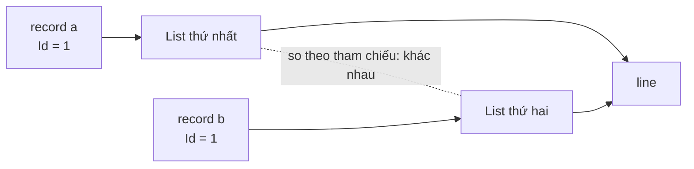

# 4.7 - Records và Value Objects (C# 9+)

> **Tóm tắt:** `record` đổi **một** thứ so với `class`, nhưng thứ đó kéo theo rất nhiều: nó so sánh **theo giá trị** chứ không theo tham chiếu. Hai object khác nhau trong bộ nhớ mà cùng nội dung sẽ `Equals` nhau, cùng `GetHashCode`, và dùng làm khoá `Dictionary` được ngay. Nhờ đó bạn mô hình hoá được **value object** — tiền, địa chỉ, khoảng thời gian — những thứ mà *danh tính chính là giá trị*. Bài này cũng chỉ ra cái bẫy hay gặp: `record` chỉ bất biến **nông**, nên một `List` bên trong nó vẫn sửa được từ bên ngoài, và hai record có cùng danh sách phần tử vẫn **không** bằng nhau.

## Mục tiêu bài học

Sau bài này bạn có thể:

- Giải thích record khác class ở điểm nào và điều đó kéo theo gì.
- Mô hình hoá value object thay vì dùng kiểu nguyên thuỷ trần.
- Dùng `with` để tạo bản sao có sửa đổi.
- Nhận ra cái bẫy bất biến nông với collection bên trong record.
- Chọn giữa `record`, `record struct` và `class`.

**Cần biết trước:** [bài 4.1](4.1-class-and-object.md) (constructor, `struct`), [bài 4.2](4.2-encapsulation.md) (bẫy collection), `Dictionary` và điều kiện của khoá ở [bài 1.5](../../stage-01-foundation/module-01-programming-logic/1.5-arrays-and-lists.md). [Bài 1.8](../../stage-01-foundation/module-01-programming-logic/1.8-advanced-notes.md) đã giới thiệu `record` ở mức cú pháp; bài này đi sâu vào ý nghĩa của nó.

## Nội dung bài học

### 4.7.1 — Một khác biệt, nhiều hệ quả

```csharp
// Customer.cs
public class CustomerClass(string name, string email)
{
    public string Name { get; } = name;
    public string Email { get; } = email;
}

public record CustomerRecord(string Name, string Email);
```

```csharp
// Program.cs
var c1 = new CustomerClass("A", "a@x.com");
var c2 = new CustomerClass("A", "a@x.com");
Console.WriteLine(c1 == c2);      // False — hai tham chiếu khác nhau

var r1 = new CustomerRecord("A", "a@x.com");
var r2 = new CustomerRecord("A", "a@x.com");
Console.WriteLine(r1 == r2);      // True  — cùng giá trị
Console.WriteLine(r1);            // CustomerRecord { Name = A, Email = a@x.com }
```

`record CustomerRecord(string Name, string Email);` là **positional record**: một dòng khai báo cả constructor lẫn hai thuộc tính `Name`, `Email` chỉ gán được lúc khởi tạo.

Trình biên dịch sinh giúp record bốn thứ:

- `Equals` và `GetHashCode` **theo từng thuộc tính**
- Toán tử `==` và `!=`
- `ToString()` in ra nội dung: `CustomerRecord { Name = A, Email = a@x.com }`
- Phương thức `Clone` phục vụ biểu thức `with`

Hai thứ đầu là lý do record dùng làm **khoá `Dictionary`** được ngay, không cần override gì — đúng vấn đề đã nêu ở [bài 1.5](../../stage-01-foundation/module-01-programming-logic/1.5-arrays-and-lists.md).

### 4.7.2 — Value object: khi danh tính chính là giá trị

```csharp
// Kiểu nguyên thuỷ trần — trình biên dịch không giúp được gì
public void Transfer(decimal amount, string fromAccount, string toAccount) { }

Transfer(1000, "ACC-2", "ACC-1");     // đảo thứ tự? gửi sai tiền tệ? không ai biết
```

```csharp
// Value object — sai là lỗi biên dịch
public record Money(decimal Amount, string Currency)
{
    public static Money Vnd(decimal amount) => new(amount, "VND");

    public Money Add(Money other)
    {
        if (Currency != other.Currency)
            throw new InvalidOperationException("Không cộng được hai loại tiền khác nhau.");
        return this with { Amount = Amount + other.Amount };
    }
}

public record AccountNumber(string Value);

public void Transfer(Money amount, AccountNumber from, AccountNumber to) { }
```

Bốn thứ có được:

1. **Không đảo nhầm tham số** — `AccountNumber` và `Money` là hai kiểu khác nhau.
2. **Quy tắc ở đúng chỗ** — không cộng được VND với USD, và quy tắc đó nằm trong `Money`.
3. **So sánh đúng nghĩa** — hai `Money(100, "VND")` là bằng nhau.
4. **Tên nói lên ý nghĩa** — `Money` rõ hơn `decimal`.

Đây là cách áp dụng nguyên tắc "làm cho trạng thái sai không biểu diễn được" ở [bài 4.1](4.1-class-and-object.md) vào từng tham số.

Dấu hiệu nên tạo value object: một nhóm giá trị **luôn đi cùng nhau** (số tiền và đơn vị tiền tệ), hoặc một kiểu nguyên thuỷ có **quy tắc riêng** (email, mã bưu chính, số tài khoản).

### 4.7.3 — `with`: sao chép có sửa đổi

```csharp
var original = new Money(1_000_000m, "VND");
var doubled  = original with { Amount = 2_000_000m };

Console.WriteLine(original.Amount);   // 1000000 — không đổi
```

`with` tạo **object mới**, chép mọi thuộc tính, rồi ghi đè những thuộc tính bạn liệt kê. Object gốc không bị đụng tới.

Đây là cách làm việc với dữ liệu bất biến: thay vì sửa tại chỗ, bạn tạo phiên bản mới. Hơi tốn bộ nhớ hơn, đổi lại không bao giờ có chuyện một chỗ khác trong hệ thống bị đổi giá trị dưới chân bạn.

### 4.7.4 — Cái bẫy: bất biến chỉ ở mức nông

Đây là phần quan trọng nhất của bài.

```csharp
public record Order(int Id, List<OrderLine> Lines);

var order = new Order(1, new List<OrderLine>());
order.Lines.Add(new OrderLine(...));       // CHẠY ĐƯỢC — record không ngăn
```

`record` làm cho **tham chiếu** tới `Lines` không đổi được, nhưng **nội dung** của list thì vẫn sửa thoải mái. Đúng vấn đề đã nói ở [bài 4.2](4.2-encapsulation.md), và `record` không giải quyết nó.

Hệ quả thứ hai còn khó chịu hơn — **phép so sánh cũng hỏng**:

```csharp
var a = new Order(1, new List<OrderLine> { line });
var b = new Order(1, new List<OrderLine> { line });
Console.WriteLine(a == b);     // False!
```

Vì `List<T>` so sánh theo **tham chiếu**, nên hai list khác nhau dù cùng nội dung vẫn không bằng nhau, kéo theo hai record không bằng nhau. Record chỉ so sánh theo giá trị **nếu mọi thành viên của nó cũng so sánh theo giá trị**.



Cách xử lý tuỳ vào bản chất của kiểu:

- **`Order` là entity** (có danh tính riêng, mục 4.7.6), nên nó **không nên** là record ngay từ đầu. Viết nó thành `class` với `List` riêng tư và `IReadOnlyList` công khai như [bài 4.2](4.2-encapsulation.md). Với entity, so sánh theo `Id` chứ không theo danh sách dòng hàng.
- **Value object thật sự chứa tập hợp**, ví dụ bộ nhãn `Tags` của một khách hàng: dùng kiểu bọc có so sánh theo nội dung như `EquatableArray<T>` ở bài tập 1, hoặc tự viết `Equals` và `GetHashCode`.

Lưu ý thêm: equality tự sinh của record so sánh **mọi field của instance**, kể cả field `private` bạn tự khai báo trong thân record. Một `private readonly List<T> _items` trong record cũng làm hỏng phép so sánh y như thuộc tính `List` công khai.

Quy tắc thực dụng: **record hợp nhất với dữ liệu phẳng gồm các kiểu bất biến**. Có collection bên trong thì phải xử lý tay.

### 4.7.5 — `record` hay `record struct`

```csharp
public record        Customer(string Name);       // kiểu tham chiếu
public record struct Point(int X, int Y);          // kiểu giá trị
public readonly record struct Money2(decimal Amount, string Currency);  // nên dùng
```

| | `record` | `record struct` |
|---|---|---|
| Loại kiểu | Tham chiếu | Giá trị |
| Có thể `null` | Có | Không |
| Phép gán | Chép địa chỉ | **Chép dữ liệu** |
| Kế thừa | Có | Không |
| Hợp với | Hầu hết trường hợp | Giá trị nhỏ, tạo rất nhiều |

Khi dùng `record struct`, hãy thêm `readonly` — nếu không, thuộc tính sinh từ positional record struct có `set` công khai, nó vẫn thay đổi được và gặp lại mọi vấn đề của `struct` đã nói ở [bài 4.1](4.1-class-and-object.md). Và nhớ rằng struct luôn có giá trị mặc định không đi qua constructor (bài tập 2 bàn kỹ), nên đừng dùng struct cho kiểu có quy tắc hợp lệ bắt buộc.

### 4.7.6 — Khi nào **đừng** dùng record

Ba trường hợp cụ thể:

**1. Entity của EF Core.** Entity có **danh tính riêng** là khoá chính, không phải nội dung. Hai khách hàng cùng tên vẫn là hai người khác nhau. Ngoài ra EF Core cần property có thể thay đổi để theo dõi trạng thái, nên `init` gây khó.

```csharp
// SAI về mặt mô hình — Customer là entity, có Id riêng
public record Customer(int Id, string Name);

// ĐÚNG — entity là class, so sánh theo Id
public class Customer { public int Id { get; private set; } /* ... */ }
```

**2. Class có nhiều hành vi.** Record sinh ra để chở dữ liệu. Một class có mười phương thức nghiệp vụ và hai thuộc tính thì không phải record.

**3. Khi cần thay đổi thường xuyên.** Mỗi lần `with` là một object mới. Trong vòng lặp nóng chạy hàng triệu lần, số lần cấp phát đó có thể thành vấn đề — dù với code nghiệp vụ thông thường thì không.

### 4.7.7 — Rà lại code của bạn

**Danh sách rà soát record và value object**

- [ ] Nhóm giá trị luôn đi cùng nhau (số tiền + đơn vị) đã gom thành value object.
- [ ] Kiểu nguyên thuỷ có quy tắc riêng (email, mã số) đã bọc thành kiểu riêng.
- [ ] Không có record nào chứa List hay mảng mà vẫn kỳ vọng so sánh theo nội dung.
- [ ] Entity của EF Core là class, không phải record.
- [ ] record struct nào cũng có readonly.
- [ ] Kiểu dùng làm khoá Dictionary là record, hoặc đã override GetHashCode và Equals.
- [ ] Dùng with để tạo bản sao thay vì sửa tại chỗ.

## Bài tập áp dụng

#### Bài 1 — Chứng minh bẫy collection trong `record`

Tạo `record Order(int Id, List<string> Tags)`, tạo hai thể hiện cùng nội dung, so sánh bằng `==`. Ghi lại kết quả và thử các cách sửa.

**Tiêu chí hoàn thành:** bạn biết cách nào **thật sự** sửa được — và cách nào chỉ *có vẻ* sửa được.

<details>
<summary><strong>Gợi ý và lời giải — Bài 1</strong></summary>

**Gợi ý.** `record` tự sinh `Equals` bằng cách gọi `Equals` của **từng thành phần**. Vậy câu hỏi thật là: `List<string>.Equals` so sánh cái gì?

**Lời giải — kết quả chạy thật trên .NET 10** (cần `using System.Collections.Immutable;` ở đầu file):

```csharp
public record R1(int Id, List<string> Tags);
public record R2(int Id, ImmutableArray<string> Tags);

new R1(1, new(){"vip"}) == new R1(1, new(){"vip"})                          // False
new R2(1, ImmutableArray.Create("vip")) == new R2(1, ImmutableArray.Create("vip"))  // False
```

```text
List<string>             : False
ImmutableArray<string>   : False
```

**Điểm quan trọng nhất của bài: `ImmutableArray` KHÔNG sửa được.** Đây là hiểu nhầm rất phổ biến — người ta đổi sang kiểu bất biến và tưởng đã xong. Chứng minh rằng nó vẫn so sánh theo tham chiếu:

```csharp
var shared = ImmutableArray.Create("vip");
new R2(1, shared) == new R2(1, shared)     // True  <- cùng một mảng nền
```

Bằng nhau **chỉ khi** hai record trỏ tới cùng một mảng nền. `ImmutableArray<T>` bảo đảm nội dung không đổi được, nhưng phép so sánh bằng của nó vẫn dựa trên tham chiếu tới mảng bên dưới.

**Hai cách thật sự sửa được:**

```csharp
// Cách 1 — tự viết Equals và GetHashCode
public record R3(int Id, IReadOnlyList<string> Tags)
{
    public virtual bool Equals(R3? o) =>
        o is not null && Id == o.Id && Tags.SequenceEqual(o.Tags);

    public override int GetHashCode()
    {
        var h = new HashCode();
        h.Add(Id);
        foreach (var t in Tags) h.Add(t);
        return h.ToHashCode();
    }
}

// Cách 2 — bọc collection trong một kiểu có so sánh theo giá trị
public readonly record struct EquatableArray<T>(ImmutableArray<T> Items)
    where T : IEquatable<T>
{
    public bool Equals(EquatableArray<T> o) => Items.AsSpan().SequenceEqual(o.Items.AsSpan());
    public override int GetHashCode()
    {
        var h = new HashCode();
        foreach (var i in Items) h.Add(i);
        return h.ToHashCode();
    }
}

public record R4(int Id, EquatableArray<string> Tags);
```

**Kết quả:**

```text
tự override Equals         : True
kiểu bọc có value equality : True
```

**Ba chi tiết dễ sai khi tự viết:**

1. **Phải là `public virtual bool Equals(R3? o)`.** Đúng chữ ký này thì trình biên dịch mới dùng nó thay cho bản tự sinh. Viết `override` hay đổi kiểu tham số là nó không thay thế được.
2. **Ghi đè `Equals` thì phải ghi đè `GetHashCode`.** Quên là hỏng `Dictionary` và `HashSet` theo cách rất khó tìm — đúng vấn đề đã gặp ở [bài 1.5](../../stage-01-foundation/module-01-programming-logic/1.5-arrays-and-lists.md).
3. **`SequenceEqual` phân biệt thứ tự.** Nếu nghiệp vụ coi `["a","b"]` bằng `["b","a"]` thì phải sắp xếp trước khi so, hoặc dùng `SetEquals`.

**Cái bẫy thứ hai: bất biến chỉ ở mức nông.**

```csharp
var e = new R1(1, new List<string>{"vip"});
e.Tags.Add("thêm sau khi tạo");
Console.WriteLine(e.Tags.Count);   // 2
```

`record` ngăn việc **gán lại** thuộc tính `Tags`, nhưng không ngăn việc **sửa nội dung** danh sách mà nó trỏ tới. Một `record` chứa `List` là "bất biến" chỉ trên danh nghĩa — đúng cùng một vấn đề với `IReadOnlyList` ở [bài 4.2](4.2-encapsulation.md).

**Khuyến nghị thực dụng.** Với value object, hãy giữ chúng chỉ chứa **kiểu nguyên thuỷ và value object khác**. Cần chứa tập hợp thì dùng kiểu bọc như cách 2 — viết một lần, dùng lại khắp dự án.

</details>

#### Bài 2 — Bọc kiểu nguyên thuỷ thành value object

Hàm `CreateCustomer(string name, string email, string phone, string taxCode)` có bốn tham số cùng kiểu `string`, và một chỗ gọi đang truyền nhầm số điện thoại vào vị trí email (xem phần "trước" của lời giải). Bọc `email` và `phone` thành value object `Email` và `PhoneNumber` có kiểm tra trong constructor, rồi build lại.

**Tiêu chí hoàn thành:** trình biên dịch tìm ra chỗ gọi **đang truyền nhầm thứ tự tham số**, và `new Email("0912345678")` ném `ArgumentException`.

<details>
<summary><strong>Gợi ý và lời giải — Bài 2</strong></summary>

**Gợi ý.** Hàm có nhiều tham số cùng kiểu là nơi lỗi hoán đổi thứ tự xảy ra — và trình biên dịch không giúp được gì, vì với nó `string` nào cũng như nhau.

**Lời giải — trước:**

```csharp
static int CreateCustomer(string name, string email, string phone, string taxCode)
```

Chỗ gọi:

```csharp
CreateCustomer("Nguyễn Văn An", "0912345678", "an@company.com", "0101234567");
//                              ^^^ số điện thoại ở vị trí email — SAI
```

Biên dịch sạch. Lỗi chỉ lộ ra khi hệ thống gửi email tới `0912345678` và thất bại, thường là trên production.

**Sau:**

```csharp
public sealed record Email
{
    public string Value { get; }

    public Email(string value)
    {
        if (string.IsNullOrWhiteSpace(value) || !value.Contains('@'))
            throw new ArgumentException($"Email không hợp lệ: {value}", nameof(value));
        Value = value.Trim().ToLowerInvariant();
    }

    public override string ToString() => Value;
}

public sealed record PhoneNumber
{
    public string Value { get; }

    public PhoneNumber(string value)
    {
        var digits = new string(value.Where(char.IsDigit).ToArray());
        if (digits.Length is < 9 or > 11)
            throw new ArgumentException($"Số điện thoại không hợp lệ: {value}", nameof(value));
        Value = digits;
    }

    public override string ToString() => Value;
}

static int CreateCustomer(string name, Email email, PhoneNumber phone, string taxCode)
```

Chỗ gọi cũ giờ **không biên dịch được** (lỗi thật trên .NET 10):

```text
error CS1503: Argument 2: cannot convert from 'string' to 'Email'
error CS1503: Argument 3: cannot convert from 'string' to 'PhoneNumber'
```

Phải viết rõ ràng, và lúc viết thì không thể nhầm:

```csharp
CreateCustomer(
    "Nguyễn Văn An",
    new Email("an@company.com"),
    new PhoneNumber("0912345678"),
    "0101234567");
```

**Bốn lợi ích, xếp theo giá trị:**

1. **Không hoán đổi nhầm được.** Trình biên dịch chặn, không phụ thuộc vào việc ai đó nhớ đúng thứ tự.
2. **Xác thực nằm ở một chỗ.** Mọi object `Email` đều đã đi qua constructor có kiểm tra, nên không tồn tại một `Email` mang giá trị sai định dạng. Trường hợp còn lại là biến `Email` bằng `null` — và với nullable reference types đang bật (mặc định trong project mới), trình biên dịch cảnh báo khi bạn gán `null` vào một biến kiểu `Email` không có dấu `?`.
3. **Chuẩn hoá tự động.** Constructor `Email` cắt khoảng trắng và chuyển chữ thường, nên `"An@Company.com "` và `"an@company.com"` trở thành cùng một giá trị — và nhờ `record` nên chúng **bằng nhau** (chạy thử: `True`).
4. **Chữ ký hàm thành tài liệu.** Đọc `Email email` biết ngay phải truyền gì; đọc `string email` thì không biết định dạng nào được chấp nhận.

**Vì sao `sealed record` (class) chứ không phải `readonly record struct`.** Struct tiết kiệm một lần cấp phát trên heap, nhưng nó luôn có một giá trị mặc định **không đi qua constructor của bạn**: `new Email()`, `default(Email)`, hay các phần tử của `new Email[10]` đều là một `Email` có `Value` bằng `null` mà không ném lỗi gì. Chạy thử với phiên bản struct, cả ba trường hợp đều cho `Value is null` là `True`. Value object cần bất biến tuyệt đối như `Email` vì vậy nên là `sealed record` (class). `sealed` chặn việc kế thừa, để không ai tạo một lớp con lách qua kiểm tra. Struct chỉ hợp với value object mà giá trị mặc định cũng hợp lệ, như toạ độ `(0, 0)` hay số tiền `0`.

**Xem trước — EF Core.** Khi lưu khách hàng vào database ([bài 8.10](../../stage-03-aspnet-core-backend/module-08-aspnet-core-fundamentals/8.10-ef-core-minimal.md)), value object ánh xạ được thành một cột chuỗi bằng bộ chuyển đổi:

```csharp
builder.Property(c => c.Email)
       .HasConversion(e => e.Value, v => new Email(v));
```

Chi tiết ở [bài 13.2](../../stage-04-database-production/module-13-entity-framework-core/13.2-dbcontext-and-entity-configuration.md).

**Đừng bọc mọi thứ.** Bọc những kiểu có **quy tắc hợp lệ** hoặc **dễ nhầm với nhau**: email, số điện thoại, tiền tệ, mã định danh. Đừng bọc những thứ thật sự chỉ là văn bản tự do như ghi chú hay mô tả.

</details>

#### Bài 3 — `record` làm khoá `Dictionary`

Tạo `record CustomerKey(int TenantId, int CustomerId)`, dùng làm khoá `Dictionary`, tra bằng một đối tượng **mới** cùng giá trị. Làm lại với `class` không ghi đè gì. (Hệ thống "nhiều tenant" là hệ thống phục vụ nhiều công ty khách hàng trên cùng một database; `TenantId` cho biết bản ghi thuộc công ty nào.)

**Tiêu chí hoàn thành:** bạn giải thích được **hai** phương thức mà `Dictionary` dựa vào và `record` sinh ra chúng như thế nào.

<details>
<summary><strong>Gợi ý và lời giải — Bài 3</strong></summary>

**Gợi ý.** Bài này lặp lại thí nghiệm ở [bài 1.5](../../stage-01-foundation/module-01-programming-logic/1.5-arrays-and-lists.md) nhưng với khoá ghép hai trường — tình huống thực tế trong hệ thống nhiều tổ chức dùng chung.

**Lời giải.**

```csharp
public record CustomerKey(int TenantId, int CustomerId);
public class CustomerKeyCls { public int TenantId; public int CustomerId; }

var dRec = new Dictionary<CustomerKey, string> { [new CustomerKey(1, 42)] = "An" };
var dCls = new Dictionary<CustomerKeyCls, string>
    { [new CustomerKeyCls { TenantId = 1, CustomerId = 42 }] = "An" };

Console.WriteLine(dRec.TryGetValue(new CustomerKey(1, 42), out _));                          // True
Console.WriteLine(dCls.TryGetValue(new CustomerKeyCls { TenantId = 1, CustomerId = 42 }, out _));  // False
```

**Hai phương thức `Dictionary` dựa vào:**

| Phương thức | Vai trò |
|---|---|
| `GetHashCode()` | Quyết định **nhìn vào ô nào** trong bảng băm |
| `Equals()` | Xác nhận **đúng khoá** sau khi đã tìm tới ô đó |

Cả hai đều cần thiết. `Dictionary` gọi `GetHashCode` trước; nếu mã băm khác nhau thì nó tìm ở ô khác và kết luận không có, `Equals` **không bao giờ được gọi tới**.

**`record` sinh ra chúng thế nào.** Trình biên dịch tự sinh cả hai dựa trên **toàn bộ** thuộc tính trong danh sách tham số chính:

```csharp
// Xấp xỉ những gì trình biên dịch sinh ra cho CustomerKey
public override int GetHashCode() =>
    HashCode.Combine(
        EqualityComparer<int>.Default.GetHashCode(TenantId),
        EqualityComparer<int>.Default.GetHashCode(CustomerId));

public virtual bool Equals(CustomerKey? other) =>
    other is not null
    && EqualityComparer<int>.Default.Equals(TenantId, other.TenantId)
    && EqualityComparer<int>.Default.Equals(CustomerId, other.CustomerId);
```

`class` không ghi đè gì thì dùng bản mặc định của `object`, vốn dựa trên **danh tính đối tượng trong bộ nhớ** — nên hai đối tượng khác nhau luôn cho mã băm khác nhau.

**Vì sao lỗi này nguy hiểm.** Nó **không ném ngoại lệ**. `Dictionary` chỉ lặng lẽ báo không tìm thấy, và code thường xử lý bằng cách thêm mới. Hậu quả trong hệ thống thật:

- **Bộ nhớ đệm không bao giờ trúng.** Mỗi lần tra đều tính lại, nhưng mọi thứ vẫn "chạy đúng" nên không ai nghi ngờ. Triệu chứng duy nhất là hệ thống chậm hơn mong đợi.
- **Dữ liệu bị nhân đôi.** `Dictionary` tích tụ nhiều mục trùng nội dung, và bộ nhớ tăng dần.
- **`Distinct()` và `GroupBy` cho kết quả sai.** Cả hai đều dựa trên cùng hai phương thức này.

**Ba lựa chọn cho khoá ghép:**

| Lựa chọn | Ưu | Nhược |
|---|---|---|
| `record` | Ngắn nhất, đúng ngay | Là kiểu tham chiếu, có cấp phát heap |
| `readonly record struct` | Không cấp phát heap | Nếu lớn thì sao chép tốn kém |
| Tuple `(int, int)` | Không cần khai báo kiểu | Mất tên có nghĩa, dễ nhầm thứ tự |

Với khoá nhỏ như ở đây, **`readonly record struct` là lựa chọn tốt nhất**:

```csharp
public readonly record struct CustomerKey(int TenantId, int CustomerId);
```

Nó có so sánh theo giá trị, không cấp phát trên heap, và tên trường vẫn rõ ràng.

</details>

## Tự kiểm tra

<details>
<summary>Record khác class ở điểm nào?</summary>

Điểm cốt lõi là record so sánh theo giá trị chứ không theo tham chiếu. Trình biên dịch sinh giúp Equals và GetHashCode theo từng thuộc tính, toán tử bằng và khác, ToString in ra nội dung, cùng phương thức phục vụ biểu thức with. Nhờ đó record dùng làm khoá Dictionary được ngay mà không cần override gì.

</details>

<details>
<summary>Value object là gì và khi nào nên tạo?</summary>

Là kiểu mà danh tính chính là giá trị của nó — hai Money cùng số tiền và cùng đơn vị thì là một. Nên tạo khi một nhóm giá trị luôn đi cùng nhau, ví dụ số tiền với đơn vị tiền tệ, hoặc khi một kiểu nguyên thuỷ có quy tắc riêng như email hay số tài khoản.

</details>

<details>
<summary>Vì sao hai record chứa List cùng nội dung lại không bằng nhau?</summary>

Vì List so sánh theo tham chiếu, nên hai danh sách khác nhau dù cùng phần tử vẫn không bằng nhau, và điều đó kéo theo hai record không bằng nhau. Record chỉ so sánh theo giá trị nếu mọi thành viên của nó cũng so sánh theo giá trị.

</details>

<details>
<summary>Record có làm cho object bất biến hoàn toàn không?</summary>

Không, nó chỉ bất biến ở mức nông. Tham chiếu tới một List bên trong không đổi được, nhưng nội dung list thì vẫn Add và Clear thoải mái từ bên ngoài. Muốn bất biến thật thì phải dùng ImmutableList hoặc chỉ phơi ra IReadOnlyList.

</details>

<details>
<summary>Vì sao entity của EF Core không nên là record?</summary>

Vì entity có danh tính riêng là khoá chính chứ không phải nội dung — hai khách hàng cùng tên vẫn là hai người khác nhau, nên so sánh theo giá trị là sai về mặt mô hình. Ngoài ra EF Core cần property thay đổi được để theo dõi trạng thái, nên init gây khó.

</details>

<details>
<summary>Biểu thức with làm gì?</summary>

Nó tạo một object mới, chép mọi thuộc tính từ object cũ rồi ghi đè những thuộc tính bạn liệt kê. Object gốc không bị đụng tới. Đây là cách làm việc với dữ liệu bất biến: thay vì sửa tại chỗ thì tạo phiên bản mới, nên không bao giờ có chuyện giá trị bị đổi dưới chân một chỗ khác.

</details>

## Kết luận

Ba điều đáng nhớ nhất:

1. **Record so sánh theo giá trị** — đó là toàn bộ khác biệt, và là lý do nó hợp với value object.
2. **Bất biến của record chỉ ở mức nông.** Một `List` bên trong phá vỡ cả tính bất biến lẫn phép so sánh.
3. **Entity là `class`, value object là `record`.** Entity có danh tính riêng; value object thì giá trị chính là danh tính.

## Tham khảo

- [Records — C#](https://learn.microsoft.com/en-us/dotnet/csharp/fundamentals/types/records)
- [record type reference](https://learn.microsoft.com/en-us/dotnet/csharp/language-reference/builtin-types/record) — `with`, `record struct`, kế thừa
- [Object-oriented programming in C#](https://learn.microsoft.com/en-us/dotnet/csharp/fundamentals/object-oriented/)
- [Framework design guidelines](https://learn.microsoft.com/en-us/dotnet/standard/design-guidelines/) — chọn giữa kiểu giá trị và kiểu tham chiếu

## Điều hướng

- **Bài trước:** [4.6 — Access Modifiers](4.6-access-modifiers.md)
- **Bài tiếp theo:** [4.8 — Pattern Matching (C# 8+)](4.8-pattern-matching.md)
- **Về module:** [Trang mục lục](README.md)
