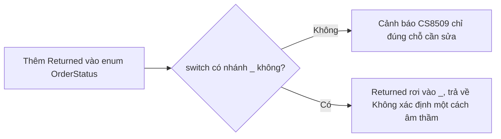

# 4.8 - Pattern Matching (C# 8+)

> **Tóm tắt:** Pattern matching thay thế ba mẫu code cũ: chuỗi `if (x is T) { var t = (T)x; ... }`, `switch` dài dòng, và những khối `if` lồng nhau kiểm tra nhiều thuộc tính cùng lúc. Nhưng lợi ích lớn nhất không phải ngắn hơn — mà là **tính vét cạn**: khi `switch` expression trên một `enum` bỏ nhánh `_`, trình biên dịch **cảnh báo CS8509 nếu bạn thiếu một giá trị có tên**. Sáu tháng sau có người thêm trạng thái mới vào enum, và chính cảnh báo đó chỉ ra mọi chỗ cần cập nhật — thay vì một `default` im lặng trả về giá trị sai.

## Mục tiêu bài học

Sau bài này bạn có thể:

- Dùng bảy loại pattern: hằng, kiểu, quan hệ, logic, thuộc tính, tuple, danh sách.
- Viết lại chuỗi `if-is-cast` bằng type pattern.
- Tận dụng tính vét cạn của `switch` expression trên enum.
- Dùng property pattern thay cho `if` lồng nhau nhiều tầng.
- Biết khi nào pattern matching làm code khó đọc hơn.

**Cần biết trước:** `switch` expression trên enum ở [bài 1.2](../../stage-01-foundation/module-01-programming-logic/1.2-conditions.md), kế thừa và đa hình ở [bài 4.3](4.3-inheritance-and-polymorphism.md), `record` ở [bài 4.7](4.7-records-and-value-objects.md). Các đoạn code ngắn trong phần nội dung dùng `Order`, `Customer`, `CardPayment`... như những kiểu đã có; phần bài tập có code chạy được.

## Nội dung bài học

### 4.8.1 — Bảy loại pattern

```csharp
// 1. Hằng
if (status is 0) { }
if (name is null) { }
if (day is DayOfWeek.Sunday) { }

// 2. Kiểu — kèm khai báo biến luôn
if (payment is CardPayment card)
    Console.WriteLine(card.CardNumber);

// 3. Quan hệ (C# 9)
var label = amount switch
{
    < 0        => "Không hợp lệ",
    0          => "Miễn phí",
    < 100_000  => "Nhỏ",
    _          => "Lớn"
};

// 4. Logic: and, or, not (C# 9)
if (age is >= 18 and < 65) { }
if (status is "new" or "contacted") { }
if (customer is not null) { }

// 5. Thuộc tính (C# 8), có thể lồng (C# 10)
if (order is { Total: > 500_000, Customer.IsVip: true }) { }

// 6. Tuple
var result = (isVip, total) switch
{
    (true,  > 1_000_000) => 0.20m,
    (true,  _)           => 0.10m,
    (false, > 1_000_000) => 0.05m,
    _                    => 0m
};

// 7. Danh sách (C# 11)
if (parts is ["GET", var path, ..])
    Console.WriteLine($"Đường dẫn: {path}");
```

### 4.8.2 — Thay thế chuỗi `is`-cast

```csharp
// CŨ — kiểm tra, ép kiểu, rồi dùng
if (payment is CardPayment)
{
    var card = (CardPayment)payment;     // ép kiểu lần hai
    return card.Amount * 0.022m;
}
else if (payment is BankTransfer)
{
    var bank = (BankTransfer)payment;
    return 11_000m;
}
throw new NotSupportedException();
```

```csharp
// MỚI — một biểu thức, không ép kiểu thừa, không quên nhánh null
return payment switch
{
    CardPayment card => card.Amount * 0.022m,
    BankTransfer     => 11_000m,
    CashPayment      => 0m,
    null             => throw new ArgumentNullException(nameof(payment)),
    _                => throw new NotSupportedException($"Chưa hỗ trợ {payment.GetType().Name}")
};
```

Bốn thứ tốt hơn: không ép kiểu lần hai, có nhánh `null` tường minh, là **biểu thức** nên gán thẳng vào biến được, và mọi nhánh nằm cạnh nhau nên đọc một lượt là thấy hết.

### 4.8.3 — Tính vét cạn: lợi ích lớn nhất

```csharp
public enum OrderStatus { Draft, Confirmed, Shipped, Delivered, Cancelled }

// KHÔNG có nhánh _ — trình biên dịch kiểm tra giúp
public static string Describe(OrderStatus s) => s switch
{
    OrderStatus.Draft     => "Nháp",
    OrderStatus.Confirmed => "Đã xác nhận",
    OrderStatus.Shipped   => "Đang giao",
    OrderStatus.Delivered => "Đã giao",
    OrderStatus.Cancelled => "Đã huỷ",
};
```

Thêm `Returned` vào enum, và trình biên dịch phát cảnh báo **CS8509** ở mọi `switch` expression chưa xử lý nó, kèm đúng giá trị còn thiếu. Bạn được chỉ đúng chỗ cần sửa:

```text
warning CS8509: The switch expression does not handle all possible values of its input type (it is not exhaustive). For example, the pattern 'OrderStatus.Returned' is not covered.
```

**Còn một cảnh báo nữa, và nó xuất hiện ngay cả khi switch đã đủ nhánh.** Build đoạn `Describe` ở trên (đủ năm giá trị), bạn vẫn nhận:

```text
warning CS8524: The switch expression does not handle some values of its input type (it is not exhaustive) involving an unnamed enum value. For example, the pattern '(OrderStatus)5' is not covered.
```

Lý do: enum trong C# thực chất là một số nguyên, nên `(OrderStatus)5` là giá trị hợp lệ về kiểu dù không có tên. Nếu giá trị như vậy lọt vào (ví dụ đọc số sai từ database), `switch` không khớp nhánh nào và ném `SwitchExpressionException` lúc chạy. Hai cảnh báo nói hai chuyện khác nhau:

| Mã | Ý nghĩa | Nên làm gì |
|---|---|---|
| CS8509 | Thiếu một giá trị **có tên** (ví dụ `Returned`) | Đây là cảnh báo quý nhất. Biến nó thành **lỗi** |
| CS8524 | Thiếu các giá trị **không tên** (`(OrderStatus)5`) | Tắt nó bằng `NoWarn` (xem bên dưới) |

So với:

```csharp
// CÓ nhánh _ — im lặng, và sai
public static string Describe(OrderStatus s) => s switch
{
    OrderStatus.Draft => "Nháp",
    // ... các nhánh khác ...
    _ => "Không xác định"       // Returned rơi vào đây, không ai biết
};
```



Nguyên tắc:

- **Enum nội bộ bạn kiểm soát** → bỏ nhánh `_`, để nhận CS8509. Rủi ro `SwitchExpressionException` lúc chạy với giá trị không tên là đánh đổi xứng đáng: nổ rõ ràng vẫn tốt hơn trả về giá trị sai âm thầm.
- **Dữ liệu từ bên ngoài** (chuỗi, số từ API) → giữ nhánh `_` và xử lý tường minh.

Cấu hình nên dùng trong `.csproj`: biến CS8509 thành lỗi, tắt CS8524.

```xml
<PropertyGroup>
  <WarningsAsErrors>$(WarningsAsErrors);CS8509</WarningsAsErrors>
  <NoWarn>$(NoWarn);CS8524</NoWarn>
</PropertyGroup>
```

Với cấu hình này, `Describe` đủ năm nhánh build sạch; thêm `Returned` vào enum thì build **thất bại** với `error CS8509` ở đúng chỗ thiếu. Đừng đưa CS8524 vào `WarningsAsErrors`: nó luôn xuất hiện với mọi switch trên enum không có `_`, nên build sẽ hỏng ngay cả khi code đã đúng.

Có người xử lý CS8524 bằng cách thêm nhánh `_ => throw new UnreachableException()`. Cách này đúng về lúc chạy (giá trị không tên ném ngoại lệ rõ ràng), nhưng nó **tắt luôn CS8509**: một khi đã có `_`, giá trị `Returned` mới thêm cũng rơi vào `_`, và trình biên dịch không còn nhắc bạn nữa. Với enum nội bộ, cách `NoWarn` ở trên giữ được lợi ích quan trọng hơn. Nhánh `_` ném ngoại lệ dành cho chỗ nhận dữ liệu từ bên ngoài, như bài tập 1 trình bày.

### 4.8.4 — Property pattern thay `if` lồng nhau

```csharp
// CŨ — bốn tầng
if (order != null)
    if (order.Customer != null)
        if (order.Customer.IsVip)
            if (order.Total >= 500_000m)
                return 0.20m;
return 0m;
```

```csharp
// MỚI — một dòng, và tự xử lý null
if (order is { Customer.IsVip: true, Total: >= 500_000m })
    return 0.20m;
return 0m;
```

Property pattern **tự kiểm tra null ở mọi cấp**. `{ Customer.IsVip: true }` trả về `false` nếu `order` là `null`, hoặc `order.Customer` là `null` — không ném `NullReferenceException`.

Đây là một trong những chỗ pattern matching tiết kiệm nhiều code nhất mà vẫn an toàn hơn.

### 4.8.5 — List pattern (C# 11)

```csharp
string[] parts = request.Split(' ');

var route = parts switch
{
    ["GET",  "api", "orders"]           => "Danh sách đơn",
    ["GET",  "api", "orders", var id]   => $"Chi tiết đơn {id}",
    ["POST", "api", "orders"]           => "Tạo đơn",
    [var method, ..]                    => $"Chưa hỗ trợ {method}",
    []                                  => "Rỗng"
};
```

Ký hiệu:

- `[a, b, c]` — đúng ba phần tử
- `[a, ..]` — bắt đầu bằng `a`, còn lại bao nhiêu cũng được
- `[.., z]` — kết thúc bằng `z`
- `[a, .. var middle, z]` — bắt được cả phần giữa

Hợp cho phân tích lệnh, đường dẫn, dữ liệu dạng dòng. Với dữ liệu nghiệp vụ thì ít dùng hơn.

### 4.8.6 — Khi nào pattern matching làm code tệ hơn

Pattern matching không phải lúc nào cũng thắng. Ba dấu hiệu dùng quá tay:

**1. Một biểu thức `switch` dài hơn 15 nhánh.** Nó đã thành một bảng dữ liệu viết nhầm thành code — xem lại [bài 1.2](../../stage-01-foundation/module-01-programming-logic/1.2-conditions.md).

**2. Pattern lồng quá sâu.**

```csharp
// Khó đọc hơn hẳn ba dòng if thường
if (o is { Customer: { Address: { City: "Hà Nội", District: not null } }, Lines.Count: > 0 })
```

**3. Dùng type pattern thay cho đa hình.**

```csharp
// Mỗi lần thêm loại payment là phải nhớ sửa chỗ này
decimal fee = payment switch
{
    CardPayment c  => c.Amount * 0.022m,
    BankTransfer   => 11_000m,
    CashPayment    => 0m,
};

// Thường tốt hơn: để mỗi loại tự biết phí của mình
decimal fee = payment.CalculateFee();
```

Tiêu chí phân biệt: nếu các nhánh **thuộc về chính đối tượng đó** thì dùng đa hình như [bài 4.3](4.3-inheritance-and-polymorphism.md). Nếu chúng thuộc về **người gọi** — ví dụ cách hiển thị khác nhau ở từng màn hình — thì pattern matching đúng hơn, vì bạn không muốn nhồi logic hiển thị vào entity.

### 4.8.7 — Rà lại code của bạn

**Danh sách rà soát pattern matching**

- [ ] Không còn chuỗi if (x is T) rồi ép kiểu thủ công.
- [ ] switch trên enum nội bộ không có nhánh _, để nhận cảnh báo khi enum đổi.
- [ ] CS8509 nằm trong WarningsAsErrors, CS8524 nằm trong NoWarn.
- [ ] if lồng nhiều tầng kiểm tra thuộc tính đã đổi sang property pattern.
- [ ] Không có switch expression nào dài quá 15 nhánh.
- [ ] Không dùng type pattern ở chỗ đa hình hợp lý hơn.
- [ ] switch trên dữ liệu bên ngoài vẫn giữ nhánh _ và xử lý tường minh.

## Bài tập áp dụng

#### Bài 1 — Nhận cảnh báo vét cạn và biến nó thành lỗi

Tạo một `enum` bốn giá trị và một `switch` expression không có nhánh `_`. Thêm giá trị thứ năm và ghi lại mã cảnh báo. Sau đó bật `WarningsAsErrors` và xác nhận build thất bại.

**Tiêu chí hoàn thành:** build **thất bại** sau khi thêm giá trị mới, và bạn nêu được vì sao đó là điều tốt.

<details>
<summary><strong>Gợi ý và lời giải — Bài 1</strong></summary>

**Gợi ý.** Cảnh báo chỉ xuất hiện khi `switch` expression **không** có nhánh `_`. Thêm `_ => ...` là bạn tự tắt mất cơ chế bảo vệ.

**Lời giải.**

```csharp
Console.WriteLine(Describe(LeadStatus.New));

static string Describe(LeadStatus s) => s switch
{
    LeadStatus.New       => "Mới tạo",
    LeadStatus.Contacted => "Đã liên hệ",
    LeadStatus.Qualified => "Đủ điều kiện",
    LeadStatus.Won       => "Chốt thành công"
};

enum LeadStatus { New, Contacted, Qualified, Won }
```

Build lần đầu (enum đủ bốn nhánh) vẫn có một cảnh báo CS8524 về giá trị không tên, như mục 4.8.3 đã giải thích. Thêm `Lost` vào `enum` rồi build lại:

```text
warning CS8509: The switch expression does not handle all possible values of its input type (it is not exhaustive). For example, the pattern 'LeadStatus.Lost' is not covered.
```

Biến CS8509 thành lỗi và tắt CS8524 trong `.csproj`:

```xml
<PropertyGroup>
  <WarningsAsErrors>$(WarningsAsErrors);CS8509</WarningsAsErrors>
  <NoWarn>$(NoWarn);CS8524</NoWarn>
</PropertyGroup>
```

```text
error CS8509: The switch expression does not handle all possible values of its input type (it is not exhaustive). For example, the pattern 'LeadStatus.Lost' is not covered.
Build FAILED.
```

Thêm nhánh `LeadStatus.Lost => "Thất bại"` thì build lại thành công, không còn cảnh báo nào.

**Vì sao build thất bại lại là điều tốt.** Trong một hệ thống thật, một `enum` trạng thái được `switch` ở rất nhiều nơi: tính phí, hiển thị nhãn, quyết định quyền, sinh báo cáo, lọc danh sách. Thêm một trạng thái mới nghĩa là phải rà hết những nơi đó.

Không có cơ chế này, bạn dựa vào **trí nhớ** — và trí nhớ sẽ sót. Nơi bị sót sẽ ném `SwitchExpressionException` khi có bản ghi đầu tiên rơi vào trạng thái mới, thường là trên production, vài tuần sau khi bạn đã quên mất thay đổi ấy.

Với `WarningsAsErrors`, trình biên dịch **liệt kê sẵn** danh sách nơi cần sửa. Việc phải nhớ biến thành việc phải sửa cho hết lỗi build.

**Khi nào vẫn cần nhánh `_`.** Khi giá trị đến từ **bên ngoài** và có thể không thuộc `enum` — ví dụ số nguyên ép kiểu từ database hoặc từ JSON:

```csharp
_ => throw new ArgumentOutOfRangeException(nameof(s), s, "Trạng thái không hợp lệ")
```

Lưu ý hai điều: nhánh `_` này **ném ngoại lệ** chứ không trả giá trị mặc định âm thầm, và nó chỉ nên có ở **ranh giới** tiếp nhận dữ liệu ngoài, không rải khắp nơi.

**Vét cạn trên kiểu: C# chưa làm được.** Một mẫu hay gặp là "phân cấp kín": lớp `abstract` có constructor `private`, các lớp con `sealed` lồng bên trong, nên bên ngoài không ai thêm được lớp con mới.

```csharp
using System.Diagnostics;   // cần cho UnreachableException

string Describe(PaymentResult result) => result switch
{
    PaymentResult.Succeeded ok  => $"Thành công: {ok.TransactionId}",
    PaymentResult.Failed err    => $"Thất bại: {err.Reason}",
    PaymentResult.Pending wait  => $"Chờ tới {wait.ExpectedAt:dd/MM}",
    _ => throw new UnreachableException()   // vẫn bắt buộc phải có
};

public abstract record PaymentResult
{
    public sealed record Succeeded(string TransactionId) : PaymentResult;
    public sealed record Failed(string Reason) : PaymentResult;
    public sealed record Pending(DateTime ExpectedAt) : PaymentResult;

    private PaymentResult() { }   // chặn lớp con từ bên ngoài
}
```

Dù đã liệt kê đủ ba lớp con, nếu bỏ nhánh `_`, trình biên dịch (kể cả C# 14) vẫn báo:

```text
warning CS8509: The switch expression does not handle all possible values of its input type (it is not exhaustive). For example, the pattern '_' is not covered.
```

Trình biên dịch **không** suy ra được rằng ba lớp con là toàn bộ khả năng. Mẫu phân cấp kín vẫn có ích, vì nó ngăn bên ngoài thêm lớp con lạ, nhưng nó không cho bạn cảnh báo khi chính bạn thêm loại kết quả thứ tư. Nhánh `_ => throw new UnreachableException()` là bắt buộc, và bạn phải tự rà các `switch` khi thêm loại mới (hoặc dùng analyzer của bên thứ ba có hỗ trợ kiểm tra này). Đây là một lý do nữa để ưu tiên `enum` khi các trường hợp chỉ khác nhau ở tên, không mang dữ liệu riêng.

</details>

#### Bài 2 — Làm phẳng bằng property pattern

Hàm `CalculateShippingFee` trong phần "trước" của lời giải có năm tầng `if` lồng nhau. Viết lại bằng property pattern và đếm số dòng giảm được. Gọi thử với `null` ở mỗi cấp (`order` null, `Customer` null, `Address` null) để kiểm tra.

**Tiêu chí hoàn thành:** bản viết lại xử lý `null` đúng **mà không cần** một câu kiểm tra `null` nào.

<details>
<summary><strong>Gợi ý và lời giải — Bài 2</strong></summary>

**Gợi ý.** Property pattern có một tính chất quan trọng: nó **không bao giờ khớp với `null`**. Nghĩa là `{ Address: { City: "Hà Nội" } }` đã ngầm kiểm tra rằng cả đối tượng lẫn `Address` đều khác `null`.

**Lời giải — trước:**

```csharp
public decimal CalculateShippingFee(Order? order)
{
    if (order != null)
    {
        if (order.Customer != null)
        {
            if (order.Customer.Address != null)
            {
                if (order.Customer.Address.City == "Hà Nội")
                {
                    if (order.Total > 500_000m)
                        return 0m;
                    return 25_000m;
                }
            }
        }
    }
    return 50_000m;
}
```

17 dòng, 5 tầng thụt lề, 3 câu kiểm tra `null`.

**Sau:**

```csharp
public decimal CalculateShippingFee(Order? order) => order switch
{
    { Customer.Address.City: "Hà Nội", Total: > 500_000m } => 0m,
    { Customer.Address.City: "Hà Nội" }                    => 25_000m,
    _                                                      => 50_000m
};
```

6 dòng, 1 tầng thụt lề, **0 câu kiểm tra `null`**.

**Vì sao không cần kiểm tra `null`.** Mẫu `{ Customer.Address.City: "Hà Nội" }` dùng cú pháp mẫu lồng mở rộng của C# 10. Nó thất bại — và rơi xuống nhánh tiếp theo — nếu **bất kỳ** mắt xích nào là `null`: `order` null, `Customer` null, hay `Address` null. Tất cả đều dẫn tới nhánh `_` và trả về 50.000.

Đây là điểm dễ bị bỏ qua nhất: property pattern không chỉ ngắn hơn mà còn **an toàn hơn**, vì không có chỗ nào để quên một câu kiểm tra `null`.

**Bảng so sánh:**

| | Trước | Sau |
|---|---|---|
| Số dòng | 17 | 6 |
| Tầng thụt lề tối đa | 5 | 1 |
| Câu kiểm tra `null` | 3 | 0 |
| Khả năng quên một `null` | Có | **Không** |

**Ba cú pháp mẫu đáng thuộc:**

```csharp
// Mẫu lồng — kiểm tra sâu vào cây đối tượng
order is { Customer.Address.City: "Hà Nội" }

// Mẫu quan hệ kết hợp — khoảng giá trị
order is { Total: > 100_000m and < 1_000_000m }

// Mẫu danh sách (C# 11) — khớp theo hình dạng tập hợp
order.Lines is [var onlyLine]                     // đúng một dòng
order.Lines is [var first, .., var last]          // ít nhất hai dòng
order.Lines is []                                 // rỗng
```

**Khi nào property pattern làm code tệ hơn.** Đừng nhồi quá nhiều điều kiện không liên quan vào một mẫu:

```csharp
// KHÓ ĐỌC — sáu điều kiện thuộc bốn khái niệm khác nhau trong một dòng
order is { Customer: { IsActive: true, Address.City: "Hà Nội", CreditLimit: > 0 },
           Total: > 500_000m, Status: OrderStatus.Confirmed, Lines.Count: > 0 }
```

Lúc này đặt tên cho ý nghĩa là cách tốt hơn, đúng như [bài 1.4](../../stage-01-foundation/module-01-programming-logic/1.4-functions-methods.md) đã nêu:

```csharp
if (order.IsEligibleForFreeShipping()) return 0m;
```

**Quy tắc thực dụng.** Property pattern tốt nhất khi các điều kiện cùng mô tả **một trạng thái có tên được**. Khi chúng là nhiều khái niệm ghép lại, hãy đặt tên thay vì gộp mẫu.

</details>

#### Bài 3 — Phân biệt đa hình với pattern matching

Hàm `CalculateFee` trong phần "trước" của lời giải dùng `switch` trên kiểu của phương thức thanh toán, và hàm `RenderBadge` dùng `switch` trên `OrderStatus` để sinh HTML. Với mỗi hàm, trả lời: logic này thuộc về **đối tượng** hay thuộc về **người gọi**? Cái nào thuộc về đối tượng thì chuyển sang phương thức ảo (`abstract`/`override` như [bài 4.3](4.3-inheritance-and-polymorphism.md)).

**Tiêu chí hoàn thành:** bạn nêu được tiêu chí phân biệt, và một trường hợp mà `switch` trên kiểu là lựa chọn **đúng**.

<details>
<summary><strong>Gợi ý và lời giải — Bài 3</strong></summary>

**Gợi ý.** Câu hỏi quyết định: *nếu thêm một kiểu mới, ai phải sửa?* Và ngược lại: *nếu thêm một thao tác mới, ai phải sửa?* Hai câu này chỉ ra hướng thiết kế đúng.

**Lời giải — trường hợp nên dùng đa hình:**

```csharp
// TRƯỚC — switch trên kiểu, nằm ở người gọi
public decimal CalculateFee(PaymentMethod method) => method switch
{
    CreditCard card    => card.Amount * 0.025m,
    BankTransfer       => 11_000m,
    EWallet wallet     => wallet.Amount * 0.015m,
    _ => throw new ArgumentOutOfRangeException()
};
```

Thêm một phương thức thanh toán mới, ví dụ trả góp, thì phải tìm **mọi** `switch` như thế này trong dự án — và chúng thường nằm rải rác ở năm, sáu chỗ.

```csharp
// SAU — logic nằm trong đối tượng
public abstract class PaymentMethod
{
    public abstract decimal CalculateFee();
}

public class CreditCard : PaymentMethod
{
    public decimal Amount { get; init; }
    public override decimal CalculateFee() => Amount * 0.025m;
}
```

Thêm kiểu mới giờ chỉ là thêm **một file**, và trình biên dịch bắt buộc nó cài đặt đủ mọi thao tác.

**Tiêu chí phân biệt — quy tắc hai chiều:**

| Bạn thường thêm gì? | Nên dùng |
|---|---|
| **Kiểu mới** (thêm phương thức thanh toán, thêm loại tài liệu) | **Đa hình** — thêm một lớp là xong |
| **Thao tác mới** (thêm cách xuất, thêm cách hiển thị) | **Pattern matching** — thêm một hàm là xong |

Đây là một đánh đổi cơ bản trong thiết kế: bạn chỉ làm dễ được **một** trong hai chiều. Chọn chiều mà hệ thống của bạn thay đổi thường xuyên hơn.

**Ba trường hợp `switch` trên kiểu là lựa chọn đúng:**

1. **Bạn không sở hữu các kiểu đó.** Không sửa được lớp của thư viện bên thứ ba thì không thêm phương thức ảo được.

2. **Logic không thuộc về đối tượng.** Cách hiển thị một `Order` trên giao diện web không phải trách nhiệm của `Order` — nó là trách nhiệm của tầng trình bày. Nhét nó vào entity là kéo kiến thức về HTML vào tầng nghiệp vụ:

   ```csharp
   // Đúng — logic hiển thị nằm ở tầng trình bày
   string RenderBadge(OrderStatus s) => s switch
   {
       OrderStatus.Draft     => "<span class='badge-muted'>Nháp</span>",
       OrderStatus.Confirmed => "<span class='badge-warning'>Đã xác nhận</span>",
       OrderStatus.Shipped   => "<span class='badge-info'>Đang giao</span>",
       OrderStatus.Delivered => "<span class='badge-success'>Đã giao</span>",
       OrderStatus.Cancelled => "<span class='badge-danger'>Đã huỷ</span>"
   };
   ```

   Đây là `switch` trên `enum OrderStatus` của mục 4.8.3, không có `_`, nên CS8509 vẫn nhắc bạn khi enum có thêm trạng thái.

3. **Tập trường hợp cố định, thao tác thì tăng dần.** Với kiểu như `PaymentResult` ở bài tập 1 — chỉ có thành công, thất bại, đang chờ, và hiếm khi thêm khả năng mới — số kiểu gần như cố định còn số thao tác (hiển thị, ghi log, gửi thông báo) thì tăng dần. Pattern matching hợp hơn. Nhớ rằng với phân cấp kiểu, trình biên dịch **không** kiểm tra vét cạn giúp bạn (bài tập 1), nên vẫn cần nhánh `_` ném ngoại lệ.

**Dấu hiệu bạn đang chọn sai.** Nếu cùng một `switch` trên cùng một tập kiểu xuất hiện ở **ba nơi trở lên**, gần như chắc chắn logic đó thuộc về đối tượng và nên chuyển sang đa hình. Ngược lại, nếu một lớp abstract có phương thức ảo mà **phần lớn** lớp con ném `NotSupportedException`, thì thao tác đó không thuộc về mọi kiểu, và pattern matching ở phía người gọi mới đúng.

</details>

## Tự kiểm tra

<details>
<summary>Lợi ích lớn nhất của pattern matching là gì?</summary>

Tính vét cạn. Khi switch expression chạy trên một enum mà không có nhánh mặc định, trình biên dịch cảnh báo CS8509 nếu thiếu một giá trị có tên (nên biến cảnh báo này thành lỗi, và tắt CS8524 về giá trị không tên). Nhờ đó khi ai đó thêm trạng thái mới vào enum sáu tháng sau, chính cảnh báo đó chỉ ra mọi chỗ cần cập nhật, thay vì một nhánh default im lặng trả về giá trị sai.

</details>

<details>
<summary>Khi nào nên bỏ nhánh _ và khi nào nên giữ?</summary>

Bỏ khi switch trên enum nội bộ do bạn kiểm soát, để nhận cảnh báo lúc biên dịch; rủi ro SwitchExpressionException lúc chạy là đánh đổi xứng đáng vì nổ rõ ràng tốt hơn sai âm thầm. Giữ khi dữ liệu đến từ bên ngoài như chuỗi hay số từ API, và xử lý nhánh đó tường minh.

</details>

<details>
<summary>Property pattern có tự kiểm tra null không?</summary>

Có, ở mọi cấp. Biểu thức order is { Customer.IsVip: true } trả về false nếu order là null hoặc order.Customer là null, không ném NullReferenceException. Đó là lý do nó thay thế được một khối if lồng bốn tầng chỉ bằng một dòng mà vẫn an toàn hơn.

</details>

<details>
<summary>Ba dấu hiệu dùng pattern matching quá tay là gì?</summary>

Một switch expression dài hơn mười lăm nhánh, tức là nó đã thành bảng dữ liệu viết nhầm thành code. Pattern lồng quá sâu khiến đọc khó hơn mấy dòng if thường. Và dùng type pattern ở chỗ đa hình hợp lý hơn, khiến mỗi lần thêm một loại lại phải nhớ sửa thêm một chỗ.

</details>

<details>
<summary>Khi nào dùng đa hình, khi nào dùng type pattern?</summary>

Nếu logic của các nhánh thuộc về chính đối tượng — ví dụ cách tính phí của từng loại thanh toán — thì dùng đa hình, để mỗi loại tự biết phí của mình. Nếu logic thuộc về người gọi, ví dụ cách hiển thị khác nhau ở từng màn hình, thì pattern matching đúng hơn vì bạn không muốn nhồi logic hiển thị vào entity.

</details>

<details>
<summary>List pattern dùng cho việc gì?</summary>

Phân tích dữ liệu dạng dãy: lệnh dòng lệnh, phân đoạn đường dẫn, dữ liệu theo dòng. Ký hiệu hai chấm cho phép khớp phần đầu, phần cuối hoặc bắt cả phần giữa. Với dữ liệu nghiệp vụ thông thường thì ít dùng hơn các loại pattern khác.

</details>

<details>
<summary>Phân cấp abstract record với các lớp con sealed và constructor private có được trình biên dịch kiểm tra vét cạn không?</summary>

Không. Dù liệt kê đủ mọi lớp con, switch không có nhánh _ vẫn bị cảnh báo CS8509 với pattern '_'. Mẫu phân cấp kín chỉ ngăn bên ngoài thêm lớp con; bạn vẫn phải có nhánh _ ném UnreachableException và tự rà các switch khi thêm loại mới.

</details>

## Kết luận

Ba điều đáng nhớ nhất:

1. **Tính vét cạn là lý do chính để dùng `switch` expression** trên enum — CS8509 nhắc bạn khi enum có thêm giá trị.
2. **Property pattern tự xử lý null ở mọi cấp.** Bốn tầng `if` gói lại thành một dòng an toàn hơn.
3. **Type pattern không thay thế đa hình.** Hỏi xem logic thuộc về đối tượng hay thuộc về người gọi.

## Tham khảo

- [Pattern matching — C#](https://learn.microsoft.com/en-us/dotnet/csharp/fundamentals/functional/pattern-matching)
- [Patterns — C# reference](https://learn.microsoft.com/en-us/dotnet/csharp/language-reference/operators/patterns) — danh sách đầy đủ
- [Selection statements](https://learn.microsoft.com/en-us/dotnet/csharp/language-reference/statements/selection-statements) — `switch` statement so với expression
- [Records](https://learn.microsoft.com/en-us/dotnet/csharp/fundamentals/types/records) — ghép rất tốt với pattern matching

## Điều hướng

- **Bài trước:** [4.7 — Records và Value Objects (C# 9+)](4.7-records-and-value-objects.md)
- **Bài tiếp theo:** [4.9 — Những lỗi thường gặp](4.9-common-mistakes.md)
- **Về module:** [Trang mục lục](README.md)
