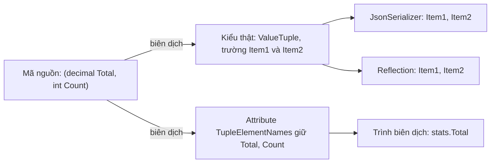

# 5.8 - Tuples và Deconstruction

> **Tóm tắt:** Tuple giải quyết một nhu cầu rất thường gặp: **trả về nhiều giá trị mà không phải dựng một class chỉ dùng một lần**. `ValueTuple` của C# 7 là kiểu giá trị, có tên trường, và thay thế hẳn `out` cho hầu hết trường hợp. Nhưng có một chi tiết cần biết trước khi dùng rộng rãi: **tên trường chỉ tồn tại ở mức trình biên dịch** — chúng bị xoá khỏi IL và thay bằng `Item1`, `Item2`, nên khi đi qua reflection, serialization hay ranh giới assembly thì tên biến mất. Vì vậy tuple hợp với **giá trị trả về nội bộ**, không hợp với hợp đồng API công khai.

## Mục tiêu bài học

Sau bài này bạn có thể:

- Dùng tuple có tên để trả nhiều giá trị thay cho `out`.
- Phân biệt `ValueTuple` với `Tuple` cũ và biết vì sao cái mới thay thế cái cũ.
- Giải thích vì sao tên trường tuple biến mất trong một số ngữ cảnh.
- Viết `Deconstruct` cho kiểu của mình.
- Quyết định khi nào dùng tuple và khi nào dùng `record`.

**Cần biết trước:** [bài 1.4](../../stage-01-foundation/module-01-programming-logic/1.4-functions-methods.md) (tham số `out`), [bài 4.7](../module-04-csharp-core/4.7-records-and-value-objects.md) (record), [bài 4.8](../module-04-csharp-core/4.8-pattern-matching.md) (pattern matching).

## Nội dung bài học

### 5.8.1 — Thay thế `out`

```csharp
// CŨ — không dùng được trong một biểu thức, không nối chuỗi được
public void GetStats(List<Order> orders, out decimal total, out int count)
{
    total = orders.Sum(o => o.Total);
    count = orders.Count;
}

GetStats(orders, out var t, out var c);   // C# 7 cho khai báo biến out ngay tại chỗ gọi
Console.WriteLine(t);                     // nhưng vẫn phải gọi thành một câu lệnh riêng
```

```csharp
// MỚI — có tên, đọc được, dùng được trong LINQ
public (decimal Total, int Count) GetStats(List<Order> orders)
    => (orders.Sum(o => o.Total), orders.Count);

var stats = GetStats(orders);
Console.WriteLine(stats.Total);

// Hoặc tách luôn ra hai biến
var (total, count) = GetStats(orders);
```

Dạng thứ hai gọi là **deconstruction** — tách một giá trị phức hợp thành nhiều biến.

### 5.8.2 — `ValueTuple` và `Tuple` cũ

| | `Tuple<T1,T2>` (.NET 4.0) | `ValueTuple` / `(T1, T2)` (C# 7) |
|---|---|---|
| Loại kiểu | Tham chiếu (cấp phát heap) | **Giá trị** |
| Tên trường | Không — chỉ `Item1`, `Item2` | **Có** |
| Có thể thay đổi | Không | Có |
| Cú pháp | `Tuple.Create(a, b)` | `(a, b)` |

`ValueTuple` là kiểu giá trị nên **không cấp phát trên heap**, quan trọng khi trả về trong vòng lặp nóng. Và nó có tên trường, nên `stats.Total` đọc dễ hơn hẳn `stats.Item1`.

Trong code mới, gần như không còn lý do dùng `Tuple` cũ.

### 5.8.3 — Tên trường chỉ tồn tại lúc biên dịch

Đây là chi tiết quan trọng nhất của bài.

```csharp
public (decimal Total, int Count) GetStats() => (100m, 5);
```

Sau khi biên dịch, kiểu thật là `ValueTuple<decimal, int>` với hai trường `Item1` và `Item2`. Tên `Total` và `Count` được lưu dưới dạng một **attribute** (`TupleElementNames`) mà **chỉ trình biên dịch đọc**.

Hệ quả cụ thể:

```csharp
// Serialize -> tên biến mất, và còn tệ hơn thế
JsonSerializer.Serialize(GetStats());
// {}   ← ValueTuple chỉ có field Item1/Item2, System.Text.Json mặc định bỏ qua field
// bật IncludeFields = true thì ra {"Item1":100,"Item2":5} — vẫn không phải Total và Count

// Reflection -> chỉ thấy Item1, Item2
typeof(ValueTuple<decimal,int>).GetFields().Select(f => f.Name);
// Item1, Item2
```



Vì vậy:

- **Dùng tuple** cho giá trị trả về nội bộ, biến cục bộ, khoá tạm.
- **Đừng dùng tuple** cho DTO của API, model gửi qua mạng, hay bất cứ thứ gì đi qua serialization.

Với hợp đồng công khai, `record` là lựa chọn đúng — nó có tên trường thật, tồn tại trong IL, và serialize ra đúng tên.

### 5.8.4 — Deconstruction cho kiểu của bạn

```csharp
// Customer.cs
public class Customer
{
    public string Name { get; init; } = "";
    public string Email { get; init; } = "";
    public int Age { get; init; }

    public void Deconstruct(out string name, out string email)
        => (name, email) = (Name, Email);

    // Nạp chồng cho số lượng khác
    public void Deconstruct(out string name, out string email, out int age)
        => (name, email, age) = (Name, Email, Age);
}
```

```csharp
// Program.cs
var customer = new Customer { Name = "An", Email = "an@example.com", Age = 17 };
var (name, email) = customer;
var (n, e, a) = customer;
```

Dán vào một file Program.cs thì khối Program.cs đặt lên đầu, khối khai báo đặt xuống cuối (C# bắt buộc, nếu không sẽ báo lỗi CS8803).

Chỉ cần một phương thức tên `Deconstruct` với các tham số `out` — không cần cài đặt interface nào. `record` tự sinh sẵn phương thức này cho các tham số vị trí.

Deconstruction ghép rất tốt với pattern matching ở [bài 4.8](../module-04-csharp-core/4.8-pattern-matching.md):

```csharp
var message = customer switch
{
    (_, _, < 18)   => "Chưa đủ tuổi",
    (var nm, _, _) => $"Xin chào {nm}"
};
Console.WriteLine(message);   // Chưa đủ tuổi
```

### 5.8.5 — Vài cách dùng hữu ích

```csharp
// Hoán đổi không cần biến tạm
(a, b) = (b, a);

// Gán nhiều biến cùng lúc
var (x, y, z) = (1, 2, 3);

// Tuple làm khoá Dictionary — so sánh theo giá trị, có sẵn
var cache = new Dictionary<(int TenantId, int CustomerId), Customer>();
cache[(TenantId: 1, CustomerId: 42)] = customer;

// Sắp xếp nhiều tiêu chí
orders.OrderBy(o => (o.Priority, o.CreatedAt));

// Trả về kết quả kèm lý do thất bại, không cần ngoại lệ
public (bool Success, string? Error) Validate(Order o)
    => o.Total < 0 ? (false, "Tổng tiền âm") : (true, null);
```

Dòng thứ ba đáng chú ý: `ValueTuple` cài đặt sẵn `Equals` và `GetHashCode` theo giá trị, nên nó dùng làm khoá `Dictionary` được ngay — không gặp vấn đề đã nêu ở [bài 1.5](../../stage-01-foundation/module-01-programming-logic/1.5-arrays-and-lists.md).

### 5.8.6 — Tuple hay `record`?

| Tiêu chí | Tuple | `record` |
|---|---|---|
| Phạm vi | Nội bộ một phương thức, một class | Cả hệ thống |
| Tên trường sau khi biên dịch | **Mất** | Giữ |
| Serialize được đúng tên | Không | Có |
| Gắn được hành vi | Không | Có |
| Chi phí viết | Không có | Một khai báo |

Quy tắc thực dụng:

- **Hai giá trị, dùng ngay trong một phương thức** → tuple.
- **Trả ra khỏi class, hoặc có tên nghiệp vụ** → `record`.
- **Ba giá trị trở lên mà người gọi phải nhớ thứ tự** → `record`.

Dấu hiệu nên chuyển từ tuple sang `record`: bạn thấy mình lặp lại cùng một hình dạng tuple ở ba chỗ, hoặc phải viết comment giải thích các phần tử là gì. Lúc đó nhóm giá trị này đã có một khái niệm nghiệp vụ, và nó xứng đáng có tên.

### 5.8.7 — Rà lại code của bạn

**Danh sách rà soát tuple**

- [ ] Không còn tham số out nào chỉ để trả nhiều giá trị (trừ mẫu TryXxx).
- [ ] Không dùng Tuple cũ; mọi chỗ đều là ValueTuple với cú pháp ngoặc.
- [ ] Mọi tuple trả về đều có TÊN trường, không để Item1, Item2.
- [ ] Không có tuple nào nằm trong DTO của API hay model serialize qua mạng.
- [ ] Tuple lặp lại ở ba chỗ trở lên đã được nâng thành record.
- [ ] Khoá Dictionary phức hợp dùng tuple thay vì nối chuỗi.

## Bài tập áp dụng

#### Bài 1 — Chứng minh tên trường tuple biến mất

Viết hàm trả `(decimal Total, int Count)`, tuần tự hoá kết quả bằng `System.Text.Json` và in ra. Ghi lại tên trường thật trong JSON.

**Tiêu chí hoàn thành:** bạn giải thích được kết quả, vốn còn bất ngờ hơn "tên bị đổi".

<details>
<summary><strong>Gợi ý và lời giải — Bài 1</strong></summary>

**Gợi ý.** Tên trường của tuple chỉ tồn tại **lúc biên dịch**. Ở mức runtime, `ValueTuple` có các thành viên tên là `Item1`, `Item2`. Nhưng có một chi tiết nữa về **loại** thành viên đó.

**Lời giải.**

```csharp
using System.Text.Json;   // không nằm trong implicit usings

static (decimal Total, int Count) GetStats() => (100m, 3);

Console.WriteLine(JsonSerializer.Serialize(GetStats()));
```

**Kết quả chạy trên .NET 10:**

```text
{}
```

**Một đối tượng rỗng.** Không phải `{"Total":100,"Count":3}`, cũng không phải `{"Item1":100,"Item2":3}` — mà **không có gì cả**.

**Vì sao.** Hai tầng nguyên nhân:

1. **Tên `Total` và `Count` không tồn tại lúc chạy.** Trình biên dịch lưu chúng trong một thuộc tính siêu dữ liệu tên `TupleElementNames` gắn vào chữ ký phương thức, chỉ để trình biên dịch và trình soạn thảo dùng. Bản thân kiểu `ValueTuple<decimal, int>` chỉ có `Item1` và `Item2`.

2. **`Item1` và `Item2` là *field*, không phải *property*.** Và `System.Text.Json` theo mặc định **chỉ tuần tự hoá thuộc tính công khai**, bỏ qua trường. Vì `ValueTuple` không có thuộc tính nào, kết quả là một đối tượng rỗng.

**Kiểm chứng tầng thứ nhất:**

```csharp
var opts = new JsonSerializerOptions { IncludeFields = true };
Console.WriteLine(JsonSerializer.Serialize(GetStats(), opts));
// {"Item1":100,"Item2":3}
```

Bật tuần tự hoá trường thì thấy `Item1`, `Item2` — tên nghiệp vụ đã mất hẳn.

**Hệ quả thực tế — ba chỗ không được dùng tuple:**

| Chỗ | Vì sao |
|---|---|
| Kiểu trả về của API công khai | Client nhận `{}` hoặc `Item1`, không dùng được |
| Đối tượng lưu vào database hoặc cache | Tên trường mất, không đọc lại được có nghĩa |
| Hợp đồng giữa hai dịch vụ | Cùng lý do trên |

ASP.NET Core (Module 8) tuần tự hoá kết quả endpoint bằng chính `System.Text.Json`, với tuỳ chọn mặc định cho web (tên camelCase, không bật `IncludeFields`):

```csharp
// OrderStatsDto.cs
public record OrderStatsDto(decimal Total, int Count);
```

```csharp
// Program.cs
// SAI — endpoint trả về {}
app.MapGet("/order-stats", () => GetStats());

// ĐÚNG — record có tên thật
app.MapGet("/order-stats-dto", () => new OrderStatsDto(100m, 3));
// {"total":100,"count":3}
```

Kiểm chứng không cần dựng web API: `JsonSerializer.Serialize(GetStats(), new JsonSerializerOptions(JsonSerializerDefaults.Web))` in ra `{}`, còn với `new OrderStatsDto(100m, 3)` in ra `{"total":100,"count":3}`.

**Vậy tuple dùng ở đâu.** Ở những chỗ giá trị **không rời khỏi tiến trình**:

```csharp
// Trả nhiều giá trị từ một hàm private
private (bool IsValid, string? Error) Validate(Order o) { }

// Gán nhiều biến cùng lúc
var (min, max) = FindMinMax(values);

// Khoá ghép trong Dictionary
var cache = new Dictionary<(int TenantId, int CustomerId), Customer>();

// Sắp xếp theo nhiều tiêu chí
customers.OrderBy(c => (c.Region, c.Name));
```

**Quy tắc chọn giữa tuple và `record`:**

| Dùng tuple | Dùng `record` |
|---|---|
| Kết quả chỉ dùng ngay tại chỗ gọi | Giá trị đi qua nhiều tầng |
| Là chi tiết nội bộ của một phương thức | Là một khái niệm nghiệp vụ có tên |
| Phương thức `private` | Phương thức `public` |
| Không cần tuần tự hoá | Cần tuần tự hoá, lưu trữ, hoặc trả ra API |

Ranh giới đơn giản: **tuple cho nội bộ, `record` cho hợp đồng.**

</details>

#### Bài 2 — Bỏ `out`, so sánh ba phiên bản

Hàm dưới trả ba giá trị qua tham số `out`. Viết lại bằng tuple có tên, rồi bằng `record`. So sánh **chỗ gọi** của ba phiên bản.

```csharp
public void Analyze(IEnumerable<Order> orders,
                    out int count, out decimal total, out decimal average)
{
    var list = orders.ToList();
    count = list.Count;
    total = list.Sum(o => o.Total);
    average = count == 0 ? 0 : total / count;
}
```

**Tiêu chí hoàn thành:** bạn nêu được tiêu chí chọn, và một trường hợp mà `out` vẫn là lựa chọn đúng.

<details>
<summary><strong>Gợi ý và lời giải — Bài 2</strong></summary>

**Gợi ý.** Bài này nối tiếp bài tập ở [bài 1.4](../../stage-01-foundation/module-01-programming-logic/1.4-functions-methods.md). Điểm mới ở đây là tìm ra **ngoại lệ chính đáng** cho quy tắc "đừng dùng `out`".

**Lời giải — ba phiên bản:**

```csharp
// 1 — out
public void Analyze(IEnumerable<Order> orders,
                    out int count, out decimal total, out decimal average) { }

// 2 — tuple có tên
public (int Count, decimal Total, decimal Average) Analyze(IEnumerable<Order> orders) { }

// 3 — record
public record OrderStats(int Count, decimal Total, decimal Average);
public OrderStats Analyze(IEnumerable<Order> orders) { }
```

**Chỗ gọi:**

```csharp
// 1 — phải là một câu lệnh riêng, không dùng được trong biểu thức
//     (C# 7 cho khai báo biến out ngay tại chỗ gọi, nhưng vẫn không viết được một dòng)
Analyze(orders, out int count, out decimal total, out decimal average);
if (average > 1_000_000m) { }

// 2 — một dòng, tháo ra ngay
var (count, total, average) = Analyze(orders);
if (Analyze(orders).Average > 1_000_000m) { }          // dùng được trong biểu thức

// 3 — truyền tiếp được, tuần tự hoá được, so sánh được
var stats = Analyze(orders);
await SaveReportAsync(stats, ct);
if (stats == previousStats) { }                        // record so sánh theo giá trị
```

**Ba nhược điểm cụ thể của `out`:**

1. **Không dùng được với `async`.** Đây là nhược điểm nghiêm trọng nhất — phương thức `async` không được có tham số `out` hoặc `ref`. Từ [Module 6](../module-06-async-programming/README.md) trở đi, phần lớn phương thức trong hệ thống là bất đồng bộ.
2. **Không dùng được trong biểu thức.** Lời gọi phải đứng thành một câu lệnh riêng (dù từ C# 7 có thể khai báo `out var` ngay tại chỗ gọi), nên không viết được dạng `if (Analyze(orders).Average > ...)`.
3. **Dễ hoán đổi nhầm.** Ba tham số `out` liền nhau, trong đó hai cái cùng kiểu `decimal` — trình biên dịch không phát hiện nếu bạn đặt sai thứ tự.

**Trường hợp `out` vẫn đúng — mẫu `Try`:**

```csharp
if (dict.TryGetValue(key, out var value)) { }
if (int.TryParse(s, out var n)) { }
if (DateTime.TryParse(s, out var d)) { }
```

Ba lý do khiến mẫu này chính đáng:

- **Trả về hai thứ khác bản chất**: một cờ thành công và một giá trị. Chúng không phải "hai phần của một kết quả" mà là "có hay không, và nếu có thì là gì".
- **Là quy ước đã ăn sâu trong .NET.** Ai đọc `TryXxx(..., out var x)` cũng hiểu ngay ngữ nghĩa.
- **Tránh cấp phát.** Không phải tạo một tuple hay đối tượng chỉ để báo thất bại — quan trọng trong đường dẫn nóng.

Khi tự viết, hãy theo đúng quy ước: tên bắt đầu bằng `Try`, trả về `bool`, và **không ném ngoại lệ**:

```csharp
public bool TryGetCustomer(int id, [NotNullWhen(true)] out Customer? customer)
{
    customer = _cache.GetValueOrDefault(id);
    return customer is not null;
}
```

Thuộc tính `[NotNullWhen(true)]` (namespace `System.Diagnostics.CodeAnalysis`) nói với trình biên dịch rằng khi hàm trả `true` thì `customer` chắc chắn khác `null` — nhờ vậy bạn dùng `customer` ngay sau `if` mà không bị cảnh báo. Đây chính là kỹ thuật ở [bài 5.6](5.6-nullable-reference-types.md).

**Tiêu chí chọn, tóm gọn:**

| Tình huống | Chọn |
|---|---|
| Mẫu `TryXxx` | `out` |
| Kết quả dùng ngay tại chỗ, phương thức `private` | Tuple có tên |
| Kết quả đi xa, cần tên, cần tuần tự hoá | `record` |
| Cần biểu diễn cả thành công lẫn lỗi có thông điệp | `Result<T>` (mẫu ở [bài 5.2](5.2-generics.md)) |

</details>

#### Bài 3 — Tuple làm khoá `Dictionary`

Một bộ đệm khách hàng dùng `Dictionary<string, Customer>` với khoá nối chuỗi `$"{tenantId}-{customerId}"` (tenant là một công ty khách thuê hệ thống CRM). Thay bằng `Dictionary<(int, int), Customer>`. So sánh độ rõ ràng và đo hiệu năng tra cứu.

**Tiêu chí hoàn thành:** bạn nêu được **ba** vấn đề của khoá nối chuỗi, trong đó có một vấn đề về tính đúng đắn chứ không phải hiệu năng.

<details>
<summary><strong>Gợi ý và lời giải — Bài 3</strong></summary>

**Gợi ý.** Đo hiệu năng là phần dễ. Phần đáng giá là tìm ra vấn đề **tính đúng đắn** — hãy thử tìm hai cặp giá trị khác nhau cho ra cùng một chuỗi khoá.

**Lời giải.**

```csharp
// Trước
var cache = new Dictionary<string, Customer>();
cache[$"{tenantId}-{customerId}"] = customer;

// Sau
var cache = new Dictionary<(int TenantId, int CustomerId), Customer>();
cache[(tenantId, customerId)] = customer;
```

**Đo hiệu năng** — 10.000 khoá, một triệu lần tra cứu, chạy `dotnet run -c Release`:

```csharp
using System.Diagnostics;

const int N = 1_000_000;
var strCache = new Dictionary<string, int>();
var tupCache = new Dictionary<(int, int), int>();
for (int t = 0; t < 10; t++)
    for (int c = 0; c < 1000; c++) { strCache[$"{t}-{c}"] = c; tupCache[(t, c)] = c; }

for (int round = 0; round < 3; round++)
{
    long sum = 0;
    var sw = Stopwatch.StartNew();
    for (int i = 0; i < N; i++) sum += strCache[$"{i % 10}-{i % 1000}"];
    var s1 = sw.Elapsed.TotalMilliseconds;
    sw.Restart();
    for (int i = 0; i < N; i++) sum += tupCache[(i % 10, i % 1000)];
    var s2 = sw.Elapsed.TotalMilliseconds;
    Console.WriteLine($"khoá chuỗi nối : {s1,6:F1} ms | khoá tuple : {s2,6:F1} ms ({s1 / s2:F1}x) {sum}");
}
```

Kết quả trên .NET 10:

```text
khoá chuỗi nối :   52,5 ms | khoá tuple :   38,7 ms (1,4x) 999000000
khoá chuỗi nối :   49,6 ms | khoá tuple :   36,4 ms (1,4x) 999000000
khoá chuỗi nối :   47,8 ms | khoá tuple :   38,5 ms (1,2x) 999000000
```

Tuple nhanh hơn khoảng 1,2 tới 1,4 lần. Khác biệt về tốc độ không lớn; lý do chính để đổi nằm ở vấn đề thứ ba bên dưới.

**Ba vấn đề của khoá nối chuỗi:**

**1. Cấp phát bộ nhớ.** Mỗi lần tra cứu tạo một chuỗi mới trên heap. Một triệu lần tra là một triệu chuỗi rác, gây áp lực lên bộ thu gom rác — trong ứng dụng thật, chi phí này phân tán ra toàn ứng dụng chứ không nằm gọn trong vòng lặp đo.

**2. Chi phí băm chuỗi.** Tính mã băm của một chuỗi phải duyệt qua từng ký tự. Với tuple hai số nguyên, mã băm được tính từ hai giá trị cố định, nhanh hơn hẳn.

**3. Nhập nhằng khoá — vấn đề về tính đúng đắn.** Đây là vấn đề nghiêm trọng nhất:

```csharp
$"{1}-{23}"    // "1-23"
$"{12}-{3}"    // "12-3"
```

Hai cặp này cho hai chuỗi khác nhau, nên có vẻ ổn. Nhưng đổi dấu phân tách hoặc dùng dữ liệu chuỗi thì hỏng ngay:

```csharp
// Ký tự phân tách xuất hiện trong chính dữ liệu
$"{"HN-01"}-{"A"}"    // "HN-01-A"
$"{"HN"}-{"01-A"}"    // "HN-01-A"    <- TRÙNG KHOÁ
```

Hai cặp giá trị **hoàn toàn khác nhau** ánh xạ về cùng một khoá. Bộ đệm trả về dữ liệu của tổ chức này cho tổ chức khác — một lỗi rò rỉ dữ liệu, và nó **không bao giờ** xuất hiện trong kiểm thử với dữ liệu mẫu sạch sẽ.

Với tuple, `("HN-01", "A")` và `("HN", "01-A")` là hai khoá khác nhau, vì so sánh diễn ra trên **từng thành phần** chứ không trên chuỗi đã ghép.

**Lợi ích thứ tư: rõ nghĩa.** Tuple có tên biến chỗ tra cứu thành tự giải thích:

```csharp
var cache = new Dictionary<(int TenantId, int CustomerId), Customer>();
cache[(TenantId: 1, CustomerId: 42)] = customer;
```

So với `cache["1-42"]`, người đọc biết ngay hai số đó nghĩa là gì.

**Khi nào dùng `record struct` thay vì tuple.** Khi khoá là một khái niệm nghiệp vụ được dùng ở nhiều nơi:

```csharp
public readonly record struct CustomerKey(int TenantId, int CustomerId);
var cache = new Dictionary<CustomerKey, Customer>();
```

Cách này cho phép đặt tên kiểu, thêm phương thức kiểm tra, và tránh nhầm với một tuple `(int, int)` khác mang ý nghĩa khác — đúng tinh thần value object ở [bài 4.7](../module-04-csharp-core/4.7-records-and-value-objects.md).

**Lưu ý về tuple làm khoá.** Cả `ValueTuple` lẫn `record struct` đều đã có `Equals` và `GetHashCode` theo giá trị sẵn, nên chúng hoạt động đúng làm khoá ngay mà không cần viết thêm gì — khác hẳn với `class` thường, như [bài 1.5](../../stage-01-foundation/module-01-programming-logic/1.5-arrays-and-lists.md) đã chứng minh.

</details>

## Tự kiểm tra

<details>
<summary>ValueTuple khác Tuple cũ ở đâu?</summary>

ValueTuple là kiểu giá trị nên không cấp phát trên heap, và nó có tên trường thay vì chỉ Item1 và Item2. Tuple cũ là kiểu tham chiếu và không có tên. Trong code mới gần như không còn lý do dùng Tuple cũ.

</details>

<details>
<summary>Vì sao tên trường của tuple biến mất khi serialize?</summary>

Vì tên chỉ tồn tại ở mức trình biên dịch. Kiểu thật sau khi biên dịch là ValueTuple với hai field Item1 và Item2; tên bạn đặt được lưu trong một attribute mà chỉ trình biên dịch đọc. Reflection chỉ thấy Item1, Item2. Còn System.Text.Json mặc định bỏ qua field, nên kết quả là một object rỗng {}; bật IncludeFields thì mới thấy Item1, Item2.

</details>

<details>
<summary>Vậy khi nào KHÔNG nên dùng tuple?</summary>

Khi nó đi qua ranh giới serialization hoặc là một phần hợp đồng API công khai — DTO, model gửi qua mạng, kiểu trả về của endpoint. Ở những chỗ đó dùng record, vì record có tên trường thật tồn tại trong IL và serialize ra đúng tên.

</details>

<details>
<summary>Làm sao cho kiểu của mình deconstruct được?</summary>

Chỉ cần viết một phương thức tên Deconstruct với các tham số out, không cần cài đặt interface nào. Có thể nạp chồng nhiều phiên bản cho số lượng phần tử khác nhau. Record với tham số vị trí tự sinh sẵn phương thức này.

</details>

<details>
<summary>Tuple dùng làm khoá Dictionary được không?</summary>

Được, và rất tiện. ValueTuple đã cài đặt sẵn Equals và GetHashCode theo giá trị, nên hai tuple cùng nội dung là cùng một khoá. Cách này rõ ràng hơn nhiều so với nối chuỗi thành khoá, và không có nguy cơ trùng khoá do ký tự phân cách.

</details>

<details>
<summary>Khi nào nên chuyển từ tuple sang record?</summary>

Khi bạn thấy mình lặp lại cùng một hình dạng tuple ở ba chỗ trở lên, hoặc phải viết comment giải thích các phần tử là gì, hoặc có từ ba giá trị mà người gọi phải nhớ thứ tự. Lúc đó nhóm giá trị này đã trở thành một khái niệm nghiệp vụ và xứng đáng có tên riêng.

</details>

## Kết luận

Ba điều đáng nhớ nhất:

1. **Tuple thay `out` cho hầu hết trường hợp.** Có tên, đọc được, dùng được trong LINQ.
2. **Tên trường biến mất sau khi biên dịch.** Đừng cho tuple đi qua serialization.
3. **Lặp lại ba lần là dấu hiệu nên làm `record`.** Nhóm giá trị đó đã có một khái niệm.

## Tham khảo

- [Tuple types](https://learn.microsoft.com/en-us/dotnet/csharp/language-reference/builtin-types/value-tuples)
- [Deconstructing tuples and other types](https://learn.microsoft.com/en-us/dotnet/csharp/fundamentals/functional/deconstruct)
- [Records](https://learn.microsoft.com/en-us/dotnet/csharp/fundamentals/types/records) — khi tuple không đủ
- [Patterns](https://learn.microsoft.com/en-us/dotnet/csharp/language-reference/operators/patterns) — tuple pattern

## Điều hướng

- **Bài trước:** [5.7 — Expression Trees và Reflection](5.7-overview.md)
- **Bài tiếp theo:** [5.9 — Đọc thêm: IAsyncEnumerable, source generator và Span](5.9-advanced-notes.md)
- **Về module:** [Trang mục lục](README.md)
