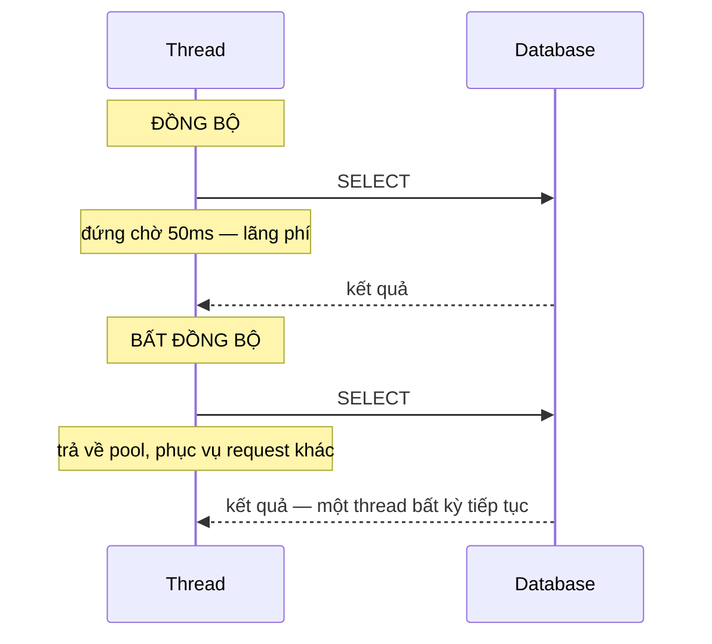

# 6.1 - Tại sao cần Async?

> **Tóm tắt:** Hiểu lầm phổ biến nhất về async: nó **không làm một request chạy nhanh hơn**. Một truy vấn database mất 50ms thì vẫn mất 50ms. Thứ async thay đổi là **thread đang làm gì trong 50ms đó**: với code đồng bộ, thread ngồi chờ và không làm gì khác; với async, nó được trả về thread pool và phục vụ request khác. Khi mọi thread của pool đều đang ngồi chờ, request mới phải xếp hàng dù CPU gần như rảnh. Đo trên .NET 10 ở bài tập 1: 200 request cùng lúc, mỗi request chờ 1 giây, bản đồng bộ mất **13 giây**, bản async mất **1 giây**.

## Mục tiêu bài học

Sau bài này bạn có thể:

- Giải thích async giải phóng thread như thế nào, và vì sao nó không giảm độ trễ của một request.
- Phân biệt công việc **I/O-bound** với **CPU-bound** và chọn cách xử lý đúng.
- Nêu cơ chế thread pool starvation và vì sao nó làm hệ thống chậm dần.
- Ước lượng số thread một API đồng bộ cần ở một mức tải cho trước.
- Biết khi nào async **không** giúp gì.

**Cần biết trước:** viết phương thức và class C# ([Module 4](../module-04-csharp-core/README.md)); tạo và chạy một Web API nhỏ ([bài 0.5](../../stage-01-foundation/module-00-setup/0.5-first-web-api.md)). Ví dụ có dùng `_db.Orders` của EF Core: đó là đối tượng truy vấn bảng `Orders` trong database, sẽ học kỹ ở [bài 8.10](../../stage-03-aspnet-core-backend/module-08-aspnet-core-fundamentals/8.10-ef-core-minimal.md). Ở bài này chỉ cần biết `Find` chờ database đồng bộ, còn `FindAsync` là bản bất đồng bộ.

## Nội dung bài học

### 6.1.1 — Thread đang làm gì trong lúc chờ

**Thread** (luồng) là đơn vị chạy code của hệ điều hành. **Thread pool** là một nhóm thread .NET tạo sẵn và cho mượn: ASP.NET Core lấy một thread trong pool để chạy mỗi request, xong thì trả lại.

```csharp
// ĐỒNG BỘ — thread bị giữ suốt 50ms chờ database
public Order? GetOrder(int id)
{
    var order = _db.Orders.Find(id);     // thread đứng chờ, không làm gì
    return order;
}

// BẤT ĐỒNG BỘ — thread được trả lại pool trong lúc chờ
public async Task<Order?> GetOrderAsync(int id, CancellationToken ct)
{
    var order = await _db.Orders.FindAsync([id], ct);   // thread đi phục vụ request khác
    return order;
}
```



Cả hai đều mất 50ms cho **một** request. Khác biệt chỉ xuất hiện khi có **nhiều** request cùng lúc. `Task`, `async` và `await` được giải thích kỹ ở [bài 6.2](6.2-task-and-async-await.md); `CancellationToken` ở [bài 6.4](6.4-cancellationtoken.md).

### 6.1.2 — Thread pool và ngưỡng sụp đổ

Thread pool của .NET khởi đầu với số thread bằng số nhân CPU (giá trị `ThreadPool.GetMinThreads`). Khi mọi thread đều bận và còn việc trong hàng đợi, nó tạo thêm thread mới, nhưng **từ từ**, chứ không tạo ngay một thread cho mỗi việc đang chờ.

Lý do của việc giới hạn đó: mỗi thread giữ một vùng nhớ stack riêng (cỡ megabyte, tuỳ hệ điều hành), và quá nhiều thread làm hệ điều hành mất thời gian chuyển qua lại giữa chúng nhiều hơn là làm việc.

**Ước lượng số thread cần.** Ở trạng thái ổn định, số thread đang bị giữ bằng **số request mỗi giây × thời gian mỗi request giữ thread** (định luật Little):

| Tình huống (code đồng bộ) | Thread cần |
|---|---|
| 100 request/giây, mỗi request chờ database 50ms | 100 × 0,05 = **5** |
| 100 request/giây, mỗi request gọi API ngoài chờ 1 giây | 100 × 1 = **100** |
| 200 request/giây, API ngoài chậm lên 3 giây | 200 × 3 = **600** |

Dòng đầu cho thấy vì sao code đồng bộ vẫn "chạy tốt" trên máy dev: chờ ngắn thì cần ít thread. Hai dòng sau là lúc pool không theo kịp. Với async, thread chỉ bị giữ trong phần tính toán ngắn ngủi trước và sau mỗi `await`, nên con số cần gần như không phụ thuộc thời gian chờ.

Số đo thật trên máy 14 nhân, .NET 10, 200 request gửi **cùng lúc**, mỗi request chờ 1 giây (bài tập 1 bên dưới):

| | Code đồng bộ (`Thread.Sleep`) | Code bất đồng bộ (`await Task.Delay`) |
|---|---|---|
| Thời gian xong 200 request | **13,1 giây** | **1,0 giây** |
| Số thread của pool lúc đỉnh | 17 | 15 |

Bản đồng bộ chạy thành từng đợt khoảng 14 request mỗi giây vì chỉ có chừng ấy thread, và trong 13 giây pool chỉ thêm được 3 thread. Hiện tượng request xếp hàng chờ thread như vậy gọi là **thread pool starvation**, và nó có một triệu chứng rất dễ nhận ra nhưng dễ chẩn đoán sai:

> **Hệ thống chậm dần, timeout khắp nơi, nhưng CPU gần như rảnh.**

Người ta thường phản ứng bằng cách thêm CPU hoặc thêm máy. Không giúp gì cả, vì nút cổ chai không phải CPU, mà là số thread đang ngồi chờ I/O.

### 6.1.3 — I/O-bound và CPU-bound

Đây là phân biệt quyết định bạn dùng công cụ nào.

| | I/O-bound | CPU-bound |
|---|---|---|
| Thời gian trôi vào | Chờ thiết bị/mạng | Tính toán |
| Ví dụ | Query database, gọi HTTP, đọc file | Nén ảnh, mã hoá, tính toán số |
| Thread trong lúc đó | **Không làm gì** | Chạy hết công suất |
| Công cụ đúng | `async`/`await` | `Task.Run`, `Parallel` (tuỳ loại ứng dụng, xem dưới) |

```csharp
// I/O-bound -> async
public async Task<Order?> GetAsync(int id, CancellationToken ct)
    => await _db.Orders.FindAsync([id], ct);

// CPU-bound trong ứng dụng có giao diện (WPF, WinForms):
// Task.Run đẩy việc nén sang thread pool để luồng giao diện không bị đơ
var compressed = await Task.Run(() => Compress(data), ct);
```

Một điểm quan trọng và hay bị làm sai: **bọc `Task.Run` quanh code I/O không giúp gì**, nó chỉ chuyển việc chờ sang một thread khác của cùng pool.

```csharp
// VÔ NGHĨA — vẫn chiếm một thread để ngồi chờ, chỉ là thread khác
await Task.Run(() => _db.Orders.Find(id));

// ĐÚNG
await _db.Orders.FindAsync([id], ct);
```

**Trong ASP.NET Core, `Task.Run` cho việc CPU-bound cũng không tăng thông lượng.** Request vốn đã chạy trên một thread của pool. `Task.Run` chỉ đổi phần tính toán sang một thread khác **của cùng pool**: thread của request được trả về, thread mới bị chiếm, tổng số thread bận không đổi. Với việc tính toán nặng và kéo dài, hãy đưa ra hàng đợi nền hoặc một dịch vụ riêng ([Module 14](../../stage-04-database-production/module-14-caching-background-jobs/README.md)). [Bài 6.7](6.7-common-pitfalls.md) phân tích kỹ bẫy này.

### 6.1.4 — Async không giúp gì trong ba trường hợp

**1. Ứng dụng console chạy tuần tự.** Không có ai để nhường thread cho.

**2. Chỉ có đúng một request tại một thời điểm.** Async thêm chi phí máy trạng thái mà không đổi lại gì.

**3. Công việc thuần CPU.** Không có lúc nào "chờ" để mà giải phóng thread.

Async cũng **không miễn phí**: trình biên dịch sinh ra một máy trạng thái cho mỗi phương thức `async`, và có cấp phát bộ nhớ. Với một phương thức được gọi hàng triệu lần trong vòng lặp nóng, chi phí đó đo được (bài tập 3).

Nhưng trong backend web, nơi hầu hết thời gian trôi vào database và HTTP, async gần như luôn đúng.

### 6.1.5 — Quy tắc "async suốt chuỗi"

```csharp
// SAI — chặn ở giữa chuỗi, phá bỏ toàn bộ lợi ích
public IActionResult Get(int id)
{
    var order = _service.GetOrderAsync(id).Result;   // chặn thread!
    return Ok(order);
}

// ĐÚNG — async từ controller xuống tận database
public async Task<IActionResult> Get(int id, CancellationToken ct)
{
    var order = await _service.GetOrderAsync(id, ct);
    return Ok(order);
}
```

`.Result` và `.Wait()` bắt thread hiện tại đứng chờ `Task` xong. Gọi chúng không chỉ mất lợi ích. Trong một số môi trường (WPF, WinForms, ASP.NET Framework cũ) nó còn **treo cứng ứng dụng**. Cơ chế deadlock đó được mổ xẻ ở [bài 6.3](6.3-configureawait.md), trong bài [Gọi .Result khi nào thì deadlock, khi nào thì không?](https://tiennhm.io.vn/blog/deadlock-result-wait-csharp), và được nói tiếp ở [bài 6.7](6.7-common-pitfalls.md).

Nguyên tắc: **một chuỗi gọi đã async thì phải async suốt**, từ điểm vào tới tận thư viện I/O.

### 6.1.6 — Rà lại hệ thống của bạn

**Danh sách rà soát async**

- [ ] Mọi thao tác I/O trong đường xử lý request đều dùng phiên bản async.
- [ ] Không có .Result hay .Wait() nào trong code chạy theo request.
- [ ] Không bọc Task.Run quanh code I/O.
- [ ] Công việc CPU nặng và kéo dài đi qua hàng đợi nền, không chiếm thread của request.
- [ ] Đã xem CPU khi hệ thống chậm: CPU thấp mà vẫn timeout thì nghi thread pool.
- [ ] Chuỗi gọi async liên tục từ controller xuống tới thư viện I/O.

## Bài tập áp dụng

#### Bài 1 — Tái hiện thread pool starvation

Viết hai endpoint: một gọi `Thread.Sleep(1000)`, một gọi `await Task.Delay(1000)`. Gửi 200 request đồng thời vào mỗi cái. So sánh tổng thời gian và số thread của pool.

**Tiêu chí hoàn thành:** bạn có số đo của cả hai endpoint, nêu được **cặp triệu chứng** đặc trưng của starvation, và vì sao nó hay bị chẩn đoán nhầm.

<details>
<summary><strong>Gợi ý và lời giải — Bài 1</strong></summary>

**Gợi ý.** Cả hai endpoint đều "chờ một giây". Khác biệt duy nhất là **thread có bị giam trong lúc chờ hay không**.

**Lời giải.** Server (`dotnet new web`, thay `Program.cs`):

```csharp
var builder = WebApplication.CreateBuilder(args);
builder.Logging.ClearProviders();
var app = builder.Build();

int peak = 0;
_ = Task.Run(async () =>            // ghi lại số thread lớn nhất của pool
{
    while (true) { peak = Math.Max(peak, ThreadPool.ThreadCount); await Task.Delay(20); }
});

app.MapGet("/sync", () =>
{
    Thread.Sleep(1000);             // giam một thread của pool trong 1 giây
    return Results.Ok();
});

app.MapGet("/async", async () =>
{
    await Task.Delay(1000);         // trả thread về pool trong lúc chờ
    return Results.Ok();
});

app.MapGet("/stats", () => $"thread hiện tại={ThreadPool.ThreadCount}, đỉnh={peak}");
app.Run("http://127.0.0.1:5080");
```

Client tạo tải (một project console khác). Bạn cũng có thể dùng công cụ như `bombardier -c 200 -n 200 <url>`:

```csharp
using System.Diagnostics;

var url = "http://127.0.0.1:5080" + args[0];       // "/sync" hoặc "/async"
using var http = new HttpClient { Timeout = TimeSpan.FromMinutes(5) };

var sw = Stopwatch.StartNew();
await Task.WhenAll(Enumerable.Range(0, 200).Select(_ => http.GetAsync(url)));
Console.WriteLine($"{args[0]}: 200 request xong sau {sw.ElapsedMilliseconds} ms");
Console.WriteLine(await http.GetStringAsync("http://127.0.0.1:5080/stats"));
```

Chạy server ở chế độ Release, khởi động lại server trước mỗi lần đo để pool về trạng thái ban đầu.

**Kết quả đo trên .NET 10, máy 14 nhân (`GetMinThreads` = 14):**

| | `/sync` | `/async` |
|---|---|---|
| Thời gian hoàn tất 200 request | **12,7–13,1 giây** (ba lần chạy) | **1,0–1,2 giây** |
| Độ trễ trung vị một request | 12,1 giây | 1,0 giây |
| Số thread của pool lúc đỉnh | 17 | 15 |
| CPU | gần như rảnh | gần như rảnh |

**Cặp triệu chứng đặc trưng: độ trễ rất cao trong khi CPU gần như không dùng.**

**Vì sao 13 giây.** Pool khởi đầu với 14 thread. Mỗi thread bị `Thread.Sleep` giam 1 giây, nên mỗi giây chỉ xong khoảng 14 request: 200 / 14 ≈ 14 đợt. Pool **có** nở thêm, nhưng trong 13 giây chỉ thêm được 3 thread. Đó là hành vi có chủ đích của thread pool: nó không biết thread đang ngủ hay đang tính toán, và tạo thread ồ ạt thường hại nhiều hơn lợi.

**Vì sao hay bị chẩn đoán nhầm.** Người vận hành nhìn biểu đồ CPU thấy gần 0% và kết luận: *"máy chủ còn rảnh, chắc do database chậm hoặc mạng có vấn đề"*. Họ đi tối ưu truy vấn, tăng cấu hình máy, thêm chỉ mục. Không cái nào có tác dụng, vì nguyên nhân nằm ở chỗ khác hoàn toàn.

**Cách xác nhận bằng số liệu thay vì đoán:**

```bash
dotnet tool install --global dotnet-counters
dotnet-counters monitor --process-id <pid> --counters System.Runtime
```

Nhìn hai chỉ số (trên .NET 9 trở lên tên của chúng là `dotnet.thread_pool.queue.length` và `dotnet.thread_pool.thread.count`):

| Chỉ số | Dấu hiệu starvation |
|---|---|
| Độ dài hàng đợi của pool | **Cao và không giảm**: có việc đang chờ thread |
| Số thread của pool | Tăng chậm, đều đặn |

Hàng đợi dài kết hợp với CPU thấp thì gần như chắc chắn là starvation. Microsoft có hướng dẫn từng bước ở [Debug ThreadPool starvation](https://learn.microsoft.com/en-us/dotnet/core/diagnostics/debug-threadpool-starvation).

**Ba nguồn chặn thread phổ biến trong code thật:**

```csharp
var result = CallApiAsync().Result;                     // 1. .Result
CallApiAsync().Wait();                                  // 2. .Wait()
var result = CallApiAsync().GetAwaiter().GetResult();   // 3. tưởng là "an toàn hơn" — không phải
```

Cả ba đều giam thread. Cách thứ ba đặc biệt nguy hiểm vì nhiều người tin rằng nó tránh được vấn đề. Nó chỉ tránh được việc ngoại lệ bị bọc trong `AggregateException`, còn việc chặn thread thì y hệt. [Bài 6.11](6.11-quick-real-world-example.md) đo cho thấy `.Result` dưới tải còn tệ hơn `Thread.Sleep`.

**Cách phòng.** Bật bộ phân tích để build báo lỗi khi có chỗ chặn thread. Cài gói `Microsoft.VisualStudio.Threading.Analyzers` rồi thêm vào file `.csproj`:

```xml
<PropertyGroup>
  <WarningsAsErrors>$(WarningsAsErrors);VSTHRD002;CA1849</WarningsAsErrors>
</PropertyGroup>
```

`VSTHRD002` báo mọi chỗ `.Result`, `.Wait()`, `GetAwaiter().GetResult()`. `CA1849` (có sẵn trong .NET SDK) báo chỗ gọi bản đồng bộ như `File.ReadAllText` bên trong phương thức async trong khi có sẵn bản async. Còn quy tắc `CA2007` (bắt buộc `ConfigureAwait`) thì **chỉ bật cho dự án thư viện**, không bật cho ứng dụng ASP.NET Core; lý do ở [bài 6.3](6.3-configureawait.md).

</details>

#### Bài 2 — Chứng minh `Task.Run` không giúp gì cho I/O

Viết ba phiên bản của cùng một thao tác chờ: đồng bộ, bọc `Task.Run`, và async thật. Đo thời gian xong 200 request đồng thời và theo dõi số thread của pool.

**Tiêu chí hoàn thành:** bạn giải thích được vì sao bản `Task.Run` **không** tốt hơn bản đồng bộ.

<details>
<summary><strong>Gợi ý và lời giải — Bài 2</strong></summary>

**Gợi ý.** `Task.Run` đẩy công việc sang một thread của thread pool. Nhưng công việc đó là gì: tính toán, hay chờ đợi? Và thread được mượn ra làm gì trong lúc chờ?

**Lời giải.** Thêm vào server của bài 1 (`Thread.Sleep(1000)` đóng vai một lời gọi I/O đồng bộ, ví dụ `_db.Orders.Find`):

```csharp
// 1. Đồng bộ — giam thread đang xử lý request
app.MapGet("/v1", () => { Thread.Sleep(1000); return Results.Ok(); });

// 2. Task.Run — trả thread của request, rồi mượn MỘT thread khác và giam nó
app.MapGet("/v2", async () => { await Task.Run(() => Thread.Sleep(1000)); return Results.Ok(); });

// 3. Async thật — không giam thread nào trong lúc chờ
app.MapGet("/v3", async () => { await Task.Delay(1000); return Results.Ok(); });
```

**Kết quả đo trên .NET 10, máy 14 nhân, 200 request đồng thời:**

| | Thời gian xong 200 request | Thread pool lúc đỉnh | Thread bị giam mỗi request đang chờ |
|---|---|---|---|
| `/v1` đồng bộ | 13,1 giây | 17 | 1 |
| `/v2` `Task.Run` | **13,2 giây** | 18 | 1 |
| `/v3` async thật | 1,0 giây | 15 | **0** |

**Vì sao `Task.Run` không giúp.** Nó chỉ **dời** chỗ chặn, không **loại bỏ** việc chặn:

```text
Đồng bộ:
  Thread A (xử lý request) ──── bị giam 1 giây ────> trả kết quả

Task.Run:
  Thread A (xử lý request) ──await──> trả về pool
  Thread B (mượn từ pool)  ──── bị giam 1 giây ────> báo Task xong, một thread chạy tiếp request

  -> Tổng số thread bị giam: vẫn 1. Cộng thêm chi phí xếp lịch.
```

Cả hai bản đều tiêu tốn **một thread của pool cho mỗi request đang chờ**, nên số đo gần như trùng nhau.

**Khi nào `Task.Run` là đúng.** Khi công việc **thật sự tốn CPU** và bạn cần giải phóng một thread **đặc biệt**, điển hình là luồng giao diện của WPF/WinForms:

```csharp
// ĐÚNG trong ứng dụng desktop — xử lý ảnh mất 2 giây tính toán thật, giao diện không bị đơ
var thumbnail = await Task.Run(() => CreateThumbnail(image), ct);
```

Trong ASP.NET Core thì không có thread đặc biệt nào để giải phóng: `Task.Run` lấy một thread **khỏi chính pool đang phục vụ các request khác**. Với công việc CPU nặng và thường xuyên, giải pháp đúng là đẩy sang tác vụ nền hoặc một dịch vụ riêng, như [Module 14](../../stage-04-database-production/module-14-caching-background-jobs/README.md) trình bày.

**Bảng phân biệt hai loại công việc:**

| | I/O-bound | CPU-bound |
|---|---|---|
| Ví dụ | Database, HTTP, đọc file | Mã hoá, nén, xử lý ảnh, tính toán |
| Trong lúc chờ | **Không cần thread nào** | Luôn cần một thread |
| Công cụ đúng | `async`/`await` | Desktop: `Task.Run`. Web: job nền. Chia nhỏ để tính song song: `Parallel.For` |
| Dùng nhầm công cụ | Lãng phí thread | Chặn thread gọi |

**Câu hỏi phân biệt.** *Trong lúc thao tác này diễn ra, CPU có đang làm việc không?* Không thì đó là I/O: dùng `async`. Có thì đó là CPU: lúc đó mới nghĩ tới `Task.Run` hay job nền.

</details>

#### Bài 3 — Đo chi phí của máy trạng thái

Viết một phương thức `async` trả về giá trị có sẵn, gọi mười triệu lần. So với phiên bản đồng bộ và với `ValueTask`.

**Tiêu chí hoàn thành:** bạn có con số, **và** kết luận đúng về việc nó có đáng quan tâm trong bối cảnh của bạn hay không.

<details>
<summary><strong>Gợi ý và lời giải — Bài 3</strong></summary>

**Gợi ý.** Khi một phương thức `async` hoàn tất **đồng bộ** (không thật sự chờ gì), nó vẫn phải chạy qua máy trạng thái và thường cấp phát một đối tượng `Task`. Đó là chi phí bạn đang đo. `ValueTask` là kiểu trả về được giới thiệu ở [bài 6.2](6.2-task-and-async-await.md): nó tránh được cấp phát khi kết quả có sẵn.

**Lời giải.**

```csharp
using System.Diagnostics;

const int N = 10_000_000;

// làm nóng để JIT biên dịch xong trước khi đo
for (int i = 0; i < 100_000; i++) { Sync(i); await AsyncReady(i); await ValueTaskReady(i); }

var sw = Stopwatch.StartNew();
long sum = 0;
for (int i = 0; i < N; i++) sum += Sync(i);
var tSync = sw.Elapsed.TotalMilliseconds;

sw.Restart();
for (int i = 0; i < N; i++) sum += await AsyncReady(i);
var tTask = sw.Elapsed.TotalMilliseconds;

sw.Restart();
for (int i = 0; i < N; i++) sum += await ValueTaskReady(i);
var tVt = sw.Elapsed.TotalMilliseconds;

Console.WriteLine($"đồng bộ          : {tSync,5:F0} ms ({tSync * 1e6 / N,5:F2} ns/lần)");
Console.WriteLine($"async Task       : {tTask,5:F0} ms ({tTask * 1e6 / N,5:F2} ns/lần)  {tTask / tSync,5:F1}x");
Console.WriteLine($"ValueTask có sẵn : {tVt,5:F0} ms ({tVt * 1e6 / N,5:F2} ns/lần)  {tVt / tSync,5:F1}x");
Console.WriteLine($"(tổng kiểm tra: {sum})");   // dùng sum để trình biên dịch không bỏ vòng lặp

static int Sync(int x) => x + 1;
#pragma warning disable CS1998 // async không có await: cố ý, để đo chi phí máy trạng thái
static async Task<int> AsyncReady(int x) => x + 1;
#pragma warning restore CS1998
static ValueTask<int> ValueTaskReady(int x) => new(x + 1);
```

**Kết quả đo thật trên .NET 10, `dotnet run -c Release`:**

```text
đồng bộ          :     3 ms ( 0,34 ns/lần)
async Task       :   166 ms (16,60 ns/lần)   48,3x
ValueTask có sẵn :     9 ms ( 0,88 ns/lần)    2,6x
```

Chạy lại vài lần, con số dao động vài phần trăm. Máy khác cho con số khác, nhưng tỉ lệ tương tự.

**Kết luận đúng, và đây là phần quan trọng nhất của bài.** Tỉ lệ **48 lần** nghe rất lớn. Nhưng hãy nhìn con số tuyệt đối: khoảng **17 nano-giây** (một nano-giây là một phần tỷ giây).

Đặt vào bối cảnh một API handler thật:

| Thao tác | Thời gian (cỡ độ lớn) |
|---|---|
| Máy trạng thái async | 0,000017 ms |
| Một truy vấn database | vài mili-giây |
| Một lời gọi HTTP nội bộ | vài chục mili-giây |

Chi phí async nhỏ hơn một truy vấn database cỡ một trăm nghìn lần. Kết luận thực dụng: **trong code backend thông thường, chi phí này không đáng quan tâm**, và đánh đổi lấy khả năng phục vụ nhiều request đồng thời là hoàn toàn xứng đáng.

**Khi nào nó đáng quan tâm:** phương thức được gọi hàng triệu lần trong vòng lặp nóng **và** thường hoàn tất đồng bộ, ví dụ hàm đọc cache mà 95% số lần giá trị đã có sẵn. Ở đó `ValueTask` giảm từ 16,6 ns xuống 0,88 ns như số đo trên. Các quy tắc khi dùng `ValueTask` ở [bài 6.2](6.2-task-and-async-await.md), và cách đo cấp phát bằng BenchmarkDotNet ở [bài 6.9](6.9-advanced-notes.md).

**Khuyến nghị.** Mặc định dùng `Task`. Chỉ chuyển sang `ValueTask` khi bạn đã **đo** và xác nhận rằng chỗ đó là nút thắt. Đây là ví dụ tốt cho nguyên tắc của [Module 19](../../stage-05-senior-engineering/module-19-performance-engineering/README.md): đo trước, tối ưu sau.

</details>

## Tự kiểm tra

<details>
<summary>Async có làm request chạy nhanh hơn không?</summary>

Không. Một truy vấn mất 50ms thì vẫn mất 50ms. Thứ async thay đổi là thread đang làm gì trong 50ms đó: thay vì ngồi chờ, nó được trả về thread pool để phục vụ request khác. Lợi ích chỉ xuất hiện khi có nhiều request cùng lúc.

</details>

<details>
<summary>Thread pool starvation là gì và nhận biết thế nào?</summary>

Là khi mọi thread trong pool đều bận ngồi chờ, còn việc mới phải xếp hàng. Pool có tạo thêm thread nhưng từ từ, nên hàng đợi kéo dài. Triệu chứng đặc trưng: độ trễ rất cao, timeout khắp nơi, trong khi CPU gần như rảnh. Xác nhận bằng dotnet-counters: hàng đợi của thread pool dài và số thread tăng chậm.

</details>

<details>
<summary>API đồng bộ nhận 100 request mỗi giây, mỗi request gọi một API ngoài mất 1 giây. Cần khoảng bao nhiêu thread?</summary>

Khoảng 100 × 1 = 100 thread bị giữ cùng lúc. Pool khởi đầu với số thread bằng số nhân CPU và chỉ tạo thêm từ từ, nên trong lúc chờ pool nở ra, request xếp hàng. Nếu chuyển sang async, thread không bị giữ trong lúc chờ, nên vài thread là đủ.

</details>

<details>
<summary>I/O-bound và CPU-bound khác nhau ra sao về cách xử lý?</summary>

I/O-bound là thời gian trôi vào việc chờ thiết bị hoặc mạng, thread không làm gì cả, nên dùng async/await để giải phóng nó. CPU-bound là thời gian trôi vào tính toán, thread chạy hết công suất, nên async không giúp gì. Trong ứng dụng desktop dùng Task.Run để không chặn luồng giao diện; trong ASP.NET Core thì Task.Run không tăng thông lượng, việc nặng nên đưa ra job nền.

</details>

<details>
<summary>Vì sao bọc Task.Run quanh code I/O là vô nghĩa?</summary>

Vì nó chỉ chuyển việc ngồi chờ sang một thread khác của cùng pool, tổng số thread bị chiếm không đổi. Số đo ở bài tập 2: 13,1 giây cho cả bản đồng bộ lẫn bản Task.Run. Cách đúng là gọi phiên bản async thật của thao tác I/O đó, để không thread nào phải chờ.

</details>

<details>
<summary>Async suốt chuỗi nghĩa là gì?</summary>

Nghĩa là một chuỗi gọi đã async thì phải async liên tục từ điểm vào tới tận thư viện I/O, không được chặn ở giữa bằng .Result hay .Wait(). Chặn ở giữa vừa mất hết lợi ích giải phóng thread, vừa có thể gây deadlock trong WPF, WinForms hay ASP.NET Framework.

</details>

## Kết luận

Ba điều đáng nhớ nhất:

1. **Async không giảm độ trễ, nó tăng thông lượng.** Nhầm hai thứ này là nguồn của mọi hiểu lầm còn lại.
2. **CPU thấp mà vẫn timeout là dấu hiệu thread pool starvation.** Thêm máy không giúp gì.
3. **Async phải liên tục suốt chuỗi.** Một chỗ chặn ở giữa là đủ phá bỏ toàn bộ lợi ích.

## Tham khảo

- [Asynchronous programming in C#](https://learn.microsoft.com/en-us/dotnet/csharp/asynchronous-programming/)
- [Task asynchronous programming model](https://learn.microsoft.com/en-us/dotnet/csharp/asynchronous-programming/task-asynchronous-programming-model)
- [ASP.NET Core best practices](https://learn.microsoft.com/en-us/aspnet/core/fundamentals/best-practices) — phần tránh chặn thread
- [Debug ThreadPool starvation](https://learn.microsoft.com/en-us/dotnet/core/diagnostics/debug-threadpool-starvation)
- [dotnet-counters](https://learn.microsoft.com/en-us/dotnet/core/diagnostics/dotnet-counters) — theo dõi số thread của pool

## Điều hướng

- **Bài trước:** Không có (bài mở đầu module).
- **Bài tiếp theo:** [6.2 — Task và async/await](6.2-task-and-async-await.md)
- **Về module:** [Trang mục lục](README.md)

## Bài liên quan

- [Gọi .Result khi nào thì deadlock, khi nào thì không?](https://tiennhm.io.vn/blog/deadlock-result-wait-csharp) — Gọi .Result hay .Wait() trên một Task treo cứng ứng dụng WPF và ASP.NET Framework, nhưng chạy bình thường trong console và ASP.NET Core.
