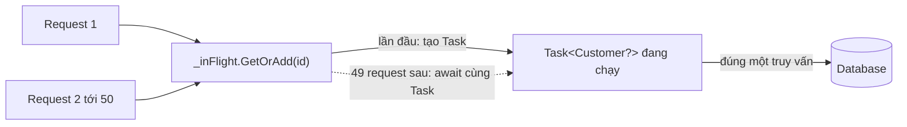

# 6.6 - Async Patterns

> **Tóm tắt:** Năm mẫu giải năm bài toán mà `async Task` trần không giải được. **`IAsyncEnumerable<T>`** để trả dữ liệu dần thay vì nạp hết vào `List` — đổi bộ nhớ từ O(n) sang O(1). **Async factory** vì constructor không thể `async`, và `.Result` trong constructor chặn thread. **`IAsyncDisposable`** để dọn dẹp có I/O. **Khử trùng lặp bằng `Task` trong cache** — lưu `Task<T>` chứ không lưu `T`, để 50 request cùng lúc chỉ gọi database **một** lần. Và **fire-and-forget**, thứ gần như luôn bị làm sai.

## Mục tiêu bài học

Sau bài này bạn có thể:

- Chuyển một endpoint trả `List<T>` lớn sang `IAsyncEnumerable<T>` và biết khi nào **không** nên.
- Viết async factory đúng cách, kể cả khi có DI.
- Dùng `IAsyncDisposable` và `await using`.
- Chống cache stampede bằng cách cache `Task<T>`.
- Chạy việc nền mà không mất exception và không bị cắt giữa chừng.

**Cần biết trước:** [bài 6.2](6.2-task-and-async-await.md), [bài 6.4](6.4-cancellationtoken.md) và [bài 6.5](6.5-task-parallel-library.md) (`DbContext` không dùng song song được). Bài dùng EF Core ([bài 8.10](../../stage-03-aspnet-core-backend/module-08-aspnet-core-fundamentals/8.10-ef-core-minimal.md)), `IMemoryCache` (bộ nhớ đệm trong tiến trình, [bài 14.2](../../stage-04-database-production/module-14-caching-background-jobs/14.2-imemorycache.md)) và đăng ký service vào DI container (`AddSingleton`, `AddScoped`, dạy kỹ ở [bài 7.4](../module-07-dependency-injection/7.4-service-lifetimes.md)). Ở đây chỉ cần biết: Singleton là một đối tượng dùng chung cho cả ứng dụng, Scoped là một đối tượng cho mỗi request.

## Nội dung bài học

### 6.6.1 — `IAsyncEnumerable<T>`: trả dần thay vì nạp hết

```csharp
// TRẢ HẾT: 500.000 bản ghi nằm trong RAM trước khi ghi được dòng đầu tiên
public async Task<List<Customer>> GetAllAsync(CancellationToken ct)
    => await _db.Customers.Where(c => c.IsActive).ToListAsync(ct);

// TRẢ DẦN: mỗi lúc chỉ giữ một bản ghi
public IAsyncEnumerable<Customer> StreamAsync(CancellationToken ct)
    => _db.Customers.Where(c => c.IsActive).AsAsyncEnumerable();
```

Phía tiêu thụ:

```csharp
await using var writer = new StreamWriter(path);
await writer.WriteLineAsync("Id,Name,Email");

await foreach (var c in StreamAsync(ct))
    await writer.WriteLineAsync($"{c.Id},{c.Name},{c.Email}");
```

Bộ nhớ đi từ tỷ lệ với số bản ghi xuống còn hằng số, và **byte đầu tiên** ra sớm hơn rất nhiều.

Khi tự viết bằng `yield return`, `CancellationToken` cần thuộc tính `[EnumeratorCancellation]`:

```csharp
public async IAsyncEnumerable<Customer> StreamAsync(
    [EnumeratorCancellation] CancellationToken ct = default)
{
    await foreach (var c in _db.Customers.AsAsyncEnumerable().WithCancellation(ct))
    {
        if (c.IsActive) yield return c;
    }
}
```

Thiếu `[EnumeratorCancellation]` thì token bị **bỏ qua im lặng** — không lỗi biên dịch, chỉ là huỷ không bao giờ có tác dụng.

**Ba trường hợp không nên dùng:**

1. Kết quả nhỏ (vài trăm bản ghi) — `List` đơn giản hơn và nhanh hơn.
2. Cần `Count` hoặc cần duyệt hai lần — `IAsyncEnumerable` chỉ đi một chiều, một lần.
3. Connection phải mở suốt quá trình duyệt. Nếu người tiêu thụ chậm, bạn giữ connection database rất lâu.

Trong ASP.NET Core, trả thẳng `IAsyncEnumerable<T>` từ controller sẽ được stream thành JSON — nhưng nếu có exception xảy ra giữa chừng, HTTP status **đã gửi 200 rồi** và client nhận JSON cụt.

### 6.6.2 — Async factory: constructor không thể `async`

```csharp
// SAI — .Result trong constructor chặn thread: deadlock trong WPF/ASP.NET Framework,
// góp phần gây thread pool starvation trong ASP.NET Core; constructor cũng không nhận được CancellationToken
public ReportEngine(ITemplateRepository repo, int templateId)
{
    _template = repo.LoadAsync(templateId).Result;
}
```

Constructor phải trả về đối tượng đã dựng xong, nên nó không thể `async`. Mẫu chuẩn là **constructor private + static factory**:

```csharp
public sealed class ReportEngine
{
    private readonly ReportTemplate _template;
    private readonly IRenderer _renderer;

    private ReportEngine(ReportTemplate template, IRenderer renderer)
        => (_template, _renderer) = (template, renderer);

    public static async Task<ReportEngine> CreateAsync(
        int templateId, ITemplateRepository repo, IRenderer renderer, CancellationToken ct = default)
    {
        var template = await repo.LoadAsync(templateId, ct)
            ?? throw new InvalidOperationException($"Không tìm thấy template {templateId}");

        return new ReportEngine(template, renderer);
    }
}
```

`private` constructor là phần quan trọng: nó khiến **không thể** tạo đối tượng ở trạng thái chưa khởi tạo.

Với DI, đừng đưa `CreateAsync` vào container. Đăng ký **factory** thay vì đối tượng:

```csharp
builder.Services.AddScoped<IReportEngineFactory, ReportEngineFactory>();
```

Rồi `await _factory.CreateAsync(templateId, ct)` tại nơi cần. Chi tiết về vòng đời ở [Module 7 — Dependency Injection](../module-07-dependency-injection/README.md).

### 6.6.3 — `IAsyncDisposable` và `await using`

```csharp
// IConnection: kết nối tới một message broker, ví dụ RabbitMQ.Client 7 có CloseAsync và DisposeAsync
public sealed class MessageProcessor(IConnection connection) : IAsyncDisposable
{
    private readonly IConnection _connection = connection;

    public async ValueTask DisposeAsync()
    {
        await _connection.CloseAsync();     // đóng kết nối có I/O
        await _connection.DisposeAsync();
    }
}

// Sử dụng
await using var processor = new MessageProcessor(connection);
```

`IDisposable` bắt bạn phải **block** trong `Dispose()` nếu việc dọn dẹp có I/O — đúng cái bạn đang cố tránh. `IAsyncDisposable` giải quyết chuyện đó.

Hai lưu ý:

- Nếu lớp cài cả hai interface, người dùng `using` (không `await`) sẽ gọi bản đồng bộ. Trong ASP.NET Core, DI container gọi `DisposeAsync` khi có.
- `await using var x = ...` giải phóng ở cuối scope; `await using (var x = ...) { }` giải phóng ở cuối khối. Dùng dạng khối khi cần giải phóng sớm.

### 6.6.4 — Khử trùng lặp: cache `Task<T>`, không cache `T`

Tình huống thật: 50 request cùng lúc hỏi cùng một khách hàng, cache vừa hết hạn. Cả 50 cùng thấy cache miss và cùng đi database — gọi là **cache stampede**.

```csharp
// VẪN CÒN STAMPEDE — 50 request đều thấy miss
if (_cache.TryGetValue(key, out Customer? c)) return c;
c = await _db.Customers.FindAsync(id);
_cache.Set(key, c);
```

Mẹo: lưu **`Task<T>`** vào cache. Request đầu tiên đặt `Task` đang chạy vào; 49 request sau tìm thấy chính `Task` đó và cùng `await` nó.



```csharp
// Gom các lời gọi trùng khoá đang chạy dở thành MỘT lần nạp
public sealed class RequestCoalescer<TKey, TValue> where TKey : notnull
{
    private readonly ConcurrentDictionary<TKey, Lazy<Task<TValue>>> _inFlight = new();

    public Task<TValue> GetAsync(TKey key, Func<TKey, Task<TValue>> load)
    {
        var lazy = _inFlight.GetOrAdd(key,
            k => new Lazy<Task<TValue>>(() => LoadAndRemoveAsync(k, load)));
        return lazy.Value;          // Lazy: chỉ MỘT lần nạp, và chỉ chạy SAU KHI mục đã nằm trong dictionary
    }

    private async Task<TValue> LoadAndRemoveAsync(TKey key, Func<TKey, Task<TValue>> load)
    {
        try { return await load(key); }
        finally { _inFlight.TryRemove(key, out _); }   // xong (kể cả lỗi) thì gỡ, lần sau nạp lại
    }
}

// Dùng: service phải là Singleton thì mọi request mới thấy chung một _coalescer
var customer = await _coalescer.GetAsync(id, LoadCustomerAsync);
```

Ba chi tiết quan trọng:

1. **Gỡ mục khi xong là bắt buộc.** Không gỡ thì một lần lỗi khiến `Task` lỗi bị giữ **vĩnh viễn** và mọi request sau đều nhận lại đúng exception đó.
2. **`Lazy<Task<T>>` thay vì `Task<T>` trực tiếp.** `ConcurrentDictionary.GetOrAdd` **không** đảm bảo hàm tạo giá trị chỉ chạy một lần: hai thread có thể cùng chạy, một kết quả bị bỏ. Bọc trong `Lazy` thì việc tạo `Lazy` có chạy hai lần cũng vô hại, còn việc nạp chỉ chạy khi gọi `.Value` trên đúng đối tượng nằm trong dictionary. Cách viết thường gặp `GetOrAdd(id, async key => { try { ... } finally { TryRemove } })` còn có lỗi: nếu việc nạp **hoàn tất đồng bộ**, khối `finally` chạy **trước** khi `GetOrAdd` kịp thêm task vào dictionary, nên task đã xong bị giữ lại mãi. Đã thử trên .NET 10: mẫu đó để lại 1 mục sau khi xong, mẫu `Lazy` ở trên để lại 0.
3. **Không giữ `DbContext` trong service Singleton.** `DbContext` là Scoped và không dùng song song được ([bài 6.5](6.5-task-parallel-library.md)). Hàm nạp phải tự tạo context riêng: `await using var db = await _dbFactory.CreateDbContextAsync(ct);` với `IDbContextFactory<CrmDbContext>`.

Trong dự án thật, nên dùng thẳng `HybridCache` (gói `Microsoft.Extensions.Caching.Hybrid`, dùng được trên .NET 9 và .NET 10): nó gom sẵn các lời gọi trùng khoá và có thêm cache nhiều tầng. Xem [bài 14.5](../../stage-04-database-production/module-14-caching-background-jobs/14.5-hybridcache-dotnet-9.md). Mẫu tự viết ở trên đáng học để hiểu cơ chế.

### 6.6.5 — Fire-and-forget: gần như luôn bị làm sai

```csharp
// SAI — exception biến mất không dấu vết
_ = SendWelcomeEmailAsync(customer);

// SAI HƠN — async void, exception làm sập tiến trình
async void Send() => await _email.SendAsync(...);
```

Cả hai còn một vấn đề chung, nghiêm trọng hơn: khi ứng dụng shutdown hoặc request kết thúc, công việc đó **bị cắt giữa chừng**. Với ASP.NET Core, `HttpContext` và mọi service scoped đã bị giải phóng.

Nếu thật sự cần fire-and-forget ngắn hạn, tối thiểu phải bắt lỗi:

```csharp
_ = Task.Run(async () =>
{
    try { await _email.SendAsync(...); }
    catch (Exception ex) { _logger.LogError(ex, "Gửi email thất bại"); }
});
```

Nhưng câu trả lời đúng gần như luôn là **hàng đợi**:

```csharp
// Ghi vào hàng đợi, trả về ngay
await _queue.EnqueueAsync(new SendWelcomeEmail(customer.Id), ct);
```

Một `BackgroundService` đọc hàng đợi, có scope DI riêng, có retry, và sống sót qua restart. Đó là khác biệt giữa "email có thể mất" và "email chắc chắn gửi". Chi tiết ở [Module 14](../../stage-04-database-production/module-14-caching-background-jobs/README.md).

### 6.6.6 — `ValueTask` và `async void`

Hai mẫu này thuộc về bài trước. Tóm tắt:

- **`async void`**: chỉ dùng cho event handler UI, không bao giờ trong backend.
- **`ValueTask<T>`**: chỉ khi phần lớn lời gọi trả về ngay; `await` **một lần duy nhất**.

Chi tiết và lý do ở [bài 6.2 — Task và async/await](6.2-task-and-async-await.md).

### 6.6.7 — Rà lại code của bạn

**Danh sách rà soát Async Patterns**

- [ ] Mọi async iterator tự viết đều có [EnumeratorCancellation] trên CancellationToken.
- [ ] Endpoint export dữ liệu lớn dùng IAsyncEnumerable thay vì ToListAsync.
- [ ] Không có .Result hay .Wait() nào trong constructor.
- [ ] Lớp cần khởi tạo bất đồng bộ có constructor private và static CreateAsync.
- [ ] Lớp có dọn dẹp I/O cài IAsyncDisposable và được dùng với await using.
- [ ] Cache khử trùng lặp lưu Task&lt;T&gt; và luôn gỡ entry trong finally.
- [ ] Không có fire-and-forget nào cho việc quan trọng — dùng hàng đợi.
- [ ] Mọi fire-and-forget còn lại đều có try/catch ghi log bên trong.

## Bài tập áp dụng

#### Bài 1 — Đo bộ nhớ khi stream thay vì nạp hết

Viết endpoint xuất CSV 200.000 bản ghi bằng `ToListAsync`, đo bộ nhớ đỉnh. Chuyển sang `IAsyncEnumerable` và đo lại.

**Tiêu chí hoàn thành:** bộ nhớ của bản stream gần như **không phụ thuộc** số bản ghi.

<details>
<summary><strong>Gợi ý và lời giải — Bài 1</strong></summary>

**Gợi ý.** Bài này là phiên bản bất đồng bộ của bài `yield return` ở [bài 1.3](../../stage-01-foundation/module-01-programming-logic/1.3-loops.md). Đo bộ nhớ đỉnh của tiến trình bằng `Process.GetCurrentProcess().PeakWorkingSet64` (thêm một endpoint `/mem` trả về giá trị này), khởi động lại ứng dụng trước mỗi lần đo.

**Lời giải — bản nạp hết:**

```csharp
app.MapGet("/export-v1", async (CrmDbContext db, CancellationToken ct) =>
{
    var orders = await db.Orders.ToListAsync(ct);          // toàn bộ vào RAM
    var sb = new StringBuilder();
    foreach (var o in orders) sb.AppendLine($"{o.Id},{o.Total},{o.CreatedAt:O}");
    return Results.Text(sb.ToString(), "text/csv");        // thêm một bản nữa trong RAM
});
```

Bản này giữ **hai** bản sao toàn bộ dữ liệu cùng lúc: danh sách thực thể và chuỗi CSV.

**Bản stream:**

```csharp
app.MapGet("/export-v2", (CrmDbContext db, CancellationToken ct) =>
    Results.Stream(async stream =>
    {
        await using var writer = new StreamWriter(stream);
        await writer.WriteLineAsync("Id,Total,CreatedAt");
        await foreach (var o in db.Orders.AsNoTracking().AsAsyncEnumerable().WithCancellation(ct))
            await writer.WriteLineAsync($"{o.Id},{o.Total},{o.CreatedAt:O}");
    }, "text/csv", "orders.csv"));
```

`Results.Stream` nhận một hàm ghi thẳng vào luồng phản hồi; tham số cuối là tên file khi trình duyệt tải về.

**Kết quả đo trên .NET 10, PostgreSQL 16, bảng `Orders` 201.500 dòng (file CSV 9 MB), đo sau khi đã làm nóng EF Core bằng một truy vấn nhỏ:**

| | `ToListAsync` | `IAsyncEnumerable` |
|---|---|---|
| Bộ nhớ đỉnh của tiến trình tăng thêm | **168 MB** | **23 MB** |
| Thời gian tới byte đầu tiên (`curl` đo `time_starttransfer`) | 1,50 giây | **0,09 giây** |
| Tổng thời gian tải | 1,51 giây | 0,59 giây |

Bộ nhớ của bản stream gần như không phụ thuộc số dòng (nó chỉ giữ một dòng và bộ đệm ghi), còn bản nạp hết tăng tỉ lệ với số dòng.

**Ba lợi ích, không chỉ bộ nhớ:**

1. **Thời gian tới byte đầu tiên.** Bản stream bắt đầu gửi dữ liệu ngay, nên trình duyệt hiện hộp thoại tải về gần như ngay (0,09 giây so với 1,5 giây trong số đo trên, và khoảng cách tăng theo kích thước dữ liệu). Đây là khác biệt lớn về trải nghiệm.
2. **Không sập khi dữ liệu lớn.** Bản nạp hết có một ngưỡng mà vượt qua là tiến trình bị hệ điều hành giết. Bản stream không có ngưỡng đó.
3. **Huỷ được giữa chừng.** Người dùng đóng tab thì `ct` bị huỷ và vòng lặp dừng ngay, không lãng phí tài nguyên cho phần còn lại.

**Hai điểm bắt buộc khi dùng `IAsyncEnumerable` với EF Core:**

```csharp
db.Orders
  .AsNoTracking()               // 1. KHÔNG theo dõi thay đổi
  .AsAsyncEnumerable()
  .WithCancellation(ct)         // 2. truyền token
```

Điểm 1 quan trọng nhất: không có `AsNoTracking()`, bộ theo dõi thay đổi của `DbContext` giữ **mọi** thực thể đã duyệt qua — và bạn quay lại đúng vấn đề bộ nhớ mà mình vừa định tránh.

Ngoài ra, **`DbContext` phải sống đủ lâu**. Trong `Results.Stream`, hàm gọi lại chạy sau khi action đã trả về, nên phải chắc rằng phạm vi DI chưa bị đóng. Với Minimal API thì `DbContext` được tiêm vào vẫn còn sống trong suốt response; với một số cấu hình khác thì phải tự tạo phạm vi.

**Khi nào *không* nên stream.** Khi dữ liệu nhỏ và bạn cần xử lý nó nhiều lần — stream chỉ duyệt được một lần, và duyệt lần hai nghĩa là truy vấn lại database. Ngưỡng thực dụng: dưới vài nghìn bản ghi thì `ToListAsync` đơn giản hơn và không có vấn đề gì.

</details>

#### Bài 2 — Tái hiện cache stampede

Viết một service có cache 5 giây, gọi 50 lần đồng thời khi cache đang trống, đếm số truy vấn database. Sửa bằng cách cache `Task<T>` và đếm lại.

**Tiêu chí hoàn thành:** số truy vấn giảm từ nhiều xuống **một**, và bạn giải thích được vì sao cache `Task<T>` lại có tác dụng đó.

<details>
<summary><strong>Gợi ý và lời giải — Bài 2</strong></summary>

**Gợi ý.** Vấn đề nằm ở khoảng thời gian **giữa** lúc kiểm tra cache và lúc ghi kết quả vào cache. Trong khoảng đó, mọi request khác đều thấy cache trống.

**Lời giải.** Service cache được dùng chung bởi mọi request nên đăng ký **Singleton**. Vì vậy nó **không được** giữ một `DbContext` (Scoped, và không dùng song song được: 50 lời gọi trên cùng một context sẽ ném `InvalidOperationException` như [bài 6.5](6.5-task-parallel-library.md), chứ không ra 50 truy vấn). Mỗi lần nạp tự tạo context từ `IDbContextFactory`:

```csharp
// Program.cs
builder.Services.AddDbContextFactory<CrmDbContext>(o => o.UseNpgsql(builder.Configuration.GetConnectionString("Crm")));
builder.Services.AddMemoryCache();
builder.Services.AddSingleton<BranchService>();
```

**Bản có stampede:**

```csharp
public sealed class NaiveBranchService(IDbContextFactory<CrmDbContext> factory, IMemoryCache cache)
{
    public async Task<List<Branch>> GetBranchesAsync(CancellationToken ct)
    {
        if (cache.TryGetValue("branches", out List<Branch>? branches))
            return branches!;

        // 50 lời gọi cùng tới đây khi cache trống
        await using var db = await factory.CreateDbContextAsync(ct);
        branches = await db.Branches.ToListAsync(ct);
        cache.Set("branches", branches, TimeSpan.FromSeconds(5));
        return branches;
    }
}
```

Thử:

```csharp
await Task.WhenAll(Enumerable.Range(1, 50).Select(_ => svc.GetBranchesAsync(ct)));
```

Đếm số câu lệnh bằng log của EF Core: thêm `.LogTo(...)` vào cấu hình `DbContext` và đếm dòng có chữ `Executed DbCommand`.

**Bản sửa — cache `Task<T>` thay vì `T`:**

```csharp
public sealed class BranchService(IDbContextFactory<CrmDbContext> factory, IMemoryCache cache)
{
    public Task<List<Branch>> GetBranchesAsync(CancellationToken ct)
        => cache.GetOrCreate("branches", entry =>
        {
            entry.AbsoluteExpirationRelativeToNow = TimeSpan.FromSeconds(5);
            return LoadFromDbAsync(CancellationToken.None);   // trả về Task, KHÔNG await; token riêng, xem lưu ý 2
        })!;

    private async Task<List<Branch>> LoadFromDbAsync(CancellationToken ct)
    {
        await using var db = await factory.CreateDbContextAsync(ct);
        return await db.Branches.AsNoTracking().ToListAsync(ct);
    }
}
```

**Kết quả đo trên .NET 10, PostgreSQL 16:**

```text
cache List<Branch>       : 50 truy vấn
cache Task<List<Branch>> : 1 truy vấn
```

**Vì sao cache `Task<T>` lại có tác dụng.** Đây là điểm cốt lõi:

```text
Cache List<Branch>:
  Request 1..50 đều kiểm tra cache -> trống
  -> cả 50 cùng chạy truy vấn
  -> kết quả chỉ được ghi vào cache SAU KHI truy vấn xong

Cache Task<List<Branch>>:
  Request 1 kiểm tra cache -> trống
  -> tạo Task (CHƯA hoàn tất) và ghi NGAY vào cache
  Request 2..50 kiểm tra cache -> THẤY Task đó
  -> cả 49 cùng await chung một Task
  -> chỉ 1 truy vấn
```

Khác biệt nằm ở chỗ `Task` được ghi vào cache **ngay lập tức**, khi nó còn chưa hoàn tất. Khoảng trống giữa "kiểm tra" và "ghi" biến mất.

**Ba lưu ý quan trọng khi dùng mẫu này:**

1. **Nhớ xoá cache khi Task thất bại.** Nếu không, một `Task` lỗi sẽ được phục vụ cho mọi request trong suốt thời gian sống của mục cache:

   ```csharp
   var task = LoadFromDbAsync(ct);
   _ = task.ContinueWith(t =>
   {
       if (t.IsFaulted) _cache.Remove("branches");
   }, TaskScheduler.Default);
   ```

2. **Cẩn thận với `CancellationToken`.** Nếu truyền token của request đầu tiên vào `LoadFromDbAsync` và request đó bị huỷ, `Task` trong cache bị huỷ theo, và 49 request kia cùng thất bại. Vì vậy bản sửa ở trên dùng `CancellationToken.None` cho việc nạp dùng chung.

3. **`GetOrCreate` của `IMemoryCache` không hoàn toàn nguyên tử.** Nếu hai thread gọi đúng cùng lúc, vẫn có thể có hai `Task` được tạo. Để bảo đảm, dùng `HybridCache` (gói `Microsoft.Extensions.Caching.Hybrid`): nó xử lý sẵn cả stampede lẫn cache nhiều tầng:

   ```csharp
   var branches = await _hybridCache.GetOrCreateAsync(
       "branches",
       async token =>
       {
           await using var db = await _dbFactory.CreateDbContextAsync(token);
           return await db.Branches.AsNoTracking().ToListAsync(token);
       },
       cancellationToken: ct);
   ```

**Vì sao stampede nguy hiểm trong thực tế.** Nó xảy ra đúng vào lúc **hệ thống đang bận nhất**: cache hết hạn khi có nhiều truy cập, và toàn bộ lưu lượng đổ thẳng xuống database cùng lúc. Database chậm lại, khiến các truy vấn kéo dài hơn, khiến càng nhiều request tích tụ — một vòng xoáy. [Module 14](../../stage-04-database-production/module-14-caching-background-jobs/README.md) trình bày đầy đủ các chiến lược chống stampede.

</details>

#### Bài 3 — Mất việc khi ứng dụng tắt

Gọi `_ = SendWelcomeEmailAsync(...)` trong một endpoint rồi tắt ứng dụng ngay sau đó. Xác nhận email không được gửi và không có log nào. Thay bằng `Channel` kèm `BackgroundService`.

**Tiêu chí hoàn thành:** bạn nêu được **ba** vấn đề của fire-and-forget, không chỉ vấn đề mất việc, và nói được bản `Channel` giải quyết vấn đề nào, còn vấn đề nào chưa.

<details>
<summary><strong>Gợi ý và lời giải — Bài 3</strong></summary>

**Gợi ý.** `_ = MethodAsync()` nghĩa là "chạy đi, tôi không quan tâm". Câu hỏi là: ai đang giữ tham chiếu tới `Task` đó, và ai sẽ chờ nó xong?

**Lời giải — bản sai:**

```csharp
app.MapPost("/register", async (RegisterRequest req, CrmDbContext db, IEmailSender mail, CancellationToken ct) =>
{
    var customer = new Customer { Name = req.Name, Email = req.Email };
    db.Customers.Add(customer);
    await db.SaveChangesAsync(ct);

    _ = mail.SendWelcomeAsync(customer.Email, CancellationToken.None);   // fire-and-forget
    return Results.Ok();
});
```

Tắt ứng dụng ngay sau khi gọi — email **không được gửi**, và không có log nào cho biết.

**Ba vấn đề, xếp theo mức nghiêm trọng:**

1. **Việc bị mất khi tắt ứng dụng.** Không ai giữ `Task`, nên khi tiến trình kết thúc, công việc dở dang biến mất. Điều này xảy ra ở **mỗi lần triển khai** — và khi tự động mở rộng thu nhỏ số thể hiện.

2. **Ngoại lệ bị nuốt hoàn toàn.** Nếu `SendWelcomeAsync` ném, không có khối `catch` nào, không có log. Từ .NET 4.5, ngoại lệ không được quan sát **không** làm sập tiến trình nữa — nghĩa là nó thất bại **hoàn toàn im lặng**.

3. **Không có giới hạn và không có thử lại.** Một nghìn request đồng thời sinh ra một nghìn lời gọi email song song, không ai kiểm soát. Máy chủ SMTP chặn, và cũng không ai biết.

**Bản sửa bằng `Channel` kèm `BackgroundService`:**

```csharp
// 1. Hàng đợi có giới hạn
public sealed class EmailQueue
{
    private readonly Channel<EmailJob> _ch = Channel.CreateBounded<EmailJob>(
        new BoundedChannelOptions(1000) { FullMode = BoundedChannelFullMode.Wait });

    public ValueTask EnqueueAsync(EmailJob job, CancellationToken ct) => _ch.Writer.WriteAsync(job, ct);
    public IAsyncEnumerable<EmailJob> ReadAllAsync(CancellationToken ct) => _ch.Reader.ReadAllAsync(ct);
    public void Complete() => _ch.Writer.Complete();
}

// 2. Consumer chạy nền
public sealed class EmailWorker(EmailQueue q, IServiceScopeFactory sf, ILogger<EmailWorker> log)
    : BackgroundService
{
    protected override async Task ExecuteAsync(CancellationToken stoppingToken)
    {
        await foreach (var job in q.ReadAllAsync(stoppingToken))
        {
            try
            {
                using var scope = sf.CreateScope();
                var mail = scope.ServiceProvider.GetRequiredService<IEmailSender>();
                await mail.SendWelcomeAsync(job.Email, stoppingToken);
            }
            catch (OperationCanceledException) when (stoppingToken.IsCancellationRequested)
            {
                break;
            }
            catch (Exception ex)
            {
                log.LogError(ex, "Gửi email thất bại cho {Email}", job.Email);
                // KHÔNG ném lại — nếu không, một job lỗi giết luôn consumer
            }
        }
    }
}

// 3. Endpoint chỉ xếp hàng, và CHỜ việc xếp hàng xong
app.MapPost("/register", async (RegisterRequest req, CrmDbContext db, EmailQueue q, CancellationToken ct) =>
{
    var customer = new Customer { Name = req.Name, Email = req.Email };
    db.Customers.Add(customer);
    await db.SaveChangesAsync(ct);

    await q.EnqueueAsync(new EmailJob(customer.Email), ct);   // hàng đầy thì chờ ở đây: đó là backpressure
    return Results.Ok();
});

// 4. Đăng ký
builder.Services.AddSingleton<EmailQueue>();
builder.Services.AddHostedService<EmailWorker>();

public record EmailJob(string Email);
```

Lệnh `await` ở bước 3 là bắt buộc. Viết `_ = q.EnqueueAsync(...)` là quay lại đúng lỗi fire-and-forget: khi hàng đầy, request không chờ nên áp lực ngược mất tác dụng, và một `ValueTask` bị bỏ không ai quan sát (quy tắc `CA2012` của .NET cảnh báo việc này).

**Bốn điểm quan trọng trong đoạn trên:**

1. **`BackgroundService` chứ không phải `IHostedService.StartAsync`.** Vòng lặp vô hạn trong `StartAsync` sẽ **chặn quá trình khởi động**: ứng dụng không bao giờ bắt đầu nhận request ([bài 6.8](6.8-channels-and-producer-consumer.md)).
2. **`try/catch` bao quanh thân vòng lặp.** Không có nó, một job lỗi làm ngoại lệ thoát khỏi `ExecuteAsync`. Với cấu hình mặc định từ .NET 6 (`BackgroundServiceExceptionBehavior.StopHost`), cả ứng dụng sẽ **dừng**: một email lỗi kéo sập toàn bộ API.
3. **Tạo phạm vi DI riêng cho mỗi job.** `BackgroundService` là `Singleton`, nên không tiêm thẳng service `Scoped` vào được — đúng vấn đề captive dependency ở [Module 7](../module-07-dependency-injection/README.md).
4. **Hàng đợi có giới hạn với `FullMode.Wait`.** Producer bị chặn khi hàng đầy, tạo áp lực ngược tự nhiên thay vì để bộ nhớ phình vô hạn.

**Giới hạn cần thừa nhận.** Cách này vẫn mất việc nếu tiến trình bị **giết đột ngột**, vì hàng đợi nằm trong bộ nhớ. Ngay cả khi tắt êm, consumer ở trên đọc bằng `stoppingToken` nên dừng ngay khi token bị huỷ, bỏ lại những job còn trong hàng; muốn xử lý nốt thì phải "drain" như [bài 6.8](6.8-channels-and-producer-consumer.md). Muốn bảo đảm thật sự thì cần hàng đợi bền vững — Hangfire, hoặc một message broker — hoặc mẫu hộp thư đi mà [Module 17](../../stage-05-senior-engineering/module-17-distributed-systems/README.md) trình bày.

Dù vậy, bản trong bộ nhớ này đã giải quyết vấn đề 2 (lỗi được log) và vấn đề 3 (giới hạn 1000 việc chờ, gửi lần lượt), và gom việc tắt máy về một chỗ để xử lý. Nó là bước đi đúng trước khi cần tới hạ tầng nặng hơn.

</details>

## Tự kiểm tra

<details>
<summary>IAsyncEnumerable giúp gì so với trả về List?</summary>

Nó trả dữ liệu dần nên bộ nhớ đi từ tỷ lệ với số bản ghi xuống còn hằng số, và byte đầu tiên ra sớm hơn nhiều. Nhưng không nên dùng khi kết quả nhỏ, khi cần Count hoặc duyệt hai lần, hoặc khi người tiêu thụ chậm vì connection database phải mở suốt quá trình duyệt.

</details>

<details>
<summary>[EnumeratorCancellation] để làm gì?</summary>

Nó cho phép CancellationToken truyền vào async iterator thật sự có tác dụng. Thiếu thuộc tính này thì token bị bỏ qua im lặng: không có lỗi biên dịch, chỉ là việc huỷ không bao giờ hoạt động.

</details>

<details>
<summary>Vì sao không viết được constructor async?</summary>

Vì constructor phải trả về đối tượng đã dựng xong. Gọi .Result trong constructor thì chặn thread: deadlock trong WPF hay ASP.NET Framework, góp phần gây starvation trong ASP.NET Core, và không truyền được CancellationToken. Mẫu chuẩn là constructor private cộng static factory CreateAsync, trong đó private constructor là phần quan trọng vì nó khiến không thể tạo đối tượng ở trạng thái chưa khởi tạo.

</details>

<details>
<summary>IAsyncDisposable giải quyết vấn đề gì?</summary>

IDisposable bắt bạn phải block trong Dispose nếu việc dọn dẹp có I/O, đúng thứ bạn đang cố tránh. IAsyncDisposable cho phép await trong quá trình giải phóng, và được dùng với await using.

</details>

<details>
<summary>Cache stampede là gì và cách chống?</summary>

Là khi nhiều request cùng lúc thấy cache miss và cùng đi database. Cách chống là cache `Task<T>` thay vì `T`: request đầu tiên đặt Task đang chạy vào cache, những request sau tìm thấy chính Task đó và cùng await nó. Phải gỡ entry khi task xong, nếu không một lần lỗi sẽ cache Task lỗi vĩnh viễn; dùng `Lazy<Task<T>>` để việc nạp chỉ chạy một lần và chạy sau khi entry đã nằm trong dictionary.

</details>

<details>
<summary>Fire-and-forget sai ở chỗ nào?</summary>

Exception biến mất không dấu vết, và quan trọng hơn là công việc bị cắt giữa chừng khi request kết thúc hoặc ứng dụng shutdown, lúc đó HttpContext và mọi service scoped đã bị giải phóng. Câu trả lời đúng gần như luôn là đẩy vào hàng đợi cho một BackgroundService xử lý, vì nó có scope DI riêng, có retry và sống sót qua restart.

</details>

## Kết luận

Ba điều đáng nhớ nhất:

1. **`IAsyncEnumerable` đổi bộ nhớ lấy thời gian giữ connection.** Đáng với dữ liệu lớn, không đáng với vài trăm bản ghi.
2. **Constructor không `async`** — dùng `private` constructor cộng static factory, đừng dùng `.Result`.
3. **Cache `Task<T>`, đừng cache `T`**, và đừng fire-and-forget việc quan trọng.

## Tham khảo

- [Asynchronous programming patterns](https://learn.microsoft.com/en-us/dotnet/standard/asynchronous-programming-patterns/)
- [Iterate with async enumerables](https://learn.microsoft.com/en-us/dotnet/csharp/asynchronous-programming/generate-consume-asynchronous-stream)
- [Implement a DisposeAsync method](https://learn.microsoft.com/en-us/dotnet/standard/garbage-collection/implementing-disposeasync)
- [ASP.NET Core best practices](https://learn.microsoft.com/en-us/aspnet/core/fundamentals/best-practices)

## Điều hướng

- **Bài trước:** [6.5 — Task Parallel Library](6.5-task-parallel-library.md)
- **Bài tiếp theo:** [6.7 — Common Pitfalls](6.7-common-pitfalls.md)
- **Về module:** [Trang mục lục](README.md)

## Bài liên quan

- [Gọi .Result khi nào thì deadlock, khi nào thì không?](https://tiennhm.io.vn/blog/deadlock-result-wait-csharp) — Gọi .Result hay .Wait() trên một Task treo cứng ứng dụng WPF và ASP.NET Framework, nhưng chạy bình thường trong console và ASP.NET Core.
