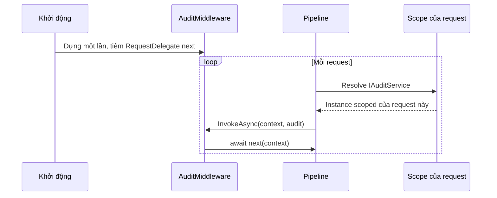

# 7.3 - Ba cách tiêm dependency

> **Tóm tắt:** Có ba kiểu tiêm phụ thuộc, nhưng chúng **không ngang hàng nhau**. **Constructor injection** là mặc định cho gần như mọi trường hợp, và là kiểu duy nhất container .NET hỗ trợ sẵn — nó cho bạn `readonly`, đảm bảo đối tượng không bao giờ ở trạng thái thiếu phụ thuộc, và biến constructor thành tài liệu trung thực. **Property injection** phá vỡ cả ba điều đó và container .NET **không hỗ trợ**. **Method injection** hẹp nhưng có chỗ đứng thật: khi framework tự tiêm vào từng lời gọi, như `[FromServices]` trong action hay `InvokeAsync` của middleware.

## Mục tiêu bài học

Sau bài này bạn có thể:

- Viết constructor injection đúng chuẩn với primary constructor của C# 12.
- Giải thích ba lý do constructor injection thắng property injection.
- Nhận ra ba chỗ method injection là cách làm chính thống.
- Xử lý phụ thuộc tuỳ chọn mà không cần property injection.

**Cần biết trước:** [bài 7.2](7.2-ioc-container-and-di-container.md), interface và constructor ([bài 4.1](../module-04-csharp-core/4.1-class-and-object.md), [bài 4.4](../module-04-csharp-core/4.4-interface.md)), project Web API đầu tiên ([bài 0.5](../../stage-01-foundation/module-00-setup/0.5-first-web-api.md)). Bài có nhắc tới middleware và controller của ASP.NET Core: mỗi chỗ đều giải thích ngắn, [bài 8.2](../../stage-03-aspnet-core-backend/module-08-aspnet-core-fundamentals/8.2-request-pipeline-and-middleware.md) và [bài 8.4](../../stage-03-aspnet-core-backend/module-08-aspnet-core-fundamentals/8.4-controllers-and-actions.md) dạy kỹ.

## Nội dung bài học

### 7.3.1 — Constructor injection

```csharp
public class CustomerService
{
    private readonly ICustomerRepository _repository;
    private readonly IEmailService _email;
    private readonly ILogger<CustomerService> _logger;

    public CustomerService(
        ICustomerRepository repository,
        IEmailService email,
        ILogger<CustomerService> logger)
    {
        _repository = repository;
        _email      = email;
        _logger     = logger;
    }
}
```

Từ C# 12, primary constructor gọn hơn nhiều:

```csharp
public class CustomerService(
    ICustomerRepository repository,
    IEmailService email,
    ILogger<CustomerService> logger)
{
    public async Task<Customer> CreateAsync(CreateCustomerRequest request, CancellationToken ct)
    {
        var customer = new Customer(request.Name, request.Email);
        await repository.AddAsync(customer, ct);
        await email.SendWelcomeAsync(customer.Email, ct);
        logger.LogInformation("Customer {CustomerId} created", customer.Id);
        return customer;
    }
}
```

Một lưu ý: tham số của primary constructor **không phải `readonly`** — bạn có thể gán lại chúng trong phương thức, và trình biên dịch không ngăn. Nếu muốn giữ đảm bảo đó thì vẫn viết constructor truyền thống, hoặc gán ra field `readonly`.

**Ba lý do nó là mặc định:**

1. **Bất biến** — field `readonly` không ai đổi được sau khi dựng.
2. **Không có trạng thái nửa vời** — đối tượng tồn tại nghĩa là nó đã đủ phụ thuộc.
3. **Trung thực** — đọc constructor là biết lớp này cần gì. Constructor dài là tín hiệu lớp làm quá nhiều việc, chứ không phải lỗi của DI.

**Còn kiểm tra `null` thì sao?**

```csharp
_repository = repository ?? throw new ArgumentNullException(nameof(repository));
```

Với lớp **do container tạo**, việc này thừa: container không bao giờ truyền `null` — nó ném exception ngay nếu thiếu đăng ký. Kiểm tra `null` chỉ đáng giá trong **thư viện công khai**, nơi người khác có thể gọi constructor trực tiếp. Trong code ứng dụng, bật nullable reference types là đủ.

### 7.3.2 — Property injection và vì sao nên tránh

```csharp
public class ReportGenerator
{
    public IReportFormatter? Formatter { get; set; }   // container .NET KHÔNG tiêm cái này
}
```

Container .NET **không** hỗ trợ property injection. Autofac có, nhưng cả khi có thì nó vẫn phá đúng ba điều ở mục trên:

- **Không `readonly`** — bất kỳ ai cũng gán lại được, kể cả nhầm.
- **Có trạng thái nửa vời** — giữa lúc `new` và lúc gán property, đối tượng tồn tại nhưng chưa dùng được.
- **Phụ thuộc bị giấu** — constructor rỗng, người đọc không biết lớp cần gì.

Điểm thứ hai gây ra `NullReferenceException` ở **rất xa** chỗ thật sự sai: ai đó quên gán property, và lỗi nổ ba tầng phía dưới.

**Phụ thuộc tuỳ chọn thì làm thế nào?** Không dùng property injection. Có ba cách tốt hơn:

```csharp
// 1. Null Object — implementation không làm gì
public sealed class NullReportFormatter : IReportFormatter
{
    public string Format(ReportData d) => d.ToString();
}
services.AddSingleton<IReportFormatter, NullReportFormatter>();

// 2. Constructor cho phép null, rõ ràng trong chữ ký
public class ReportGenerator(IReportFormatter? formatter = null) { }

// 3. Tách thành hai lớp, mỗi lớp một trách nhiệm
```

Cách 1 là tốt nhất: code dùng không cần kiểm tra `null` ở đâu cả.

### 7.3.3 — Method injection và ba chỗ nó đúng

Method injection là truyền phụ thuộc vào **từng lời gọi** thay vì vào đối tượng. Nó đúng khi **framework tự làm việc đó cho bạn**.

Chỗ đầu tiên là **middleware**: một lớp mà ASP.NET Core gọi cho **mọi** request, trước khi request tới endpoint (ví dụ ghi log, kiểm tra đăng nhập). Middleware nhận `next` để chuyển request cho khâu tiếp theo.

```csharp
// 1. Middleware — InvokeAsync được tiêm theo từng request
public class AuditMiddleware(RequestDelegate next)
{
    public async Task InvokeAsync(HttpContext context, IAuditService audit)
    {
        await audit.LogAsync(context.Request.Path);
        await next(context);
    }
}
```

Chỗ này **bắt buộc** dùng method injection: middleware được dựng **một lần** lúc khởi động (singleton), nên tiêm `IAuditService` (scoped) vào constructor là lỗi captive dependency — xem [bài 7.4](7.4-service-lifetimes.md).



```csharp
// 2. Minimal API — tiêm thẳng vào handler, mỗi request một lần
app.MapGet("/customers/{id}", async (int id, ICustomerService service, CancellationToken ct)
    => await service.GetAsync(id, ct));

// 3. [FromServices] trong controller — service chỉ một action cần
[HttpPost("export")]
public async Task<IActionResult> Export([FromServices] IExportService export, CancellationToken ct)
    => File(await export.BuildAsync(ct), "text/csv", "customers.csv");
```

Trường hợp 2 bạn đã gặp ở [bài 0.5](../../stage-01-foundation/module-00-setup/0.5-first-web-api.md): tham số của handler vừa có thể là dữ liệu từ URL (`id`), vừa có thể là service lấy từ container. Trường hợp 3 dùng cho controller, một cách viết endpoint khác mà [bài 8.4](../../stage-03-aspnet-core-backend/module-08-aspnet-core-fundamentals/8.4-controllers-and-actions.md) dạy; nó đáng dùng khi một service **nặng** mà chỉ một action trong controller cần: đưa vào constructor thì mọi request tới controller đó đều phải dựng nó.

**Không phải method injection: tự resolve ở composition root.** Trong `Program.cs`, đôi khi bạn tự lấy service ra để chạy một việc lúc khởi động:

```csharp
using var scope = app.Services.CreateScope();
var migrator = scope.ServiceProvider.GetRequiredService<IDbMigrator>();
await migrator.MigrateAsync();
```

Đây là **gọi container trực tiếp** ở composition root (nơi duy nhất trong ứng dụng biết về container), không phải method injection. Nó hợp lệ chỉ ở `Program.cs` và trong hạ tầng như `BackgroundService` ([bài 7.4](7.4-service-lifetimes.md)); đem cách này vào lớp nghiệp vụ là service locator ([bài 7.9](7.9-anti-patterns.md)).

Ngoài ba chỗ framework tự tiêm ở trên, method injection trong code của bạn thường là dấu hiệu lớp đang làm hai việc khác nhau.

### 7.3.4 — Bảng so sánh

| | Constructor | Property | Method |
|---|---|---|---|
| Container .NET hỗ trợ | Có | **Không** | Chỉ ở framework hook |
| `readonly` được | Có | Không | Không áp dụng |
| Phụ thuộc hiện rõ | Có | Không | Có, ở chữ ký hàm |
| Trạng thái nửa vời | Không | **Có** | Không |
| Khi nào dùng | Mặc định | Không dùng với container .NET | Middleware, minimal API, `[FromServices]` |

### 7.3.5 — Rà lại code của bạn

**Danh sách rà soát cách tiêm dependency**

- [ ] Mọi phụ thuộc bắt buộc đều đi qua constructor.
- [ ] Mỗi lớp chỉ có một constructor công khai.
- [ ] Field phụ thuộc là readonly, hoặc dùng primary constructor có ý thức.
- [ ] Không có public setter nào dùng để tiêm phụ thuộc.
- [ ] Phụ thuộc tuỳ chọn dùng Null Object thay vì property nullable.
- [ ] Middleware tiêm service scoped qua InvokeAsync, không qua constructor.
- [ ] [FromServices] chỉ dùng cho service nặng mà một action cần.
- [ ] Không kiểm tra null thủ công trong constructor của lớp nội bộ.

## Bài tập áp dụng

#### Bài 1 — Primary constructor và điều nó **không** bảo đảm

Lấy một service có 4 phụ thuộc, viết lại bằng primary constructor của C# 12. Thử gán lại một tham số trong phương thức và quan sát trình biên dịch **không** báo lỗi.

**Tiêu chí hoàn thành:** bạn nêu được vì sao điều đó là một khác biệt có ý nghĩa so với trường `readonly`.

<details>
<summary><strong>Gợi ý và lời giải — Bài 1</strong></summary>

**Gợi ý.** Tham số của primary constructor được trình biên dịch nâng thành **trường ẩn** — nhưng trường đó có `readonly` không?

**Lời giải — trước:**

```csharp
public class OrderService
{
    private readonly IOrderRepository _repo;
    private readonly IEmailSender _mail;
    private readonly ITaxCalculator _tax;
    private readonly ILogger<OrderService> _log;

    public OrderService(IOrderRepository repo, IEmailSender mail,
                        ITaxCalculator tax, ILogger<OrderService> log)
    {
        _repo = repo; _mail = mail; _tax = tax; _log = log;
    }
}
```

**Sau — 13 dòng xuống 1:**

```csharp
public class OrderService(
    IOrderRepository repo,
    IEmailSender mail,
    ITaxCalculator tax,
    ILogger<OrderService> log)
{
    public async Task ProcessAsync(Order o, CancellationToken ct)
    {
        await repo.AddAsync(o, ct);
        log.LogInformation("Đã xử lý đơn {Id}", o.Id);
    }
}
```

**Thử gán lại:**

```csharp
public void Sabotage()
{
    repo = new EfOrderRepository(null!);   // BIÊN DỊCH ĐƯỢC
}
```

Trình biên dịch **không báo lỗi**. Với bản dùng trường `readonly`, cùng dòng đó cho lỗi:

```text
error CS0191: A readonly field cannot be assigned to
```

**Vì sao điều này có ý nghĩa.** Tham số primary constructor được nâng thành trường ẩn **không có `readonly`**. Hệ quả là một lớp có thể tự thay đổi phụ thuộc của mình giữa chừng, và không có gì ngăn cản:

```csharp
public class Svc(IEmailSender mail)
{
    public void Reset() => mail = new NullEmailSender();   // hợp lệ
    public Task SendAsync() => mail.SendAsync(...);        // giờ là bản khác
}
```

Đây là một **thoái lui nhỏ về tính bất biến** so với cách viết cũ. Trong thực tế hiếm ai cố tình làm vậy, nhưng nó có thể xảy ra do nhầm lẫn — ví dụ gõ `repo = ...` khi định viết `var repo = ...`.

**Cách lấy lại bảo đảm khi cần:**

```csharp
public class OrderService(IOrderRepository repo)
{
    private readonly IOrderRepository _repo = repo;    // gán vào trường readonly
    // dùng _repo thay vì repo
}
```

Đổi lại thì mất phần lớn sự gọn gàng. Với phần lớn service, primary constructor vẫn là đánh đổi tốt.

**Ba lưu ý khác về primary constructor:**

1. **Tham số được ghi lại thành trường chỉ khi được dùng.** Nếu bạn chỉ truyền nó cho lớp cơ sở, trình biên dịch không tạo trường — đó là tối ưu tốt, và là lý do cảnh báo `CS9113` xuất hiện khi tham số không được dùng.

2. **Cẩn thận với `record` có primary constructor.** Với `record`, tham số trở thành **thuộc tính công khai**; với `class` thì không. Đây là khác biệt dễ nhầm:

   ```csharp
   public record R(int X);      // X là thuộc tính CÔNG KHAI
   public class C(int X);       // X là trường ẩn, KHÔNG công khai
   ```

3. **Không dùng được với xác thực trong constructor.** Muốn kiểm tra tham số trước khi gán thì phải viết constructor thường — hoặc dùng cách gán vào trường có xác thực:

   ```csharp
   public class Svc(string name)
   {
       private readonly string _name = string.IsNullOrWhiteSpace(name)
           ? throw new ArgumentException(null, nameof(name))
           : name;
   }
   ```

</details>

#### Bài 2 — Tái hiện lỗi property injection

Viết một lớp có phụ thuộc qua thuộc tính, quên gán nó, và quan sát `NullReferenceException` nổ ra **ở đâu** so với chỗ thật sự sai. Thay bằng Null Object và so sánh.

**Tiêu chí hoàn thành:** bạn chỉ ra được khoảng cách giữa **nơi lỗi nổ** và **nơi nguyên nhân**.

<details>
<summary><strong>Gợi ý và lời giải — Bài 2</strong></summary>

**Gợi ý.** Với constructor injection, thiếu phụ thuộc thì **không tạo được đối tượng**. Với property injection, đối tượng được tạo bình thường và lỗi chỉ xuất hiện khi thuộc tính đó được dùng.

**Lời giải.**

```csharp
public class OrderService(IOrderRepository repo)
{
    public IEmailSender? Mail { get; set; }             // property injection: không gì bắt buộc gán

    public async Task ProcessAsync(Order o, CancellationToken ct)
    {
        await repo.AddAsync(o, ct);                     // dòng 7 — đơn hàng ĐÃ được lưu
        // ... 40 dòng logic nghiệp vụ ...
        await Mail!.SendConfirmationAsync(o, ct);       // dòng 48 — NỔ Ở ĐÂY
    }
}

// Ở Program.cs — container .NET không gán thuộc tính, và không ai tự gán
builder.Services.AddScoped<OrderService>();             // dòng 27 — NGUYÊN NHÂN Ở ĐÂY
```

Dấu `!` sau `Mail` bảo trình biên dịch "tôi chắc chắn nó không null" để tắt cảnh báo nullable ([bài 5.6](../module-05-advanced-csharp/5.6-nullable-reference-types.md)); lúc chạy nó vẫn là `null`.

**Khoảng cách:**

| | Nơi |
|---|---|
| Nguyên nhân thật | `Program.cs` dòng 27 — không ai gán `Mail` |
| Nơi lỗi nổ | `OrderService.cs` dòng 48 |
| Thời điểm | Khi request đầu tiên đi tới nhánh gửi email |

Ba khoảng cách cùng lúc: **khác file**, **khác thời điểm**, và **đơn hàng đã được lưu rồi** — nên hệ thống ở trạng thái dở dang.

Với constructor injection, cùng lỗi đó cho:

```text
InvalidOperationException: Unable to resolve service for type 'IEmailSender'
while attempting to activate 'OrderService'.
```

Thông báo nói rõ **thiếu gì** và **cho lớp nào**, và nó xuất hiện **lúc khởi động** nếu bật `ValidateOnBuild` như [bài 7.5](7.5-registering-services.md) trình bày.

**Null Object — giảm nhẹ nhưng không sửa gốc:**

```csharp
public sealed class NullEmailSender : IEmailSender
{
    public static readonly NullEmailSender Instance = new();
    public Task SendConfirmationAsync(Order o, CancellationToken ct) => Task.CompletedTask;
}

public class OrderService
{
    public IEmailSender Mail { get; set; } = NullEmailSender.Instance;   // mặc định an toàn
}
```

Giờ không còn `NullReferenceException`. Nhưng hãy chú ý điều đã đổi:

| | Trước (null) | Sau (Null Object) |
|---|---|---|
| Triệu chứng | Ngoại lệ rõ ràng | **Không có triệu chứng** |
| Hậu quả | Request thất bại | Email **âm thầm không được gửi** |
| Phát hiện | Ngay | Khi khách hàng phàn nàn |

Null Object đổi một lỗi **ồn ào** thành một lỗi **im lặng**. Với thứ không quan trọng như ghi log, đó là đánh đổi tốt — `NullLogger<T>.Instance` tồn tại chính vì lý do đó. Với thứ quan trọng như gửi email xác nhận, đó là đánh đổi tệ.

**Khi nào còn gặp property injection.** Với container .NET mặc định thì không bao giờ: nó không gán thuộc tính. Bạn chỉ gặp nó trong hai hoàn cảnh:

1. **Framework tự gán thuộc tính**, ví dụ `[Inject]` trong component Blazor. Đó là quy ước của framework, bạn không tự chọn.
2. **Dự án dùng container khác** như Autofac, có tính năng gán thuộc tính. Kể cả khi đó, chỉ nên dùng cho phụ thuộc thật sự tuỳ chọn có mặc định an toàn (như logger dạng Null Object), hoặc để tạm phá một vòng phụ thuộc trong code cũ trong lúc chờ sửa thiết kế.

Ngoài hai hoàn cảnh đó, constructor injection luôn tốt hơn vì nó biến "quên cấu hình" thành **lỗi lúc khởi động** thay vì **lỗi lúc chạy**.

</details>

#### Bài 3 — Captive dependency trong middleware

Tạo project `dotnet new web`, tiêm một service `Scoped` vào **constructor** của middleware, chạy ứng dụng và ghi lại ngoại lệ. Chuyển sang tham số của `InvokeAsync` và xác nhận nó chạy.

**Tiêu chí hoàn thành:** bạn nêu được vì sao middleware là `Singleton` dù bạn không đăng ký nó như vậy.

<details>
<summary><strong>Gợi ý và lời giải — Bài 3</strong></summary>

**Gợi ý.** Middleware được dựng **một lần** khi đường ống được xây, không phải mỗi request. Vậy vòng đời thực tế của nó là gì?

**Lời giải — bản sai:**

```csharp
public class TenantMiddleware
{
    private readonly RequestDelegate _next;
    private readonly ITenantContext _tenant;          // Scoped

    public TenantMiddleware(RequestDelegate next, ITenantContext tenant)
    {
        _next = next;
        _tenant = tenant;
    }

    public async Task InvokeAsync(HttpContext ctx) => await _next(ctx);
}
```

```csharp
// Program.cs
builder.Services.AddScoped<ITenantContext, TenantContext>();
var app = builder.Build();
app.UseMiddleware<TenantMiddleware>();     // gắn middleware vào pipeline
```

Chạy trên .NET 10 ở môi trường Development, ứng dụng dừng ngay lúc khởi động:

```text
crit: Microsoft.AspNetCore.Hosting.Diagnostics[6]
      Application startup exception
      System.InvalidOperationException: Cannot resolve scoped service 'ITenantContext' from root provider.
```

**Bản đúng — nhận qua tham số của `InvokeAsync`:**

```csharp
public class TenantMiddleware(RequestDelegate next)
{
    public async Task InvokeAsync(HttpContext ctx, ITenantContext tenant)
    {
        // tenant được lấy từ phạm vi CỦA REQUEST NÀY
        ctx.Items["TenantId"] = tenant.TenantId;
        await next(ctx);
    }
}
```

**Vì sao middleware là `Singleton`.** Đường ống middleware được xây **một lần** lúc khởi động. Mỗi middleware được khởi tạo đúng một lần và tồn tại suốt vòng đời ứng dụng — dù bạn không viết `AddSingleton` ở đâu cả.

Đây là điểm dễ gây bất ngờ: vòng đời không đến từ đăng ký DI mà đến từ **cách framework xây đường ống**.

ASP.NET Core biết điều này, nên nó cho phép `InvokeAsync` nhận thêm tham số và **tự giải quyết chúng từ phạm vi của request**. Đây là một trong số ít chỗ mà method injection là cách làm đúng và được khuyến khích.

**Cùng vấn đề, ba chỗ khác:**

| Thành phần | Vòng đời thực tế | Cách nhận service `Scoped` |
|---|---|---|
| Middleware | `Singleton` | Tham số của `InvokeAsync` |
| `BackgroundService` | `Singleton` | `IServiceScopeFactory` |
| `IHostedService` | `Singleton` | `IServiceScopeFactory` |
| Bộ lọc dạng thuộc tính | Tuỳ cách đăng ký | `ServiceFilter` hoặc `TypeFilter` |

**Middleware dựa trên factory — lựa chọn thay thế.** Khi bạn muốn middleware có vòng đời `Scoped`:

```csharp
public class TenantMiddleware(ITenantContext tenant) : IMiddleware
{
    public async Task InvokeAsync(HttpContext ctx, RequestDelegate next)
    {
        ctx.Items["TenantId"] = tenant.TenantId;
        await next(ctx);
    }
}

builder.Services.AddScoped<TenantMiddleware>();    // BẮT BUỘC phải đăng ký
app.UseMiddleware<TenantMiddleware>();
```

Với `IMiddleware`, ASP.NET Core lấy middleware từ container **cho mỗi request**, nên constructor injection service `Scoped` trở nên hợp lệ.

**So sánh hai cách:**

| | Quy ước (`InvokeAsync`) | `IMiddleware` |
|---|---|---|
| Phải đăng ký DI | Không | **Có** |
| Vòng đời | `Singleton` | Theo đăng ký |
| Nhận service `Scoped` | Qua tham số phương thức | Qua constructor |
| Hiệu năng | Nhanh hơn chút | Một lần resolve mỗi request |
| Kiểm tra lúc biên dịch | Không — dựa trên quy ước tên | **Có** — cài interface |

Với middleware đơn giản, cách quy ước là đủ và nhẹ hơn. Với middleware có nhiều phụ thuộc, `IMiddleware` rõ ràng hơn và được trình biên dịch kiểm tra.

</details>

## Tự kiểm tra

<details>
<summary>Vì sao constructor injection là mặc định?</summary>

Ba lý do. Nó cho phép field readonly nên phụ thuộc bất biến sau khi dựng. Nó không tạo ra trạng thái nửa vời, tức đối tượng tồn tại nghĩa là đã đủ phụ thuộc. Và nó trung thực, đọc constructor là biết lớp cần gì. Đây cũng là kiểu duy nhất container .NET hỗ trợ sẵn.

</details>

<details>
<summary>Primary constructor của C# 12 có nhược điểm gì?</summary>

Tham số của nó không phải readonly, bạn có thể gán lại trong phương thức và trình biên dịch không ngăn. Nếu muốn giữ đảm bảo bất biến thì viết constructor truyền thống hoặc gán ra field readonly.

</details>

<details>
<summary>Có nên kiểm tra null trong constructor không?</summary>

Với lớp do container tạo thì thừa, vì container không bao giờ truyền null mà sẽ ném exception ngay nếu thiếu đăng ký. Kiểm tra null chỉ đáng giá trong thư viện công khai nơi người khác gọi constructor trực tiếp. Trong code ứng dụng, bật nullable reference types là đủ.

</details>

<details>
<summary>Vì sao nên tránh property injection?</summary>

Container .NET không hỗ trợ nó, và ngay cả khi dùng container khác thì nó phá cả ba lợi ích của constructor injection: không readonly được, có trạng thái nửa vời giữa lúc new và lúc gán, và phụ thuộc bị giấu khỏi constructor. Hậu quả điển hình là NullReferenceException nổ ra rất xa chỗ thật sự sai.

</details>

<details>
<summary>Phụ thuộc tuỳ chọn thì xử lý thế nào?</summary>

Tốt nhất là Null Object, tức một implementation không làm gì được đăng ký bình thường, để code dùng không phải kiểm tra null ở đâu cả. Hai cách khác là tham số constructor nullable có giá trị mặc định, hoặc tách thành hai lớp mỗi lớp một trách nhiệm.

</details>

<details>
<summary>Method injection đúng ở những chỗ nào?</summary>

Ba chỗ framework tự tiêm theo từng lời gọi: tham số của InvokeAsync trong middleware, tham số của handler minimal API, và tham số có [FromServices] trong action của controller. Với middleware thì đây là bắt buộc chứ không phải lựa chọn, vì middleware được dựng một lần nên tiêm service scoped vào constructor là captive dependency. Còn việc tự resolve qua CreateScope trong Program.cs là gọi container ở composition root, không phải method injection.

</details>

## Kết luận

Ba điều đáng nhớ nhất:

1. **Constructor injection là mặc định** — và là kiểu duy nhất container .NET hỗ trợ.
2. **Property injection giấu phụ thuộc và tạo trạng thái nửa vời.** Dùng Null Object cho phụ thuộc tuỳ chọn.
3. **Method injection đúng ở ba chỗ framework tự tiêm**, và với middleware thì nó bắt buộc.

## Tham khảo

- [Dependency injection in ASP.NET Core](https://learn.microsoft.com/en-us/aspnet/core/fundamentals/dependency-injection)
- [Dependency injection guidelines](https://learn.microsoft.com/en-us/dotnet/core/extensions/dependency-injection-guidelines)
- [Write custom ASP.NET Core middleware](https://learn.microsoft.com/en-us/aspnet/core/fundamentals/middleware/write)
- [Primary constructors (C# reference)](https://learn.microsoft.com/en-us/dotnet/csharp/programming-guide/classes-and-structs/instance-constructors#primary-constructors)

## Điều hướng

- **Bài trước:** [7.2 — IoC Container và DI Container](7.2-ioc-container-and-di-container.md)
- **Bài tiếp theo:** [7.4 — Service Lifetimes](7.4-service-lifetimes.md)
- **Về module:** [Trang mục lục](README.md)
