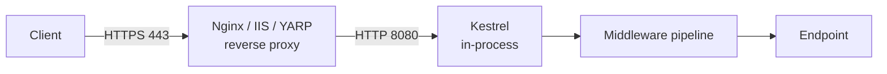

# 8.1 - Kiến trúc ASP.NET Core

> **Tóm tắt:** ASP.NET Core không phải bản nâng cấp của ASP.NET — nó được **viết lại từ đầu**, và ba quyết định thiết kế giải thích mọi thứ còn lại. **Kestrel** là HTTP server chạy in-process, thay cho việc phụ thuộc IIS; nó tự phục vụ được nhưng trong production gần như luôn đứng sau **reverse proxy**. **Pipeline là một chuỗi middleware do bạn lắp**, không phải một danh sách `HttpModule` cố định. Và **mọi thứ đều là service trong DI container**, kể cả những thứ trước đây là `static`. Từ .NET 6, `Startup.cs` biến mất và tất cả gói vào `Program.cs` — cùng một lớp `WebApplication` đóng cả hai vai trò builder và host.

## Mục tiêu bài học

Sau bài này bạn có thể:

- Giải thích vai trò của Kestrel và vì sao cần reverse proxy.
- Cấu hình forwarded headers để thấy đúng IP người dùng mà không tin header giả.
- Mô tả minimal hosting model và những gì `CreateBuilder` làm sẵn.
- Phân biệt Generic Host với `WebApplication`, và biết host chờ bao lâu khi tắt.
- Đọc hiểu cách ASP.NET Core quyết định môi trường đang chạy.

**Cần biết trước:** [bài 0.5 — Web API đầu tiên](../../stage-01-foundation/module-00-setup/0.5-first-web-api.md), [bài 7.6 — `Program.cs` và `WebApplicationBuilder`](../../stage-02-csharp-professional/module-07-dependency-injection/7.6-program-cs-and-webapplicationbuilder.md), [bài 6.4 — `CancellationToken`](../../stage-02-csharp-professional/module-06-async-programming/6.4-cancellationtoken.md) (cho bài tập 3).

## Nội dung bài học

### 8.1.1 — Khác biệt so với ASP.NET (.NET Framework)

| | ASP.NET (.NET Framework) | ASP.NET Core |
|---|---|---|
| Hệ điều hành | Chỉ Windows | Windows, Linux, macOS |
| Web server | Bắt buộc IIS | Kestrel, có thể sau Nginx/IIS/YARP |
| Pipeline | `HttpModule` / `HttpHandler` | Chuỗi middleware do bạn lắp |
| DI | Không có sẵn | Có sẵn, dùng khắp framework |
| Cấu hình | `web.config` (XML) | `appsettings.json`, biến môi trường, Key Vault |
| Khởi động | `Global.asax` + `Startup.cs` | Chỉ `Program.cs` |
| Hiệu năng | Trung bình | Thuộc nhóm đầu trong bảng đo TechEmpower |

Hai dòng đáng chú ý nhất: **DI** và **pipeline**. Trong ASP.NET cũ, `HttpContext.Current` là `static` và có thể gọi từ bất cứ đâu; điều đó làm code không test được và tạo ra chính những ambient context mà [bài 7.9](../../stage-02-csharp-professional/module-07-dependency-injection/7.9-anti-patterns.md) cảnh báo. ASP.NET Core bỏ nó: muốn `HttpContext` ở ngoài controller thì phải tiêm `IHttpContextAccessor`.

### 8.1.2 — Kestrel và reverse proxy



**Kestrel** là HTTP server viết bằng C#, chạy **trong chính tiến trình** ứng dụng — không có ranh giới tiến trình giữa server và code của bạn như thời IIS. Đây là một phần lớn lý do ASP.NET Core nhanh.

**Reverse proxy** là một server đứng trước ứng dụng: nhận request từ Internet rồi chuyển tiếp vào Kestrel. Kestrel tự chạy được, nhưng trong production nó thường đứng sau reverse proxy vì bốn lý do:

1. **Kết thúc TLS** — proxy giữ chứng chỉ, gia hạn chứng chỉ, giải mã HTTPS.
2. **Chống tấn công ở tầng ngoài** — rate limit, lọc IP, chịu kiểu tấn công slow-loris.
3. **Nhiều ứng dụng một cổng 443** — định tuyến theo tên miền.
4. **File tĩnh** — Nginx phục vụ nhanh hơn và rẻ hơn.

Hệ quả cần biết: sau proxy, mọi request tới Kestrel đều có IP nguồn là **IP của proxy**, và giao thức là `http` chứ không phải `https`. Proxy ghi IP thật và giao thức gốc vào header `X-Forwarded-For` và `X-Forwarded-Proto`. Middleware forwarded headers đọc hai header đó và gán lại cho `HttpContext`:

```csharp
builder.Services.Configure<ForwardedHeadersOptions>(options =>
{
    options.ForwardedHeaders = ForwardedHeaders.XForwardedFor | ForwardedHeaders.XForwardedProto;
    options.KnownIPNetworks.Add(System.Net.IPNetwork.Parse("172.18.0.0/16"));  // mạng của proxy
});

var app = builder.Build();
app.UseForwardedHeaders();
```

Hai điều phải nhớ:

- **Mặc định nó chỉ tin proxy chạy trên cùng máy** (địa chỉ loopback `127.0.0.1` và `::1`). Header đến từ proxy ở máy khác, kể cả container Nginx bên cạnh, bị **bỏ qua** cho tới khi bạn khai báo mạng của proxy trong `KnownIPNetworks` hoặc địa chỉ cụ thể trong `KnownProxies`. Bài tập 1 cho thấy điều này.
- **Đặt `UseForwardedHeaders()` trước mọi middleware đọc IP hoặc scheme.** Quên bước này thì rate limit theo IP sẽ coi mọi người dùng là một, còn `UseHttpsRedirection` sẽ chuyển hướng vô tận vì luôn thấy `http`.

Từ .NET 10, `KnownNetworks` và kiểu `Microsoft.AspNetCore.HttpOverrides.IPNetwork` bị đánh dấu lỗi thời (cảnh báo `ASPDEPR005`). Dùng `KnownIPNetworks` với `System.Net.IPNetwork` như trên. Tài liệu và bài viết cũ vẫn dùng tên cũ.

> [!WARNING]
> **Cẩn thận với header chuyển tiếp**
>
> Chỉ tin `X-Forwarded-*` khi request thật sự đến từ proxy của bạn. Bài [Forward header trong ASP.NET Core: vì sao "forward hết" là một lỗi kiến trúc](https://tiennhm.io.vn/blog/forward-http-header-an-toan-aspnet-core) nói rõ vì sao chuyển tiếp bừa là lỗ hổng.

### 8.1.3 — Minimal hosting model

Đây là `Program.cs` mà `dotnet new webapi --use-controllers` sinh ra trên .NET 10:

```csharp
var builder = WebApplication.CreateBuilder(args);

builder.Services.AddControllers();
builder.Services.AddOpenApi();

var app = builder.Build();

if (app.Environment.IsDevelopment())
{
    app.MapOpenApi();
}

app.UseHttpsRedirection();
app.UseAuthorization();
app.MapControllers();

app.Run();
```

`AddOpenApi()` và `MapOpenApi()` sinh tài liệu OpenAPI tại `/openapi/v1.json`. Từ .NET 9, template không còn kèm Swagger UI (gói Swashbuckle); giao diện xem tài liệu được bàn ở [bài 9.3](../module-09-web-api-professional/9.3-swagger-openapi.md).

`WebApplication.CreateBuilder(args)` làm sẵn khá nhiều thứ. Với cấu hình, nó nạp các nguồn theo **thứ tự ưu tiên tăng dần**:

1. `appsettings.json`
2. `appsettings.{Environment}.json`
3. User secrets (chỉ Development)
4. Biến môi trường
5. Tham số dòng lệnh

Nguồn sau **đè** nguồn trước — nên biến môi trường luôn thắng file. Đây là cách container truyền cấu hình vào ([bài 8.6](8.6-configuration-system.md)).

Nó cũng cấu hình logging (Console, Debug, EventSource), thiết lập Kestrel và IIS integration, đăng ký `IConfiguration`, `IWebHostEnvironment`, `ILogger<T>`, và bật `ValidateScopes` **chỉ khi** môi trường là Development ([bài 7.4](../../stage-02-csharp-professional/module-07-dependency-injection/7.4-service-lifetimes.md)).

Lớp `WebApplication` cài đồng thời ba interface: `IHost` (vòng đời), `IApplicationBuilder` (pipeline) và `IEndpointRouteBuilder` (định tuyến). Đó là lý do bạn gọi được cả `app.Use...`, `app.Map...` và `app.Run()` trên cùng một đối tượng — và cũng là lý do `app.Run()` có **hai nghĩa hoàn toàn khác nhau**:

```csharp
app.Run(async ctx => await ctx.Response.WriteAsync("hi"));   // terminal middleware
app.Run();                                                    // khởi động và chặn luồng
```

### 8.1.4 — Generic Host

`WebApplication` dựng trên **Generic Host** (`Microsoft.Extensions.Hosting`) — chính là thứ mà Worker Service dùng. Nó lo vòng đời: khởi động mọi `IHostedService`, lắng nghe tín hiệu dừng (SIGTERM trên Linux, Ctrl+C trong terminal), và tắt gọn gàng.

Ý nghĩa thực tế: `BackgroundService` bạn viết ở [bài 6.8](../../stage-02-csharp-professional/module-06-async-programming/6.8-channels-and-producer-consumer.md) chạy **bên trong cùng tiến trình** với web app, dùng chung DI container, chung cấu hình, chung logger.

Khi nhận tín hiệu dừng, host ngừng nhận request mới, chờ request đang chạy xong, gọi `StopAsync` của mọi hosted service, rồi thoát. Thời gian chờ tối đa là `HostOptions.ShutdownTimeout`, **mặc định 30 giây** trên .NET 10 (các phiên bản .NET cũ dùng 5 giây, nên tài liệu cũ hay ghi con số này). Request nào chưa xong sau khoảng đó bị cắt.

### 8.1.5 — Môi trường

```csharp
if (app.Environment.IsDevelopment())
    app.UseDeveloperExceptionPage();
else
    app.UseExceptionHandler("/error");
```

Môi trường đọc từ biến `ASPNETCORE_ENVIRONMENT`. Ba giá trị có ý nghĩa sẵn: `Development`, `Staging`, `Production`. **Không đặt gì thì mặc định là `Production`** — an toàn theo mặc định, nhưng cũng là lý do người mới thấy "sao trên máy tôi không có trang lỗi chi tiết". Khi chạy bằng `dotnet run`, file `Properties/launchSettings.json` của template đặt sẵn `Development` cho bạn.

Tên tuỳ ý cũng được (`QA`, `Demo`) với `IsEnvironment("QA")`, nhưng lưu ý `IsDevelopment()` chỉ đúng với đúng chữ `Development`.

Đừng bao giờ để `UseDeveloperExceptionPage()` chạy ở Production: nó in stack trace, đường dẫn file nguồn và header của request ra cho người dùng.

### 8.1.6 — Rà lại code của bạn

**Danh sách rà soát kiến trúc**

- [ ] Sau reverse proxy đã bật `UseForwardedHeaders`, đặt trước mọi middleware đọc IP hoặc scheme.
- [ ] Mạng hoặc địa chỉ của proxy đã khai trong `KnownIPNetworks` hoặc `KnownProxies`, không tin mọi nguồn.
- [ ] Không dùng `HttpContext` qua static; cần thì tiêm `IHttpContextAccessor`.
- [ ] Trang lỗi chi tiết chỉ bật ở Development.
- [ ] Biết rõ `ASPNETCORE_ENVIRONMENT` được đặt ở đâu cho từng môi trường triển khai.
- [ ] `ShutdownTimeout` đủ dài cho request và tác vụ nền dài nhất.
- [ ] Cấu hình nhạy cảm đến từ biến môi trường, không từ `appsettings.json` đã commit.

## Bài tập áp dụng

#### Bài 1 — Thấy IP của proxy thay vì của người dùng

Đặt ứng dụng sau một proxy ở **máy khác** (một container khác), ghi lại `HttpContext.Connection.RemoteIpAddress` trong ba trường hợp: chưa bật `UseForwardedHeaders`, bật với cấu hình mặc định, và bật kèm `KnownIPNetworks`.

Cách chạy không cần Nginx: tạo một mạng Docker, chạy ứng dụng trong một container, rồi gửi request từ container thứ hai đóng vai proxy, tự gắn header `X-Forwarded-For`. Chưa quen Docker thì đọc lời giải và kết quả bên dưới; [Module 15](../../stage-04-database-production/module-15-docker-deployment/README.md) dạy Docker.

**Tiêu chí hoàn thành:** bạn nêu được ba tính năng bị hỏng khi IP sai, và vì sao **không** nên tin `X-Forwarded-For` từ mọi nguồn.

<details>
<summary><strong>Gợi ý và lời giải — Bài 1</strong></summary>

**Gợi ý.** Với reverse proxy, kết nối TCP mà Kestrel nhìn thấy đến **từ proxy**, không phải từ người dùng. IP thật chỉ còn trong header.

**Lời giải.** Endpoint in ra những gì Kestrel thấy:

```csharp
app.MapGet("/", (HttpContext ctx) =>
    $"IP={ctx.Connection.RemoteIpAddress}, " +
    $"X-Forwarded-For={ctx.Request.Headers["X-Forwarded-For"]}, Scheme={ctx.Request.Scheme}");
```

Chạy ứng dụng (đã `dotnet publish -o out`) trong mạng Docker `172.30.0.0/16`, rồi gọi từ container `172.30.0.2` đóng vai proxy:

```bash
docker network create --subnet 172.30.0.0/16 proxynet
docker run -d --name app --network proxynet --ip 172.30.0.10 \
  -v "$PWD/out:/app" -w /app mcr.microsoft.com/dotnet/aspnet:10.0 dotnet MyApp.dll
docker run --rm --network proxynet --ip 172.30.0.2 mcr.microsoft.com/dotnet/sdk:10.0 \
  curl -s http://172.30.0.10:8080/ -H "X-Forwarded-For: 203.0.113.45" -H "X-Forwarded-Proto: https"
```

Kết quả chạy thật trên .NET 10:

```text
Chưa bật UseForwardedHeaders:
IP=::ffff:172.30.0.2, X-Forwarded-For=203.0.113.45, Scheme=http

Bật UseForwardedHeaders, cấu hình mặc định:
IP=::ffff:172.30.0.2, X-Forwarded-For=203.0.113.45, Scheme=http

Bật UseForwardedHeaders, thêm KnownIPNetworks 172.30.0.0/16:
IP=203.0.113.45, X-Forwarded-For=, Scheme=https
```

`::ffff:172.30.0.2` là địa chỉ IPv4 `172.30.0.2` viết dưới dạng IPv6, tức IP của "proxy". Dòng thứ hai là chỗ nhiều người bất ngờ: bật middleware mà **không có tác dụng gì**, vì mặc định nó chỉ tin proxy ở loopback, còn proxy này ở máy khác. Chỉ khi khai báo mạng của proxy, middleware mới đọc header, gán IP thật vào `RemoteIpAddress`, đổi `Scheme` thành `https`, rồi **xoá header đã dùng**.

Cấu hình đã dùng cho dòng thứ ba:

```csharp
builder.Services.Configure<ForwardedHeadersOptions>(o =>
{
    o.ForwardedHeaders = ForwardedHeaders.XForwardedFor | ForwardedHeaders.XForwardedProto;
    o.KnownIPNetworks.Add(System.Net.IPNetwork.Parse("172.30.0.0/16"));   // mạng của proxy
});
```

**Ba tính năng hỏng khi IP sai:**

| Tính năng | Hỏng thế nào |
|---|---|
| Giới hạn tần suất theo IP | Mọi request trông như đến từ **cùng một IP** — hoặc chặn hết, hoặc không chặn ai |
| Danh sách trắng IP | Không phân biệt được người dùng, nên hoặc mở cho tất cả hoặc chặn tất cả |
| Nhật ký kiểm toán | Ghi lại IP của proxy — vô dụng khi cần điều tra |

Ngoài ra `Scheme` sai làm `Url.Action` sinh ra đường dẫn `http://` trong email và trong chuyển hướng.

**Vì sao không tin `X-Forwarded-For` từ mọi nguồn.** Header này do client gửi được, nên **client giả mạo được**:

```bash
curl http://api.example.com/api/admin -H "X-Forwarded-For: 127.0.0.1"
```

Nếu ứng dụng tin header này vô điều kiện (ví dụ xoá hết `KnownIPNetworks` và `KnownProxies` để "cho chạy được"), kẻ tấn công tự nhận mình là `127.0.0.1` và vượt qua mọi danh sách trắng dựa trên IP. Danh sách proxy tin cậy chính là lớp bảo vệ: header chỉ được đọc khi kết nối TCP đến từ proxy của bạn.

**`ForwardLimit`** mặc định là 1: middleware chỉ xử lý **một** tầng, tức giá trị cuối cùng trong chuỗi `X-Forwarded-For` (giá trị do proxy gần nhất thêm vào). Với Cloudflare hoặc CDN đứng trước Nginx, có hai tầng proxy, nên phải tăng `ForwardLimit` và khai báo cả hai, hoặc dùng header riêng của nhà cung cấp như `CF-Connecting-IP`. Bài [Chuyển tiếp HTTP header an toàn trong ASP.NET Core](https://tiennhm.io.vn/blog/forward-http-header-an-toan-aspnet-core) đi sâu vào từng trường hợp.

**Vị trí trong đường ống.** `UseForwardedHeaders` phải đứng **rất sớm**, trước mọi middleware đọc IP hoặc scheme.

</details>

#### Bài 2 — Thứ tự nguồn cấu hình

Đặt cùng một khoá trong `appsettings.json`, `appsettings.Development.json` và biến môi trường với ba giá trị khác nhau. In ra giá trị cuối cùng và xác nhận thứ tự ưu tiên.

**Tiêu chí hoàn thành:** bạn xác nhận đúng thứ tự và biết công cụ nào cho biết provider nào đã thắng.

<details>
<summary><strong>Gợi ý và lời giải — Bài 2</strong></summary>

**Gợi ý.** Bài này trùng ý với [bài 8.6](8.6-configuration-system.md) nhưng ở đây trọng tâm là cách `CreateBuilder` thiết lập sẵn thứ tự — bạn không phải cấu hình gì.

**Lời giải.**

```json
// appsettings.json
{ "Demo": { "Value": "from-appsettings" } }
```

```json
// appsettings.Development.json
{ "Demo": { "Value": "from-appsettings-development" } }
```

```csharp
app.MapGet("/config", (IConfiguration c) => c["Demo:Value"]);
```

Đặt biến môi trường rồi chạy. Hai dấu gạch dưới `__` thay cho dấu hai chấm, [bài 8.6](8.6-configuration-system.md) giải thích vì sao:

```bash
# bash (Linux, macOS, Git Bash)
export ASPNETCORE_ENVIRONMENT=Development
export Demo__Value="from-env-var"
dotnet run
```

```powershell
# PowerShell
$env:ASPNETCORE_ENVIRONMENT = "Development"
$env:Demo__Value = "from-env-var"
dotnet run
```

`GET /config` trả `from-env-var`. Muốn biết provider nào thắng, in `GetDebugView()`:

```csharp
Console.WriteLine(((IConfigurationRoot)app.Configuration).GetDebugView());
```

Đoạn liên quan trong output thật:

```text
Demo:
  Value=from-env-var (EnvironmentVariablesConfigurationProvider)
```

Biến môi trường thắng, và `GetDebugView()` ghi rõ provider thắng trong dấu ngoặc.

**Ba hệ quả quan trọng khi triển khai:**

1. **Cùng một image Docker chạy được ở mọi môi trường.** Chỉ đổi biến môi trường. Đây là nguyên tắc thứ ba của [Twelve-Factor App](https://12factor.net/config), và là lý do không nên build image riêng cho từng môi trường.
2. **Bí mật không nằm trong kho code.** Chúng ở biến môi trường hoặc kho bí mật, nên luôn thắng mọi giá trị mặc định trong file.
3. **User Secrets chỉ hoạt động ở Development.** Nhiều người đặt secret rồi triển khai lên staging và thấy nó không có tác dụng — vì nguồn này bị bỏ qua hoàn toàn khi môi trường khác Development.

**Môi trường hiện tại đến từ đâu:**

```text
ASPNETCORE_ENVIRONMENT   -> dùng cho ứng dụng web
DOTNET_ENVIRONMENT       -> dùng cho ứng dụng console và worker
```

Không đặt biến nào thì mặc định là `Production` — một mặc định an toàn có chủ ý: nếu quên cấu hình, ứng dụng chạy ở chế độ **ít lộ thông tin nhất**. Nếu mặc định là Development thì ngược lại, và mọi lỗi sẽ phơi bày dấu vết ngăn xếp ra ngoài như [bài 8.8](8.8-global-exception-handling.md) phân tích.

**Thêm môi trường riêng.** Đặt `ASPNETCORE_ENVIRONMENT=Staging` thì `app.Environment.IsEnvironment("Staging")` trả `true`, và file `appsettings.Staging.json` tự động được nạp ở vị trí thứ hai.

</details>

#### Bài 3 — Tắt máy gọn gàng

Viết một endpoint mất 45 giây. Gọi nó, rồi bấm Ctrl+C ở terminal đang chạy ứng dụng sau vài giây. Ghi lại chuyện gì xảy ra với thời gian chờ mặc định. Lặp lại với endpoint 20 giây.

**Tiêu chí hoàn thành:** bạn đo được thời gian chờ mặc định, và nêu được vì sao tắt máy gọn gàng quan trọng khi triển khai bản mới.

<details>
<summary><strong>Gợi ý và lời giải — Bài 3</strong></summary>

**Gợi ý.** Khi nhận tín hiệu dừng, host ngừng nhận request mới nhưng **chờ** các request đang chạy hoàn tất — trong một khoảng thời gian có hạn. Ctrl+C trong terminal và `SIGTERM` mà Docker hay Kubernetes gửi đều kích hoạt cùng một quy trình.

**Lời giải.**

```csharp
app.MapGet("/slow/{seconds:int}", async (int seconds, ILogger<Program> log) =>
{
    log.LogInformation("BẮT ĐẦU");
    await Task.Delay(TimeSpan.FromSeconds(seconds));
    log.LogInformation("XONG");
    return Results.Ok();
});

var lifetime = app.Services.GetRequiredService<IHostApplicationLifetime>();
lifetime.ApplicationStopping.Register(() => app.Logger.LogInformation("Bắt đầu tắt"));
lifetime.ApplicationStopped.Register(() => app.Logger.LogInformation("Đã tắt xong"));
```

Gọi `curl localhost:5000/slow/45` ở một terminal, rồi bấm Ctrl+C ở terminal chạy ứng dụng. Kết quả chạy thật trên .NET 10 (bỏ bớt dòng không liên quan, thời điểm tính từ lúc gửi tín hiệu dừng):

```text
info: Program[0]
      BẮT ĐẦU
info: Microsoft.Hosting.Lifetime[0]
      Application is shutting down...          <- giây thứ 0
info: Program[0]
      Bắt đầu tắt
info: Program[0]
      Đã tắt xong                              <- giây thứ 31, KHÔNG có dòng XONG
```

`curl` nhận lỗi kết nối bị đóng. Host chờ đúng 30 giây (giá trị mặc định của `ShutdownTimeout`) rồi cắt request. Nếu đó là một thao tác ghi dữ liệu, nó có thể để lại trạng thái dở dang.

Với `/slow/20`, request xong trong thời gian chờ:

```text
info: Microsoft.Hosting.Lifetime[0]
      Application is shutting down...          <- giây thứ 0
info: Program[0]
      XONG                                     <- giây thứ 15
info: Program[0]
      Đã tắt xong
```

Muốn thử nhanh với thời gian chờ ngắn, đặt `ShutdownTimeout` nhỏ lại; với 5 giây, request 20 giây bị cắt sau 5 giây:

```csharp
builder.Services.Configure<HostOptions>(o => o.ShutdownTimeout = TimeSpan.FromSeconds(5));
```

**Vì sao quan trọng khi triển khai bản mới.** Phần này là đọc hiểu, bạn sẽ thực hành triển khai ở [Module 15](../../stage-04-database-production/module-15-docker-deployment/README.md). Khi Kubernetes thay một bản chạy (pod) cũ bằng bản mới:

```text
1. Kubernetes gửi SIGTERM cho pod cũ
2. Đồng thời gỡ pod khỏi danh sách nhận lưu lượng
3. Pod cũ ngừng nhận request mới nhưng HOÀN TẤT các request đang chạy
4. Pod cũ thoát sạch
5. Pod mới nhận lưu lượng
```

Nếu bước 3 bị cắt ngắn, mọi request đang xử lý tại thời điểm triển khai đều thất bại. Với hệ thống triển khai vài lần mỗi ngày, đó là một lượng lỗi đều đặn mà người dùng cảm nhận được, xuất hiện trên biểu đồ thành những đợt lỗi ngắn trùng với giờ triển khai.

**Ba việc cần làm cho tắt máy gọn gàng:**

1. **Thời gian chờ của ứng dụng phải nhỏ hơn thời gian chờ của nền tảng.** Kubernetes đợi `terminationGracePeriodSeconds` (mặc định cũng là 30 giây) rồi gửi `SIGKILL` giết hẳn tiến trình:

   ```yaml
   terminationGracePeriodSeconds: 45     # lớn hơn ShutdownTimeout của ứng dụng
   ```

   Cả hai cùng 30 giây thì ứng dụng có thể bị giết trước khi kịp chạy xong phần dọn dẹp. Tăng `ShutdownTimeout` lên 60 giây mà giữ `terminationGracePeriodSeconds` mặc định thì cấu hình của bạn không có tác dụng.

2. **Truyền `CancellationToken` cho tác vụ nền**, để chúng dừng gọn thay vì bị cắt giữa chừng:

   ```csharp
   protected override async Task ExecuteAsync(CancellationToken stoppingToken)
   {
       while (!stoppingToken.IsCancellationRequested)
       {
           await ProcessAsync(stoppingToken);
       }
       _logger.LogInformation("Tác vụ nền đã dừng gọn");
   }
   ```

3. **Thêm độ trễ trước khi bắt đầu tắt**, để bộ cân bằng tải kịp ngừng gửi request:

   ```yaml
   lifecycle:
     preStop:
       exec: { command: ["sleep", "5"] }
   ```

   Việc gỡ pod khỏi danh sách nhận lưu lượng **không tức thời**. Không có `preStop`, pod có thể nhận thêm request **sau khi** đã bắt đầu tắt. Lưu ý image chiseled của .NET không có lệnh `sleep`; khi đó dùng `preStop.sleep` có sẵn của Kubernetes bản mới.

Hai sự kiện `ApplicationStopping` và `ApplicationStopped` trong lời giải giúp xác nhận quá trình tắt diễn ra đúng thiết kế — và phát hiện khi nó **không** diễn ra: thiếu dòng "Đã tắt xong" nghĩa là tiến trình bị giết thay vì tự thoát.

</details>

## Tự kiểm tra

<details>
<summary>Kestrel là gì và vì sao vẫn cần reverse proxy?</summary>

Kestrel là HTTP server viết bằng C# chạy trong chính tiến trình ứng dụng, không có ranh giới tiến trình giữa server và code như thời IIS, và đó là một phần lớn lý do ASP.NET Core nhanh. Vẫn cần reverse proxy cho bốn việc: kết thúc TLS, chống tấn công ở tầng ngoài, phục vụ nhiều ứng dụng trên một cổng 443, và phục vụ file tĩnh.

</details>

<details>
<summary>Đã gọi UseForwardedHeaders mà IP vẫn là IP của proxy. Vì sao?</summary>

Mặc định middleware chỉ tin proxy ở địa chỉ loopback của chính máy đó. Proxy ở máy khác hoặc container khác không nằm trong danh sách tin cậy nên header bị bỏ qua. Phải khai báo mạng của proxy trong KnownIPNetworks hoặc địa chỉ trong KnownProxies. Không được xoá danh sách để tin mọi nguồn, vì client tự gửi được X-Forwarded-For giả.

</details>

<details>
<summary>CreateBuilder nạp cấu hình theo thứ tự nào?</summary>

Theo thứ tự ưu tiên tăng dần: appsettings.json, appsettings theo môi trường, user secrets chỉ ở Development, biến môi trường, rồi tham số dòng lệnh. Nguồn sau đè nguồn trước nên biến môi trường luôn thắng file, đó là cách container truyền cấu hình vào.

</details>

<details>
<summary>Vì sao app.Run có hai nghĩa?</summary>

Vì WebApplication cài đồng thời IHost, IApplicationBuilder và IEndpointRouteBuilder. app.Run với một delegate là terminal middleware trong pipeline, còn app.Run không tham số là khởi động host và chặn luồng chính.

</details>

<details>
<summary>Khi nhận tín hiệu dừng, host chờ request đang chạy bao lâu?</summary>

Tối đa HostOptions.ShutdownTimeout, mặc định 30 giây trên .NET 10 (các phiên bản cũ dùng 5 giây). Request chưa xong sau khoảng đó bị cắt. Trên Kubernetes, terminationGracePeriodSeconds phải lớn hơn giá trị này, nếu không tiến trình bị SIGKILL trước khi kịp tắt gọn.

</details>

<details>
<summary>Không đặt ASPNETCORE_ENVIRONMENT thì sao?</summary>

Mặc định là Production, an toàn theo mặc định. Đó cũng là lý do người mới thấy không có trang lỗi chi tiết khi chạy file đã publish. Lưu ý IsDevelopment chỉ đúng với đúng chữ Development, và không bao giờ để UseDeveloperExceptionPage chạy ở Production vì nó in stack trace và đường dẫn file nguồn ra cho người dùng.

</details>

## Kết luận

Ba điều đáng nhớ nhất:

1. **Kestrel chạy in-process** — nhanh, nhưng sau proxy thì phải bật `UseForwardedHeaders` và khai báo proxy tin cậy.
2. **Biến môi trường đè file cấu hình.** Đó là hợp đồng giữa ứng dụng và hệ thống triển khai.
3. **`WebApplication` là ba interface trong một** — builder, pipeline và host; host chờ tối đa 30 giây khi tắt.

## Tham khảo

- [Kestrel web server in ASP.NET Core](https://learn.microsoft.com/en-us/aspnet/core/fundamentals/servers/kestrel)
- [Configure ASP.NET Core to work with proxy servers and load balancers](https://learn.microsoft.com/en-us/aspnet/core/host-and-deploy/proxy-load-balancer)
- [Use multiple environments in ASP.NET Core](https://learn.microsoft.com/en-us/aspnet/core/fundamentals/environments)
- [.NET Generic Host — host shutdown](https://learn.microsoft.com/en-us/dotnet/core/extensions/generic-host#host-shutdown)

## Điều hướng

- **Bài trước:** Không có (bài mở đầu module).
- **Bài tiếp theo:** [8.2 — Request Pipeline và Middleware](8.2-request-pipeline-and-middleware.md)
- **Về module:** [Trang mục lục](README.md)

## Bài liên quan

- [Forward header trong ASP.NET Core: vì sao 'forward hết' là một lỗi kiến trúc](https://tiennhm.io.vn/blog/forward-http-header-an-toan-aspnet-core) — Vòng lặp copy mọi header từ request đi vào sang lời gọi HttpClient đi ra là đoạn code trông vô hại nhất mà tôi từng thấy gây sự cố production.
