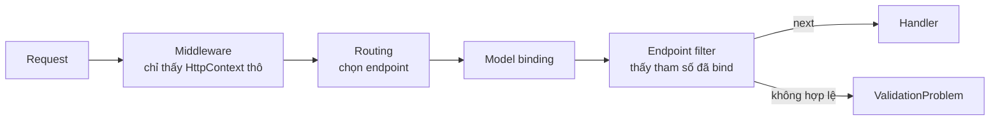

# 8.11 - Minimal API, endpoint filter, Kestrel và nén phản hồi

> **Tóm tắt:** Những chủ đề ASP.NET Core nối tiếp Module 8, kèm mức độ ưu tiên. Điểm cần làm rõ trước: **Minimal API không phải phiên bản rút gọn dành cho ứng dụng nhỏ** — nó có đầy đủ filter, model binding, validation và OpenAPI, chỉ là cú pháp khác. Lựa chọn giữa nó và controller là vấn đề **tổ chức code**, không phải vấn đề năng lực. Mục dễ cấu hình sai nhất là **Kestrel**: mặc định của nó phù hợp cho phần lớn trường hợp, và chỉnh sai giới hạn thường **tạo ra** vấn đề thay vì giải quyết — đặc biệt là `MaxConcurrentConnections`, thứ hay bị đặt thấp một cách vô tình.

## Mục tiêu bài học

Sau bài này bạn có thể:

- Chọn giữa Minimal API và controller theo tiêu chí rõ ràng.
- Gom endpoint bằng `MapGroup` và dùng endpoint filter thay cho action filter.
- Biết cấu hình Kestrel nào đáng chỉnh và cái nào không.
- Giới hạn tần suất theo từng người dùng hoặc IP.
- Bật nén phản hồi và đo được tác dụng của nó.

**Cần biết trước:** [bài 8.3](8.3-routing.md) (Minimal API, `MapGroup` cơ bản), [bài 8.5](8.5-model-validation.md) (FluentValidation), [bài 8.2](8.2-request-pipeline-and-middleware.md) (thứ tự middleware).

## Nội dung bài học

### 8.11.1 — Minimal API

**Ưu tiên cao** nếu bạn đang bắt đầu dự án mới.

```csharp
// Minimal API — gọn, nhưng đầy đủ tính năng (ILeadService là service tự viết)
app.MapGet("/api/leads/{id:int}", async Task<Results<Ok<LeadDto>, NotFound>> (
    int id,
    ILeadService service,
    CancellationToken ct) =>
    await service.FindAsync(id, ct) is { } lead
        ? TypedResults.Ok(lead)
        : TypedResults.NotFound())
.WithName("GetLead")
.RequireAuthorization();
```

`TypedResults` trả về kiểu cụ thể (`Ok<LeadDto>`, `NotFound`), và kiểu trả về `Results<Ok<LeadDto>, NotFound>` liệt kê mọi khả năng. Nhờ vậy tài liệu OpenAPI tự biết endpoint trả 200 với `LeadDto` hoặc 404, không cần khai báo thêm. Dùng `Results.Ok(...)` thì kiểu trả về chỉ là `IResult` chung chung, OpenAPI không đoán được gì.

| | Controller | Minimal API |
|---|---|---|
| Tổ chức | Gom theo lớp | Gom theo file hoặc nhóm endpoint |
| Model binding | Đầy đủ | Đầy đủ |
| Filter | Action filter | **Endpoint filter** |
| Validation tự động | `[ApiController]` | `AddValidation()` (từ .NET 10) |
| OpenAPI | Suy từ `ActionResult<T>` và attribute | Suy từ `TypedResults` |
| Hiệu năng | Rất tốt | **Nhỉnh hơn một chút** |
| Phù hợp với | Nhóm endpoint có logic chung | **Vertical slice** |

Với Minimal API, gom endpoint thành nhóm để tránh một `Program.cs` dài hàng trăm dòng:

```csharp
// LeadEndpoints.cs — GetById, Create, Convert là các hàm static trong lớp này
public static class LeadEndpoints
{
    public static RouteGroupBuilder MapLeadEndpoints(this RouteGroupBuilder group)
    {
        group.MapGet("/{id:int}", GetById);
        group.MapPost("/", Create);
        group.MapPut("/{id:int}/convert", Convert);
        return group;
    }
}
```

```csharp
// Program.cs
app.MapGroup("/api/leads")
   .RequireAuthorization()
   .WithTags("Leads")
   .MapLeadEndpoints();
```

`MapGroup` cho phép áp dụng cấu hình chung — authorization, tags, filter — cho cả nhóm, nên nó bù được phần lớn lợi thế tổ chức của controller. Hàm `MapLeadEndpoints` nhận một `RouteGroupBuilder` và chỉ khai đường dẫn **tương đối**; tiền tố do nơi gọi quyết định.

Cách tổ chức này hợp tự nhiên với Vertical Slice Architecture, nơi mỗi tính năng tự chứa cả endpoint lẫn handler ([bài 16.4](../../stage-05-senior-engineering/module-16-clean-architecture/16.4-vertical-slice-architecture.md)).

### 8.11.2 — Endpoint filter

**Ưu tiên trung bình.** Thay cho action filter trong Minimal API.

**Endpoint filter** là một lớp chạy bao quanh handler của endpoint, giống middleware nhưng chỉ cho endpoint đã chọn. Ví dụ dưới chạy validator FluentValidation ([bài 8.5](8.5-model-validation.md)) cho tham số kiểu `T`:

```csharp
// ValidationFilter.cs
public class ValidationFilter<T>(IValidator<T> validator) : IEndpointFilter where T : class
{
    public async ValueTask<object?> InvokeAsync(
        EndpointFilterInvocationContext context, EndpointFilterDelegate next)
    {
        var argument = context.Arguments.OfType<T>().FirstOrDefault();
        if (argument is null) return await next(context);

        var result = await validator.ValidateAsync(argument, context.HttpContext.RequestAborted);
        if (!result.IsValid)
            return TypedResults.ValidationProblem(result.ToDictionary());

        return await next(context);
    }
}
```

```csharp
// LeadEndpoints.cs — gắn filter vào endpoint
group.MapPost("/", Create).AddEndpointFilter<ValidationFilter<CreateLeadRequest>>();
```

Endpoint filter chạy **sau** model binding và **trước** handler, nên nó thấy được tham số đã được bind — khác với middleware, vốn chỉ thấy `HttpContext` thô.



Nếu quy tắc chỉ là DataAnnotations (`[Required]`, `[EmailAddress]`...), .NET 10 làm sẵn việc này: gọi `builder.Services.AddValidation();` là tham số của Minimal API được kiểm tra tự động.

**Chọn cái nào:**

| Cần gì | Dùng |
|---|---|
| Áp dụng cho **mọi** request | Middleware |
| Cần truy cập tham số đã bind | **Endpoint filter** |
| Cần biết endpoint nhưng không cần tham số | Middleware sau `UseRouting` |

### 8.11.3 — Kestrel: cẩn thận

**Ưu tiên thấp.** Mặc định phù hợp cho phần lớn trường hợp.

```csharp
builder.WebHost.ConfigureKestrel(options =>
{
    options.Limits.MaxRequestBodySize = 30 * 1024 * 1024;      // 30 MB cho upload
    options.Limits.KeepAliveTimeout = TimeSpan.FromMinutes(2);
    options.Limits.RequestHeadersTimeout = TimeSpan.FromSeconds(30);
});
```

Ba giới hạn hay được nhắc tới, và khi nào nên chỉnh:

| Giới hạn | Mặc định | Khi nào chỉnh |
|---|---|---|
| `MaxRequestBodySize` | 30.000.000 byte (~28,6 MB) | Cho phép upload file lớn hơn |
| `KeepAliveTimeout` | 130 giây | Hiếm khi cần đổi |
| `MaxConcurrentConnections` | **Không giới hạn** | **Gần như không bao giờ chỉnh** |

Hàng cuối là cái bẫy: người ta hay đặt `MaxConcurrentConnections = 100` vì nghe có vẻ an toàn, nhưng nó **giới hạn số kết nối TCP**, không phải số request đồng thời. Trình duyệt mở vài kết nối cho mỗi trang và giữ chúng mở (keep-alive), nên 100 kết nối có thể chỉ là vài chục người dùng — và người tiếp theo bị từ chối.

**Cách đúng để chống quá tải** là rate limiting (giới hạn tần suất) **theo người dùng hoặc IP**, không phải giới hạn kết nối. Mỗi người dùng có một bộ đếm riêng, gọi là một *partition*:

```csharp
builder.Services.AddRateLimiter(options =>
{
    options.RejectionStatusCode = StatusCodes.Status429TooManyRequests;
    options.AddPolicy("api", httpContext =>
        RateLimitPartition.GetFixedWindowLimiter(
            partitionKey: httpContext.User.Identity?.Name                     // đã đăng nhập: theo tên
                          ?? httpContext.Connection.RemoteIpAddress?.ToString()   // chưa: theo IP
                          ?? "anonymous",
            factory: _ => new FixedWindowRateLimiterOptions
            {
                PermitLimit = 100,
                Window = TimeSpan.FromMinutes(1)
            }));
});

var app = builder.Build();
// ... UseRouting, UseAuthentication, UseAuthorization (bài 8.2)
app.UseRateLimiter();

app.MapGroup("/api").RequireRateLimiting("api");
```

Ba chỗ hay quên: `UseRateLimiter()` trong pipeline (đặt sau `UseAuthentication` để biết người dùng), `RequireRateLimiting("api")` trên endpoint, và `RejectionStatusCode` (mặc định là 503, sai ngữ nghĩa). Chạy thử với `PermitLimit = 5`, bảy request liên tiếp từ cùng một máy cho:

```text
200 200 200 200 200 429 429
```

`AddFixedWindowLimiter("api", ...)` mà nhiều ví dụ trên mạng dùng tạo **một bộ đếm chung cho cả hệ thống**: 100 request mỗi phút cho tất cả người dùng cộng lại, một người gọi nhiều là chặn hết mọi người. [Bài 9.6](../module-09-web-api-professional/9.6-rate-limiting.md) đi sâu vào các thuật toán và `QueueLimit`.

### 8.11.4 — Nén phản hồi

**Ưu tiên trung bình.** Giảm băng thông đáng kể cho API trả JSON lớn.

```csharp
builder.Services.AddResponseCompression(options =>
{
    options.EnableForHttps = true;                 // xem cảnh báo bên dưới
    options.Providers.Add<BrotliCompressionProvider>();
    options.Providers.Add<GzipCompressionProvider>();
});

var app = builder.Build();
app.UseResponseCompression();      // đặt SỚM trong pipeline
```

JSON có cấu trúc lặp nên nén rất tốt; bài tập 3 đo con số cụ thể.

**Cảnh báo bảo mật:** `EnableForHttps = true` mở ra khả năng tấn công BREACH, trong đó kẻ tấn công suy ra bí mật bằng cách quan sát kích thước phản hồi nén. Rủi ro chỉ thực sự đáng kể khi phản hồi chứa **cả** dữ liệu bí mật (như token CSRF) **và** dữ liệu do người dùng kiểm soát. Với API trả JSON thuần và dùng token trong header, rủi ro thấp.

Nếu hệ thống chạy sau reverse proxy hoặc CDN, **để chúng nén** — hiệu quả hơn và không tốn CPU của ứng dụng.

### 8.11.5 — Những chủ đề khác

| Chủ đề | Nội dung | Ưu tiên |
|---|---|---|
| **Output caching** | Cache phản hồi ở server ([bài 9.7](../module-09-web-api-professional/9.7-response-caching-and-output-caching.md)) | **Cao** |
| **.NET Aspire** | Điều phối nhiều thành phần khi phát triển ([bài 15.10](../../stage-04-database-production/module-15-docker-deployment/15.10-dotnet-aspire-dotnet-8-plus.md)) | **Trung bình** |
| **HTTP logging** | Ghi log request và response | Trung bình |
| **Request decompression** | Nhận body đã nén từ client | Thấp |
| **gRPC** | Giao tiếp nội bộ hiệu năng cao | Thấp |

Health check đã có bài riêng ([bài 8.9](8.9-health-checks.md)).

**HTTP logging** (`AddHttpLogging` + `UseHttpLogging`) hữu ích khi chẩn đoán. Mặc định nó ghi dòng request, header và mã trạng thái, **không ghi body**, và header không nằm trong danh sách cho phép thì bị thay bằng `[Redacted]`. Chạy thử trên .NET 10 với một `POST /api/login` kèm `Authorization`:

```text
info: Microsoft.AspNetCore.HttpLogging.HttpLoggingMiddleware[1]
      Request:
      Protocol: HTTP/1.1
      Method: POST
      Path: /api/login
      ...
      Authorization: [Redacted]
      Content-Type: application/json
      Content-Length: 42
```

Hai điều cần nhớ: middleware ghi ở category `Microsoft.AspNetCore.HttpLogging` mức `Information`, nên với `appsettings.json` của template (`Microsoft.AspNetCore` để `Warning`) bạn không thấy gì cho tới khi hạ mức category đó. Và **đừng** bật `HttpLoggingFields.RequestBody` cho endpoint đăng nhập hay thanh toán: lúc đó mật khẩu đi thẳng vào log ([bài 8.7](8.7-logging-with-serilog.md)).

### 8.11.6 — Thứ tự nên học

| Ưu tiên | Chủ đề | Vì sao |
|---|---|---|
| **Cao** | Minimal API với `MapGroup` | Cú pháp hiện đại, hợp vertical slice |
| **Cao** | Output caching | Giảm tải rõ rệt với chi phí thấp |
| **Cao** | Rate limiting theo người dùng | Chống quá tải đúng cách |
| Trung bình | Endpoint filter | Khi dùng Minimal API |
| Trung bình | Nén phản hồi | Nếu không có proxy nén giúp |
| Thấp | Kestrel tuning | Mặc định đã tốt, chỉnh sai gây hại |

Sau Module 8, bước tiếp theo là [Module 9 — Web API chuyên nghiệp](../module-09-web-api-professional/README.md).

### 8.11.7 — Rà lại code của bạn

**Danh sách rà soát ASP.NET Core nâng cao**

- [ ] Endpoint được gom bằng `MapGroup`, `Program.cs` không dài quá mức.
- [ ] Endpoint Minimal API trả `TypedResults` để OpenAPI biết kiểu trả về.
- [ ] Không đặt `MaxConcurrentConnections` nếu không có lý do cụ thể.
- [ ] Rate limiting phân theo người dùng hoặc IP, có `UseRateLimiter` và `RequireRateLimiting`.
- [ ] Nếu có reverse proxy, để nó nén thay vì nén trong ứng dụng.
- [ ] HTTP logging không ghi body của endpoint nhạy cảm.
- [ ] Đã cân nhắc output caching cho endpoint đọc nhiều.

## Bài tập áp dụng

#### Bài 1 — Chuyển sang MapGroup

Gom các endpoint của `LeadsController` dưới đây thành một nhóm Minimal API dưới `/api/v1/leads`, giữ nguyên hành vi (200, 404, 201 kèm `Location`), và so sánh số dòng.

**Tiêu chí hoàn thành:** `GET /api/v1/leads/1` trả 200, `GET /api/v1/leads/9` trả 404, `POST /api/v1/leads` trả 201 kèm header `Location`; bạn có số dòng trước và sau, và biết một trường hợp **nên giữ controller**.

<details>
<summary><strong>Gợi ý và lời giải — Bài 1</strong></summary>

**Gợi ý.** Phần tiết kiệm được không nằm ở thân phương thức, mà ở phần khai báo lặp lại: thuộc tính route, kiểu trả về, và constructor.

**Lời giải — các kiểu dùng chung:**

```csharp
// Leads.cs
public record LeadDto(int Id, string FullName, string Email);
public record CreateLeadRequest(string FullName, string Email);

public interface ILeadService
{
    Task<IReadOnlyList<LeadDto>> GetPageAsync(int page, CancellationToken ct);
    Task<LeadDto?> FindAsync(int id, CancellationToken ct);
    Task<LeadDto> CreateAsync(CreateLeadRequest request, CancellationToken ct);
}
```

Cài đặt `ILeadService` bằng một `List<LeadDto>` trong bộ nhớ và đăng ký `AddSingleton<ILeadService, InMemoryLeadService>()` là đủ để chạy thử.

**Trước:**

```csharp
// LeadsController.cs
[ApiController]
[Route("api/v1/leads")]
public class LeadsController(ILeadService service) : ControllerBase
{
    [HttpGet]
    public async Task<ActionResult<IReadOnlyList<LeadDto>>> GetPage(
        [FromQuery] int page = 1, CancellationToken ct = default)
        => Ok(await service.GetPageAsync(page, ct));

    [HttpGet("{id:int}")]
    [ProducesResponseType<LeadDto>(StatusCodes.Status200OK)]
    [ProducesResponseType(StatusCodes.Status404NotFound)]
    public async Task<ActionResult<LeadDto>> GetById(int id, CancellationToken ct)
    {
        var lead = await service.FindAsync(id, ct);
        return lead is null ? NotFound() : Ok(lead);
    }

    [HttpPost]
    [ProducesResponseType<LeadDto>(StatusCodes.Status201Created)]
    public async Task<ActionResult<LeadDto>> Create(CreateLeadRequest request, CancellationToken ct)
    {
        var lead = await service.CreateAsync(request, ct);
        return CreatedAtAction(nameof(GetById), new { id = lead.Id }, lead);
    }
}
```

**Sau:**

```csharp
// LeadEndpoints.cs
public static class LeadEndpoints
{
    public static RouteGroupBuilder MapLeadEndpoints(this RouteGroupBuilder group)
    {
        group.MapGet("/", (ILeadService service, CancellationToken ct, int page = 1)
            => service.GetPageAsync(page, ct));

        group.MapGet("/{id:int}", async Task<Results<Ok<LeadDto>, NotFound>> (
            int id, ILeadService service, CancellationToken ct) =>
            await service.FindAsync(id, ct) is { } lead
                ? TypedResults.Ok(lead)
                : TypedResults.NotFound());

        group.MapPost("/", async (CreateLeadRequest request, ILeadService service, CancellationToken ct) =>
        {
            var lead = await service.CreateAsync(request, ct);
            return TypedResults.Created($"/api/v1/leads/{lead.Id}", lead);
        });

        return group;
    }
}
```

```csharp
// Program.cs
var v1 = app.MapGroup("/api/v1");
v1.MapGroup("/leads").WithTags("Leads").MapLeadEndpoints();
```

`using Microsoft.AspNetCore.Http.HttpResults;` ở đầu file cho các kiểu `Ok<T>`, `NotFound`, `Results<...>`. Chạy thật trên .NET 10:

```text
GET  /api/v1/leads/1  -> 200 {"id":1,"fullName":"Nguyễn Văn An","email":"an@example.com"}
GET  /api/v1/leads/9  -> 404
POST /api/v1/leads    -> 201, Location: /api/v1/leads/2
```

Tài liệu `/openapi/v1.json` liệt kê đúng `200` (kiểu `LeadDto`) và `404` cho `GET /api/v1/leads/{id}` mà không cần `[ProducesResponseType]`.

**Số dòng:** bản controller 24 dòng, bản Minimal API 19 dòng (đếm cả dòng ngoặc, không đếm dòng trống và chú thích). Phần tiết kiệm đến từ ba chỗ:

```text
1. Không có constructor — phụ thuộc tiêm thẳng vào tham số của từng endpoint
2. MapGroup gom tiền tố đường dẫn và tags về MỘT chỗ
3. TypedResults thay cho [ProducesResponseType] — OpenAPI tự suy ra
```

**Lợi ích lớn hơn số dòng: phụ thuộc theo từng endpoint.**

```csharp
// Controller: mọi action chia sẻ cùng một bộ phụ thuộc
public class LeadsController(ILeadService service, IPdfService pdf, IEmailSender email) : ControllerBase
// -> request GET cũng phải dựng IPdfService và IEmailSender
```

```csharp
// Minimal API: mỗi endpoint nhận đúng thứ nó cần
group.MapGet("/{id:int}", (int id, ILeadService service) => ...);
group.MapPost("/{id:int}/export-pdf", (int id, IPdfService pdf) => ...);
```

Với service đắt để khởi tạo, khác biệt này đo được. Và nó làm rõ endpoint nào phụ thuộc vào cái gì.

**Bẫy khi lồng nhóm.** Nếu hàm mở rộng tự gọi `MapGroup("/api/leads")` bên trong, thì `v1.MapGroup("/leads").MapLeads()` sinh ra đường dẫn `/api/v1/leads/api/leads/...`. Quy tắc: hàm mở rộng chỉ khai đường dẫn tương đối, nơi gọi quyết định tiền tố.

**Một trường hợp NÊN giữ controller:** dự án đã có 40 controller chạy tốt, dùng action filter theo lớp, model binder tuỳ biến, content negotiation (trả XML hoặc JSON tuỳ header `Accept`), hoặc kế thừa một lớp cơ sở có logic chung. Chuyển hết sang Minimal API là một dự án riêng, không phải cải tiến. Dùng Minimal API cho phần **mới**, giữ controller cho phần cũ; hai kiểu chạy song song trong cùng một ứng dụng không vấn đề gì — miễn mỗi tài nguyên chỉ dùng một kiểu ([bài 8.3](8.3-routing.md)).

</details>

---

#### Bài 2 — Viết endpoint filter

Gắn `ValidationFilter<T>` ở mục 8.11.2 vào endpoint `POST` của bài 1, với một `CreateLeadValidator` bắt buộc họ tên và email hợp lệ.

**Tiêu chí hoàn thành:** body sai trả 400 dạng `ValidationProblemDetails` và handler không chạy; body đúng vẫn trả 201; bạn nêu được filter khác action filter của controller ở chỗ nào.

<details>
<summary><strong>Gợi ý và lời giải — Bài 2</strong></summary>

**Gợi ý.** Endpoint filter nhận `EndpointFilterInvocationContext`, trong đó có sẵn danh sách tham số đã được bind (`context.Arguments`).

**Lời giải:**

```csharp
// CreateLeadValidator.cs
public class CreateLeadValidator : AbstractValidator<CreateLeadRequest>
{
    public CreateLeadValidator()
    {
        RuleFor(x => x.FullName).NotEmpty().WithMessage("Họ tên là bắt buộc");
        RuleFor(x => x.Email).NotEmpty().EmailAddress();
    }
}
```

```csharp
// LeadEndpoints.cs — thêm filter vào endpoint POST
group.MapPost("/", async (CreateLeadRequest request, ILeadService service, CancellationToken ct) =>
{
    var lead = await service.CreateAsync(request, ct);
    return TypedResults.Created($"/api/v1/leads/{lead.Id}", lead);
})
.AddEndpointFilter<ValidationFilter<CreateLeadRequest>>();
```

```csharp
// Program.cs
builder.Services.AddValidatorsFromAssemblyContaining<Program>();
```

Kết quả chạy thật trên .NET 10 với body `{"fullName":"","email":"x"}`:

```json
{"type":"https://tools.ietf.org/html/rfc9110#section-15.5.1","title":"One or more validation errors occurred.","status":400,
 "errors":{"FullName":["Họ tên là bắt buộc"],"Email":["'Email' is not a valid email address."]}}
```

Body hợp lệ vẫn trả `201 Created`.

Muốn áp cho **cả nhóm** thì gọi `AddEndpointFilter` trên `RouteGroupBuilder`; filter sẽ chạy cho mọi endpoint trong nhóm, và tự bỏ qua endpoint không có tham số kiểu `T` (dòng `if (argument is null) return await next(context);`).

**Khác action filter của controller:**

| | Endpoint filter | Action filter |
|---|---|---|
| Áp dụng cho | Một endpoint hoặc một nhóm | Một action, controller, hoặc toàn cục |
| Thấy tham số đã bind | **Có** — `context.Arguments` | Có — `ActionArguments` |
| Chi phí | **Thấp** — không qua bộ máy MVC | Cao hơn |
| Đổi kết quả | Trả về một `object` khác | Gán `context.Result` |
| Thứ tự | **Theo thứ tự đăng ký** | Theo phạm vi (toàn cục → controller → action) và `Order` |

Điểm khác biệt thực tế nhất là thứ tự: endpoint filter chạy đúng theo thứ tự `AddEndpointFilter`, dễ suy luận; action filter có quy tắc thứ tự phức tạp hơn và hay gây bất ngờ.

**Filter KHÔNG thay thế middleware.**

```text
Middleware: chạy cho MỌI request, kể cả request không khớp endpoint nào
            -> dùng cho: xác thực, CORS, nén, ghi log truy cập

Endpoint filter: chỉ chạy khi đã xác định được endpoint
                 -> dùng cho: validation, phân quyền theo dữ liệu, idempotency
```

Chọn sai tầng là một nguồn lỗi thật: đặt việc ghi log truy cập vào endpoint filter thì request 404 không được ghi; đặt validation vào middleware thì chưa có tham số đã bind để kiểm tra.

</details>

---

#### Bài 3 — Đo nén

Bật nén phản hồi, gọi một endpoint trả JSON lớn với và không có `Accept-Encoding`, so sánh kích thước phản hồi.

**Tiêu chí hoàn thành:** bạn có **ba con số** (không nén, gzip, brotli) đo trên máy mình, và biết ba trường hợp **không nên** bật nén.

<details>
<summary><strong>Gợi ý và lời giải — Bài 3</strong></summary>

**Gợi ý.** Máy chủ chỉ nén khi client nói nó hiểu được. Không gửi `Accept-Encoding` thì không có nén nào.

**Lời giải:**

```csharp
// LeadDto.cs
public record LeadDto(int Id, string FullName, string Email, string Phone, string Status, string Note);
```

```csharp
// Program.cs — hai dòng using này không có sẵn trong implicit usings
using System.IO.Compression;                       // CompressionLevel
using Microsoft.AspNetCore.ResponseCompression;    // BrotliCompressionProvider, GzipCompressionProvider...

builder.Services.AddResponseCompression(o =>
{
    o.EnableForHttps = true;                          // mặc định TẮT — xem bên dưới
    o.Providers.Add<BrotliCompressionProvider>();
    o.Providers.Add<GzipCompressionProvider>();
});
builder.Services.Configure<BrotliCompressionProviderOptions>(o => o.Level = CompressionLevel.Optimal);
builder.Services.Configure<GzipCompressionProviderOptions>(o => o.Level = CompressionLevel.Optimal);

var app = builder.Build();
app.UseResponseCompression();

var leads = Enumerable.Range(1, 500)
    .Select(i => new LeadDto(i, $"Khách hàng {i}", $"lead{i}@example.com", "0901234567",
                             "New", "Liên hệ lại sau khi gửi báo giá"))
    .ToList();

app.MapGet("/api/leads", () => leads);
```

```bash
curl -s -o /dev/null -w "none: %{size_download}\n"                           http://127.0.0.1:5000/api/leads
curl -s -o /dev/null -w "gzip: %{size_download}\n" -H "Accept-Encoding: gzip" http://127.0.0.1:5000/api/leads
curl -s -o /dev/null -w "br:   %{size_download}\n" -H "Accept-Encoding: br"   http://127.0.0.1:5000/api/leads
```

Kết quả đo thật trên .NET 10, 500 lead như trên:

| | `CompressionLevel.Optimal` | `CompressionLevel.Fastest` |
|---|---:|---:|
| Không nén | 78.177 byte | 78.177 byte |
| gzip | 4.082 byte (giảm 94,8%) | 6.524 byte (giảm 91,7%) |
| brotli | 1.866 byte (giảm 97,6%) | 6.571 byte (giảm 91,6%) |

**Tỉ lệ nén cao bất thường — và lý do đáng hiểu:**

```text
JSON ở đây LẶP rất mạnh:
    tên trường lặp lại 500 lần: "fullName", "email", "phone"...
    giá trị giống nhau: cùng số điện thoại, cùng ghi chú, cùng trạng thái

-> thuật toán nén thay mỗi chuỗi lặp bằng một tham chiếu ngắn
-> dữ liệu thật đa dạng hơn, nên tỉ lệ sẽ thấp hơn nhiều
```

Đừng chờ đợi giảm 97% trên hệ thống thật; hãy đo bằng dữ liệu của chính bạn. Nhưng ngay cả giảm vài lần cũng đáng: phản hồi 200 KB, 1.000 request mỗi phút là 200 MB băng thông mỗi phút; nén còn một phần năm thì chỉ còn 40 MB.

**Mức nén là đánh đổi giữa kích thước và CPU.** Ở mức `Optimal`, brotli nhỏ hơn gzip hơn hai lần; ở mức `Fastest`, hai thuật toán gần như ngang nhau. `Optimal` tốn CPU hơn cho mỗi request; với nội dung sinh động (mỗi request một nội dung), `Fastest` thường là lựa chọn cân bằng cho API. Đo cả thời gian phản hồi trước khi chọn.

**Và ba trường hợp KHÔNG nên bật nén:**

1. **Nội dung đã nén sẵn** — JPEG, PNG, MP4, ZIP, PDF. Nén lại gần như không giảm được gì, chỉ tốn CPU. ASP.NET Core mặc định chỉ nén một danh sách kiểu MIME an toàn (`ResponseCompressionDefaults.MimeTypes`); muốn nén thêm kiểu nào thì thêm tường minh:

   ```csharp
   o.MimeTypes = ResponseCompressionDefaults.MimeTypes.Concat(["application/problem+json"]);
   ```

2. **Phản hồi rất nhỏ.** Vài trăm byte thì phần tiết kiệm không đáng một lần gọi thuật toán nén.

3. **Có reverse proxy hoặc CDN đứng trước — và nó đã nén.** Nginx, Cloudflare, Azure Front Door đều nén được. Bật ở cả hai nơi là tốn CPU hai lần; để proxy làm, và tắt ở ứng dụng.

**`EnableForHttps` mặc định TẮT** vì các tấn công kiểu BREACH khai thác mối liên hệ giữa **kích thước** phản hồi đã nén và nội dung bí mật bên trong. Rủi ro thật khi phản hồi chứa **cả** bí mật (token chống CSRF) lẫn dữ liệu do người dùng kiểm soát. Với API JSON trả dữ liệu nghiệp vụ và token nằm ở header, rủi ro này rất thấp, nên bật là hợp lý.

**Với dữ liệu tĩnh (JS, CSS): nén sẵn lúc build** thành `.br` và `.gz`, máy chủ chỉ việc gửi tệp đã nén — không tốn CPU lúc chạy và dùng được mức nén cao nhất.

</details>

## Tự kiểm tra

<details>
<summary>Minimal API có kém tính năng hơn controller không?</summary>

Không. Nó có đầy đủ filter, model binding, validation (AddValidation từ .NET 10) và OpenAPI. Lựa chọn giữa hai cách là vấn đề tổ chức code chứ không phải vấn đề năng lực.

</details>

<details>
<summary>Vì sao nên trả TypedResults thay vì Results trong Minimal API?</summary>

TypedResults trả kiểu cụ thể như `Ok<LeadDto>` hay NotFound, và kiểu trả về `Results<Ok<LeadDto>, NotFound>` liệt kê mọi khả năng, nên OpenAPI tự biết endpoint trả gì. Results.Ok trả về IResult chung chung, OpenAPI không suy ra được kiểu.

</details>

<details>
<summary>Endpoint filter khác middleware thế nào?</summary>

Endpoint filter chạy sau model binding nên thấy được tham số đã bind, và chỉ chạy cho endpoint đã chọn. Middleware chỉ thấy HttpContext thô và chạy cho mọi request. Dùng middleware khi cần áp dụng cho mọi request, dùng endpoint filter khi cần truy cập tham số.

</details>

<details>
<summary>Vì sao MaxConcurrentConnections là cái bẫy?</summary>

Vì nó giới hạn số kết nối TCP chứ không phải số request đồng thời. Trình duyệt mở nhiều kết nối và giữ chúng mở nên một trăm kết nối có thể chỉ là vài chục người dùng, và người tiếp theo bị từ chối oan.

</details>

<details>
<summary>AddFixedWindowLimiter("api", ...) với PermitLimit 100 có giới hạn mỗi người dùng 100 request mỗi phút không?</summary>

Không. Nó tạo một bộ đếm chung cho mọi client, nên 100 request mỗi phút là tổng của cả hệ thống. Muốn giới hạn theo người dùng hoặc IP phải dùng AddPolicy với RateLimitPartition, khoá partition là tên người dùng hoặc IP. Và phải có UseRateLimiter cùng RequireRateLimiting thì policy mới có tác dụng.

</details>

<details>
<summary>Rủi ro của EnableForHttps khi nén phản hồi là gì?</summary>

Nó mở ra khả năng tấn công BREACH, trong đó kẻ tấn công suy ra bí mật từ kích thước phản hồi nén. Rủi ro đáng kể khi phản hồi chứa cả dữ liệu bí mật lẫn dữ liệu do người dùng kiểm soát; với API trả JSON thuần và token trong header thì thấp.

</details>

## Kết luận

Ba điều đáng nhớ nhất:

1. **Minimal API đầy đủ tính năng** — chọn nó hay controller là vấn đề tổ chức code; dùng `MapGroup` và `TypedResults`.
2. **Mặc định của Kestrel đã tốt**; chỉnh sai giới hạn kết nối thường tạo ra vấn đề mới.
3. **Chống quá tải bằng rate limiting theo người dùng hoặc IP**, không bằng giới hạn kết nối.

## Tham khảo

- [Minimal APIs quick reference](https://learn.microsoft.com/en-us/aspnet/core/fundamentals/minimal-apis)
- [Filters in Minimal API apps](https://learn.microsoft.com/en-us/aspnet/core/fundamentals/minimal-apis/min-api-filters)
- [Rate limiting middleware in ASP.NET Core](https://learn.microsoft.com/en-us/aspnet/core/performance/rate-limit)
- [Response compression in ASP.NET Core](https://learn.microsoft.com/en-us/aspnet/core/performance/response-compression)
- [HTTP logging in ASP.NET Core](https://learn.microsoft.com/en-us/aspnet/core/fundamentals/http-logging/)
- [Kestrel limits](https://learn.microsoft.com/en-us/aspnet/core/fundamentals/servers/kestrel/options)

## Điều hướng

- **Bài trước:** [8.10 — EF Core tối thiểu: lưu dữ liệu vào database](8.10-ef-core-minimal.md)
- **Bài tiếp theo:** [8.12 — Tình huống: đảo thứ tự middleware làm hỏng xác thực](8.12-mini-case-study.md)
- **Về module:** [Trang mục lục](README.md)
