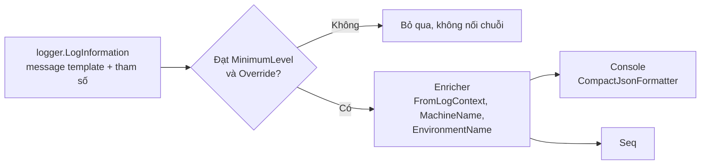

# 8.7 - Logging với Serilog

> **Tóm tắt:** Khác biệt giữa log dùng được và log vô dụng nằm ở đúng một ký tự: dấu `$`. `LogInformation($"Customer {id} created")` tạo ra một **chuỗi đã nấu chín** — bạn chỉ tìm kiếm được bằng văn bản. `LogInformation("Customer {CustomerId} created", id)` giữ `CustomerId` thành **một trường có cấu trúc**, nên bạn truy vấn được `CustomerId = 42` trên hàng triệu dòng log. Đó là toàn bộ ý nghĩa của structured logging. Serilog thêm vào: **sink** (ghi đi đâu), **enricher** (thêm ngữ cảnh chung), và `UseSerilogRequestLogging()` — thứ thay **nhiều dòng log framework mỗi request** bằng **một dòng tóm tắt** có đủ thông tin.

## Mục tiêu bài học

Sau bài này bạn có thể:

- Giải thích vì sao nội suy chuỗi phá hỏng log có cấu trúc.
- Chọn đúng log level cho từng tình huống.
- Dùng scope để gắn ngữ cảnh cho một nhóm log.
- Cấu hình Serilog từ `appsettings.json`.
- Biết chắc những gì không bao giờ được ghi vào log.

**Cần biết trước:** [bài 8.2](8.2-request-pipeline-and-middleware.md) (middleware), [bài 8.6](8.6-configuration-system.md) (cấu hình từ `appsettings.json`), `ILogger<T>` ở [bài 7.6](../../stage-02-csharp-professional/module-07-dependency-injection/7.6-program-cs-and-webapplicationbuilder.md).

## Nội dung bài học

### 8.7.1 — Message template, không phải nội suy chuỗi

```csharp
// SAI — chuỗi đã nấu chín, không còn trường nào
logger.LogInformation($"Customer {customer.Id} created by {userId}");

// ĐÚNG — CustomerId và UserId là trường truy vấn được
logger.LogInformation("Customer {CustomerId} created by {UserId}",
    customer.Id, userId);
```

Với Serilog ghi ra dạng JSON gọn (CLEF, cấu hình ở mục 8.7.3), dòng thứ hai sinh ra (rút gọn):

```json
{
  "@t": "2026-10-18T02:52:25.3276710Z",
  "@mt": "Customer {CustomerId} created by {UserId}",
  "CustomerId": 42,
  "UserId": "u-77"
}
```

`@t` là thời điểm, `@mt` là message template; mỗi placeholder thành một trường riêng.

Bạn truy vấn được `CustomerId = 42` trong Seq, Elasticsearch hay Loki. Với bản nội suy, bạn chỉ có một chuỗi và phải tìm bằng văn bản — đúng lúc đang cần tìm nhanh nhất.

Còn hai lý do nữa:

- **Hiệu năng.** Nội suy chuỗi **luôn** chạy, kể cả khi `Debug` đang tắt. Message template chỉ nối khi log thật sự được ghi.
- **Gom nhóm.** Cùng một `@mt` là cùng một loại sự kiện, nên hệ thống log đếm được "sự kiện này xảy ra 12.000 lần hôm nay".

Hai quy ước đặt tên: **PascalCase** cho placeholder, và tiền tố `@` khi muốn Serilog ghi cả đối tượng thay vì gọi `ToString()`:

```csharp
logger.LogInformation("Nhận đơn hàng {@Order}", order);   // ghi cả object
```

Cẩn thận với `@`: nó ghi **toàn bộ** thuộc tính, nên rất dễ đưa dữ liệu nhạy cảm vào log.

Bật quy tắc phân tích code có sẵn trong .NET SDK để không ai quên. Quy tắc `CA2254` phát hiện template thay đổi giữa các lần gọi (dấu hiệu của nội suy chuỗi), nhưng mặc định chỉ ở mức gợi ý nên không hiện khi build. Nâng nó thành lỗi trong file `.editorconfig` ở thư mục gốc solution:

```ini
[*.cs]
dotnet_diagnostic.CA2254.severity = error
```

Build lại, dòng dùng `$"..."` trong lời gọi log báo lỗi:

```text
Program.cs(23,27): error CA2254: The logging message template should not vary between calls to
'LoggerExtensions.LogInformation(ILogger, string?, params object?[])'
```

### 8.7.2 — Log level

| Level | Nghĩa | Ví dụ |
|---|---|---|
| `Trace` | Chi tiết tới mức lộ nội bộ | Giá trị biến trong vòng lặp |
| `Debug` | Thông tin chẩn đoán cho dev | Cache hit/miss, SQL sinh ra |
| `Information` | Sự kiện nghiệp vụ đáng ghi | Đơn hàng được tạo, người dùng đăng nhập |
| `Warning` | Bất thường nhưng đã xử lý được | Retry lần 2, cache không kết nối được nên đi thẳng DB |
| `Error` | Một thao tác thất bại | Không lưu được đơn hàng |
| `Critical` | Ứng dụng không phục vụ được | Mất kết nối database, sắp hết bộ nhớ |

Ba nhầm lẫn hay gặp:

- **`Error` cho mọi exception.** Người dùng nhập sai dữ liệu là chuyện bình thường, không phải sự cố. `OperationCanceledException` do client ngắt kết nối cũng vậy ([bài 6.7](../../stage-02-csharp-professional/module-06-async-programming/6.7-common-pitfalls.md)). Log mức `Error` cho chúng làm dashboard đầy báo động giả cho tới khi không ai nhìn nó nữa.
- **`Information` cho mọi thứ.** Log mức `Information` trong một vòng lặp 10.000 phần tử là chi phí thật và là nhiễu thật.
- **`Critical` không bao giờ dùng.** Nếu `Critical` không nối với cảnh báo gọi điện cho ai đó, nó chỉ là `Error` viết hoa.

Đặt mức theo namespace:

```json
{
  "Serilog": {
    "MinimumLevel": {
      "Default": "Information",
      "Override": {
        "Microsoft.AspNetCore": "Warning",
        "Microsoft.EntityFrameworkCore.Database.Command": "Warning",
        "System.Net.Http.HttpClient": "Warning"
      }
    }
  }
}
```

Ba dòng `Override` này cắt phần lớn nhiễu: EF Core log **mọi** câu SQL ở mức `Information`, và `HttpClient` log mọi request đi ra.

Lưu ý khi đã dùng Serilog: mục `Logging:LogLevel` mà template sinh sẵn trong `appsettings.json` **không còn tác dụng**; mức log đọc từ mục `Serilog` như trên.

### 8.7.3 — Cấu hình

```bash
dotnet add package Serilog.AspNetCore
dotnet add package Serilog.Sinks.Seq
dotnet add package Serilog.Enrichers.Environment
```

`Serilog.AspNetCore` đã kèm sink Console, File, đọc cấu hình từ `appsettings.json` và định dạng JSON gọn (`CompactJsonFormatter`). Hai enricher `WithMachineName()` và `WithEnvironmentName()` nằm trong gói `Serilog.Enrichers.Environment`; thiếu gói này thì code dưới không biên dịch.

```csharp
builder.Host.UseSerilog((ctx, services, config) => config
    .ReadFrom.Configuration(ctx.Configuration)   // đọc từ appsettings.json
    .ReadFrom.Services(services)                 // enricher đăng ký trong DI
    .Enrich.FromLogContext()                     // BẮT BUỘC cho scope
    .Enrich.WithMachineName()                    // thêm trường MachineName
    .Enrich.WithEnvironmentName());              // thêm trường EnvironmentName
```

Trên .NET 10 với Serilog.AspNetCore 10, mỗi sự kiện log trong một request còn tự có `@tr` (trace id) và `@sp` (span id) lấy từ `Activity.Current`, không cần gói enricher nào thêm. [Bài 8.13](8.13-quick-real-world-example.md) dùng trường này để nối phản hồi lỗi với log.

Đặt cấu hình trong `appsettings.json` để đổi được theo môi trường mà không build lại:

```json
{
  "Serilog": {
    "Using": ["Serilog.Sinks.Console", "Serilog.Sinks.Seq"],
    "MinimumLevel": { "Default": "Information" },
    "WriteTo": [
      { "Name": "Console", "Args": { "formatter": "Serilog.Formatting.Compact.CompactJsonFormatter, Serilog.Formatting.Compact" } },
      { "Name": "Seq", "Args": { "serverUrl": "http://seq:5341" } }
    ]
  }
}
```

**Chọn sink theo nơi triển khai:**

- **Trong container** → chỉ ghi ra Console dạng JSON. Docker, Kubernetes và cloud đều thu thập stdout. Ghi ra file trong container là ghi vào một lớp sẽ biến mất, và nó còn làm image phình ra.
- **Ngoài container** → thêm `Serilog.Sinks.File` với `rollingInterval` và `retainedFileCountLimit`.
- **Tập trung** → Seq (nhẹ, dễ dựng), Elasticsearch, hoặc sink của nhà cung cấp cloud.

`CompactJsonFormatter` gọn hơn đáng kể so với `JsonFormatter` mặc định — đáng dùng khi log đi qua mạng.

Đường đi của một sự kiện log qua cấu hình ở trên:



### 8.7.4 — `UseSerilogRequestLogging`

```csharp
app.UseSerilogRequestLogging(options =>
{
    options.MessageTemplate =
        "HTTP {RequestMethod} {RequestPath} -> {StatusCode} trong {Elapsed:0.0}ms";

    options.GetLevel = (httpContext, elapsed, ex) =>
        ex is not null                          ? LogEventLevel.Error
        : httpContext.Response.StatusCode > 499 ? LogEventLevel.Error
        : elapsed > 3000                        ? LogEventLevel.Warning
        : httpContext.Request.Path.StartsWithSegments("/health")
                                                ? LogEventLevel.Verbose
                                                : LogEventLevel.Information;

    options.EnrichDiagnosticContext = (diag, http) =>
    {
        diag.Set("UserId", http.User.FindFirst("sub")?.Value);
        diag.Set("UserAgent", http.Request.Headers.UserAgent.ToString());
    };
});
```

Đo trên .NET 10 với một action controller và mức `Information` cho `Microsoft.AspNetCore`: framework ghi **7 sự kiện log** cho một request (Request starting, Executing endpoint, Route matched, Executing OkObjectResult, Executed action, Executed endpoint, Request finished). `UseSerilogRequestLogging` cho bạn **một dòng** có đủ method, path, status, thời gian và những gì bạn thêm vào, để bạn hạ `Microsoft.AspNetCore` xuống `Warning` mà không mất thông tin.

`GetLevel` là phần đáng giá nhất: health check mỗi 10 giây sẽ chiếm phần lớn log của bạn nếu không hạ mức nó xuống, còn request chậm tự nổi lên `Warning` mà không cần middleware riêng.

Đặt nó **sớm** trong pipeline, ngay sau middleware xử lý lỗi và correlation ID ([bài 8.2](8.2-request-pipeline-and-middleware.md)).

### 8.7.5 — Scope

```csharp
using (logger.BeginScope(new Dictionary<string, object>
{
    ["OrderId"] = order.Id,
    ["TenantId"] = tenant.Id
}))
{
    logger.LogInformation("Bắt đầu xử lý");
    await ValidateAsync(order, ct);      // mọi log bên trong đều có OrderId và TenantId
    await ChargeAsync(order, ct);
    logger.LogInformation("Hoàn tất");
}
```

Scope gắn thuộc tính vào **mọi** log phát sinh bên trong nó, kể cả từ lớp khác ở sâu bên dưới. Đó là cách bạn lọc ra toàn bộ dấu vết của một đơn hàng qua nhiều lớp mà không phải truyền `orderId` vào từng lời gọi log.

Cần `Enrich.FromLogContext()` trong cấu hình, nếu không scope bị bỏ qua trong im lặng.

Serilog còn có `LogContext.PushProperty(...)` làm điều tương tự ở tầng Serilog. `CorrelationIdMiddleware` ở [bài 8.2](8.2-request-pipeline-and-middleware.md) dùng `BeginScope` nên chạy được với cả logger mặc định lẫn Serilog.

### 8.7.6 — Không bao giờ ghi vào log

Log thường được gửi sang hệ thống bên thứ ba, giữ nhiều tháng, và **nhiều người đọc được** hơn database. Không bao giờ ghi:

- Mật khẩu, kể cả mật khẩu sai người dùng vừa gõ.
- Token, API key, connection string.
- Số thẻ đầy đủ, CVV.
- Số CMND/CCCD, thông tin y tế.
- Toàn bộ request body của endpoint đăng nhập hoặc thanh toán.

```csharp
// SAI — @ ghi toàn bộ thuộc tính, kể cả Password
logger.LogInformation("Đăng nhập {@Request}", loginRequest);

// ĐÚNG
logger.LogInformation("Đăng nhập {Email}", loginRequest.Email);
```

Một tầng bảo vệ đáng thêm là quy tắc phân rã (destructuring), để cùng một quy tắc áp cho mọi chỗ ghi log kiểu đó. Thêm vào chuỗi cấu hình trong `UseSerilog` ở mục 8.7.3:

```csharp
    .Destructure.ByTransforming<LoginRequest>(r => new { r.Email })
```

Và nhớ rằng URL cũng vào log: đừng đặt token trong query string.

### 8.7.7 — Rà lại code của bạn

**Danh sách rà soát logging**

- [ ] Không còn lời gọi log nào dùng nội suy chuỗi với dấu $.
- [ ] Placeholder đặt tên PascalCase và nhất quán giữa các lớp.
- [ ] MinimumLevel có Override cho Microsoft.AspNetCore và EF Core Database.Command.
- [ ] Lỗi do người dùng nhập sai không được log ở mức Error.
- [ ] OperationCanceledException do client ngắt không log ở mức Error.
- [ ] Trong container chỉ ghi Console dạng JSON, không ghi file.
- [ ] UseSerilogRequestLogging được bật và hạ mức cho health check.
- [ ] Enrich.FromLogContext() có trong cấu hình để scope hoạt động.
- [ ] Không có mật khẩu, token hay số thẻ nào xuất hiện trong log.
- [ ] Không dùng {@Object} cho model có chứa trường nhạy cảm.

## Bài tập áp dụng

#### Bài 1 — Message template so với nội suy chuỗi

Ghi cùng một sự kiện bằng nội suy chuỗi và bằng message template, rồi thử truy vấn theo `CustomerId`. Ghi lại cách nào tìm được.

**Tiêu chí hoàn thành:** bạn truy vấn được theo giá trị trường, và nêu được vì sao cách kia không thể.

<details>
<summary><strong>Gợi ý và lời giải — Bài 1</strong></summary>

**Gợi ý.** Nội suy chuỗi được thực hiện bởi **trình biên dịch**, trước khi `ILogger` nhìn thấy gì. Vậy thứ `ILogger` nhận được là gì?

**Lời giải.**

Cấu hình Serilog ghi ra console dạng JSON gọn để thấy cấu trúc:

```csharp
builder.Host.UseSerilog((ctx, services, config) => config
    .Enrich.FromLogContext()
    .WriteTo.Console(new CompactJsonFormatter()));   // using Serilog.Formatting.Compact;
```

```csharp
app.MapGet("/order", (ILogger<Program> logger) =>
{
    var customerId = 42;
    var total = 1_500_000m;

    // Cách 1 — nội suy chuỗi
    logger.LogInformation($"Đã tạo đơn cho khách {customerId}, tổng {total}");

    // Cách 2 — message template
    logger.LogInformation("Đã tạo đơn cho khách {CustomerId}, tổng {Total}", customerId, total);
    return "ok";
});
```

**Với định dạng văn bản thường, hai dòng trông giống hệt nhau.** Nhưng JSON thì khác hẳn. Kết quả chạy thật trên .NET 10 (bỏ các trường chung như `@tr`, `RequestId`, `SourceContext`):

```json
{"@t":"2026-10-18T02:52:25.3274182Z","@mt":"Đã tạo đơn cho khách 42, tổng 1500000"}
{"@t":"2026-10-18T02:52:25.3276710Z","@mt":"Đã tạo đơn cho khách {CustomerId}, tổng {Total}","CustomerId":42,"Total":1500000}
```

Không có trường `@l` vì định dạng gọn bỏ qua mức `Information` (mức mặc định). Ở cách 1, "template" chính là chuỗi đã nối xong: mỗi khách hàng một template khác nhau, và không có trường `CustomerId` nào.

**Truy vấn trong Seq:**

```text
Cách 1: CustomerId = 42        -> KHÔNG TÌM THẤY (trường không tồn tại)
        @Message like '%khách 42%'  -> tìm được, nhưng cũng khớp "khách 420", "khách 421"

Cách 2: CustomerId = 42        -> chính xác
        Total > 1000000        -> so sánh SỐ được
```

**Vì sao cách 1 không thể.** Trình biên dịch nối chuỗi **trước khi** gọi `ILogger`, nên logger chỉ nhận được một chuỗi phẳng. Không có gì để tách ra thành trường. Thông tin về cấu trúc đã mất vĩnh viễn ngay tại dòng code đó.

**Bốn lợi ích của message template, ngoài việc truy vấn được:**

1. **Nhóm được các dòng log cùng loại.** Trường `@mt` giống nhau cho mọi lần gọi, nên đếm được "sự kiện này xảy ra bao nhiêu lần" dù giá trị khác nhau.
2. **So sánh theo kiểu dữ liệu.** `Total > 1000000` hoạt động vì `Total` được lưu là số, không phải chuỗi.
3. **Không tính chuỗi khi mức log bị tắt.** Với nội suy, chuỗi **luôn được nối** kể cả khi `Debug` đang tắt — lãng phí trong vòng lặp nóng.
4. **Bảo vệ khỏi log injection.** Giá trị được lưu thành trường riêng chứ không trộn vào thông điệp, nên không ai chèn được dòng log giả bằng cách nhập ký tự xuống dòng.

**Quy ước đặt tên.** Dùng PascalCase cho tên trường trong template và **giữ nhất quán toàn hệ thống**. Nếu chỗ này ghi `{CustomerId}` và chỗ kia ghi `{customerId}`, chúng thành hai trường khác nhau và truy vấn sẽ sót.

**Bật cảnh báo tự động.** Nâng `CA2254` thành lỗi bằng `.editorconfig` như mục 8.7.1. Đây là một trong những quy tắc đáng biến thành lỗi nhất, vì hậu quả chỉ lộ ra khi bạn cần điều tra sự cố — lúc đã quá muộn để sửa.

</details>

#### Bài 2 — Đếm nhiễu từ health check

Bật `UseSerilogRequestLogging()` và một endpoint `/health/live` ([bài 8.9](8.9-health-checks.md) dạy kỹ health check; ở đây chỉ cần `builder.Services.AddHealthChecks()` và `app.MapHealthChecks("/health/live")`). Giả lập probe bằng một vòng lặp gọi endpoint đó mỗi 10 giây trong 5 phút. Đếm số dòng log mà health check sinh ra. Bật cấu hình hạ health check xuống mức thấp và đếm lại.

**Tiêu chí hoàn thành:** bạn có hai con số và nêu được vì sao nhiễu trong log là một vấn đề thật.

<details>
<summary><strong>Gợi ý và lời giải — Bài 2</strong></summary>

**Gợi ý.** Trên production, Kubernetes gọi cả liveness và readiness probe. Với hai probe mỗi 10 giây trên 3 bản chạy (instance), hãy tính xem một ngày có bao nhiêu lần gọi.

**Lời giải — bản mặc định.** Vòng lặp giả lập probe:

```bash
# bash
for i in $(seq 1 30); do curl -s localhost:5000/health/live > /dev/null; sleep 10; done
```

```powershell
# PowerShell
1..30 | ForEach-Object { Invoke-WebRequest http://localhost:5000/health/live | Out-Null; Start-Sleep 10 }
```

Với `app.UseSerilogRequestLogging();` mặc định và `Microsoft.AspNetCore` đã hạ xuống `Warning`, mỗi lần gọi sinh một dòng `HTTP GET /health/live responded 200 in ... ms` ở mức `Information`. Trên production có hai probe mỗi 10 giây, tính cho 5 phút:

```text
5 phút = 300 giây
300 / 10 = 30 lần mỗi probe
2 probe  = 60 dòng log
```

Quy ra một ngày, với 3 thể hiện:

```text
60 dòng / 5 phút × 288 (số khoảng 5 phút trong ngày) × 3 thể hiện
= khoảng 51.840 dòng log mỗi ngày, chỉ riêng health check
```

**Bản có cấu hình:**

```csharp
app.UseSerilogRequestLogging(o =>
{
    o.GetLevel = (ctx, elapsed, ex) =>
        ex is not null                                   ? LogEventLevel.Error
        : ctx.Response.StatusCode >= 500                 ? LogEventLevel.Error
        : ctx.Request.Path.StartsWithSegments("/health") ? LogEventLevel.Verbose
        : elapsed > 3000                                 ? LogEventLevel.Warning
        : LogEventLevel.Information;
});
```

Với mức tối thiểu là `Information`, các dòng `Verbose` bị loại bỏ trước khi ghi. Chạy thật trên .NET 10: gọi `/health/live` nhiều lần, log không còn dòng nào chứa `health`:

```text
60 dòng -> 0 dòng
```

**Vì sao nhiễu là vấn đề thật — bốn lý do:**

1. **Chi phí lưu trữ.** Các dịch vụ log tính tiền theo dung lượng. 50.000 dòng vô nghĩa mỗi ngày là chi phí thuần, và nó nhân lên theo số môi trường.
2. **Che lấp dòng quan trọng.** Khi cuộn log tìm một lỗi, 95% những gì bạn thấy là health check. Điều này làm chậm việc điều tra đúng lúc cần nhanh nhất.
3. **Làm hỏng thống kê.** Tính độ trễ trung bình mà gộp cả health check — vốn luôn nhanh — sẽ cho con số đẹp hơn thực tế đáng kể.
4. **Tạo thói quen bỏ qua log.** Đây là hậu quả lâu dài và tệ nhất: khi log đầy nhiễu, người ta ngừng đọc nó.

**Cấu hình mức log theo nguồn — quan trọng không kém:**

```json
{
  "Serilog": {
    "MinimumLevel": {
      "Default": "Information",
      "Override": {
        "Microsoft.AspNetCore": "Warning",
        "Microsoft.EntityFrameworkCore.Database.Command": "Warning",
        "System.Net.Http.HttpClient": "Warning"
      }
    }
  }
}
```

Dòng thứ hai trong `Override` đặc biệt đáng giá: ở mức `Information`, EF Core ghi **toàn bộ câu SQL** của mọi truy vấn. Rất hữu ích khi phát triển, và là một nguồn nhiễu khổng lồ trên production — chưa kể nó có thể ghi cả **giá trị tham số**, tức là dữ liệu người dùng.

**Quy tắc chọn mức log:**

| Mức | Dùng cho | Có nên bật ở production |
|---|---|---|
| `Verbose` / `Trace` | Chi tiết gỡ rối sâu | Không |
| `Debug` | Thông tin cho lập trình viên | Không |
| `Information` | Sự kiện nghiệp vụ đáng lưu | **Có** |
| `Warning` | Bất thường nhưng xử lý được | Có |
| `Error` | Thất bại cần người xem | Có |
| `Fatal` | Ứng dụng không chạy tiếp được | Có |

**Phép thử cho mức `Information`:** *dòng này có giúp tôi hiểu chuyện gì đã xảy ra với một request cụ thể không?* Không thì hạ xuống `Debug`.

</details>

#### Bài 3 — Rò rỉ dữ liệu nhạy cảm qua toán tử `@`

Ghi log một `LoginRequest` bằng `{@Request}` và xác nhận mật khẩu xuất hiện trong output. Sửa bằng chính sách phân rã và kiểm chứng lại.

**Tiêu chí hoàn thành:** bạn nêu được vì sao đây là vi phạm nghiêm trọng, không chỉ là một bất cẩn.

<details>
<summary><strong>Gợi ý và lời giải — Bài 3</strong></summary>

**Gợi ý.** Toán tử `@` trong Serilog yêu cầu **phân rã đối tượng thành các trường** thay vì gọi `ToString()`. Nó phân rã **mọi** thuộc tính công khai.

**Lời giải — bản rò rỉ:**

```csharp
public record LoginRequest(string Email, string Password);

_logger.LogInformation("Đăng nhập: {@Request}", req);
```

**Output** chạy thật trên .NET 10 với `CompactJsonFormatter` (bỏ các trường chung):

```json
{"@mt":"Đăng nhập: {@Request}","Request":{"Email":"an@company.com","Password":"MatKhauThat@123","$type":"LoginRequest"}}
```

**Mật khẩu nguyên văn nằm trong log.**

**Vì sao đây là vi phạm nghiêm trọng, không chỉ bất cẩn:**

1. **Log được lưu lâu hơn bạn nghĩ.** Thường 30 tới 90 ngày, sao lưu có thể lâu hơn nữa.
2. **Log được nhiều người xem hơn database.** Lập trình viên, vận hành, hỗ trợ — nhiều người có quyền đọc log mà không có quyền đọc bảng người dùng.
3. **Log thường rời khỏi hệ thống của bạn.** Gửi tới dịch vụ bên thứ ba, đi qua nhiều tầng thu thập, và có thể nằm ở vùng địa lý khác.
4. **Vi phạm quy định về dữ liệu cá nhân.** Ghi mật khẩu dạng thô vi phạm mọi tiêu chuẩn bảo mật, và là điểm bị ghi nhận ngay trong mọi cuộc kiểm toán.
5. **Không thể xoá chọn lọc.** Khi phát hiện, bạn phải xoá cả khối log của khoảng thời gian đó — mất luôn thông tin cần cho việc điều tra.

Và hậu quả trực tiếp: **mọi mật khẩu đã lọt vào log phải được coi là đã lộ**, nên phải buộc toàn bộ người dùng đổi mật khẩu.

**Sửa bằng chính sách phân rã.** Đánh dấu thuộc tính nhạy cảm bằng một attribute tự viết, và chỉ can thiệp vào kiểu có thuộc tính được đánh dấu:

```csharp
// SensitiveAttribute.cs
[AttributeUsage(AttributeTargets.Property)]
public sealed class SensitiveAttribute : Attribute;
```

```csharp
// LoginRequest.cs
public record LoginRequest(string Email, [property: Sensitive] string Password);
```

```csharp
// SensitiveDataPolicy.cs
using Serilog.Core;
using Serilog.Events;

public sealed class SensitiveDataPolicy : IDestructuringPolicy
{
    public bool TryDestructure(object value, ILogEventPropertyValueFactory factory,
                               out LogEventPropertyValue result)
    {
        var properties = value.GetType().GetProperties()
            .Where(p => p.GetIndexParameters().Length == 0)        // bỏ qua indexer
            .ToList();

        // Kiểu không có thuộc tính [Sensitive] -> để Serilog phân rã như bình thường
        if (!properties.Any(p => p.IsDefined(typeof(SensitiveAttribute), inherit: true)))
        {
            result = null!;
            return false;
        }

        result = new StructureValue(properties.Select(p => new LogEventProperty(
            p.Name,
            p.IsDefined(typeof(SensitiveAttribute), inherit: true)
                ? new ScalarValue("***")
                : factory.CreatePropertyValue(p.GetValue(value), destructureObjects: true))),
            typeTag: value.GetType().Name);
        return true;
    }
}
```

Đăng ký trong chính cấu hình `UseSerilog` ở mục 8.7.3, không tạo một `Log.Logger` riêng:

```csharp
builder.Host.UseSerilog((ctx, services, config) => config
    .ReadFrom.Configuration(ctx.Configuration)
    .Enrich.FromLogContext()
    .Destructure.With<SensitiveDataPolicy>());
```

Kết quả chạy thật:

```json
{"@mt":"Đăng nhập: {@Request}","Request":{"Email":"an@company.com","Password":"***","$type":"LoginRequest"}}
```

Hai chi tiết trong policy: trả `false` cho kiểu không liên quan để không chặn các policy khác, và bỏ qua indexer (thuộc tính có tham số như `this[int i]`) vì gọi `GetValue` trên nó sẽ ném lỗi. Nếu không muốn tự viết, gói `Destructurama.Attributed` cung cấp sẵn attribute `[NotLogged]` và `[LogMasked]`.

**Ba lớp phòng vệ, nên có cả ba:**

1. **Đừng ghi log cả đối tượng.** Ghi đúng những trường cần:

   ```csharp
   _logger.LogInformation("Đăng nhập: {Email}", req.Email);
   ```

   Đây là lớp tốt nhất — không có gì để rò rỉ.

2. **Chính sách phân rã** như trên, làm lưới an toàn cho những chỗ ai đó quên.

3. **Quét log định kỳ** tìm mẫu giống mật khẩu, số thẻ, token. Nhiều dịch vụ log có sẵn tính năng này.

**Danh sách không bao giờ được ghi vào log:**

| Loại | Ví dụ |
|---|---|
| Thông tin xác thực | mật khẩu, token, khoá API, chuỗi kết nối |
| Dữ liệu tài chính | số thẻ, mã CVV, số tài khoản |
| Định danh cá nhân | căn cước, hộ chiếu, mã số thuế cá nhân |
| Dữ liệu sức khoẻ | bất kỳ thông tin y tế nào |
| Nội dung riêng tư | nội dung tin nhắn, email của người dùng |

**Một chi tiết dễ quên: chuỗi kết nối do chính bạn ghi ra.** Driver PostgreSQL và SQL Server không đưa mật khẩu vào thông báo ngoại lệ (xem output thật ở [bài 8.8](8.8-global-exception-handling.md)), nhưng code tự viết thì hay làm: `logger.LogError(ex, "Không kết nối được {ConnectionString}", cs)`. Ghi tên máy chủ và tên database thì được, đừng ghi cả chuỗi. `Persist Security Info=false` (mặc định) chỉ làm thuộc tính `ConnectionString` của kết nối đã mở không trả lại mật khẩu; nó không bảo vệ được chuỗi bạn tự đưa vào log.

</details>

## Tự kiểm tra

<details>
<summary>Vì sao không dùng nội suy chuỗi khi log?</summary>

Vì nó tạo ra một chuỗi đã nấu chín nên bạn chỉ tìm kiếm được bằng văn bản, không truy vấn được theo trường. Nó cũng luôn chạy kể cả khi mức log đó đang tắt, và làm mất khả năng gom nhóm các sự kiện cùng loại theo message template.

</details>

<details>
<summary>Tiền tố @ trong placeholder có tác dụng gì?</summary>

Nó bảo Serilog ghi cả đối tượng thành các thuộc tính thay vì gọi ToString. Nhưng nó ghi toàn bộ thuộc tính nên rất dễ đưa dữ liệu nhạy cảm như mật khẩu hay token vào log; với model có trường nhạy cảm thì nên dùng destructuring policy.

</details>

<details>
<summary>Những nhầm lẫn nào hay gặp với log level?</summary>

Ba cái. Dùng Error cho mọi exception, trong khi người dùng nhập sai hay client ngắt kết nối là chuyện bình thường, và làm vậy khiến dashboard đầy báo động giả. Dùng Information cho mọi thứ kể cả trong vòng lặp lớn. Và không bao giờ dùng Critical, trong khi nếu Critical không nối với cảnh báo thật thì nó chỉ là Error viết hoa.

</details>

<details>
<summary>Nên ghi log ra đâu khi chạy trong container?</summary>

Chỉ ghi ra Console dạng JSON, vì Docker, Kubernetes và cloud đều thu thập stdout. Ghi ra file trong container là ghi vào một lớp sẽ biến mất khi container bị thay, và nó còn làm image phình ra.

</details>

<details>
<summary>UseSerilogRequestLogging mang lại gì?</summary>

Nó thay bảy sự kiện log mà ASP.NET Core sinh cho mỗi request (đo trên .NET 10 với một action controller) bằng một dòng có đủ method, path, status và thời gian. Phần đáng giá nhất là GetLevel, cho phép hạ mức health check xuống rất thấp và tự nâng request chậm lên Warning mà không cần middleware riêng.

</details>

<details>
<summary>Scope trong logging để làm gì?</summary>

Nó gắn thuộc tính vào mọi log phát sinh bên trong nó, kể cả từ lớp khác ở sâu bên dưới, nên bạn lọc được toàn bộ dấu vết của một đơn hàng qua nhiều lớp mà không phải truyền id vào từng lời gọi log. Cần Enrich.FromLogContext trong cấu hình, nếu không scope bị bỏ qua trong im lặng.

</details>

## Kết luận

Ba điều đáng nhớ nhất:

1. **Dấu `$` phá hỏng log.** Dùng message template với placeholder có tên.
2. **`Error` là cho sự cố**, không phải cho người dùng nhập sai hay client ngắt kết nối.
3. **Log được nhiều người đọc hơn database.** Không có mật khẩu, token hay số thẻ trong đó.

## Tham khảo

- [Logging in .NET Core and ASP.NET Core](https://learn.microsoft.com/en-us/aspnet/core/fundamentals/logging/)
- [High-performance logging in .NET](https://learn.microsoft.com/en-us/dotnet/core/extensions/high-performance-logging)
- [Serilog — structured logging for .NET](https://serilog.net/)
- [Serilog.AspNetCore on GitHub](https://github.com/serilog/serilog-aspnetcore)

## Điều hướng

- **Bài trước:** [8.6 — Configuration System](8.6-configuration-system.md)
- **Bài tiếp theo:** [8.8 — Global Exception Handling](8.8-global-exception-handling.md)
- **Về module:** [Trang mục lục](README.md)

## Bài liên quan

- [Vì sao EF Core bắn 201 query cho 1 màn hình danh sách? Cách sửa N+1](https://tiennhm.io.vn/blog/ef-core-n-plus-1-query) — Một màn hình 200 dòng mà log SQL ghi 201 câu lệnh là dấu hiệu của N+1 query.
