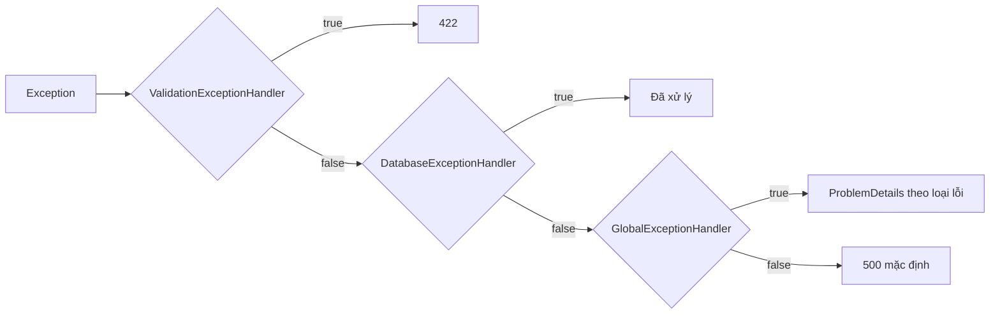

# 8.8 - Global Exception Handling

> **Tóm tắt:** Không có xử lý lỗi tập trung, mỗi controller tự `try/catch` theo một kiểu, và client nhận về mỗi chỗ một định dạng lỗi khác nhau. `IExceptionHandler` (.NET 8+) gom việc đó về **một nơi**: khai báo **một lần** rằng `NotFoundException` là 404 và `DomainValidationException` là 422, rồi mọi action đều đúng. Hai nguyên tắc không thương lượng: **log đầy đủ ở server, trả tối thiểu cho client** — stack trace tiết lộ cấu trúc thư mục, tên thư viện và phiên bản; và **`UseExceptionHandler()` phải đứng đầu pipeline**, vì nó chỉ bắt được exception từ những lớp **bên trong** nó.

## Mục tiêu bài học

Sau bài này bạn có thể:

- Cài `IExceptionHandler` và xếp chuỗi nhiều handler theo thứ tự.
- Thiết kế cây exception nghiệp vụ ánh xạ sang mã HTTP.
- Phân biệt mức log phù hợp cho từng loại exception.
- Giải thích những gì không bao giờ được lọt vào phản hồi lỗi.
- Biết loại exception nào handler **không** bắt được.

**Cần biết trước:** [bài 8.2](8.2-request-pipeline-and-middleware.md) (pipeline hai chiều), [bài 8.5](8.5-model-validation.md) (`ProblemDetails`), [bài 8.7](8.7-logging-with-serilog.md) (log level), [bài 4.3](../../stage-02-csharp-professional/module-04-csharp-core/4.3-inheritance-and-polymorphism.md) (kế thừa, để hiểu cây exception).

## Nội dung bài học

### 8.8.1 — `IExceptionHandler`

`IExceptionHandler` (có từ .NET 8) là interface cho một lớp xử lý exception: middleware `UseExceptionHandler()` bắt exception rồi gọi lần lượt các handler đã đăng ký. Các lớp `NotFoundException`, `ConflictException`... dưới đây là cây exception nghiệp vụ, khai báo ở mục 8.8.3.

```csharp
using Microsoft.AspNetCore.Diagnostics;   // chứa IExceptionHandler, không nằm trong implicit usings

public sealed class GlobalExceptionHandler(
    ILogger<GlobalExceptionHandler> logger,
    IHostEnvironment env,
    IProblemDetailsService problemDetailsService) : IExceptionHandler
{
    public async ValueTask<bool> TryHandleAsync(
        HttpContext context, Exception exception, CancellationToken ct)
    {
        // Kiểu cụ thể đặt TRƯỚC kiểu cha DomainException
        var (status, title) = exception switch
        {
            NotFoundException          => (StatusCodes.Status404NotFound, "Không tìm thấy"),
            DomainValidationException  => (StatusCodes.Status422UnprocessableEntity, "Dữ liệu không hợp lệ"),
            ConflictException          => (StatusCodes.Status409Conflict, "Xung đột trạng thái"),
            ForbiddenException         => (StatusCodes.Status403Forbidden, "Không đủ quyền"),
            DomainException            => (StatusCodes.Status400BadRequest, "Yêu cầu không hợp lệ"),
            _                          => (StatusCodes.Status500InternalServerError, "Lỗi hệ thống")
        };

        // Lỗi của hệ thống mới là sự cố; lỗi nghiệp vụ chỉ là cảnh báo, không cần stack trace
        if (status >= 500)
            logger.LogError(exception, "Lỗi chưa xử lý tại {Path}", context.Request.Path);
        else
            logger.LogWarning("Lỗi nghiệp vụ tại {Path}: {Message}", context.Request.Path, exception.Message);

        context.Response.StatusCode = status;

        return await problemDetailsService.TryWriteAsync(new ProblemDetailsContext
        {
            HttpContext = context,
            Exception = exception,
            ProblemDetails = new ProblemDetails
            {
                Status = status,
                Title = title,
                // Lỗi nghiệp vụ: thông điệp viết cho người dùng, trả được.
                // Lỗi hệ thống: chỉ lộ thông điệp ngoài Production.
                Detail = exception is DomainException || !env.IsProduction() ? exception.Message : null,
                Instance = context.Request.Path
            }
        });
    }
}
```

```csharp
// Program.cs
builder.Services.AddProblemDetails();
builder.Services.AddExceptionHandler<GlobalExceptionHandler>();

var app = builder.Build();
app.UseExceptionHandler();       // ĐẦU pipeline
```

Gọi một endpoint ném `new NotFoundException("Customer", 2)` trên .NET 10, môi trường Production:

```text
HTTP/1.1 404 Not Found
Content-Type: application/problem+json

{"type":"https://tools.ietf.org/html/rfc9110#section-15.5.5","title":"Không tìm thấy","status":404,
 "detail":"Không tìm thấy Customer với id '2'","instance":"/customers/2",
 "traceId":"00-cd5a268c41a6bf8f655943f60ab454fc-b88cf45dfdfe60fe-00"}
```

Ba chi tiết đáng chú ý:

- **Thứ tự các nhánh trong `switch`** đi từ cụ thể tới tổng quát. `NotFoundException` kế thừa `DomainException`; đặt nhánh `DomainException` lên trước thì nhánh `NotFoundException` không bao giờ khớp, và trình biên dịch báo lỗi `CS8510: The pattern is unreachable`.
- **`IProblemDetailsService`** áp `CustomizeProblemDetails` bạn cấu hình ở [bài 8.5](8.5-model-validation.md), và tự thêm `traceId`, nên định dạng lỗi thống nhất với lỗi validation.
- **Mức log phân theo mã.** 500 là sự cố của bạn; 404 và 422 là hành vi bình thường của hệ thống. Log tất cả ở `Error` thì cảnh báo mất ý nghĩa. `traceId` nối phản hồi lỗi với log: người dùng báo lỗi kèm `traceId` là bạn tìm ra log trong vài giây.

Vì sao không ánh xạ `UnauthorizedAccessException` sang 403: đó là exception của .NET khi **hệ điều hành** từ chối, ví dụ không có quyền ghi một thư mục. Nó là lỗi hệ thống, phải rơi vào nhánh 500. Lỗi phân quyền nghiệp vụ dùng `ForbiddenException` của riêng bạn.

### 8.8.2 — Chuỗi nhiều handler

`DatabaseExceptionHandler` dưới đây là một handler tự viết khác, ví dụ đổi lỗi trùng khoá của database thành 409.

```csharp
builder.Services.AddExceptionHandler<ValidationExceptionHandler>();  // chạy trước
builder.Services.AddExceptionHandler<DatabaseExceptionHandler>();
builder.Services.AddExceptionHandler<GlobalExceptionHandler>();      // bắt tất cả
```

Chúng chạy **theo thứ tự đăng ký**, và dừng ở handler đầu tiên trả `true`. Trả `false` nghĩa là "không phải việc của tôi, chuyển tiếp".

```csharp
public sealed class ValidationExceptionHandler(IProblemDetailsService pds) : IExceptionHandler
{
    public async ValueTask<bool> TryHandleAsync(HttpContext ctx, Exception ex, CancellationToken ct)
    {
        if (ex is not DomainValidationException v) return false;   // nhường cho handler sau

        ctx.Response.StatusCode = StatusCodes.Status422UnprocessableEntity;

        return await pds.TryWriteAsync(new ProblemDetailsContext
        {
            HttpContext = ctx,
            ProblemDetails = new HttpValidationProblemDetails(v.Errors)
            {
                Status = StatusCodes.Status422UnprocessableEntity,
                Title = "Dữ liệu không hợp lệ"
            }
        });
    }
}
```

`HttpValidationProblemDetails` là `ProblemDetails` có thêm trường `errors`, dạng giống lỗi 400 tự động của `[ApiController]`. Khi một action ném `new DomainValidationException(new Dictionary<string, string[]> { ["Name"] = ["Tên là bắt buộc"] })`, body trả về (chạy thật trên .NET 10) là:

```json
{"type":"https://tools.ietf.org/html/rfc4918#section-11.2","title":"Dữ liệu không hợp lệ","status":422,"errors":{"Name":["Tên là bắt buộc"]},"traceId":"00-9d4a88d6192f5bee9c536d8b7e476d87-9401792c22548648-00"}
```

Handler bắt-tất-cả phải đăng ký **cuối cùng**. Nếu **không** handler nào trả `true`, exception tiếp tục lan lên và ASP.NET Core trả 500 mặc định.



### 8.8.3 — Cây exception nghiệp vụ

```csharp
public abstract class DomainException(string message) : Exception(message);

public sealed class NotFoundException(string entity, object id)
    : DomainException($"Không tìm thấy {entity} với id '{id}'")
{
    public string Entity { get; } = entity;
    public object Id { get; } = id;
}

public sealed class ConflictException(string message) : DomainException(message);

public sealed class ForbiddenException(string message) : DomainException(message);

public sealed class DomainValidationException(IDictionary<string, string[]> errors)
    : DomainException("Dữ liệu không hợp lệ")
{
    public IReadOnlyDictionary<string, string[]> Errors { get; } = errors.AsReadOnly();
}
```

Lớp cơ sở `DomainException` cho phép phân biệt **lỗi dự kiến được** với lỗi hạ tầng bằng một dòng:

```csharp
var status = exception switch
{
    NotFoundException         => 404,
    ConflictException         => 409,
    ForbiddenException        => 403,
    DomainValidationException => 422,
    DomainException           => 400,   // mọi lỗi nghiệp vụ khác — đặt SAU các kiểu con
    _                         => 500    // hạ tầng: SQL, mạng, bug
};
```

**Nhưng đừng dùng exception cho luồng thông thường.** Ném exception tốn kém hơn nhiều so với trả về một kết quả ([bài 4.9](../../stage-02-csharp-professional/module-04-csharp-core/4.9-common-mistakes.md) đo được chậm hơn hàng trăm lần), và với thứ xảy ra thường xuyên như "không tìm thấy", điều đó có thể nhìn thấy được trên biểu đồ.

```csharp
// Tốt hơn cho trường hợp bình thường
var customer = await service.GetByIdAsync(id, ct);
return customer is null ? NotFound() : Ok(customer);
```

Exception dành cho những gì **thật sự bất thường**: vi phạm ràng buộc sâu trong tầng domain, trạng thái không thể xảy ra, lỗi hạ tầng.

### 8.8.4 — Không bao giờ lọt ra ngoài

```csharp
// SAI — lộ cấu trúc nội bộ
return Problem(detail: exception.ToString());
```

Stack trace tiết lộ đường dẫn file nguồn trên máy build, namespace và cấu trúc dự án, tên thư viện (tra được lỗ hổng đã biết), và đôi khi cả giá trị tham số trong thông điệp exception.

Thông điệp exception cũng nguy hiểm không kém:

```text
Npgsql.PostgresException (0x80004005): 28P01: password authentication failed for user "crm_prod_user"
```

Một dòng đó cho kẻ tấn công tên tài khoản database và biết rằng bạn dùng PostgreSQL. Bài tập 2 cho thấy toàn bộ.

Nguyên tắc: **client nhận `title`, `status`, `traceId`. Còn lại nằm trong log.**

Trên Development thì trả `exception.Message` của lỗi hệ thống cho tiện — đó là lý do có `env.IsProduction()` ở trên. Đừng nhầm nó với `UseDeveloperExceptionPage()`, thứ tuyệt đối không được bật ở Production.

### 8.8.5 — Những gì handler không bắt được

`UseExceptionHandler()` chỉ bắt exception từ các lớp **bên trong** nó. Bốn trường hợp nằm ngoài:

1. **Exception trong middleware đăng ký trước nó.** Vì vậy nó phải đứng đầu — sau `UseForwardedHeaders()` là hợp lý nhất.
2. **Exception sau khi response đã bắt đầu.** Không đổi được status code nữa ([bài 8.2](8.2-request-pipeline-and-middleware.md)); ASP.NET Core chỉ có thể ngắt kết nối. Đây là lý do stream một `IAsyncEnumerable` lớn có rủi ro ([bài 6.6](../../stage-02-csharp-professional/module-06-async-programming/6.6-async-patterns.md)).
3. **Exception trong `BackgroundService`.** Nó không đi qua pipeline HTTP. Exception thoát khỏi `ExecuteAsync` được host ghi log, rồi **dừng toàn bộ ứng dụng** — kể cả phần web đang phục vụ bình thường. Chạy thử trên .NET 10 với một worker ném exception sau 2 giây:

   ```text
   fail: Microsoft.Extensions.Hosting.Internal.Host[9]
         BackgroundService failed
         System.InvalidOperationException: Lỗi trong tác vụ nền
   crit: Microsoft.Extensions.Hosting.Internal.Host[10]
         The HostOptions.BackgroundServiceExceptionBehavior is configured to StopHost. A BackgroundService has thrown
         an unhandled exception, and the IHost instance is stopping. To avoid this behavior, configure this to Ignore;
         however the BackgroundService will not be restarted.
   info: Microsoft.Hosting.Lifetime[0]
         Application is shutting down...
   ```

   Đổi sang `Ignore` bằng `builder.Services.Configure<HostOptions>(o => o.BackgroundServiceExceptionBehavior = BackgroundServiceExceptionBehavior.Ignore);` thì ứng dụng không dừng, nhưng worker đã chết và không tự chạy lại. Cách đúng vẫn là `try/catch` quanh **từng công việc** trong vòng lặp ([bài 6.8](../../stage-02-csharp-professional/module-06-async-programming/6.8-channels-and-producer-consumer.md)), để một việc lỗi không giết cả worker.
4. **`async void`.** Exception đi thẳng lên và làm sập tiến trình ([bài 6.2](../../stage-02-csharp-professional/module-06-async-programming/6.2-task-and-async-await.md)). Không có cách nào "bắt" để cứu tiến trình; cách sửa duy nhất là không viết `async void`.

Sự kiện `AppDomain.CurrentDomain.UnhandledException` cho bạn cơ hội cuối để **ghi log** trước khi tiến trình chết. Nó không ngăn được việc tiến trình dừng:

```csharp
AppDomain.CurrentDomain.UnhandledException += (_, e) =>
    app.Logger.LogCritical(e.ExceptionObject as Exception, "Exception chưa bắt, tiến trình sắp dừng");
```

### 8.8.6 — Rà lại code của bạn

**Danh sách rà soát xử lý lỗi**

- [ ] UseExceptionHandler() đứng đầu pipeline, chỉ sau UseForwardedHeaders().
- [ ] Không còn try/catch lặp lại trong controller cho lỗi đã có handler.
- [ ] Handler bắt-tất-cả được đăng ký cuối cùng.
- [ ] Lỗi nghiệp vụ log mức Warning, lỗi hệ thống log mức Error.
- [ ] Phản hồi lỗi ở Production không chứa stack trace hay message của exception.
- [ ] Mọi phản hồi lỗi có traceId nối được với log.
- [ ] Không dùng exception cho luồng thông thường như không tìm thấy.
- [ ] BackgroundService có try/catch riêng cho từng công việc.
- [ ] Không có `async void` ngoài event handler.

## Bài tập áp dụng

#### Bài 1 — Thứ tự đường ống quyết định handler có chạy hay không

Đặt `UseExceptionHandler()` **sau** một middleware ném ngoại lệ, xác nhận client không nhận `ProblemDetails` do handler của bạn tạo. Chuyển lên đầu và kiểm chứng lại. Dùng `GlobalExceptionHandler` ở mục 8.8.1.

**Tiêu chí hoàn thành:** bạn giải thích được bằng mô hình đường ống hai chiều ở [bài 8.2](8.2-request-pipeline-and-middleware.md).

<details>
<summary><strong>Gợi ý và lời giải — Bài 1</strong></summary>

**Gợi ý.** Ngoại lệ lan **ngược** ra ngoài theo ngăn xếp gọi. Chỉ middleware **bọc ngoài** chỗ ném mới có cơ hội bắt.

**Lời giải — bản sai:**

```csharp
var app = builder.Build();

app.Use(async (ctx, next) =>
{
    if (ctx.Request.Path == "/boom") throw new InvalidOperationException("nổ ở đây");
    await next();
});

app.UseExceptionHandler();      // quá muộn — nằm BÊN TRONG middleware trên
app.MapControllers();
```

```bash
curl -i localhost:5000/boom
```

Kết quả chạy thật trên .NET 10. Ở **Production** (chạy bằng `dotnet run -- --environment Production`), một phản hồi `500` trống rỗng — không `ProblemDetails`, không `traceId`:

```text
HTTP/1.1 500 Internal Server Error
Content-Length: 0
```

Ở **Development**, `WebApplication` tự thêm trang lỗi dành cho lập trình viên ở ngoài cùng, nên bạn nhận chi tiết exception (với `Accept: application/json` thì là JSON có cả stack trace) — cũng không phải phản hồi của handler bạn viết.

**Bản đúng:**

```csharp
app.UseExceptionHandler();      // ĐẦU TIÊN — bọc ngoài mọi thứ

app.Use(async (ctx, next) => { /* ... */ });
app.MapControllers();
```

Kết quả (Production):

```text
HTTP/1.1 500 Internal Server Error
Content-Type: application/problem+json

{"type":"https://tools.ietf.org/html/rfc9110#section-15.6.1","title":"Lỗi hệ thống","status":500,
 "instance":"/boom","traceId":"00-c45cb03b7f336028d141d9d75a19bd33-8596a2502a2a53a7-00"}
```

**Giải thích bằng mô hình đường ống.** Nhớ lại cấu trúc lồng nhau:

```text
Sai:   [middleware ném] ( [UseExceptionHandler] ( [MapControllers] ) )
       ngoại lệ ném ở LỚP NGOÀI -> không có ai bọc nó -> lọt ra ngoài

Đúng:  [UseExceptionHandler] ( [middleware ném] ( [MapControllers] ) )
       ngoại lệ ném ở lớp trong -> lan ra và bị lớp ngoài bắt
```

Cùng một nguyên tắc với khối `try/catch`: `catch` chỉ bắt được những gì ném **bên trong** khối `try` tương ứng.

**Thứ tự chuẩn — `UseExceptionHandler` luôn là dòng đầu tiên:**

```csharp
var app = builder.Build();

app.UseExceptionHandler();         // 1. bọc ngoài cùng
app.UseHttpsRedirection();
app.UseRouting();
app.UseCors();
app.UseAuthentication();
app.UseAuthorization();
app.MapControllers();
```

**Ba loại ngoại lệ mà `UseExceptionHandler` *không* bắt được:**

| Loại | Vì sao | Xử lý bằng |
|---|---|---|
| Ném **trong chính** exception handler | Không có lớp nào bọc nó | Giữ handler cực đơn giản |
| Ném **sau khi** phản hồi đã bắt đầu | Không sửa được phản hồi đang gửi | Kiểm tra `Response.HasStarted` |
| Ném lúc **khởi động**, trước `app.Run()` | Đường ống chưa tồn tại | `try/catch` quanh `Program.Main` |

Loại thứ hai đáng chú ý: nếu một endpoint đã ghi một phần body rồi mới ném, `ProblemDetails` không thể được gửi vì header đã đi — đúng vấn đề `HasStarted` ở [bài 8.2](8.2-request-pipeline-and-middleware.md). Client nhận một phản hồi **cụt**, và đây là một trong những lỗi khó chẩn đoán nhất.

**Bắt lỗi khởi động** (với Serilog, `Log` là logger tĩnh của nó, xem [bài 8.7](8.7-logging-with-serilog.md)):

```csharp
try
{
    var app = builder.Build();
    // ...
    app.Run();
}
catch (Exception ex)
{
    Log.Fatal(ex, "Ứng dụng không khởi động được");
    throw;
}
finally
{
    Log.CloseAndFlush();      // quan trọng — đẩy hết log ra trước khi thoát
}
```

Không có `try/catch` này, một lỗi khởi động chỉ để lại dấu vết trong output của tiến trình — thứ có thể đã biến mất khi container bị xoá.

</details>

#### Bài 2 — Rò rỉ thông tin qua thông báo lỗi

Cấu hình handler trả `exception.ToString()`, gây một lỗi kết nối database bằng mật khẩu sai, và ghi lại **chính xác** những thông tin lọt ra ngoài. Mở kết nối bằng gói `Npgsql` (`new NpgsqlConnection(cs)` rồi `OpenAsync`), database PostgreSQL chạy bằng `docker compose up -d` ở gốc repo; [bài 8.10](8.10-ef-core-minimal.md) và Module 12 dạy kỹ phần database.

**Tiêu chí hoàn thành:** bạn liệt kê được ít nhất **năm** loại thông tin nội bộ bị lộ.

<details>
<summary><strong>Gợi ý và lời giải — Bài 2</strong></summary>

**Gợi ý.** Đừng chỉ nhìn thông báo lỗi. Hãy đọc **toàn bộ** chuỗi mà `ToString()` trả về, gồm cả dấu vết ngăn xếp và ngoại lệ bên trong.

**Lời giải — bản rò rỉ:**

```csharp
app.UseExceptionHandler(a => a.Run(async ctx =>
{
    var ex = ctx.Features.Get<IExceptionHandlerFeature>()?.Error;
    ctx.Response.StatusCode = 500;
    await ctx.Response.WriteAsync(ex?.ToString() ?? "");   // RÒ RỈ
}));
```

**Phản hồi khi sai mật khẩu database.** Chạy thật trên .NET 10 với Npgsql 10, ứng dụng build từ `/home/deploy/src/Crm.Api` trong container; bỏ bớt các dòng giữa của Npgsql:

```text
Npgsql.PostgresException (0x80004005): 28P01: password authentication failed for user "crm_prod_user"
   at Npgsql.Internal.NpgsqlConnector.ReadMessageLong(Boolean async, DataRowLoadingMode dataRowLoadingMode, ...)
   at Npgsql.Internal.NpgsqlConnector.AuthenticateSASL(List`1 mechanisms, String username, Boolean async, ...)
   ...
   at Npgsql.NpgsqlConnection.<Open>g__OpenAsync|42_0(Boolean async, CancellationToken cancellationToken)
   at Crm.Api.OrderRepository.GetByIdAsync(Int32 id, CancellationToken ct) in /home/deploy/src/Crm.Api/Program.cs:line 28
   at Program.<>c.<<<Main>$>b__0_1>d.MoveNext() in /home/deploy/src/Crm.Api/Program.cs:line 18
--- End of stack trace from previous location ---
   at Microsoft.AspNetCore.Http.RequestDelegateFactory.ExecuteTaskResult[T](Task`1 task, HttpContext httpContext)
   at Microsoft.AspNetCore.Routing.EndpointMiddleware.<Invoke>g__AwaitRequestTask|7_0(...)
   at Microsoft.AspNetCore.Diagnostics.ExceptionHandlerMiddlewareImpl.<Invoke>g__Awaited|10_0(...)
  Exception data:
    Severity: FATAL
    SqlState: 28P01
    MessageText: password authentication failed for user "crm_prod_user"
    File: auth.c
    Line: 331
    Routine: auth_failed
```

<details>
<summary>SQL Server</summary>

Với `Microsoft.Data.SqlClient` 6 và SQL Server 2022, cùng tình huống cho (bỏ bớt các dòng giữa):

```text
Microsoft.Data.SqlClient.SqlException (0x80131904): Login failed for user 'crm_prod_user'.
   at Microsoft.Data.ProviderBase.DbConnectionFactory.CreatePooledConnection(...)
   ...
   at Crm.Api.OrderRepository.GetByIdAsync(Int32 id, CancellationToken ct) in /home/deploy/src/Crm.Api/Program.cs:line 28
   ...
ClientConnectionId:3d272ca0-c2bf-4f8d-a2d1-a474d4bdc5c6
Error Number:18456,State:1,Class:14
```

Bảng phân tích bên dưới vẫn đúng, chỉ khác mã lỗi (`18456` thay cho `28P01`).

</details>

**Sáu loại thông tin bị lộ:**

| # | Thông tin | Kẻ tấn công dùng để |
|---|---|---|
| 1 | Loại database (PostgreSQL) và tên driver (Npgsql) | Chọn đúng bộ khai thác |
| 2 | **Tên tài khoản database**: `crm_prod_user` | Nửa đầu của cặp thông tin đăng nhập |
| 3 | **Đường dẫn trên máy build**: `/home/deploy/src/...` | Suy ra cấu trúc triển khai, người dùng hệ thống |
| 4 | Namespace và tên lớp: `Crm.Api.OrderRepository` | Vẽ bản đồ kiến trúc nội bộ |
| 5 | Số dòng mã nguồn | Đối chiếu với mã nguồn nếu bị lộ ở nơi khác |
| 6 | Mã lỗi nội bộ, tên file nguồn của PostgreSQL (`auth.c`, dòng 331) | Đoán phiên bản database |

Không thông tin nào trong bảng trên có ích cho người dùng hợp lệ. Tất cả đều có ích cho người đang dò tìm.

**Bản đúng — tách hai luồng thông tin.** Dùng `GlobalExceptionHandler` ở mục 8.8.1: exception đầy đủ đi vào log bằng `LogError(exception, ...)`, còn client nhận `ProblemDetails` chỉ có `title`, `status`, `instance`, `traceId`. Phản hồi có dạng giống hệt kết quả ở bài tập 1 — `"title":"Lỗi hệ thống"`, `instance` là đường dẫn, kèm `traceId` — không còn chữ nào về Npgsql, tài khoản hay đường dẫn máy build. Thử thêm một endpoint ném `new InvalidOperationException("Invalid object name 'Leads_Old'. Host=prod-db-01;Database=crm;Username=crm_app")` trên Production, chạy thật trên .NET 10:

```text
HTTP/1.1 500 Internal Server Error
Content-Type: application/problem+json

{"type":"https://tools.ietf.org/html/rfc9110#section-15.6.1","title":"Lỗi hệ thống","status":500,
 "instance":"/sys","traceId":"00-2f0ed4d59515bb39ed8b7b83f2ce83a5-82b9b30d347997f3-00"}
```

**Nguyên tắc: log đầy đủ, trả về tối thiểu, nối hai bên bằng mã tra cứu.** Người dùng báo lỗi kèm `traceId`, bộ phận hỗ trợ tra ra đúng chuỗi log trong vài giây — mà không tiết lộ gì ra ngoài.

**Ngoại lệ nghiệp vụ thì khác.** Chúng được thiết kế để người dùng đọc, nên trả chi tiết là đúng — đó là lý do handler ở mục 8.8.1 trả `exception.Message` cho mọi `DomainException`:

```csharp
exception switch
{
    NotFoundException e         => (404, e.Message),
    DomainValidationException e => (422, e.Message),
    ConflictException e         => (409, e.Message),
    _                           => (500, "Lỗi hệ thống")   // mặc định: giấu
};
```

Điểm mấu chốt: **danh sách cho phép**, không phải danh sách cấm. Ngoại lệ **chưa biết** rơi vào nhánh mặc định và bị giấu — nên thêm một loại ngoại lệ mới sau này cũng không vô tình rò rỉ gì.

**Kiểm tra dự án của bạn:**

```bash
grep -rn "ex.ToString()\|ex.StackTrace\|exception.Message" --include=*.cs src/ \
  | grep -iv "log\|logger"
```

```powershell
# PowerShell
Get-ChildItem src -Recurse -Filter *.cs |
  Select-String 'ex\.ToString\(\)|ex\.StackTrace|exception\.Message' |
  Where-Object { $_.Line -notmatch 'log' }
```

Mỗi kết quả là một chỗ cần rà: thông tin đó đi tới client hay chỉ vào log?

</details>

#### Bài 3 — Chi phí của ngoại lệ trong luồng thường

Viết hai endpoint "không tìm thấy", một ném `NotFoundException` và một trả `NotFound()`. Bắn 10.000 request vào mỗi cái bằng một công cụ đo tải (ví dụ [bombardier](https://github.com/codesenberg/bombardier), một file chạy được trên Windows, Linux, macOS) và so sánh độ trễ phân vị 99 (p99: 99% request nhanh hơn con số này). Chạy ứng dụng bằng `dotnet run -c Release`.

**Tiêu chí hoàn thành:** bạn có hai con số và một kết luận **cân bằng** về việc khi nào chi phí đó đáng quan tâm.

<details>
<summary><strong>Gợi ý và lời giải — Bài 3</strong></summary>

**Gợi ý.** Bài này nối tiếp phép đo ở [bài 4.9](../../stage-02-csharp-professional/module-04-csharp-core/4.9-common-mistakes.md), nơi ngoại lệ chậm hơn `TryParse` 527 lần. Nhưng ở đây ngăn xếp **sâu hơn nhiều**, nên chi phí cũng khác.

**Lời giải.**

```csharp
var customers = new Dictionary<int, string> { [1] = "Nguyễn Văn An" };

app.MapGet("/throw/{id:int}", (int id) =>
{
    if (!customers.TryGetValue(id, out var name)) throw new NotFoundException("Customer", id);
    return Results.Ok(name);
});

app.MapGet("/return/{id:int}", (int id) =>
    customers.TryGetValue(id, out var name) ? Results.Ok(name) : Results.NotFound());
```

```bash
bombardier -c 50 -n 10000 -l http://localhost:5000/throw/99999
bombardier -c 50 -n 10000 -l http://localhost:5000/return/99999
```

Tham số `-l` in phân bố độ trễ, trong đó có p99. Con số tuyệt đối phụ thuộc máy của bạn, nên bài không ghi số; điều cần quan sát là **chênh lệch** giữa hai endpoint ở thông lượng (request/giây), trung vị và p99. Ghi cả ba con số vào bảng của bạn.

Nhánh ném exception đi qua `UseExceptionHandler`, `GlobalExceptionHandler`, ghi log `Warning` và dựng `ProblemDetails` — nhiều việc hơn hẳn một `Results.NotFound()`. Ném exception còn cấp phát thêm bộ nhớ và chụp stack trace.

**Vì sao ngăn xếp sâu làm chi phí tăng.** Khi ném trong một endpoint ASP.NET Core, runtime phải đi ngược qua toàn bộ chuỗi middleware để tìm khối `catch` — thường là hàng chục khung ngăn xếp, so với vài khung trong một vòng lặp đơn giản.

**Kết luận cân bằng — đây là phần chính của bài.** Đừng kết luận "không bao giờ dùng ngoại lệ". Hãy hỏi: **tình huống này có thường xuyên không?**

| Tình huống | Tần suất | Nên dùng |
|---|---|---|
| Tra một mã khách hàng người dùng gõ tay | Sai thường xuyên | **Trả `NotFound()`** |
| Truy cập tài nguyên đã bị xoá | Thỉnh thoảng | Trả `NotFound()` |
| Mất kết nối database | Hiếm | **Ngoại lệ** |
| Lỗi lập trình, trạng thái không thể xảy ra | Không bao giờ nên xảy ra | **Ngoại lệ** |

**Ngưỡng thực dụng.** Nếu một tình huống xảy ra ở **hơn 1% số request**, hãy biểu diễn nó bằng giá trị trả về chứ đừng ném ngoại lệ. Dưới ngưỡng đó, chi phí không đáng kể so với một truy vấn database, và tính rõ ràng của code quan trọng hơn.

**Mẫu `Result<T>` giữ được cả hai** (`Result<T>` tự viết như ở [bài 8.4](8.4-controllers-and-actions.md)):

```csharp
var result = await _service.GetAsync(id, ct);

return result.Kind switch
{
    ResultKind.Success       => Results.Ok(result.Value),
    ResultKind.NotFound      => Results.NotFound(),
    ResultKind.RuleViolation => Results.BadRequest(result.Error),
    _ => Results.StatusCode(500)
};
```

Không ném ngoại lệ cho luồng bình thường, nhưng vẫn có xử lý ngoại lệ toàn cục làm lưới an toàn cho những gì thật sự bất thường.

**Một điều đáng đo hơn cả tốc độ: ảnh hưởng tới log và cảnh báo.** Mỗi ngoại lệ ném ra sinh ít nhất một dòng log (handler ở mục 8.8.1 ghi `Warning`; nhiều dự án ghi `Error` cho mọi exception). Một endpoint trả "không tìm thấy" 10.000 lần mỗi ngày sẽ tạo 10.000 dòng log vô ích, làm ngập log thật và khiến cảnh báo mất giá trị — đúng vấn đề nhiễu log đã bàn ở [bài 8.7](8.7-logging-with-serilog.md).

</details>

## Tự kiểm tra

<details>
<summary>IExceptionHandler giải quyết vấn đề gì?</summary>

Nó gom việc ánh xạ exception sang mã HTTP về một nơi, nên bạn khai báo một lần rằng NotFoundException là 404 và DomainValidationException là 422, rồi mọi action đều đúng. Không có nó thì mỗi controller tự try catch theo một kiểu và client nhận mỗi chỗ một định dạng lỗi khác nhau.

</details>

<details>
<summary>Nhiều IExceptionHandler chạy theo thứ tự nào?</summary>

Theo thứ tự đăng ký, và dừng ở handler đầu tiên trả về true. Trả false nghĩa là không phải việc của tôi, chuyển tiếp. Handler bắt tất cả phải đăng ký cuối cùng; nếu không handler nào trả true thì ASP.NET Core trả 500 mặc định.

</details>

<details>
<summary>Vì sao không trả stack trace cho client?</summary>

Vì nó tiết lộ đường dẫn file nguồn trên máy build, namespace và cấu trúc dự án, tên thư viện để tra lỗ hổng đã biết. Thông điệp exception cũng nguy hiểm: lỗi đăng nhập database lộ tên tài khoản database và loại database đang dùng. Client chỉ nên nhận title, status và traceId.

</details>

<details>
<summary>Có nên dùng exception cho trường hợp không tìm thấy không?</summary>

Không, với thứ xảy ra thường xuyên thì nên trả về kết quả rỗng rồi để controller trả NotFound. Ném exception tốn kém hơn nhiều so với trả về kết quả, sinh log vô ích, và có thể nhìn thấy được trên biểu đồ latency. Exception dành cho những gì thật sự bất thường.

</details>

<details>
<summary>UseExceptionHandler không bắt được những gì?</summary>

Bốn thứ. Exception trong middleware đăng ký trước nó, nên nó phải đứng đầu pipeline. Exception sau khi response đã bắt đầu, vì không đổi được status code nữa. Exception trong BackgroundService vì nó không đi qua pipeline HTTP; mặc định nó làm host dừng cả ứng dụng (StopHost). Và async void, vì exception đi thẳng lên và làm sập tiến trình.

</details>

<details>
<summary>Nên log exception ở mức nào?</summary>

Phân theo mã trạng thái: từ 500 trở lên là sự cố của bạn nên log mức Error, còn 404 và 422 là hành vi bình thường nên log mức Warning. Log tất cả ở mức Error khiến cảnh báo mất ý nghĩa và không ai còn nhìn dashboard nữa.

</details>

## Kết luận

Ba điều đáng nhớ nhất:

1. **`UseExceptionHandler()` đứng đầu pipeline** — nó chỉ bắt được những lớp bên trong nó.
2. **Log đầy đủ ở server, trả `title` + `status` + `traceId` cho client.**
3. **Exception không dành cho luồng thông thường.** "Không tìm thấy" nên là một giá trị trả về.

## Tham khảo

- [Handle errors in ASP.NET Core](https://learn.microsoft.com/en-us/aspnet/core/fundamentals/error-handling)
- [Handle errors in ASP.NET Core web APIs](https://learn.microsoft.com/en-us/aspnet/core/web-api/handle-errors)
- [IExceptionHandler interface](https://learn.microsoft.com/en-us/dotnet/api/microsoft.aspnetcore.diagnostics.iexceptionhandler)
- [Best practices for exceptions](https://learn.microsoft.com/en-us/dotnet/standard/exceptions/best-practices-for-exceptions)

## Điều hướng

- **Bài trước:** [8.7 — Logging với Serilog](8.7-logging-with-serilog.md)
- **Bài tiếp theo:** [8.9 — Health Checks](8.9-health-checks.md)
- **Về module:** [Trang mục lục](README.md)
