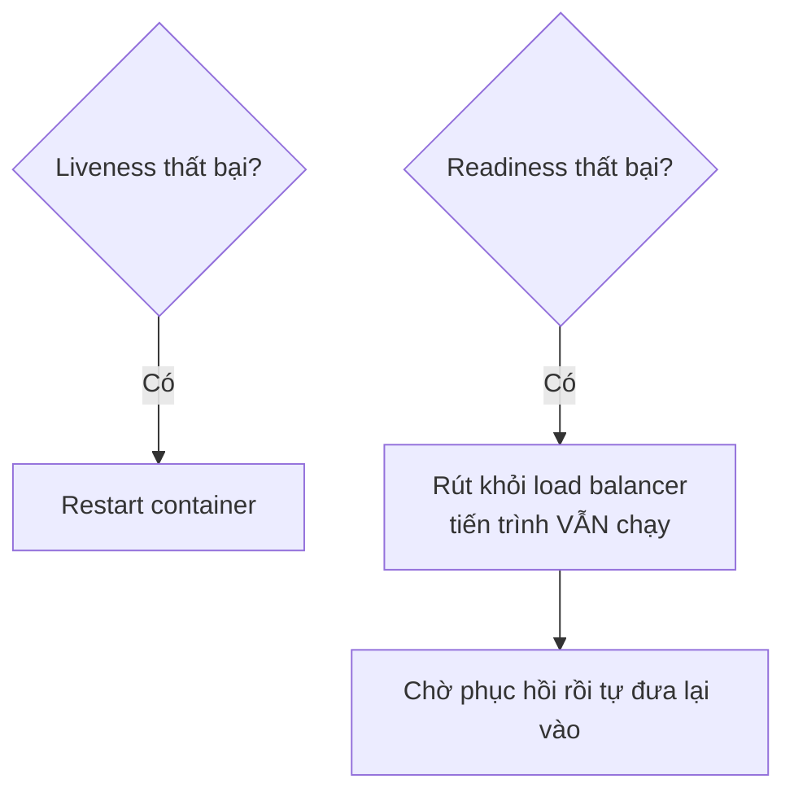

# 8.9 - Health Checks

> **Tóm tắt:** Health check không phải "một endpoint trả OK". Có **hai loại khác hẳn nhau**, và trộn chúng là nguyên nhân của một sự cố kinh điển: **liveness** trả lời "tiến trình có còn sống không" và thất bại nghĩa là **restart**; **readiness** trả lời "có nhận request được không" và thất bại nghĩa là **tạm rút khỏi load balancer**. Nếu liveness probe của bạn kiểm tra database, thì database chậm 30 giây sẽ làm Kubernetes **restart toàn bộ pod** — biến một sự cố database thành một sự cố toàn hệ thống, và các pod vừa khởi động lại càng làm database quá tải hơn.

## Mục tiêu bài học

Sau bài này bạn có thể:

- Phân biệt liveness, readiness và startup probe.
- Cấu hình hai endpoint riêng bằng tag.
- Viết custom health check có timeout.
- Cấu hình probe trong Docker Compose và Kubernetes.
- Tránh biến health check thành điểm nghẽn.

**Cần biết trước:** [bài 8.2](8.2-request-pipeline-and-middleware.md) (endpoint và pipeline), [bài 8.8](8.8-global-exception-handling.md) (không lộ chi tiết lỗi), [bài 6.4 — `CancellationToken`](../../stage-02-csharp-professional/module-06-async-programming/6.4-cancellationtoken.md). Bài dùng PostgreSQL chạy bằng `docker compose up -d` ở gốc repo. Phần Docker Compose và Kubernetes trong bài là **đọc hiểu**; bạn sẽ thực hành chúng ở [Module 15](../../stage-04-database-production/module-15-docker-deployment/README.md).

## Nội dung bài học

### 8.9.1 — Hai câu hỏi khác nhau

**Probe** là lời gọi định kỳ mà hệ thống điều phối (Kubernetes, Docker, bộ cân bằng tải) gửi tới endpoint health check để quyết định có restart hay gửi lưu lượng tới bản chạy đó không.

| | Liveness | Readiness |
|---|---|---|
| Câu hỏi | Tiến trình còn sống không? | Nhận request được không? |
| Thất bại nghĩa là | **Restart container** | **Rút khỏi load balancer** |
| Nên kiểm tra | Chỉ bản thân tiến trình | Database, cache, phụ thuộc bắt buộc |
| Thời gian chạy | Vài mili giây | Có thể vài trăm mili giây |



**Vì sao trộn hai loại là nguy hiểm:**

Giả sử liveness probe kiểm tra database. Database chậm 30 giây vì một truy vấn nặng:

1. Liveness thất bại ở mọi pod.
2. Kubernetes restart **toàn bộ** pod.
3. Các pod khởi động lại đồng loạt mở kết nối mới → database càng quá tải.
4. Liveness lại thất bại → restart loop.

Một sự cố database đã biến thành sự cố toàn hệ thống, và vòng lặp tự nuôi chính nó. Với readiness thì các pod chỉ tạm rút khỏi load balancer, giữ nguyên trạng thái, và tự quay lại khi database hồi phục.

**Quy tắc: liveness không kiểm tra gì bên ngoài tiến trình.**

### 8.9.2 — Cấu hình bằng tag

`AddHealthChecks()` có sẵn trong ASP.NET Core. Health check cho PostgreSQL và Redis nằm trong các gói của dự án mã nguồn mở AspNetCore.Diagnostics.HealthChecks (Xabaril), phải cài thêm:

```bash
dotnet add package AspNetCore.HealthChecks.NpgSql
dotnet add package AspNetCore.HealthChecks.Redis
```

```csharp
builder.Services.AddHealthChecks()
    // Liveness — không chạm gì bên ngoài
    .AddCheck("self", () => HealthCheckResult.Healthy(), tags: ["live"])

    // Readiness — phụ thuộc bắt buộc
    .AddNpgSql(
        connectionString: builder.Configuration.GetConnectionString("CrmDb")!,
        name: "database",
        failureStatus: HealthStatus.Unhealthy,
        tags: ["ready"],
        timeout: TimeSpan.FromSeconds(2))

    // Phụ thuộc không bắt buộc -> Degraded, KHÔNG phải Unhealthy
    .AddRedis(
        builder.Configuration.GetConnectionString("Redis")!,
        name: "cache",
        failureStatus: HealthStatus.Degraded,
        tags: ["ready"],
        timeout: TimeSpan.FromSeconds(2));
```

<details>
<summary>SQL Server</summary>

```bash
dotnet add package AspNetCore.HealthChecks.SqlServer
```

```csharp
    .AddSqlServer(
        connectionString: builder.Configuration.GetConnectionString("CrmDb")!,
        name: "database",
        failureStatus: HealthStatus.Unhealthy,
        tags: ["ready"],
        timeout: TimeSpan.FromSeconds(2))
```

</details>

Tham số `timeout` cắt check chạy quá lâu và tính nó là thất bại theo `failureStatus`. Thử với Redis không chạy: không có `timeout`, check Redis mất khoảng 10 giây mới trả kết quả; có `timeout: 2 giây`, nó trả `Degraded` sau đúng 2 giây.

```csharp
app.MapHealthChecks("/health/live", new HealthCheckOptions
{
    Predicate = check => check.Tags.Contains("live")
});

app.MapHealthChecks("/health/ready", new HealthCheckOptions
{
    Predicate = check => check.Tags.Contains("ready")
});
```

Mặc định mỗi endpoint chỉ trả một chữ như `Healthy`; mục 8.9.4 sẽ đổi sang JSON. `failureStatus` quan trọng hơn vẻ ngoài của nó. Ba trạng thái ánh xạ sang HTTP:

| Trạng thái | HTTP | Ý nghĩa |
|---|---|---|
| `Healthy` | 200 | Bình thường |
| `Degraded` | **200** | Có vấn đề nhưng vẫn phục vụ được |
| `Unhealthy` | 503 | Không phục vụ được |

`Degraded` trả **200**, nên load balancer vẫn gửi request tới. Đó chính là điều bạn muốn khi Redis chết: ứng dụng chậm hơn vì mất cache, nhưng vẫn chạy. Đặt Redis là `Unhealthy` sẽ rút **toàn bộ** pod khỏi load balancer vì một phụ thuộc không bắt buộc — tức tự gây ra downtime.

### 8.9.3 — Custom health check

Ví dụ kiểm tra một cổng thanh toán bên ngoài qua HTTP. `IHttpClientFactory` là service tạo `HttpClient` đã cấu hình sẵn (đăng ký bằng `builder.Services.AddHttpClient("payment", c => c.BaseAddress = ...)`).

```csharp
// PaymentGatewayHealthCheck.cs
public sealed class PaymentGatewayHealthCheck(IHttpClientFactory factory) : IHealthCheck
{
    public async Task<HealthCheckResult> CheckHealthAsync(
        HealthCheckContext context, CancellationToken ct = default)
    {
        try
        {
            using var cts = CancellationTokenSource.CreateLinkedTokenSource(ct);
            cts.CancelAfter(TimeSpan.FromSeconds(3));          // BẮT BUỘC có timeout

            var client = factory.CreateClient("payment");
            var response = await client.GetAsync("/ping", cts.Token);

            return response.IsSuccessStatusCode
                ? HealthCheckResult.Healthy()
                : HealthCheckResult.Degraded($"Gateway trả về {(int)response.StatusCode}");
        }
        catch (OperationCanceledException) when (!ct.IsCancellationRequested)
        {
            return HealthCheckResult.Degraded("Gateway không phản hồi trong 3 giây");
        }
        catch (Exception ex)
        {
            return HealthCheckResult.Unhealthy("Không kết nối được gateway", ex);
        }
    }
}
```

```csharp
// Program.cs
builder.Services.AddHealthChecks()
    .AddCheck<PaymentGatewayHealthCheck>("payment", tags: ["ready"]);
```

Ba nguyên tắc:

1. **Luôn có timeout.** Health check không timeout sẽ treo cùng phụ thuộc của nó, và probe của orchestrator sẽ timeout — kết quả là restart loop.
2. **Tự quyết định trạng thái khi lỗi.** Nếu check ném exception, framework tự bắt và ghi nhận theo `failureStatus` của check. Mặc định đó là `Unhealthy`, nên endpoint trả 503 (đã thử trên .NET 10). Có hai cách chọn trạng thái khác. Với check không tự `try/catch`, đăng ký kèm `failureStatus`, ví dụ `.AddCheck<MyCheck>("my-check", failureStatus: HealthStatus.Degraded, tags: ["ready"])`, thì mọi exception thoát ra đều thành `Degraded`. Còn khi muốn phân biệt từng loại lỗi (timeout là `Degraded`, lỗi khác là `Unhealthy`) hoặc mô tả rõ hơn, tự `try/catch` như ví dụ trên.
3. **Nhẹ.** Probe chạy mỗi 10–30 giây trên mọi instance. `SELECT 1` chứ không phải đếm số bản ghi.

Với database, `AddNpgSql` (và `AddSqlServer`) mặc định chạy `SELECT 1;` — vừa đủ.

### 8.9.4 — Đừng lộ chi tiết ra ngoài

`MapHealthChecks` mặc định chỉ trả một chữ như `Healthy`. Muốn trả JSON có từng check thì tự viết hàm ghi phản hồi. Đặt nó trong `Program.cs` (hàm cục bộ), trước các lời gọi `MapHealthChecks`:

```csharp
static Task WriteJsonResponse(HttpContext context, HealthReport report)
{
    context.Response.ContentType = "application/json";

    return context.Response.WriteAsJsonAsync(new
    {
        status = report.Status.ToString(),
        checks = report.Entries.Select(e => new
        {
            name = e.Key,
            status = e.Value.Status.ToString(),
            duration = Math.Round(e.Value.Duration.TotalMilliseconds, 1)
            // KHÔNG trả e.Value.Description hay Exception ra ngoài
        })
    });
}
```

Rồi gắn hàm vào endpoint readiness của mục 8.9.2:

```csharp
app.MapHealthChecks("/health/ready", new HealthCheckOptions
{
    Predicate = check => check.Tags.Contains("ready"),
    ResponseWriter = WriteJsonResponse     // hàm vừa viết ở trên
});
```

`Description` và `Exception` thường chứa connection string, tên máy chủ và thông điệp lỗi của database — đúng những thứ [bài 8.8](8.8-global-exception-handling.md) nói là không được lộ.

Nếu cần endpoint chi tiết cho đội vận hành, giới hạn truy cập (`RequireAuthorization` với một chính sách phân quyền, dạy ở [Module 10](../module-10-authentication-authorization/README.md); `WriteDetailedResponse` là một hàm ghi phản hồi khác, có cả `Description`):

```csharp
app.MapHealthChecks("/health/detail", new HealthCheckOptions
{
    Predicate = _ => true,
    ResponseWriter = WriteDetailedResponse
}).RequireAuthorization("OpsOnly");
```

Và nhớ loại health check khỏi log truy cập ([bài 8.7](8.7-logging-with-serilog.md)) — probe mỗi 10 giây là 8.640 dòng log mỗi ngày cho mỗi instance.

### 8.9.5 — Cấu hình probe

Phần này là đọc hiểu. Docker Compose có khối `healthcheck` chạy một lệnh **bên trong** container:

```yaml
# docker-compose.yml — chỉ chạy được nếu image có curl
healthcheck:
  test: ["CMD", "curl", "-f", "http://localhost:8080/health/live"]
  interval: 30s
  timeout: 5s
  retries: 3
  start_period: 40s
```

**Bẫy: image chính thức của .NET không có `curl`.** Kiểm tra trên `mcr.microsoft.com/dotnet/aspnet:10.0`:

```bash
docker run --rm --entrypoint sh mcr.microsoft.com/dotnet/aspnet:10.0 -c "command -v curl || echo 'không có curl'"
```

```text
không có curl
```

Image cũng không có `wget`, còn bản chiseled (`10.0-noble-chiseled`) không có cả shell. Với cấu hình trên, container sẽ **luôn** bị đánh dấu `unhealthy` dù ứng dụng chạy tốt. Ba cách xử lý:

1. **Để hệ thống bên ngoài gọi vào.** Kubernetes `httpGet` (bên dưới) hay bộ cân bằng tải gọi endpoint từ ngoài container, không cần công cụ nào bên trong. Đây là cách phổ biến nhất.
2. **Cài curl vào image** (chỉ với bản không chiseled), trong Dockerfile ([bài 15.2](../../stage-04-database-production/module-15-docker-deployment/15.2-dockerfile-for-aspnet-core.md)):

   ```dockerfile
   FROM mcr.microsoft.com/dotnet/aspnet:10.0
   RUN apt-get update && apt-get install -y --no-install-recommends curl && rm -rf /var/lib/apt/lists/*
   ```

3. **Viết một lệnh kiểm tra bằng .NET** (một console app nhỏ gọi `HttpClient` rồi trả mã thoát 0 hoặc 1) và chép vào image. Cách này dùng được cả với image chiseled.

`start_period` là phần hay bị bỏ qua: trong khoảng đó, thất bại **không tính**. Ứng dụng .NET cần vài giây để JIT và chạy migration, và không có nó thì container bị đánh dấu hỏng trước khi kịp khởi động.

```yaml
# Kubernetes
startupProbe:                       # cho phép khởi động chậm
  httpGet: { path: /health/live, port: 8080 }
  failureThreshold: 30
  periodSeconds: 10                 # chờ tối đa 300 giây

livenessProbe:
  httpGet: { path: /health/live, port: 8080 }
  periodSeconds: 10
  failureThreshold: 3

readinessProbe:
  httpGet: { path: /health/ready, port: 8080 }
  periodSeconds: 10
  failureThreshold: 2
```

`startupProbe` là cách đúng cho ứng dụng khởi động chậm: khi nó còn chạy, liveness và readiness **bị tạm dừng**. Không có nó, bạn buộc phải đặt `initialDelaySeconds` lớn cho liveness — và như vậy suốt vòng đời pod, mọi sự cố thật đều được phát hiện chậm hơn.

### 8.9.6 — Rà lại code của bạn

**Danh sách rà soát health checks**

- [ ] Liveness và readiness là hai endpoint riêng biệt.
- [ ] Liveness không kiểm tra database hay bất kỳ phụ thuộc bên ngoài nào.
- [ ] Phụ thuộc không bắt buộc như cache đặt failureStatus là Degraded.
- [ ] Mọi custom health check đều có timeout riêng.
- [ ] Health check chủ động chọn trạng thái khi lỗi (Degraded hay Unhealthy) thay vì để exception quyết định.
- [ ] `healthcheck` của Docker không dùng lệnh mà image không có (curl, wget).
- [ ] Endpoint công khai không trả Description hay Exception.
- [ ] Health check bị loại khỏi log truy cập.
- [ ] Kubernetes có startupProbe cho ứng dụng khởi động chậm.
- [ ] docker-compose healthcheck có start_period đủ dài.

## Bài tập áp dụng

#### Bài 1 — Liveness kiểm tra database và vòng lặp khởi động lại

Phần chạy trên máy: cấu hình một endpoint `/health` có kiểm tra PostgreSQL, rồi tách thành `/health/live` và `/health/ready`. Gọi các endpoint bằng `curl` (hoặc file `.http`) khi database đang chạy và khi đã dừng nó (`docker compose stop postgres` ở gốc repo; chạy lại bằng `docker compose start postgres`). Phần Kubernetes là đọc hiểu: dựa vào mã trạng thái bạn đo được, suy ra Kubernetes sẽ làm gì.

**Tiêu chí hoàn thành:** bạn có bảng mã trạng thái của ba endpoint khi database chạy và khi database dừng, mô tả được vòng lặp khởi động lại theo từng bước, và nêu được vì sao nó **làm sự cố tệ hơn**.

<details>
<summary><strong>Gợi ý và lời giải — Bài 1</strong></summary>

**Gợi ý.** Kubernetes phản ứng với hai probe theo hai cách hoàn toàn khác nhau: liveness thất bại thì **giết và khởi động lại**; readiness thất bại thì **ngừng gửi lưu lượng** nhưng để container chạy.

**Lời giải — cấu hình sai:**

```csharp
var cs = builder.Configuration.GetConnectionString("CrmDb")!;

builder.Services.AddHealthChecks()
    .AddNpgSql(cs);          // không phân tag — nằm trong /health

app.MapHealthChecks("/health");
```

```yaml
livenessProbe:
  httpGet: { path: /health, port: 8080 }    # /health kiểm tra CẢ database
  periodSeconds: 10
  failureThreshold: 3
```

Kết quả chạy thật trên .NET 10:

| | Database chạy | Database dừng |
|---|---|---|
| `GET /health` | `200 Healthy` | `503 Unhealthy` |

Nếu `/health` là liveness probe, cột bên phải nghĩa là Kubernetes **giết** pod. **Vòng lặp khi database gặp sự cố 30 giây:**

```text
1. Database chậm/mất kết nối
2. /health trả 503 trên MỌI thể hiện
3. Sau 3 lần thất bại (30 giây), Kubernetes GIẾT toàn bộ pod
4. Pod mới khởi động, mở kết nối mới tới database
5. Một đợt kết nối đồng loạt đổ vào database vốn đang yếu
6. Database quá tải THẬT -> chậm hơn nữa
7. Health check lại thất bại -> quay lại bước 3
```

Một sự cố database 30 giây biến thành **gián đoạn kéo dài**, và chính cơ chế bảo vệ là nguyên nhân. Đây là vòng lặp khởi động lại, một lỗi cấu hình kinh điển.

**Cấu hình đúng — tách bằng tag:**

```csharp
builder.Services.AddHealthChecks()
    .AddCheck("self", () => HealthCheckResult.Healthy(), tags: ["live"])
    .AddNpgSql(cs, name: "postgres", tags: ["ready"]);

app.MapHealthChecks("/health/live",  new HealthCheckOptions { Predicate = c => c.Tags.Contains("live") });
app.MapHealthChecks("/health/ready", new HealthCheckOptions
{
    Predicate = c => c.Tags.Contains("ready"),
    ResponseWriter = WriteJsonResponse
});
```

Kết quả chạy thật khi **dừng** database:

```text
GET /health/live  -> HTTP/1.1 200 OK
Healthy

GET /health/ready -> HTTP/1.1 503 Service Unavailable
{"status":"Unhealthy","checks":[{"name":"postgres","status":"Unhealthy","duration":1587.5}]}
```

Khi database chạy lại, `/health/ready` trở về `200`.

```yaml
livenessProbe:
  httpGet: { path: /health/live, port: 8080 }     # chỉ hỏi "tiến trình còn sống không"
  periodSeconds: 10
  failureThreshold: 3

readinessProbe:
  httpGet: { path: /health/ready, port: 8080 }    # hỏi "sẵn sàng phục vụ chưa"
  periodSeconds: 5
  failureThreshold: 2
```

**Hành vi mới khi database gặp sự cố:**

```text
1. Database chậm
2. /health/ready trả 503 -> Kubernetes NGỪNG gửi lưu lượng tới pod
3. /health/live vẫn trả 200 -> pod KHÔNG bị giết
4. Database hồi phục
5. /health/ready trả 200 -> lưu lượng quay lại
```

Không có pod nào bị khởi động lại, không có đợt kết nối đồng loạt, và ứng dụng tự phục hồi khi database hồi phục.

**Ba nguyên tắc viết health check:**

| Loại | Kiểm tra gì | Không kiểm tra gì |
|---|---|---|
| **Liveness** | Tiến trình còn phản hồi | **Mọi phụ thuộc bên ngoài** |
| **Readiness** | Phụ thuộc **bắt buộc** | Phụ thuộc tuỳ chọn |
| **Startup** | Khởi tạo đã xong chưa | — |

Dòng thứ hai đáng nói thêm: chỉ đưa vào readiness những thứ mà **thiếu nó thì ứng dụng không làm được gì**. Một dịch vụ gửi email hỏng không nên khiến toàn bộ API ngừng nhận request — hãy để nó ở mức `Degraded` thay vì `Unhealthy`, như bài 2 phân tích.

**Startup probe cho ứng dụng khởi động chậm:**

```yaml
startupProbe:
  httpGet: { path: /health/live, port: 8080 }
  failureThreshold: 30
  periodSeconds: 5          # cho phép tối đa 150 giây để khởi động
```

Khi có startup probe, Kubernetes **hoãn** liveness cho tới khi nó thành công lần đầu. Không có nó, một ứng dụng cần 60 giây để khởi động sẽ bị giết ở giây thứ 30 — và rơi vào một vòng lặp khởi động lại khác, lần này ngay từ đầu.

</details>

#### Bài 2 — `Degraded` trả 200

Thêm check Redis với `failureStatus: HealthStatus.Degraded` vào `/health/ready` của bài 1, trỏ tới một Redis **không chạy** (ví dụ `localhost:6399,abortConnect=false` — cổng không có gì), và gọi `/health/ready`. Xác nhận mã trạng thái là 200 dù JSON ghi `Degraded`. Đổi sang `Unhealthy` và xác nhận nó thành 503.

**Tiêu chí hoàn thành:** bạn nêu được khi nào nên dùng `Degraded` và khi nào phải dùng `Unhealthy`.

<details>
<summary><strong>Gợi ý và lời giải — Bài 2</strong></summary>

**Gợi ý.** ASP.NET Core ánh xạ ba trạng thái sang hai mã HTTP. Hãy tìm xem `Degraded` rơi vào nhóm nào.

**Lời giải.**

```csharp
var redis = builder.Configuration.GetConnectionString("Redis")!;

builder.Services.AddHealthChecks()
    .AddCheck("self", () => HealthCheckResult.Healthy(), tags: ["live"])
    .AddNpgSql(cs, name: "postgres", tags: ["ready"])
    .AddRedis(redis, name: "redis", tags: ["ready"],
              failureStatus: HealthStatus.Degraded,        // <- thay vì Unhealthy
              timeout: TimeSpan.FromSeconds(2));
```

```bash
curl -i localhost:5000/health/ready
```

Kết quả chạy thật trên .NET 10 (PostgreSQL chạy, Redis không):

```text
HTTP/1.1 200 OK

{"status":"Degraded","checks":[{"name":"postgres","status":"Healthy","duration":174.4},{"name":"redis","status":"Degraded","duration":2002.6}]}
```

**Mã 200 dù trạng thái là `Degraded`.** Kubernetes coi pod này vẫn sẵn sàng và tiếp tục gửi lưu lượng. Để ý `duration` của Redis: đúng 2 giây, tức check bị `timeout` cắt.

Đổi thành `HealthStatus.Unhealthy`:

```text
HTTP/1.1 503 Service Unavailable

{"status":"Unhealthy","checks":[{"name":"postgres","status":"Healthy","duration":320.2},{"name":"redis","status":"Unhealthy","duration":10128.9}]}
```

Lần đo này chưa đặt `timeout`, nên check Redis mất hơn 10 giây — thêm một lý do để luôn có `timeout`.

**Bảng ánh xạ mặc định:**

| `HealthStatus` | Mã HTTP | Kubernetes hiểu là |
|---|---|---|
| `Healthy` | 200 | Sẵn sàng |
| `Degraded` | **200** | **Sẵn sàng** |
| `Unhealthy` | 503 | Không sẵn sàng |

**Khi nào dùng cái nào — câu hỏi quyết định:** *thiếu thứ này thì ứng dụng còn phục vụ được phần lớn chức năng không?*

| Phụ thuộc | Trạng thái khi hỏng | Vì sao |
|---|---|---|
| Database chính | `Unhealthy` | Không có nó thì hầu như không làm được gì |
| Redis dùng làm cache | **`Degraded`** | Chậm hơn, nhưng vẫn chạy được từ database |
| Redis dùng lưu phiên | `Unhealthy` | Không có nó thì người dùng không đăng nhập được |
| Dịch vụ gửi email | `Degraded` | Xếp hàng lại, gửi sau |
| Cổng thanh toán | `Degraded` | Chỉ ảnh hưởng luồng thanh toán |
| Dịch vụ lưu file | Tuỳ | Ảnh hưởng tính năng tải lên, không ảnh hưởng phần còn lại |

Chú ý Redis xuất hiện hai lần với hai kết luận khác nhau — **cùng một công nghệ, vai trò khác nhau thì trạng thái khác nhau**. Điều quyết định không phải là thứ gì hỏng mà là **hệ thống còn làm được gì khi thiếu nó**.

**Đổi ánh xạ khi cần:**

```csharp
app.MapHealthChecks("/health/ready", new HealthCheckOptions
{
    Predicate = c => c.Tags.Contains("ready"),
    ResultStatusCodes =
    {
        [HealthStatus.Healthy]   = StatusCodes.Status200OK,
        [HealthStatus.Degraded]  = StatusCodes.Status200OK,        // giữ 200
        [HealthStatus.Unhealthy] = StatusCodes.Status503ServiceUnavailable
    }
});
```

**Giá trị thật của `Degraded`: nó là tín hiệu cho hệ thống giám sát, không cho bộ điều phối.** Kubernetes bỏ qua nó, nhưng bạn nên cảnh báo dựa trên nó:

```text
Unhealthy -> cảnh báo mức khẩn cấp, gọi người trực
Degraded  -> cảnh báo mức thấp, xem trong giờ làm việc
```

Nhờ vậy bạn biết Redis đang hỏng và cần xử lý, nhưng không ai bị đánh thức lúc 3 giờ sáng cho một vấn đề chỉ làm hệ thống chậm đi.

**Một lưu ý về phản hồi mặc định.** `MapHealthChecks` mặc định chỉ trả **một chuỗi** như `Healthy`, không phải JSON như ví dụ trên. JSON ở đây do `WriteJsonResponse` ở mục 8.9.4 tạo ra — và khi viết hàm này, hãy cẩn thận không lộ thông tin nội bộ ra endpoint công khai, như mục 8.9.4 đã trình bày.

</details>

#### Bài 3 — Đo chi phí của chính probe

Viết một health check chạy `SELECT COUNT(*)` trên bảng lớn, giả sử probe gọi nó mỗi 5 giây trên 5 bản chạy, và tính tải database sinh ra bởi chính health check. Sau đó viết lại thành bản rẻ.

**Tiêu chí hoàn thành:** bạn tính được số truy vấn mỗi ngày, bản rẻ trả `Healthy` khi database chạy và `Unhealthy` (503) khi database dừng, và bạn nêu được nguyên tắc viết health check rẻ.

<details>
<summary><strong>Gợi ý và lời giải — Bài 3</strong></summary>

**Gợi ý.** Nhân lên: số probe × chu kỳ × số thể hiện × số giây trong ngày. Con số thường lớn hơn nhiều so với trực giác.

**Lời giải — health check tốn kém.** Check dùng `NpgsqlDataSource` của gói `Npgsql.DependencyInjection` để chạy SQL trực tiếp: `NpgsqlDataSource` là đối tượng quản lý kết nối tới PostgreSQL, đăng ký vào DI bằng `AddNpgsqlDataSource`.

```bash
dotnet add package Npgsql.DependencyInjection
```

```csharp
// CountOrdersHealthCheck.cs — SAI: quét toàn bảng mỗi lần probe
public class CountOrdersHealthCheck(NpgsqlDataSource dataSource) : IHealthCheck
{
    public async Task<HealthCheckResult> CheckHealthAsync(
        HealthCheckContext context, CancellationToken ct = default)
    {
        await using var command = dataSource.CreateCommand("""SELECT COUNT(*) FROM "Orders" """);
        var count = await command.ExecuteScalarAsync(ct);
        return HealthCheckResult.Healthy($"{count} đơn hàng");
    }
}
```

```csharp
// Program.cs
builder.Services.AddNpgsqlDataSource(builder.Configuration.GetConnectionString("CrmDb")!);
builder.Services.AddHealthChecks()
    .AddCheck<CountOrdersHealthCheck>("db", tags: ["ready"]);
```

**Tính tải:**

```text
1 probe mỗi 5 giây = 12 lần mỗi phút
× 5 thể hiện       = 60 truy vấn mỗi phút
× 60 × 24          = 86.400 truy vấn COUNT(*) mỗi ngày
```

Trên bảng 10 triệu dòng, mỗi `COUNT(*)` có thể mất hàng trăm mili-giây và quét toàn bộ bảng. Đây là **tải thường trực** do chính cơ chế giám sát tạo ra — và nó chạy cả lúc hệ thống không có người dùng nào.

Thêm cả liveness probe và một hệ thống giám sát ngoài cùng gọi, con số dễ dàng vượt 200.000 truy vấn mỗi ngày.

**Health check rẻ:**

```csharp
// DatabaseHealthCheck.cs
public class DatabaseHealthCheck(NpgsqlDataSource dataSource) : IHealthCheck
{
    public async Task<HealthCheckResult> CheckHealthAsync(
        HealthCheckContext context, CancellationToken ct = default)
    {
        await using var command = dataSource.CreateCommand("SELECT 1");
        await command.ExecuteScalarAsync(ct);
        return HealthCheckResult.Healthy();
    }
}
```

```csharp
// Program.cs
builder.Services.AddHealthChecks()
    .AddCheck<DatabaseHealthCheck>("db", tags: ["ready"], timeout: TimeSpan.FromSeconds(2));
```

`SELECT 1` chỉ cần mở kết nối và một vòng trao đổi với database, không chạm dữ liệu. Không cần `try/catch`: khi database không kết nối được, exception được framework bắt và check nhận `failureStatus` mặc định là `Unhealthy`; `timeout` cắt check nếu database treo. Kết quả chạy thật:

```text
Database chạy:  HTTP/1.1 200 OK
{"status":"Healthy","checks":[{"name":"db","status":"Healthy","duration":238.7}]}

Database dừng:  HTTP/1.1 503 Service Unavailable
{"status":"Unhealthy","checks":[{"name":"db","status":"Unhealthy","duration":2013.6}]}
```

Trên thực tế bạn dùng luôn `AddNpgSql` ở mục 8.9.2, vốn làm đúng việc này; viết tay ở đây để thấy bên trong nó.

**Bốn nguyên tắc viết health check:**

1. **Kiểm tra *kết nối được không*, không kiểm tra *dữ liệu có đúng không*.** Health check trả lời "tôi có nói chuyện được với database không", không phải "dữ liệu có toàn vẹn không".
2. **Luôn đặt hạn chờ ngắn.** Health check không có hạn chờ sẽ **tự nó bị treo**, và bộ điều phối hiểu nhầm là tiến trình chết — một cách tự gây ra sự cố.
3. **Biết exception sẽ thành gì.** Exception thoát khỏi check được framework bắt và ghi nhận theo `failureStatus` lúc đăng ký, mặc định là `Unhealthy` — endpoint trả 503 (thử một check chỉ có `throw new InvalidOperationException(...)` sẽ thấy `503` và `"status":"Unhealthy"`; đăng ký nó với `failureStatus: HealthStatus.Degraded` thì thấy `200` và `"status":"Degraded"`). Muốn mọi lỗi của phụ thuộc không bắt buộc thành `Degraded` thì đặt `failureStatus`; muốn phân biệt từng loại lỗi thì tự `try/catch`.
4. **Kiểm tra tốn kém thì chạy nền và lưu đệm kết quả.** Một `BackgroundService` chạy kiểm tra mỗi 30 giây và ghi kết quả vào một biến dùng chung; health check chỉ đọc biến đó. Probe dù gọi dày tới đâu cũng không làm tăng tải.

**Đừng quên chính hạ tầng cũng gọi.** Danh sách những thứ thường cùng gọi một endpoint health check:

| Nguồn gọi | Chu kỳ điển hình |
|---|---|
| Kubernetes liveness | 10 giây |
| Kubernetes readiness | 5 giây |
| Bộ cân bằng tải | 5–30 giây |
| Hệ thống giám sát ngoài | 30–60 giây |
| Bảng điều khiển trạng thái | 10 giây |

Năm nguồn, nhân với số thể hiện. Vì vậy health check phải rẻ tới mức bạn không cần nghĩ tới chi phí của nó.

</details>

## Tự kiểm tra

<details>
<summary>Liveness và readiness khác nhau thế nào?</summary>

Liveness trả lời tiến trình còn sống không, và thất bại nghĩa là restart container. Readiness trả lời có nhận request được không, và thất bại nghĩa là tạm rút khỏi load balancer nhưng tiến trình vẫn chạy. Liveness chỉ nên kiểm tra bản thân tiến trình, còn readiness kiểm tra các phụ thuộc bắt buộc.

</details>

<details>
<summary>Vì sao liveness probe không được kiểm tra database?</summary>

Vì database chậm sẽ làm liveness thất bại ở mọi pod, orchestrator restart toàn bộ, các pod khởi động lại đồng loạt mở kết nối mới khiến database càng quá tải, rồi liveness lại thất bại. Một sự cố database biến thành sự cố toàn hệ thống với vòng lặp tự nuôi chính nó.

</details>

<details>
<summary>Degraded trả về mã HTTP nào?</summary>

200, không phải 503. Đó là điều bạn muốn khi một phụ thuộc không bắt buộc như Redis chết: ứng dụng chậm hơn vì mất cache nhưng vẫn phục vụ được. Đặt phụ thuộc không bắt buộc là Unhealthy sẽ rút toàn bộ pod khỏi load balancer và tự gây ra downtime.

</details>

<details>
<summary>Custom health check cần theo nguyên tắc nào?</summary>

Ba nguyên tắc. Luôn có timeout, vì check không timeout sẽ treo cùng phụ thuộc và probe của orchestrator sẽ timeout dẫn tới restart loop. Chủ động chọn trạng thái khi lỗi: exception thoát ra được framework ghi nhận theo failureStatus của check (mặc định Unhealthy, trả 503). Đặt failureStatus là Degraded nếu mọi lỗi của phụ thuộc đó đều nên là Degraded; tự try/catch khi muốn phân biệt từng loại lỗi hoặc mô tả rõ hơn. Và phải nhẹ, vì probe chạy mỗi 10 tới 30 giây trên mọi instance.

</details>

<details>
<summary>Vì sao không trả Description ra endpoint công khai?</summary>

Vì Description và Exception thường chứa connection string, tên máy chủ nội bộ và thông điệp lỗi của database. Cần chi tiết cho đội vận hành thì làm một endpoint riêng có yêu cầu xác thực.

</details>

<details>
<summary>startupProbe giải quyết vấn đề gì?</summary>

Nó cho ứng dụng khởi động chậm một khoảng thời gian dài mà trong đó liveness và readiness bị tạm dừng. Không có nó thì bạn buộc phải đặt initialDelaySeconds lớn cho liveness, và như vậy suốt vòng đời pod mọi sự cố thật đều được phát hiện chậm hơn.

</details>

## Kết luận

Ba điều đáng nhớ nhất:

1. **Liveness không chạm gì bên ngoài tiến trình.** Trộn với readiness là công thức của restart loop.
2. **Phụ thuộc không bắt buộc là `Degraded`**, và `Degraded` trả 200.
3. **Endpoint công khai chỉ trả trạng thái.** Chi tiết nằm sau xác thực.

## Tham khảo

- [Health checks in ASP.NET Core](https://learn.microsoft.com/en-us/aspnet/core/host-and-deploy/health-checks)
- [Configure Liveness, Readiness and Startup Probes (Kubernetes)](https://kubernetes.io/docs/tasks/configure-pod-container/configure-liveness-readiness-startup-probes/)
- [Health monitoring in microservices](https://learn.microsoft.com/en-us/dotnet/architecture/microservices/implement-resilient-applications/monitor-app-health)
- [AspNetCore.Diagnostics.HealthChecks](https://github.com/Xabaril/AspNetCore.Diagnostics.HealthChecks)
- [Docker images for ASP.NET Core](https://learn.microsoft.com/en-us/dotnet/core/docker/container-images)

## Điều hướng

- **Bài trước:** [8.8 — Global Exception Handling](8.8-global-exception-handling.md)
- **Bài tiếp theo:** [8.10 — EF Core tối thiểu: lưu dữ liệu vào database](8.10-ef-core-minimal.md)
- **Về module:** [Trang mục lục](README.md)
