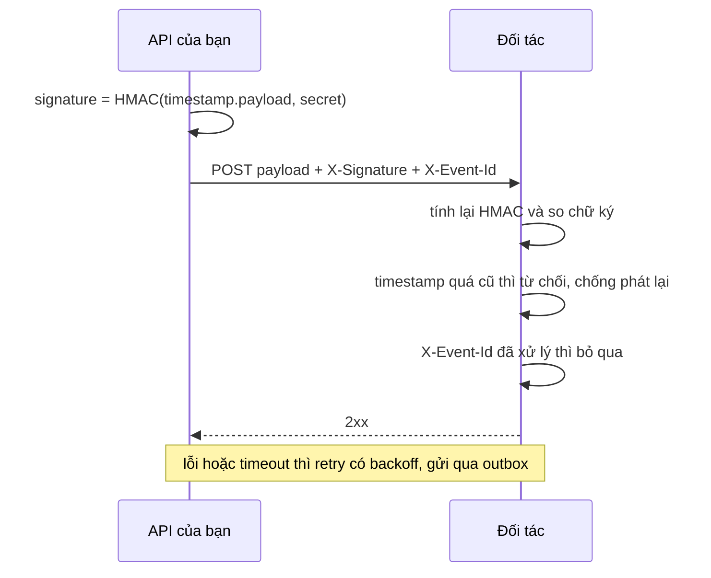

# 9.10 - Sinh client, webhook và GraphQL (nâng cao)

> **Tóm tắt:** Bài **tự chọn**, đọc sau khi đã nắm các bài 9.1 tới 9.9. Những chủ đề API nối tiếp Module 9, kèm điều kiện cụ thể để biết khi nào cần. Mục đáng làm ngay và bị bỏ qua nhiều nhất là **sinh client từ OpenAPI**: client TypeScript hoặc C# được sinh tự động từ tài liệu API, nên **mọi breaking change trở thành lỗi biên dịch** ở phía client thay vì lỗi lúc chạy — đúng lớp sự cố ở [bài 9.11](9.11-mini-case-study.md). Mục bị đánh giá thấp nhất là **webhook**: nhiều dự án tự viết nó như một endpoint bình thường rồi phát hiện ra nó cần đủ thứ — ký chữ ký, retry, chống trùng — mà messaging đã giải sẵn. Và **GraphQL** cần một cảnh báo riêng: nó giải quyết vấn đề thật nhưng kéo theo ba vấn đề mới mà REST không có.

## Mục tiêu bài học

Sau bài này bạn có thể:

- Sinh client tự động từ OpenAPI.
- Biết GraphQL giải quyết gì và kéo theo vấn đề gì.
- Thiết kế webhook an toàn và đáng tin.
- Chọn giữa REST, gRPC và GraphQL.

**Cần biết trước:** [9.3 — Tài liệu API với OpenAPI và Scalar](9.3-swagger-openapi.md) (file OpenAPI sinh lúc build), [9.2 — API Versioning](9.2-api-versioning.md), [9.11 — Mini case study](9.11-mini-case-study.md) được nhắc tới như ví dụ sự cố. Bài tập 1 cần Node.js để chạy `npx`; bài tập 3 dùng thư viện GraphQL HotChocolate, đọc lướt nếu chưa cần GraphQL.

## Nội dung bài học

### 9.10.1 — Sinh client từ OpenAPI: làm ngay

**Điều kiện kích hoạt:** có bất kỳ client nào do đội bạn viết.

```bash
# TypeScript cho frontend
npx openapi-typescript https://api.company.com/openapi/v1.json -o src/api/schema.d.ts

# C# cho service khác hoặc test — NSwag như bài 9.3
dotnet nswag openapi2csclient /input:obj/CrmApi.json /output:CrmApiClient.cs /namespace:Crm.Client
```

Lợi ích lớn nhất không phải tiết kiệm thời gian gõ mà là: **breaking change trở thành lỗi biên dịch**.

```typescript
// Sau khi backend đổi customerId từ int sang Guid,
// sinh lại client -> TypeScript báo lỗi NGAY:
const id: number = lead.customerId;
//    ^^ Type 'string' is not assignable to type 'number'
```

Đưa bước sinh client vào CI của frontend thì mọi thay đổi API đều được kiểm tra trước khi triển khai.

Để client sinh ra gọn gàng, API cần mô tả đầy đủ:

```csharp
group.MapGet("/{id:guid}", GetById)
     .WithName("GetLead")
     .Produces<LeadDto>(StatusCodes.Status200OK)
     .Produces<ProblemDetails>(StatusCodes.Status404NotFound)
     .WithSummary("Lấy chi tiết lead theo id");
```

Thiếu `Produces`, công cụ sinh không biết kiểu trả về và cho ra `unknown` hoặc `any`, mất hết lợi ích.

**Một chi tiết của .NET 10 làm hỏng lợi ích này.** Mặc định, JSON của ASP.NET Core **chấp nhận số gửi dưới dạng chuỗi** (`"42"`), nên file OpenAPI mô tả mọi trường số là `"type": ["integer", "string"]`. `openapi-typescript` dịch thành `customerId: number | string`, và trình biên dịch không còn phân biệt được số với chuỗi. Muốn kiểu chặt, tắt hành vi đó cho cả Minimal API (thứ OpenAPI đọc) lẫn controller:

```csharp
using System.Text.Json.Serialization;

builder.Services.ConfigureHttpJsonOptions(o =>
    o.SerializerOptions.NumberHandling = JsonNumberHandling.Strict);
builder.Services.AddControllers()
    .AddJsonOptions(o => o.JsonSerializerOptions.NumberHandling = JsonNumberHandling.Strict);
```

Chạy thử: schema của `LeadDto.customerId` đổi từ `["integer", "string"]` thành `"integer"`, và kiểu TypeScript sinh ra thành `customerId: number`. Đây là thay đổi hành vi: client đang gửi số dạng chuỗi sẽ nhận `400`, nên làm từ đầu dự án hoặc coi như một breaking change ([bài 9.2](9.2-api-versioning.md)).

### 9.10.2 — Webhook

**Điều kiện kích hoạt:** cần thông báo cho hệ thống bên ngoài khi có sự kiện.

Webhook nghe đơn giản — gọi một URL do đối tác cung cấp — nhưng làm đúng cần năm thứ. Đoạn dưới là phần gửi; `ComputeHmac` và phía nhận có ở Bài 2:

```csharp
public async Task SendWebhookAsync(WebhookEvent evt, CancellationToken ct)
{
    var payload = JsonSerializer.Serialize(evt);
    var timestamp = DateTimeOffset.UtcNow.ToUnixTimeSeconds();

    // 1. KÝ — để đối tác xác minh là bạn gửi
    var signature = ComputeHmac($"{timestamp}.{payload}", _secret);

    var request = new HttpRequestMessage(HttpMethod.Post, _endpoint)
    {
        Content = new StringContent(payload, Encoding.UTF8, "application/json")
    };
    request.Headers.Add("X-Signature", $"t={timestamp},v1={signature}");
    request.Headers.Add("X-Event-Id", evt.Id.ToString());   // 2. để đối tác chống trùng

    var response = await _httpClient.SendAsync(request, ct);
    response.EnsureSuccessStatusCode();                      // lỗi -> để tầng retry xử lý
}
```

| Yêu cầu | Vì sao |
|---|---|
| **Ký chữ ký HMAC** | Đối tác xác minh được request đến từ bạn |
| **Kèm timestamp trong chữ ký** | Chống tấn công phát lại request cũ |
| **Kèm id sự kiện** | Đối tác chống trùng được |
| **Retry có backoff** | Endpoint đối tác có thể tạm thời down |
| **Gửi qua outbox** | Không mất sự kiện nếu tiến trình chết |

Hai yêu cầu cuối là lý do nên **dùng lại hạ tầng messaging** thay vì tự viết: outbox, retry có jitter và DLQ đều đã có sẵn ở [Module 17](../../stage-05-senior-engineering/module-17-distributed-systems/README.md).

Timestamp trong chữ ký là chi tiết dễ bỏ sót: không có nó, kẻ tấn công chặn được một request hợp lệ có thể gửi lại nó mãi mãi và chữ ký vẫn đúng.



### 9.10.3 — GraphQL: cân nhắc kỹ

**Điều kiện kích hoạt:** nhiều loại client cần hình dạng dữ liệu rất khác nhau, và bạn không kiểm soát được client.

```graphql
query {
  lead(id: "8f3a...") {
    name
    value
    customer { name, email }      # client tự chọn trường cần
  }
}
```

Nó giải quyết vấn đề thật: over-fetching (nhận dư dữ liệu) và under-fetching (phải gọi nhiều lần).

Nhưng nó kéo theo **ba vấn đề mà REST không có**:

**1. N+1 query.** Mỗi trường lồng nhau có thể sinh một truy vấn riêng:

```text
query { leads { customer { name } } }
-> 1 truy vấn lấy leads + N truy vấn lấy customer
```

Cần DataLoader để gom lại — một khái niệm nữa cả đội phải học.

**2. Truy vấn tuỳ ý có thể làm sập database.** Client viết một truy vấn lồng 10 tầng và server phải chạy nó. Phải giới hạn độ sâu và chi phí; cấu hình cụ thể với HotChocolate ở Bài 3.

**3. Cache HTTP không dùng được.** Mọi truy vấn là `POST` tới cùng một URL, nên `ETag`, `Cache-Control` và CDN đều vô tác dụng.

**Lựa chọn trung gian, thường đủ:** giữ REST và thêm tham số chọn trường (*field selection*).

```text
GET /api/leads/42?fields=name,value,customer.name
```

Server đọc danh sách trường, chỉ `Select` những cột đó và chỉ trả những trường đó; trường lạ thì trả `400`, giống whitelist của `sortBy` ở [bài 9.4](9.4-pagination-filtering-sorting.md). Bạn có phần lớn lợi ích của GraphQL (không nhận dư dữ liệu) mà giữ được cache HTTP và không thêm hạ tầng. Cái giá là tự viết phần ánh xạ tên trường sang cột, và tài liệu OpenAPI không mô tả được hình dạng phản hồi thay đổi theo `fields`.

### 9.10.4 — Chọn giữa REST, gRPC và GraphQL

| | REST | gRPC | GraphQL |
|---|---|---|---|
| Client công khai | **Tốt nhất** | Kém | Khá |
| Giao tiếp nội bộ | Tốt | **Tốt nhất** | Khá |
| Cache HTTP | **Có** | Không | **Không** |
| Debug bằng curl | **Dễ** | Khó (nhị phân) | Trung bình |
| Hợp đồng chặt | Qua OpenAPI | **Qua proto** | **Qua schema** |
| Streaming | Hạn chế | **Tốt** | Qua subscription |
| Độ phức tạp vận hành | **Thấp nhất** | Trung bình | Cao |

**Khuyến nghị thực dụng:**

- **REST** cho API công khai và cho phần lớn nhu cầu. Nó đơn giản nhất, dễ debug nhất, và cache HTTP là lợi thế thật.
- **gRPC** cho giao tiếp giữa các service nội bộ khi cần hiệu năng và hợp đồng chặt ([bài 18.4](../../stage-05-senior-engineering/module-18-microservices/18.4-inter-service-communication.md)).
- **GraphQL** chỉ khi có nhiều loại client với nhu cầu dữ liệu khác nhau **và** bạn chấp nhận ba vấn đề ở trên.

### 9.10.5 — HATEOAS và những chủ đề khác

| Chủ đề | Nội dung | Ưu tiên |
|---|---|---|
| **Sinh client từ OpenAPI** | Hợp đồng kiểm tra lúc biên dịch | **Cao** |
| **Output caching** | Cache phản hồi ở server | **Cao** |
| **Webhook** | Thông báo ra ngoài | Trung bình |
| **Server-Sent Events** | Đẩy một chiều, đơn giản hơn WebSocket | Trung bình |
| **HATEOAS** | Nhúng link điều hướng vào phản hồi | **Thấp** |
| **JSON:API, OData** | Chuẩn định dạng có sẵn | Thấp |

**HATEOAS** đáng nói riêng vì nó là "REST đúng chuẩn" theo lý thuyết nhưng hiếm khi đáng làm:

```json
{
  "id": "8f3a...",
  "status": "New",
  "_links": {
    "self":    { "href": "/api/leads/8f3a..." },
    "convert": { "href": "/api/leads/8f3a.../convert", "method": "POST" }
  }
}
```

Ý tưởng: client biết làm được gì từ phản hồi thay vì cần biết trước cấu trúc URL. Thực tế: gần như không client nào tận dụng — frontend đã biết cấu trúc API, và phần `_links` chỉ làm payload to thêm.

**Server-Sent Events** thì ngược lại, bị đánh giá thấp: nếu chỉ cần đẩy một chiều từ server (thông báo, tiến độ job), SSE dùng HTTP thường, tự kết nối lại, và không cần backplane như SignalR.

### 9.10.6 — Thứ tự nên học

| Ưu tiên | Chủ đề | Vì sao |
|---|---|---|
| **Cao** | Sinh client từ OpenAPI | Biến breaking change thành lỗi biên dịch |
| **Cao** | Output caching | Giảm tải rõ rệt, chi phí thấp |
| Trung bình | Webhook qua outbox | Khi cần thông báo ra ngoài |
| Trung bình | Server-Sent Events | Đẩy một chiều, đơn giản hơn WebSocket |
| Thấp | GraphQL | Chỉ khi thật sự cần, kèm ba vấn đề |
| Thấp | HATEOAS | Hiếm khi có client tận dụng |

Sau Module 9, bước tiếp theo là [Module 10 — Authentication và Authorization](../module-10-authentication-authorization/README.md).

### 9.10.7 — Lỗi thường gặp

- **Client TypeScript sinh ra có `number | string` cho mọi trường số.** Mặc định JSON của ASP.NET Core nhận số dạng chuỗi; đặt `JsonNumberHandling.Strict` như mục 9.10.1.
- **Code chép từ bài viết cũ báo `SetPagingOptions`, `AddQueryComplexityRule` không tồn tại.** Đó là API HotChocolate cũ; bản 14 trở đi dùng `ModifyPagingOptions` và `ModifyCostOptions`.
- **Chữ ký webhook phía nhận luôn sai.** Phía nhận ký lại trên JSON đã deserialize rồi serialize lại thay vì trên raw body.

**Danh sách rà soát API nâng cao**

- [ ] Mọi endpoint khai báo Produces đầy đủ cho OpenAPI.
- [ ] Client do đội viết được sinh từ OpenAPI, không viết tay.
- [ ] Bước sinh client nằm trong CI để bắt breaking change.
- [ ] Webhook có ký HMAC kèm timestamp trong chữ ký.
- [ ] Webhook gửi qua outbox và có retry với backoff.
- [ ] Nếu dùng GraphQL, có giới hạn độ sâu và độ phức tạp truy vấn.
- [ ] Đã cân nhắc tham số chọn trường trước khi chọn GraphQL.

## Bài tập áp dụng

#### Bài 1 — Để trình biên dịch phát hiện breaking change thay cho bạn

Sinh client TypeScript từ OpenAPI của dự án, đổi kiểu một trường ở backend, sinh lại và xem lỗi biên dịch.

**Tiêu chí hoàn thành:** bạn nêu được vì sao cách này bắt được lỗi **sớm hơn** bộ test tích hợp.

<details>
<summary><strong>Gợi ý và lời giải — Bài 1</strong></summary>

**Gợi ý.** Bộ test tích hợp chạy lúc **CI của backend**. Client sinh tự động chạy lúc **biên dịch của frontend** — tức là trên máy người viết giao diện, trước khi họ kịp commit.

**Lời giải — sinh client:**

Đặt `JsonNumberHandling.Strict` như mục 9.10.1, cài gói `Microsoft.Extensions.ApiDescription.Server` để file OpenAPI sinh lúc build ([bài 9.3](9.3-swagger-openapi.md)), rồi:

```bash
dotnet build                                          # sinh obj/CrmApi.json
npx openapi-typescript obj/CrmApi.json -o src/api/schema.d.ts
```

File sinh ra (openapi-typescript 7, chạy thật) mô tả đúng hợp đồng:

```ts
LeadDto: {
    /** Format: int32 */
    customerId: number;
    name: string;
    /** Format: double */
    value: number;
};
```

Code frontend dùng nó:

```ts
// src/pages/LeadList.ts
import type { components } from "../api/schema";

type LeadDto = components["schemas"]["LeadDto"];

function customerUrl(customerId: number): string {
  return `/customers/${customerId}/detail`;
}

export function render(lead: LeadDto): string {
  return customerUrl(lead.customerId);
}
```

**Đổi kiểu ở backend** — đúng thay đổi đã gây sự cố trong bài:

```csharp
public record LeadDto(Guid CustomerId, string Name, decimal Value);
```

Build lại và sinh lại, `schema.d.ts` thành:

```ts
/** Format: uuid */
customerId: string;
```

**Và frontend không biên dịch được nữa** (`npx tsc --noEmit --strict`, chạy thật):

```text
LeadList.ts(10,22): error TS2345: Argument of type 'string' is not assignable to parameter of type 'number'.
```

**Vì sao sớm hơn test tích hợp — ba lý do:**

1. **Không cần ai nghĩ ra trường hợp kiểm thử.** Test tích hợp chỉ bắt được thứ có người viết test cho nó. Trình biên dịch kiểm **mọi** chỗ dùng trường đó, kể cả chỗ viết từ hai năm trước.
2. **Nó chỉ đúng dòng bị ảnh hưởng.** Test tích hợp báo "response không khớp mong đợi"; trình biên dịch báo `LeadList.ts(10,22)`.
3. **Nó chạy ở phía sẽ hỏng.** Backend có thể xanh hoàn toàn — API mới **đúng** theo nghĩa của backend. Vấn đề nằm ở phía tiêu thụ, và đó cũng là nơi lỗi xuất hiện.

**Điều này không thay thế được versioning.** Nó bảo vệ client mà **bạn biên dịch được**. Ứng dụng mobile đã phát hành thì không — bản trên máy người dùng không được biên dịch lại. Đó chính là lý do sự cố ở [bài 9.11](9.11-mini-case-study.md) làm hỏng mobile mà web app không sao.

**Đưa vào CI để không ai quên chạy tay:**

```yaml
- name: Sinh lại client và kiểm tra hợp đồng
  run: |
    npx openapi-typescript openapi/CrmApi.json -o src/api/schema.d.ts
    git diff --exit-code src/api/schema.d.ts || {
      echo "Hợp đồng API đã đổi — xem lại diff ở trên rồi commit file sinh ra"
      exit 1
    }
    npx tsc --noEmit
```

Bước `git diff --exit-code` làm cho mọi thay đổi hợp đồng **hiện ra trong pull request** dưới dạng một file diff mà người review phải nhìn.

</details>

---

#### Bài 2 — Ký webhook và xác minh phía nhận

Cài ký HMAC kèm timestamp và viết hàm xác minh phía nhận.

**Tiêu chí hoàn thành:** hàm xác minh của bạn chống được **cả ba**: sửa nội dung, phát lại request cũ, và tấn công theo thời gian so sánh chuỗi.

<details>
<summary><strong>Gợi ý và lời giải — Bài 2</strong></summary>

**Gợi ý.** Ký riêng payload là chưa đủ: kẻ tấn công bắt được một request hợp lệ có thể gửi lại y nguyên. Timestamp phải nằm **bên trong** phần được ký, không phải là một header rời.

**Lời giải — phía gửi:**

```csharp
var payload   = JsonSerializer.Serialize(evt);
var timestamp = DateTimeOffset.UtcNow.ToUnixTimeSeconds();

var signature = Convert.ToHexString(
    HMACSHA256.HashData(
        Encoding.UTF8.GetBytes(_secret),
        Encoding.UTF8.GetBytes($"{timestamp}.{payload}")))     // timestamp NẰM TRONG chữ ký
    .ToLowerInvariant();

request.Headers.Add("X-Signature", $"t={timestamp},v1={signature}");
```

**Phía nhận:**

```csharp
public static bool Verify(string header, string payload, string secret,
                          TimeProvider time, TimeSpan tolerance)
{
    // 1. Tách t và v1
    var parts = header.Split(',')
        .Select(p => p.Split('=', 2))
        .Where(p => p.Length == 2)
        .ToDictionary(p => p[0].Trim(), p => p[1].Trim());

    if (!parts.TryGetValue("t", out var ts) ||
        !parts.TryGetValue("v1", out var received) ||
        !long.TryParse(ts, out var unix)) return false;

    // 2. Chống phát lại — timestamp phải nằm trong cửa sổ cho phép
    var age = time.GetUtcNow() - DateTimeOffset.FromUnixTimeSeconds(unix);
    if (age > tolerance || age < -tolerance) return false;

    // 3. Tính lại chữ ký trên CÙNG chuỗi
    var expected = Convert.ToHexString(
        HMACSHA256.HashData(
            Encoding.UTF8.GetBytes(secret),
            Encoding.UTF8.GetBytes($"{unix}.{payload}"))).ToLowerInvariant();

    // 4. So sánh theo thời gian hằng số
    return CryptographicOperations.FixedTimeEquals(
        Encoding.UTF8.GetBytes(expected),
        Encoding.UTF8.GetBytes(received));
}
```

**Ba cơ chế phòng vệ, tương ứng ba tiêu chí:**

| Tấn công | Chặn bởi | Nếu thiếu thì sao |
|---|---|---|
| Sửa nội dung | HMAC trên payload | Đối tác nhận dữ liệu giả mạo |
| Phát lại request cũ | Bước 2 — cửa sổ thời gian | Bắt được một webhook "thanh toán thành công" rồi gửi lại 100 lần |
| Đo thời gian so sánh | `FixedTimeEquals` | Xem bên dưới |

**Vì sao `==` là lỗi thật, không phải chuyện lý thuyết.** So sánh chuỗi thông thường **dừng ở byte đầu tiên khác nhau**. Kẻ tấn công gửi nhiều chữ ký chỉ khác nhau ký tự đầu, đo thời gian phản hồi, và giữ lại ký tự nào làm thời gian tăng nhẹ — nghĩa là nó khớp. Lặp lại cho từng vị trí, họ dựng dần chữ ký đúng mà không cần biết khoá. `FixedTimeEquals` luôn duyệt hết mọi byte nên thời gian không tiết lộ gì.

**Hai chi tiết cài đặt hay sai:**

1. **Phải ký trên đúng byte thô của body, không phải trên object đã deserialize rồi serialize lại.** Thứ tự trường, khoảng trắng hay cách escape khác đi một chút là chữ ký lệch. Phía nhận phải đọc raw body:

   ```csharp
   Request.EnableBuffering();
   using var reader = new StreamReader(Request.Body, leaveOpen: true);
   var raw = await reader.ReadToEndAsync(ct);
   Request.Body.Position = 0;
   ```

2. **Cửa sổ thời gian nên khoảng 5 phút.** Chặt hơn thì lệch đồng hồ giữa hai bên gây lỗi giả — đúng ca ở [bài 2.11](../../stage-01-foundation/module-02-computer-science-basics/2.11-mini-case-study.md). Rộng hơn thì cửa sổ phát lại quá dài.

**Vẫn cần idempotent ở phía nhận.** Chữ ký chứng minh *ai gửi*, không chứng minh *đã xử lý chưa*. Webhook được gửi lại khi bên nhận timeout, nên `X-Event-Id` và bảng đã-xử-lý vẫn bắt buộc, cùng kỹ thuật với `Idempotency-Key` ở [bài 9.12](9.12-quick-real-world-example.md).

Code trên cần `using System.Security.Cryptography;` và `using System.Text;`. Hàm `ComputeHmac` ở mục 9.10.2 chính là đoạn `Convert.ToHexString(HMACSHA256.HashData(...)).ToLowerInvariant()` phía gửi.

</details>

---

#### Bài 3 — Truy vấn GraphQL lồng mười tầng

Dựng một GraphQL server nhỏ bằng HotChocolate (`dotnet add package HotChocolate.AspNetCore`, bài dùng bản 16.6) có quan hệ hai chiều `Customer.leads` và `Lead.customer`. Gửi một truy vấn lồng 10 tầng và xác nhận nó bị từ chối.

**Tiêu chí hoàn thành:** bạn giải thích được vì sao một truy vấn **ngắn** lại có thể làm sập server.

<details>
<summary><strong>Gợi ý và lời giải — Bài 3</strong></summary>

**Gợi ý.** Chỉ cần hai kiểu trỏ vào nhau — `Customer` có `leads`, `Lead` có `customer` — là người gọi lặp vòng đó bao nhiêu lần tuỳ thích.

**Lời giải — truy vấn tấn công:**

```graphql
query {
  customers {
    leads { customer {
      leads { customer {
        leads { customer {
          leads { customer {
            leads { id name value createdAt }
          } }
        } }
      } }
    } }
  }
}
```

Truy vấn này chỉ khoảng mười dòng. Với 1.000 khách hàng, mỗi khách 50 lead, số nút phải giải là tích của các tầng: hàng triệu lượt, từ một request duy nhất.

**Đây là câu trả lời cho tiêu chí.** Với REST, chi phí của một request bị chặn bởi thiết kế endpoint: `GET /customers` trả đúng những gì lập trình viên đã quyết định. Với GraphQL, **client quyết định hình dạng truy vấn**, nên chi phí không còn trần tự nhiên. Rate limit theo số request cũng không cứu được — đây là **một** request.

**Ba giới hạn cần bật, và không cái nào thay thế được cái nào** (API của HotChocolate 14 trở đi; bản cũ dùng `SetPagingOptions` và `AddQueryComplexityRule`, nay không còn):

```csharp
// Program.cs
builder.Services
    .AddGraphQLServer()
    .AddQueryType<Query>()
    .AddMaxExecutionDepthRule(7)                 // 1. chặn lồng sâu
    .ModifyPagingOptions(o =>
    {
        o.MaxPageSize = 100;                     // 2. chặn lấy tất cả ở mỗi tầng
        o.DefaultPageSize = 20;
    })
    .ModifyCostOptions(o =>                      // 3. chặn truy vấn rộng mà nông
    {
        o.MaxFieldCost = 1_000;
        o.MaxTypeCost = 1_000;
    });

var app = builder.Build();
app.MapGraphQL();                                // endpoint /graphql
app.Run();
```

**Kết quả khi gửi truy vấn trên** (chạy thật với HotChocolate 16.6, rút gọn):

```json
{"errors":[
  {"message":"The GraphQL document has an execution depth of 11 which exceeds the max allowed execution depth of 7.",
   "extensions":{"allowedExecutionDepth":7,"detectedExecutionDepth":11}},
  {"message":"Maximum allowed coordinate cycle depth was exceeded.",
   "path":["customers","leads","customer","leads","customer","leads","customer"],
   "extensions":{"code":"HC0087"}}
]}
```

Lỗi thứ hai đến từ một kiểm tra có sẵn của bản mới: nó phát hiện vòng lặp `leads → customer → leads` lặp quá nhiều lần.

**Vì sao cần cả ba.** Giới hạn độ sâu không chặn được truy vấn **rộng mà nông**:

```graphql
query { customers { a b c d e f g h i j k l m n o p q r s t } }
```

Độ sâu chỉ là 2, nhưng nếu mỗi trường gọi một resolver riêng chạm database thì đây vẫn là hàng nghìn truy vấn. Phân tích chi phí bắt được nó; giới hạn độ sâu thì không.

**Cái bẫy N+1 nằm sẵn trong mô hình này.** Mỗi `customer.leads` là một resolver riêng, nên 100 khách hàng thành 101 truy vấn — đúng vấn đề ở [bài 13.6](../../stage-04-database-production/module-13-entity-framework-core/13.6-n-plus-1-problem.md), chỉ khác là bạn không nhìn thấy nó trong code. `DataLoader` gom các lời gọi trong cùng một vòng thực thi thành một truy vấn `WHERE Id IN (...)`:

```csharp
// using GreenDonut;  (namespace DataLoader của HotChocolate)
public sealed class LeadsByCustomerDataLoader(
    IDbContextFactory<CrmDbContext> factory, IBatchScheduler scheduler, DataLoaderOptions options)
    : GroupedDataLoader<int, Lead>(scheduler, options)
{
    protected override async Task<ILookup<int, Lead>> LoadGroupedBatchAsync(
        IReadOnlyList<int> keys, CancellationToken ct)
    {
        await using var db = await factory.CreateDbContextAsync(ct);
        var leads = await db.Leads.Where(l => keys.Contains(l.CustomerId)).ToListAsync(ct);
        return leads.ToLookup(l => l.CustomerId);
    }
}
```

**Kết luận thực dụng.** GraphQL chuyển quyền quyết định hình dạng dữ liệu sang client — đó vừa là giá trị vừa là rủi ro của nó. Nếu bạn không sẵn sàng cấu hình và giám sát ba giới hạn trên, REST với các endpoint được thiết kế sẵn an toàn hơn nhiều.

</details>

## Tự kiểm tra

<details>
<summary>Lợi ích lớn nhất của việc sinh client từ OpenAPI là gì?</summary>

Breaking change trở thành lỗi biên dịch ở phía client thay vì lỗi lúc chạy. Đưa bước sinh client vào CI thì mọi thay đổi API đều được kiểm tra trước khi triển khai.

</details>

<details>
<summary>Vì sao thiếu Produces làm mất lợi ích của việc sinh client?</summary>

Vì công cụ sinh không biết kiểu trả về nên cho ra kiểu `unknown` hoặc `any`, và khi đó trình biên dịch không kiểm tra được gì. Tương tự, để mặc định số nhận được dạng chuỗi thì mọi trường số thành `number | string`.

</details>

<details>
<summary>Vì sao timestamp phải nằm trong chữ ký webhook?</summary>

Không có nó, kẻ tấn công chặn được một request hợp lệ có thể gửi lại nó mãi mãi và chữ ký vẫn đúng. Timestamp cho phép bên nhận từ chối request quá cũ.

</details>

<details>
<summary>GraphQL kéo theo ba vấn đề gì mà REST không có?</summary>

N plus 1 query vì mỗi trường lồng nhau có thể sinh một truy vấn riêng, truy vấn tuỳ ý có thể làm sập database nên phải giới hạn độ sâu và độ phức tạp, và cache HTTP không dùng được vì mọi truy vấn là POST tới cùng một URL.

</details>

<details>
<summary>Lựa chọn trung gian thay cho GraphQL là gì?</summary>

Giữ REST và thêm tham số chọn trường trên query string. Bạn có phần lớn lợi ích về việc tránh over-fetching mà giữ được cache HTTP và không thêm hạ tầng nào.

</details>

<details>
<summary>Vì sao HATEOAS hiếm khi đáng làm?</summary>

Vì gần như không client nào tận dụng. Frontend đã biết cấu trúc API từ tài liệu hoặc từ client sinh tự động, nên phần link nhúng chỉ làm payload to thêm.

</details>

## Kết luận

Ba điều đáng nhớ nhất:

1. **Sinh client từ OpenAPI biến breaking change thành lỗi biên dịch** — mục đáng làm nhất.
2. **Webhook cần nhiều hơn một lời gọi HTTP**; dùng lại hạ tầng messaging.
3. **GraphQL giải một vấn đề và tạo ba vấn đề.** Cân nhắc tham số chọn trường trước.

## Tham khảo

- [Web API trong ASP.NET Core](https://learn.microsoft.com/en-us/aspnet/core/web-api/)
- [API design cho microservices](https://learn.microsoft.com/en-us/azure/architecture/microservices/design/api-design)
- [gRPC trên ASP.NET Core](https://learn.microsoft.com/en-us/aspnet/core/grpc/)
- [Rate limiting trong ASP.NET Core](https://learn.microsoft.com/en-us/aspnet/core/performance/rate-limit)

## Điều hướng

- **Bài trước:** [9.9 — Background Processing với Hosted Service](9.9-hosted-service-background-jobs.md)
- **Bài tiếp theo:** [9.11 — Mini case study](9.11-mini-case-study.md)
- **Về module:** [Trang mục lục](README.md)
