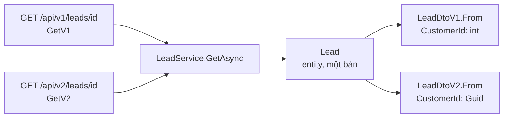

# 9.11 - Case study: đổi kiểu một trường làm hỏng app mobile

> **Tóm tắt:** Một thay đổi nhỏ — đổi kiểu trường `customerId` từ `int` sang `Guid` — làm ứng dụng mobile của **12.000 người dùng** không dùng được, và không thể sửa nhanh vì bản vá mobile phải qua kiểm duyệt cửa hàng mất **3 ngày**. Bài học cốt lõi: **API là hợp đồng**, và với client bạn **không kiểm soát được thời điểm cập nhật** — web thì refresh là xong, mobile thì không. Lý thuyết phân loại breaking change và versioning đã có ở [bài 9.2](9.2-api-versioning.md); bài này đi qua sự cố, cách sửa bằng hai version dùng chung một service, và cách **bắt lỗi trong CI** để nó không lặp lại.

## Mục tiêu bài học

Sau bài này bạn có thể:

- Nhận ra vì sao cùng một thay đổi gây hậu quả khác nhau cho từng loại client.
- Giữ v1 và v2 song song mà chỉ nhân đôi DTO, không nhân đôi service.
- Phát hiện breaking change tự động trong CI bằng `oasdiff`.
- Báo deprecation bằng header chuẩn và đo lưu lượng theo version.

**Cần biết trước:** [9.2 — API Versioning](9.2-api-versioning.md) (bảng breaking change, `Asp.Versioning`, sunset policy), [9.3 — Tài liệu API với OpenAPI và Scalar](9.3-swagger-openapi.md) (file OpenAPI sinh lúc build, `oasdiff`), [9.8 — API Testing](9.8-api-testing.md) (`WebApplicationFactory`). Bài 2 cần Docker để chạy `oasdiff`.

## Nội dung bài học

### 9.11.1 — Sự cố

```csharp
// Trước
public record LeadDto(int CustomerId, string Name, decimal EstimatedValue);

// Sau — đổi sang Guid cho nhất quán với phần còn lại
public record LeadDto(Guid CustomerId, string Name, decimal EstimatedValue);
```

```json
// Client mobile mong đợi
{ "customerId": 4821, "name": "Công ty ABC", "estimatedValue": 5000000 }

// Nhận được
{ "customerId": "8f3a1b2c-...", "name": "Công ty ABC", "estimatedValue": 5000000 }
```

Dòng thời gian (tình huống minh họa):

```text
14:30  Deploy
14:34  Crash report tăng vọt: lỗi parse JSON trên Android và iOS
14:40  12.000 người dùng không mở được app
14:45  Rollback backend — nhưng những người đã mở app trong 15 phút đó
       vẫn có dữ liệu hỏng trong cache cục bộ
```

Web app không bị ảnh hưởng nhiều vì JavaScript không kiểu chặt và người dùng chỉ cần refresh. **Mobile thì không**: app viết bằng Kotlin, Swift hay Dart parse `customerId` thành số; gặp chuỗi là ném lỗi. Bản vá phải qua kiểm duyệt cửa hàng, và kể cả sau đó người dùng phải chủ động cập nhật.

### 9.11.2 — Vì sao hậu quả phụ thuộc client

Bảng "thay đổi nào là breaking" ở [mục 9.2.1](9.2-api-versioning.md) cho biết **có** gãy hay không. Câu hỏi tiếp theo quyết định kế hoạch: **ai** gãy, và họ sửa được trong bao lâu.

| Thay đổi | Web (JS, cập nhật ngay) | Mobile đã phát hành | Đối tác B2B |
|---|---|---|---|
| `int` → `Guid` cho `CustomerId` | Phần lớn vẫn chạy, refresh là xong | **Crash, chờ kiểm duyệt** | Hỏng job đêm |
| Thêm `Tags` vào response | Không sao | Không sao | Không sao |
| `Name` từ `MaxLength(200)` → `(100)` | Lỗi 400 khi nhập dài | Lỗi 400, không rõ lý do | Bản ghi bị từ chối |
| Bỏ trường `LegacyCode` | Cột trống | **Crash nếu parse chặt** | Hỏng ánh xạ |

Ba điều bảng này nói ra mà danh sách "breaking / không breaking" không nói:

1. **Mức độ nghiêm trọng nằm ở client, không ở thay đổi.** Cùng một lần đổi kiểu: web refresh là xong, mobile crash và chờ cửa hàng duyệt.
2. **Client bạn không kiểm soát đặt ra mốc thời gian.** Bạn không rollback được bản app cài trên máy người dùng.
3. **Rollback backend không hoàn tác được thiệt hại.** 15 phút đủ để dữ liệu hỏng đi vào cache cục bộ của app.

**Hệ quả:** có client mobile đã phát hành thì mọi thay đổi phá hợp đồng **bắt buộc** đi qua version mới, kể cả khi bạn chắc "chỉ đội mình gọi API này".

### 9.11.3 — Sửa: v1 và v2 song song, một service

Cấu hình `Asp.Versioning` như [mục 9.2.2](9.2-api-versioning.md), dùng version trong URL. Điều quan trọng là **chỉ tầng DTO có version**, logic nghiệp vụ dùng chung:

```csharp
// Data/Lead.cs — entity, một bản duy nhất
public class Lead
{
    public int Id { get; set; }
    public required string Name { get; set; }
    public decimal EstimatedValue { get; set; }
    public Guid CustomerId { get; set; }            // khoá mới
    public int LegacyCustomerId { get; set; }       // giữ cột cũ cho client v1
}
```

```csharp
// Services/LeadService.cs — một service, trả entity, không biết gì về version
public class LeadService(CrmDbContext db)
{
    public Task<Lead?> GetAsync(int id, CancellationToken ct) =>
        db.Leads.AsNoTracking().FirstOrDefaultAsync(l => l.Id == id, ct);
}
```

```csharp
// Contracts/LeadDtos.cs — hai DTO, chỉ khác cách TRÌNH BÀY
public record LeadDtoV1(int CustomerId, string Name, decimal EstimatedValue)
{
    public static LeadDtoV1 From(Lead lead) =>
        new(lead.LegacyCustomerId, lead.Name, lead.EstimatedValue);
}

public record LeadDtoV2(Guid CustomerId, string Name, decimal EstimatedValue)
{
    public static LeadDtoV2 From(Lead lead) =>
        new(lead.CustomerId, lead.Name, lead.EstimatedValue);
}
```

```csharp
// Controllers/LeadsController.cs
[ApiController]
[ApiVersion("1.0", Deprecated = true)]
[ApiVersion("2.0")]
[Route("api/v{version:apiVersion}/leads")]
public class LeadsController(LeadService leads) : ControllerBase
{
    [HttpGet("{id:int}"), MapToApiVersion("1.0")]
    public async Task<ActionResult<LeadDtoV1>> GetV1(int id, CancellationToken ct) =>
        await leads.GetAsync(id, ct) is { } lead ? LeadDtoV1.From(lead) : NotFound();

    [HttpGet("{id:int}"), MapToApiVersion("2.0")]
    public async Task<ActionResult<LeadDtoV2>> GetV2(int id, CancellationToken ct) =>
        await leads.GetAsync(id, ct) is { } lead ? LeadDtoV2.From(lead) : NotFound();
}
```

Đăng ký `builder.Services.AddScoped<LeadService>();`. Sửa một bug trong `LeadService` là sửa cho cả hai version.

Quy tắc: **version hoá ranh giới, không version hoá logic**. Nếu thấy mình chép `LeadServiceV1.cs` thành `LeadServiceV2.cs`, ranh giới đang đặt sai chỗ.



### 9.11.4 — Chặn lớp sự cố này trong CI

Đây là phần có giá trị cao nhất: chặn sự cố **trước khi** nó tới production. Sinh file OpenAPI lúc build (gói `Microsoft.Extensions.ApiDescription.Server`, [mục 9.3.5](9.3-swagger-openapi.md)) rồi so với file của bản đã phát hành bằng `oasdiff`:

```bash
docker run --rm -v "$(pwd):/specs" tufin/oasdiff breaking \
  /specs/baseline.json /specs/current.json --fail-on ERR
```

Với đúng thay đổi gây sự cố, kết quả chạy thật (rút gọn, ba lỗi cho ba media type):

```text
3 changes: 3 error, 0 warning, 0 info
error	[response-property-type-changed] at /specs/current.json
	in API GET /api/leads/{id}
		the `customerId` response's property `type/format` changed from `integer/int32` to `string/uuid` for status `200` (media type: application/json)
```

Mã thoát `1`, CI đỏ, thay đổi không merge được.

Bổ sung một test tích hợp khẳng định **kiểu** của trường quan trọng:

```csharp
[Fact]
public async Task LeadV1_KeepsContract()
{
    var response = await _client.GetAsync("/api/v1/leads/1");
    var json = await response.Content.ReadFromJsonAsync<JsonElement>();

    // Khẳng định KIỂU, không chỉ sự tồn tại
    Assert.Equal(JsonValueKind.Number, json.GetProperty("customerId").ValueKind);
    Assert.Equal(JsonValueKind.String, json.GetProperty("name").ValueKind);
}
```

Một test chỉ kiểm tra `customerId` có tồn tại vẫn xanh khi kiểu đổi từ số sang chuỗi, đúng thứ đã gãy ở ca này.

### 9.11.5 — Vòng đời một version

```text
1. Phát hành v2, GIỮ v1 chạy song song
2. Trả header cảnh báo trên v1 (Deprecation, Sunset, Link)
3. Theo dõi lưu lượng v1 theo từng loại client
4. Liên hệ trực tiếp những client còn dùng
5. Tắt v1 khi lưu lượng về gần 0 — VÀ đã báo trước đủ lâu
```

`Asp.Versioning` sinh sẵn các header ở bước 2. Thêm vào `AddApiVersioning(options => ...)`:

```csharp
options.Policies.Deprecate(1.0)
    .Effective(new DateTimeOffset(2026, 7, 1, 0, 0, 0, TimeSpan.Zero))
    .Link("https://docs.example.com/migrate-v2");

options.Policies.Sunset(1.0)
    .Effective(new DateTimeOffset(2026, 12, 31, 23, 59, 59, TimeSpan.Zero))
    .Link("https://docs.example.com/migrate-v2");
```

Response của v1 (chạy thật):

```http
api-supported-versions: 2.0
api-deprecated-versions: 1.0
Sunset: Thu, 31 Dec 2026 23:59:59 GMT
Link: <https://docs.example.com/migrate-v2>; rel="sunset"
Link: <https://docs.example.com/migrate-v2>; rel="deprecation"
Deprecation: @1782864000
```

`Deprecation` theo RFC 9745 là một mốc thời gian dạng `@<số giây Unix>` (ở đây là 01/07/2026), không phải `Deprecation: true` như các bản nháp cũ. `Sunset` (RFC 8594) là ngày v1 ngừng chạy.

**Thời gian giữ version cũ** phụ thuộc loại client:

| Loại client | Thời gian tối thiểu |
|---|---|
| Web do bạn kiểm soát | Vài tuần |
| Mobile | **6–12 tháng** |
| Đối tác bên thứ ba | **12 tháng trở lên**, có thông báo bằng văn bản |

Hàng mobile là bài học của ca này: kể cả khi bạn phát hành bản vá ngay, một phần người dùng **không bao giờ** cập nhật. Đo lưu lượng theo version là cách duy nhất biết khi nào tắt được (Bài 3).

### 9.11.6 — Lỗi thường gặp

- **Đổi kiểu trường ngay trong DTO đang chạy "cho nhất quán".** Thêm trường mới (`CustomerGuid`) hoặc mở v2; đừng sửa kiểu tại chỗ.
- **So `oasdiff` với file của nhánh chính thay vì bản đã phát hành.** Breaking change đã merge trở thành "bình thường mới" và mọi PR sau không báo gì.
- **Viết `Deprecation: true` bằng tay.** Định dạng chuẩn hiện tại là `@<unix-time>`; dùng deprecation policy của `Asp.Versioning`.

**Danh sách rà soát versioning API**

- [ ] API có versioning trước khi có client mobile hay đối tác đầu tiên.
- [ ] Biết loại client nào chịu hậu quả nặng nhất với mỗi thay đổi.
- [ ] Chỉ tầng DTO có version, service và entity dùng chung.
- [ ] Có kiểm tra breaking change tự động trong CI, so với bản đã phát hành.
- [ ] Test khẳng định kiểu của trường, không chỉ sự tồn tại.
- [ ] Version cũ trả header `Deprecation`, `Sunset` và `Link`.
- [ ] Có số đo lưu lượng theo version và theo loại client.
- [ ] Thời gian giữ version cũ phù hợp với loại client.

## Bài tập áp dụng

#### Bài 1 — Xếp loại theo client chịu hậu quả

Cho năm thay đổi: (a) đổi `EstimatedValue` từ `decimal` sang `string` có đơn vị ("5.000.000 đ"); (b) thêm trường `Source` vào response; (c) bắt buộc `Phone` khi tạo lead; (d) đổi `404` thành `200` với body rỗng khi không tìm thấy lead; (e) đổi `EstimatedValue` từ giá chưa thuế sang giá đã gồm thuế. Với mỗi thay đổi, ghi breaking hay không, và loại client nào (web, mobile đã phát hành, đối tác B2B) chịu hậu quả nặng nhất.

**Tiêu chí hoàn thành:** mỗi thay đổi có câu trả lời kèm lý do; bạn chỉ ra được thay đổi nào **không** bị `oasdiff` bắt.

<details>
<summary><strong>Gợi ý và lời giải — Bài 1</strong></summary>

**Gợi ý.** Với mỗi dòng, hỏi hai câu: client cũ không sửa code thì còn chạy đúng không; và client đó sửa được trong bao lâu.

**Lời giải:**

| Thay đổi | Breaking? | Nặng nhất với | Vì sao |
|---|---|---|---|
| (a) `decimal` → `string` | **Có** | Mobile | Parse số thất bại, crash như ca trong bài |
| (b) thêm `Source` | Không | — | Client cũ bỏ qua trường lạ |
| (c) bắt buộc `Phone` | **Có** | Đối tác B2B | Job tích hợp gửi thiếu trường, nhận `400` hàng loạt lúc nửa đêm |
| (d) `404` → `200` rỗng | **Có** | Mobile và đối tác | Nhánh "không tìm thấy" không chạy; code đọc body rỗng thành `null` rồi lỗi ở chỗ khác |
| (e) đổi nghĩa giá | **Có, tệ nhất** | Mọi client | Không lỗi gì, chỉ hiển thị **sai tiền** |

`oasdiff` bắt được (a), (c), (d) vì chúng đổi kiểu, đổi `required`, đổi mã phản hồi trong file OpenAPI. Nó **không** bắt được (e): tên, kiểu, ràng buộc giữ nguyên, file OpenAPI không đổi một ký tự. Cách đúng cho (e) là **đổi tên trường** (`EstimatedValueIncludingTax`) như [bài 9.2](9.2-api-versioning.md).

**Mẹo để biết trước ai chịu hậu quả.** Ghi log `User-Agent` và phiên bản app cho mỗi request ([lời giải Bài 2 của 9.2](9.2-api-versioning.md)). Khi đánh giá một thay đổi, bạn trả lời được ngay *"bao nhiêu phần trăm lưu lượng đến từ bản không cập nhật được?"*.

</details>

---

#### Bài 2 — Bắt CI thất bại đúng lúc cần

Với API có `LeadDto(int CustomerId, string Name, decimal EstimatedValue)`, sinh file OpenAPI làm mốc. Đổi `CustomerId` sang `Guid`, sinh lại và chạy `oasdiff breaking`. Làm lại với thay đổi chỉ **thêm** trường `string[]? Tags = null`.

**Tiêu chí hoàn thành:** lệnh **đỏ** (mã thoát khác 0) khi đổi kiểu, và **xanh** khi chỉ thêm trường — chứng minh bước kiểm tra không phải là cái chuông kêu suốt ngày.

<details>
<summary><strong>Gợi ý và lời giải — Bài 2</strong></summary>

**Gợi ý.** Một bước kiểm tra kêu cả với thay đổi an toàn sẽ bị người ta thêm `continue-on-error: true` trong vòng một tuần. Hãy kiểm chứng cả hai chiều trước khi bật nó cho cả đội.

**Lời giải** (các bước như Bài 3 của [9.3](9.3-swagger-openapi.md)):

```bash
dotnet build && cp obj/CrmApi.json baseline.json      # bản đã phát hành
# đổi CustomerId sang Guid
dotnet build && cp obj/CrmApi.json current.json
docker run --rm -v "$(pwd):/specs" tufin/oasdiff breaking /specs/baseline.json /specs/current.json --fail-on ERR
echo "exit=$?"
```

**Chiều thứ nhất — đổi kiểu, phải đỏ** (chạy thật): ba lỗi `response-property-type-changed` như ở mục 9.11.4, `exit=1`.

**Chiều thứ hai — chỉ thêm `Tags`, phải xanh:**

```text
No breaking changes to report, but the specs are different.
Run 'oasdiff diff' to see structural differences.
exit=0
```

**Bước CI** (GitHub Actions; file `openapi/baseline.json` là bản của lần phát hành gần nhất, commit trong repo):

```yaml
- name: Kiểm tra breaking change trong hợp đồng API
  if: "!contains(github.event.pull_request.labels.*.name, 'breaking-change-approved')"
  run: |
    dotnet build -c Release
    docker run --rm -v "$PWD:/specs" tufin/oasdiff breaking \
      /specs/openapi/baseline.json /specs/obj/CrmApi.json --fail-on ERR || {
      echo "::error::Thay đổi này phá hợp đồng API. Sửa cho tương thích ngược, hoặc mở v2 (bài 9.2) rồi gắn nhãn breaking-change-approved."
      exit 1
    }
```

**Ba chi tiết làm bước kiểm tra này sống sót lâu dài:**

1. **File mốc phải là bản đã phát hành, không phải nhánh chính.** Lấy từ nhánh chính thì một breaking change đã merge sẽ trở thành "bình thường mới".
2. **Cho phép vượt qua một cách tường minh, có dấu vết.** Đôi khi bạn **cố ý** phá hợp đồng vì đang phát hành v2. Đừng tắt bước kiểm tra; bắt người ta gắn nhãn `breaking-change-approved` lên pull request, nhìn thấy được trong lịch sử.
3. **Thông báo lỗi chỉ cách sửa.** Người gặp lỗi lần đầu thường không biết phải làm gì.

**Giới hạn phải nhớ.** Bước này không bắt được đổi **ý nghĩa** (thay đổi (e) ở Bài 1). Máy không thấy gì, chỉ người review thấy.

</details>

---

#### Bài 3 — Đo lưu lượng theo version

Thêm một *metric* (chỉ số đếm, gửi tới hệ thống giám sát) đếm request theo version, loại client và nhóm mã trạng thái.

**Tiêu chí hoàn thành:** code chạy được và metric có ba nhãn; bạn giải thích được vì sao **không** gắn `user_id` làm nhãn, và vì sao xu hướng quan trọng hơn một con số tại một thời điểm.

<details>
<summary><strong>Gợi ý và lời giải — Bài 3</strong></summary>

**Gợi ý.** Một con số "v1 chiếm 12%" không nói được gì. Con số đó **đang giảm nhanh hay đứng yên** mới là thứ quyết định.

**Lời giải — metric** (`System.Diagnostics.Metrics` có sẵn trong .NET; xuất ra Prometheus hay OpenTelemetry học ở Module 18):

```csharp
// Monitoring/ApiMetrics.cs — đăng ký AddSingleton<ApiMetrics>()
using System.Diagnostics.Metrics;

public sealed class ApiMetrics
{
    private readonly Counter<long> _requests;

    public ApiMetrics(IMeterFactory factory)
    {
        var meter = factory.Create("Crm.Api");
        _requests = meter.CreateCounter<long>("crm.api.requests");
    }

    public void Record(string version, string clientKind, int status) =>
        _requests.Add(1,
            new KeyValuePair<string, object?>("api.version", version),
            new KeyValuePair<string, object?>("client.kind", clientKind),
            new KeyValuePair<string, object?>("http.status_class", $"{status / 100}xx"));
}
```

```csharp
// Program.cs — sau var app = builder.Build();
static string ClassifyClient(string userAgent) =>
    userAgent.Contains("CrmMobile") ? "mobile"
    : userAgent.Contains("Mozilla") ? "web"
    : "other";

app.Use(async (ctx, next) =>
{
    await next(ctx);
    var metrics = ctx.RequestServices.GetRequiredService<ApiMetrics>();
    var raw = ctx.Features.Get<IApiVersioningFeature>()?.RawRequestedApiVersions ?? [];
    metrics.Record(
        raw.Count > 0 ? string.Join(",", raw) : "unset",
        ClassifyClient(ctx.Request.Headers.UserAgent.ToString()),
        ctx.Response.StatusCode);
});
```

Xem metric ngay trên máy bằng công cụ `dotnet-counters`:

```bash
dotnet tool install --global dotnet-counters
dotnet-counters monitor -n CrmApi --counters Crm.Api
```

**Ba nhãn, và vì sao đúng ba nhãn này:**

| Nhãn | Trả lời câu hỏi |
|---|---|
| `api.version` | Còn ai dùng v1? |
| `client.kind` | Ai trong số đó **cập nhật được**? |
| `http.status_class` | v2 có thật sự hoạt động tốt không? |

**Tuyệt đối không gắn `customer_id` hay `user_id` làm nhãn.** Mỗi tổ hợp nhãn là một chuỗi số liệu riêng; một nhãn có hàng chục nghìn giá trị làm nổ hệ thống metric, đúng cảnh báo ở [bài 18.5](../../stage-05-senior-engineering/module-18-microservices/18.5-observability-three-pillars.md). Câu hỏi "ai còn dùng" thuộc về **log**, không thuộc về metric.

**Bảng minh họa** phân bố sau 8 tuần (số liệu giả định để thảo luận):

```text
Tuần   v1      v2      Ghi chú
  1    94%      6%     vừa phát hành v2
  2    81%     19%     web chuyển xong
  3    64%     36%     mobile phát hành bản mới
  4    41%     59%     người dùng cập nhật dần
  5    23%     77%
  6    16%     84%
  7    13%     87%     <- bắt đầu phẳng
  8    12%     88%     <- vẫn phẳng
```

**Đường cong phẳng ở tuần 7 mới là thông tin thật.** 12% còn lại không tự biến mất: đó là những người không bao giờ cập nhật app, cộng với vài đối tác chưa đụng tới. Lúc đó chuyển từ chờ sang hành động: tách 12% theo `client.kind`, lấy danh sách cụ thể từ log và liên hệ trực tiếp, công bố ngày tắt, brownout một ngày ([bài 9.2](9.2-api-versioning.md)), rồi tắt.

**Một chỉ số nữa đáng theo dõi song song:** tỉ lệ `4xx`/`5xx` **của riêng v2**. Nếu v2 lỗi nhiều hơn v1, việc người ta chưa chuyển có thể không phải vì lười mà vì v2 đang hỏng ở một trường hợp nào đó.

</details>

## Tự kiểm tra

<details>
<summary>Vì sao client mobile khiến sự cố nghiêm trọng hơn?</summary>

Vì bản vá phải qua kiểm duyệt cửa hàng mất nhiều ngày, và kể cả sau đó người dùng phải chủ động cập nhật. Rollback backend cũng không xoá được dữ liệu hỏng đã vào cache của app. Web app thì chỉ cần refresh là xong.

</details>

<details>
<summary>Thay đổi nào là nguy hiểm nhất, và vì sao CI không bắt được?</summary>

Đổi nghĩa của một trường, ví dụ từ giá chưa thuế sang giá đã gồm thuế. Nó không gây lỗi nào, chỉ khiến mọi con số hiển thị sai. File OpenAPI không đổi một ký tự nên `oasdiff` không thấy; phải đổi tên trường và dựa vào người review.

</details>

<details>
<summary>Quy tắc để không nhân đôi code khi versioning là gì?</summary>

Version hoá ranh giới, không version hoá logic. Chỉ tầng DTO có version (`LeadDtoV1`, `LeadDtoV2`), còn service và entity dùng chung. Nếu thấy mình chép một service thì ranh giới đang bị đặt sai chỗ.

</details>

<details>
<summary>Vì sao test nên khẳng định kiểu chứ không chỉ sự tồn tại của trường?</summary>

Vì đổi kiểu là loại breaking change gây sự cố trong ca này. Một test chỉ kiểm tra trường có tồn tại vẫn xanh khi kiểu đổi từ số sang chuỗi.

</details>

<details>
<summary>Header Deprecation theo chuẩn hiện tại trông thế nào?</summary>

Theo RFC 9745, `Deprecation: @<số giây Unix>` cho biết thời điểm version bị deprecate, ví dụ `Deprecation: @1782864000`. Đi kèm `Sunset` (RFC 8594) cho ngày ngừng chạy và `Link` tới tài liệu chuyển đổi. `Asp.Versioning` sinh cả ba bằng deprecation policy và sunset policy.

</details>

<details>
<summary>Giữ version cũ bao lâu?</summary>

Tuỳ loại client: vài tuần với web do bạn kiểm soát, sáu tới mười hai tháng với mobile, và từ mười hai tháng trở lên kèm thông báo bằng văn bản với đối tác bên thứ ba. Đo lưu lượng theo version là cách duy nhất biết khi nào tắt được.

</details>

## Kết luận

Ba điều đáng nhớ nhất:

1. **API là hợp đồng**, và với mobile bạn không kiểm soát được thời điểm client cập nhật.
2. **Version hoá DTO, không version hoá logic**: một service, nhiều DTO.
3. **Kiểm tra breaking change trong CI** chặn được đúng lớp sự cố này, trừ đổi nghĩa.

## Tham khảo

- [ASP.NET API Versioning (GitHub)](https://github.com/dotnet/aspnet-api-versioning)
- [RFC 9745 — The Deprecation HTTP Response Header Field](https://www.rfc-editor.org/rfc/rfc9745.html)
- [RFC 8594 — The Sunset HTTP Header Field](https://www.rfc-editor.org/rfc/rfc8594.html)
- [oasdiff](https://github.com/oasdiff/oasdiff)
- [.NET metrics — tạo metric với IMeterFactory](https://learn.microsoft.com/en-us/dotnet/core/diagnostics/metrics-instrumentation)

## Điều hướng

- **Bài trước:** [9.10 — Sinh client, webhook và GraphQL (nâng cao)](9.10-advanced-notes.md)
- **Bài tiếp theo:** [9.12 — Ví dụ thực tế nhanh](9.12-quick-real-world-example.md)
- **Về module:** [Trang mục lục](README.md)
