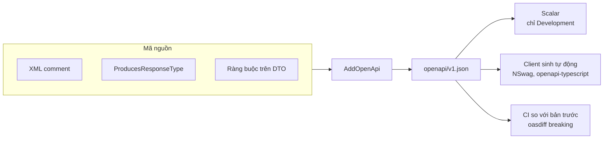

# 9.3 - Tài liệu API với OpenAPI và Scalar

> **Tóm tắt:** OpenAPI là **hợp đồng API ở dạng máy đọc được**: một file JSON mô tả mọi endpoint, tham số, kiểu dữ liệu và mã phản hồi. Swagger UI hay Scalar chỉ là giao diện trình bày file đó. Từ .NET 9, template Web API dùng gói `Microsoft.AspNetCore.OpenApi` để sinh file và **không kèm giao diện nào**; khóa học dùng Scalar làm giao diện. Giá trị thật của tài liệu sinh từ code là nó không lỗi thời, **miễn là bạn cho nó đủ thông tin**: mặc định ASP.NET Core không biết endpoint trả 404 khi nào hay tham số nghĩa là gì, đó là việc của XML comment và `[ProducesResponseType]`. Và một điều hay bị quên: trang tài liệu mở ở production là **bản đồ bề mặt tấn công** cho bất kỳ ai.

## Mục tiêu bài học

Sau bài này bạn có thể:

- Sinh tài liệu OpenAPI bằng `Microsoft.AspNetCore.OpenApi`, hiển thị bằng Scalar, có XML comment và khai báo JWT.
- Khai báo đầy đủ các mã phản hồi để tài liệu không nói dối.
- Tách tài liệu theo version API.
- Quyết định có mở trang tài liệu ở production hay không, và bảo vệ nó đúng cách.
- Sinh client tự động và bắt breaking change trong CI bằng `oasdiff`.

**Cần biết trước:** [8.4 — Controllers và Actions](../module-08-aspnet-core-fundamentals/8.4-controllers-and-actions.md) (kiểu trả về, `[ApiController]`), [8.5 — Model validation](../module-08-aspnet-core-fundamentals/8.5-model-validation.md), [9.2 — API Versioning](9.2-api-versioning.md) cho mục 9.3.4. Bài tập 3 cần Docker để chạy công cụ `oasdiff`.

## Nội dung bài học

### 9.3.1 — `Microsoft.AspNetCore.OpenApi`, Swashbuckle hay NSwag

| | `Microsoft.AspNetCore.OpenApi` | Swashbuckle | NSwag |
|---|---|---|---|
| Sinh file OpenAPI | Có (.NET 9+; .NET 10 sinh OpenAPI 3.1) | Có | Có |
| Có sẵn trong template | **Có** | Không (bỏ khỏi template từ .NET 9) | Không |
| Giao diện xem tài liệu | Không, tự thêm (Scalar, Swagger UI) | Swagger UI | Swagger UI, ReDoc |
| Đọc XML comment | Có (.NET 10, sinh lúc build) | Có | Có |
| Sinh client C#/TS | Không | Không | **Có** |

Từ .NET 9, template mặc định dùng `Microsoft.AspNetCore.OpenApi` và **không kèm Swagger UI**. Nhiều người bất ngờ vì `/swagger` trả 404 sau khi nâng cấp. Khóa học dùng gói có sẵn này cộng với **Scalar** (`Scalar.AspNetCore`), một giao diện xem và gọi thử API.

Swashbuckle vẫn gặp nhiều ở dự án cũ. Nếu bảo trì dự án dùng nó, xem phần ghi chú ở cuối mục 9.3.5.

### 9.3.2 — Cấu hình

Bật sinh file XML comment trong `.csproj`:

```xml
<PropertyGroup>
  <GenerateDocumentationFile>true</GenerateDocumentationFile>
  <NoWarn>$(NoWarn);1591</NoWarn>   <!-- tắt cảnh báo "thiếu XML comment" cho mọi public member -->
</PropertyGroup>
```

Cài Scalar:

```bash
dotnet add package Scalar.AspNetCore
```

```csharp
// Program.cs
using Microsoft.OpenApi;
using Scalar.AspNetCore;

var builder = WebApplication.CreateBuilder(args);
builder.Services.AddControllers();

builder.Services.AddOpenApi(options =>
{
    // Document transformer: sửa file OpenAPI sau khi được sinh ra
    options.AddDocumentTransformer((document, context, ct) =>
    {
        document.Info = new OpenApiInfo
        {
            Title = "CRM API",
            Version = "v1",
            Description = "API quản lý khách hàng và liên hệ",
            Contact = new OpenApiContact { Name = "Team Backend", Email = "backend@example.com" }
        };

        // Khai báo API dùng JWT Bearer, để Scalar hiện ô nhập token
        document.Components ??= new OpenApiComponents();
        document.Components.SecuritySchemes ??= new Dictionary<string, IOpenApiSecurityScheme>();
        document.Components.SecuritySchemes["Bearer"] = new OpenApiSecurityScheme
        {
            Type = SecuritySchemeType.Http,
            Scheme = "bearer",
            BearerFormat = "JWT",
            Description = "Nhập JWT token (không cần tiền tố 'Bearer')"
        };
        document.Security =
        [
            new OpenApiSecurityRequirement
            {
                [new OpenApiSecuritySchemeReference("Bearer", document)] = []
            }
        ];
        return Task.CompletedTask;
    });
});

var app = builder.Build();

if (app.Environment.IsDevelopment())
{
    app.MapOpenApi();                 // file JSON ở /openapi/v1.json
    app.MapScalarApiReference();      // giao diện ở /scalar
}

app.MapControllers();
app.Run();
```

- Kiểu `OpenApiInfo`, `OpenApiSecurityScheme`... nằm trong namespace `Microsoft.OpenApi` (thư viện Microsoft.OpenApi 2.x). Code cũ viết `using Microsoft.OpenApi.Models;` và `new OpenApiReference { ... }` là của bản 1.x, không biên dịch được trên .NET 10.
- JWT và `Bearer` là cách xác thực sẽ học ở [Module 10](../module-10-authentication-authorization/README.md). Ở đây chỉ cần biết: khai báo này làm Scalar hiện ô nhập token để gọi thử endpoint cần đăng nhập.
- `GenerateDocumentationFile` là bước hay bị quên. Không bật nó thì tài liệu chỉ có tên đường dẫn và kiểu, không có mô tả nào, và không có lỗi nào báo cho bạn biết.

### 9.3.3 — Cho tài liệu biết những gì nó không tự đoán được

```csharp
// Controllers/CustomersController.cs
public record CustomerDto(int Id, string Name, string Email, string? Phone);

/// <summary>Quản lý khách hàng.</summary>
[ApiController]
[Route("api/customers")]
public class CustomersController(CrmDbContext db) : ControllerBase
{
    /// <summary>Lấy một khách hàng theo id.</summary>
    /// <param name="id">Id khách hàng.</param>
    /// <param name="ct">Token huỷ của request.</param>
    /// <response code="200">Tìm thấy khách hàng.</response>
    /// <response code="404">Không có khách hàng với id này.</response>
    [HttpGet("{id:int}")]
    [ProducesResponseType<CustomerDto>(StatusCodes.Status200OK)]
    [ProducesResponseType<ProblemDetails>(StatusCodes.Status404NotFound)]
    public async Task<ActionResult<CustomerDto>> GetById(int id, CancellationToken ct)
    {
        var c = await db.Customers.FindAsync([id], ct);
        return c is null ? NotFound() : new CustomerDto(c.Id, c.Name, c.Email, c.Phone);
    }
}
```

Trong `/openapi/v1.json`, endpoint này có mô tả lấy từ XML comment và **hai** nhánh phản hồi (trích kết quả chạy thật):

```json
"responses": {
  "200": { "description": "Tìm thấy khách hàng.",
           "content": { "application/json": { "schema": { "$ref": "#/components/schemas/CustomerDto" } } } },
  "404": { "description": "Không có khách hàng với id này.",
           "content": { "application/json": { "schema": { "$ref": "#/components/schemas/ProblemDetails" } } } }
}
```

Những gì ASP.NET Core **không** tự biết và bạn phải khai:

- **Các mã lỗi.** Không khai thì tài liệu chỉ có nhánh thành công, và client sinh tự động không có kiểu cho lỗi.
- **Kiểu của body lỗi.** `ValidationProblemDetails` (lỗi validation, có danh sách lỗi theo trường) khác `ProblemDetails`.
- **Ý nghĩa của tham số.** `status` nhận những giá trị nào?
- **Ví dụ.** Một request mẫu tiết kiệm hàng giờ cho người tích hợp.

Mã lỗi dùng chung cho mọi endpoint thì khai một lần:

```csharp
builder.Services.AddControllers(options =>
{
    options.Filters.Add(new ProducesResponseTypeAttribute(
        typeof(ProblemDetails), StatusCodes.Status500InternalServerError));
});
```

Cẩn thận một hệ quả: khi action **không** có `[ProducesResponseType]` nào, ASP.NET Core tự suy ra nhánh `200` từ kiểu `ActionResult<T>`. Nhưng chỉ cần có **một** khai báo, kể cả từ filter toàn cục ở trên, việc suy ra đó tắt. Chạy thử: action `ActionResult<LeadDto> GetById(int id)` không khai gì, sau khi thêm filter `500` thì tài liệu chỉ còn nhánh `500`, mất hẳn nhánh `200` và schema `LeadDto`. Dùng filter toàn cục thì khai `200` tường minh trên mọi action.

Ràng buộc trên DTO cũng chảy vào schema:

```csharp
// Contracts/CreateCustomerRequest.cs
using System.ComponentModel.DataAnnotations;

/// <summary>Dữ liệu tạo khách hàng mới.</summary>
public sealed record CreateCustomerRequest
{
    /// <summary>Tên đầy đủ của khách hàng.</summary>
    /// <example>Nguyễn Văn A</example>
    [Required, StringLength(200, MinimumLength = 2)]
    public required string Name { get; init; }

    /// <summary>Email liên hệ, duy nhất trong hệ thống.</summary>
    /// <example>a@example.com</example>
    [Required, EmailAddress]
    public required string Email { get; init; }
}
```

Schema sinh ra (chạy thật trên .NET 10):

```json
"CreateCustomerRequest": {
  "required": [ "name", "email" ],
  "type": "object",
  "properties": {
    "name":  { "examples": [ "Nguyễn Văn A" ], "maxLength": 200, "minLength": 2,
               "type": "string", "description": "Tên đầy đủ của khách hàng." },
    "email": { "examples": [ "a@example.com" ], "type": "string",
               "description": "Email liên hệ, duy nhất trong hệ thống." }
  },
  "description": "Dữ liệu tạo khách hàng mới."
}
```

`<example>` hiện sẵn trong ô gọi thử của Scalar: người tích hợp bấm là chạy được ngay, thay vì phải tự đoán dữ liệu hợp lệ.

### 9.3.4 — Mỗi version một tài liệu

Với API có nhiều version như [bài 9.2](9.2-api-versioning.md), gói `Asp.Versioning.OpenApi` sinh mỗi version một file:

```bash
dotnet add package Asp.Versioning.OpenApi
```

```csharp
// Program.cs — thay cho builder.Services.AddOpenApi(...) ở mục 9.3.2
builder.Services.AddApiVersioning(o =>
{
    o.DefaultApiVersion = new ApiVersion(1, 0);
    o.ReportApiVersions = true;
    o.ApiVersionReader = new UrlSegmentApiVersionReader();
})
.AddMvc()
.AddApiExplorer(o =>
{
    o.GroupNameFormat = "'v'VVV";
    o.SubstituteApiVersionInUrl = true;
})
.AddOpenApi(options =>
{
    // options.Document là OpenApiOptions quen thuộc ở mục 9.3.2
    options.Document.AddDocumentTransformer((document, context, ct) =>
    {
        document.Info.Title = "CRM API";
        return Task.CompletedTask;
    });
});

var app = builder.Build();

if (app.Environment.IsDevelopment())
{
    app.MapOpenApi().WithDocumentPerVersion();                        // /openapi/v1.json, /openapi/v2.json
    app.MapScalarApiReference(options => options.AddDocuments("v1", "v2"));
}
```

Version đánh dấu `Deprecated = true` tự có dòng mô tả "The API is deprecated." trong tài liệu của nó. Quên `WithDocumentPerVersion()` thì endpoint chỉ trả một tài liệu không biết gì về version; `Asp.Versioning` có analyzer cảnh báo lỗi này lúc build (mã `AV0030`).

### 9.3.5 — Trang tài liệu ở production

Template chỉ map OpenAPI trong `IsDevelopment()`, và đó là mặc định **đúng**. Trang tài liệu công khai:

- Liệt kê **mọi** endpoint, kể cả endpoint nội bộ và admin.
- Cho biết trường nào bắt buộc, kiểu gì, ràng buộc ra sao.
- Cho phép **gọi thử trực tiếp** từ trình duyệt.

Nói cách khác, nó là bản đồ bề mặt tấn công, được cập nhật tự động.

Ba lựa chọn hợp lý:

```csharp
// 1. Chỉ trả lời khi request tới từ host nội bộ
app.MapOpenApi().RequireHost("localhost", "*.internal.example.com");

// 2. Yêu cầu đăng nhập — cả file JSON lẫn giao diện Scalar đều là endpoint nên bảo vệ được
app.MapOpenApi().RequireAuthorization("ApiDocsPolicy");
app.MapScalarApiReference().RequireAuthorization("ApiDocsPolicy");

// 3. Không map gì ở production; sinh file OpenAPI lúc build và đưa sang công cụ tài liệu riêng
```

Với cách 2, gọi `/openapi/v1.json` hay `/scalar/v1` khi chưa đăng nhập đều nhận `401` (đã chạy thử với xác thực JWT; policy `ApiDocsPolicy` và xác thực học ở Module 10).

Cách 3 là sạch nhất cho API công khai: file OpenAPI sinh trong CI, đẩy lên một portal tài liệu, còn ứng dụng chạy không có endpoint tài liệu nào. Cài gói sinh file lúc build:

```bash
dotnet add package Microsoft.Extensions.ApiDescription.Server
dotnet build
# file sinh ra: obj/CrmApi.json (tên theo project)
```

Muốn file nằm ở chỗ khác thì thêm `<OpenApiDocumentsDirectory>openapi</OpenApiDocumentsDirectory>` vào `PropertyGroup` của `.csproj`.

**Ghi chú cho dự án dùng Swashbuckle.** Swashbuckle 10.x dùng Microsoft.OpenApi 2.x, nên khai báo yêu cầu bảo mật đổi cú pháp:

```csharp
options.AddSecurityRequirement(document => new OpenApiSecurityRequirement
{
    [new OpenApiSecuritySchemeReference("Bearer", document)] = []
});
```

Và một cái bẫy bảo mật: Swagger UI của Swashbuckle là **middleware** (`app.UseSwaggerUI()` trả về `IApplicationBuilder`), không phải endpoint. Viết `app.UseSwaggerUI().RequireAuthorization(...)` không biên dịch (lỗi `CS0311`). Còn `app.MapSwagger().RequireAuthorization(...)` chỉ bảo vệ file JSON: chạy thử thì `/swagger/v1/swagger.json` trả `401` nhưng `/swagger/index.html` vẫn trả `200`. Muốn chặn cả trang UI thì chỉ bật nó ở môi trường nội bộ.

### 9.3.6 — Sinh client từ OpenAPI

Giá trị lớn nhất của OpenAPI không phải trang giao diện mà là **client sinh tự động**:

```bash
# C# — NSwag, cài làm công cụ cục bộ của project
dotnet new tool-manifest
dotnet tool install NSwag.ConsoleCore
dotnet nswag openapi2csclient /input:obj/CrmApi.json /output:CrmApiClient.cs /namespace:Crm.Client

# TypeScript — chỉ sinh kiểu dữ liệu
npx openapi-typescript obj/CrmApi.json -o src/api/types.ts
```

Khi API đổi, client sinh lại và **trình biên dịch chỉ ra ngay** chỗ nào gãy, thay vì phát hiện lúc chạy trên production.

Thêm vào CI một bước so sánh file OpenAPI với bản đã phát hành để phát hiện breaking change tự động. Công cụ `oasdiff` làm việc này (chạy bằng Docker, không cần cài):

```bash
docker run --rm -v "$(pwd):/specs" tufin/oasdiff breaking /specs/baseline.json /specs/current.json --fail-on ERR
```

Đây là cách biến bảng "thay đổi nào là breaking" ở [bài 9.2](9.2-api-versioning.md) thành một bước kiểm tra tự động, thay vì trông vào trí nhớ của người review.



### 9.3.7 — Lỗi thường gặp

- **Mở `/swagger` sau khi nâng cấp lên .NET 9/10 thì nhận 404.** Template mới không còn Swashbuckle. Dùng `/openapi/v1.json` và thêm Scalar như mục 9.3.2.
- **Tài liệu không có mô tả nào dù đã viết XML comment.** Quên `<GenerateDocumentationFile>true</GenerateDocumentationFile>`.
- **Endpoint mất nhánh `200` trong tài liệu.** Action có một `[ProducesResponseType]` bất kỳ (hoặc filter toàn cục) nên ASP.NET Core không tự suy ra `200` nữa; khai `200` tường minh.
- **Code cấu hình chép từ bài viết cũ báo lỗi `OpenApiReference` hoặc `Microsoft.OpenApi.Models` không tồn tại.** Đó là API của Microsoft.OpenApi 1.x. Bản 2.x dùng namespace `Microsoft.OpenApi` và `OpenApiSecuritySchemeReference`.
- **Header hoặc mô tả tiếng Việt trong `Link`, `Title` của header HTTP làm request lỗi 500.** Giá trị header chỉ được chứa ASCII (xem [bài 9.2](9.2-api-versioning.md)). Mô tả trong file OpenAPI thì dùng tiếng Việt thoải mái.

**Danh sách rà soát OpenAPI**

- [ ] `GenerateDocumentationFile` được bật trong `.csproj`.
- [ ] Mọi endpoint công khai có XML summary mô tả bằng tiếng người.
- [ ] Mọi mã phản hồi có thể xảy ra đều được khai bằng `ProducesResponseType`.
- [ ] Kiểu body lỗi được khai đúng: `ProblemDetails` hay `ValidationProblemDetails`.
- [ ] DTO có ràng buộc validation để schema phản ánh đúng.
- [ ] Trường quan trọng có `<example>` để gọi thử chạy được ngay.
- [ ] Trang tài liệu không mở công khai ở production.
- [ ] API nhiều version có mỗi version một tài liệu.
- [ ] CI so sánh file OpenAPI để phát hiện breaking change.

## Bài tập áp dụng

#### Bài 1 — Khi tài liệu nói dối

Viết endpoint `GetById` trả `404` khi không tìm thấy nhưng **không** khai `[ProducesResponseType(404)]`. Sinh client C# bằng NSwag và đọc đoạn code xử lý mã trạng thái. Sau đó khai thêm `404` và sinh lại.

**Tiêu chí hoàn thành:** bạn chỉ ra được **dòng nào trong client sinh ra** xử lý `404` ở cả hai lần, và nói được khai `404` thay đổi gì cho người dùng client, và **không** thay đổi gì.

<details>
<summary><strong>Gợi ý và lời giải — Bài 1</strong></summary>

**Gợi ý.** NSwag sinh code từ **danh sách mã trạng thái được khai báo**. Mã nào không có trong danh sách thì rơi vào nhánh "không mong đợi".

**Lời giải — endpoint thiếu khai báo:**

```csharp
[HttpGet("{id:int}")]
[ProducesResponseType<CustomerDto>(StatusCodes.Status200OK)]
// THIẾU: [ProducesResponseType<ProblemDetails>(StatusCodes.Status404NotFound)]
public async Task<ActionResult<CustomerDto>> GetById(int id, CancellationToken ct)
{
    var c = await db.Customers.FindAsync([id], ct);
    return c is null ? NotFound() : new CustomerDto(c.Id, c.Name, c.Email, c.Phone);   // 404 có thật
}
```

File OpenAPI chỉ có nhánh `200`. **Client NSwag 14 sinh ra từ file đó** (trích nguyên văn):

```csharp
var status_ = (int)response_.StatusCode;
if (status_ == 200)
{
    var objectResponse_ = await ReadObjectResponseAsync<CustomerDto>(response_, headers_, cancellationToken).ConfigureAwait(false);
    ...
    return objectResponse_.Object;
}
else
{
    var responseData_ = response_.Content == null ? null : await ReadAsStringAsync(response_.Content, cancellationToken).ConfigureAwait(false);
    throw new ApiException("The HTTP status code of the response was not expected (" + status_ + ").", status_, responseData_, headers_, null);   // <- 404 rơi vào đây
}
```

`404` rơi vào nhánh `else` và ném `ApiException` với thông báo chung chung "not expected (404)". Body lỗi chỉ là một chuỗi, không có kiểu.

**Sau khi khai `404`**, NSwag sinh thêm một nhánh riêng:

```csharp
else
if (status_ == 404)
{
    var objectResponse_ = await ReadObjectResponseAsync<ProblemDetails>(response_, headers_, cancellationToken).ConfigureAwait(false);
    ...
    throw new ApiException<ProblemDetails>("Không có khách hàng với id này.", status_, objectResponse_.Text, headers_, objectResponse_.Object, null);
}
```

**Khai `404` thay đổi gì:** client nhận `ApiException<ProblemDetails>` có kiểu, thông báo lấy từ `<response code="404">`, và đọc được `ex.Result.Title`, `ex.Result.Detail` thay vì tự parse chuỗi JSON.

**Không thay đổi gì:** client **vẫn ném ngoại lệ**. Mặc định NSwag coi mọi mã không phải 2xx là lỗi, có khai hay không. Người dùng client vẫn phải viết (NSwag đặt tên phương thức theo `operationId` trong file; endpoint không có tên thì nó ghép từ đường dẫn và method, thành `CustomersGETAsync`):

```csharp
CustomerDto? customer;
try { customer = await api.CustomersGETAsync(id, ct); }
catch (ApiException<ProblemDetails> ex) when (ex.StatusCode == 404) { customer = null; }
```

Nếu "không tìm thấy" là kết quả thường gặp (không phải sự cố), có hai hướng: bọc lời gọi trên vào một hàm `GetByIdOrNullAsync` ở phía client, hoặc tùy chỉnh template của NSwag. Đừng đổi API thành `200` với body rỗng chỉ để chiều client sinh tự động: như thế lại là một breaking change ([bài 9.2](9.2-api-versioning.md)).

**Khi nào phải khai `200`.** Từ ASP.NET Core 2.1, action trả `ActionResult<T>` mà **không có** `[ProducesResponseType]` nào thì tự có nhánh `200` kiểu `T` trong tài liệu. Nhưng khai thêm `404` (hoặc dùng filter toàn cục) là tắt việc suy ra đó, nên khi đã khai mã lỗi thì khai luôn `200` như đoạn code trên.

**Điểm đáng nhớ.** Tài liệu sai còn tệ hơn không có tài liệu: không có tài liệu thì người ta đi đọc code, còn tài liệu sai thì họ tin và sinh ra client xử lý lỗi sai.

</details>

---

#### Bài 2 — Trang tài liệu như một bản đồ tấn công

Đọc file OpenAPI của một API có endpoint admin (dùng API của bạn, thêm vài endpoint `admin`, `internal` để thử), và liệt kê những thông tin một người lạ thu được trong 2 phút: số endpoint, tên trường, ràng buộc, cơ chế xác thực.

**Tiêu chí hoàn thành:** bạn viết ra được ít nhất **năm thông tin cụ thể** hữu ích cho người tấn công, và nêu cách chặn từng loại.

<details>
<summary><strong>Gợi ý và lời giải — Bài 2</strong></summary>

**Gợi ý.** Đừng chỉ nhìn giao diện. Tải thẳng file mô tả, nó gọn hơn và máy đọc được. `jq` là công cụ dòng lệnh để lọc JSON:

```bash
curl -s https://api.example.com/openapi/v1.json | jq '.paths | keys'
```

**Lời giải — năm nhóm thông tin thu được, không cần đăng nhập.** Các kết quả dưới đây là **ví dụ minh họa** cho một API giả định có lỗi thiết kế.

**1. Toàn bộ danh sách endpoint, gồm cả phần không có trong giao diện người dùng.**

```bash
curl -s .../openapi/v1.json | jq -r '.paths | keys[]' | grep -i 'admin\|internal\|debug\|export'
```

```text
/api/v1/admin/users/{id}/impersonate
/api/v1/internal/reindex
/api/v1/debug/config
```

Ba endpoint này không xuất hiện ở bất kỳ màn hình nào, nhưng chúng tồn tại và nhận request.

**2. Hình dạng chính xác của dữ liệu, kể cả trường nhạy cảm.**

```bash
curl -s .../openapi/v1.json | jq '.components.schemas.UserDto.properties | keys'
```

```json
["id","email","passwordHash","roles","tenantId","isSuperAdmin","internalNotes"]
```

`passwordHash` và `isSuperAdmin` lộ ra vì API trả thẳng entity. Đây là lỗi thiết kế, và trang tài liệu chỉ làm nó **dễ thấy** hơn.

**3. Quy tắc validation đủ để thu hẹp việc đoán mật khẩu.**

```json
"password": { "minLength": 8, "pattern": "^(?=.*[A-Z])(?=.*\\d).+$" }
```

Người tấn công biết ngay không gian mật khẩu cần thử: tối thiểu 8 ký tự, ít nhất một chữ hoa và một chữ số.

**4. Endpoint nào cần token, endpoint nào không** (khi tài liệu khai `security` theo từng endpoint).

**5. Nút gọi thử biến trình duyệt thành công cụ dò.** Không cần viết script, không cần Postman: gọi thử ngay trên trang, thấy luôn response thật.

**Ba cách chặn, theo thứ tự nên chọn:**

```csharp
// 1. TỐT NHẤT cho API công khai — production không có endpoint tài liệu nào
if (app.Environment.IsDevelopment())
{
    app.MapOpenApi();
    app.MapScalarApiReference();
}

// 2. Cần xem trên production — bắt đăng nhập cho cả file JSON lẫn giao diện
app.MapOpenApi().RequireAuthorization("ApiDocsPolicy");
app.MapScalarApiReference().RequireAuthorization("ApiDocsPolicy");

// 3. Giới hạn theo host nội bộ
app.MapOpenApi().RequireHost("*.internal.example.com");
```

Với cách 1, file OpenAPI vẫn sinh lúc build (gói `Microsoft.Extensions.ApiDescription.Server`, mục 9.3.5) và đẩy lên portal tài liệu riêng, nên bạn không mất gì.

**Và độc lập với ba cách trên: đừng để schema lộ trường không nên lộ.** Trả DTO riêng thay vì entity, đúng như [bài 8.4](../module-08-aspnet-core-fundamentals/8.4-controllers-and-actions.md) trình bày. Ẩn tài liệu chỉ giấu tấm bản đồ; nó không sửa được việc endpoint thật vẫn trả `passwordHash` cho bất kỳ ai gọi.

</details>

---

#### Bài 3 — Bắt breaking change tự động

Sinh file OpenAPI lúc build, lưu thành `baseline.json`. Xoá trường `Phone` khỏi `CustomerDto`, sinh lại thành `current.json`, chạy `oasdiff breaking`. Làm lại với thay đổi chỉ **thêm** trường `Tags`.

**Tiêu chí hoàn thành:** lệnh kiểm tra thoát với mã khác 0 khi xoá trường, và mã 0 khi chỉ thêm trường.

<details>
<summary><strong>Gợi ý và lời giải — Bài 3</strong></summary>

**Gợi ý.** Ở dự án thật, so sánh phải chạy trên file sinh ra từ **bản đã phát hành**, không phải file trong nhánh của bạn. Cách đơn giản: commit file OpenAPI của bản phát hành vào repo, CI sinh file mới rồi so với nó.

**Lời giải.** Cài gói sinh file lúc build (mục 9.3.5), rồi:

```bash
# 1. File cơ sở
dotnet build
cp obj/CrmApi.json baseline.json

# 2. Xoá Phone khỏi CustomerDto, build lại
dotnet build
cp obj/CrmApi.json current.json

# 3. So sánh
docker run --rm -v "$(pwd):/specs" tufin/oasdiff breaking /specs/baseline.json /specs/current.json --fail-on ERR
echo "exit=$?"
```

Trên Git Bash của Windows, Docker hiểu sai đường dẫn: chạy `MSYS_NO_PATHCONV=1 docker run --rm -v "$(pwd -W):/specs" ...`. Trên PowerShell dùng `-v "${PWD}:/specs"`.

**Khi xoá trường `Phone`** (kết quả chạy thật, rút gọn):

```text
6 changes: 6 error, 0 warning, 0 info
error	[response-required-property-removed] at /specs/current.json
	in API GET /api/customers/{id}
		removed the required property `phone` from the response with the `200` status (media type: application/json)
...
exit=1
```

Sáu lỗi vì có hai endpoint trả `CustomerDto`, mỗi endpoint khai ba media type (`application/json`, `text/json`, `text/plain`, mặc định của controller). Mã thoát `1` làm bước CI đỏ.

**Khi chỉ thêm trường `Tags`:**

```text
No breaking changes to report, but the specs are different.
Run 'oasdiff diff' to see structural differences.
exit=0
```

Xanh, đúng như bảng phân loại ở [bài 9.2](9.2-api-versioning.md). Muốn xem cả thay đổi không breaking thì dùng `oasdiff changelog`.

**Bước CI** (GitHub Actions, file `openapi/baseline.json` được commit sẵn):

```yaml
- name: Kiểm tra breaking change trong hợp đồng API
  run: |
    dotnet build -c Release
    docker run --rm -v "$PWD:/specs" tufin/oasdiff breaking \
      /specs/openapi/baseline.json /specs/obj/CrmApi.json --fail-on ERR
```

**Ba điều bộ so sánh này bắt được mà người review rất hay bỏ sót:**

| Thay đổi | Vì sao mắt người bỏ sót |
|---|---|
| Xoá một giá trị `enum` | Diff C# chỉ mất **một dòng** giữa hàng trăm dòng khác |
| Đổi trường từ cho phép `null` sang bắt buộc | Chỉ là bỏ dấu `?` trong khai báo thuộc tính |
| Thêm trường bắt buộc vào request | Trông y hệt việc thêm trường vào response |

**Một giới hạn phải biết.** Công cụ so sánh **không** phát hiện được đổi ý nghĩa: `Total` chuyển từ chưa thuế sang đã thuế giữ nguyên tên, nguyên kiểu, hợp đồng OpenAPI không đổi một ký tự. Đó vẫn là loại breaking change nguy hiểm nhất, và chỉ con người bắt được khi review.

**Cách dùng đúng:** đặt `oasdiff` làm lưới an toàn cho những gì máy kiểm được, và giữ quy tắc "đổi ý nghĩa thì đổi tên trường" cho phần máy không kiểm được.

</details>

## Tự kiểm tra

<details>
<summary>Giá trị thật của OpenAPI nằm ở đâu?</summary>

Ở chỗ nó là hợp đồng API dạng máy đọc được, sinh ra từ code nên không lỗi thời, và từ đó sinh được client tự động cho nhiều ngôn ngữ. Scalar hay Swagger UI chỉ là cách trình bày nó. Khi API đổi, client sinh lại và trình biên dịch chỉ ra ngay chỗ gãy thay vì phát hiện lúc chạy.

</details>

<details>
<summary>Vì sao mở /swagger trên project .NET 10 mới tạo lại nhận 404?</summary>

Từ .NET 9, template Web API dùng `Microsoft.AspNetCore.OpenApi`: nó chỉ sinh file JSON ở `/openapi/v1.json` và không kèm giao diện nào. Muốn có giao diện thì thêm Scalar (`MapScalarApiReference`) hoặc tự cài Swagger UI.

</details>

<details>
<summary>ASP.NET Core không tự biết những gì?</summary>

Các mã lỗi mà endpoint có thể trả, kiểu của body lỗi, ý nghĩa và giá trị hợp lệ của tham số, và ví dụ dữ liệu. Không khai thì tài liệu chỉ có nhánh thành công và client sinh tự động không có kiểu cho lỗi. Đó là việc của XML comment và `ProducesResponseType`.

</details>

<details>
<summary>Khai [ProducesResponseType(404)] có làm client NSwag trả null thay vì ném lỗi không?</summary>

Không. Client vẫn ném ngoại lệ, chỉ khác là ngoại lệ có kiểu (`ApiException<ProblemDetails>`), có thông báo lấy từ XML comment và đọc được body lỗi. Mặc định NSwag coi mọi mã không phải 2xx là lỗi.

</details>

<details>
<summary>Bảo vệ Swagger UI của Swashbuckle bằng app.MapSwagger().RequireAuthorization(...) có đủ không?</summary>

Không. `MapSwagger` chỉ là endpoint trả file JSON; trang Swagger UI do middleware `UseSwaggerUI` phục vụ nên vẫn mở. Với `Microsoft.AspNetCore.OpenApi` và Scalar thì cả file JSON lẫn giao diện đều là endpoint, gắn `RequireAuthorization` cho cả hai là đủ.

</details>

<details>
<summary>Làm sao phát hiện breaking change tự động?</summary>

Sinh file OpenAPI lúc build, rồi trong CI so sánh nó với file của bản đã phát hành bằng `oasdiff breaking ... --fail-on ERR`. Có breaking change thì lệnh thoát với mã khác 0 và CI đỏ. Công cụ không bắt được đổi ý nghĩa của trường, phần đó vẫn cần người review.

</details>

## Kết luận

Ba điều đáng nhớ nhất:

1. **Tài liệu sinh từ code không tự đầy đủ.** Khai mã lỗi và kiểu body lỗi, nếu không nó nói dối.
2. **Trang tài liệu ở production là bản đồ bề mặt tấn công.** Chỉ bật ở Development, hoặc bắt đăng nhập cho cả file lẫn giao diện.
3. **Dùng OpenAPI để sinh client và để bắt breaking change trong CI.**

## Tham khảo

- [Generate OpenAPI documents in ASP.NET Core](https://learn.microsoft.com/en-us/aspnet/core/fundamentals/openapi/aspnetcore-openapi)
- [Use the generated OpenAPI documents (Scalar, Swagger UI)](https://learn.microsoft.com/en-us/aspnet/core/fundamentals/openapi/using-openapi-documents)
- [OpenAPI XML documentation comment support](https://learn.microsoft.com/en-us/aspnet/core/fundamentals/openapi/openapi-comments)
- [Scalar (GitHub)](https://github.com/scalar/scalar)
- [oasdiff](https://github.com/oasdiff/oasdiff)
- [OpenAPI Specification](https://spec.openapis.org/oas/latest.html)

## Điều hướng

- **Bài trước:** [9.2 — API Versioning](9.2-api-versioning.md)
- **Bài tiếp theo:** [9.4 — Pagination, Filtering, Sorting](9.4-pagination-filtering-sorting.md)
- **Về module:** [Trang mục lục](README.md)
