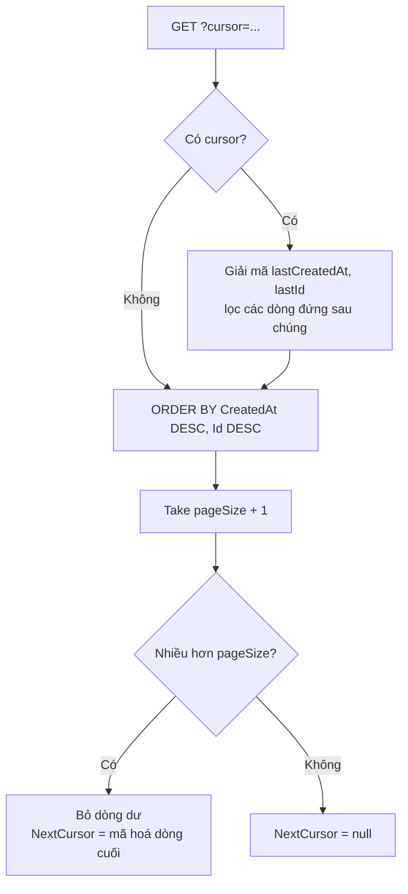

# 9.4 - Pagination, Filtering, Sorting

> **Tóm tắt:** Phân trang có hai kiểu và chúng **không thay thế được cho nhau**. **Offset** (`?page=3&pageSize=20`) quen thuộc và cho nhảy tới trang bất kỳ, nhưng có hai khuyết điểm nghiêm trọng: `OFFSET 200000` buộc database **đọc và bỏ** 200.000 dòng, và nếu dữ liệu thay đổi giữa hai lần gọi thì người dùng **thấy trùng hoặc bỏ sót** bản ghi. **Cursor** giải quyết cả hai bằng cách hỏi "cho tôi 20 bản ghi **sau** bản ghi này", nhưng đánh đổi: không có tổng số trang và không nhảy được. Ngoài ra bài này có hai thứ bắt buộc về an toàn: **whitelist cho `sortBy`** và **trần cứng cho `pageSize`**.

## Mục tiêu bài học

Sau bài này bạn có thể:

- Giải thích vì sao `OFFSET` lớn chậm và vì sao nó làm trùng hoặc sót bản ghi.
- Cài cursor pagination với khoá ổn định, dùng được index.
- Chặn sorting tuỳ ý bằng whitelist.
- Đặt trần cho `pageSize` và trả `400` khi tham số phân trang sai.
- Tránh đếm tổng khi không cần.

**Cần biết trước:** [8.4 — Controllers và Actions](../module-08-aspnet-core-fundamentals/8.4-controllers-and-actions.md) (`[FromQuery]`), [8.5 — Model validation](../module-08-aspnet-core-fundamentals/8.5-model-validation.md) (`[Range]`, lỗi `400` tự động), [8.10 — EF Core tối thiểu](../module-08-aspnet-core-fundamentals/8.10-ef-core-minimal.md), [5.3 — LINQ](../../stage-02-csharp-professional/module-05-advanced-csharp/5.3-linq.md). Bài tập chạy trên PostgreSQL (xem [trang mục lục module](README.md)); *index* là cấu trúc giúp database tìm nhanh theo một cột, Module 12 dạy kỹ.

## Nội dung bài học

### 9.4.1 — Tham số và vỏ phản hồi

Ví dụ trong bài dùng entity `Customer` có thêm cột `Status` so với [bài 8.10](../module-08-aspnet-core-fundamentals/8.10-ef-core-minimal.md):

```csharp
// Data/Customer.cs
public class Customer
{
    public int Id { get; set; }
    public required string Name { get; set; }
    public required string Email { get; set; }
    public string Status { get; set; } = "Active";
    public DateTime CreatedAt { get; set; }
}
```

Tham số phân trang:

```csharp
// Contracts/PaginationRequest.cs
using System.ComponentModel.DataAnnotations;

public record PaginationRequest
{
    public const int MaxPageSize = 100;

    [Range(1, int.MaxValue)]
    public int Page { get; init; } = 1;

    [Range(1, MaxPageSize)]
    public int PageSize { get; init; } = 20;

    public int Skip => (Page - 1) * PageSize;
}
```

Với `[ApiController]`, gọi `?pageSize=0` hay `?pageSize=1000000` nhận ngay `400` (kết quả chạy thật):

```json
{"type":"https://tools.ietf.org/html/rfc9110#section-15.5.1","title":"One or more validation errors occurred.","status":400,"errors":{"PageSize":["The field PageSize must be between 1 and 100."]}}
```

Bài chọn **trả lỗi** thay vì âm thầm kẹp giá trị về 100: client biết tham số của mình sai thay vì nhận ít dữ liệu hơn mà không hiểu vì sao. Đừng làm cả hai cùng lúc: nếu setter tự kẹp giá trị trước khi validation chạy thì `[Range]` không bao giờ báo lỗi. Đây không phải chuyện lý thuyết: một `pageSize` không giới hạn là cách đơn giản nhất để làm sập API, một request kéo toàn bộ bảng.

Vỏ phản hồi dùng chung cho cả module:

```csharp
// Contracts/PagedResponse.cs
public record PagedResponse<T>(IReadOnlyList<T> Items, int Page, int PageSize, int TotalCount)
{
    public int TotalPages => (int)Math.Ceiling((double)TotalCount / PageSize);
    public bool HasNext => Page < TotalPages;
}
```

JSON trả về có dạng `{ "items": [...], "page": 1, "pageSize": 20, "totalCount": 76, "totalPages": 4, "hasNext": true }`.

### 9.4.2 — Hai vấn đề của offset

**Vấn đề 1: chậm dần theo số trang.**

```sql
SELECT * FROM "Customers" ORDER BY "CreatedAt" DESC, "Id" DESC
LIMIT 20 OFFSET 200000;
```

Database phải **đọc 200.020 dòng** rồi vứt đi 200.000 dòng đầu. Chi phí tăng **tuyến tính** theo số trang. Bài 1 đo con số thật.

**Vấn đề 2: trùng và sót khi dữ liệu thay đổi.**

```text
t=0   Người dùng xem trang 1 (bản ghi 1-20, mới nhất trước)
t=1   Có 5 bản ghi MỚI được tạo, chen lên đầu danh sách
t=2   Người dùng bấm trang 2 -> OFFSET 20
      => 5 bản ghi cuối của trang 1 cũ bị đẩy xuống và hiện LẠI ở trang 2

Ngược lại, nếu 5 bản ghi ở trang 1 bị XOÁ trước khi bấm trang 2,
5 bản ghi đầu của trang 2 cũ dồn lên trang 1 (đã xem xong) và bị BỎ SÓT.
```

Chèn thêm gây **trùng**, xoá bớt gây **sót**. Với danh sách người dùng lướt thì đây là phiền toái. Với **job đồng bộ dữ liệu** duyệt hết mọi trang thì đây là **dữ liệu sai im lặng**, rất khó phát hiện.

### 9.4.3 — Cursor pagination

Thay vì "bỏ qua N dòng", hỏi "cho tôi N dòng **sau** dòng này". PostgreSQL có cú pháp so sánh cặp giá trị (*row value*):

```sql
SELECT * FROM "Customers"
WHERE ("CreatedAt", "Id") < (@lastCreatedAt, @lastId)
ORDER BY "CreatedAt" DESC, "Id" DESC
LIMIT 20;
```

<details>
<summary>SQL Server</summary>

SQL Server không có so sánh cặp giá trị. Viết tách điều kiện, giữ vế `CreatedAt <= @lastCreatedAt` để database dùng được index:

```sql
SELECT TOP (20) * FROM Customers
WHERE CreatedAt <= @lastCreatedAt
  AND (CreatedAt < @lastCreatedAt OR Id < @lastId)
ORDER BY CreatedAt DESC, Id DESC;
```

</details>

Cursor là cặp `(CreatedAt, Id)` của dòng cuối trang trước, mã hoá thành chuỗi Base64:

```csharp
// Contracts/Cursor.cs
using System.Text.Json;

public record Cursor(DateTime CreatedAt, int Id)
{
    public string Encode() => Convert.ToBase64String(JsonSerializer.SerializeToUtf8Bytes(this));

    public static Cursor? Decode(string? token)
    {
        if (string.IsNullOrEmpty(token)) return null;
        try { return JsonSerializer.Deserialize<Cursor>(Convert.FromBase64String(token)); }
        catch (Exception e) when (e is FormatException or JsonException) { return null; }   // chuỗi rác
    }
}

public record CursorResponse<T>(IReadOnlyList<T> Items, string? NextCursor);

public record CustomerDto(int Id, string Name, string Email, string Status, DateTime CreatedAt);
```

```csharp
// Controllers/CustomersController.cs
[HttpGet("feed")]
public async Task<ActionResult<CursorResponse<CustomerDto>>> GetFeed(
    string? cursor, int pageSize = 20, CancellationToken ct = default)
{
    pageSize = Math.Clamp(pageSize, 1, PaginationRequest.MaxPageSize);
    var query = db.Customers.AsNoTracking();

    if (cursor is not null)
    {
        if (Cursor.Decode(cursor) is not { } last)
            return BadRequest("Cursor không hợp lệ");

        // Đứng SAU dòng cuối trang trước theo thứ tự (CreatedAt DESC, Id DESC)
        query = query.Where(c =>
            c.CreatedAt <= last.CreatedAt &&
            (c.CreatedAt < last.CreatedAt || c.Id < last.Id));        // Id là tie-breaker
    }

    var items = await query
        .OrderByDescending(c => c.CreatedAt).ThenByDescending(c => c.Id)
        .Take(pageSize + 1)                                    // lấy dư 1 để biết còn nữa không
        .Select(c => new CustomerDto(c.Id, c.Name, c.Email, c.Status, c.CreatedAt))
        .ToListAsync(ct);

    var hasMore = items.Count > pageSize;
    if (hasMore) items.RemoveAt(pageSize);

    var next = hasMore ? new Cursor(items[^1].CreatedAt, items[^1].Id).Encode() : null;
    return new CursorResponse<CustomerDto>(items, next);
}
```

Bốn chi tiết quyết định nó đúng hay sai:

1. **Tie-breaker bắt buộc.** `CreatedAt` không duy nhất: hai bản ghi tạo cùng thời điểm sẽ bị bỏ sót hoặc lặp. Luôn thêm `Id` làm khoá phụ, và `ORDER BY` phải khớp chính xác điều kiện `WHERE`. Chạy thử trên 1.000 khách hàng mà cứ hai người trùng `CreatedAt`, duyệt hết bằng cursor với trang 7 dòng thu được đúng 1.000 bản ghi khác nhau.
2. **Viết điều kiện sao cho dùng được index.** Cách viết tự nhiên `c.CreatedAt < x || (c.CreatedAt == x && c.Id < id)` cho kết quả đúng, nhưng trên PostgreSQL nó không dùng được index để nhảy tới vị trí: đo trên bảng 1 triệu dòng, lấy trang ở vị trí thứ 900.000 mất **89 ms** và database lọc bỏ 900.001 dòng, chậm ngang offset. Thêm vế `c.CreatedAt <= x &&` như code trên thì cùng truy vấn còn **0,05 ms**.
3. **`Take(pageSize + 1)`** để biết còn trang sau mà không phải `COUNT` thêm một lần.
4. **Mã hoá cursor** thành chuỗi mờ (Base64 của JSON) để client coi nó là con trỏ chứ không phải dữ liệu để chỉnh sửa. Cursor hỏng thì trả `400`, đừng để nó thành lỗi `500`.



| | Offset | Cursor |
|---|---|---|
| Nhảy tới trang bất kỳ | **Có** | Không |
| Tổng số trang | **Có** | Không |
| Hiệu năng ở trang sâu | Kém dần | **Ổn định** |
| Nhất quán khi dữ liệu đổi | Không | **Có** |
| Độ phức tạp | Thấp | Trung bình |

**Chọn thế nào:** giao diện quản trị có thanh số trang → offset. API công khai, cuộn vô hạn, feed, job đồng bộ dữ liệu → cursor.

### 9.4.4 — Filtering trên `IQueryable`

```csharp
// Contracts/CustomerFilterRequest.cs
public record CustomerFilterRequest : PaginationRequest
{
    public string? Search { get; init; }
    public string? Status { get; init; }
    public DateOnly? CreatedFrom { get; init; }    // ?createdFrom=2026-09-01
    public DateOnly? CreatedTo { get; init; }
    public string? SortBy { get; init; }
    public string? SortDir { get; init; }
}
```

```csharp
// Data/CustomerQueryExtensions.cs
public static class CustomerQueryExtensions
{
    public static IQueryable<Customer> ApplyFilters(
        this IQueryable<Customer> query, CustomerFilterRequest request)
    {
        if (!string.IsNullOrWhiteSpace(request.Search))
            query = query.Where(c => c.Name.Contains(request.Search)
                                  || c.Email.Contains(request.Search));

        if (request.Status is not null)
            query = query.Where(c => c.Status == request.Status);

        if (request.CreatedFrom is { } from)
        {
            var fromUtc = from.ToDateTime(TimeOnly.MinValue, DateTimeKind.Utc);
            query = query.Where(c => c.CreatedAt >= fromUtc);
        }

        if (request.CreatedTo is { } to)
        {
            var nextDayUtc = to.AddDays(1).ToDateTime(TimeOnly.MinValue, DateTimeKind.Utc);
            query = query.Where(c => c.CreatedAt < nextDayUtc);   // gồm trọn ngày "to"
        }

        return query;
    }
}
```

`IQueryable` nghĩa là mọi `Where` được **dịch sang SQL** và gộp vào một câu lệnh. Với bộ lọc đủ cả bốn tham số, EF Core sinh ra (log thật):

```sql
SELECT c."Id", c."Name", c."Email", c."Status", c."CreatedAt"
FROM "Customers" AS c
WHERE (c."Name" LIKE @request_Search_contains OR c."Email" LIKE @request_Search_contains)
  AND c."Status" = @request_Status AND c."CreatedAt" >= @fromUtc AND c."CreatedAt" < @nextDayUtc
ORDER BY c."Name", c."Id"
LIMIT @p6 OFFSET @p
```

Một `.ToList()` đặt sớm sẽ kéo cả bảng về bộ nhớ rồi lọc trong ứng dụng, xem [bài 5.3](../../stage-02-csharp-professional/module-05-advanced-csharp/5.3-linq.md).

Ba điểm dễ sai:

- **`Contains` sinh ra `LIKE '%...%'`**, không dùng được index thường. Với bảng lớn, đó là quét toàn bảng ở mỗi lần gõ phím trong ô tìm kiếm. Giải pháp là full-text search, hoặc tối thiểu yêu cầu độ dài tối thiểu cho từ khoá.
- **`LIKE` của PostgreSQL phân biệt hoa thường**: tìm `an` không thấy `An`. Muốn không phân biệt thì dùng `EF.Functions.ILike(c.Name, $"%{search}%")`. SQL Server với collation mặc định thì không phân biệt hoa thường.
- **So sánh ngày.** `<= to` với `to` là `2026-09-24 00:00:00` sẽ **loại** mọi bản ghi trong ngày 24. Dùng `< ngày kế tiếp`. Cột `timestamp with time zone` của PostgreSQL chỉ nhận `DateTime` có `Kind = Utc`, vì vậy code đổi `DateOnly` sang `DateTime` với `DateTimeKind.Utc` (ví dụ coi ngày theo giờ UTC cho gọn).

### 9.4.5 — Sorting phải có whitelist

```csharp
// SAI — cho phép sắp xếp theo bất kỳ cột nào client gửi lên
query = query.OrderBy(request.SortBy);      // thư viện System.Linq.Dynamic.Core
```

```csharp
// ĐÚNG — whitelist, thêm vào class CustomerQueryExtensions
private static readonly Dictionary<string, Expression<Func<Customer, object>>> Sortable =
    new(StringComparer.OrdinalIgnoreCase)
    {
        ["name"]      = c => c.Name,
        ["email"]     = c => c.Email,
        ["createdAt"] = c => c.CreatedAt,
        ["status"]    = c => c.Status,
    };

public static IQueryable<Customer> ApplySort(
    this IQueryable<Customer> query, string? sortBy, string? sortDir)
{
    var key = Sortable.TryGetValue(sortBy ?? "createdAt", out var expr) ? expr : Sortable["createdAt"];
    var desc = !string.Equals(sortDir, "asc", StringComparison.OrdinalIgnoreCase);

    IOrderedQueryable<Customer> ordered = desc ? query.OrderByDescending(key) : query.OrderBy(key);

    return desc ? ordered.ThenByDescending(c => c.Id)     // thứ tự ổn định
                : ordered.ThenBy(c => c.Id);
}
```

`Expression<Func<Customer, object>>` là biểu thức mà EF Core đọc được để dịch sang SQL ([bài 5.7](../../stage-02-csharp-professional/module-05-advanced-csharp/5.7-overview.md)); cần `using System.Linq.Expressions;`. `ThenBy` chỉ có trên `IOrderedQueryable<T>`, kiểu mà `OrderBy` trả về. Gán kết quả `OrderBy` vào biến kiểu `IQueryable<Customer>` rồi gọi `ThenBy` sẽ lỗi biên dịch, nên code giữ biến `ordered` riêng.

Whitelist giải quyết ba vấn đề cùng lúc:

1. **Không sắp xếp được theo cột không có index** → không ai vô tình gây quét toàn bảng.
2. **Không lộ cột nội bộ**: client không sắp xếp được theo `PasswordHash` để suy ra thông tin.
3. **Không nhận chuỗi tuỳ ý** vào biểu thức truy vấn.

`ThenBy(c => c.Id)` là chi tiết nhỏ nhưng quan trọng: không có nó, hai bản ghi cùng giá trị sắp xếp có thứ tự **không xác định**, và trang sau có thể lặp lại bản ghi của trang trước (Bài 3 tái hiện).

### 9.4.6 — Đừng đếm khi không cần

```csharp
var total = await query.CountAsync(ct);                        // MỘT truy vấn
var items = await query.Skip(...).Take(...).ToListAsync(ct);   // truy vấn THỨ HAI
```

Mỗi trang là **hai** truy vấn, và `COUNT` với điều kiện lọc phức tạp thường **đắt hơn** truy vấn lấy dữ liệu, vì nó phải đi qua mọi dòng khớp chứ không dừng ở dòng thứ 20.

Ba cách giảm:

```csharp
// 1. Không trả tổng — chỉ cho biết còn trang sau không
var items = await query.Skip(skip).Take(pageSize + 1).ToListAsync(ct);
var hasNext = items.Count > pageSize;

// 2. Cache tổng trong thời gian ngắn khi bộ lọc không đổi
// 3. Trả tổng gần đúng khi vượt ngưỡng: "hơn 10.000 kết quả"
```

Nhiều API lớn chọn cách 1 hoặc 3. Người dùng hiếm khi cần biết chính xác có 48.213 kết quả; họ cần biết **có còn trang sau không**.

### 9.4.7 — Endpoint hoàn chỉnh

```csharp
// Controllers/CustomersController.cs
[ApiController]
[Route("api/customers")]
public class CustomersController(CrmDbContext db) : ControllerBase
{
    [HttpGet]
    [ProducesResponseType<PagedResponse<CustomerDto>>(StatusCodes.Status200OK)]
    public async Task<ActionResult<PagedResponse<CustomerDto>>> GetAll(
        [FromQuery] CustomerFilterRequest request, CancellationToken ct)
    {
        var query = db.Customers
            .AsNoTracking()                     // chỉ đọc -> tắt change tracker
            .ApplyFilters(request)
            .ApplySort(request.SortBy, request.SortDir);

        var total = await query.CountAsync(ct);

        var items = await query
            .Skip(request.Skip)
            .Take(request.PageSize)
            .Select(c => new CustomerDto(c.Id, c.Name, c.Email, c.Status, c.CreatedAt))
            .ToListAsync(ct);

        return new PagedResponse<CustomerDto>(items, request.Page, request.PageSize, total);
    }
}
```

Gọi thử `GET /api/customers?pageSize=2&search=Customer%201&status=Active&sortBy=name&sortDir=asc` trên dữ liệu mẫu 1.000 khách hàng:

```json
{"items":[{"id":1,"name":"Customer 1","email":"c1@example.com","status":"Active","createdAt":"2026-01-01T00:00:00Z"},
          {"id":10,"name":"Customer 10","email":"c10@example.com","status":"Active","createdAt":"2026-01-01T00:05:00Z"}],
 "page":1,"pageSize":2,"totalCount":76,"totalPages":38,"hasNext":true}
```

Hai chi tiết hiệu năng: `AsNoTracking()` bỏ change tracker cho truy vấn chỉ đọc, và `.Select(...)` **trước** `ToListAsync` khiến SQL chỉ lấy đúng những cột cần, không kéo về cột `Notes` dài 10KB mà DTO không dùng.

Và nhớ [bài về N+1](https://tiennhm.io.vn/blog/ef-core-n-plus-1-query): nếu `CustomerDto` có danh sách con, `Select` lồng nhau là đúng còn truy cập navigation property trong vòng lặp là sai.

### 9.4.8 — Lỗi thường gặp

- **`CS1061: 'IQueryable<Customer>' does not contain a definition for 'ThenBy'`.** `ThenBy` cần `IOrderedQueryable<T>`; giữ kết quả `OrderBy` trong biến riêng như mục 9.4.5.
- **`[Range]` không bao giờ báo lỗi.** Setter tự kẹp giá trị trước khi validation chạy. Chọn một trong hai: kẹp im lặng (và ghi rõ trong tài liệu) hoặc trả `400`.
- **`ArgumentException: Cannot write DateTime with Kind=Unspecified to PostgreSQL type 'timestamp with time zone', only UTC is supported`.** Tham số ngày từ query string có `Kind = Unspecified`. Đổi sang UTC trước khi so sánh.
- **Cursor pagination vẫn chậm ở trang sâu.** Điều kiện chỉ có dạng `A < x OR (A = x AND B < y)` nên không dùng được index; thêm vế `A <= x AND`.

**Danh sách rà soát phân trang**

- [ ] `pageSize` có trần cứng, vượt trần thì trả `400` (hoặc kẹp im lặng có ghi trong tài liệu, không làm cả hai).
- [ ] `sortBy` dùng whitelist, không nhận chuỗi tuỳ ý.
- [ ] Mọi sắp xếp đều có tie-breaker theo khoá chính.
- [ ] Cursor pagination có tie-breaker, `ORDER BY` khớp chính xác `WHERE`, và điều kiện dùng được index.
- [ ] Cursor được mã hoá; cursor hỏng trả `400`.
- [ ] Truy vấn chỉ đọc dùng `AsNoTracking()`.
- [ ] `Select` được đặt trước `ToListAsync` để SQL chỉ lấy cột cần.
- [ ] So sánh khoảng ngày dùng `<` ngày kế tiếp, không dùng `<=` ngày cuối.
- [ ] Đã cân nhắc bỏ `COUNT` hoặc trả tổng gần đúng cho bảng lớn.

## Bài tập áp dụng

#### Bài 1 — Đo chi phí của `OFFSET`

Tạo bảng 1 triệu đơn hàng, đo thời gian lấy trang ở vị trí 0, 2.000, 200.000, 900.000 bằng offset. So sánh với phân trang theo con trỏ trên cùng dữ liệu.

**Tiêu chí hoàn thành:** bạn có bảng số đo của chính máy mình và giải thích được vì sao thời gian tăng theo **vị trí trang**, dù mỗi trang vẫn trả về đúng 20 dòng.

<details>
<summary><strong>Gợi ý và lời giải — Bài 1</strong></summary>

**Gợi ý.** `OFFSET 200000` không nói với database "nhảy tới dòng 200.000". Nó nói "đọc và **bỏ đi** 200.000 dòng đầu". Hãy nghĩ xem việc bỏ đi đó tốn gì.

**Lời giải — tạo dữ liệu bằng SQL** (chạy trong `psql -h localhost -U postgres -d crm`):

```sql
CREATE TABLE "Orders" (
    "Id"         serial PRIMARY KEY,
    "CustomerId" int NOT NULL,
    "Total"      numeric(18,2) NOT NULL,
    "Status"     text NOT NULL,
    "CreatedAt"  timestamptz NOT NULL);

INSERT INTO "Orders" ("CustomerId", "Total", "Status", "CreatedAt")
SELECT (random() * 1000)::int, (random() * 1000000)::numeric(18,2), 'Pending',
       timestamptz '2025-01-01' + g * interval '30 seconds'
FROM generate_series(1, 1000000) g;

CREATE INDEX "IX_Orders_CreatedAt_Id" ON "Orders" ("CreatedAt" DESC, "Id" DESC);
ANALYZE "Orders";
```

**Đo offset** bằng `EXPLAIN ANALYZE`, lệnh chạy truy vấn thật và in thời gian:

```sql
EXPLAIN ANALYZE
SELECT * FROM "Orders" ORDER BY "CreatedAt" DESC, "Id" DESC LIMIT 20 OFFSET 200000;
```

Kết quả chạy thật trên PostgreSQL 16 (Docker, máy laptop; mỗi truy vấn chạy 3 lần, lấy lần cuối):

| Vị trí (`OFFSET`) | `Execution Time` | Số dòng index phải đọc |
|---|---|---|
| 0 | 0,06 ms | 20 |
| 2.000 | 0,30 ms | 2.020 |
| 200.000 | **30 ms** | **200.020** |
| 900.000 | **177 ms** | **900.020** |

Số dòng đọc lấy từ dòng `Index Scan ... (actual ... rows=200020 ...)` trong kết quả `EXPLAIN ANALYZE`.

**Vì sao tăng theo vị trí.** Database phải đi qua toàn bộ các dòng đứng trước rồi mới vứt chúng đi. Công việc đó tỉ lệ thuận với `OFFSET`, chứ không phải với số dòng trả về: O(n) với n là **vị trí trang**.

**Đo cursor** — lấy `CreatedAt`, `Id` của dòng ở cùng vị trí làm mốc:

```sql
EXPLAIN ANALYZE
SELECT * FROM "Orders"
WHERE ("CreatedAt", "Id") < ('2025-02-04 10:20:00+00', 100000)
ORDER BY "CreatedAt" DESC, "Id" DESC
LIMIT 20;
```

| Vị trí tương đương | `Execution Time` |
|---|---|
| 0 | 0,06 ms |
| 2.000 | 0,06 ms |
| 200.000 | 0,09 ms |
| 900.000 | **0,11 ms** |

**Gần như không đổi**, vì index cho phép nhảy thẳng tới vị trí bắt đầu (dòng `Index Cond: (ROW("CreatedAt", "Id") < ROW(...))` trong plan). Đây là O(log n) của B-tree, đúng như [bài 1.7](../../stage-01-foundation/module-01-programming-logic/1.7-data-structures-and-big-o.md) mô tả. Con số tuyệt đối trên máy bạn sẽ khác; tỉ lệ giữa các dòng mới là điều cần thấy.

<details>
<summary>SQL Server</summary>

```sql
-- offset
SET STATISTICS TIME ON;
SELECT * FROM Orders ORDER BY CreatedAt DESC, Id DESC
OFFSET 200000 ROWS FETCH NEXT 20 ROWS ONLY;

-- cursor
SELECT TOP (20) * FROM Orders
WHERE CreatedAt <= @lastCreatedAt AND (CreatedAt < @lastCreatedAt OR Id < @lastId)
ORDER BY CreatedAt DESC, Id DESC;
```

Thời gian in ở tab Messages (`CPU time`, `elapsed time`). Tạo dữ liệu bằng `INSERT ... SELECT TOP (1000000) ... FROM sys.all_objects a CROSS JOIN sys.all_objects b`.

</details>

**Cài đặt trong EF Core** là endpoint `GetFeed` ở mục 9.4.3.

**Chọn cách nào:** dùng offset cho giao diện quản trị có phân trang số trang và dữ liệu vừa phải. Dùng cursor cho danh sách cuộn vô hạn, cho API công khai, và cho mọi thứ vượt vài chục nghìn bản ghi.

</details>

#### Bài 2 — Trùng bản ghi khi phân trang bằng offset

Viết script duyệt hết mọi trang của `GET /api/customers` bằng offset trong khi một script khác chèn khách hàng mới liên tục. Đếm số bản ghi thu được và số bản ghi **khác nhau**. Lặp lại với endpoint cursor `GET /api/customers/feed`.

**Tiêu chí hoàn thành:** script offset thu được bản ghi trùng, script cursor thì không; bạn giải thích được **cả hai** hiện tượng trùng và sót, và điều kiện gây ra từng cái.

<details>
<summary><strong>Gợi ý và lời giải — Bài 2</strong></summary>

**Gợi ý.** `OFFSET` đếm theo **vị trí** trong kết quả sắp xếp. Khi dữ liệu thay đổi giữa hai lần gọi, vị trí của mọi bản ghi dịch chuyển.

**Lời giải — minh hoạ bằng chữ cái:**

```text
Trạng thái ban đầu, sắp xếp CreatedAt giảm dần:
  [A, B, C, D, E, F]        (A mới nhất)

Client lấy trang 1: LIMIT 2 OFFSET 0  ->  [A, B]

Trong lúc đó, bản ghi mới Z được chèn vào (mới nhất):
  [Z, A, B, C, D, E, F]

Client lấy trang 2: LIMIT 2 OFFSET 2  ->  [B, C]
                                            ^ B ĐÃ LẤY RỒI — LẶP LẠI
```

**Chiều ngược lại — bản ghi bị xoá:**

```text
Ban đầu: [A, B, C, D, E, F]
Trang 1: OFFSET 0 -> [A, B]

A bị xoá:  [B, C, D, E, F]

Trang 2: OFFSET 2 -> [D, E]
                      ^ C BỊ BỎ SÓT
```

**Hai hiện tượng, hai điều kiện:**

| Hiện tượng | Xảy ra khi | Hậu quả |
|---|---|---|
| **Lặp lại** | Bản ghi mới được chèn vào **trước** vị trí hiện tại | Xử lý trùng: gửi email hai lần, tính tiền hai lần |
| **Bỏ sót** | Bản ghi bị xoá **trước** vị trí hiện tại | Mất dữ liệu: không xuất hiện trong báo cáo |

Với danh sách sắp xếp mới nhất lên đầu, **lặp lại phổ biến hơn nhiều**, vì bản ghi mới luôn được chèn vào đầu.

**Đo thật.** Script B gọi endpoint `POST /api/customers` tạo khách hàng như [bài 8.10](../module-08-aspnet-core-fundamentals/8.10-ef-core-minimal.md). Script dùng `jq`, công cụ dòng lệnh để đọc JSON (cài bằng `winget install jqlang.jq` hoặc `sudo apt install jq`):

```bash
# Script B — chạy nền, chèn 200 khách hàng mới, mỗi 50 ms một người
(for i in $(seq 1 200); do
   curl -s -o /dev/null -X POST localhost:5000/api/customers -H "Content-Type: application/json" \
        -d "{\"name\":\"New $i\",\"email\":\"n$i@example.com\"}"
   sleep 0.05
 done) &

# Script A — duyệt hết mọi trang bằng offset, nghỉ 0,3 giây giữa hai trang
page=1; total=0; ids=""
while true; do
  r=$(curl -s "localhost:5000/api/customers?page=$page&pageSize=100")
  n=$(echo "$r" | jq '.items | length')
  [ "$n" -eq 0 ] && break
  ids="$ids $(echo "$r" | jq -r '.items[].id')"
  total=$((total + n)); page=$((page + 1)); sleep 0.3
done
echo "offset: thu được $total bản ghi, khác nhau $(echo $ids | tr ' ' '\n' | sort -u | wc -l)"
wait
```

Kết quả chạy thật trên bảng 1.000 khách hàng (sắp xếp mặc định mới nhất trước):

```text
offset: thu được 1050 bản ghi, khác nhau 1015
```

**35 bản ghi bị lấy hai lần.** Bản thay cho cursor:

```bash
cursor=""; total=0; ids=""
while true; do
  r=$(curl -s -G "localhost:5000/api/customers/feed" --data-urlencode "pageSize=100" \
           ${cursor:+--data-urlencode "cursor=$cursor"})
  total=$((total + $(echo "$r" | jq '.items | length')))
  ids="$ids $(echo "$r" | jq -r '.items[].id')"
  cursor=$(echo "$r" | jq -r '.nextCursor // empty')
  [ -z "$cursor" ] && break
  sleep 0.3
done
echo "cursor: thu được $total bản ghi, khác nhau $(echo $ids | tr ' ' '\n' | sort -u | wc -l)"
```

```text
cursor: thu được 1004 bản ghi, khác nhau 1004
```

Không trùng. `--data-urlencode` cần thiết vì cursor Base64 có thể chứa `+`, `/`, `=`.

**Vì sao cursor không trùng.** Điều kiện dựa trên **giá trị**, không dựa trên vị trí. Chèn thêm bản ghi mới ở đầu danh sách không ảnh hưởng gì tới việc "lấy những bản ghi cũ hơn mốc này".

**Bản ghi mới chèn vào sau khi bắt đầu duyệt thì không xuất hiện** (1004 chứ không phải 1200). Đó là hành vi **đúng và mong muốn**: bạn đang duyệt một ảnh chụp logic của dữ liệu tại thời điểm bắt đầu.

**Hệ quả thực tế.** Với các tác vụ duyệt toàn bộ dữ liệu (đồng bộ sang hệ thống khác, xuất báo cáo, gửi email hàng loạt), dùng offset nghĩa là **chấp nhận sai số**. Ba lựa chọn đúng:

1. **Dùng cursor**, như trên.
2. **Chốt một mốc thời gian** và chỉ lấy dữ liệu trước mốc đó. Cách này chống được bản ghi mới chen vào, nhưng không chống được bản ghi bị xoá:

   ```csharp
   var cutoff = DateTime.UtcNow;
   var q = db.Customers.Where(c => c.CreatedAt <= cutoff);   // dữ liệu mới không lọt vào
   ```
3. **Đọc trong một transaction có mức cô lập snapshot**, nếu database hỗ trợ và tập dữ liệu không quá lớn (Module 13).

</details>

#### Bài 3 — Sắp xếp không ổn định

Tạo bảng 10.000 lead có cùng `Status`. Lấy liên tiếp ba trang 5 dòng, sắp xếp **chỉ** theo `Status`, rồi so sánh các trang với nhau.

**Tiêu chí hoàn thành:** bạn quan sát được một bản ghi xuất hiện ở nhiều trang (hoặc trang nào cũng giống nhau) dù dữ liệu không đổi, và nêu được vì sao database được phép làm vậy.

<details>
<summary><strong>Gợi ý và lời giải — Bài 3</strong></summary>

**Gợi ý.** SQL **không bảo đảm** thứ tự của các dòng có cùng giá trị sắp xếp. Database tự do trả về chúng theo bất kỳ thứ tự nào thuận tiện cho cách thực thi nó chọn.

**Lời giải.**

```sql
CREATE TABLE "Leads" ("Id" serial PRIMARY KEY, "Status" text NOT NULL);
INSERT INTO "Leads" ("Status") SELECT 'New' FROM generate_series(1, 10000);

SELECT "Id" FROM "Leads" ORDER BY "Status" LIMIT 5 OFFSET 0;
SELECT "Id" FROM "Leads" ORDER BY "Status" LIMIT 5 OFFSET 5;
SELECT "Id" FROM "Leads" ORDER BY "Status" LIMIT 5 OFFSET 10;
```

Kết quả chạy thật trên PostgreSQL 16 (gộp mỗi trang thành một dòng):

```text
OFFSET 0:  2, 3, 4, 5, 1
OFFSET 5:  7, 8, 9, 10, 1      <- Id 1 LẠI xuất hiện, Id 6 biến mất
OFFSET 10: 12, 13, 14, 15, 1   <- Id 1 lần thứ ba, Id 11 biến mất
```

Chạy lại bao nhiêu lần cũng ra đúng như vậy: người dùng thấy lead số 1 ở mọi trang và không bao giờ thấy lead 6, 11, 16... **Dữ liệu không hề thay đổi**, khác với Bài 2.

**Vì sao.** Với `LIMIT` nhỏ, PostgreSQL dùng thuật toán chỉ giữ N dòng "nhỏ nhất" (*top-N heapsort*) thay vì sắp xếp cả bảng. Mọi dòng đều bằng nhau theo `Status`, nên dòng nào lọt vào N dòng giữ lại phụ thuộc vào chi tiết thuật toán, và N đổi theo `OFFSET`.

<details>
<summary>SQL Server</summary>

```sql
SELECT Id FROM Leads ORDER BY Status OFFSET 0 ROWS FETCH NEXT 5 ROWS ONLY;
SELECT Id FROM Leads ORDER BY Status OFFSET 5 ROWS FETCH NEXT 5 ROWS ONLY;
```

Chạy thật trên SQL Server 2022 với cùng dữ liệu, cả ba trang trả **cùng một tập** Id `2, 3, 4, 5, 6`: người dùng bấm trang nào cũng thấy năm lead đó.

</details>

**Database được phép làm vậy.** Chuẩn SQL chỉ bảo đảm thứ tự theo **các cột được nêu trong `ORDER BY`**. Với các dòng có cùng giá trị ở mọi cột đó, thứ tự là **không xác định**, và database tận dụng quyền tự do này để chọn cách chạy nhanh nhất.

**Sửa bằng tie-breaker — một cột duy nhất ở cuối:**

```sql
SELECT "Id" FROM "Leads" ORDER BY "Status", "Id" LIMIT 5 OFFSET 5;
-- 6, 7, 8, 9, 10
```

```csharp
q.OrderBy(l => l.Status).ThenBy(l => l.Id);
```

`Id` là khoá chính nên duy nhất, và thứ tự trở thành **hoàn toàn xác định**: ba trang cho `1-5`, `6-10`, `11-15`.

**Quy tắc: mọi `ORDER BY` dùng cho phân trang đều phải kết thúc bằng một cột duy nhất.**

```csharp
// SAI — không ổn định
q.OrderByDescending(o => o.CreatedAt);              // CreatedAt có thể trùng

// ĐÚNG
q.OrderByDescending(o => o.CreatedAt).ThenByDescending(o => o.Id);
```

Ngay cả `CreatedAt` cũng trùng được: nhiều bản ghi tạo trong cùng một lần `SaveChangesAsync` thường có **cùng một giá trị thời gian**.

**Cách kiểm tra trong dự án:**

```bash
grep -rn "OrderBy\|OrderByDescending" --include=*.cs src/ | grep -v "ThenBy"
```

Mỗi kết quả là một chỗ cần rà: nếu truy vấn đó được phân trang, nó cần tie-breaker. Sắp xếp do người dùng chọn thì dùng `ApplySort` ở mục 9.4.5, vốn **luôn** thêm `ThenBy(c => c.Id)`.

</details>

## Tự kiểm tra

<details>
<summary>Offset pagination có hai vấn đề gì?</summary>

Thứ nhất là chậm dần theo vị trí trang, vì `OFFSET 200000` buộc database đọc 200.020 dòng rồi vứt đi 200.000 dòng đầu, chi phí tăng tuyến tính. Thứ hai là trùng và sót khi dữ liệu thay đổi giữa hai lần gọi: chèn mới gây trùng, xoá gây sót. Với người lướt thì chỉ phiền toái, với job đồng bộ là dữ liệu sai im lặng.

</details>

<details>
<summary>Cursor pagination hoạt động thế nào?</summary>

Thay vì bỏ qua N dòng, nó hỏi "cho tôi N dòng sau dòng này", dùng điều kiện `WHERE` trên giá trị của bản ghi cuối trang trước. Nhờ đó hiệu năng ổn định ở mọi độ sâu và không trùng khi có bản ghi mới. Đánh đổi là không có tổng số trang và không nhảy tới trang bất kỳ.

</details>

<details>
<summary>Vì sao cursor pagination cần tie-breaker?</summary>

Vì cột sắp xếp thường không duy nhất, các bản ghi trùng `CreatedAt` sẽ bị bỏ sót hoặc lặp lại. Phải thêm khoá chính làm khoá phụ, và `ORDER BY` phải khớp chính xác điều kiện `WHERE`.

</details>

<details>
<summary>Điều kiện cursor viết dạng CreatedAt &lt; x OR (CreatedAt = x AND Id &lt; y) có vấn đề gì?</summary>

Kết quả đúng nhưng trên PostgreSQL nó không dùng được index để nhảy tới vị trí, nên trang sâu chậm như offset (đo được 89 ms ở vị trí 900.000). Thêm vế `CreatedAt <= x AND ...`, hoặc dùng so sánh cặp giá trị `(CreatedAt, Id) < (x, y)` trong SQL, thì còn dưới 0,1 ms.

</details>

<details>
<summary>Vì sao sortBy phải có whitelist?</summary>

Ba lý do. Không cho sắp xếp theo cột không có index nên không ai vô tình gây quét toàn bảng. Không lộ cột nội bộ mà client có thể dùng để suy ra thông tin. Và không nhận chuỗi tuỳ ý vào biểu thức truy vấn.

</details>

<details>
<summary>Đặt [Range(1, 100)] trên PageSize và đồng thời kẹp giá trị trong setter thì sao?</summary>

Setter chạy lúc model binding, trước validation, nên giá trị đã bị kẹp về hợp lệ và `[Range]` không bao giờ báo lỗi. Client gửi `pageSize=1000000` nhận âm thầm 100 dòng mà không biết tham số sai. Chọn một chiến lược thôi.

</details>

<details>
<summary>Có cần luôn trả tổng số bản ghi không?</summary>

Không. Mỗi trang là hai truy vấn, và `COUNT` với điều kiện lọc phức tạp thường đắt hơn truy vấn lấy dữ liệu. Có thể lấy thừa một bản ghi để biết còn trang sau, cache tổng trong thời gian ngắn, hoặc trả tổng gần đúng khi vượt ngưỡng.

</details>

## Kết luận

Ba điều đáng nhớ nhất:

1. **`OFFSET` lớn vừa chậm vừa làm trùng, sót bản ghi.** Job đồng bộ dữ liệu phải dùng cursor.
2. **Whitelist cho `sortBy` và trần cứng cho `pageSize`**: cả hai đều là vấn đề an toàn.
3. **Mọi sắp xếp cần tie-breaker theo khoá chính.**

## Tham khảo

- [Pagination — EF Core](https://learn.microsoft.com/en-us/ef/core/querying/pagination)
- [Efficient Querying — EF Core](https://learn.microsoft.com/en-us/ef/core/performance/efficient-querying)
- [Tracking vs. No-Tracking Queries](https://learn.microsoft.com/en-us/ef/core/querying/tracking)
- [PostgreSQL — Row constructor comparison](https://www.postgresql.org/docs/16/functions-comparisons.html#ROW-WISE-COMPARISON)
- [PostgreSQL — LIMIT và OFFSET](https://www.postgresql.org/docs/16/queries-limit.html)

## Điều hướng

- **Bài trước:** [9.3 — Tài liệu API với OpenAPI và Scalar](9.3-swagger-openapi.md)
- **Bài tiếp theo:** [9.5 — File Upload và Download](9.5-file-upload-and-download.md)
- **Về module:** [Trang mục lục](README.md)

## Bài liên quan

- [Vì sao EF Core bắn 201 query cho 1 màn hình danh sách? Cách sửa N+1](https://tiennhm.io.vn/blog/ef-core-n-plus-1-query) — Một màn hình 200 dòng mà log SQL ghi 201 câu lệnh là dấu hiệu của N+1 query.
