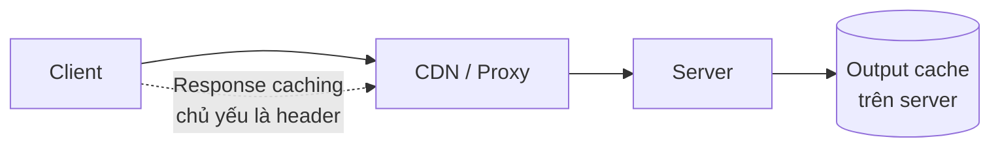

# 9.7 - Response Caching và Output Caching

> **Tóm tắt:** Hai cơ chế tên gần giống nhau nhưng hoạt động ở hai nơi khác nhau. **Response caching** chủ yếu **gửi header** `Cache-Control` để trình duyệt hoặc CDN giữ bản sao; server không chủ động xoá được bản sao đó. **Output caching** (.NET 7+) giữ bản sao **trên server** và **xoá được theo tag**: đặt TTL dài, xoá đúng lúc dữ liệu đổi. Cả hai đều mặc định **không** cache request đã đăng nhập, và đó là mặc định đúng: rủi ro lớn nhất của caching là **trả dữ liệu của người này cho người khác**. Bài này cũng sửa một hiểu lầm phổ biến: khoá output cache mặc định **đã gồm toàn bộ query string**; `SetVaryByQuery` dùng để **thu hẹp** khoá, và thu hẹp sai là trả sai dữ liệu.

## Mục tiêu bài học

Sau bài này bạn có thể:

- Phân biệt response caching và output caching, và chọn đúng.
- Cấu hình khoá cache (`VaryBy...`) để không trộn dữ liệu giữa các bộ lọc và giữa người dùng.
- Xoá cache theo tag khi dữ liệu thay đổi.
- Dùng ETag để tiết kiệm băng thông.
- Nhận ra khi nào **không** nên cache.

**Cần biết trước:** [2.4 — HTTP/HTTPS](../../stage-01-foundation/module-02-computer-science-basics/2.4-http-https.md) (`Cache-Control`, `ETag`), [8.2 — Request pipeline và middleware](../module-08-aspnet-core-fundamentals/8.2-request-pipeline-and-middleware.md), [9.4 — Pagination, Filtering, Sorting](9.4-pagination-filtering-sorting.md). Phần dữ liệu theo người dùng nhắc tới đăng nhập (`[Authorize]`, `User`), học kỹ ở [Module 10](../module-10-authentication-authorization/README.md).

## Nội dung bài học

### 9.7.1 — Hai cơ chế, hai nơi



| | Response caching | Output caching |
|---|---|---|
| Bản sao nằm ở | Trình duyệt, CDN, proxy (và bộ nhớ server nếu bật middleware) | **Server** |
| Cache request có `Authorization` | Middleware phía server: **không** | Mặc định: **không**; muốn thì tự viết policy (mục 9.7.3) |
| Xoá chủ động được | **Không** | **Có, theo tag** |
| Giảm tải cho server | Có (nếu client tuân thủ) | Có (chắc chắn) |
| Giảm băng thông | **Có** | Không |
| Có từ | ASP.NET Core 1.0 | .NET 7 |

`[ResponseCache]` đặt header, ví dụ:

```http
Cache-Control: public,max-age=60
```

Rồi trông vào trình duyệt, CDN hay proxy ở giữa tôn trọng nó. Middleware `UseResponseCaching()` thêm một tầng cache trong bộ nhớ server, nhưng nó **bỏ qua** request có header `Authorization`, vì cache dùng chung một response của người đã đăng nhập là lỗ hổng bảo mật. Đây là lý do nhiều người thấy middleware response caching "không hoạt động": API của họ có xác thực.

### 9.7.2 — Response caching

```csharp
// Program.cs
builder.Services.AddResponseCaching();
// ...
app.UseResponseCaching();     // đặt TRƯỚC UseOutputCache nếu dùng cả hai
```

```csharp
// Dữ liệu công khai, ít thay đổi
[HttpGet("countries")]
[ResponseCache(Duration = 3600, Location = ResponseCacheLocation.Any)]
public ActionResult<IEnumerable<CountryDto>> GetCountries() => Ok(countries);

// Dữ liệu riêng tư — KHÔNG cache ở đâu cả
[HttpGet("me")]
[ResponseCache(NoStore = true, Location = ResponseCacheLocation.None)]
public ActionResult<ProfileDto> GetProfile() => Ok(LoadProfile());
```

`Location` quyết định ai được giữ bản sao (header lấy từ lần chạy thật):

| `Location` | Header sinh ra | Ai cache |
|---|---|---|
| `Any` | `Cache-Control: public,max-age=60` | Trình duyệt **và** CDN/proxy |
| `Client` | `Cache-Control: private,max-age=60` | **Chỉ** trình duyệt của người dùng đó |
| `None` + `NoStore = true` | `Cache-Control: no-store,no-cache` | Không ai |

**Quy tắc sống còn:** dữ liệu gắn với người dùng thì `Location = Client` hoặc `None`, không bao giờ `Any`. Một CDN cache response `public` chứa thông tin cá nhân sẽ **trả nó cho người tiếp theo** hỏi cùng URL (Bài 2 tái hiện bằng Nginx).

```csharp
// SAI — CDN sẽ phục vụ dữ liệu của người này cho người khác
[ResponseCache(Duration = 60, Location = ResponseCacheLocation.Any)]
[Authorize]
public ActionResult<CustomerDto> GetMyCustomer() => Ok(LoadMyCustomer());
```

`[ResponseCache]` vẫn có tác dụng ngay cả khi bạn không bật middleware: nó gửi header cho trình duyệt và CDN.

### 9.7.3 — Output caching

```csharp
// Program.cs
builder.Services.AddOutputCache(options =>
{
    options.AddBasePolicy(b => b.Expire(TimeSpan.FromSeconds(10)));

    options.AddPolicy("customers-list", b => b
        .Expire(TimeSpan.FromMinutes(2))
        .Tag("customers"));
});

var app = builder.Build();

app.UseAuthentication();
app.UseAuthorization();
app.UseOutputCache();     // sau xác thực và routing, trước MapControllers
app.MapControllers();
```

```csharp
[HttpGet]
[OutputCache(PolicyName = "customers-list")]
public async Task<ActionResult<PagedResponse<CustomerDto>>> GetAll(
    [FromQuery] CustomerFilterRequest request, CancellationToken ct)
{
    // như bài 9.4
}
```

**Khoá cache mặc định đã gồm scheme, host, port, đường dẫn và toàn bộ query string.** `?page=1` và `?page=2` tự có hai bản cache riêng mà không cần cấu hình gì. `SetVaryByQuery("page", "pageSize")` làm điều ngược lại với cái tên gợi ý: nó **chỉ giữ** các tham số được liệt kê trong khoá và bỏ phần còn lại. Dùng nó để loại tham số rác như `?utm_source=...`; liệt kê thiếu một tham số ảnh hưởng tới kết quả thì hai bộ lọc khác nhau dùng chung một bản cache (Bài 1).

**Policy mặc định không cache mọi thứ.** Nó chỉ cache khi:

- method là `GET` hoặc `HEAD`,
- request **không** có header `Authorization` và người dùng chưa đăng nhập,
- response có mã `200` và không có `Set-Cookie`.

Chạy thử một endpoint `[Authorize]` gắn `[OutputCache(Duration = 60)]`: ba lần gọi với token thì action chạy cả ba lần, không lần nào lấy từ cache. Viết `.SetVaryByHeader("Authorization")` cũng không đổi được điều đó.

**Muốn cache theo từng người dùng** thì phải viết policy riêng (lớp cài `IOutputCachePolicy`) và tự đưa user id vào khoá. Làm sai ở đây là rò rỉ dữ liệu, nên chỉ làm khi đã đo được lợi ích:

```csharp
// Caching/PerUserCachePolicy.cs
using System.Security.Claims;
using Microsoft.AspNetCore.OutputCaching;
using Microsoft.Extensions.Primitives;

public sealed class PerUserCachePolicy : IOutputCachePolicy
{
    public ValueTask CacheRequestAsync(OutputCacheContext context, CancellationToken ct)
    {
        var request = context.HttpContext.Request;
        var userId = context.HttpContext.User.FindFirstValue(ClaimTypes.NameIdentifier);
        var cacheable = userId is not null
                        && (HttpMethods.IsGet(request.Method) || HttpMethods.IsHead(request.Method));

        context.EnableOutputCaching = true;
        context.AllowCacheLookup = cacheable;
        context.AllowCacheStorage = cacheable;
        context.AllowLocking = true;
        context.ResponseExpirationTimeSpan = TimeSpan.FromMinutes(5);
        context.CacheVaryByRules.QueryKeys = "*";
        context.CacheVaryByRules.VaryByValues["uid"] = userId ?? "";   // KHOÁ CÓ USER ID
        return ValueTask.CompletedTask;
    }

    public ValueTask ServeFromCacheAsync(OutputCacheContext context, CancellationToken ct)
        => ValueTask.CompletedTask;

    public ValueTask ServeResponseAsync(OutputCacheContext context, CancellationToken ct)
    {
        var response = context.HttpContext.Response;
        // Giống policy mặc định: không lưu response có Set-Cookie hoặc mã khác 200
        if (!StringValues.IsNullOrEmpty(response.Headers.SetCookie)
            || response.StatusCode != StatusCodes.Status200OK)
            context.AllowCacheStorage = false;
        return ValueTask.CompletedTask;
    }
}
```

```csharp
// Program.cs, trong AddOutputCache(options => { ... })
options.AddPolicy("per-user", new PerUserCachePolicy());
```

Chạy thật với endpoint `[Authorize] [OutputCache(PolicyName = "per-user")]` trả về số lần action đã chạy:

```text
an   -> {"user":"an","calls":1}
an   -> {"user":"an","calls":1}     <- lấy từ cache của an
binh -> {"user":"binh","calls":2}   <- bản cache riêng của binh
binh -> {"user":"binh","calls":2}
```

Cách dễ hơn `OutputCachePolicyBuilder` là `AddPolicy("...", b => ..., excludeDefaultPolicy: true)` kèm `.Cache()` và `.VaryByValue(...)`: chạy thử thì **vẫn không cache** gì, vì bỏ policy mặc định nghĩa là không ai bật `AllowCacheLookup`/`AllowCacheStorage`.

`UseOutputCache` phải đứng **sau** `UseAuthentication`, nếu không `User` luôn là ẩn danh lúc policy chạy.

### 9.7.4 — Xoá cache theo tag

Đây là lý do chính để chọn output caching:

```csharp
[HttpPost]
public async Task<ActionResult<CustomerDto>> Create(
    CreateCustomerRequest request,
    [FromServices] IOutputCacheStore cache,
    CancellationToken ct)
{
    var customer = new Customer { Name = request.Name, Email = request.Email, CreatedAt = DateTime.UtcNow };
    db.Customers.Add(customer);
    await db.SaveChangesAsync(ct);

    await cache.EvictByTagAsync("customers", ct);    // mọi bản cache danh sách hết hạn

    return CreatedAtAction(nameof(GetById), new { id = customer.Id }, customer);
}
```

Không có cơ chế này, bạn phải chọn giữa "TTL ngắn, cache gần như vô dụng" và "TTL dài, người dùng thấy dữ liệu cũ". Với tag, bạn đặt TTL **dài** và xoá **chính xác** khi có thay đổi.

Nhớ xoá trong **mọi** đường ghi: `Create`, `Update`, `Delete`, import hàng loạt, và cả background job sửa dữ liệu. Sót một chỗ là sinh ra bug "thỉnh thoảng dữ liệu không cập nhật".

Một hạn chế quan trọng: kho output cache mặc định **nằm trong bộ nhớ một tiến trình**. Với nhiều instance, `EvictByTagAsync` chỉ xoá cache của **pod đang xử lý request đó**, các pod khác vẫn trả dữ liệu cũ. Đây là cùng một hạn chế với rate limiter ở [bài 9.6](9.6-rate-limiting.md). Microsoft có sẵn kho dùng Redis:

```bash
dotnet add package Microsoft.AspNetCore.OutputCaching.StackExchangeRedis
```

```csharp
builder.Services.AddStackExchangeRedisOutputCache(o =>
    o.Configuration = builder.Configuration.GetConnectionString("Redis"));
```

Redis và caching phân tán học kỹ ở Module 14.

### 9.7.5 — ETag: tiết kiệm băng thông

Cache trả lời "có cần chạy lại không". ETag trả lời "có cần **gửi lại** không". ETag là một chuỗi đại diện cho phiên bản dữ liệu; nguồn tốt nhất là một cột tự đổi mỗi lần bản ghi được cập nhật. Với PostgreSQL, Npgsql ánh xạ một property `uint` có `[Timestamp]` vào cột hệ thống `xmin` (mã giao dịch ghi bản ghi lần cuối), không cần thêm cột:

```csharp
// Data/Customer.cs — thêm property
using System.ComponentModel.DataAnnotations;

[Timestamp]
public uint Version { get; set; }      // PostgreSQL: cột hệ thống xmin
```

```csharp
[HttpGet("{id:int}")]
public async Task<IActionResult> GetById(int id, CancellationToken ct)
{
    var customer = await db.Customers.AsNoTracking().FirstOrDefaultAsync(c => c.Id == id, ct);
    if (customer is null) return NotFound();

    var etag = $"\"{customer.Version}\"";

    if (Request.Headers.IfNoneMatch == etag)
        return StatusCode(StatusCodes.Status304NotModified);

    Response.Headers.ETag = etag;
    return Ok(customer);
}
```

<details>
<summary>SQL Server</summary>

SQL Server dùng cột `rowversion`, EF Core ánh xạ vào `byte[]`:

```csharp
[Timestamp]
public byte[] RowVersion { get; set; } = [];
```

```csharp
var etag = $"\"{Convert.ToBase64String(customer.RowVersion)}\"";
```

Đừng viết `$"\"{customer.RowVersion}\""`: nội suy một mảng byte cho ra tên kiểu `System.Byte[]`, nên ETag **không bao giờ đổi** và client nhận `304` mãi dù dữ liệu đã cập nhật.

</details>

Lần sau client gửi `If-None-Match: "..."`, và nếu dữ liệu chưa đổi bạn trả **304 không kèm body**. Với response 200KB trên mạng di động, đó là khác biệt lớn.

Lưu ý: bạn vẫn phải **truy vấn database** để biết dữ liệu có đổi không. ETag tiết kiệm băng thông, không tiết kiệm tải database. Muốn tiết kiệm cả hai thì kết hợp với output caching. Cùng cột phiên bản đó còn dùng cho optimistic concurrency, xem [Module 13](../../stage-04-database-production/module-13-entity-framework-core/README.md).

### 9.7.6 — Khi nào không cache

| Tình huống | Vì sao |
|---|---|
| Dữ liệu cá nhân mà khoá cache không có user id | Rò rỉ giữa người dùng |
| Endpoint ghi (`POST`, `PUT`, `DELETE`) | Không có ý nghĩa; policy mặc định chỉ cache `GET` và `HEAD` |
| Dữ liệu phải đúng tuyệt đối | Số dư tài khoản, tồn kho lúc đặt hàng |
| Dữ liệu đổi nhanh hơn TTL | Cache chỉ tốn bộ nhớ mà tỷ lệ trúng gần 0 |
| Tham số gần như không lặp lại | Mỗi request một khoá cache mới |

Trường hợp cuối là cái bẫy tinh vi: cache một endpoint tìm kiếm với từ khoá tự do. Hầu như mọi từ khoá đều khác nhau, nên tỷ lệ trúng rất thấp, còn bộ nhớ thì phình lên. Đo tỷ lệ trúng trước khi giữ lại một cache.

Giới hạn kích thước có giá trị mặc định: `SizeLimit` (trần cho toàn bộ cache) là **100 MB**, `MaximumBodySize` (response lớn hơn thì không cache) là **64 MB**. Với API trả JSON vài chục KB, nên hạ xuống để một endpoint nhiều biến thể không chiếm hết phần bộ nhớ đó:

```csharp
builder.Services.AddOutputCache(options =>
{
    options.MaximumBodySize = 1 * 1024 * 1024;     // bỏ qua response lớn hơn 1 MB
    options.SizeLimit = 50 * 1024 * 1024;           // trần 50 MB cho toàn bộ cache
});
```

### 9.7.7 — Lỗi thường gặp

- **Hai bộ lọc khác nhau trả cùng kết quả.** `SetVaryByQuery` liệt kê thiếu tham số. Bỏ hẳn `SetVaryByQuery` (khoá gồm cả query string) hoặc liệt kê đủ.
- **Endpoint `[Authorize]` gắn `[OutputCache]` mà action vẫn chạy mỗi lần.** Policy mặc định không cache request đã đăng nhập; đó là chủ đích. Cần thì viết policy riêng như mục 9.7.3.
- **`OutputCachePolicyBuilder` không có `SetVaryByValue`.** Tên đúng là `VaryByValue`.
- **ETag không bao giờ đổi.** Nội suy `byte[]` thành chuỗi ra `System.Byte[]`; dùng `Convert.ToBase64String`.
- **Sửa dữ liệu xong vẫn thấy dữ liệu cũ trên một số máy.** Kho cache in-memory, nhiều instance; `EvictByTagAsync` chỉ xoá trên một pod.

**Danh sách rà soát caching**

- [ ] Không có endpoint dữ liệu cá nhân nào dùng `ResponseCacheLocation.Any`.
- [ ] `SetVaryByQuery`, nếu dùng, liệt kê đủ mọi tham số ảnh hưởng kết quả.
- [ ] Dữ liệu theo người dùng chỉ cache bằng policy có user id trong khoá, và đã được review.
- [ ] `UseOutputCache` đứng sau `UseAuthentication`.
- [ ] Cache được xoá theo tag trong MỌI đường ghi, kể cả background job.
- [ ] Biết rằng `EvictByTagAsync` chỉ xoá trên pod hiện tại nếu dùng kho in-memory.
- [ ] Endpoint dữ liệu lớn có ETag để tiết kiệm băng thông.
- [ ] `MaximumBodySize` và `SizeLimit` được cân nhắc lại thay vì để mặc định.
- [ ] Đã đo tỷ lệ trúng cache trước khi giữ lại một policy.
- [ ] Dữ liệu phải đúng tuyệt đối không được cache.

## Bài tập áp dụng

#### Bài 1 — Lọc "Inactive" lại thấy khách "Active"

Bật output cache cho `GET /api/customers` với `.SetVaryByQuery("page", "pageSize")`. Gọi `?status=Active` rồi `?status=Inactive` và xác nhận cả hai trả cùng nội dung. Sau đó bỏ `SetVaryByQuery` và gọi lại.

**Tiêu chí hoàn thành:** bạn nói được **khoá cache gồm những gì** trong hai trường hợp, và khi nào nên dùng `SetVaryByQuery`.

<details>
<summary><strong>Gợi ý và lời giải — Bài 1</strong></summary>

**Gợi ý.** Câu trả lời cho tiêu chí: khoá mặc định gồm scheme, host, port, đường dẫn và **toàn bộ** query string. `SetVaryByQuery("page", "pageSize")` thu khoá lại chỉ còn hai tham số đó, nên mọi giá trị `status` rơi vào cùng một ô.

**Lời giải — chính sách thu hẹp sai:**

```csharp
options.AddPolicy("customers-list", b => b
    .Expire(TimeSpan.FromMinutes(2))
    .SetVaryByQuery("page", "pageSize")      // THIẾU "status" (và "search"...)
    .Tag("customers"));
```

**Kiểm chứng** (dữ liệu mẫu có 2 khách Active và 2 khách Inactive; kết quả chạy thật):

```bash
curl -s 'localhost:5000/api/customers?status=Active'   | jq -c '[.items[].name]'
curl -s 'localhost:5000/api/customers?status=Inactive' | jq -c '[.items[].name]'
```

```text
["Công ty Minh Phát","Hộ kinh doanh Lan"]
["Công ty Minh Phát","Hộ kinh doanh Lan"]      <- lọc Inactive mà ra Y HỆT Active
```

Còn `?page=1` và `?page=2` vẫn đúng, vì `page` nằm trong danh sách. Đó là lý do lỗi này sống sót qua review và qua thử tay: chỉ bộ lọc bị quên mới sai, và chỉ từ request thứ hai trong cửa sổ 2 phút.

**Bỏ `SetVaryByQuery`** (khoá gồm cả query string):

```text
["Công ty Minh Phát","Hộ kinh doanh Lan"]
["Startup GreenTech","Tập đoàn Bắc Nam"]       <- đúng
```

**Khi nào dùng `SetVaryByQuery`.** Khi URL có tham số **không** ảnh hưởng kết quả, ví dụ `?utm_source=facebook` từ quảng cáo. Không thu hẹp khoá thì mỗi giá trị `utm_source` tạo một bản cache riêng (chạy thử: gọi thêm `?status=Inactive&utm_source=fb` thì action chạy thêm một lần), làm loãng tỷ lệ trúng. Với API nội bộ, để mặc định là an toàn hơn; với endpoint nhận lưu lượng từ quảng cáo thì liệt kê **đủ** tham số nghiệp vụ.

**Một bài kiểm thử chặn được lớp lỗi này** (cách viết integration test ở [bài 9.8](9.8-api-testing.md)):

```csharp
[Fact]
public async Task CustomerList_DifferentStatus_ReturnsDifferentData()
{
    var client = _factory.CreateClient();

    var active = await client.GetFromJsonAsync<PagedResponse<CustomerDto>>(
        "/api/customers?status=Active");
    var inactive = await client.GetFromJsonAsync<PagedResponse<CustomerDto>>(
        "/api/customers?status=Inactive");

    Assert.All(inactive!.Items, c => Assert.Equal("Inactive", c.Status));
    Assert.NotEqual(active!.Items[0].Id, inactive.Items[0].Id);
}
```

Chạy nó **với output cache đang bật**; nếu bộ test tắt cache thì nó không bắt được gì.

</details>

---

#### Bài 2 — Rò rỉ dữ liệu giữa hai người dùng

Đặt `[ResponseCache(Duration = 60, Location = ResponseCacheLocation.Any)]` trên endpoint trả hồ sơ cá nhân, đặt Nginx làm proxy cache ở giữa, và xác nhận người dùng thứ hai nhận dữ liệu của người thứ nhất.

**Tiêu chí hoàn thành:** bạn chỉ ra được **header nào** khiến proxy tin rằng nó được phép chia sẻ phản hồi đó.

<details>
<summary><strong>Gợi ý và lời giải — Bài 2</strong></summary>

**Gợi ý.** `Location = Any` dịch thành `Cache-Control: public`. Từ `public` có nghĩa rất cụ thể trong HTTP: *bất kỳ cache chung nào cũng được lưu và phục vụ lại cho người khác*.

**Lời giải — endpoint sai.** Để thử nhanh mà chưa cần xác thực thật (Module 10), endpoint đọc thẳng header `Authorization` để chọn hồ sơ; với `[Authorize]` và token thật kết quả y hệt, vì Nginx không nhìn vào token:

```csharp
[HttpGet("/api/me/profile")]
[ResponseCache(Duration = 60, Location = ResponseCacheLocation.Any)]
public IActionResult GetMyProfile()
{
    var who = Request.Headers.Authorization.ToString().Replace("Bearer ", "");
    return Ok(who == "an"
        ? new { name = "Nguyễn Văn An", email = "an@company.com", salary = 25000000 }
        : new { name = "Trần Thị Bình", email = "binh@company.com", salary = 18000000 });
}
```

Header trả về:

```http
HTTP/1.1 200 OK
Cache-Control: public,max-age=60
```

**Dòng đó chính là câu trả lời cho tiêu chí.** Không có `private`, không có `Vary`: proxy hiểu là "ai hỏi cũng đưa bản này".

**Dựng proxy để kiểm chứng** — file `nginx.conf`:

```nginx
proxy_cache_path /tmp/cache keys_zone=demo:10m;

server {
    listen 8080;
    location /api/ {
        proxy_cache demo;
        proxy_pass http://host.docker.internal:5000;
        add_header X-Cache-Status $upstream_cache_status;
    }
}
```

Chạy Nginx bằng Docker (API chạy trên máy ở cổng 5000 với `--urls http://0.0.0.0:5000`; Git Bash trên Windows thêm `MSYS_NO_PATHCONV=1` và dùng `$(pwd -W)`):

```bash
docker run -d --rm --name demo-nginx -p 8080:8080 \
  -v "$(pwd)/nginx.conf:/etc/nginx/conf.d/default.conf:ro" nginx:1.27

curl -s -D - -H "Authorization: Bearer an"   http://localhost:8080/api/me/profile
curl -s -D - -H "Authorization: Bearer binh" http://localhost:8080/api/me/profile
```

Kết quả chạy thật (rút gọn header):

```text
X-Cache-Status: MISS
{"name":"Nguyễn Văn An","email":"an@company.com","salary":25000000}

X-Cache-Status: HIT
{"name":"Nguyễn Văn An","email":"an@company.com","salary":25000000}
```

Bình gửi token của Bình và nhận **hồ sơ của An**, kèm cả lương. Ứng dụng không hề nhận request thứ hai, Nginx trả lời thay.

**Vì sao đây là lỗi dễ mắc.** Tên các giá trị `ResponseCacheLocation` không gợi ý gì về rủi ro. Người viết code thường đọc `Any` là "cho phép cache ở bất cứ tầng nào cho tiện", chứ không đọc là "cho phép người lạ đọc dữ liệu này".

**Ba cách sửa, theo thứ tự an toàn:**

```csharp
// 1. AN TOÀN NHẤT — dữ liệu cá nhân thì đừng cache chung
[ResponseCache(NoStore = true, Location = ResponseCacheLocation.None)]

// 2. Cache ở trình duyệt của chính người đó — header private, Nginx không lưu
[ResponseCache(Duration = 60, Location = ResponseCacheLocation.Client)]

// 3. Cần cache phía server thì dùng output cache với PerUserCachePolicy (mục 9.7.3)
[OutputCache(PolicyName = "per-user")]
```

**Vì sao cách 3 khoá theo user id chứ không theo token.** Khoá theo header `Authorization` tạo **một bản cache cho mỗi token**. Token đổi sau mỗi lần refresh, nên với refresh 15 phút một lần, mỗi người dùng sinh ra 96 bản cache mỗi ngày: cache phình lên mà tỷ lệ trúng rất thấp. User id lấy từ claim thì ổn định.

**Quy tắc một câu:** `public` chỉ dành cho phản hồi mà bạn sẵn lòng dán lên trang chủ.

</details>

---

#### Bài 3 — Đo ETag tiết kiệm được gì, và không tiết kiệm được gì

Cài ETag cho `GET /api/customers/{id}` trên một khách hàng có ghi chú dài (response khoảng 200KB), gọi hai lần và so sánh số byte truyền đi. Bật log EF Core và đếm số truy vấn. Sửa tên khách hàng rồi gọi lại với ETag cũ.

**Tiêu chí hoàn thành:** bạn nêu được **một** thứ ETag tiết kiệm và **một** thứ nó không tiết kiệm, và chứng minh ETag đổi sau khi sửa dữ liệu.

<details>
<summary><strong>Gợi ý và lời giải — Bài 3</strong></summary>

**Gợi ý.** Để tính được ETag, server phải biết dữ liệu hiện tại là gì. Hãy nghĩ xem điều đó bắt buộc nó phải làm gì trước.

**Lời giải — cài đặt** là action `GetById` ở mục 9.7.5. Bật log SQL bằng `LogTo` khi đăng ký `DbContext`:

```csharp
builder.Services.AddDbContext<CrmDbContext>(o => o
    .UseNpgsql(builder.Configuration.GetConnectionString("Crm"))
    .LogTo(Console.WriteLine, [DbLoggerCategory.Database.Command.Name], LogLevel.Information));
```

**Đo hai lần gọi:**

```bash
curl -s -o /dev/null -D h1.txt -w 'lan 1: %{http_code} %{size_download} byte\n' \
  localhost:5000/api/customers/5

ETAG=$(grep -i '^etag:' h1.txt | cut -d' ' -f2 | tr -d '\r')

curl -s -o /dev/null -w 'lan 2: %{http_code} %{size_download} byte\n' \
  -H "If-None-Match: $ETAG" localhost:5000/api/customers/5
```

```text
lan 1: 200 200121 byte
lan 2: 304 0 byte
```

**Thứ ETag tiết kiệm: băng thông.** 200.121 byte xuống 0.

**Thứ ETag không tiết kiệm: tải database.** Log có **một truy vấn cho mỗi lần gọi**, kể cả lần trả `304`:

```text
Executed DbCommand (2ms) [Parameters=[@id='?' (DbType = Int32)], CommandType='Text', CommandTimeout='30']
SELECT c."Id", c."CreatedAt", c."Email", c."Name", c."Notes", c."Status", c.xmin
FROM "Customers" AS c
WHERE c."Id" = @id
```

Lần thứ hai vẫn chạy đủ: nhận request, truy vấn database (kéo cả cột `Notes` 200KB), tính ETag, rồi mới phát hiện không đổi và trả 304 rỗng. Chi phí phía server giữ nguyên; chỉ phần truyền dữ liệu biến mất. Chỗ `c.xmin` trong câu SQL là property `Version`.

**ETag đổi khi dữ liệu đổi:**

```bash
curl -s -X PUT localhost:5000/api/customers/5/name -H "Content-Type: application/json" -d '"Khach 5 moi"'
curl -s -o /dev/null -w '%{http_code} %{size_download} byte\n' -H "If-None-Match: $ETAG" localhost:5000/api/customers/5
# 200 200124 byte      <- ETag cũ "7322" không còn khớp, ETag mới là "7326"
```

**Bảng phân vai:**

| | Tải database | Byte truyền | Độ mới của dữ liệu |
|---|---|---|---|
| ETag | Không giảm | **Giảm về 0** | Luôn đúng |
| Output cache | **Giảm về 0** trong TTL | Không giảm | Cũ tối đa bằng TTL |
| Cả hai | **Giảm** | **Giảm** | Cũ tối đa bằng TTL |

**Hai chi tiết làm hỏng ETag trong thực tế:**

1. **Sinh ETag bằng cách băm JSON đã tuần tự hoá** thì vẫn phải truy vấn **và** phải tuần tự hoá, tốn hơn cả việc trả thẳng. Dùng cột phiên bản (`xmin` của PostgreSQL, `rowversion` của SQL Server), vì nó đổi mỗi lần bản ghi được ghi và lấy ra không tốn gì thêm.
2. **`If-None-Match` có thể chứa nhiều giá trị** (`"a", "b"`) và tiền tố `W/` cho weak ETag. So sánh bằng `==` với một chuỗi duy nhất sẽ trượt trong những trường hợp đó, và bạn lặng lẽ mất hết lợi ích mà không ai biết. Tách chuỗi rồi so từng phần tử.

</details>

## Tự kiểm tra

<details>
<summary>Response caching và output caching khác nhau thế nào?</summary>

Response caching chủ yếu gửi header `Cache-Control` để trình duyệt hoặc CDN giữ bản sao, server không xoá được bản sao đó. Output caching giữ bản sao trên server và xoá được theo tag. Cả hai mặc định đều không cache request đã đăng nhập.

</details>

<details>
<summary>Không gọi SetVaryByQuery thì ?page=1 và ?page=2 có dùng chung cache không?</summary>

Không. Khoá mặc định đã gồm toàn bộ query string. `SetVaryByQuery` dùng để thu hẹp khoá xuống chỉ các tham số được liệt kê; liệt kê thiếu tham số lọc thì hai bộ lọc khác nhau dùng chung cache.

</details>

<details>
<summary>Vì sao gắn [OutputCache] lên endpoint [Authorize] mà action vẫn chạy mỗi lần?</summary>

Policy mặc định của output cache không cache request có header `Authorization` hoặc người dùng đã đăng nhập, để tránh rò rỉ dữ liệu. Muốn cache theo người dùng phải viết `IOutputCachePolicy` riêng, bật `AllowCacheLookup`/`AllowCacheStorage` và đưa user id vào khoá.

</details>

<details>
<summary>ResponseCacheLocation.Any nguy hiểm khi nào?</summary>

Khi dùng cho dữ liệu gắn với người dùng. Nó sinh header `public` nên CDN hoặc proxy sẽ giữ bản sao và trả nó cho người tiếp theo hỏi cùng URL; Bài 2 tái hiện bằng Nginx. Dữ liệu cá nhân phải dùng `Location.Client`, hoặc `None` nếu nhạy cảm.

</details>

<details>
<summary>Xoá cache theo tag giải quyết vấn đề gì, và hạn chế ở đâu?</summary>

Không có nó, bạn phải chọn giữa TTL ngắn khiến cache gần như vô dụng và TTL dài khiến người dùng thấy dữ liệu cũ. Với tag thì đặt TTL dài và xoá chính xác khi có thay đổi. Hạn chế: kho mặc định nằm trong bộ nhớ một tiến trình nên chỉ xoá trên pod hiện tại; nhiều instance thì dùng kho Redis.

</details>

<details>
<summary>ETag khác caching ở điểm nào?</summary>

Cache trả lời "có cần chạy lại không", còn ETag trả lời "có cần gửi lại không". Client gửi `If-None-Match` và nếu dữ liệu chưa đổi thì server trả 304 không kèm body. Nó tiết kiệm băng thông nhưng vẫn phải truy vấn database để biết dữ liệu có đổi hay không.

</details>

## Kết luận

Ba điều đáng nhớ nhất:

1. **Response caching là header cho tầng khác giữ bản sao**; output caching giữ bản sao trên server và xoá được theo tag.
2. **Khoá output cache mặc định đã gồm query string.** `SetVaryByQuery` thu hẹp khoá, thiếu tham số là bug trả sai dữ liệu.
3. **Dữ liệu theo người dùng mặc định không được cache**, và đó là điều tốt. Cache nó thì khoá phải có user id.

## Tham khảo

- [Output caching middleware in ASP.NET Core](https://learn.microsoft.com/en-us/aspnet/core/performance/caching/output)
- [Response caching in ASP.NET Core](https://learn.microsoft.com/en-us/aspnet/core/performance/caching/response)
- [Overview of caching in ASP.NET Core](https://learn.microsoft.com/en-us/aspnet/core/performance/caching/overview)
- [Npgsql — Concurrency tokens (xmin)](https://www.npgsql.org/efcore/modeling/concurrency.html)
- [RFC 9111 — HTTP Caching](https://www.rfc-editor.org/rfc/rfc9111.html)

## Điều hướng

- **Bài trước:** [9.6 — Rate Limiting (.NET 7+)](9.6-rate-limiting.md)
- **Bài tiếp theo:** [9.8 — API Testing](9.8-api-testing.md)
- **Về module:** [Trang mục lục](README.md)
