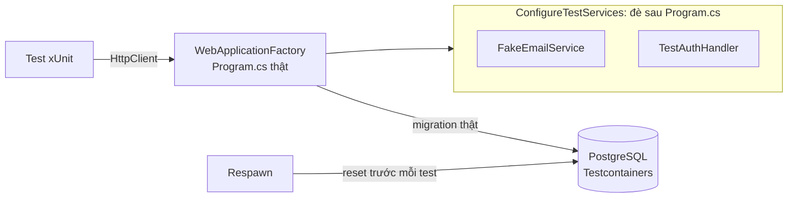

# 9.8 - API Testing

> **Tóm tắt:** `WebApplicationFactory` dựng **toàn bộ ứng dụng trong bộ nhớ** và cho bạn một `HttpClient` gọi vào nó: không mở cổng, không cần chạy server, nhưng **đi qua đầy đủ** pipeline: routing, model binding, validation, filter, middleware. Đó là điểm ngọt giữa unit test và test end-to-end. Cạm bẫy lớn nhất là **`UseInMemoryDatabase`**: nó không phải database quan hệ, nó **không có ràng buộc, không có transaction thật, không dịch SQL**, nên test xanh trong khi production đỏ. Nếu code chạm tới database, hãy test trên **database thật** bằng Testcontainers.

## Mục tiêu bài học

Sau bài này bạn có thể:

- Dựng `WebApplicationFactory` và thay thế service cho môi trường test.
- Liệt kê những gì InMemory provider không phát hiện được.
- Chạy test trên PostgreSQL thật bằng Testcontainers, kể cả migration.
- Cô lập dữ liệu giữa các test bằng Respawn.
- Bỏ qua xác thực trong test mà không tắt phân quyền.

**Cần biết trước:** [0.4 — Solution, thư viện và unit test](../../stage-01-foundation/module-00-setup/0.4-solution-and-unit-test.md) (project xUnit, `[Fact]`, `Assert`), [7.4 — Service lifetimes](../../stage-02-csharp-professional/module-07-dependency-injection/7.4-service-lifetimes.md), [8.10 — EF Core tối thiểu](../module-08-aspnet-core-fundamentals/8.10-ef-core-minimal.md) (migration). Phần 9.8.4 trở đi cần **Docker** đang chạy: Testcontainers tự tải và khởi động container PostgreSQL, bạn không phải gõ lệnh Docker nào. Phần xác thực dùng khái niệm role và `[Authorize]` của [Module 10](../module-10-authentication-authorization/README.md); đọc lướt nếu chưa học.

## Nội dung bài học

### 9.8.1 — Ba tầng test

| Tầng | Test cái gì | Tốc độ | Số lượng |
|---|---|---|---|
| **Unit** | Một lớp, mọi phụ thuộc là bản giả | Mili giây | Nhiều |
| **Integration** | API qua `WebApplicationFactory` | Chục–trăm mili giây | Vừa |
| **End-to-end** | Hệ thống thật đã triển khai | Giây | Ít |

Integration test là tầng **đáng đầu tư nhất** cho một Web API, vì nó bắt được đúng những lỗi mà unit test bỏ sót: sai route, binding không như mong đợi, validation không chạy, thứ tự middleware sai, DI thiếu đăng ký, serialization JSON khác dự kiến.

Ví dụ trong bài dùng API khách hàng: `Customer` như [bài 8.10](../module-08-aspnet-core-fundamentals/8.10-ef-core-minimal.md) cộng unique index trên `Email`, controller `CustomersController` có `GetById`, `Create` (trả `409` khi trùng email, gửi email chào mừng qua `IEmailService`) và `Delete` chỉ cho role `Admin`.

### 9.8.2 — `WebApplicationFactory`

Tạo project test và tham chiếu tới project API:

```bash
dotnet new xunit -n CrmApi.Tests
cd CrmApi.Tests
dotnet add reference ../CrmApi
dotnet add package Microsoft.AspNetCore.Mvc.Testing
```

```csharp
// CrmApi.Tests/FakeEmailService.cs
public sealed class FakeEmailService : IEmailService
{
    public List<string> Sent { get; } = [];

    public Task SendWelcomeAsync(string email, CancellationToken ct)
    {
        Sent.Add(email);            // không gửi thật, chỉ ghi lại để test kiểm tra
        return Task.CompletedTask;
    }
}
```

```csharp
// CrmApi.Tests/CrmApiFactory.cs
using Microsoft.AspNetCore.Hosting;
using Microsoft.AspNetCore.Mvc.Testing;
using Microsoft.AspNetCore.TestHost;
using Microsoft.Extensions.DependencyInjection;
using Microsoft.Extensions.DependencyInjection.Extensions;

public sealed class CrmApiFactory : WebApplicationFactory<Program>
{
    public FakeEmailService Email { get; } = new();

    protected override void ConfigureWebHost(IWebHostBuilder builder)
    {
        builder.UseEnvironment("Testing");

        builder.ConfigureTestServices(services =>
        {
            // Thay dịch vụ bên ngoài bằng bản giả
            services.RemoveAll<IEmailService>();
            services.AddSingleton<IEmailService>(Email);
        });
    }
}
```

- `WebApplicationFactory<Program>` chạy đúng `Program.cs` của API. Từ .NET 10, lớp `Program` sinh từ top-level statements đã là `public`, nên test project dùng được ngay; dự án cũ (.NET 9 trở về trước) phải thêm dòng `public partial class Program;` vào cuối `Program.cs`.
- `ConfigureTestServices` chạy **sau** mọi đăng ký trong `Program.cs`, nên đăng ký của test đè lên được. Với ứng dụng kiểu `WebApplication` (.NET 6+), `builder.ConfigureServices(...)` trong factory **cũng** chạy sau `Program.cs`; khác biệt chỉ lộ ra với ứng dụng kiểu cũ có lớp `Startup`, nơi `ConfigureServices` của factory chạy **trước** `Startup.ConfigureServices` và bị ghi đè. Dùng `ConfigureTestServices` cho rõ ý và an toàn với cả hai kiểu.
- `RemoveAll<T>()` sạch hơn tìm `ServiceDescriptor` thủ công, nhất là khi một interface được đăng ký nhiều lần.

### 9.8.3 — `UseInMemoryDatabase` nói dối

Đây là lời khuyên phổ biến nhất và cũng gây hại nhất trong testing .NET:

```csharp
services.AddDbContext<CrmDbContext>(o => o.UseInMemoryDatabase("Test"));
```

InMemory provider **không phải** database quan hệ. Nó là một kho object trong bộ nhớ biết LINQ. Những gì nó **không** phát hiện:

| Không phát hiện | Hậu quả trên production |
|---|---|
| Ràng buộc unique | Trùng email lọt qua test, nổ khi chạy thật |
| Khoá ngoại | Xoá bản ghi còn tham chiếu vẫn qua |
| `NOT NULL`, độ dài cột | Chuỗi 500 ký tự vào cột `varchar(200)` |
| Truy vấn không dịch được sang SQL | Test xanh, production ném `InvalidOperationException` |
| Quy tắc so sánh chuỗi của database | Kết quả lọc theo chuỗi khác giữa test và production |
| Transaction và concurrency thật | Optimistic concurrency không bao giờ được test |
| Kiểu dữ liệu, độ chính xác `decimal` | Làm tròn khác nhau |

Dòng thứ tư nguy hiểm nhất: EF Core dịch truy vấn **khác nhau** cho mỗi provider. Một truy vấn chạy tốt với InMemory có thể không dịch được sang SQL và ném exception lúc chạy, đúng thứ mà test lẽ ra phải bắt.

Chính tài liệu EF Core cũng khuyến cáo **không** dùng InMemory để test code chạm database. Bài 1 chứng minh bằng một test thật.

### 9.8.4 — Testcontainers: database thật

*Testcontainers* là thư viện khởi động container Docker từ code test và huỷ nó khi xong.

```bash
dotnet add package Testcontainers.PostgreSql
dotnet add package Respawn
```

```csharp
// CrmApi.Tests/CrmApiFactory.cs — bản đầy đủ
using Microsoft.AspNetCore.Authentication;
using Microsoft.AspNetCore.Hosting;
using Microsoft.AspNetCore.Mvc.Testing;
using Microsoft.AspNetCore.TestHost;
using Microsoft.EntityFrameworkCore;
using Microsoft.EntityFrameworkCore.Infrastructure;
using Microsoft.Extensions.DependencyInjection;
using Microsoft.Extensions.DependencyInjection.Extensions;
using Npgsql;
using Respawn;
using Testcontainers.PostgreSql;

public sealed class CrmApiFactory : WebApplicationFactory<Program>, IAsyncLifetime
{
    private readonly PostgreSqlContainer _db = new PostgreSqlBuilder()
        .WithImage("postgres:16-alpine")
        .Build();

    private NpgsqlConnection _connection = null!;
    private Respawner _respawner = null!;

    public FakeEmailService Email { get; } = new();

    public async Task InitializeAsync()
    {
        await _db.StartAsync();

        // Lần đầu dùng Services, ứng dụng được dựng với ConfigureWebHost bên dưới
        using (var scope = Services.CreateScope())
        {
            var ctx = scope.ServiceProvider.GetRequiredService<CrmDbContext>();
            await ctx.Database.MigrateAsync();              // chạy migration THẬT
        }

        // Respawn xoá dữ liệu mọi bảng, giữ nguyên cấu trúc
        _connection = new NpgsqlConnection(_db.GetConnectionString());
        await _connection.OpenAsync();
        _respawner = await Respawner.CreateAsync(_connection, new RespawnerOptions
        {
            DbAdapter = DbAdapter.Postgres,
            SchemasToInclude = ["public"],
            TablesToIgnore = ["__EFMigrationsHistory"]
        });
    }

    public Task ResetDatabaseAsync() => _respawner.ResetAsync(_connection);

    protected override void ConfigureWebHost(IWebHostBuilder builder)
    {
        builder.UseEnvironment("Testing");

        builder.ConfigureTestServices(services =>
        {
            // Bỏ cấu hình DbContext của Program.cs. Từ EF Core 9, lambda UseNpgsql(...)
            // của Program.cs nằm trong IDbContextOptionsConfiguration, phải xoá cả nó.
            services.RemoveAll<DbContextOptions<CrmDbContext>>();
            services.RemoveAll<IDbContextOptionsConfiguration<CrmDbContext>>();
            services.AddDbContext<CrmDbContext>(o => o.UseNpgsql(_db.GetConnectionString()));

            services.RemoveAll<IEmailService>();
            services.AddSingleton<IEmailService>(Email);

            // Xác thực giả cho test, xem mục 9.8.6
            services.AddAuthentication(defaultScheme: "Test")
                .AddScheme<AuthenticationSchemeOptions, TestAuthHandler>("Test", _ => { });
        });
    }

    public new async Task DisposeAsync()
    {
        await _connection.DisposeAsync();
        await _db.DisposeAsync();
        await base.DisposeAsync();
    }
}
```

<details>
<summary>SQL Server</summary>

```bash
dotnet add package Testcontainers.MsSql
```

```csharp
private readonly MsSqlContainer _db = new MsSqlBuilder()
    .WithImage("mcr.microsoft.com/mssql/server:2022-latest")
    .Build();

// trong ConfigureTestServices
services.AddDbContext<CrmDbContext>(o => o.UseSqlServer(_db.GetConnectionString()));

// Respawn 7 nhận một kết nối đang mở (SqlConnection thay cho NpgsqlConnection)
_connection = new SqlConnection(_db.GetConnectionString());     // using Microsoft.Data.SqlClient;
await _connection.OpenAsync();
_respawner = await Respawner.CreateAsync(_connection, new RespawnerOptions
{
    DbAdapter = DbAdapter.SqlServer,
    TablesToIgnore = ["__EFMigrationsHistory"]
});
```

Container phải cùng loại với database của `Program.cs`: migration sinh cho SQL Server không chạy được trên PostgreSQL và ngược lại.

</details>

Testcontainers khởi động một container PostgreSQL thật, chạy migration thật, và huỷ nó khi xong. Trên máy đã có sẵn image, toàn bộ bộ test trong bài (10 test, gồm khởi động container) chạy hết khoảng 7 giây; lần đầu lâu hơn vì phải tải image.

Lợi ích vượt xa chi phí đó: **migration được test**, ràng buộc được test, truy vấn được dịch thật sự. Một migration lỗi bị phát hiện trong CI thay vì lúc deploy.

**Vì sao phải xoá `IDbContextOptionsConfiguration`.** Từ EF Core 9, `AddDbContext` lưu lambda cấu hình vào service `IDbContextOptionsConfiguration<CrmDbContext>`, và mọi lambda đăng ký đều được áp dụng. Chỉ xoá `DbContextOptions<CrmDbContext>` thì cấu hình `UseNpgsql(...)` của `Program.cs` vẫn chạy. Cùng provider thì lambda sau đè chuỗi kết nối nên trông như vẫn chạy; khác provider (ví dụ test thử với SQLite) thì mọi test đỏ với lỗi thật sau:

```text
System.InvalidOperationException : Services for database providers 'Npgsql.EntityFrameworkCore.PostgreSQL', 'Microsoft.EntityFrameworkCore.Sqlite' have been registered in the service provider. Only a single database provider can be registered in a service provider.
```

Chia sẻ container cho cả bộ test bằng `ICollectionFixture` để không khởi động lại mỗi lớp test:

```csharp
// CrmApi.Tests/ApiCollection.cs
[CollectionDefinition("api")]
public sealed class ApiCollection : ICollectionFixture<CrmApiFactory>;
```

Lớp test gắn `[Collection("api")]` nhận chung một `CrmApiFactory`. Test trong cùng collection chạy **lần lượt**, không song song.

### 9.8.5 — Cô lập dữ liệu giữa các test

Test dùng chung một database sẽ ảnh hưởng lẫn nhau: một test tạo khách hàng, test đếm ở lớp khác thất bại, và chỉ thất bại khi chạy **cùng nhau**, không khi chạy riêng (Bài 2 tái hiện).

**Respawn** đặt lại database về trạng thái sạch trước mỗi test:

```csharp
// CrmApi.Tests/CustomerApiTests.cs
using System.Net;
using System.Net.Http.Json;

[Collection("api")]
public sealed class CustomerApiTests(CrmApiFactory factory) : IAsyncLifetime
{
    private readonly HttpClient _client = factory.CreateClient();

    public Task InitializeAsync() => factory.ResetDatabaseAsync();   // chạy trước MỖI test
    public Task DisposeAsync() => Task.CompletedTask;

    [Fact]
    public async Task Create_WithDuplicateEmail_Returns409()
    {
        var request = new CreateCustomerRequest("Nguyen Van A", "a@example.com");

        var first  = await _client.PostAsJsonAsync("/api/customers", request);
        var second = await _client.PostAsJsonAsync("/api/customers", request);

        Assert.Equal(HttpStatusCode.Created, first.StatusCode);
        Assert.Equal(HttpStatusCode.Conflict, second.StatusCode);
    }
}
```

xUnit tạo một instance mới của lớp test cho **mỗi** test, nên `InitializeAsync` của `IAsyncLifetime` chạy trước từng test. Bài test này là ví dụ đúng cho lý do dùng database thật: với InMemory, **cả hai** request đều trả `201` vì không có ràng buộc unique.

Hai cách cô lập khác: mỗi test một transaction rồi rollback (nhanh hơn nhưng không dùng được khi đi qua `HttpClient`, vì mỗi request có `DbContext` riêng), hoặc mỗi test một database riêng (sạch nhất nhưng chậm).

### 9.8.6 — Xác thực trong test

Đừng tắt `[Authorize]`: tắt là bạn **không** test được phân quyền, và đó chính là thứ cần test nhất.

Thay vào đó, thêm một authentication scheme cho môi trường test (đã đăng ký trong `ConfigureTestServices` ở mục 9.8.4):

```csharp
// CrmApi.Tests/TestAuthHandler.cs
using System.Security.Claims;
using System.Text.Encodings.Web;
using Microsoft.AspNetCore.Authentication;
using Microsoft.Extensions.Logging;
using Microsoft.Extensions.Options;

public sealed class TestAuthHandler(
    IOptionsMonitor<AuthenticationSchemeOptions> options,
    ILoggerFactory logger, UrlEncoder encoder)
    : AuthenticationHandler<AuthenticationSchemeOptions>(options, logger, encoder)
{
    protected override Task<AuthenticateResult> HandleAuthenticateAsync()
    {
        // Không có header -> coi như chưa đăng nhập
        if (!Context.Request.Headers.TryGetValue("X-Test-Roles", out var header))
            return Task.FromResult(AuthenticateResult.NoResult());

        var roles = header.ToString().Split(',', StringSplitOptions.RemoveEmptyEntries);

        var claims = new List<Claim>
        {
            new(ClaimTypes.NameIdentifier, "test-user-id"),
            new(ClaimTypes.Name, "test@example.com")
        };
        claims.AddRange(roles.Select(r => new Claim(ClaimTypes.Role, r)));

        var principal = new ClaimsPrincipal(new ClaimsIdentity(claims, "Test"));
        return Task.FromResult(AuthenticateResult.Success(
            new AuthenticationTicket(principal, "Test")));
    }
}
```

```csharp
// trong CustomerApiTests
[Fact]
public async Task Delete_RequiresAdminRole()
{
    var created = await _client.PostAsJsonAsync("/api/customers",
        new CreateCustomerRequest("Binh", "binh@example.com"));
    var location = created.Headers.Location!;

    var anonymous = await _client.DeleteAsync(location);
    Assert.Equal(HttpStatusCode.Unauthorized, anonymous.StatusCode);

    var asUser = new HttpRequestMessage(HttpMethod.Delete, location);
    asUser.Headers.Add("X-Test-Roles", "Sales");
    Assert.Equal(HttpStatusCode.Forbidden, (await _client.SendAsync(asUser)).StatusCode);

    var asAdmin = new HttpRequestMessage(HttpMethod.Delete, location);
    asAdmin.Headers.Add("X-Test-Roles", "Admin");
    Assert.Equal(HttpStatusCode.NoContent, (await _client.SendAsync(asAdmin)).StatusCode);
}
```

Phân quyền vẫn chạy đầy đủ; chỉ phần lấy danh tính bị thay. Nhờ đó bạn test được cả ba đường: chưa đăng nhập (`401`), sai quyền (`403`), đúng quyền (`204`). Header gắn vào từng `HttpRequestMessage` thay vì `DefaultRequestHeaders` để các test không rò header sang nhau.

Ghép lại, một test tích hợp chạy qua những thành phần sau:



> [!WARNING]
> **Đừng để lọt sang production**
>
> `TestAuthHandler` chỉ được đăng ký trong `ConfigureTestServices` của test project. Đừng bao giờ đặt nó trong `Program.cs` sau một câu `if` về môi trường: một biến môi trường đặt nhầm là một API không xác thực.

### 9.8.7 — Test những gì unit test không thấy

```csharp
[Fact]
public async Task Create_WithInvalidEmail_Returns400WithProblemDetails()
{
    var response = await _client.PostAsJsonAsync("/api/customers",
        new { name = "Test", email = "not-an-email" });

    Assert.Equal(HttpStatusCode.BadRequest, response.StatusCode);

    var problem = await response.Content.ReadFromJsonAsync<ValidationProblemDetails>();
    Assert.Contains("Email", problem!.Errors.Keys, StringComparer.OrdinalIgnoreCase);
}

[Fact]
public async Task Create_ReturnsUsableLocationHeader()
{
    var response = await _client.PostAsJsonAsync("/api/customers",
        new CreateCustomerRequest("An", "an@example.com"));

    Assert.Equal(HttpStatusCode.Created, response.StatusCode);
    Assert.NotNull(response.Headers.Location);

    var follow = await _client.GetAsync(response.Headers.Location);
    Assert.Equal(HttpStatusCode.OK, follow.StatusCode);      // URL trả về phải dùng được
    Assert.Contains("an@example.com", factory.Email.Sent);   // email chào mừng đã "gửi"
}
```

Lỗi validation với `[ApiController]` trả `400` kèm `ValidationProblemDetails`, không phải `422`. Bài test thứ hai đáng chú ý: nó kiểm tra rằng URL trong header `Location` **thật sự gọi được**. Đây là lỗi hay gặp khi đổi tên route mà quên sửa `CreatedAtRoute`, và không unit test nào bắt được (Bài 3).

Nếu dùng `PaginationRequest` của [bài 9.4](9.4-pagination-filtering-sorting.md), thêm một test khẳng định `?pageSize=999999` trả `400` chứ không âm thầm cắt bớt.

### 9.8.8 — Lỗi thường gặp

- **Test vẫn ghi vào database thật của máy dev.** `RemoveAll<DbContextOptions<T>>` chưa đủ trên EF Core 9+; xoá thêm `IDbContextOptionsConfiguration<T>`.
- **`Services for database providers ... have been registered`.** Như trên, cộng với việc test dùng provider khác `Program.cs`.
- **`Cannot connect to the Docker daemon` / Testcontainers không chạy.** Docker Desktop chưa bật.
- **Test chạy riêng xanh, chạy cùng đỏ.** Dữ liệu dùng chung giữa các test, xem Bài 2.
- **Header test (`X-Test-Roles`) đặt ở `DefaultRequestHeaders` rò sang test khác.** Factory dùng chung nhưng mỗi test nên có `HttpClient` hoặc `HttpRequestMessage` riêng.

**Danh sách rà soát API testing**

- [ ] Dùng `ConfigureTestServices` để thay service.
- [ ] Thay `DbContext` bằng cách xoá cả `DbContextOptions<T>` lẫn `IDbContextOptionsConfiguration<T>`.
- [ ] Không dùng `UseInMemoryDatabase` cho test chạm tới database.
- [ ] Test database dùng Testcontainers với cùng loại database như production.
- [ ] Migration được chạy trong test, không phải `EnsureCreated`.
- [ ] Dữ liệu được đặt lại trước mỗi test để chúng không ảnh hưởng nhau.
- [ ] Container được chia sẻ qua `ICollectionFixture` để không khởi động lại mỗi lớp.
- [ ] `[Authorize]` không bị tắt; dùng authentication scheme riêng cho test.
- [ ] `TestAuthHandler` không xuất hiện ở đâu trong `Program.cs`.
- [ ] Có test cho cả đường bị từ chối (`401`, `403`), không chỉ đường thành công.
- [ ] Có test kiểm tra header `Location` của `201` thật sự gọi được.

## Bài tập áp dụng

#### Bài 1 — `InMemoryDatabase` nói dối

Viết test "lưu hai khách hàng trùng email thì `SaveChangesAsync` phải ném `DbUpdateException`". Chạy với `UseInMemoryDatabase`: test **đỏ**, vì InMemory cho lưu cả hai. Chạy cùng test đó trên PostgreSQL qua Testcontainers: test **xanh**, vì database thật chặn bản ghi trùng.

**Tiêu chí hoàn thành:** hai kết quả trên tái hiện được trên máy bạn; bạn liệt kê được ít nhất **bốn** thứ mà `InMemoryDatabase` không mô phỏng.

<details>
<summary><strong>Gợi ý và lời giải — Bài 1</strong></summary>

**Gợi ý.** `InMemoryDatabase` không phải một database quan hệ: nó là một kho object trong bộ nhớ có API giống EF Core. Vậy nó có biết gì về unique index, khoá, hay SQL không?

**Lời giải — bản InMemory:**

```csharp
// CrmApi.Tests/InMemoryLiesTests.cs
using Microsoft.EntityFrameworkCore;

public sealed class InMemoryLiesTests
{
    private static CrmDbContext CreateInMemoryContext() =>
        new(new DbContextOptionsBuilder<CrmDbContext>()
            .UseInMemoryDatabase(Guid.NewGuid().ToString()).Options);

    [Fact]
    public async Task DuplicateEmail_IsRejected_InMemory()
    {
        using var db = CreateInMemoryContext();

        db.Customers.Add(new Customer { Name = "An",   Email = "a@x.com" });
        db.Customers.Add(new Customer { Name = "Binh", Email = "a@x.com" });   // TRÙNG

        await Assert.ThrowsAsync<DbUpdateException>(() => db.SaveChangesAsync());
    }
}
```

Cần gói `Microsoft.EntityFrameworkCore.InMemory`. Kết quả chạy thật:

```text
Failed CrmApi.Tests.InMemoryLiesTests.DuplicateEmail_IsRejected_InMemory
   Assert.Throws() Failure: No exception was thrown
   Expected: typeof(Microsoft.EntityFrameworkCore.DbUpdateException)
```

`SaveChangesAsync` thành công, hai bản ghi trùng email được lưu, dù model có `HasIndex(c => c.Email).IsUnique()`. Hãy nghĩ tới chiều ngược lại: một test khẳng định "lưu khách hàng thành công" sẽ **xanh** với InMemory cả khi code đang tạo dữ liệu trùng.

**Bản PostgreSQL qua Testcontainers** (dùng `CrmApiFactory` ở mục 9.8.4):

```csharp
[Collection("api")]
public sealed class RealDatabaseTests(CrmApiFactory factory) : IAsyncLifetime
{
    public Task InitializeAsync() => factory.ResetDatabaseAsync();
    public Task DisposeAsync() => Task.CompletedTask;

    [Fact]
    public async Task DuplicateEmail_IsRejected_Postgres()
    {
        using var scope = factory.Services.CreateScope();
        var db = scope.ServiceProvider.GetRequiredService<CrmDbContext>();

        db.Customers.Add(new Customer { Name = "An",   Email = "a@x.com" });
        db.Customers.Add(new Customer { Name = "Binh", Email = "a@x.com" });   // TRÙNG

        await Assert.ThrowsAsync<DbUpdateException>(() => db.SaveChangesAsync());
    }
}
```

Test xanh; exception bên trong là:

```text
Npgsql.PostgresException (0x80004005): 23505: duplicate key value violates unique constraint "IX_Customers_Email"
```

**Bốn thứ `InMemoryDatabase` không mô phỏng:**

| Không có | Hậu quả |
|---|---|
| **Ràng buộc duy nhất và khoá ngoại** | Dữ liệu trùng và mồ côi lọt qua test |
| **Transaction thật** | Không kiểm chứng được tính nguyên tử ở [bài 2.6](../../stage-01-foundation/module-02-computer-science-basics/2.6-what-is-a-database.md) |
| **SQL thật** | Truy vấn không dịch được vẫn "chạy", nên lỗi chỉ lộ ra trên production |
| **Kiểu dữ liệu và độ chính xác** | `decimal(18,2)` không làm tròn, chuỗi quá dài không bị từ chối |

Thêm hai thứ nữa: không có **quy tắc so sánh chuỗi của database** (collation) và không có **khoá mức dòng**, nên không kiểm chứng được xử lý đồng thời.

**Điểm nguy hiểm nhất là dòng thứ ba.** Từ EF Core 3.0, truy vấn không dịch được sang SQL sẽ **ném exception** với provider thật. Với `InMemoryDatabase`, mọi thứ chạy trong bộ nhớ nên **không bao giờ ném**: test xanh, production hỏng.

**Khi không có Docker.** **SQLite trong bộ nhớ** là lựa chọn tốt hơn InMemory: nó là database quan hệ thật, có ràng buộc và transaction, chạy trong vài mili giây. Nhưng migration sinh cho PostgreSQL không chạy trên SQLite, nên dùng `EnsureCreated()` và chấp nhận không test được migration:

```csharp
var conn = new SqliteConnection("DataSource=:memory:");
conn.Open();                                   // giữ mở, đóng là mất dữ liệu
var opt = new DbContextOptionsBuilder<CrmDbContext>().UseSqlite(conn).Options;
```

**Bảng chọn:**

| Mục tiêu test | Dùng |
|---|---|
| Logic nghiệp vụ thuần | Bản giả repository, không cần database |
| Logic có dùng dữ liệu, không quan tâm SQL | SQLite trong bộ nhớ |
| Truy vấn, migration, ràng buộc, transaction | **Testcontainers** |
| Toàn bộ đường ống HTTP | `WebApplicationFactory` + Testcontainers |

</details>

#### Bài 2 — Test ảnh hưởng lẫn nhau

Viết hai lớp test cùng dùng `CrmApiFactory` (cùng collection `"api"`), mỗi lớp thêm một khách hàng rồi khẳng định tổng số khách hàng bằng 1, **không** gọi `ResetDatabaseAsync`. Chạy riêng từng lớp, rồi chạy cùng nhau. Sau đó sửa.

**Tiêu chí hoàn thành:** chạy riêng thì xanh, chạy cùng thì một test đỏ; bạn nêu được vì sao loại lỗi này **khó chẩn đoán hơn** lỗi thông thường, và sửa để chạy cùng vẫn xanh.

<details>
<summary><strong>Gợi ý và lời giải — Bài 2</strong></summary>

**Gợi ý.** Hai lớp cùng collection dùng chung **một** container, tức chung một database. Test sau nhìn thấy dữ liệu test trước để lại.

**Lời giải.**

```csharp
// CrmApi.Tests/CountTests.cs
using Microsoft.EntityFrameworkCore;

[Collection("api")]
public sealed class CustomerCountTests(CrmApiFactory factory)
{
    [Fact]
    public async Task CreateCustomer()
    {
        using var scope = factory.Services.CreateScope();
        var db = scope.ServiceProvider.GetRequiredService<CrmDbContext>();
        db.Customers.Add(new Customer { Name = "An", Email = "an@x.com" });
        await db.SaveChangesAsync();
        Assert.Equal(1, await db.Customers.CountAsync());      // giả định database trống
    }
}

[Collection("api")]
public sealed class OrderCountTests(CrmApiFactory factory)
{
    [Fact]
    public async Task CreateCustomerForOrder()
    {
        using var scope = factory.Services.CreateScope();
        var db = scope.ServiceProvider.GetRequiredService<CrmDbContext>();
        db.Customers.Add(new Customer { Name = "Binh", Email = "binh@x.com" });
        await db.SaveChangesAsync();
        Assert.Equal(1, await db.Customers.CountAsync());      // cũng giả định vậy
    }
}
```

Kết quả chạy thật:

```bash
dotnet test --filter "FullyQualifiedName~CustomerCountTests"   # Passed!  - Failed: 0, Passed: 1
dotnet test --filter "FullyQualifiedName~OrderCountTests"      # Passed!  - Failed: 0, Passed: 1
dotnet test --filter "FullyQualifiedName~CountTests"           # Failed!  - Failed: 1, Passed: 1
```

```text
Failed CrmApi.Tests.CustomerCountTests.CreateCustomer
Expected: 1
Actual:   2
```

**Vì sao khó chẩn đoán hơn lỗi thông thường — bốn lý do:**

1. **Chạy riêng thì xanh.** Phản xạ đầu tiên là chạy lại đúng test đỏ, và nó xanh. Kết luận sai: "chắc lỗi vặt".
2. **Kết quả phụ thuộc thứ tự.** Test nào chạy sau thì đỏ; thêm test mới vào bộ có thể làm một test cũ đỏ.
3. **Test báo lỗi không phải test có vấn đề.** `CustomerCountTests` đỏ vì `OrderCountTests` chèn dữ liệu trước. Người điều tra đi sửa nhầm chỗ.
4. **Máy dev và CI cho kết quả khác nhau**, vì thứ tự và tập test chạy khác nhau, dẫn tới kết luận sai là "CI có vấn đề".

Hậu quả cuối cùng và tệ nhất: bộ test mất uy tín. Khi một test đỏ, người ta chạy lại thay vì điều tra, và một ngày nào đó nó đỏ vì lỗi thật mà không ai để ý.

**Sửa — hai việc:**

1. **Đặt lại database trước mỗi test**: cài `IAsyncLifetime` và gọi `factory.ResetDatabaseAsync()` như `CustomerApiTests` ở mục 9.8.5.
2. **Khẳng định theo dữ liệu mình tạo, không theo tổng số:**

   ```csharp
   Assert.NotNull(await db.Customers.FirstOrDefaultAsync(c => c.Email == "an@x.com"));
   ```

   Đếm tổng phụ thuộc vào trạng thái chung; kiểm tra đúng bản ghi mình vừa tạo thì không. Thói quen này nên giữ cả khi đã có cơ chế dọn dữ liệu.

**Nguyên tắc: mỗi test phải tự dựng đủ dữ liệu nó cần và không giả định gì về trạng thái ban đầu.**

</details>

#### Bài 3 — Header `Location` sai mà unit test không bắt được

Trong `CustomersController`, đổi tên route của `GetById` từ `"GetCustomerById"` thành `"GetCustomer"`, nhưng **giữ nguyên** `CreatedAtRoute("GetCustomerById", ...)` trong `Create`. Chạy một unit test gọi thẳng `Create` và test tích hợp `Create_ReturnsUsableLocationHeader` ở mục 9.8.7.

**Tiêu chí hoàn thành:** unit test xanh, test tích hợp đỏ; bạn nêu được lớp lỗi mà **chỉ** test tích hợp bắt được.

<details>
<summary><strong>Gợi ý và lời giải — Bài 3</strong></summary>

**Gợi ý.** Unit test gọi thẳng phương thức của controller và nhận về một `IActionResult`. Nó có biết gì về bảng route không?

**Lời giải — code có lỗi:**

```csharp
[HttpGet("{id:int}", Name = "GetCustomer")]                 // ĐÃ ĐỔI TÊN
public async Task<ActionResult<CustomerDto>> GetById(int id, CancellationToken ct)
{
    var c = await db.Customers.FindAsync([id], ct);
    return c is null ? NotFound() : new CustomerDto(c.Id, c.Name, c.Email);
}

[HttpPost]
public async Task<IActionResult> Create(CreateCustomerRequest req, CancellationToken ct)
{
    // ... lưu customer như cũ ...
    return CreatedAtRoute("GetCustomerById", new { id = customer.Id },
        new CustomerDto(customer.Id, customer.Name, customer.Email));
    //                     ^^^^^^^^^^^^^^^ tên cũ, không còn route nào mang tên này
}
```

**Unit test vẫn xanh:**

```csharp
[Fact]
public async Task Create_Returns201()
{
    var db = new CrmDbContext(new DbContextOptionsBuilder<CrmDbContext>()
        .UseInMemoryDatabase(Guid.NewGuid().ToString()).Options);
    var controller = new CustomersController(db, new FakeEmailService());

    var result = await controller.Create(new CreateCustomerRequest("An", "an@x.com"), default);

    var created = Assert.IsType<CreatedAtRouteResult>(result);
    Assert.Equal(201, created.StatusCode);      // XANH dù tên route sai
}
```

`CreatedAtRouteResult` chỉ là một **object mô tả ý định**. Nó chưa hề sinh URL, nên tên route sai không gây vấn đề gì ở tầng này.

**Test tích hợp đỏ** (kết quả chạy thật):

```text
Failed CrmApi.Tests.CustomerApiTests.Create_ReturnsUsableLocationHeader
   System.InvalidOperationException : No route matches the supplied values.
```

Khi ghi response, ASP.NET Core phải **sinh URL thật** cho header `Location`, nên lỗi lộ ra ngay. Đổi `Name` về `"GetCustomerById"` (hoặc dùng `CreatedAtAction(nameof(GetById), ...)`, không phụ thuộc chuỗi tên route) thì test xanh.

**Lớp lỗi chỉ test tích hợp bắt được:**

| Loại lỗi | Unit test | Tích hợp |
|---|---|---|
| Tên route sai trong `CreatedAtRoute` | Không | **Có** |
| Thứ tự middleware sai — [bài 7.6](../../stage-02-csharp-professional/module-07-dependency-injection/7.6-program-cs-and-webapplicationbuilder.md) | Không | **Có** |
| Route nhập nhằng — [bài 8.3](../module-08-aspnet-core-fundamentals/8.3-routing.md) | Không | **Có** |
| Đăng ký DI thiếu | Không | **Có** |
| Model binding không như mong đợi | Không | **Có** |
| Cấu hình JSON, quy ước đặt tên trường | Không | **Có** |
| Xác thực và phân quyền | Không | **Có** |
| Migration chưa chạy được | Không | **Có** |

Điểm chung của tám dòng trên: chúng là lỗi ở **chỗ ghép nối**, không ở bên trong một lớp. Unit test kiểm tra từng mảnh; chỉ test tích hợp kiểm tra chúng **lắp vào nhau**.

**Không có nghĩa là bỏ unit test.** Tỉ lệ thực dụng: unit test bao phủ **mọi nhánh nghiệp vụ**; test tích hợp bao phủ **một luồng thành công và một luồng lỗi cho mỗi endpoint**.

**Một test tích hợp đáng có cho mọi API:**

```csharp
[Fact]
public void App_BuildsAllEndpoints()
{
    var source = factory.Services.GetRequiredService<EndpointDataSource>();
    Assert.NotEmpty(source.Endpoints);
}
```

Nó xác nhận ứng dụng dựng được toàn bộ đồ thị DI và bảng route, bắt được lớp lỗi "khởi động không lên" trong CI thay vì lúc triển khai. `EndpointDataSource` nằm trong namespace `Microsoft.AspNetCore.Routing`.

</details>

## Tự kiểm tra

<details>
<summary>WebApplicationFactory cho bạn điều gì?</summary>

Nó dựng toàn bộ ứng dụng trong bộ nhớ và cho một `HttpClient` gọi vào, không mở cổng nhưng đi qua đầy đủ pipeline gồm routing, model binding, validation, filter và middleware. Đó là điểm ngọt giữa unit test và test end-to-end, bắt được đúng những lỗi unit test bỏ sót.

</details>

<details>
<summary>Vì sao nên dùng ConfigureTestServices để thay service?</summary>

Nó luôn chạy sau mọi đăng ký của ứng dụng, nên đăng ký của test đè lên được. Với ứng dụng `WebApplication` (.NET 6+), `ConfigureServices` của factory cũng chạy sau `Program.cs`; nhưng với ứng dụng có lớp `Startup` kiểu cũ thì nó chạy trước và bị ghi đè. `ConfigureTestServices` rõ ý và đúng với cả hai.

</details>

<details>
<summary>Trên EF Core 9+, thay DbContext trong test cần xoá những gì?</summary>

Cả `DbContextOptions<CrmDbContext>` lẫn `IDbContextOptionsConfiguration<CrmDbContext>`. Lambda `UseNpgsql(...)` của `Program.cs` nằm trong service thứ hai; không xoá thì nó vẫn được áp dụng, và nếu test dùng provider khác sẽ gặp lỗi "Services for database providers ... have been registered".

</details>

<details>
<summary>Vì sao không nên dùng UseInMemoryDatabase?</summary>

Vì nó không phải database quan hệ. Nó không có ràng buộc unique, không có khoá ngoại, không kiểm tra độ dài cột, không dịch SQL. Bài 1 cho thấy nó lưu hai khách hàng trùng email mà không báo lỗi. Nguy hiểm nhất là truy vấn chạy tốt với nó có thể không dịch được sang SQL và ném exception trên production.

</details>

<details>
<summary>Testcontainers mang lại gì?</summary>

Nó khởi động một container database thật từ code test, chạy migration thật, và huỷ khi xong. Chi phí là vài giây khởi động, đổi lại migration được test, ràng buộc được test và truy vấn được dịch thật sự.

</details>

<details>
<summary>Vì sao phải cô lập dữ liệu giữa các test?</summary>

Vì test dùng chung database sẽ ảnh hưởng lẫn nhau, và kiểu lỗi đó chỉ xuất hiện khi chạy cùng nhau chứ không khi chạy riêng, rất khó chẩn đoán. Dùng Respawn để đặt lại database trước mỗi test, và khẳng định theo dữ liệu chính test đó tạo ra.

</details>

<details>
<summary>Xử lý xác thực trong integration test thế nào?</summary>

Đừng tắt `[Authorize]`. Đăng ký một authentication scheme riêng cho test, đọc vai trò từ một header để mỗi test tự chọn danh tính. Phân quyền vẫn chạy đầy đủ, nên test được cả `401`, `403` lẫn đường thành công.

</details>

## Kết luận

Ba điều đáng nhớ nhất:

1. **Integration test là tầng đáng đầu tư nhất cho Web API**: nó bắt lỗi route, binding, middleware và DI.
2. **InMemory provider làm test xanh trong khi production đỏ.** Dùng Testcontainers với đúng loại database của production.
3. **Đừng tắt `[Authorize]`**: thay authentication scheme để test được cả đường bị từ chối.

## Tham khảo

- [Integration tests in ASP.NET Core](https://learn.microsoft.com/en-us/aspnet/core/test/integration-tests)
- [Testing EF Core applications](https://learn.microsoft.com/en-us/ef/core/testing/)
- [Testing against your production database system](https://learn.microsoft.com/en-us/ef/core/testing/testing-with-the-database)
- [Testcontainers for .NET — PostgreSQL](https://dotnet.testcontainers.org/modules/postgres/)
- [Respawn (GitHub)](https://github.com/jbogard/Respawn)

## Điều hướng

- **Bài trước:** [9.7 — Response Caching và Output Caching](9.7-response-caching-and-output-caching.md)
- **Bài tiếp theo:** [9.9 — Background Processing với Hosted Service](9.9-hosted-service-background-jobs.md)
- **Về module:** [Trang mục lục](README.md)

## Bài liên quan

- [Các loại kiểm thử API: 9 loại, khác nhau ở đâu và chạy lúc nào](https://tiennhm.io.vn/blog/api-testing-types) — Kiểm thử API là gì và vì sao nó rẻ hơn kiểm thử giao diện.
