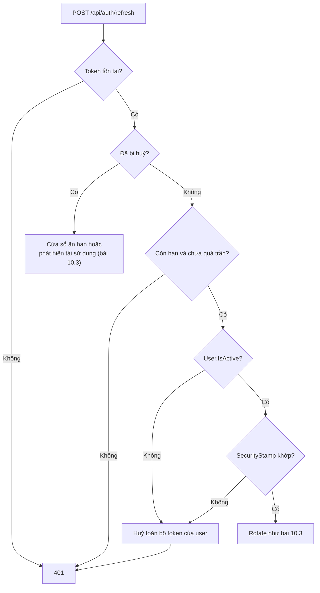

# 10.12 - Case study: nhân viên nghỉ việc vẫn gọi được API

> **Tóm tắt:** Một sự cố bảo mật với hậu quả thật: nhân viên nghỉ việc, tài khoản bị vô hiệu hoá đúng quy trình, nhưng **4 ngày sau** người đó vẫn gọi API xoá 340 bản ghi khách hàng. Nguyên nhân không nằm ở access token — cái đó hết hạn sau 15 phút — mà ở chỗ endpoint `/refresh` **không kiểm tra lại trạng thái tài khoản** khi đổi refresh token lấy token mới. Vô hiệu hoá tài khoản chỉ chặn được **đăng nhập mới**, không chặn được vòng lặp refresh đang chạy. Bài này thêm đúng phần còn thiếu vào `RefreshTokenService` của [bài 10.3](10.3-refresh-token.md): kiểm `IsActive` và `SecurityStamp` mỗi lần refresh, và thu hồi mọi token khi vô hiệu hoá tài khoản.

## Mục tiêu bài học

Sau bài này bạn có thể:

- Chẩn đoán vì sao một tài khoản đã vô hiệu hoá vẫn truy cập được API.
- Kiểm tra lại trạng thái tài khoản và `SecurityStamp` khi refresh.
- Viết thao tác vô hiệu hoá tài khoản thu hồi được mọi phiên.
- Đo cửa sổ rủi ro của hệ thống và chọn cách thu hẹp phù hợp.

**Cần biết trước:** refresh token, rotation và `RefreshTokenService` ([bài 10.3](10.3-refresh-token.md)), `AppUser.IsActive`, `SecurityStamp` và việc đổi vai trò không tự đổi stamp ([bài 10.8](10.8-overview.md)), `ClockSkew` ([bài 10.2](10.2-jwt-authentication.md)).

## Nội dung bài học

### 10.12.1 — Sự cố

```text
Ngày 1, 09:00  Nhân viên nghỉ việc
Ngày 1, 09:15  Admin vô hiệu hoá tài khoản (IsActive = false)
Ngày 1, 09:15  Access token hiện tại còn hạn 12 phút
Ngày 1, 09:27  Access token hết hạn
Ngày 1, 09:27  Client tự động gọi /refresh -> NHẬN TOKEN MỚI  (!!)
...            cứ 15 phút lại refresh một lần
Ngày 5, 14:30  Gọi DELETE /api/customers/bulk -> xoá 340 bản ghi
```

Hệ thống dùng đúng `RefreshTokenService` của [bài 10.3](10.3-refresh-token.md), chỉ thay `DemoUserStore` bằng `UserManager<AppUser>` sau khi chuyển sang Identity ở [bài 10.8](10.8-overview.md). Đoạn tìm người dùng trong `RefreshAsync` lúc đó trông như sau:

```csharp
// RefreshTokenService.RefreshAsync — bản có lỗ hổng
var user = await userManager.FindByIdAsync(stored.UserId);
if (user is null) return null;

// THIẾU: tài khoản còn hoạt động không? quyền có đổi từ lúc cấp token không?

// ... rotate như bài 10.3, cấp access token mới
```

Vô hiệu hoá tài khoản chỉ ảnh hưởng luồng **đăng nhập** (endpoint login ở bài 10.8 kiểm `IsActive`). Luồng **refresh** chỉ kiểm token có tồn tại, chưa bị huỷ, còn hạn — không kiểm gì về người dùng, nên nó tiếp tục cấp token mới mỗi 15 phút suốt 30 ngày trần tuyệt đối.

### 10.12.2 — Sửa: kiểm tra lại khi refresh

Hai thay đổi nhỏ trên code của bài 10.3.

**1. Lưu `SecurityStamp` của người dùng vào mỗi refresh token lúc phát.** Thêm một cột vào entity `RefreshToken` rồi tạo migration:

```csharp
// RefreshToken.cs — thêm vào entity của bài 10.3
public string? SecurityStamp { get; set; }      // stamp của người dùng lúc phát token
```

```bash
dotnet ef migrations add AddRefreshTokenSecurityStamp
dotnet ef database update
```

`IssueAsync` và đoạn tạo token mới trong `RefreshAsync` gán thêm `SecurityStamp = user.SecurityStamp`.

**2. Kiểm tra người dùng ngay sau khi nạp token, trước khi rotate:**

```csharp
// RefreshTokenService.RefreshAsync — sau khi đã kiểm token chưa bị huỷ và còn hạn
var user = await userManager.FindByIdAsync(stored.UserId);
if (user is null) return null;

if (!user.IsActive || user.SecurityStamp != stored.SecurityStamp)
{
    var revoked = await RevokeAllForUserAsync(user.Id,
        user.IsActive ? "security-changed" : "account-disabled", ct);

    logger.LogWarning(
        "Từ chối refresh cho {UserId}: IsActive={IsActive}, stamp khớp={StampMatches}. Đã huỷ {Count} token.",
        user.Id, user.IsActive, user.SecurityStamp == stored.SecurityStamp, revoked);
    return null;
}

// ... rotate như bài 10.3
```

`RevokeAllForUserAsync` là hàm của bài 10.3. **Thu hồi cả chuỗi chứ không chỉ từ chối lần này**: chỉ trả `null` thì client cứ 15 phút lại thử, log đầy lỗi, và nếu sau này có ai kích hoạt lại tài khoản thì phiên cũ sống lại.

So sánh stamp khiến refresh token cấp **trước** một thay đổi bảo mật tự vô hiệu. Nhưng nhớ bảng ở [bài 10.8](10.8-overview.md): Identity tự đổi stamp khi đổi mật khẩu, đổi email, bật tắt 2FA — **không** tự đổi khi đổi vai trò hay vô hiệu hoá tài khoản. Kiểm chứng trên PostgreSQL với cả hai phiên bản `RefreshAsync` (chạy thật):

```text
                                              Bản có lỗ hổng    Bản đã sửa
Tài khoản vừa bị vô hiệu hoá (IsActive=false)  CẤP TOKEN MỚI    401
Gỡ vai trò Admin, KHÔNG gọi UpdateSecurityStamp CẤP TOKEN MỚI    CẤP TOKEN MỚI
Gỡ vai trò Admin, rồi UpdateSecurityStampAsync  CẤP TOKEN MỚI    401
```

```text
Warning: Từ chối refresh cho aa1c0fa2-...: IsActive=False, stamp khớp=True. Đã huỷ 1 token.
Warning: Từ chối refresh cho aa1c0fa2-...: IsActive=True, stamp khớp=False. Đã huỷ 2 token.
```

Dòng giữa là cái bẫy: kiểm stamp đúng mà quên đổi stamp thì vẫn hở. Vì vậy thao tác vô hiệu hoá và thao tác đổi quyền phải tự gọi `UpdateSecurityStampAsync`.

### 10.12.3 — Vô hiệu hoá tài khoản cho đúng

Một hàm duy nhất, gọi từ màn hình quản trị và từ quy trình nghỉ việc:

```csharp
// UserAdminService.cs
public async Task DeactivateUserAsync(string userId, CancellationToken ct)
{
    var user = await userManager.FindByIdAsync(userId)
        ?? throw new InvalidOperationException($"Không có user {userId}");

    user.IsActive = false;
    await userManager.UpdateAsync(user);
    await userManager.UpdateSecurityStampAsync(user);                 // access token cũ chết nếu có đối chiếu stamp (bài 10.8)
    await refreshTokens.RevokeAllForUserAsync(userId, "account-disabled", ct);   // refresh token chết ngay

    logger.LogInformation("{Actor} vô hiệu hoá tài khoản {UserId}", currentUser.Id, userId);
}
```

Ba dòng giữa mỗi dòng đóng một cánh cửa: `IsActive` chặn đăng nhập mới và refresh, stamp chặn access token còn hạn (khi có đối chiếu ở `OnTokenValidated`), `RevokeAllForUserAsync` dọn mọi refresh token ngay mà không chờ lần refresh kế tiếp.

Luồng `/refresh` sau khi sửa, theo thứ tự kiểm:



### 10.12.4 — Vòng đời token, nhắc lại

Phần còn lại của thiết kế đã có ở các bài trước; case study này chỉ cho thấy chúng phải đi cùng nhau:

| Thành phần | Ở đâu | Vai trò trong sự cố |
|---|---|---|
| Access token 5–15 phút, `ClockSkew` 30 giây | [Bài 10.2](10.2-jwt-authentication.md) | Giới hạn cửa sổ sau khi vô hiệu hoá |
| Refresh token hash, rotation, trần tuyệt đối | [Bài 10.3](10.3-refresh-token.md) | Có chỗ để kiểm lại mỗi 15 phút |
| Refresh token trong cookie `HttpOnly`, `Secure`, `SameSite=Strict`, `Path=/api/auth` | [Bài 10.3](10.3-refresh-token.md) | Khó bị đánh cắp ngay từ đầu |
| `IsActive`, `SecurityStamp` | [Bài 10.8](10.8-overview.md) và bài này | Cắt vòng lặp refresh |

### 10.12.5 — Thu hồi tức thì

Access token vẫn còn hạn tối đa 15 phút sau khi thu hồi. Nếu nghiệp vụ không chấp nhận được, có hai cách:

- **Đối chiếu `SecurityStamp` ở `OnTokenValidated`** như [bài 10.8](10.8-overview.md): một lần tra database (hoặc cache) mỗi request, thu hồi theo người dùng.
- **Danh sách chặn theo `jti`** trong cache phân tán (Redis), thu hồi từng token:

```csharp
options.Events = new JwtBearerEvents
{
    OnTokenValidated = async context =>
    {
        var jti = context.Principal?.FindFirstValue(JwtRegisteredClaimNames.Jti);
        if (jti is null) return;

        var cache = context.HttpContext.RequestServices
            .GetRequiredService<IDistributedCache>();

        if (await cache.GetStringAsync($"revoked:{jti}") is not null)
            context.Fail("Token đã bị thu hồi");
    }
};
```

```csharp
// Khi thu hồi — TTL bằng thời gian còn lại của token
var remaining = tokenExpiresAt - DateTime.UtcNow;
await _cache.SetStringAsync($"revoked:{jti}", "1",
    new DistributedCacheEntryOptions { AbsoluteExpirationRelativeToNow = remaining });
```

`jti` không bị ánh xạ lại tên (khác `sub`), nên đọc thẳng bằng `JwtRegisteredClaimNames.Jti`. Cái giá: mỗi request thêm một lần đọc Redis. Với hầu hết hệ thống nội bộ, access token ngắn cộng kiểm tra ở `/refresh` là đủ và không cần lớp này ([bài 18.6](../../stage-05-senior-engineering/module-18-microservices/18.6-distributed-identity-overview.md)).

### 10.12.6 — Lỗi thường gặp

**Danh sách rà soát vòng đời token**

- [ ] Luồng refresh kiểm tra lại IsActive của người dùng.
- [ ] Refresh token lưu SecurityStamp lúc phát, và refresh so với stamp hiện tại.
- [ ] Vô hiệu hoá tài khoản gọi UpdateSecurityStampAsync và thu hồi mọi refresh token.
- [ ] Đổi vai trò, đổi quyền gọi UpdateSecurityStampAsync (Identity không tự làm).
- [ ] Khi từ chối refresh vì tài khoản, thu hồi cả chuỗi chứ không chỉ trả 401.
- [ ] Access token có hạn 5–15 phút, ClockSkew không để mặc định 5 phút.
- [ ] Có log cho mỗi lần từ chối refresh vì tài khoản, kèm người thực hiện vô hiệu hoá.

## Bài tập áp dụng

#### Bài 1 — Tái hiện: tài khoản đã vô hiệu vẫn tự gia hạn

Với bản `RefreshAsync` chưa sửa, vô hiệu hoá một tài khoản (chỉ đặt `IsActive = false`) rồi gọi `/refresh` bằng refresh token cũ. Xác nhận nó vẫn cấp token mới. Sửa như mục 10.12.2 và chạy lại.

**Tiêu chí hoàn thành:** bạn nêu được vì sao thiếu **một** điều kiện kiểm tra biến cửa sổ rủi ro 15 phút thành **vô hạn** (trong giới hạn trần tuyệt đối).

<details>
<summary><strong>Gợi ý và lời giải — Bài 1</strong></summary>

**Gợi ý.** Vẽ vòng lặp: access token hết hạn sau 15 phút, nhưng cái gì cấp access token mới?

**Lời giải — tái hiện trên PostgreSQL:**

```sql
UPDATE "AspNetUsers" SET "IsActive" = false WHERE "Email" = 'an@company.com';
```

<details>
<summary>SQL Server</summary>

```sql
UPDATE AspNetUsers SET IsActive = 0 WHERE Email = 'an@company.com';
```

</details>

Gọi `/refresh` bằng cookie refresh token cũ: bản chưa sửa vẫn trả `200` kèm access token và refresh token mới (dòng đầu của bảng ở mục 10.12.2). Bản đã sửa trả `401` và ghi:

```text
Warning: Từ chối refresh cho aa1c0fa2-...: IsActive=False, stamp khớp=True. Đã huỷ 1 token.
```

**Vì sao cửa sổ thành vô hạn — vẽ ra vòng lặp:**

```text
09:00  Vô hiệu hoá tài khoản
09:14  Access token cũ hết hạn
09:14  Client tự động gọi /refresh
09:14  -> nhận access token MỚI, hạn thêm 15 phút, và refresh token MỚI
09:29  Hết hạn -> refresh -> lại 15 phút
...     lặp lại cho tới trần tuyệt đối 30 ngày
```

Mỗi lần refresh đặt lại đồng hồ của access token. Điểm dừng duy nhất là trần tuyệt đối `AbsoluteExpiresAt` của bài 10.3 — nếu hệ thống quên cả trần này (gia hạn `ExpiresAt` mỗi lần rotate), thì không có điểm dừng nào.

Đây chính là lý do trong sự cố gốc, người đã nghỉ việc vẫn truy cập được **4 ngày sau** và xoá 340 bản ghi. Không phải vì access token sống 4 ngày, mà vì nó được làm mới khoảng 4 × 24 × 4 = 384 lần.

**`/refresh` là nơi bắt buộc phải chạm database.** Xác thực access token thì không — đó là lý do JWT nhanh. Nhưng refresh thì **đã** phải tra database để kiểm token, nên thêm một lần đọc người dùng ở đây là cái giá rất nhỏ, và nó chạy mỗi 15 phút một lần cho mỗi người, không phải mỗi request.

**Danh sách kiểm phải có ở `/refresh`:**

- refresh token tồn tại và chưa bị thu hồi,
- chưa hết hạn và chưa vượt trần tuyệt đối (`AbsoluteExpiresAt` — **không** gia hạn khi rotate),
- tài khoản còn hoạt động,
- `SecurityStamp` khớp (mật khẩu hay quyền chưa đổi kể từ lúc phát token).

</details>

---

#### Bài 2 — Gỡ quyền Admin mà quên đổi stamp

Gỡ vai trò `Admin` của một người bằng `RemoveFromRoleAsync` rồi gọi `/refresh`. Ghi lại kết quả. Thêm `UpdateSecurityStampAsync` và chạy lại.

**Tiêu chí hoàn thành:** bạn giải thích được vì sao kiểm stamp ở `/refresh` **không đủ** nếu chỉ dựa vào Identity tự đổi stamp, và chỉ ra mọi chỗ trong hệ thống của mình phải gọi `UpdateSecurityStampAsync` tay.

<details>
<summary><strong>Gợi ý và lời giải — Bài 2</strong></summary>

**Gợi ý.** Kiểm stamp chỉ phát hiện được thay đổi **nếu stamp thật sự đổi**. Xem lại bảng thao tác nào tự đổi stamp ở [bài 10.8](10.8-overview.md).

**Lời giải — kết quả chạy thật** (bản `RefreshAsync` đã sửa, có kiểm stamp):

```text
Gỡ vai trò Admin, KHÔNG gọi UpdateSecurityStampAsync:  CẤP TOKEN MỚI
Gỡ vai trò Admin, rồi UpdateSecurityStampAsync:        401
```

Lần thứ nhất, refresh token mới được cấp, và access token mới phát ra **không** còn vai trò `Admin` — vì `TokenService` đọc vai trò từ database mỗi lần phát. Nghe có vẻ ổn: người đó mất quyền Admin chậm nhất sau một lần refresh. Nhưng:

- trong khoảng chờ tới lần refresh kế, access token cũ (vẫn ghi `role: Admin`) dùng được bình thường, cộng thêm `ClockSkew`;
- nếu có đối chiếu stamp ở `OnTokenValidated` (bài 10.8) để thu hồi tức thì, nó cũng không phát hiện được gì, vì stamp không đổi.

**Mọi chỗ phải gọi `UpdateSecurityStampAsync` tay:**

| Thao tác | Vì sao |
|---|---|
| Gỡ hoặc thêm vai trò | `AddToRoleAsync`/`RemoveFromRoleAsync` không đổi stamp |
| Sửa quyền của người dùng hoặc của vai trò (bảng ở [bài 10.7](10.7-permission-system.md)) | Bảng riêng, Identity không biết |
| Vô hiệu hoá tài khoản | `UpdateAsync` không đổi stamp |
| Khoá tài khoản thủ công (`SetLockoutEndDateAsync`) | Không đổi stamp |
| Thao tác sửa thẳng database | Không đi qua `UserManager` |

Gói các thao tác này sau một service quản trị duy nhất (như `UserAdminService` ở mục 10.12.3) để không ai quên dòng `UpdateSecurityStampAsync`.

</details>

---

#### Bài 3 — Đo chính xác cửa sổ rủi ro

Vô hiệu hoá tài khoản (bản đã sửa, nhưng **chưa** có đối chiếu stamp ở `OnTokenValidated`) và đo bao lâu access token cũ còn dùng được.

**Tiêu chí hoàn thành:** bạn ra được một con số cụ thể cho hệ thống mình, và chỉ ra được **hai** thành phần tạo nên con số đó.

<details>
<summary><strong>Gợi ý và lời giải — Bài 3</strong></summary>

**Gợi ý.** Một thành phần bạn tự chọn khi phát token. Thành phần kia là một cấu hình mà bạn có thể đang để mặc định.

**Lời giải — đo:**

```bash
TOKEN=$(login)
psql -c "UPDATE \"AspNetUsers\" SET \"IsActive\" = false WHERE \"Email\" = 'an@company.com';"
START=$(date +%s)

while true; do
  code=$(curl -s -o /dev/null -w '%{http_code}' -H "Authorization: Bearer $TOKEN" \
    https://localhost:5001/api/v1/customers)
  now=$(date +%s)
  echo "$((now - START))s -> $code"
  [ "$code" != "200" ] && break
  sleep 10
done
```

Vòng lặp in `200` cho tới khi access token hết hạn cộng `ClockSkew`, rồi chuyển sang `401` và dừng. Con số đo được phụ thuộc vào lúc bạn vô hiệu hoá so với lúc token được phát, nên mỗi lần đo một khác; điều không đổi là **trần** của nó.

**Hai thành phần tạo nên con số:**

```text
Thời gian còn lại của access token khi vô hiệu hoá   (0 đến TTL)
  + ClockSkew                                          (mặc định 5 phút)
  = cửa sổ rủi ro tối đa: TTL + ClockSkew
```

Với TTL 15 phút và `ClockSkew` mặc định, trần là **20 phút**. Vô hiệu hoá ngay sau khi người dùng vừa đăng nhập thì con số chạm trần.

**`ClockSkew` là thành phần hay bị bỏ sót.** Rất nhiều đội tin rằng token 15 phút nghĩa là rủi ro 15 phút, trong khi mặc định của `TokenValidationParameters` cộng thêm 5 phút nữa — tăng 33% so với ý định ([bài 10.2](10.2-jwt-authentication.md) đã chạy thử: token hết hạn 2 phút vẫn nhận `200` với `ClockSkew` mặc định).

**Các cách thu hẹp, và cái giá của từng cách:**

| Cách | Cửa sổ | Cái giá |
|---|---|---|
| Giữ nguyên (15 phút, skew mặc định) | 20 phút | 0 |
| Token 5 phút + `ClockSkew` 30 giây | **5,5 phút** | Refresh thường xuyên gấp 3 |
| Đối chiếu `SecurityStamp` mỗi request | **Tức thì** | 1 lần chạm database (hoặc cache) mỗi request |
| Danh sách chặn trong Redis | **Tức thì** | 1 lần chạm Redis mỗi request |

**Khuyến nghị theo mức nhạy cảm:**

- **Hệ thống nội bộ thông thường:** token 5 phút + kiểm trạng thái ở `/refresh` (bài 1). Cửa sổ 5,5 phút là chấp nhận được, và không thêm hạ tầng gì.
- **Thao tác nhạy cảm** — chuyển tiền, đổi quyền, xoá hàng loạt: thêm đối chiếu stamp hoặc danh sách chặn cho **riêng** những endpoint đó, đừng áp cho toàn API.

**Và một điều quan trọng hơn con số:** vô hiệu hoá tài khoản phải **đồng thời** thu hồi refresh token như `DeactivateUserAsync` ở mục 10.12.3. Nếu không, bài 1 lặp lại — cửa sổ 20 phút trở thành vô hạn, và con số bạn vừa đo mất hết ý nghĩa.

</details>

## Tự kiểm tra

<details>
<summary>Vì sao vô hiệu hoá tài khoản không chặn được người dùng?</summary>

Vì nó chỉ ảnh hưởng luồng đăng nhập. Luồng refresh không kiểm tra trạng thái tài khoản nên tiếp tục cấp access token mới mỗi khi cái cũ hết hạn, cho tới trần tuyệt đối của refresh token.

</details>

<details>
<summary>SecurityStamp giúp gì ở luồng refresh, và giới hạn của nó là gì?</summary>

Mỗi refresh token lưu stamp của người dùng lúc phát; khi refresh, stamp hiện tại khác thì từ chối và thu hồi cả chuỗi. Giới hạn là Identity chỉ tự đổi stamp khi đổi mật khẩu, email, 2FA; đổi vai trò, đổi quyền hay vô hiệu hoá tài khoản thì phải gọi UpdateSecurityStampAsync tay, nếu không kiểm stamp không phát hiện được gì.

</details>

<details>
<summary>Vô hiệu hoá tài khoản cần làm những gì?</summary>

Đặt IsActive bằng false để chặn đăng nhập và refresh, gọi UpdateSecurityStampAsync để access token cũ bị từ chối nếu có đối chiếu stamp, và thu hồi mọi refresh token ngay bằng RevokeAllForUserAsync. Ghi log ai đã thực hiện.

</details>

<details>
<summary>Vì sao khi từ chối refresh nên thu hồi cả chuỗi?</summary>

Vì chỉ trả 401 thì client cứ định kỳ thử lại, log đầy lỗi, và nếu tài khoản được kích hoạt lại thì những refresh token cũ sống lại. Thu hồi cả chuỗi buộc người dùng đăng nhập lại từ đầu.

</details>

<details>
<summary>Cửa sổ rủi ro sau khi vô hiệu hoá gồm những thành phần nào?</summary>

Thời gian còn lại của access token cộng ClockSkew. Với token 15 phút và ClockSkew mặc định 5 phút, trần là 20 phút. Token 5 phút và ClockSkew 30 giây hạ trần xuống 5,5 phút; muốn tức thì thì phải đối chiếu stamp hoặc danh sách chặn mỗi request.

</details>

## Kết luận

Ba điều đáng nhớ nhất:

1. **Vô hiệu hoá tài khoản không chặn vòng lặp refresh** — phải kiểm tra lại `IsActive` và `SecurityStamp` ở `/refresh`.
2. **Kiểm stamp chỉ có tác dụng khi stamp thật sự đổi.** Đổi vai trò, đổi quyền, vô hiệu hoá đều phải gọi `UpdateSecurityStampAsync` tay.
3. **Cửa sổ rủi ro = phần còn lại của access token + `ClockSkew`.** Đo nó, rồi chọn cách thu hẹp theo mức nhạy cảm.

## Tham khảo

- [Configure JWT bearer authentication in ASP.NET Core](https://learn.microsoft.com/en-us/aspnet/core/security/authentication/configure-jwt-bearer-authentication)
- [UserManager.UpdateSecurityStampAsync](https://learn.microsoft.com/en-us/dotnet/api/microsoft.aspnetcore.identity.usermanager-1.updatesecuritystampasync)
- [RFC 9700 — Best Current Practice for OAuth 2.0 Security](https://www.rfc-editor.org/rfc/rfc9700.html)
- [OWASP Session Management Cheat Sheet](https://cheatsheetseries.owasp.org/cheatsheets/Session_Management_Cheat_Sheet.html)

## Điều hướng

- **Bài trước:** [10.11 — Bảo mật nâng cao: Data Protection, PKCE, passkey, mTLS](10.11-advanced-notes.md)
- **Bài tiếp theo:** [10.13 — Ví dụ thực tế: sales sửa được lead của đồng nghiệp](10.13-quick-real-world-example.md)
- **Về module:** [Trang mục lục](README.md)
