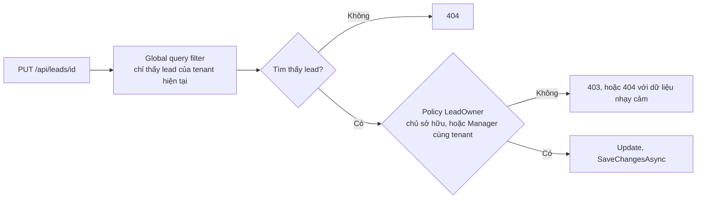

# 10.13 - Ví dụ thực tế: sales sửa được lead của đồng nghiệp

> **Tóm tắt:** Lỗ hổng phổ biến nhất trong ứng dụng nghiệp vụ, và cũng dễ bỏ sót nhất: endpoint có `[Authorize(Roles = CrmRoles.SalesRep)]` nên trông đã được bảo vệ, nhưng bất kỳ nhân viên sales nào cũng **sửa được lead của đồng nghiệp** chỉ bằng cách đổi id trên URL. Nguyên nhân là nhầm lẫn giữa hai câu hỏi khác nhau: *"người này có phải nhân viên sales không"* (vai trò) và *"người này có được sửa **bản ghi cụ thể này** không"* (tài nguyên). `[Authorize]` chỉ trả lời câu đầu. Đây là lớp lỗ hổng mà **OWASP xếp hạng cao nhất** — và nó không xuất hiện trong test vì test thường chỉ dùng dữ liệu của chính người dùng đang đăng nhập.

## Mục tiêu bài học

Sau bài này bạn có thể:

- Phân biệt phân quyền theo vai trò và theo tài nguyên.
- Cài `IAuthorizationHandler` cho tài nguyên cụ thể.
- Tránh lộ thông tin qua sự khác biệt giữa 403 và 404.
- Viết test bắt được lỗ hổng này.

**Cần biết trước:** phân quyền theo tài nguyên, IDOR và 403 so với 404 ([bài 10.6](10.6-resource-based-authorization.md)) — bài này áp các ý đó lên một tình huống cụ thể; requirement và handler ([bài 10.5](10.5-policy-based-authorization.md)); integration test ([bài 9.8](../module-09-web-api-professional/9.8-api-testing.md)).

## Nội dung bài học

Entity dùng trong bài:

```csharp
// Lead.cs
public class Lead
{
    public Guid Id { get; set; }
    public string Name { get; set; } = "";
    public decimal Value { get; set; }
    public string OwnerId { get; set; } = "";     // id nhân viên sales phụ trách
    public string Territory { get; set; } = "";
    public string TenantId { get; set; } = "";    // công ty khách hàng của CRM

    public void Update(string name, decimal value) { Name = name; Value = value; }
}
```

### 10.13.1 — Lỗ hổng

```csharp
[Authorize(Roles = CrmRoles.SalesRep)]
[HttpPut("{id:guid}")]
public async Task<IActionResult> Update(Guid id, UpdateLeadRequest request, CancellationToken ct)
{
    var lead = await _db.Leads.FindAsync([id], ct);
    if (lead is null) return NotFound();

    lead.Update(request.Name, request.Value);       // KHÔNG kiểm tra chủ sở hữu
    await _db.SaveChangesAsync(ct);

    return NoContent();
}
```

```
Nhân viên A (sales) đăng nhập, sửa lead của mình:
  PUT /api/leads/8f3a1b2c-...     -> OK, đúng

Nhân viên A đổi id trên URL:
  PUT /api/leads/7c1d9e4f-...     -> OK, VÀ ĐÂY LÀ LEAD CỦA NHÂN VIÊN B
```

`[Authorize(Roles = CrmRoles.SalesRep)]` trả lời đúng câu hỏi nó được hỏi: A **có** vai trò SalesRep. Nhưng câu hỏi cần trả lời là: A có được sửa **lead này** không?

Lớp lỗ hổng này gọi là **Broken Object Level Authorization** (BOLA, tên khác của IDOR ở [bài 10.6](10.6-resource-based-authorization.md)), và nó đứng đầu danh sách rủi ro API của OWASP. Lý do nó phổ biến: endpoint trông đã được bảo vệ, và test thường chỉ dùng dữ liệu của chính người dùng đang đăng nhập nên không phát hiện ra.

### 10.13.2 — Sửa nhanh và sửa đúng

**Sửa nhanh — kiểm tra ngay trong controller:**

```csharp
var lead = await _db.Leads.FindAsync([id], ct);
if (lead is null) return NotFound();

if (lead.OwnerId != _currentUser.Id && !User.IsInRole(CrmRoles.Manager))
    return Forbid();
```

Nó hoạt động, nhưng logic này sẽ phải **lặp lại ở mọi endpoint** động tới lead — và chỗ nào quên là một lỗ hổng.

**Sửa đúng — tách thành policy dùng chung:**

```csharp
// LeadOwnerRequirement.cs
public sealed class LeadOwnerRequirement : IAuthorizationRequirement;
```

```csharp
// LeadOwnerHandler.cs
public sealed class LeadOwnerHandler : AuthorizationHandler<LeadOwnerRequirement, Lead>
{
    protected override Task HandleRequirementAsync(
        AuthorizationHandlerContext context,
        LeadOwnerRequirement requirement,
        Lead lead)
    {
        var userId = context.User.FindFirstValue(ClaimTypes.NameIdentifier);

        if (lead.OwnerId == userId)
            context.Succeed(requirement);

        else if (context.User.IsInRole(CrmRoles.Manager) &&
                 lead.TenantId == context.User.FindFirstValue("tenant_id"))
            context.Succeed(requirement);

        return Task.CompletedTask;
    }
}
```

```csharp
// Program.cs
builder.Services.AddSingleton<IAuthorizationHandler, LeadOwnerHandler>();
builder.Services.AddAuthorization(options =>
    options.AddPolicy("LeadOwner", p => p.Requirements.Add(new LeadOwnerRequirement())));
```

```csharp
[HttpPut("{id:guid}")]
public async Task<IActionResult> Update(
    Guid id, UpdateLeadRequest request, CancellationToken ct)
{
    var lead = await _db.Leads.FindAsync([id], ct);
    if (lead is null) return NotFound();

    var authorized = await _authorizationService.AuthorizeAsync(User, lead, "LeadOwner");
    if (!authorized.Succeeded) return Forbid();

    lead.Update(request.Name, request.Value);
    await _db.SaveChangesAsync(ct);
    return NoContent();
}
```

Ba lợi ích so với cách sửa nhanh: quy tắc nằm **một chỗ**, test được độc lập, và khi quy tắc đổi (thêm vai trò được xem chéo chẳng hạn) bạn sửa một file thay vì rà cả codebase ([bài 10.6](10.6-resource-based-authorization.md)).

Lưu ý thứ tự: **phải nạp tài nguyên trước** rồi mới phân quyền được — đó là lý do không dùng được attribute `[Authorize(Policy = "LeadOwner")]` đặt trên action.

### 10.13.3 — Cái bẫy: 403 làm lộ thông tin

```csharp
if (lead is null) return NotFound();        // 404
if (!authorized.Succeeded) return Forbid(); // 403
```

Hai mã khác nhau **tiết lộ** thông tin:

```
GET /api/leads/{non-existent-id}       -> 404
GET /api/leads/{someone-elses-id}      -> 403   <- xác nhận ID NÀY TỒN TẠI
```

Kẻ tấn công dò id và phân biệt được id nào tồn tại — đủ để suy ra quy mô dữ liệu, và trong một số trường hợp id mang ý nghĩa (số hoá đơn tăng dần chẳng hạn) thì đó là rò rỉ thật.

**Với dữ liệu nhạy cảm, trả `404` cho cả hai:**

```csharp
var lead = await _db.Leads.FindAsync([id], ct);

var authorized = lead is not null &&
    (await _authorizationService.AuthorizeAsync(User, lead, "LeadOwner")).Succeeded;

if (!authorized) return NotFound();      // không phân biệt được
```

**Đánh đổi:** người dùng hợp lệ gặp lỗi phân quyền sẽ thấy "không tìm thấy" thay vì "không có quyền" — khó hiểu hơn, và có thể làm tăng số cuộc gọi hỗ trợ.

Cân bằng thực dụng: dùng `403` cho ứng dụng nội bộ (nơi mọi người dùng đã được tin tưởng ở mức cơ bản) và `404` cho API công khai hoặc dữ liệu nhạy cảm.

### 10.13.4 — Lọc theo tenant: phòng thủ hai lớp

Trong hệ multi-tenant, kiểm tra ở tầng ứng dụng **không đủ** — một chỗ quên là rò rỉ dữ liệu giữa các công ty khác nhau.

```csharp
// CrmDbContext.cs
public sealed class CrmDbContext(DbContextOptions<CrmDbContext> options, ITenantContext tenantContext)
    : DbContext(options)
{
    private readonly ITenantContext _tenantContext = tenantContext;   // tenant của request hiện tại

    public DbSet<Lead> Leads => Set<Lead>();

    protected override void OnModelCreating(ModelBuilder modelBuilder)
    {
        // Global query filter — áp dụng TỰ ĐỘNG cho MỌI truy vấn tới Lead
        modelBuilder.Entity<Lead>()
            .HasQueryFilter(l => l.TenantId == _tenantContext.TenantId);
    }
}
```

`ITenantContext` là một service scoped có thuộc tính `TenantId`, được middleware gán theo claim `tenant_id` của người dùng. Giờ `_db.Leads.FindAsync(id)` **không bao giờ** trả về lead của tenant khác, kể cả khi lập trình viên quên kiểm tra. Đây là lớp phòng thủ ở tầng dữ liệu, dưới cả tầng phân quyền ([bài 13.10](../../stage-04-database-production/module-13-entity-framework-core/13.10-global-query-filters.md)).

**Hai cái bẫy của global query filter:**

```csharp
// 1. IgnoreQueryFilters bỏ qua HẾT — chỉ dùng trong job hệ thống
var allLeads = await _db.Leads.IgnoreQueryFilters().ToListAsync(ct);
```

```csharp
// 2. SAI — chụp giá trị TenantId vào biến cục bộ lúc dựng model
protected override void OnModelCreating(ModelBuilder modelBuilder)
{
    var tenantId = _tenantContext.TenantId;
    modelBuilder.Entity<Lead>().HasQueryFilter(l => l.TenantId == tenantId);
}
```

Cái bẫy thứ hai tinh vi và nguy hiểm. EF Core chỉ dựng model **một lần** rồi dùng lại cho mọi instance `DbContext` sau đó. Biểu thức filter tham chiếu **một thành viên của chính `DbContext`** (`_tenantContext.TenantId`, như bản đúng ở trên) thì EF biến nó thành tham số và đọc lại giá trị từ instance `DbContext` đang chạy ở mỗi truy vấn. Còn chép giá trị vào biến cục bộ `tenantId` thì giá trị bị **đóng băng** theo tenant của `DbContext` đầu tiên dựng model. Chạy thật trên PostgreSQL 16, hai `DbContext` lần lượt cho tenant A rồi tenant B:

```text
Bản đúng — SQL sinh ra:
  WHERE l."TenantId" = @ef_filter__TenantId
  tenant A thấy: Lead của A
  tenant B thấy: Lead của B

Bản sai — SQL sinh ra:
  WHERE l."TenantId" = 'A'
  tenant A thấy: Lead của A
  tenant B thấy: Lead của A      <- rò rỉ dữ liệu giữa hai công ty
```

Giá trị `'A'` nằm cứng trong SQL. Không cần `IModelCacheKeyFactory` hay cấu hình gì thêm; chỉ cần filter đọc qua thành viên của `DbContext` chứ không qua biến cục bộ.

Hai lớp phòng thủ đứng cạnh nhau trên cùng một request:



### 10.13.5 — Test bắt được lỗ hổng

Test thông thường không phát hiện được vì nó dùng dữ liệu của chính người dùng đang đăng nhập:

```csharp
[Fact]
public async Task Update_OtherUsersLead_Returns403()
{
    var leadOfB = await SeedLeadAsync(ownerId: _userB.Id);

    var client = _factory.CreateClientAs(_userA);      // đăng nhập là A
    var response = await client.PutAsJsonAsync(
        $"/api/leads/{leadOfB.Id}", new { Name = "Đã sửa", Value = 0 });

    Assert.Equal(HttpStatusCode.Forbidden, response.StatusCode);
}

[Fact]
public async Task Get_OtherTenantsLead_Returns404()
{
    var leadTenantB = await SeedLeadAsync(tenantId: _tenantB.Id);

    var client = _factory.CreateClientAs(_userTenantA);
    var response = await client.GetAsync($"/api/leads/{leadTenantB.Id}");

    Assert.Equal(HttpStatusCode.NotFound, response.StatusCode);
}
```

`SeedLeadAsync` và `CreateClientAs` là hàm trợ giúp bạn tự viết trong lớp test: một cái ghi lead vào database test, một cái tạo `HttpClient` có sẵn token của người dùng chỉ định (như [bài 9.8](../module-09-web-api-professional/9.8-api-testing.md)).

**Quy tắc:** mỗi endpoint nhận id từ client cần **ít nhất một** test dùng id của người khác. Đây là loại test dễ viết và bắt được đúng lớp lỗ hổng nghiêm trọng nhất ([bài 16.9](../../stage-05-senior-engineering/module-16-clean-architecture/16.9-testing-strategy-overview.md)).

### 10.13.6 — Lỗi thường gặp

**Danh sách rà soát phân quyền theo tài nguyên**

- [ ] Mọi endpoint nhận id từ client đều kiểm tra quyền trên bản ghi đó.
- [ ] Quy tắc phân quyền tài nguyên nằm trong handler dùng chung, không rải rác.
- [ ] Đã cân nhắc trả 404 thay vì 403 cho dữ liệu nhạy cảm.
- [ ] Hệ multi-tenant có global query filter ở tầng dữ liệu.
- [ ] IgnoreQueryFilters chỉ dùng trong job hệ thống, có rà soát.
- [ ] Global query filter đọc qua thành viên của DbContext, không chép giá trị vào biến cục bộ.
- [ ] Mỗi endpoint nhận id có ít nhất một test dùng id của người khác.
- [ ] Có test kiểm tra cách ly giữa các tenant.

## Bài tập áp dụng

#### Bài 1 — Đếm endpoint nhận id mà không kiểm quyền trên bản ghi

Rà mọi endpoint nhận id từ route và đếm số endpoint không kiểm tra quyền trên bản ghi.

**Tiêu chí hoàn thành:** bạn có một con số, và một danh sách **xếp theo mức nghiêm trọng** — chứ không phải một đống endpoint ngang nhau.

<details>
<summary><strong>Gợi ý và lời giải — Bài 1</strong></summary>

**Gợi ý.** Không phải endpoint nào cũng nguy hiểm như nhau. `GET` lộ dữ liệu, `DELETE` phá dữ liệu — và mức độ còn phụ thuộc dữ liệu đó là gì.

**Lời giải — liệt kê bằng công cụ:**

```bash
grep -rnE '\[Http(Get|Put|Post|Patch|Delete)\("\{[a-zA-Z]+:?[a-z]*\}' \
  --include=*.cs src/ -A 6 \
  | grep -B 6 -L 'AuthorizeAsync\|CanAccess\|VisibleTo'
```

Hoặc chính xác hơn, đi từ bảng định tuyến lúc chạy:

```csharp
[Fact]
public void ListEndpointsTakingIdWithoutResourceCheck()
{
    var endpoints = _endpointDataSource.Endpoints.OfType<RouteEndpoint>()
        .Where(e => e.RoutePattern.Parameters.Any(p => p.Name is "id" or "leadId" or "customerId"))
        .Select(e => new
        {
            Route  = e.RoutePattern.RawText,
            Method = e.Metadata.GetMetadata<HttpMethodMetadata>()?.HttpMethods.First(),
            // RequireResourceAccessAttribute: attribute đánh dấu do bạn tự định nghĩa,
            // gắn lên action đã gọi IAuthorizationService cho tài nguyên
            HasResourceCheck = e.Metadata.GetMetadata<RequireResourceAccessAttribute>() is not null
        })
        .Where(x => !x.HasResourceCheck)
        .ToList();

    foreach (var e in endpoints) _output.WriteLine($"{e.Method,-6} {e.Route}");
    Assert.Empty(endpoints);
}
```

**Kết quả minh hoạ trên một CRM cỡ vừa:**

```text
GET    api/v1/leads/{id}
PUT    api/v1/leads/{id}
DELETE api/v1/leads/{id}
GET    api/v1/leads/{id}/activities
POST   api/v1/leads/{id}/convert
GET    api/v1/customers/{id}/invoices
PATCH  api/v1/deals/{id}/stage
GET    api/v1/attachments/{id}/download
```

**8 endpoint. Xếp theo mức nghiêm trọng:**

| Mức | Endpoint | Vì sao |
|---|---|---|
| **1 — Nặng nhất** | `POST /leads/{id}/convert` | Thay đổi dữ liệu **và** tạo bản ghi mới ở nơi khác |
| | `DELETE /leads/{id}` | Mất dữ liệu, khó phục hồi |
| | `PATCH /deals/{id}/stage` | Đổi số liệu báo cáo, ảnh hưởng hoa hồng |
| **2 — Nặng** | `PUT /leads/{id}` | Ghi đè dữ liệu người khác |
| **3 — Rò rỉ** | `GET /attachments/{id}/download` | File có thể chứa hợp đồng, CCCD |
| | `GET /customers/{id}/invoices` | Dữ liệu tài chính |
| | `GET /leads/{id}` | Thông tin khách hàng |
| | `GET /leads/{id}/activities` | Lịch sử trao đổi |

**Hai tiêu chí xếp hạng, và chúng nhân với nhau:**

1. **Ghi nguy hiểm hơn đọc.** Rò rỉ dữ liệu tệ, nhưng mất dữ liệu hoặc dữ liệu bị sửa sai còn khó khắc phục hơn — bạn không biết bản ghi nào đã bị đụng.
2. **Nội dung quyết định phần còn lại.** `GET /attachments/{id}/download` là đọc, nhưng file đính kèm thường chứa thứ nhạy cảm nhất trong cả hệ thống.

**Hai dạng dễ bị bỏ sót nhất, và chúng nằm ngay trong danh sách trên:**

- **Endpoint con** (`/{id}/activities`, `/{id}/invoices`): người ta kiểm quyền trên `lead` nhưng quên rằng route này trả về **dữ liệu con** mà không ai kiểm lại.
- **Endpoint hành động** (`/{id}/convert`, `/{id}/stage`): trông như thao tác nghiệp vụ nên dễ được xem là "đã có `[Authorize]` là đủ".

**Biến bài tập này thành hàng rào thường trực.** Giữ bài test ở trên trong bộ test với một danh sách trắng:

```csharp
Assert.Equal(KnownExemptEndpoints, endpoints.Select(e => e.Route).ToList());
```

Giờ mỗi endpoint mới nhận id sẽ làm test đỏ cho tới khi có người **chủ động** thêm kiểm tra quyền hoặc giải thích vì sao không cần.

</details>

---

#### Bài 2 — Gom kiểm tra rải rác vào một `AuthorizationHandler`

Cài một `AuthorizationHandler` cho một loại tài nguyên và thay các kiểm tra rải rác bằng nó.

**Tiêu chí hoàn thành:** bạn nêu được **ba** lợi ích cụ thể so với việc viết `if` trong từng action.

<details>
<summary><strong>Gợi ý và lời giải — Bài 2</strong></summary>

**Gợi ý.** Đếm xem quy tắc "ai được xem lead này" hiện đang được viết lại ở bao nhiêu chỗ, và chúng có giống hệt nhau không.

**Lời giải — trước khi gom:**

```csharp
// LeadsController.GetById
if (lead.OwnerId != userId && !User.IsInRole(CrmRoles.Admin)) return Forbid();

// LeadsController.Update
if (lead.OwnerId != userId) return Forbid();                    // QUÊN Admin

// LeadsController.Delete
if (lead.OwnerId != userId && !User.IsInRole(CrmRoles.Admin)) return Forbid();

// LeadsController.GetActivities
// ... không kiểm tra gì

// BulkImportHandler
if (lead.Status != "Lost") { /* ... */ }                        // quy tắc KHÁC HẲN
```

Năm nơi, **ba biến thể khác nhau**, và một nơi không kiểm gì. Đây chính là hình dạng của sự cố trong bài.

**Sau khi gom:**

```csharp
public sealed class LeadAccessRequirement : IAuthorizationRequirement;

public sealed class LeadOwnerHandler : AuthorizationHandler<LeadAccessRequirement, Lead>
{
    protected override Task HandleRequirementAsync(
        AuthorizationHandlerContext ctx, LeadAccessRequirement req, Lead lead)
    {
        if (lead.OwnerId == ctx.User.FindFirstValue(ClaimTypes.NameIdentifier))
            ctx.Succeed(req);
        return Task.CompletedTask;
    }
}

public sealed class LeadTerritoryManagerHandler : AuthorizationHandler<LeadAccessRequirement, Lead>
{
    protected override Task HandleRequirementAsync(
        AuthorizationHandlerContext ctx, LeadAccessRequirement req, Lead lead)
    {
        if (ctx.User.IsInRole(CrmRoles.Manager) &&
            ctx.User.FindFirstValue("territory") == lead.Territory)
            ctx.Succeed(req);
        return Task.CompletedTask;
    }
}

public sealed class LeadAdminHandler : AuthorizationHandler<LeadAccessRequirement, Lead>
{
    protected override Task HandleRequirementAsync(
        AuthorizationHandlerContext ctx, LeadAccessRequirement req, Lead lead)
    {
        if (ctx.User.IsInRole(CrmRoles.Admin)) ctx.Succeed(req);
        return Task.CompletedTask;
    }
}
```

```csharp
// Program.cs
builder.Services.AddAuthorization(o =>
    o.AddPolicy("LeadAccess", p => p.AddRequirements(new LeadAccessRequirement())));
```

```csharp
// Mọi action giờ giống hệt nhau
var lead = await _db.Leads.FindAsync([id], ct);
if (lead is null) return NotFound();

if (!(await _authz.AuthorizeAsync(User, lead, "LeadAccess")).Succeeded)
    return Forbid();
```

**Ba lợi ích cụ thể:**

**1. Một nơi định nghĩa quy tắc.** Thêm con đường mới — ví dụ "người được uỷ quyền khi chủ sở hữu nghỉ phép" — là thêm **một handler**, và **mọi** endpoint có ngay. Với `if` rải rác, bạn phải tìm và sửa từng chỗ, và chắc chắn sót.

**2. Kiểm thử được độc lập, không cần HTTP.**

```csharp
[Theory]
[InlineData("owner", null,  false, true)]
[InlineData("other", "HCM", true,  true)]    // Manager cùng khu vực
[InlineData("other", "HN",  true,  false)]   // Manager khác khu vực
[InlineData("other", null,  false, false)]
public async Task LeadAccessRules(string who, string? territory, bool isManager, bool expected)
{
    var lead = new Lead { OwnerId = "owner", Territory = "HCM" };
    var user = Principal(who, territory, isManager);   // hàm tạo ClaimsPrincipal như bài 10.5

    var result = await _authz.AuthorizeAsync(user, lead, "LeadAccess");

    Assert.Equal(expected, result.Succeeded);
}
```

Bốn dòng `InlineData` phủ hết ma trận quyền. Với `if` trong controller, mỗi trường hợp cần dựng `WebApplicationFactory`, token và HTTP request — chậm hơn hàng trăm lần và khó đọc hơn nhiều.

**3. Thiếu kiểm tra trở nên nhìn thấy được.** Mọi action đều có đúng một dòng `AuthorizeAsync`. Action nào không có thì lộ ra ngay khi đọc, và `grep` tìm được:

```bash
grep -rn 'FindAsync\|FirstOrDefaultAsync' --include=*Controller.cs src/ \
  | grep -v 'AuthorizeAsync'
```

Với `if` viết tay, mỗi chỗ một cách viết nên không có mẫu nào để tìm.

**Một điều handler không làm được:** lọc **danh sách**. `IAuthorizationService` nhận một tài nguyên. Với `GET /leads`, bạn cần điều kiện dịch được sang SQL — hai bài toán khác nhau, xem lại [bài 10.6](10.6-resource-based-authorization.md).

</details>

---

#### Bài 3 — Test cách ly tenant

Viết test gọi API bằng token của tenant A với id của tenant B và xác nhận không rò rỉ.

**Tiêu chí hoàn thành:** bài test của bạn phải **đỏ** khi ai đó thêm `IgnoreQueryFilters()` hoặc viết một truy vấn không qua filter.

<details>
<summary><strong>Gợi ý và lời giải — Bài 3</strong></summary>

**Gợi ý.** Một bài test kiểm đúng một endpoint sẽ không bắt được endpoint thứ hai ai đó thêm vào tuần sau. Hãy sinh danh sách endpoint từ bảng định tuyến.

**Lời giải — test quét toàn bộ endpoint:**

```csharp
public class TenantIsolationTests(CrmApiFactory factory) : IClassFixture<CrmApiFactory>
{
    public static TheoryData<string, string> Endpoints => new()
    {
        { "GET",    "/api/v1/leads/{id}" },
        { "PUT",    "/api/v1/leads/{id}" },
        { "DELETE", "/api/v1/leads/{id}" },
        { "GET",    "/api/v1/leads/{id}/activities" },
        { "GET",    "/api/v1/customers/{id}/invoices" },
        { "GET",    "/api/v1/attachments/{id}/download" },
    };

    [Theory]
    [MemberData(nameof(Endpoints))]
    public async Task TenantAToken_CannotReachTenantBData(string method, string template)
    {
        var (tenantB, resourceId) = await SeedResourceForTenantBAsync();
        var client = factory.CreateClientForTenant("tenant-a");

        var url = template.Replace("{id}", resourceId.ToString());
        var res = await client.SendAsync(new HttpRequestMessage(new HttpMethod(method), url));

        Assert.True(res.StatusCode is HttpStatusCode.NotFound or HttpStatusCode.Forbidden,
            $"{method} {url} trả về {(int)res.StatusCode} — có thể đang rò rỉ dữ liệu tenant B");

        if (res.IsSuccessStatusCode)
        {
            var body = await res.Content.ReadAsStringAsync();
            Assert.DoesNotContain(tenantB.SecretMarker, body);
        }
    }
}
```

**`SecretMarker` là mẹo làm test không thể qua mặt.** Gieo dữ liệu tenant B với một chuỗi duy nhất — ví dụ `"TENANT-B-CANARY-8f3a"` trong trường tên. Nếu chuỗi đó xuất hiện trong bất kỳ phản hồi nào mà tenant A nhận được, bạn biết chắc có rò rỉ, kể cả khi mã trạng thái là `200` hợp lệ vì lý do khác.

**Vì sao test này đỏ khi ai đó thêm `IgnoreQueryFilters()`:**

```csharp
// Ai đó thêm để "sửa một bug báo cáo"
var lead = await _db.Leads.IgnoreQueryFilters().FirstOrDefaultAsync(l => l.Id == id, ct);
```

Global query filter bị bỏ qua, truy vấn trả về lead của tenant B, endpoint trả `200` kèm `SecretMarker` — và test đỏ ngay.

**Bổ sung một test chặn ở tầng thấp hơn:**

```csharp
[Fact]
public void NoUnreviewedIgnoreQueryFilters()
{
    var offenders = Directory
        .EnumerateFiles("../../../../src", "*.cs", SearchOption.AllDirectories)
        .SelectMany(f => File.ReadLines(f).Select((line, i) => (f, i: i + 1, line)))
        .Where(x => x.line.Contains("IgnoreQueryFilters"))
        .Where(x => !x.line.Contains("// tenant-safe:"))     // cho phép có chú thích giải trình
        .Select(x => $"{Path.GetFileName(x.f)}:{x.i}")
        .ToList();

    Assert.Empty(offenders);
}
```

Ai thật sự cần `IgnoreQueryFilters` — ví dụ job hệ thống chạy ngoài ngữ cảnh tenant — phải viết `// tenant-safe: job dọn dẹp toàn hệ thống`, tức là để lại một lời giải thích trong code.

**Ba cái bẫy cách ly tenant mà bộ test nên phủ:**

| Bẫy | Cách phủ |
|---|---|
| `IgnoreQueryFilters()` | Test quét mã nguồn ở trên |
| Truy vấn SQL thô không có `WHERE TenantId` | Cũng quét: tìm `FromSql` không kèm tham số tenant |
| `TenantId` bị chép vào biến cục bộ lúc **dựng model** | Test gọi hai tenant **trong cùng một tiến trình** |

**Bẫy thứ ba là loại tinh vi nhất.** Model chỉ dựng một lần, nên filter chép giá trị vào biến cục bộ trong `OnModelCreating` bị **đóng băng theo tenant đầu tiên** — mục 10.13.4 đã đo: SQL chứa cứng `'A'` và tenant B thấy lead của A. Bài test chạy tuần tự hai tenant trong cùng tiến trình sẽ bắt được; bài test chỉ chạy một tenant thì không bao giờ thấy.

</details>

## Tự kiểm tra

<details>
<summary>Vì sao Authorize theo vai trò không đủ?</summary>

Vì nó trả lời câu hỏi người này có vai trò gì, không trả lời câu hỏi người này có được thao tác trên bản ghi cụ thể này không. Một nhân viên sales hợp lệ vẫn có thể sửa lead của đồng nghiệp bằng cách đổi id trên URL.

</details>

<details>
<summary>Vì sao lỗ hổng này ít bị phát hiện trong test?</summary>

Vì test thường chỉ dùng dữ liệu của chính người dùng đang đăng nhập, nên đường dẫn kiểm tra quyền trên bản ghi của người khác không bao giờ được chạy.

</details>

<details>
<summary>Vì sao tách thành policy tốt hơn kiểm tra trong controller?</summary>

Vì quy tắc nằm một chỗ nên không có endpoint nào quên, test được độc lập, và khi quy tắc đổi thì sửa một file thay vì rà cả codebase.

</details>

<details>
<summary>Vì sao không dùng được attribute Authorize với policy tài nguyên?</summary>

Vì phải nạp tài nguyên trước rồi mới phân quyền được, mà attribute chạy trước khi action thực thi. Phải gọi IAuthorizationService trong thân action sau khi đã nạp bản ghi.

</details>

<details>
<summary>Sự khác biệt giữa 403 và 404 làm lộ gì?</summary>

Nó xác nhận id nào tồn tại, đủ để kẻ tấn công dò và suy ra quy mô dữ liệu. Với dữ liệu nhạy cảm nên trả 404 cho cả hai trường hợp, đánh đổi là người dùng hợp lệ thấy thông báo khó hiểu hơn.

</details>

<details>
<summary>Cái bẫy tinh vi của global query filter là gì?</summary>

EF Core chỉ dựng model một lần. Nếu OnModelCreating chép TenantId vào biến cục bộ rồi dùng trong filter, giá trị bị đóng băng theo tenant đầu tiên và SQL chứa cứng giá trị đó. Filter phải đọc qua thành viên của chính DbContext, ví dụ _tenantContext.TenantId, để EF biến nó thành tham số đọc lại ở mỗi truy vấn.

</details>

## Kết luận

Ba điều đáng nhớ nhất:

1. **Vai trò và tài nguyên là hai câu hỏi khác nhau.** `[Authorize]` chỉ trả lời câu đầu.
2. **Global query filter là lớp phòng thủ ở tầng dữ liệu** — nó đúng cả khi lập trình viên quên.
3. **Mỗi endpoint nhận id cần một test dùng id của người khác.**

## Tham khảo

- [Phân quyền trong ASP.NET Core](https://learn.microsoft.com/en-us/aspnet/core/security/authorization/introduction)
- [Xác thực trong ASP.NET Core](https://learn.microsoft.com/en-us/aspnet/core/security/authentication/)
- [Cấu hình JWT bearer authentication](https://learn.microsoft.com/en-us/aspnet/core/security/authentication/configure-jwt-bearer-authentication)
- [Web API trong ASP.NET Core](https://learn.microsoft.com/en-us/aspnet/core/web-api/)

## Điều hướng

- **Bài trước:** [10.12 — Case study: nhân viên nghỉ việc vẫn gọi được API](10.12-mini-case-study.md)
- **Bài tiếp theo:** [10.14 — Ôn tập và đánh giá Module 10](10.14-review-and-assessment.md)
- **Về module:** [Trang mục lục](README.md)
