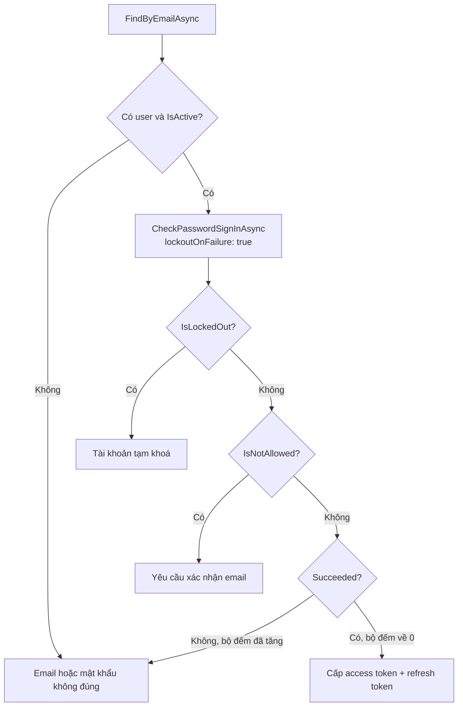
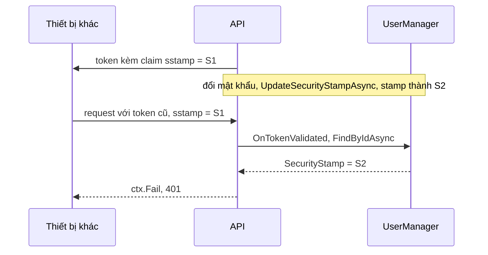

# 10.8 - ASP.NET Core Identity cho API JWT

> **Tóm tắt:** ASP.NET Core Identity không phải "hệ thống đăng nhập bằng cookie" mà là **một bộ thư viện quản lý người dùng** — băm mật khẩu, khoá tài khoản, xác nhận email, đặt lại mật khẩu, 2FA. Bạn dùng được những phần đó mà **không** dùng cookie: `AddIdentityCore` cho bạn `UserManager` mà không kéo theo cookie authentication, còn `AddDefaultIdentity` thì kéo theo cả cookie lẫn Razor Pages — thừa và gây nhầm lẫn cho một API JWT. Thứ đáng giá nhất là **băm mật khẩu**: PBKDF2-HMAC-SHA512 với 100.000 vòng lặp và salt riêng cho mỗi người dùng, cộng cơ chế **nâng cấp tham số tự động**. Và **`SecurityStamp`** là chìa khoá cho thứ JWT không làm được: vô hiệu hoá mọi phiên đăng nhập ngay lập tức — với điều kiện bạn biết thao tác nào tự đổi stamp và thao tác nào (như đổi vai trò) thì không.

## Mục tiêu bài học

Sau bài này bạn có thể:

- Chọn đúng giữa `AddIdentityCore` và `AddDefaultIdentity`.
- Giải thích vì sao không tự viết băm mật khẩu.
- Cấu hình lockout chống dò mật khẩu.
- Dùng `SecurityStamp` để vô hiệu hoá phiên.
- Sinh và dùng token xác nhận email, đặt lại mật khẩu.

**Cần biết trước:** endpoint đăng nhập và `TokenService` ([bài 10.2](10.2-jwt-authentication.md)), refresh token ([bài 10.3](10.3-refresh-token.md)), vai trò ([bài 10.4](10.4-role-based-authorization.md)), EF Core và migration ([bài 8.10](../module-08-aspnet-core-fundamentals/8.10-ef-core-minimal.md)). Bài này thay `DemoUserStore` của bài 10.2 bằng người dùng thật lưu trong PostgreSQL.

## Nội dung bài học

### 10.8.1 — `AddIdentityCore` cho API JWT

```bash
dotnet add package Microsoft.AspNetCore.Identity.EntityFrameworkCore
```

```csharp
// AppUser.cs
public sealed class AppUser : IdentityUser
{
    public string? FullName  { get; set; }
    public string? Territory { get; set; }
    public bool IsActive { get; set; } = true;     // dùng ở bài 10.12
    public DateTime CreatedAt { get; set; }
}
```

```csharp
// CrmDbContext.cs — IdentityDbContext tạo sẵn các bảng AspNetUsers, AspNetRoles, AspNetUserRoles...
public sealed class CrmDbContext(DbContextOptions<CrmDbContext> options)
    : IdentityDbContext<AppUser>(options)
{
    public DbSet<RefreshToken> RefreshTokens => Set<RefreshToken>();   // bảng của bài 10.3

    protected override void OnModelCreating(ModelBuilder modelBuilder)
    {
        base.OnModelCreating(modelBuilder);      // bắt buộc gọi trước, nếu không thiếu cấu hình bảng Identity
        // ... cấu hình RefreshToken như bài 10.3
    }
}
```

```csharp
// Program.cs
builder.Services.AddDbContext<CrmDbContext>(options =>
    options.UseNpgsql(builder.Configuration.GetConnectionString("Crm")));

builder.Services
    .AddIdentityCore<AppUser>(options =>
    {
        options.User.RequireUniqueEmail = true;

        options.Password.RequiredLength         = 12;
        options.Password.RequireDigit           = true;
        options.Password.RequireUppercase       = true;
        options.Password.RequireNonAlphanumeric = false;

        options.Lockout.MaxFailedAccessAttempts = 5;
        options.Lockout.DefaultLockoutTimeSpan  = TimeSpan.FromMinutes(15);
        options.Lockout.AllowedForNewUsers      = true;

        options.SignIn.RequireConfirmedEmail = true;
    })
    .AddRoles<IdentityRole>()
    .AddEntityFrameworkStores<CrmDbContext>()
    .AddSignInManager()              // cho CheckPasswordSignInAsync ở mục 10.8.3
    .AddDefaultTokenProviders();     // cho xác nhận email, đặt lại mật khẩu
```

<details>
<summary>SQL Server</summary>

```csharp
builder.Services.AddDbContext<CrmDbContext>(options =>
    options.UseSqlServer(builder.Configuration.GetConnectionString("Crm")));
```

</details>

Sau `dotnet ef migrations add AddIdentity` và `dotnet ef database update`, PostgreSQL có các bảng `"AspNetUsers"`, `"AspNetRoles"`, `"AspNetUserRoles"`, `"AspNetUserClaims"`, `"AspNetUserLogins"`, `"AspNetUserTokens"`, `"AspNetRoleClaims"`. Tên bảng và cột có chữ hoa nên khi viết SQL tay trên PostgreSQL phải đặt trong nháy kép: `SELECT "Email" FROM "AspNetUsers"`.

| | `AddIdentityCore` | `AddDefaultIdentity` |
|---|---|---|
| `UserManager`, `RoleManager` | Có | Có |
| Cookie authentication | **Không** | Có |
| Razor Pages đăng nhập sẵn | Không | Có |
| Hợp với | **API JWT** | Ứng dụng web có giao diện server |

`AddDefaultIdentity` trong một API JWT gây hai vấn đề: nó đăng ký cookie scheme làm mặc định, nên `[Authorize]` có thể **redirect tới `/Account/Login`** thay vì trả 401 — một lỗi rất khó hiểu khi mới gặp. Và nó kéo theo Razor Pages mà bạn không bao giờ dùng.

`AddDefaultTokenProviders()` hay bị quên, và thiếu nó thì `GeneratePasswordResetTokenAsync` ném exception lúc chạy (thông báo thật trên .NET 10):

```text
NotSupportedException: No IUserTwoFactorTokenProvider<TUser> named 'Default' is registered.
```

`AddSignInManager()` cũng hay bị quên vì `AddIdentityCore` không tự đăng ký `SignInManager`. Thiếu nó, controller nào nhận `SignInManager<AppUser>` qua constructor sẽ lỗi ngay khi được gọi:

```text
InvalidOperationException: No service for type 'Microsoft.AspNetCore.Identity.SignInManager`1[AppUser]' has been registered.
```

**`RequiredLength = 12`** thay vì mặc định 6: độ dài là yếu tố quan trọng nhất của mật khẩu. Tạo người dùng với mật khẩu `abc` sẽ nhận đủ ba lỗi (chạy thật):

```text
PasswordTooShort: Passwords must be at least 12 characters.
PasswordRequiresDigit: Passwords must have at least one digit ('0'-'9').
PasswordRequiresUpper: Passwords must have at least one uppercase ('A'-'Z').
```

Ngược lại, `RequireNonAlphanumeric` bị tắt có chủ đích — yêu cầu ký tự đặc biệt khiến người dùng chọn `Password1!` thay vì một cụm từ dài, mà cụm từ dài thì mạnh hơn nhiều. Đây cũng là khuyến nghị của NIST.

### 10.8.2 — Băm mật khẩu: đừng tự viết

```csharp
// SAI — SHA-256 KHÔNG phải hàm băm mật khẩu
var hash = SHA256.HashData(Encoding.UTF8.GetBytes(password));
```

SHA-256 được thiết kế để **nhanh** — GPU hiện đại tính hàng tỷ hash mỗi giây, nên một bảng mật khẩu bị lộ sẽ bị bẻ trong vài giờ. Hàm băm mật khẩu phải **cố ý chậm**.

Identity (từ .NET 7) dùng PBKDF2-HMAC-SHA512 với **100.000 vòng lặp** và **salt 128 bit riêng cho mỗi người dùng**. Trước .NET 7 là PBKDF2-HMAC-SHA256 với 10.000 vòng.

```csharp
var user = new AppUser { UserName = email, Email = email };
var result = await _userManager.CreateAsync(user, password);   // tự băm

if (!result.Succeeded)
    return BadRequest(result.Errors.Select(e => e.Description));
```

Salt riêng cho mỗi người dùng nghĩa là hai người cùng mật khẩu vẫn có hash khác nhau, nên rainbow table vô dụng và kẻ tấn công phải bẻ **từng** tài khoản một.

Điểm ít người biết: mỗi hash tự ghi lại thuật toán và tham số ở phần đầu. Giải mã Base64 cột `PasswordHash` của một người dùng vừa tạo trên .NET 10 (chạy thật, hash bắt đầu bằng `AQAAAAIAAYagAAAA`):

```text
byte 0      = 0x01      định dạng V3
byte 1-4    = 2         hàm PRF: HMAC-SHA512
byte 5-8    = 100000    số vòng lặp
byte 9-12   = 16        độ dài salt (16 byte = 128 bit)
```

Khi tham số mặc định được nâng (như lần .NET 7 đổi từ SHA256/10.000 sang SHA512/100.000), hàm kiểm mật khẩu trả kết quả "đúng nhưng cần băm lại", và `UserManager` tự **băm lại** mật khẩu bằng tham số mới ở lần đăng nhập kế tiếp — bạn không phải làm gì.

Muốn chặt hơn nữa (Argon2id, bcrypt) thì cài `IPasswordHasher<AppUser>` riêng. Nhưng mặc định của Identity **đủ tốt** cho gần như mọi hệ thống.

### 10.8.3 — Lockout

Endpoint đăng nhập của bài 10.2 giờ dùng `UserManager` và `SignInManager` thay cho `DemoUserStore`:

```csharp
// AuthController.cs — constructor nhận UserManager<AppUser>, SignInManager<AppUser>,
// TokenService, RefreshTokenService như các bài trước
[HttpPost("login")]
[AllowAnonymous]
[EnableRateLimiting("login")]
public async Task<ActionResult<TokenResponse>> Login(LoginRequest request, CancellationToken ct)
{
    var user = await userManager.FindByEmailAsync(request.Email);
    if (user is null || !user.IsActive)
        return Unauthorized(Failed("Email hoặc mật khẩu không đúng."));

    var result = await signInManager.CheckPasswordSignInAsync(
        user, request.Password, lockoutOnFailure: true);

    if (result.IsLockedOut)
        return Unauthorized(Failed("Tài khoản tạm khoá, vui lòng thử lại sau."));
    if (result.IsNotAllowed)
        return Unauthorized(Failed("Vui lòng xác nhận email trước khi đăng nhập."));
    if (!result.Succeeded)
        return Unauthorized(Failed("Email hoặc mật khẩu không đúng."));

    var roles = await userManager.GetRolesAsync(user);
    var accessToken = tokens.CreateAccessToken(user.Id, user.Email!, roles);
    // ... phát refresh token vào cookie như bài 10.3
    return Ok(new TokenResponse(accessToken, jwt.Value.AccessTokenMinutes * 60));
}

private static ProblemDetails Failed(string detail) =>
    new() { Title = "Đăng nhập thất bại", Detail = detail };
```

`CheckPasswordSignInAsync` kiểm mật khẩu **và** lo phần lockout: sai thì tăng bộ đếm, đủ ngưỡng thì khoá, đang khoá thì từ chối kể cả mật khẩu đúng. Nó **không** tạo cookie (khác `PasswordSignInAsync`), nên hợp với API JWT. Tham số `lockoutOnFailure` là bắt buộc, không có giá trị mặc định; nhiều mẫu code trên mạng truyền `false`, và lockout không bao giờ kích hoạt.

Bảy lần đăng nhập sai liên tiếp vào một tài khoản (chạy thật, ngưỡng 5):

```text
401 401 401 401 401(đang khoá) 401(đang khoá) 401(đang khoá)
```

Lần sai thứ năm khoá tài khoản 15 phút. Sau khi khoá, `AccessFailedCount` quay về 0 và `LockoutEnd` được đặt bằng thời điểm mở khoá.



Ba chi tiết:

**`UserManager.CheckPasswordAsync` không đếm lần sai.** Nếu bạn tự viết luồng đăng nhập bằng nó thay vì `CheckPasswordSignInAsync`, phải tự gọi `AccessFailedAsync` mỗi lần sai — nhiều người tưởng nó tự đếm và kết quả là lockout không bao giờ kích hoạt (bài tập 1).

**`CheckPasswordSignInAsync` không xử lý xác thực hai lớp (2FA).** Với người dùng đã bật 2FA, nó vẫn trả `Succeeded` khi mật khẩu đúng (chạy thử: `Succeeded`, `RequiresTwoFactor = False`). Hệ thống có 2FA phải tự kiểm `await userManager.GetTwoFactorEnabledAsync(user)` và yêu cầu bước thứ hai trước khi cấp token.

**Thông báo giống nhau** cho email không tồn tại và mật khẩu sai — [bài 10.2](10.2-jwt-authentication.md).

**Lockout không thay thế rate limit.** Lockout bảo vệ **một tài khoản** khỏi bị dò mật khẩu; rate limit bảo vệ **hệ thống** khỏi tấn công thử một mật khẩu phổ biến trên hàng nghìn tài khoản (password spraying) — kiểu tấn công mà lockout không thấy gì vì mỗi tài khoản chỉ sai một lần. Cần cả hai ([bài 9.6](../module-09-web-api-professional/9.6-rate-limiting.md)).

### 10.8.4 — `SecurityStamp`: vô hiệu hoá mọi phiên

`IdentityUser` có cột `SecurityStamp` — một chuỗi ngẫu nhiên mà `UserManager` **tự đổi** khi có một số thay đổi về thông tin đăng nhập. Kiểm thử trên .NET 10 từng thao tác, so stamp trước và sau:

| Thao tác | Stamp |
|---|---|
| `ChangePasswordAsync`, `ResetPasswordAsync` | **Đổi** |
| `SetEmailAsync` | **Đổi** |
| `SetTwoFactorEnabledAsync` | **Đổi** |
| `AddToRoleAsync`, `RemoveFromRoleAsync` | Giữ nguyên |
| `AddClaimAsync` | Giữ nguyên |
| `UpdateAsync` (ví dụ đặt `IsActive = false`) | Giữ nguyên |
| `SetLockoutEndDateAsync` | Giữ nguyên |

Theo tài liệu của Identity, đổi số điện thoại, thêm hoặc gỡ đăng nhập ngoài (Google...) và đặt lại khoá authenticator cũng tự đổi stamp. Còn **đổi vai trò, đổi quyền, vô hiệu hoá tài khoản thì không**, nên bạn phải tự gọi:

```csharp
await _userManager.RemoveFromRoleAsync(user, CrmRoles.Admin);
await _userManager.UpdateSecurityStampAsync(user);      // BẮT BUỘC, Identity không tự làm
```

Đây là công cụ giải quyết đúng giới hạn lớn nhất của JWT ([bài 10.2](10.2-jwt-authentication.md)) — thu hồi tức thì:

```csharp
// 1. Thêm stamp vào token lúc phát (thêm vào danh sách claim trong TokenService của bài 10.2)
claims.Add(new Claim("sstamp", await _userManager.GetSecurityStampAsync(user)));

// 2. Đối chiếu khi xác thực token
options.Events = new JwtBearerEvents
{
    OnTokenValidated = async ctx =>
    {
        var userManager = ctx.HttpContext.RequestServices
            .GetRequiredService<UserManager<AppUser>>();

        var userId = ctx.Principal!.FindFirstValue(ClaimTypes.NameIdentifier);
        var tokenStamp = ctx.Principal.FindFirstValue("sstamp");

        var user = userId is null ? null : await userManager.FindByIdAsync(userId);

        if (user is null || !user.IsActive || user.SecurityStamp != tokenStamp)
            ctx.Fail("Phiên đăng nhập không còn hiệu lực");
    }
};
```

`OnTokenValidated` chạy sau khi chữ ký và hạn đã hợp lệ, lúc `ctx.Principal` đã có claim được ánh xạ, nên đọc id bằng `ClaimTypes.NameIdentifier` như mọi bài trong module. Đổi mật khẩu là **mọi token cũ** chết ngay lập tức, trên mọi thiết bị.



Cái giá: **một truy vấn database cho mỗi request**. Thực tế nên cache stamp trong Redis với TTL ngắn (30–60 giây) và xoá khi stamp đổi — giống cách cache quyền ở [bài 10.7](10.7-permission-system.md). Khi đó cửa sổ rủi ro là 60 giây thay vì 15 phút.

### 10.8.5 — Token cho email và đặt lại mật khẩu

```csharp
// Xác nhận email
var token = await _userManager.GenerateEmailConfirmationTokenAsync(user);
var encoded = WebEncoders.Base64UrlEncode(Encoding.UTF8.GetBytes(token));
var link = $"{_options.ClientUrl}/confirm-email?userId={user.Id}&token={encoded}";
await _email.SendAsync(user.Email!, "Xác nhận email", link, ct);

// Đặt lại mật khẩu
var resetToken = await _userManager.GeneratePasswordResetTokenAsync(user);
// ... gửi link tương tự ...

// Xác nhận
var decoded = Encoding.UTF8.GetString(WebEncoders.Base64UrlDecode(encodedToken));
var result = await _userManager.ResetPasswordAsync(user, decoded, newPassword);

if (result.Succeeded)
{
    // ResetPasswordAsync đã tự đổi SecurityStamp: với đối chiếu stamp ở mục 10.8.4,
    // mọi access token cũ bị từ chối từ request kế tiếp
    await _refreshTokens.RevokeAllForUserAsync(user.Id, "password-changed", ct);
}
```

**Mã hoá URL là bắt buộc.** Token là Base64 chuẩn nên chứa `+`, `/`, `=` — trong query string, `+` bị hiểu là dấu cách và token hỏng. Đây là lỗi kinh điển "link đặt lại mật khẩu báo token không hợp lệ" mà nguyên nhân hoàn toàn không liên quan tới Identity.

**Endpoint quên mật khẩu phải trả kết quả giống nhau** dù email có tồn tại hay không:

```csharp
[HttpPost("forgot-password")]
[AllowAnonymous]
[EnableRateLimiting("forgot-password")]
public async Task<IActionResult> ForgotPassword(ForgotPasswordRequest request, CancellationToken ct)
{
    var user = await _userManager.FindByEmailAsync(request.Email);

    if (user is not null && await _userManager.IsEmailConfirmedAsync(user))
        await SendResetLinkAsync(user, ct);

    // LUÔN trả về như nhau
    return Ok(new { message = "Nếu email tồn tại, chúng tôi đã gửi hướng dẫn." });
}
```

Trả 404 cho email không tồn tại biến endpoint này thành công cụ dò tài khoản.

Token mặc định sống **1 ngày** (`DataProtectionTokenProviderOptions.TokenLifespan` mặc định `1.00:00:00`) — quá dài cho đặt lại mật khẩu:

```csharp
builder.Services.Configure<DataProtectionTokenProviderOptions>(o =>
    o.TokenLifespan = TimeSpan.FromHours(2));
```

### 10.8.6 — Lỗi thường gặp

**Danh sách rà soát Identity**

- [ ] API JWT dùng AddIdentityCore, không dùng AddDefaultIdentity.
- [ ] AddDefaultTokenProviders() được gọi nếu dùng xác nhận email hay đặt lại mật khẩu; AddSignInManager() được gọi nếu dùng CheckPasswordSignInAsync.
- [ ] Không tự viết băm mật khẩu; dùng IPasswordHasher của Identity.
- [ ] Độ dài mật khẩu tối thiểu từ 12 ký tự.
- [ ] Đăng nhập dùng CheckPasswordSignInAsync với lockoutOnFailure: true, hoặc tự gọi AccessFailedAsync.
- [ ] Có 2FA thì tự kiểm GetTwoFactorEnabledAsync, vì CheckPasswordSignInAsync không làm việc đó.
- [ ] Có cả lockout và rate limit, hiểu rằng chúng chống hai kiểu tấn công khác nhau.
- [ ] SecurityStamp được đối chiếu để thu hồi phiên ngay lập tức.
- [ ] Việc đối chiếu SecurityStamp có cache để không truy vấn mỗi request.
- [ ] Token trong URL được Base64Url encode.
- [ ] Endpoint quên mật khẩu trả kết quả giống nhau dù email tồn tại hay không.
- [ ] Đổi vai trò, đổi quyền, vô hiệu hoá tài khoản đều gọi UpdateSecurityStampAsync.
- [ ] Đổi mật khẩu kéo theo thu hồi refresh token.
- [ ] TokenLifespan được rút ngắn so với mặc định 1 ngày.

## Bài tập áp dụng

#### Bài 1 — Lockout không kích hoạt vì thiếu một dòng

Viết luồng đăng nhập chỉ dùng `CheckPasswordAsync`, nhập sai 10 lần và xác nhận tài khoản **không** bị khoá. Sửa lại và kiểm chứng.

**Tiêu chí hoàn thành:** bạn nêu được vì sao `CheckPasswordAsync` **không** tự đếm số lần sai, dù `UserManager` có đủ thông tin để làm việc đó.

<details>
<summary><strong>Gợi ý và lời giải — Bài 1</strong></summary>

**Gợi ý.** So sánh tên hai phương thức: `UserManager.CheckPasswordAsync` và `SignInManager.CheckPasswordSignInAsync`. Một cái chỉ kiểm tra, một cái là bước đăng nhập — và chúng thuộc hai lớp khác nhau.

**Lời giải — luồng thiếu sót:**

```csharp
var user = await _userManager.FindByEmailAsync(request.Email);
if (user is null) return Unauthorized();

if (!await _userManager.CheckPasswordAsync(user, request.Password))
    return Unauthorized();                      // KHÔNG ghi nhận lần sai

return Ok(/* cấp token như mục 10.8.3 */);
```

```bash
for i in $(seq 1 10); do
  curl -s -o /dev/null -w '%{http_code} ' -X POST .../auth/login \
    -d '{"email":"an@company.com","password":"sai-mat-khau"}' \
    -H 'Content-Type: application/json'
done
echo
```

```text
401 401 401 401 401 401 401 401 401 401
```

```sql
SELECT "AccessFailedCount", "LockoutEnd" FROM "AspNetUsers" WHERE "Email" = 'an@company.com';
-- 0 | NULL
```

<details>
<summary>SQL Server</summary>

```sql
SELECT AccessFailedCount, LockoutEnd FROM AspNetUsers WHERE Email = 'an@company.com';
```

</details>

**Không đếm, không khoá** (chạy thật: sau 10 lần `CheckPasswordAsync` sai, `AccessFailedCount = 0`, `LockoutEnd = NULL`). Kẻ tấn công thử được không giới hạn, chỉ còn rate limit cản.

**Câu trả lời cho tiêu chí.** `CheckPasswordAsync` nằm trên `UserManager` và làm **đúng một việc**: so khớp mật khẩu với hash. Nó là một hàm thuần về mặt ý nghĩa — không có tác dụng phụ. Việc đếm lần sai, khoá tài khoản, kiểm tra xác nhận email thuộc về **luồng đăng nhập**, và luồng đó nằm ở `SignInManager` (riêng 2FA thì `CheckPasswordSignInAsync` không kiểm, phải tự làm, xem mục 10.8.3).

Tách như vậy là có chủ ý: `CheckPasswordAsync` còn được dùng ở những nơi không phải đăng nhập — ví dụ xác nhận mật khẩu trước khi đổi email — nơi mà khoá tài khoản là sai.

**Hai cách sửa:**

```csharp
// Cách 1 — tự ghi nhận, giữ nguyên cấu trúc hiện có
if (await _userManager.IsLockedOutAsync(user))
    return Unauthorized();                                // đang khoá: từ chối kể cả mật khẩu đúng

if (!await _userManager.CheckPasswordAsync(user, request.Password))
{
    await _userManager.AccessFailedAsync(user);          // tăng bộ đếm, khoá nếu đủ ngưỡng
    return Unauthorized();
}

await _userManager.ResetAccessFailedCountAsync(user);    // thành công -> reset
```

```csharp
// Cách 2 — để SignInManager lo (khuyến nghị)
var result = await _signInManager.CheckPasswordSignInAsync(
    user, request.Password, lockoutOnFailure: true);

if (result.IsLockedOut) return Unauthorized();
if (!result.Succeeded)  return Unauthorized();
```

**Cách 2 tốt hơn vì nó xử lý luôn hai thứ dễ quên:** `IsLockedOut` (kiểm khoá trước khi so mật khẩu) và `IsNotAllowed` (chưa xác nhận email khi bật `RequireConfirmedEmail`; chạy thử trả `NotAllowed`). Nó **không** xử lý 2FA — xem mục 10.8.3.

**Chú ý `lockoutOnFailure: true`** — đây là tham số bắt buộc, không có giá trị mặc định, nhưng rất nhiều mẫu code trên mạng truyền `false`. Đó là lý do nhiều hệ thống có lockout cấu hình đầy đủ mà không bao giờ kích hoạt.

**Kiểm chứng sau khi sửa** (cách 2, gọi trực tiếp `CheckPasswordSignInAsync` 10 lần với mật khẩu sai, chạy thật):

```text
Failed Failed Failed Failed LockedOut LockedOut LockedOut LockedOut LockedOut LockedOut
```

Sau đó trong database: `AccessFailedCount = 0`, `LockoutEnd` bằng thời điểm hiện tại cộng 15 phút. Bộ đếm quay về 0 ngay khi tài khoản bị khoá — thứ giữ trạng thái khoá là `LockoutEnd`, không phải bộ đếm. Thử đăng nhập bằng **mật khẩu đúng** trong lúc khoá vẫn nhận `LockedOut`.

**Cấu hình ngưỡng:**

```csharp
builder.Services.Configure<IdentityOptions>(o =>
{
    o.Lockout.MaxFailedAccessAttempts = 5;
    o.Lockout.DefaultLockoutTimeSpan = TimeSpan.FromMinutes(15);
    o.Lockout.AllowedForNewUsers = true;
});
```

**Một đánh đổi phải biết.** Lockout theo tài khoản mở ra hướng tấn công từ chối dịch vụ: kẻ xấu cố tình nhập sai để khoá tài khoản người khác. Vì vậy nên kết hợp **thêm** giới hạn tần suất theo IP ([bài 9.6](../module-09-web-api-professional/9.6-rate-limiting.md)), và dùng khoá tạm thời có thời hạn thay vì khoá vĩnh viễn.

</details>

---

#### Bài 2 — Token đặt lại mật khẩu hỏng vì một dấu cộng

Sinh token đặt lại mật khẩu, đặt thẳng vào query string **không** encode, và tìm một token chứa dấu `+`. Xác nhận nó báo không hợp lệ, rồi sửa bằng `Base64UrlEncode`.

**Tiêu chí hoàn thành:** bạn giải thích được vì sao lỗi này chỉ xảy ra với **một phần** người dùng, và vì sao nó khó tái hiện.

<details>
<summary><strong>Gợi ý và lời giải — Bài 2</strong></summary>

**Gợi ý.** Trong query string, `+` có một nghĩa đặc biệt đã có từ trước khi URL encoding được chuẩn hoá.

**Lời giải — bản lỗi:**

```csharp
var token = await _userManager.GeneratePasswordResetTokenAsync(user);
var link = $"https://crm.company.com/reset?email={user.Email}&token={token}";
await _email.SendAsync(user.Email, "Đặt lại mật khẩu", link);
```

Token là Base64 chuẩn, nên bảng chữ cái của nó gồm `A–Z`, `a–z`, `0–9`, `+`, `/`, `=`.

```text
CfDJ8ODswBZgQvpLqC1g...
```

Token đặt lại mật khẩu thật trên .NET 10 dài 240 ký tự.

**Khi trình duyệt gửi link đó, máy chủ đọc được:**

```text
CfDJ8Nrs kZ1vUxNnM4...aB cD/eF=
```

Mọi dấu `+` thành **dấu cách**, vì trong `application/x-www-form-urlencoded` — định dạng của query string — `+` nghĩa là khoảng trắng.

```csharp
var result = await _userManager.ResetPasswordAsync(user, token, newPassword);
// Succeeded = false, Errors = [InvalidToken]      (chạy thật)
```

**Câu trả lời cho tiêu chí — token là dữ liệu ngẫu nhiên.** Mỗi token có hay không có dấu `+` là chuyện may rủi. Sinh thử 50 token cho cùng một người dùng: **47 token có dấu `+`**, 3 token không có. Mỗi ký tự có xác suất 1/64 là `+`, nên với 240 ký tự, khoảng 9 phần 10 số token dính ít nhất một dấu `+`. Kết quả: phần lớn người dùng gặp lỗi, một số thì không.

Và vì mỗi lần sinh ra một token khác nhau, **thử lại có thể thành công** — nên người gỡ rối dễ kết luận "chắc do mạng" rồi bỏ qua. Cùng một người dùng, cùng một đoạn code, lúc chạy lúc không.

**Cách sửa:**

```csharp
var token = await _userManager.GeneratePasswordResetTokenAsync(user);
var encoded = WebEncoders.Base64UrlEncode(Encoding.UTF8.GetBytes(token));

var link = $"https://crm.company.com/reset" +
           $"?email={Uri.EscapeDataString(user.Email)}&token={encoded}";
```

```csharp
// Phía nhận
var token = Encoding.UTF8.GetString(WebEncoders.Base64UrlDecode(request.Token));
var result = await _userManager.ResetPasswordAsync(user, token, request.NewPassword);
```

Base64Url dùng `-` và `_` thay cho `+` và `/`, và bỏ dấu `=` ở cuối — nên nó an toàn trong URL mà không cần escape thêm.

**Đừng quên `email` cũng phải encode.** Email hợp lệ có thể chứa `+` (`an+crm@company.com` — cách gắn nhãn rất phổ biến), và nó vỡ theo đúng cùng một cách.

**Ba chỗ khác cùng lớp lỗi này:**

| Chỗ | Cách sửa |
|---|---|
| Token xác nhận email | `Base64UrlEncode` |
| Token mời thành viên | `Base64UrlEncode` |
| Chuỗi tìm kiếm trên URL | `Uri.EscapeDataString` |

**Một bài test chặn được cả lớp lỗi, không phụ thuộc may rủi:**

```csharp
[Fact]
public async Task ResetLink_WorksForEveryToken()
{
    for (int i = 0; i < 50; i++)              // sinh nhiều token để chắc chắn gặp dấu +
    {
        var user = await CreateUserAsync($"user{i}@test.com");
        var link = await _service.BuildResetLinkAsync(user);

        var query = QueryHelpers.ParseQuery(new Uri(link).Query);
        var token = Encoding.UTF8.GetString(
            WebEncoders.Base64UrlDecode(query["token"]!));

        var result = await _userManager.ResetPasswordAsync(user, token, "MatKhauMoi123!");
        Assert.True(result.Succeeded, $"Thất bại ở lần {i}");
    }
}
```

Lặp 50 lần để bài test không phụ thuộc vào việc token hôm nay có chứa `+` hay không.

</details>

---

#### Bài 3 — `SecurityStamp` thu hồi phiên trên thiết bị khác

Cài đối chiếu stamp trong `OnTokenValidated`, đăng nhập trên hai thiết bị, đổi mật khẩu ở thiết bị một, và xác nhận thiết bị hai mất quyền **ngay lập tức**.

**Tiêu chí hoàn thành:** bạn nêu được cái giá phải trả để có "ngay lập tức", và khi nào cái giá đó xứng đáng.

<details>
<summary><strong>Gợi ý và lời giải — Bài 3</strong></summary>

**Gợi ý.** JWT hấp dẫn vì xác thực nó **không cần chạm database**. Đối chiếu stamp phá vỡ đúng tính chất đó.

**Lời giải — đưa stamp vào token:**

```csharp
claims.Add(new Claim("sstamp", user.SecurityStamp!));
```

**Đối chiếu khi xác thực:**

```csharp
options.Events = new JwtBearerEvents
{
    OnTokenValidated = async ctx =>
    {
        var users = ctx.HttpContext.RequestServices
            .GetRequiredService<UserManager<AppUser>>();

        var userId = ctx.Principal!.FindFirstValue(ClaimTypes.NameIdentifier);
        var stampInToken = ctx.Principal.FindFirstValue("sstamp");

        var user = userId is null ? null : await users.FindByIdAsync(userId);

        if (user is null || user.SecurityStamp != stampInToken)
            ctx.Fail("Thông tin bảo mật đã thay đổi");
    }
};
```

**Kiểm chứng:**

```bash
# Thiết bị 1 và 2 cùng đăng nhập
TOKEN1=$(login); TOKEN2=$(login)

# Thiết bị 1 đổi mật khẩu — Identity tự đổi SecurityStamp
curl -s -X POST .../auth/change-password -H "Authorization: Bearer $TOKEN1" \
     -d '{"current":"...","new":"..."}'

# Thiết bị 2 gọi API ngay sau đó
curl -s -o /dev/null -w '%{http_code}\n' -H "Authorization: Bearer $TOKEN2" .../customers
```

Kết quả chạy thật trên PostgreSQL:

```text
Trước khi đổi mật khẩu, thiết bị 2:  200
Đổi mật khẩu từ thiết bị 1:          204
Sau khi đổi mật khẩu, thiết bị 2:    401   WWW-Authenticate: Bearer error="invalid_token"
```

**Mất quyền ngay, không chờ token hết hạn.**

**Cái giá: một lần chạm database cho MỖI request.**

Đó là phá bỏ lý do chính người ta chọn JWT. Với 1.000 request/giây, bạn vừa thêm 1.000 truy vấn `SELECT` mỗi giây — chỉ để đọc một chuỗi.

**Giảm giá bằng cache, nhưng phải hiểu mình đang đổi gì:**

```csharp
// _cache là IMemoryCache (Microsoft.Extensions.Caching.Memory)
var stamp = await _cache.GetOrCreateAsync($"stamp:{userId}", async e =>
{
    e.AbsoluteExpirationRelativeToNow = TimeSpan.FromSeconds(30);
    return (await users.FindByIdAsync(userId))?.SecurityStamp;
});
```

Giờ độ trễ thu hồi là **30 giây** thay vì tức thì — nhưng tải database giảm hàng trăm lần. Và bạn xoá cache được ngay khi đổi mật khẩu để lấy lại tính tức thì cho đúng trường hợp đó:

```csharp
await _userManager.UpdateSecurityStampAsync(user);
_cache.Remove($"stamp:{user.Id}");
```

`IMemoryCache` chỉ nằm trong bộ nhớ của một tiến trình. Chạy nhiều instance thì xoá cache ở instance này không ảnh hưởng instance khác — khi đó cần cache phân tán (Redis) hoặc `HybridCache`, giống cách cache quyền ở [bài 10.7](10.7-permission-system.md).

**Bảng đánh đổi đầy đủ:**

| Cách | Độ trễ thu hồi | Chạm database mỗi request |
|---|---|---|
| Không đối chiếu | Tới khi token hết hạn (15–20 phút) | 0 |
| Đối chiếu, không cache | **Tức thì** | **1** |
| Đối chiếu, cache 30 giây | 30 giây (0 nếu xoá cache chủ động) | ~0 |
| Access token 5 phút | 5 phút | 0 |

**Khi nào cái giá xứng đáng:**

- **Xứng đáng:** hệ thống tài chính, y tế, hoặc bất kỳ chỗ nào mà "người vừa bị sa thải còn dùng được 15 phút" là không chấp nhận được.
- **Không xứng đáng:** ứng dụng nội bộ thông thường. Access token 5 phút cộng kiểm tra trạng thái ở `/refresh` đã đủ, và không thêm hạ tầng gì.

**Một lưu ý dễ bỏ sót.** Identity tự đổi stamp khi đổi mật khẩu, nhưng **không** khi bạn đổi vai trò qua `AddToRoleAsync`/`RemoveFromRoleAsync`, đổi quyền ở bảng riêng như [bài 10.7](10.7-permission-system.md), hay sửa thẳng database. Muốn thu hồi phiên trong các trường hợp đó, phải gọi `UpdateSecurityStampAsync` tay.

</details>

## Tự kiểm tra

<details>
<summary>AddIdentityCore khác AddDefaultIdentity thế nào?</summary>

AddIdentityCore cho UserManager và RoleManager mà không kéo theo cookie authentication hay Razor Pages. AddDefaultIdentity kéo theo cả hai, và trong một API JWT thì nó đăng ký cookie scheme làm mặc định nên Authorize có thể redirect tới trang đăng nhập thay vì trả 401.

</details>

<details>
<summary>Vì sao không dùng SHA-256 để băm mật khẩu?</summary>

Vì SHA-256 được thiết kế để nhanh, GPU hiện đại tính hàng tỷ hash mỗi giây nên bảng mật khẩu bị lộ sẽ bị bẻ trong vài giờ. Hàm băm mật khẩu phải cố ý chậm. Identity từ .NET 7 dùng PBKDF2-HMAC-SHA512 với 100.000 vòng lặp và salt 128 bit riêng cho mỗi người dùng.

</details>

<details>
<summary>Salt riêng cho mỗi người dùng giải quyết gì?</summary>

Hai người cùng mật khẩu vẫn có hash khác nhau, nên rainbow table vô dụng và kẻ tấn công phải bẻ từng tài khoản một thay vì bẻ một lần cho cả bảng.

</details>

<details>
<summary>Vì sao lockout có thể không kích hoạt?</summary>

Vì UserManager.CheckPasswordAsync không tự tăng bộ đếm thất bại. Cách đơn giản nhất cho API JWT là SignInManager.CheckPasswordSignInAsync với lockoutOnFailure true, cần gọi AddSignInManager khi cấu hình. Nếu tự viết luồng thì phải gọi AccessFailedAsync sau mỗi lần sai và ResetAccessFailedCountAsync khi thành công.

</details>

<details>
<summary>Lockout có thay thế rate limit không?</summary>

Không, chúng chống hai kiểu tấn công khác nhau. Lockout bảo vệ một tài khoản khỏi bị dò mật khẩu. Rate limit bảo vệ hệ thống khỏi password spraying, tức thử một mật khẩu phổ biến trên hàng nghìn tài khoản, kiểu tấn công mà lockout không thấy gì vì mỗi tài khoản chỉ sai một lần.

</details>

<details>
<summary>SecurityStamp dùng để làm gì?</summary>

Nó là một chuỗi ngẫu nhiên mà Identity tự đổi khi đổi mật khẩu, đổi email hay bật tắt 2FA. Đổi vai trò thì Identity không tự đổi, phải gọi UpdateSecurityStampAsync. Nhét stamp vào token và đối chiếu lúc xác thực cho phép thu hồi mọi phiên ngay lập tức, đúng thứ JWT không làm được. Cái giá là một truy vấn mỗi request, nên nên cache với TTL ngắn.

</details>

## Kết luận

Ba điều đáng nhớ nhất:

1. **`AddIdentityCore` cho API JWT** — `AddDefaultIdentity` kéo theo cookie và gây redirect thay vì 401.
2. **`CheckPasswordAsync` không đếm lần sai.** Dùng `CheckPasswordSignInAsync(..., lockoutOnFailure: true)`, nếu không lockout không bao giờ kích hoạt.
3. **`SecurityStamp` là cách thu hồi phiên tức thì** mà JWT thuần không có.

## Tham khảo

- [Introduction to Identity on ASP.NET Core](https://learn.microsoft.com/en-us/aspnet/core/security/authentication/identity)
- [Configure ASP.NET Core Identity](https://learn.microsoft.com/en-us/aspnet/core/security/authentication/identity-configuration)
- [Account confirmation and password recovery](https://learn.microsoft.com/en-us/aspnet/core/security/authentication/accconfirm)
- [ASP.NET Core Data Protection](https://learn.microsoft.com/en-us/aspnet/core/security/data-protection/introduction)

## Điều hướng

- **Bài trước:** [10.7 — Permission System](10.7-permission-system.md)
- **Bài tiếp theo:** [10.9 — Đăng nhập bằng Google: OAuth 2.0 và OpenID Connect](10.9-overview.md)
- **Về module:** [Trang mục lục](README.md)
