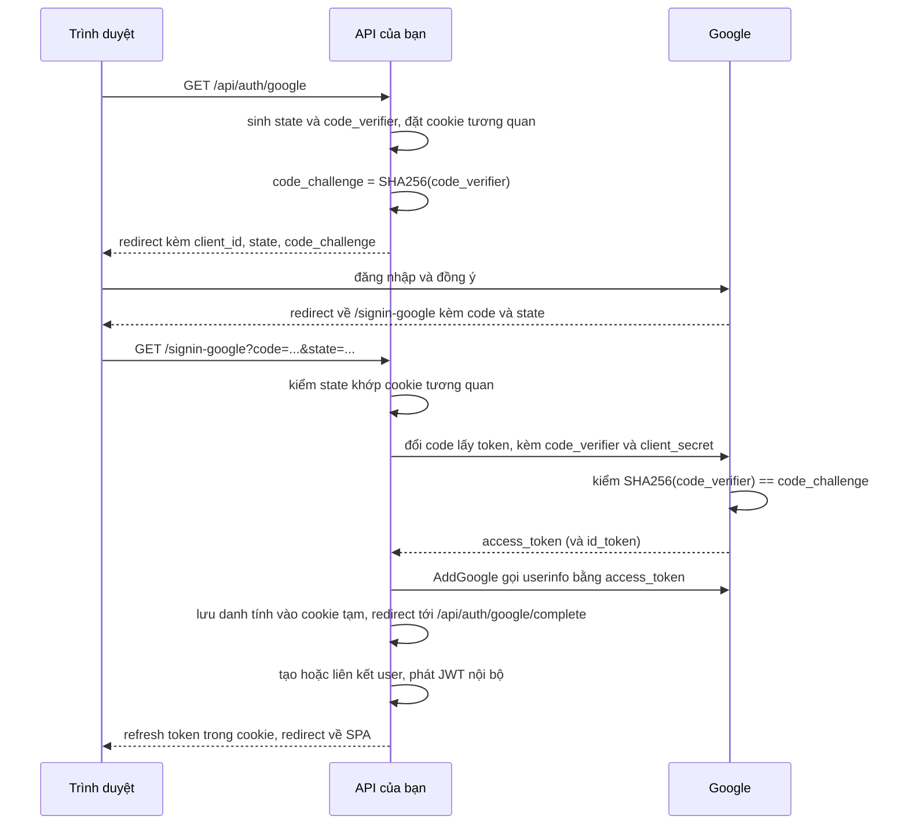

# 10.9 - Đăng nhập bằng Google: OAuth 2.0 và OpenID Connect

> **Tóm tắt:** Hai chuẩn hay bị gọi lẫn nhau: **OAuth 2.0 là uỷ quyền** (*"cho ứng dụng này đọc Google Drive của tôi"*), **OpenID Connect (OIDC) là xác thực** (*"đây là ai"*) — và OIDC xây **trên** OAuth2 bằng cách thêm `id_token`. Google hỗ trợ OIDC, nhưng handler `AddGoogle` của ASP.NET Core thật ra chạy **OAuth 2.0 rồi gọi endpoint userinfo** để lấy danh tính, không kiểm `id_token`; muốn OIDC đúng nghĩa thì dùng `AddOpenIdConnect`. Về luồng: chỉ có **một** luồng nên dùng ngày nay — **Authorization Code + PKCE**. Trong một API dùng JWT, handler Google cần một **cookie tạm** để giữ danh tính vừa lấy được, rồi API đổi nó lấy JWT của chính mình. Và rủi ro lớn nhất khi tích hợp: **liên kết tài khoản theo email mà không kiểm tra `email_verified`** — kẻ tấn công đăng ký ở một nhà cung cấp nào đó với email của bạn và chiếm luôn tài khoản trong hệ thống.

> Bài **nâng cao, không bắt buộc** trong lộ trình chính của module. Làm được bài tập cần một OAuth Client ID tạo trong Google Cloud Console.

## Mục tiêu bài học

Sau bài này bạn có thể:

- Phân biệt OAuth 2.0 và OpenID Connect, và biết `AddGoogle` đang dùng cái nào.
- Mô tả luồng Authorization Code + PKCE và vai trò của `state`, `nonce`, `code_verifier`.
- Cấu hình đăng nhập Google cho một API JWT: cookie tạm, `SignInScheme`, đổi danh tính ngoài lấy JWT nội bộ.
- Liên kết tài khoản ngoài với tài khoản nội bộ an toàn, không bị chiếm tài khoản qua email chưa xác minh.
- Chọn `SameSite` đúng cho từng cookie trong luồng.

**Cần biết trước:** JWT và refresh token trong cookie ([bài 10.2](10.2-jwt-authentication.md), [bài 10.3](10.3-refresh-token.md)), `UserManager` và `SignInManager` ([bài 10.8](10.8-overview.md)), user-secrets ([bài 8.6](../module-08-aspnet-core-fundamentals/8.6-configuration-system.md)).

## Nội dung bài học

### 10.9.1 — OAuth2 hay OpenID Connect

| | OAuth 2.0 | OpenID Connect |
|---|---|---|
| Trả lời | "Ứng dụng này được làm gì?" | "Người này là ai?" |
| Trả về | `access_token` | `access_token` + **`id_token`** |
| `id_token` là | — | **JWT** chứa danh tính, đã ký |
| Dùng cho | Gọi API của bên thứ ba | **Đăng nhập** |

Dùng `access_token` của OAuth2 làm bằng chứng danh tính là sai: nó là **chìa khoá cho một API**, không phải bằng chứng danh tính, và với phần lớn nhà cung cấp nó là chuỗi mờ mà bạn không tự xác thực được.

`id_token` thì khác — nó là JWT có chữ ký, xác thực được bằng khoá công từ endpoint JWKS của nhà cung cấp, đúng như [bài 10.2](10.2-jwt-authentication.md).

**ASP.NET Core có hai cách nối với Google, và chúng không giống nhau:**

| | `AddGoogle` (gói `Microsoft.AspNetCore.Authentication.Google`) | `AddOpenIdConnect` (gói `Microsoft.AspNetCore.Authentication.OpenIdConnect`) |
|---|---|---|
| Giao thức | OAuth 2.0 | OpenID Connect |
| Lấy danh tính bằng | Dùng `access_token` gọi `https://www.googleapis.com/oauth2/v3/userinfo` | Kiểm chữ ký và nội dung `id_token` |
| `nonce` | Không gửi | Có |
| Cấu hình | Ít, có sẵn ánh xạ claim của Google | Phải đặt `Authority = "https://accounts.google.com"`, `ResponseType = "code"` |

Với `AddGoogle`, danh tính đáng tin vì `access_token` được đổi trực tiếp giữa server của bạn và Google qua HTTPS, kèm `client_secret`, rồi dùng ngay để gọi userinfo — trình duyệt không chạm vào bước đó. Đó là lý do nó vẫn an toàn dù không kiểm `id_token`. Bài này dùng `AddGoogle` vì nó gọn và là cách tài liệu Microsoft hướng dẫn; mục 10.9.6 nói khi nào nên chuyển sang `AddOpenIdConnect`.

### 10.9.2 — Authorization Code + PKCE



Ba tham số bảo mật, mỗi cái chống một thứ khác nhau:

| Tham số | Chống |
|---|---|
| **`state`** | **CSRF đăng nhập** — kẻ tấn công ép trình duyệt của bạn hoàn tất luồng đăng nhập bằng tài khoản của **họ** |
| **`nonce`** | **Replay** — `id_token` cũ bị dùng lại (chỉ có ý nghĩa khi bạn kiểm `id_token`, tức với OIDC) |
| **`code_verifier` / PKCE** | **Đánh cắp mã** — mã bị chặn trên đường redirect cũng vô dụng khi thiếu `code_verifier` |

`state` phải là chuỗi ngẫu nhiên, được lưu ở phía bạn, và **đối chiếu** khi callback về. Handler của ASP.NET Core làm việc này: nó mã hoá `state` và đặt một cookie tương quan (correlation cookie) để kiểm khi Google gọi lại. Tự viết luồng OAuth mà bỏ bước đối chiếu là một lỗ hổng CSRF thật sự — và nó dễ bị bỏ qua vì luồng vẫn chạy bình thường khi không có ai tấn công.

**PKCE** (Proof Key for Code Exchange) sinh ra cho ứng dụng di động (không giữ được secret), nhưng RFC 9700 khuyến nghị dùng cho **mọi** loại client, kể cả web server có secret. `AddGoogle` bật PKCE mặc định.

**Implicit flow** — trả token thẳng trong URL fragment — đã bị khuyến cáo **không dùng**: token lọt vào lịch sử trình duyệt, vào log của proxy, vào header `Referer`.

### 10.9.3 — Cấu hình cho một API JWT

```bash
dotnet add package Microsoft.AspNetCore.Authentication.Google
dotnet user-secrets set "Google:ClientId" "<client id từ Google Cloud Console>"
dotnet user-secrets set "Google:ClientSecret" "<client secret>"
```

Trong Google Cloud Console, thêm `https://localhost:5001/signin-google` vào danh sách "Authorized redirect URIs".

```csharp
// Program.cs
builder.Services
    .AddAuthentication(JwtBearerDefaults.AuthenticationScheme)
    .AddJwtBearer(/* như bài 10.2 */)
    .AddCookie(IdentityConstants.ExternalScheme)          // cookie tạm giữ danh tính Google
    .AddGoogle(options =>
    {
        options.ClientId     = builder.Configuration["Google:ClientId"]!;
        options.ClientSecret = builder.Configuration["Google:ClientSecret"]!;
        options.SignInScheme = IdentityConstants.ExternalScheme;

        options.ClaimActions.MapJsonKey("email_verified", "email_verified");
    });

// Identity như bài 10.8, nhớ có .AddSignInManager()
```

Mặc định của `GoogleOptions` trên .NET 10 (in ra từ code): scope `openid profile email`, `UsePkce = true`, `SaveTokens = false`, `CallbackPath = /signin-google`. `CallbackPath` là đường dẫn handler tự xử lý, không phải một action trong controller của bạn.

**Vì sao cần `AddCookie(IdentityConstants.ExternalScheme)` và `SignInScheme`?** Sau khi lấy được danh tính từ Google, handler phải **cất** nó ở đâu đó để request kế tiếp đọc được. Nó cất bằng cách gọi `SignInAsync` vào `SignInScheme`. Nếu không đặt, `SignInScheme` rơi về scheme mặc định là `Bearer`, mà JwtBearer không biết "đăng nhập" (nó chỉ đọc token). Lỗi xuất hiện ở bước callback, đúng lúc khó gỡ nhất:

```text
InvalidOperationException: The authentication handler registered for scheme 'Bearer' is 'JwtBearerHandler'
which cannot be used for SignInAsync. Did you forget to call AddAuthentication().AddCookie("Cookies")
and SignInAsync("Cookies",...)?
```

Cookie tạm này sống vài phút, chỉ dùng trong luồng đăng nhập ngoài; API vẫn xác thực mọi request khác bằng JWT.

Dòng `ClaimActions` là quan trọng nhất trong đoạn cấu hình. Ánh xạ mặc định của `AddGoogle` chỉ lấy `sub`, `name`, `given_name`, `family_name`, `email`... mà không lấy `email_verified`; dòng này đưa nó vào claim để mục sau dùng. Chú ý: userinfo trả `"email_verified": true` (kiểu boolean JSON), và giá trị claim nhận được là chuỗi **`"True"`** với chữ T hoa — so sánh phải không phân biệt hoa thường.

`ClientSecret` là **secret** — user-secrets khi phát triển, biến môi trường hoặc Key Vault khi chạy thật, không phải `appsettings.json` ([bài 8.6](../module-08-aspnet-core-fundamentals/8.6-configuration-system.md)).

Hai endpoint của luồng:

```csharp
// AuthController.cs
[HttpGet("google")]
[AllowAnonymous]
public IActionResult GoogleLogin()
{
    // Ghi tên provider vào AuthenticationProperties để GetExternalLoginInfoAsync đọc lại được
    var props = signInManager.ConfigureExternalAuthenticationProperties(
        GoogleDefaults.AuthenticationScheme, redirectUrl: "/api/auth/google/complete");
    return Challenge(props, GoogleDefaults.AuthenticationScheme);
}

[HttpGet("google/complete")]
[AllowAnonymous]
public async Task<IActionResult> GoogleComplete(CancellationToken ct)
{
    var info = await signInManager.GetExternalLoginInfoAsync();   // đọc cookie tạm
    await HttpContext.SignOutAsync(IdentityConstants.ExternalScheme);   // xoá cookie tạm ngay

    if (info is null)
        return Redirect($"{clientUrl}/login?error=external");

    var outcome = await externalLogins.HandleAsync(info, ct);    // mục 10.9.4
    if (outcome.User is null)
        return Redirect($"{clientUrl}/login?error={Uri.EscapeDataString(outcome.Error!)}");

    var refresh = await refreshTokens.IssueAsync(outcome.User.Id,
        HttpContext.Connection.RemoteIpAddress?.ToString(), Request.Headers.UserAgent.ToString(), ct);
    Response.Cookies.Append(RefreshCookie.Name, refresh,
        RefreshCookie.Options(DateTimeOffset.UtcNow.AddDays(7)));          // cookie của bài 10.3

    return Redirect($"{clientUrl}/auth/callback");
}
```

`clientUrl` là địa chỉ SPA, đọc từ cấu hình. Gọi `GET /api/auth/google` trên .NET 10 trả `302` tới `https://accounts.google.com/o/oauth2/v2/auth` với các tham số (chạy thật):

```text
client_id, scope, response_type, redirect_uri, code_challenge, code_challenge_method, state
scope=openid profile email   code_challenge_method=S256   redirect_uri=https://localhost/signin-google
```

Không có `nonce` — đúng như đã nói, `AddGoogle` là OAuth 2.0. Quên `ConfigureExternalAuthenticationProperties` (gọi `Challenge` với `AuthenticationProperties` tự tạo) thì `GetExternalLoginInfoAsync` luôn trả `null`, vì nó tìm tên provider trong `AuthenticationProperties` mà không thấy.

### 10.9.4 — Rủi ro chiếm tài khoản

```csharp
// SAI — liên kết theo email mà không kiểm tra gì
var user = await _userManager.FindByEmailAsync(email);
if (user is not null)
    await _userManager.AddLoginAsync(user, info);   // CHIẾM TÀI KHOẢN
```

Kịch bản tấn công:

1. Nạn nhân có tài khoản `victim@company.com` trong hệ thống của bạn, đăng nhập bằng mật khẩu.
2. Kẻ tấn công tìm một nhà cung cấp đăng nhập **không xác minh email** và đăng ký ở đó với `victim@company.com`.
3. Kẻ tấn công bấm "Đăng nhập bằng nhà cung cấp X" trên hệ thống của bạn.
4. Hệ thống thấy email khớp, liên kết tài khoản, và **cấp quyền vào tài khoản của nạn nhân**.

Luồng đầy đủ, với hai tầng bảo vệ: chỉ tin email đã xác minh, và chỉ tự động liên kết với nhà cung cấp đáng tin:

```csharp
// ExternalLoginResult.cs
public sealed record ExternalLoginResult(AppUser? User, string? Error);
```

```csharp
// ExternalLoginService.cs
public sealed class ExternalLoginService(
    UserManager<AppUser> userManager, ILinkConfirmationSender linkRequests)
{
    // Rất ngắn và được review: chỉ nhà cung cấp có quy trình xác minh email nghiêm túc
    private static readonly HashSet<string> TrustedProviders = ["Google"];

    private static bool IsEmailVerified(ExternalLoginInfo info) =>
        string.Equals(info.Principal.FindFirstValue("email_verified"), "true",
                      StringComparison.OrdinalIgnoreCase);         // giá trị thật là "True"

    public async Task<ExternalLoginResult> HandleAsync(ExternalLoginInfo info, CancellationToken ct)
    {
        // 1. Đã liên kết trước đó -> đăng nhập
        var user = await userManager.FindByLoginAsync(info.LoginProvider, info.ProviderKey);
        if (user is not null)
            return user.IsActive ? new(user, null) : new(null, "account-disabled");

        var email = info.Principal.FindFirstValue(ClaimTypes.Email);
        if (email is null)
            return new(null, "no-email");

        if (!IsEmailVerified(info))
            return new(null, "email-not-verified");

        // 2. Email đã tồn tại -> chỉ tự liên kết với nhà cung cấp đáng tin
        var existing = await userManager.FindByEmailAsync(email);
        if (existing is not null)
        {
            if (!existing.IsActive)                                  // bị vô hiệu hoá -> không cấp gì
                return new(null, "account-disabled");

            if (!TrustedProviders.Contains(info.LoginProvider))
            {
                await linkRequests.SendAsync(existing, info, ct);    // hỏi chủ tài khoản qua email
                return new(null, "check-your-email");
            }

            await userManager.AddLoginAsync(existing, info);
            return new(existing, null);
        }

        // 3. Người dùng mới — quyền thấp nhất
        var newUser = new AppUser
        {
            UserName = email, Email = email, EmailConfirmed = true,
            FullName = info.Principal.FindFirstValue(ClaimTypes.Name),
        };

        var created = await userManager.CreateAsync(newUser);
        if (!created.Succeeded)
            return new(null, "create-failed");

        await userManager.AddLoginAsync(newUser, info);
        await userManager.AddToRoleAsync(newUser, CrmRoles.ReadOnly);
        return new(newUser, null);
    }
}
```

`ILinkConfirmationSender` là một service bạn tự viết để gửi email "bấm vào đây để liên kết tài khoản Google với tài khoản hiện có" tới **địa chỉ đã có trong hệ thống**.

Chú ý dòng `!existing.IsActive`: **mọi** đường đăng nhập đều phải kiểm tài khoản còn hoạt động, kể cả đăng nhập ngoài. Thiếu nó, một tài khoản đã bị vô hiệu hoá nhưng chưa từng liên kết Google vẫn đăng nhập được bằng Google và nhận refresh token mới — đúng lỗ hổng mà [bài 10.12](10.12-mini-case-study.md) dạy cách bịt.

Chú ý dòng cuối: người dùng mới nhận **quyền thấp nhất**. Tự động cấp quyền theo tên miền email (`@company.com` thành `Manager`) là cách nhiều hệ thống bị xâm nhập — tên miền email không phải bằng chứng về vai trò trong tổ chức.

Kiểm chứng đường đi qua cookie tạm (chạy thật, giả lập bước Google đã trả danh tính về): `GetExternalLoginInfoAsync` trả `provider=Google`, `ProviderKey` bằng `sub` của Google, claim `email_verified = 'True'`. So sánh `== "true"` cho `False`, so sánh không phân biệt hoa thường cho `True` — đúng cái bẫy đã nói ở mục 10.9.3.

### 10.9.5 — Xử lý ở phía client

Với SPA, đừng trả JWT nội bộ trong **URL**:

```csharp
// SAI — token vào lịch sử trình duyệt, vào log proxy, vào Referer
return Redirect($"{clientUrl}/auth/callback?token={jwt}");
```

Endpoint `GoogleComplete` ở mục 10.9.3 làm đúng: đặt refresh token vào cookie `HttpOnly` (cùng `RefreshCookie.Options()` của [bài 10.3](10.3-refresh-token.md), `SameSite=Strict`, `Path=/api/auth`), rồi redirect về SPA **không kèm token nào**. SPA sau đó gọi `POST /api/auth/refresh` để lấy access token, đúng mẫu ở bài 10.3.

`SameSite=Strict` vẫn dùng được ở đây. Trình duyệt **nhận** cookie Strict trong response của một lần điều hướng cấp cao nhất, kể cả khi chuỗi redirect bắt đầu từ Google; thứ `Strict` chặn là **gửi** cookie kèm request khởi phát từ site khác. Lần gọi `/api/auth/refresh` sau đó xuất phát từ chính SPA của bạn (cùng site), nên cookie được gửi bình thường. Bài tập 3 xem kỹ chuyện này.

### 10.9.6 — Khi nào dùng `AddOpenIdConnect`

`AddGoogle` đủ cho "Đăng nhập bằng Google" thông thường. Chuyển sang `AddOpenIdConnect` khi:

- bạn cần **`id_token` đã kiểm chữ ký** làm bằng chứng (ví dụ chuyển tiếp danh tính cho service khác),
- bạn tích hợp nhà cung cấp chuẩn OIDC khác (Microsoft Entra ID, Keycloak, Auth0) và muốn một cấu hình chung,
- bạn cần `nonce` và các kiểm tra OIDC đầy đủ.

```csharp
.AddOpenIdConnect("Google", options =>
{
    options.Authority    = "https://accounts.google.com";
    options.ClientId     = builder.Configuration["Google:ClientId"]!;
    options.ClientSecret = builder.Configuration["Google:ClientSecret"]!;
    options.ResponseType = "code";            // mặc định của handler là "id_token", phải đổi
    options.SignInScheme = IdentityConstants.ExternalScheme;
    options.CallbackPath = "/signin-oidc-google";
    options.Scope.Add("email");
});
```

Handler OIDC tự tải cấu hình và khoá công từ `https://accounts.google.com/.well-known/openid-configuration`, kiểm chữ ký, `iss`, `aud`, hạn và `nonce` của `id_token`. Mặc định `ResponseType` của `OpenIdConnectOptions` trên .NET 10 là `id_token` (in ra từ code), nên dòng `ResponseType = "code"` là bắt buộc để dùng Authorization Code + PKCE.

### 10.9.7 — Lỗi thường gặp

**Danh sách rà soát đăng nhập ngoài**

- [ ] Dùng Authorization Code + PKCE, không dùng Implicit flow.
- [ ] Biết AddGoogle là OAuth 2.0 + userinfo; cần id_token đã kiểm thì dùng AddOpenIdConnect với ResponseType code.
- [ ] Có AddCookie(IdentityConstants.ExternalScheme) và SignInScheme trỏ tới nó; JwtBearer không làm SignInScheme được.
- [ ] Challenge dùng ConfigureExternalAuthenticationProperties để GetExternalLoginInfoAsync đọc được.
- [ ] Cookie tạm bị xoá (SignOutAsync) ngay sau khi đổi sang JWT nội bộ.
- [ ] Chỉ liên kết tài khoản khi email_verified là true, so sánh không phân biệt hoa thường.
- [ ] Email trùng với tài khoản có sẵn cần xác nhận trước khi liên kết, trừ nhà cung cấp đáng tin.
- [ ] Người dùng mới nhận quyền thấp nhất, không cấp theo tên miền email.
- [ ] ClientSecret nằm trong user-secrets, biến môi trường hoặc Key Vault.
- [ ] SaveTokens tắt trừ khi thật sự cần gọi API của nhà cung cấp.
- [ ] Không trả JWT nội bộ qua URL; dùng cookie HttpOnly.

## Bài tập áp dụng

#### Bài 1 — Đọc danh tính Google và quyết định dùng claim nào

Hoàn tất một luồng đăng nhập Google, in ra các claim mà `GetExternalLoginInfoAsync` trả về, và giải mã `id_token` mà Google gửi kèm. Xác định claim nào bạn thật sự dùng.

**Tiêu chí hoàn thành:** bạn chỉ ra được claim nào **định danh người dùng một cách bền vững**, và vì sao `email` không phải claim đó.

<details>
<summary><strong>Gợi ý và lời giải — Bài 1</strong></summary>

**Gợi ý.** Hỏi: người dùng có đổi được giá trị này không? Và nếu họ đổi, tài khoản của họ trong hệ thống bạn có còn nhận ra họ không?

**Lời giải — lấy `id_token`.** `AddGoogle` không lưu `id_token` vào danh tính, kể cả khi bật `SaveTokens` (nó chỉ lưu `access_token`, `refresh_token`, `token_type`, `expires_at`). Muốn xem thì đọc từ response của bước đổi mã, trong sự kiện `OnCreatingTicket`, chỉ khi đang học:

```csharp
options.Events.OnCreatingTicket = ctx =>
{
    if (ctx.TokenResponse.Response?.RootElement.TryGetProperty("id_token", out var idToken) == true)
        ctx.HttpContext.RequestServices.GetRequiredService<ILogger<Program>>()
            .LogInformation("id_token: {IdToken}", idToken.GetString());   // CHỈ khi học, xoá ngay sau đó
    return Task.CompletedTask;
};
```

```bash
python3 -c "
import base64,json,sys
p = sys.argv[1].split('.')[1]; p += '=' * (-len(p) % 4)
print(json.dumps(json.loads(base64.urlsafe_b64decode(p)), indent=2, ensure_ascii=False))
" "$ID_TOKEN"
```

Payload `id_token` của Google có dạng sau (giá trị đã thay, danh sách claim theo tài liệu OpenID Connect của Google):

```json
{
  "iss": "https://accounts.google.com",
  "azp": "1234.apps.googleusercontent.com",
  "aud": "1234.apps.googleusercontent.com",
  "sub": "110248495921238986420",
  "email": "an@company.com",
  "email_verified": true,
  "name": "Nguyễn Văn An",
  "picture": "https://lh3.googleusercontent.com/a/...",
  "given_name": "An",
  "family_name": "Nguyễn Văn",
  "iat": 1790000000,
  "exp": 1790003600
}
```

**Claim định danh bền vững là `sub`.** Nó do Google cấp, duy nhất trong phạm vi issuer, và **không đổi** — kể cả khi người dùng đổi email, đổi tên, hay đổi ảnh đại diện. `AddGoogle` ánh xạ `sub` thành `ClaimTypes.NameIdentifier`, và `ExternalLoginInfo.ProviderKey` chính là giá trị đó.

**Vì sao `email` không dùng làm định danh — ba lý do:**

1. **Người dùng đổi được.** Google Workspace cho phép đổi địa chỉ chính. Sau khi đổi, nếu bạn tra theo email thì người đó thành một người mới và mất sạch dữ liệu.
2. **Email có thể được cấp lại.** Nhân viên nghỉ việc, công ty gán `an@company.com` cho người mới. Tra theo email là người mới vào thẳng tài khoản của người cũ.
3. **`email_verified` có thể là `false`.** Với một số nhà cung cấp, người dùng tự khai email mà không chứng minh sở hữu — xem bài 2.

**Cách lưu đúng — Identity đã làm sẵn.** Bảng `"AspNetUserLogins"` của Identity có khoá chính là cặp (`LoginProvider`, `ProviderKey`), tức (`Google`, `sub`), kèm `UserId` trỏ tới người dùng nội bộ. `AddLoginAsync` ghi vào bảng này, `FindByLoginAsync` tra từ nó. Bạn không cần tạo bảng riêng.

`email` chỉ dùng để **hiển thị** và để **gợi ý liên kết** với tài khoản sẵn có — và việc liên kết đó cần xác nhận, xem bài 2.

**Bảng phân loại claim:**

| Claim | Dùng làm gì | Lưu lại? |
|---|---|---|
| `sub` | **Định danh** | Có — trong `"AspNetUserLogins"` cùng tên provider |
| `email` | Hiển thị, gợi ý liên kết | Có, nhưng cập nhật lại mỗi lần đăng nhập |
| `email_verified` | Quyết định có tự động liên kết không | Không — kiểm tại chỗ |
| `name`, `picture` | Hiển thị | Tuỳ, cập nhật mỗi lần đăng nhập |
| `given_name`, `family_name` | Hầu như không dùng | Không |
| `iss`, `aud`, `exp` | Thư viện tự xác thực (với OIDC) | Không |

Xem xong thì **xoá đoạn `OnCreatingTicket`** — ghi token vào log là đúng loại lỗi [bài 10.2](10.2-jwt-authentication.md) đã cảnh báo.

</details>

---

#### Bài 2 — Chiếm tài khoản qua liên kết tự động theo email

Tạo tài khoản `test@example.com` bằng mật khẩu. Viết unit test cho `ExternalLoginService.HandleAsync` với một `ExternalLoginInfo` giả có cùng email nhưng `email_verified = "False"`, và xác nhận code **không** liên kết.

**Tiêu chí hoàn thành:** test xanh, và bạn mô tả được **toàn bộ chuỗi tấn công** từ góc nhìn kẻ xấu, không chỉ nói "thiếu kiểm tra".

<details>
<summary><strong>Gợi ý và lời giải — Bài 2</strong></summary>

**Gợi ý.** Có những nhà cung cấp OAuth cho phép đặt email tuỳ ý trong hồ sơ mà không bắt chứng minh sở hữu. `ExternalLoginInfo` tạo được bằng `new ExternalLoginInfo(principal, loginProvider, providerKey, displayName)`.

**Lời giải — dựng `ExternalLoginInfo` giả:**

```csharp
var principal = new ClaimsPrincipal(new ClaimsIdentity(
[
    new Claim(ClaimTypes.NameIdentifier, "attacker-123"),
    new Claim(ClaimTypes.Email, "test@example.com"),
    new Claim("email_verified", "False"),
], authenticationType: "SomeProvider"));

var info = new ExternalLoginInfo(principal, "SomeProvider", "attacker-123", "SomeProvider");

var outcome = await service.HandleAsync(info, CancellationToken.None);

Assert.Null(outcome.User);
Assert.Equal("email-not-verified", outcome.Error);
Assert.Empty(await userManager.GetLoginsAsync(existingUser));   // không có liên kết nào được tạo
```

**Chuỗi tấn công đầy đủ, nếu code chỉ so email:**

```text
1. Kẻ tấn công biết nạn nhân dùng ceo@company.com trên hệ thống của bạn
   (email công ty thường đoán được: ho.ten@congty.com)

2. Hắn tạo tài khoản ở một nhà cung cấp OAuth cho phép tự khai email,
   và đặt email hồ sơ thành ceo@company.com — không cần chứng minh gì

3. Hắn bấm "Đăng nhập bằng <nhà cung cấp>" trên hệ thống của bạn

4. Code của bạn đọc claim email, thấy ceo@company.com, tìm thấy tài
   khoản của CEO, và GẮN danh tính của kẻ tấn công vào tài khoản đó

5. Hắn đăng nhập vào tài khoản CEO — không cần mật khẩu, không cần
   chạm vào email thật của CEO, không để lại dấu vết nào bất thường
```

**Điểm đáng chú ý:** không có bước nào là "tấn công" theo nghĩa kỹ thuật. Không dò mật khẩu, không khai thác lỗ hổng bộ nhớ, không SQL injection. Hắn chỉ dùng đúng luồng đăng nhập mà bạn cung cấp.

**Ba nguyên tắc rút ra, và `ExternalLoginService` ở mục 10.9.4 làm đủ cả ba:**

1. **`email_verified` không phải `true` thì không liên kết gì cả** — email đó chưa được chứng minh là của ai.
2. **Chỉ tự động liên kết với nhà cung cấp bạn tin cậy.** Google và Microsoft có quy trình xác minh email nghiêm túc; một nhà cung cấp OAuth bất kỳ thì không.
3. **Khi email đã tồn tại và nhà cung cấp không nằm trong danh sách tin cậy, hãy hỏi chủ tài khoản.** Gửi email xác nhận tới **địa chỉ đã có trong hệ thống** — chỉ người thật sự kiểm soát hộp thư đó mới bấm được.

**Và tài khoản mới luôn bắt đầu ở quyền thấp nhất.** Nếu bước xác minh nào đó vẫn bị vượt qua, kẻ tấn công cũng chỉ có tài khoản chỉ-đọc thay vì quyền của tài khoản cũ.

Viết thêm ba test cho đủ ma trận: cùng email, `email_verified = "True"`, provider `Google` → liên kết; cùng email, `"True"`, provider không tin cậy → `check-your-email`; cùng email, `"True"`, provider `Google` nhưng tài khoản có `IsActive = false` → `account-disabled` và không tạo liên kết nào.

</details>

---

#### Bài 3 — Cookie nào cần `SameSite` gì trong luồng đăng nhập ngoài

Chạy luồng đăng nhập Google với refresh token cookie `SameSite=Strict` như bài 10.3. Mở DevTools, tab Application → Cookies và tab Network, ghi lại **mọi** cookie xuất hiện trong luồng cùng thuộc tính `SameSite` của chúng, và xác nhận SPA gọi `/api/auth/refresh` thành công.

**Tiêu chí hoàn thành:** bạn giải thích được vì sao cookie tương quan phải là `SameSite=None` trong khi refresh token cookie là `Strict` vẫn chạy, và khi nào mới thật sự cần `Lax`.

<details>
<summary><strong>Gợi ý và lời giải — Bài 3</strong></summary>

**Gợi ý.** `SameSite` quyết định trình duyệt có **gửi** cookie kèm một request hay không, dựa trên việc request đó khởi phát từ site nào. Hãy xem từng cookie cần được **gửi** ở request nào.

**Lời giải — ba cookie trong luồng:**

| Cookie | Do ai đặt | Cần được gửi ở request nào | `SameSite` |
|---|---|---|---|
| `.AspNetCore.Correlation.*` | Handler Google, lúc `GET /api/auth/google` | `GET /signin-google?code=...` — redirect từ `accounts.google.com`, tức **khởi phát từ site khác** | `None` (handler tự đặt) |
| `.AspNetCore.Identity.External` | Handler Google, lúc xử lý `/signin-google` | `GET /api/auth/google/complete` — redirect từ chính API | `Lax` (mặc định của cookie handler) |
| `refresh_token` | `GoogleComplete` | `POST /api/auth/refresh` do SPA gọi | `Strict` (bài 10.3) |

Thuộc tính của hai cookie đầu là kết quả chạy thật trên .NET 10:

```http
Set-Cookie: .AspNetCore.Correlation.OBXhyJAYaCPkCz5...=N; expires=...; path=/signin-google; secure; samesite=none; httponly
Set-Cookie: .AspNetCore.Identity.External=...; path=/; secure; samesite=lax; httponly
```

**Cookie tương quan phải là `None`** vì nó phải đi kèm đúng request khởi phát từ Google. Nếu nó là `Strict`, request `/signin-google` sẽ không mang nó, handler không đối chiếu được `state`, và bạn nhận lỗi "Correlation failed". Bạn không phải làm gì: handler đã đặt `SameSite=None; Secure` sẵn. Lỗi "Correlation failed" thật sự thường đến từ chỗ khác — trang chạy qua HTTP nên cookie `Secure` không được lưu, hoặc sau proxy mà thiếu `UseForwardedHeaders()` ([bài 10.10](10.10-security-best-practices.md)).

**Refresh token cookie là `Strict` vẫn chạy** vì hai lẽ. Thứ nhất, trình duyệt vẫn **nhận và lưu** cookie `Strict` trong response của `GoogleComplete` — đó là một điều hướng cấp cao nhất, và `SameSite` không ngăn việc đặt cookie trong trường hợp này. Thứ hai, cookie đó chỉ cần được **gửi** ở `POST /api/auth/refresh`, request do chính SPA của bạn khởi phát (cùng site), nên `Strict` không chặn. Không có lý do gì phải hạ nó xuống `Lax`.

**Khác biệt chính xác giữa ba giá trị** (theo đặc tả cookie RFC 6265bis):

| Request khởi phát từ site khác | `Strict` | `Lax` | `None` |
|---|---|---|---|
| **Điều hướng cấp cao nhất** bằng `GET` (bấm link, redirect) | **Không gửi** | **Gửi** | Gửi |
| `POST` từ form ở site khác | Không | **Không** | Gửi |
| `fetch`/XHR từ site khác | Không | **Không** | Gửi |
| Ảnh, iframe nhúng ở site khác | Không | Không | Gửi |

Request cùng site thì cả ba giá trị đều gửi.

**Khi nào mới cần `Lax`:** khi chính cookie đó phải có mặt ở **lần điều hướng đầu tiên từ site khác** — ví dụ một ứng dụng web render ở server, người dùng bấm link từ email hay từ Google vào thẳng một trang cần đăng nhập. Với `Strict`, trang đó thấy người dùng như chưa đăng nhập ở lần tải đầu. Refresh token chỉ dùng ở `/api/auth/refresh` nên không thuộc trường hợp này.

**Vì sao `Lax` vẫn chặn được CSRF cổ điển.** Tấn công CSRF dựa vào việc trang độc hại tự gửi một request thay đổi dữ liệu mà người dùng không biết:

```html
<!-- Trang của kẻ tấn công -->
<form action="https://crm.company.com/api/customers/42" method="POST">
  <input name="delete" value="true">
</form>
<script>document.forms[0].submit()</script>
```

Đây là `POST` xuyên site — **dòng thứ hai trong bảng** — nên `Lax` **không** gửi cookie. Điều `Lax` cho phép chỉ là `GET` ở cấp cao nhất, mà `GET` theo đúng thiết kế thì không được thay đổi dữ liệu. Nếu API có endpoint `GET` gây thay đổi dữ liệu (`GET /customers/42/delete`), thì `Lax` **không** bảo vệ nó — một lý do nữa để tôn trọng ngữ nghĩa của HTTP method, như [bài 9.1](../module-09-web-api-professional/9.1-rest-api-design-principles.md) trình bày.

**Quy ước của module:**

```csharp
// Refresh token — chỉ cần gửi tới /api/auth từ chính SPA
SameSite = SameSiteMode.Strict

// Cookie phải có mặt khi người dùng vào từ link ở site khác (web render ở server)
SameSite = SameSiteMode.Lax

// Chỉ khi frontend nằm ở SITE khác backend — và BẮT BUỘC kèm Secure
SameSite = SameSiteMode.None, Secure = true
```

**Cẩn thận với `None`:** nó tắt hẳn lớp bảo vệ SameSite, nên phải bù lại bằng token chống CSRF hoặc kiểm tra header `Origin` ở phía server ([bài 10.10](10.10-security-best-practices.md)).

</details>

## Tự kiểm tra

<details>
<summary>OAuth 2.0 và OpenID Connect khác nhau thế nào?</summary>

OAuth 2.0 là uỷ quyền, trả lời ứng dụng này được làm gì, và trả về access_token. OpenID Connect là xác thực, trả lời người này là ai, và xây trên OAuth2 bằng cách thêm id_token là một JWT có chữ ký chứa danh tính.

</details>

<details>
<summary>AddGoogle lấy danh tính người dùng bằng cách nào?</summary>

Nó chạy OAuth 2.0: đổi code lấy access_token ở phía server kèm client_secret, rồi dùng access_token gọi endpoint userinfo của Google. Nó không kiểm id_token và không gửi nonce. Cần id_token đã kiểm chữ ký thì dùng AddOpenIdConnect với Authority là accounts.google.com và ResponseType là code.

</details>

<details>
<summary>state, nonce và PKCE chống lại những gì?</summary>

state chống CSRF đăng nhập, tức kẻ tấn công ép bạn hoàn tất luồng đăng nhập bằng tài khoản của họ. nonce chống replay id_token cũ, chỉ có ý nghĩa khi bạn kiểm id_token. PKCE chống đánh cắp mã, làm cho mã bị chặn trên đường redirect cũng vô dụng vì thiếu code_verifier.

</details>

<details>
<summary>Vì sao một API JWT vẫn cần cookie trong luồng đăng nhập Google?</summary>

Vì sau khi lấy được danh tính từ Google, handler phải cất nó ở đâu đó cho request kế tiếp bằng cách SignInAsync vào SignInScheme. JwtBearer không làm được việc đó. Giải pháp là một cookie tạm IdentityConstants.ExternalScheme, đọc bằng GetExternalLoginInfoAsync, đổi sang JWT nội bộ rồi xoá ngay.

</details>

<details>
<summary>Rủi ro khi liên kết tài khoản theo email là gì?</summary>

Kẻ tấn công tìm một nhà cung cấp không xác minh email, đăng ký ở đó bằng email của nạn nhân, rồi đăng nhập vào hệ thống của bạn. Hệ thống thấy email khớp, liên kết tài khoản và cấp quyền vào tài khoản nạn nhân. Phải kiểm tra email_verified, so sánh không phân biệt hoa thường vì giá trị là True, và chỉ tự động liên kết với danh sách nhà cung cấp đáng tin rất ngắn.

</details>

<details>
<summary>Refresh token cookie có phải hạ xuống SameSite Lax cho luồng Google không?</summary>

Không. Cookie tương quan của handler mới cần đi kèm request từ Google về, và handler đã đặt nó là SameSite None. Refresh token cookie Strict vẫn được lưu ở response cuối của luồng và chỉ cần gửi khi SPA cùng site gọi /api/auth/refresh. Lax chỉ cần cho cookie phải có mặt ngay ở lần điều hướng đầu tiên từ site khác.

</details>

## Kết luận

Ba điều đáng nhớ nhất:

1. **`AddGoogle` là OAuth 2.0 + userinfo; OIDC đúng nghĩa là `AddOpenIdConnect`.** Cả hai đều dùng Authorization Code + PKCE.
2. **API JWT cần một cookie tạm** cho luồng đăng nhập ngoài: `AddCookie(IdentityConstants.ExternalScheme)` và `SignInScheme`, đổi sang JWT nội bộ rồi xoá.
3. **Không liên kết tài khoản theo email chưa xác minh** — đó là đường chiếm tài khoản.

## Tham khảo

- [Google external login setup in ASP.NET Core](https://learn.microsoft.com/en-us/aspnet/core/security/authentication/social/google-logins)
- [External provider authentication in ASP.NET Core](https://learn.microsoft.com/en-us/aspnet/core/security/authentication/social/)
- [OpenID Connect — Google Identity](https://developers.google.com/identity/openid-connect/openid-connect)
- [RFC 9700 — Best Current Practice for OAuth 2.0 Security](https://www.rfc-editor.org/rfc/rfc9700.html)
- [OpenID Connect Core 1.0](https://openid.net/specs/openid-connect-core-1_0.html)

## Điều hướng

- **Bài trước:** [10.8 — ASP.NET Core Identity cho API JWT](10.8-overview.md)
- **Bài tiếp theo:** [10.10 — Security Best Practices](10.10-security-best-practices.md)
- **Về module:** [Trang mục lục](README.md)
