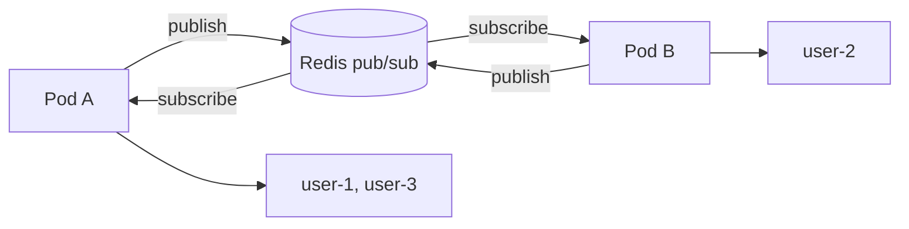

# 11.10 - Scale-out và Production

> **Tóm tắt:** Thêm instance thứ hai **phá vỡ** SignalR nếu không có backplane: người gửi ở pod A, người nhận ở pod B, và tin nhắn **biến mất không lỗi**. Redis backplane sửa điều đó, nhưng cần hiểu nó **không phải hàng đợi** — nó là **pub/sub** (phát và đăng ký nhận): instance đang mất kết nối Redis sẽ **mất luôn** những tin phát trong khoảng đó. Và khi Redis chết, **mọi** tin real-time ngừng, kể cả giữa hai người trên cùng một instance, nhưng API REST vẫn chạy — nên health check của backplane trả `Degraded`, không phải `Unhealthy`. Với quy mô lớn, **Azure SignalR Service** đưa toàn bộ kết nối ra ngoài tiến trình, bỏ được sticky session và giảm tác động của deploy nếu cấu hình graceful shutdown.

## Mục tiêu bài học

Sau bài này bạn có thể:

- Giải thích chính xác điều gì hỏng khi scale ngang không có backplane.
- Cấu hình Redis backplane và biết hành vi của nó khi Redis chết.
- Quyết định có cần sticky session hay không.
- So sánh Redis backplane với Azure SignalR Service.
- Giám sát bằng metric có sẵn và xử lý đợt kết nối lại khi deploy.

**Cần biết trước:** [bài 11.1](11.1-why-real-time-matters.md) (backplane là gì), [bài 11.2](11.2-signalr-architecture.md) (`negotiate`, giữ nhịp), [bài 8.9](../module-08-aspnet-core-fundamentals/8.9-health-checks.md) (health check). Bài dùng Nginx và Kubernetes ở mức đọc hiểu cấu hình; Module 15 dạy kỹ. Đây là bài nâng cao, cần khi hệ thống chạy nhiều instance.

## Nội dung bài học

### 11.10.1 — Điều gì hỏng khi không có backplane

```text
Pod A giữ: user-1, user-3
Pod B giữ: user-2

user-1 (trên Pod A) gửi tin cho user-2
=> Pod A tìm trong danh sách kết nối CỦA NÓ, không thấy user-2
=> Không gửi gì cả, KHÔNG có lỗi, KHÔNG có log
```

Đây là loại lỗi tệ nhất: nó **chạy hoàn hảo** trên máy dev một instance, và hỏng ngẫu nhiên trên production tuỳ theo load balancer đưa ai vào pod nào. Với 2 pod và phân phối đều, người nhận nằm ở pod khác người gửi khoảng một nửa số lần.

Backplane giải quyết bằng cách cho các instance **nói chuyện với nhau**:



Pod A publish lên Redis, **mọi** pod nhận, và pod nào đang giữ người nhận thì gửi đi. Kể cả tin cho người trên chính pod A cũng đi vòng qua Redis.

### 11.10.2 — Redis backplane

```bash
dotnet add package Microsoft.AspNetCore.SignalR.StackExchangeRedis
```

```csharp
builder.Services.AddSignalR()
    .AddStackExchangeRedis(
        builder.Configuration.GetConnectionString("Redis")!,
        options =>
        {
            options.Configuration.ChannelPrefix = RedisChannel.Literal("crm");
            options.Configuration.AbortOnConnectFail = false;   // không chết nếu Redis chưa sẵn sàng
            options.Configuration.ConnectRetry = 5;
        });
```

`ChannelPrefix` là **bắt buộc** khi nhiều ứng dụng dùng chung một Redis — không có nó, tin nhắn của ứng dụng này đi sang ứng dụng khác.

`AbortOnConnectFail = false` cho ứng dụng khởi động được khi Redis chưa sẵn sàng (thứ tự khởi động trong Kubernetes) và tự kết nối lại sau.

**Ba giới hạn phải biết:**

**1. Nó là pub/sub, không phải hàng đợi.** Instance mất kết nối Redis trong 5 giây sẽ **mất hoàn toàn** những tin phát trong 5 giây đó. Không có gửi lại, không có xác nhận. Đây là lý do [bài 11.8](11.8-notification-center-pattern.md) nhấn mạnh ghi database trước — bản ghi vẫn còn dù tin nhắn mất.

**2. Nó nhân lưu lượng.** Mỗi tin gửi tới một nhóm được publish một lần, rồi **mọi** instance nhận và tự lọc. Với 10 instance, một tin nhắn thành 10 lượt nhận — 9 trong đó là vô ích nếu chỉ một instance giữ người nhận.

```text
1.000 tin/giây được publish  =>  mỗi instance nhận 1.000 tin/giây, dù giữ người nhận hay không
                              =>  Redis gửi ra 1.000 × 10 = 10.000 tin/giây
```

Với lưu lượng cao, Redis thành nút cổ chai. Đó là lúc cần xem lại thiết kế ([bài 11.6](11.6-groups-and-targeting.md)): gom tin, gửi tín hiệu thay vì dữ liệu, giới hạn tần suất.

**3. Redis trở thành điểm hỏng của toàn bộ real-time.** Mọi lời gửi đều đi qua Redis, nên Redis chết thì **không tin nào tới**, kể cả giữa hai người trên cùng một instance; kết nối mới cũng không mở được. Bài 3 đo chính xác điều này. Dùng Redis Sentinel hoặc Cluster cho production.

### 11.10.3 — Sticky session

Sticky session nghĩa là load balancer luôn đưa request của cùng một client về cùng một instance. Câu hỏi thường gặp: **có cần không?**

| Transport | Cần sticky |
|---|---|
| WebSocket **có** `negotiate` | **Có** — `negotiate` và kết nối phải cùng instance |
| WebSocket **bỏ** `negotiate` | **Không** |
| SSE, long polling | **Có** — mọi request phải về cùng instance |
| Azure SignalR Service | **Không** |

```nginx
upstream signalr_backend {
    ip_hash;
    server api1:5000;
    server api2:5000;
}

location /hubs/ {
    proxy_pass http://signalr_backend;
    proxy_http_version 1.1;
    proxy_set_header Upgrade $http_upgrade;       # BẮT BUỘC cho WebSocket
    proxy_set_header Connection "upgrade";
    proxy_set_header Host $host;
    proxy_read_timeout 3600s;                     # không cắt kết nối dài
}
```

Các dòng cuối hay bị quên và mỗi dòng gây một triệu chứng riêng: thiếu `Upgrade`/`Connection` thì WebSocket **không bao giờ** nâng cấp được và rơi về transport khác; `proxy_read_timeout` mặc định 60 giây sẽ **cắt kết nối rỗi mỗi phút**.

Cách tránh sticky session hoàn toàn: bỏ `negotiate` và chỉ dùng WebSocket ([bài 11.2](11.2-signalr-architecture.md)) — đổi lại mất khả năng dự phòng khi WebSocket bị chặn.

`ip_hash` có nhược điểm: nhiều người sau cùng một NAT đi vào **cùng một instance**, nên tải phân bổ không đều. Sticky theo cookie (`sticky` của Nginx Plus, hoặc annotation `nginx.ingress.kubernetes.io/affinity: cookie` của ingress-nginx) phân bổ tốt hơn.

### 11.10.4 — Azure SignalR Service

```bash
dotnet add package Microsoft.Azure.SignalR
```

```csharp
builder.Services.AddSignalR()
    .AddAzureSignalR(builder.Configuration["Azure:SignalR:ConnectionString"]!);
```

Nó thay đổi **kiến trúc**, không chỉ là backplane: client kết nối WebSocket tới **dịch vụ**, dịch vụ chuyển tiếp tới ứng dụng của bạn qua một số ít kết nối máy chủ. Mỗi kết nối client vẫn được gắn với **một** app server cụ thể.

| | Redis backplane | Azure SignalR Service |
|---|---|---|
| Kết nối WebSocket nằm ở | Ứng dụng của bạn | **Dịch vụ** |
| Sticky session | Cần (trừ khi bỏ `negotiate`) | **Không** |
| Khi một app server dừng | Mọi client của nó mất kết nối | Client gắn với server đó vẫn bị ngắt, **trừ khi** bật graceful shutdown của SDK |
| Giới hạn kết nối | RAM/CPU của bạn | Theo gói |
| Chi phí | Redis | Theo kết nối và tin nhắn, đắt hơn |
| Vendor lock-in | Không | **Có** |

**Graceful shutdown của Azure SignalR SDK** giảm đáng kể tác động của deploy. Khi app server dừng, dịch vụ ngừng đưa client mới vào server đó, rồi tuỳ chế độ:

```csharp
builder.Services.AddSignalR().AddAzureSignalR(options =>
{
    options.GracefulShutdown.Mode = GracefulShutdownMode.MigrateClients;  // hoặc WaitForClientsClose
    options.GracefulShutdown.Timeout = TimeSpan.FromSeconds(30);
});
```

- `MigrateClients`: dịch vụ chuyển kết nối client sang app server khác; `OnDisconnectedAsync` chạy ở server cũ và `OnConnectedAsync` chạy ở server mới. Client vẫn giữ kết nối WebSocket tới dịch vụ.
- `WaitForClientsClose`: dịch vụ giữ client tới khi chúng tự đóng; bạn gửi một tin báo trước để client tự kết nối lại.

Tài liệu của Azure ghi rõ client **vẫn bị ngắt** nếu không chuyển hoặc đóng được trong thời hạn, ví dụ không còn server nào nhận. Nên client vẫn cần `withAutomaticReconnect` và đồng bộ qua REST.

Khi nào đáng: hàng chục nghìn kết nối đồng thời, hoặc khi bạn không muốn tự vận hành sticky session và Redis. Dưới mức đó, Redis backplane rẻ hơn nhiều.

### 11.10.5 — Giám sát

ASP.NET Core có sẵn metric cho SignalR trong meter `Microsoft.AspNetCore.Http.Connections`:

| Metric | Loại | Thuộc tính đáng dùng |
|---|---|---|
| `signalr.server.active_connections` | UpDownCounter | `signalr.transport` (`web_sockets`, `server_sent_events`, `long_polling`) |
| `signalr.server.connection.duration` | Histogram | `signalr.transport`, `signalr.connection.status` (`normal_closure`, `timeout`, `app_shutdown`) |

```csharp
builder.Services.AddOpenTelemetry()
    .WithMetrics(m => m.AddMeter("Microsoft.AspNetCore.Http.Connections"));
```

Trên máy dev, xem nhanh bằng `dotnet-counters monitor -n <tên tiến trình> --counters Microsoft.AspNetCore.Http.Connections`.

Bốn chỉ số quan trọng nhất:

| Chỉ số | Cảnh báo khi |
|---|---|
| Số kết nối đang mở | Tăng đột biến, hoặc giảm đột ngột |
| **Kết nối đóng vì `timeout`** | Tăng — dấu hiệu mạng hoặc cấu hình giữ nhịp sai |
| **Phân bố transport** | Tỷ lệ không phải `web_sockets` tăng — WebSocket đang bị chặn |
| Độ trễ Redis backplane | Tăng — sắp thành nút cổ chai |

Hàng thứ ba đáng chú ý: nếu tỷ lệ long polling đột nhiên tăng, thường là cấu hình proxy vừa đổi và mất header `Upgrade`. Hệ thống **vẫn chạy** — chỉ tốn tài nguyên hơn nhiều — nên không ai phát hiện nếu không giám sát.

Health check cho backplane, đúng phân loại ở [bài 8.9](../module-08-aspnet-core-fundamentals/8.9-health-checks.md). `AddRedis` đến từ gói cộng đồng `AspNetCore.HealthChecks.Redis`:

```csharp
builder.Services.AddHealthChecks()
    .AddRedis(redisConnectionString, name: "signalr-backplane",
              failureStatus: HealthStatus.Degraded,     // KHÔNG phải Unhealthy
              tags: ["ready"]);
```

`Degraded` chứ không `Unhealthy`: Redis chết thì real-time hỏng nhưng **API vẫn phục vụ được**. Đặt `Unhealthy` sẽ rút toàn bộ pod khỏi load balancer vì một tính năng phụ.

### 11.10.6 — Deploy và đợt kết nối lại

```csharp
builder.Services.Configure<HostOptions>(o =>
    o.ShutdownTimeout = TimeSpan.FromSeconds(30));
```

`ShutdownTimeout` là thời gian host chờ các `IHostedService` dừng khi nhận SIGTERM. Từ .NET 6, mặc định đã là **30 giây**; dòng trên chỉ cần khi bạn muốn số khác.

Khi ứng dụng bắt đầu dừng, **chính SignalR đóng mọi kết nối** ngay lập tức (metric ghi trạng thái `app_shutdown`). Client không phải chờ timeout nào: chạy thử, client JavaScript nhận ngay

```text
onreconnecting WebSocket closed with status code: 1006 (no reason given).
```

và với `withAutomaticReconnect` mặc định, lần thử lại đầu tiên chạy sau **0 ms**. Trong lần chạy thử đó, client nối lại thành công **vào chính instance đang dừng**, vì nó vẫn còn nhận kết nối trong lúc chờ các service khác dừng — rồi bị ngắt thêm lần nữa vài giây sau.

Nên vấn đề thật của deploy không phải "client phát hiện chậm", mà là:

1. **Client nối lại vào instance sắp chết.** Load balancer phải gỡ pod ra **trước** khi tiến trình dừng. Trên Kubernetes, `preStop` chờ vài giây cho việc gỡ khỏi Service lan ra mọi node:

   ```yaml
   terminationGracePeriodSeconds: 60
   lifecycle:
     preStop:
       exec:
         command: ["sleep", "15"]
   ```

2. **Mọi client kết nối lại cùng một lúc.** Rolling deployment với `maxUnavailable` nhỏ giới hạn số pod dừng cùng lúc. Phía client, thêm độ trễ ngẫu nhiên (jitter) để các client không thử lại cùng một mili-giây:

   ```typescript
   .withAutomaticReconnect({
     nextRetryDelayInMilliseconds: ctx => {
       if (ctx.elapsedMilliseconds > 5 * 60_000) return null;            // bỏ cuộc sau 5 phút
       const base = Math.min(30_000, 1000 * 2 ** ctx.previousRetryCount);
       return base * (0.5 + Math.random());                              // 50% tới 150% của base
     }
   })
   ```

3. **Tin phát trong lúc đứt bị mất.** Đồng bộ qua REST trong `onreconnected` ([bài 11.4](11.4-client-side-integration.md)).

### 11.10.7 — Rà lại code của bạn

**Danh sách rà soát production**

- [ ] Có backplane trước khi chạy quá một instance.
- [ ] ChannelPrefix được đặt nếu nhiều ứng dụng dùng chung Redis.
- [ ] AbortOnConnectFail = false để ứng dụng khởi động được khi Redis chưa sẵn sàng.
- [ ] Redis có Sentinel hoặc Cluster, không phải một node đơn.
- [ ] Hiểu rằng backplane là pub/sub và tin nhắn có thể mất; Redis chết là mọi tin real-time ngừng.
- [ ] Thông báo quan trọng được ghi database trước khi push.
- [ ] Sticky session được cấu hình, hoặc đã bỏ negotiate có chủ đích.
- [ ] Nginx có header Upgrade, Connection và proxy_read_timeout đủ dài.
- [ ] Giám sát số kết nối, kết nối đóng vì timeout và phân bố transport bằng metric có sẵn.
- [ ] Health check backplane trả Degraded, không phải Unhealthy.
- [ ] Pod được gỡ khỏi load balancer trước khi dừng (preStop).
- [ ] Client kết nối lại có jitter và đồng bộ REST sau khi nối lại.

## Bài tập áp dụng

#### Bài 1 — Hai instance không có backplane

Chạy 2 instance của cùng một ứng dụng (`--urls http://localhost:5083` và `5084`). Nối client A vào instance 1, client B vào instance 2. Gọi một endpoint trên instance 1 gửi `Clients.All`. Đếm ai nhận được. Thêm Redis backplane và làm lại.

**Tiêu chí hoàn thành:** bạn dự đoán được kết quả **trước khi chạy**, và giải thích được vì sao `Clients.All` "thành công" mà vẫn thiếu người nhận.

<details>
<summary><strong>Gợi ý và lời giải — Bài 1</strong></summary>

**Gợi ý.** Tin chỉ tới nơi khi người nhận nằm trên **cùng** instance với nơi gọi `Clients.All`.

**Lời giải — dự đoán:** chỉ client A nhận.

**Chạy thử.** Endpoint gửi tin trên mỗi instance:

```csharp
app.MapPost("/push-all", async (IHubContext<NotificationHub, INotificationClient> hub) =>
{
    await hub.Clients.All.Receive($"all from {Environment.ProcessId}");
    return Results.Ok();
});
```

```bash
dotnet run --no-launch-profile --urls http://localhost:5083 &
dotnet run --no-launch-profile --urls http://localhost:5084 &
```

Một script Node.js nối client A vào 5083, client B vào 5084, rồi gọi `POST http://localhost:5083/push-all`. Output thật:

```text
POST /push-all (instance A) -> 200
client-A nhận "all from 31228"
```

Client B không nhận gì. Endpoint trả `200`, log không có lỗi.

**Vì sao.** Mỗi instance chỉ biết những kết nối **của chính nó**. `Clients.All` trên instance 1 nghĩa là "mọi kết nối instance 1 đang giữ". Nó tìm trong danh sách cục bộ, gửi cho những ai có, và kết thúc bình thường. Không exception, không cảnh báo.

Đặt sau một load balancer phân phối đều, với `N` instance thì một người nhận cụ thể nằm cùng instance với người gửi khoảng `1/N` số lần:

| Số instance | Tỷ lệ tin tới đúng người (ước lượng) |
|---|---|
| 1 | **100%** |
| 2 | ~50% |
| 3 | ~33% |
| 10 | ~10% |

Và đây chính là lý do lỗi này hay xuất hiện đúng lúc hệ thống thành công: chạy một instance thì mọi thứ hoàn hảo, scale lên ba instance để chịu tải thì 2/3 thông báo biến mất.

**Thêm Redis backplane** (chạy Redis bằng `docker run -d --name redis -p 6379:6379 redis:7-alpine`):

```csharp
builder.Services.AddSignalR()
    .AddStackExchangeRedis("localhost:6379", options =>
    {
        options.Configuration.ChannelPrefix = RedisChannel.Literal("crm-signalr");
        options.Configuration.AbortOnConnectFail = false;
    });
```

Chạy lại cùng script, output thật:

```text
POST /push-all (instance A) -> 200
client-A nhận "all from 16720"
client-B nhận "all from 16720"
```

**Cách backplane hoạt động:**

```text
Instance 1 gọi Clients.All
  -> publish lên Redis
  -> Instance 1 và 2 cùng nhận từ Redis
  -> Mỗi instance gửi tới kết nối CỦA MÌNH
```

**Và đừng chờ tới khi lên production mới phát hiện.** Chạy hai instance trên máy phát triển là đủ để lộ mọi lỗi thuộc lớp này — cùng lý do với bài kiểm tra Data Protection ở [bài 10.11](../module-10-authentication-authorization/10.11-advanced-notes.md).

</details>

---

#### Bài 2 — Thiếu header `Upgrade` và cú lùi im lặng

Bỏ `proxy_set_header Upgrade` trong Nginx, kết nối SignalR, và kiểm tra transport thực tế trong DevTools. Xác nhận nó **không** dùng WebSocket mà không có lỗi nào hiện ra cho người dùng.

**Tiêu chí hoàn thành:** bạn nêu được vì sao cú lùi này nguy hiểm hơn một lỗi rõ ràng, và kiểm được transport từ phía server.

<details>
<summary><strong>Gợi ý và lời giải — Bài 2</strong></summary>

**Gợi ý.** Một lỗi làm bạn sửa ngay. Một thứ vẫn "chạy" thì có thể tồn tại hàng tháng.

**Lời giải — cấu hình thiếu:**

```nginx
location /hubs/ {
    proxy_pass http://crm;
    proxy_http_version 1.1;
    # THIẾU: proxy_set_header Upgrade $http_upgrade;
    # THIẾU: proxy_set_header Connection "upgrade";
}
```

```js
await connection.start();
console.log('đã kết nối');       // vẫn in ra bình thường
```

**Kiểm tra transport thật trong DevTools, tab Network:**

```text
Đúng:
  negotiate     200
  ?id=...       101 Switching Protocols     <- WebSocket, giữ mãi

Thiếu header Upgrade:
  negotiate     200
  ?id=...       (WebSocket thất bại, client chuyển sang transport khác)
  ?id=...       200      <- SSE giữ mở, hoặc long polling: request mới liên tục
```

**Ứng dụng chạy đúng chức năng.** Thông báo vẫn tới, chỉ là qua một cơ chế khác hẳn.

**Vì sao nguy hiểm hơn một lỗi rõ ràng.** Nếu WebSocket hỏng và SignalR ném exception, bạn sửa trong mười phút. Nhưng SignalR được thiết kế để **tự lùi** về Server-Sent Events rồi long polling khi WebSocket không dùng được — đó là một tính năng tốt, và ở đây nó che mất một cấu hình sai.

Hệ quả chỉ lộ ra khi có tải:

| | WebSocket | Long polling |
|---|---|---|
| Kết nối mỗi client | 1, giữ mãi | Request mới **liên tục** |
| Độ trễ | Thấp | Cao hơn: mỗi tin chờ một vòng request mới |
| Tải server | Thấp | **Cao hơn nhiều** |
| Giới hạn 6 kết nối HTTP/1.1 | Không bị tính | **Bị tính** |

Dòng cuối là thứ gây ra triệu chứng khó hiểu nhất: người dùng mở nhiều tab thì tab sau treo hẳn, kể cả việc tải ảnh và gọi API — đúng cơ chế ở [bài 11.1](11.1-why-real-time-matters.md).

**Cấu hình đúng:**

```nginx
location /hubs/ {
    proxy_pass http://crm;
    proxy_http_version 1.1;
    proxy_set_header Upgrade $http_upgrade;
    proxy_set_header Connection "upgrade";
    proxy_set_header Host $host;
    proxy_cache_bypass $http_upgrade;
    proxy_read_timeout 3600s;                     # không cắt kết nối dài
}
```

**Và đừng dựa vào việc nhớ kiểm tra.** Metric `signalr.server.active_connections` có sẵn thuộc tính `signalr.transport` (mục 11.10.5). Đặt cảnh báo:

```text
CẢNH BÁO khi: tỷ lệ kết nối không phải web_sockets > 5% trong 10 phút
```

Ngưỡng 5% cho phép một số ít client ở mạng doanh nghiệp chặn WebSocket, nhưng bắt ngay được trường hợp cả hệ thống lùi transport vì một dòng cấu hình proxy.

Muốn log transport của từng kết nối thì đọc nó trong Hub:

```csharp
using Microsoft.AspNetCore.Http.Connections.Features;

public override Task OnConnectedAsync()
{
    var transport = Context.Features.Get<IHttpTransportFeature>()?.TransportType.ToString() ?? "unknown";
    logger.LogInformation("Kết nối {ConnectionId} qua {Transport}", Context.ConnectionId, transport);
    return base.OnConnectedAsync();
}
```

</details>

---

#### Bài 3 — Redis chết: real-time ngừng, API vẫn chạy

Chạy ứng dụng với Redis backplane, nối hai client vào **cùng một** instance. Gửi một tin, xác nhận cả hai nhận. Dừng Redis, gửi lại, và ghi lại: client nhận được gì, endpoint gửi trả gì sau bao lâu, và một client mới có kết nối được không. Kiểm tra health check trả `Degraded`.

**Tiêu chí hoàn thành:** bạn mô tả đúng ba hành vi đo được, và giải thích được vì sao backplane hỏng phải cho `Degraded` chứ không phải `Unhealthy`.

<details>
<summary><strong>Gợi ý và lời giải — Bài 3</strong></summary>

**Gợi ý.** Với Redis backplane, **mọi** lời gửi đều được publish lên Redis, kể cả khi người nhận ở ngay instance này.

**Lời giải — output thật:**

```text
Redis chạy: 200 A1 nhận "all from 16720", A2 nhận "all from 16720"
Redis dừng: 500 sau 5513ms (không ai nhận) state Connected Connected
```

Ba hành vi:

1. **Không tin nào tới, kể cả trong cùng instance.** Hai client vẫn ở trạng thái `Connected` nhưng không nhận gì, vì lời gửi phải đi qua Redis.
2. **Lời gửi chờ khoảng 5 giây rồi ném exception.** Endpoint gọi `await hub.Clients.All...` không bắt lỗi nên trả `500`. Log có `RedisConnectionException: The message timed out in the backlog attempting to send because no connection became available (5000ms)`. Đây là lý do [bài 11.7](11.7-ihubcontext-server-push-outside-hub.md) bọc mọi lời push trong `try/catch`.
3. **Kết nối mới thất bại.** Client mới mở kết nối bị server đóng ngay (`WebSocket closed with status code: 1011`), vì bước đăng ký kết nối với backplane cần Redis.

Nhờ `AbortOnConnectFail = false`, ứng dụng **không sập** và tự nối lại khi Redis quay về. Mọi endpoint REST không dùng SignalR vẫn chạy bình thường.

**Health check đúng:**

```csharp
builder.Services.AddHealthChecks()
    .AddRedis(redisConnectionString,
              name: "signalr-backplane",
              failureStatus: HealthStatus.Degraded,     // KHÔNG phải Unhealthy
              tags: ["ready"]);
```

`curl -s localhost:8080/health/ready` trả trạng thái `Degraded` và mã `200` (cấu hình `ResultStatusCodes` bên dưới), nên Kubernetes vẫn giữ pod trong Service.

**Vì sao phải là `Degraded`.** Nếu đặt `Unhealthy`, chuỗi sự kiện sẽ như sau:

```text
Redis chết
  -> MỌI pod trả Unhealthy cùng lúc
  -> Kubernetes rút TẤT CẢ pod khỏi Service
  -> Không còn pod nào phục vụ
  -> Toàn bộ ứng dụng sập, kể cả những phần không liên quan tới SignalR
```

Một phụ thuộc **không bắt buộc** vừa kéo theo cả hệ thống. Trong khi thực tế, mất backplane chỉ làm mất một tính năng: người dùng vẫn đăng nhập được, vẫn xem và sửa dữ liệu được, chỉ là thông báo real-time ngừng — và bản thân thông báo đã có đường đồng bộ REST làm dự phòng.

**Quy tắc phân loại phụ thuộc trong health check:**

| Phụ thuộc | Trạng thái khi hỏng | Lý do |
|---|---|---|
| Database chính | `Unhealthy` | Không có nó thì không làm được gì |
| Redis backplane | **`Degraded`** | Mất real-time, không mất hệ thống |
| Redis cache | **`Degraded`** | Chậm hơn, vẫn đúng |
| Cổng thanh toán | **`Degraded`** | Chỉ ảnh hưởng luồng thanh toán |
| Dịch vụ gửi email | **`Degraded`** | Có hàng đợi làm đệm |

**Và liveness thì không được kiểm gì bên ngoài:**

```csharp
// Liveness — không chạm gì bên ngoài
app.MapHealthChecks("/health/live", new()
{
    Predicate = _ => false                  // chỉ trả 200 là đủ
});

// Readiness — kiểm phụ thuộc, nhưng Degraded vẫn coi là sẵn sàng
app.MapHealthChecks("/health/ready", new()
{
    Predicate = c => c.Tags.Contains("ready"),
    ResultStatusCodes =
    {
        [HealthStatus.Healthy]   = StatusCodes.Status200OK,
        [HealthStatus.Degraded]  = StatusCodes.Status200OK,     // VẪN phục vụ
        [HealthStatus.Unhealthy] = StatusCodes.Status503ServiceUnavailable
    }
});
```

Liveness chạm database là nguyên nhân của ca restart dây chuyền ở [bài 18.12](../../stage-05-senior-engineering/module-18-microservices/18.12-quick-real-world-example.md) — database chậm một nhịp là Kubernetes giết sạch mọi pod.

**Cho người dùng biết khi đang suy giảm.** Lúc Redis chết thì không gửi được gì qua SignalR, nên đừng định báo bằng SignalR. Cho client tự phát hiện: kết nối mới thất bại hoặc lâu không nhận tin thì gọi một endpoint trạng thái và hiện dải "Thông báo tức thời tạm gián đoạn, dữ liệu vẫn được cập nhật khi bạn tải lại".

</details>

## Tự kiểm tra

<details>
<summary>Điều gì hỏng khi scale ngang không có backplane?</summary>

Người gửi ở một pod và người nhận ở pod khác thì pod gửi không tìm thấy kết nối của người nhận, nên tin nhắn biến mất mà không có lỗi hay log nào. Với 2 pod thì khoảng một nửa tin nhắn tới người nhận cụ thể bị mất, và nó chạy hoàn hảo trên máy dev một instance.

</details>

<details>
<summary>Redis backplane có đảm bảo tin nhắn tới nơi không?</summary>

Không. Nó là pub/sub chứ không phải hàng đợi, nên instance mất kết nối Redis sẽ mất hoàn toàn những tin phát trong khoảng đó, không có gửi lại và không có xác nhận. Đó là lý do phải ghi database trước rồi mới push.

</details>

<details>
<summary>Redis chết thì hai người trên cùng một instance có nhắn được cho nhau không?</summary>

Không. Với Redis backplane mọi lời gửi đều được publish lên Redis, kể cả khi người nhận ở cùng instance. Đo thật: client vẫn Connected nhưng không nhận gì, lời gửi chờ khoảng 5 giây rồi ném RedisConnectionException, và kết nối mới bị đóng. API REST vẫn chạy.

</details>

<details>
<summary>Khi nào cần sticky session?</summary>

Với SSE và long polling thì luôn cần vì mọi request phải về cùng instance. Với WebSocket thì cần nếu còn bước negotiate, vì negotiate và kết nối phải cùng instance. Bỏ negotiate và chỉ dùng WebSocket thì không cần, đổi lại mất khả năng dự phòng khi WebSocket bị chặn.

</details>

<details>
<summary>Azure SignalR Service có làm deploy không ảnh hưởng gì tới client không?</summary>

Không hoàn toàn. Kết nối WebSocket nằm ở dịch vụ, nhưng mỗi kết nối client vẫn gắn với một app server. Khi server đó dừng, client bị ngắt trừ khi bật graceful shutdown của SDK (MigrateClients chuyển client sang server khác, WaitForClientsClose giữ client tới khi chúng tự đóng), và ngay cả khi bật, client vẫn có thể bị ngắt nếu không chuyển được trong thời hạn.

</details>

<details>
<summary>Khi app dừng, client mất bao lâu để biết?</summary>

Gần như ngay lập tức: SignalR tự đóng mọi kết nối khi ứng dụng bắt đầu dừng, client nhận sự kiện đóng và withAutomaticReconnect thử lại sau 0 ms. Vấn đề thật là client có thể nối lại vào chính instance đang dừng, và mọi client kết nối lại cùng lúc; xử lý bằng preStop, rolling deployment và jitter ở client.

</details>

## Kết luận

Ba điều đáng nhớ nhất:

1. **Không backplane thì instance thứ hai làm mất tin nhắn im lặng.**
2. **Backplane là pub/sub, không phải hàng đợi**, và Redis chết là mọi tin real-time ngừng. Database vẫn là nguồn sự thật.
3. **Health check backplane trả `Degraded`** — real-time hỏng không có nghĩa là API hỏng.

## Tham khảo

- [SignalR scale-out considerations](https://learn.microsoft.com/en-us/aspnet/core/signalr/scale)
- [Redis backplane for SignalR scale-out](https://learn.microsoft.com/en-us/aspnet/core/signalr/redis-backplane)
- [ASP.NET Core built-in HTTP metrics — SignalR](https://learn.microsoft.com/en-us/aspnet/core/metrics/http)
- [Azure SignalR Service — Stop your app server gracefully](https://learn.microsoft.com/en-us/azure/azure-signalr/server-graceful-shutdown)
- [.NET Generic Host — ShutdownTimeout](https://learn.microsoft.com/en-us/dotnet/core/extensions/generic-host#host-shutdown)

## Điều hướng

- **Bài trước:** [11.9 — Presence - Online/Offline](11.9-presence-online-offline-status.md)
- **Bài tiếp theo:** [11.11 — SSE, streaming và giới hạn tài nguyên](11.11-advanced-notes.md)
- **Về module:** [Trang mục lục](README.md)
