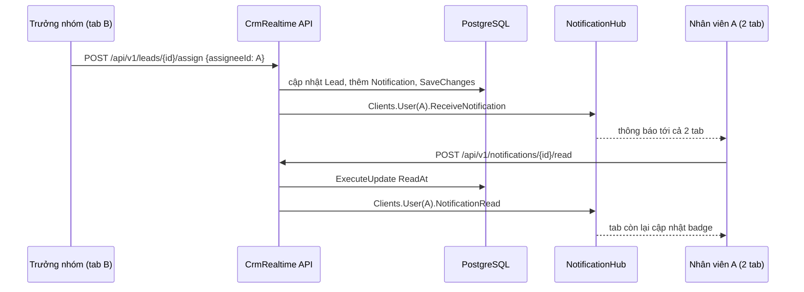

# 11.13 - Thực hành: thông báo real-time khi giao Lead

> **Tóm tắt:** Bài thực hành ghép các mảnh của Module 11 thành một luồng chạy được từ đầu tới cuối, đúng yêu cầu SignalR của [Project 2](../project-02-crm-backend-api.md): khi một Lead được giao cho nhân viên, người đó thấy thông báo ngay trên mọi tab đang mở mà không cần tải lại trang. Bạn dựng một Web API .NET 10 với EF Core và PostgreSQL, JWT đọc từ query string, Hub có `[Authorize]`, `IUserIdProvider` đọc claim `sub`, dịch vụ giao Lead theo thứ tự **lưu trước, đẩy sau**, API REST để đồng bộ và đánh dấu đã đọc, và một trang HTML để thử. Mọi output trong bài là output thật.

## Mục tiêu bài học

Sau bài này bạn có thể:

- Dựng một luồng thông báo real-time hoàn chỉnh: database, Hub, service, REST API, client.
- Bảo vệ Hub bằng JWT và cho `Clients.User` tìm đúng người theo claim `sub`.
- Kiểm chứng bằng hai người dùng rằng thông báo tới đúng người, đủ mọi tab, và không lọt sang người khác.
- Mở rộng luồng với thông báo theo tenant, đánh dấu tất cả đã đọc, và đồng bộ sau khi mất kết nối.

**Cần biết trước:** [bài 11.3](11.3-setup-signalr-server.md) (Hub đầu tiên), [bài 11.5](11.5-signalr-authentication.md) (JWT trong SignalR), [bài 11.7](11.7-ihubcontext-server-push-outside-hub.md) và [bài 11.8](11.8-notification-center-pattern.md) (lưu trước, đẩy sau), [bài 8.10](../module-08-aspnet-core-fundamentals/8.10-ef-core-minimal.md) (EF Core), [bài 10.2](../module-10-authentication-authorization/10.2-jwt-authentication.md) (JWT). Cần Docker để chạy PostgreSQL bằng [docker-compose.yml](../../../docker-compose.yml) của repo.

## Nội dung bài học

### 11.13.1 — Sản phẩm và cấu trúc thư mục

Luồng cần làm:



```text
CrmRealtime/
├── Data/
│   ├── Lead.cs
│   ├── Notification.cs
│   └── CrmDbContext.cs
├── Hubs/
│   ├── NotificationDto.cs
│   ├── INotificationClient.cs
│   ├── GroupNames.cs
│   ├── SubUserIdProvider.cs
│   └── NotificationHub.cs
├── Services/
│   ├── INotificationPublisher.cs
│   ├── SignalRNotificationPublisher.cs
│   └── LeadService.cs
├── wwwroot/index.html
├── appsettings.Development.json
└── Program.cs
```

Tạo project và thêm gói:

```bash
dotnet new webapi -n CrmRealtime -f net10.0
cd CrmRealtime
dotnet add package Microsoft.AspNetCore.Authentication.JwtBearer
dotnet add package Npgsql.EntityFrameworkCore.PostgreSQL
```

Chạy PostgreSQL từ thư mục gốc của repo khoá học:

```bash
docker compose up -d
```

<details>
<summary>SQL Server</summary>

```bash
dotnet add package Microsoft.EntityFrameworkCore.SqlServer
docker compose --profile sqlserver up -d
```

</details>

### 11.13.2 — Entity và `DbContext`

```csharp
// Data/Lead.cs
namespace CrmRealtime.Data;

public class Lead
{
    public Guid Id { get; set; } = Guid.CreateVersion7();
    public required string Name { get; set; }
    public Guid? AssigneeId { get; set; }
}
```

`Notification` là entity chuẩn của module ([bài 11.8](11.8-notification-center-pattern.md)):

```csharp
// Data/Notification.cs
namespace CrmRealtime.Data;

public enum NotificationType { Info, LeadAssigned, Comment }

public class Notification
{
    public Guid Id { get; set; } = Guid.CreateVersion7();   // sắp xếp được theo thời gian
    public Guid UserId { get; set; }                         // người nhận
    public NotificationType Type { get; set; }
    public required string Message { get; set; }
    public string? EntityType { get; set; }                  // "Lead"
    public string? EntityId { get; set; }                    // id của lead, để client mở đúng trang
    public DateTime CreatedAt { get; set; } = DateTime.UtcNow;
    public DateTime? ReadAt { get; set; }                    // null = chưa đọc
    public string? GroupKey { get; set; }                    // gom nhóm, bài 11.8
    public int Count { get; set; } = 1;
}
```

```csharp
// Data/CrmDbContext.cs
using Microsoft.EntityFrameworkCore;

namespace CrmRealtime.Data;

public class CrmDbContext(DbContextOptions<CrmDbContext> options) : DbContext(options)
{
    public DbSet<Lead> Leads => Set<Lead>();
    public DbSet<Notification> Notifications => Set<Notification>();

    protected override void OnModelCreating(ModelBuilder modelBuilder)
    {
        modelBuilder.Entity<Notification>()
            .HasIndex(n => new { n.UserId, n.CreatedAt });
    }
}
```

Chuỗi kết nối và khoá JWT cho môi trường phát triển. Khoá ở đây **chỉ để học**; dự án thật lấy nó từ biến môi trường hoặc kho bí mật ([bài 8.6](../module-08-aspnet-core-fundamentals/8.6-configuration-system.md)):

```json
// appsettings.Development.json
{
  "Logging": {
    "LogLevel": {
      "Default": "Information",
      "Microsoft.AspNetCore": "Warning"
    }
  },
  "ConnectionStrings": {
    "Crm": "Host=localhost;Port=5432;Database=crm;Username=postgres;Password=postgres"
  },
  "Jwt": {
    "Issuer": "crm-dev",
    "Audience": "crm-dev",
    "SecretKey": "khoa-chi-de-hoc-dai-it-nhat-32-byte-0123456789"
  }
}
```

<details>
<summary>SQL Server</summary>

```json
"ConnectionStrings": {
  "Crm": "Server=localhost,1433;Database=crm;User Id=sa;Password=Crm@123456;TrustServerCertificate=True"
}
```

</details>

### 11.13.3 — Hub, DTO và cách định danh người dùng

```csharp
// Hubs/NotificationDto.cs
using CrmRealtime.Data;

namespace CrmRealtime.Hubs;

public sealed record NotificationDto(
    Guid Id, NotificationType Type, string Message, string? EntityType, string? EntityId,
    DateTime CreatedAt, DateTime? ReadAt, int Count)
{
    public static NotificationDto From(Notification n) =>
        new(n.Id, n.Type, n.Message, n.EntityType, n.EntityId, n.CreatedAt, n.ReadAt, n.Count);
}
```

```csharp
// Hubs/INotificationClient.cs
namespace CrmRealtime.Hubs;

public interface INotificationClient
{
    Task ReceiveNotification(NotificationDto notification);
    Task NotificationRead(Guid id);
}
```

```csharp
// Hubs/GroupNames.cs — rút gọn từ bài 11.6
namespace CrmRealtime.Hubs;

public static class GroupNames
{
    public static string Tenant(string tenantId) => $"tenant:{tenantId}";
}
```

Cấu hình JWT ở mục 11.13.5 đặt `MapInboundClaims = false` như [bài 10.2](../module-10-authentication-authorization/10.2-jwt-authentication.md), nên id người dùng nằm ở claim `sub` và phải khai báo cho SignalR biết ([bài 11.5](11.5-signalr-authentication.md)):

```csharp
// Hubs/SubUserIdProvider.cs
using Microsoft.AspNetCore.SignalR;

namespace CrmRealtime.Hubs;

// Bài 10.2 đặt MapInboundClaims = false nên id người dùng nằm ở claim "sub"
public sealed class SubUserIdProvider : IUserIdProvider
{
    public string? GetUserId(HubConnectionContext connection)
        => connection.User.FindFirst("sub")?.Value;
}
```

Hub không có method nào cho client gọi: mọi thông báo đi từ server xuống. Nó chỉ log và tự gán nhóm tenant theo claim ([bài 11.6](11.6-groups-and-targeting.md)):

```csharp
// Hubs/NotificationHub.cs
using Microsoft.AspNetCore.Authorization;
using Microsoft.AspNetCore.SignalR;

namespace CrmRealtime.Hubs;

[Authorize]
public sealed class NotificationHub(ILogger<NotificationHub> logger) : Hub<INotificationClient>
{
    public override async Task OnConnectedAsync()
    {
        logger.LogInformation("User {UserId} kết nối, ConnectionId {ConnectionId}",
            Context.UserIdentifier, Context.ConnectionId);

        var tenantId = Context.User?.FindFirst("tenant_id")?.Value;
        if (tenantId is not null)
            await Groups.AddToGroupAsync(Context.ConnectionId, GroupNames.Tenant(tenantId));

        await base.OnConnectedAsync();
    }
}
```

### 11.13.4 — Publisher và `LeadService`: lưu trước, đẩy sau

```csharp
// Services/INotificationPublisher.cs
using CrmRealtime.Hubs;

namespace CrmRealtime.Services;

public interface INotificationPublisher
{
    Task PublishAsync(Guid userId, NotificationDto notification);
    Task PublishReadAsync(Guid userId, Guid notificationId);
}
```

```csharp
// Services/SignalRNotificationPublisher.cs
using CrmRealtime.Hubs;
using Microsoft.AspNetCore.SignalR;

namespace CrmRealtime.Services;

public sealed class SignalRNotificationPublisher(
    IHubContext<NotificationHub, INotificationClient> hub,
    ILogger<SignalRNotificationPublisher> logger) : INotificationPublisher
{
    public async Task PublishAsync(Guid userId, NotificationDto notification)
    {
        try
        {
            await hub.Clients.User(userId.ToString()).ReceiveNotification(notification);
        }
        catch (Exception ex)
        {
            // Đã lưu database rồi: client sẽ thấy khi gọi GET /api/v1/notifications
            logger.LogWarning(ex, "Push thông báo {Id} cho {UserId} thất bại", notification.Id, userId);
        }
    }

    public async Task PublishReadAsync(Guid userId, Guid notificationId)
    {
        try
        {
            await hub.Clients.User(userId.ToString()).NotificationRead(notificationId);
        }
        catch (Exception ex)
        {
            logger.LogWarning(ex, "Push trạng thái đã đọc {Id} thất bại", notificationId);
        }
    }
}
```

```csharp
// Services/LeadService.cs
using CrmRealtime.Data;
using CrmRealtime.Hubs;

namespace CrmRealtime.Services;

public sealed class LeadService(CrmDbContext db, INotificationPublisher publisher)
{
    public async Task<bool> AssignAsync(Guid leadId, Guid assigneeId, CancellationToken ct)
    {
        var lead = await db.Leads.FindAsync([leadId], ct);
        if (lead is null) return false;

        lead.AssigneeId = assigneeId;
        var notification = new Notification
        {
            UserId = assigneeId,
            Type = NotificationType.LeadAssigned,
            Message = $"Lead '{lead.Name}' vừa được giao cho bạn",
            EntityType = nameof(Lead),
            EntityId = lead.Id.ToString()
        };
        db.Notifications.Add(notification);

        await db.SaveChangesAsync(ct);                                                  // 1. LƯU trước
        await publisher.PublishAsync(assigneeId, NotificationDto.From(notification));   // 2. rồi mới đẩy
        return true;
    }
}
```

Cập nhật Lead và thêm Notification nằm trong **một** lần `SaveChangesAsync`, nên EF Core ghi cả hai trong một transaction: hoặc cả hai được lưu, hoặc không cái nào. Push nằm **sau** đó ([bài 11.7](11.7-ihubcontext-server-push-outside-hub.md)).

### 11.13.5 — `Program.cs`

Thay toàn bộ `Program.cs` của template. Hai record ở cuối file là kiểu dữ liệu cho body request; trong file top-level statements, khai báo kiểu phải nằm **sau** code chạy.

```csharp
// Program.cs
using System.IdentityModel.Tokens.Jwt;
using System.Security.Claims;
using System.Text;
using CrmRealtime.Data;
using CrmRealtime.Hubs;
using CrmRealtime.Services;
using Microsoft.AspNetCore.Authentication.JwtBearer;
using Microsoft.AspNetCore.SignalR;
using Microsoft.EntityFrameworkCore;
using Microsoft.IdentityModel.Tokens;

var builder = WebApplication.CreateBuilder(args);
var jwtKey = new SymmetricSecurityKey(Encoding.UTF8.GetBytes(builder.Configuration["Jwt:SecretKey"]!));

builder.Services.AddOpenApi();
builder.Services.AddDbContext<CrmDbContext>(o =>
    o.UseNpgsql(builder.Configuration.GetConnectionString("Crm")));

builder.Services
    .AddAuthentication(JwtBearerDefaults.AuthenticationScheme)
    .AddJwtBearer(options =>
    {
        options.TokenValidationParameters = new TokenValidationParameters
        {
            ValidIssuer = builder.Configuration["Jwt:Issuer"],
            ValidAudience = builder.Configuration["Jwt:Audience"],
            IssuerSigningKey = jwtKey,
            ClockSkew = TimeSpan.FromSeconds(30)
        };
        options.MapInboundClaims = false;
        options.Events = new JwtBearerEvents
        {
            // Trình duyệt không gửi được header Authorization qua WebSocket,
            // nên SignalR đưa token vào query string. CHỈ chấp nhận cho /hubs.
            OnMessageReceived = context =>
            {
                var token = context.Request.Query["access_token"];
                if (!string.IsNullOrEmpty(token) && context.HttpContext.Request.Path.StartsWithSegments("/hubs"))
                    context.Token = token;
                return Task.CompletedTask;
            }
        };
    });
builder.Services.AddAuthorization();

builder.Services.AddSignalR();
builder.Services.AddSingleton<IUserIdProvider, SubUserIdProvider>();
builder.Services.AddSingleton<INotificationPublisher, SignalRNotificationPublisher>();
builder.Services.AddScoped<LeadService>();

var app = builder.Build();

if (app.Environment.IsDevelopment())
{
    app.MapOpenApi();

    // Chỉ để thực hành: tạo bảng nếu chưa có. Dự án thật dùng migration (bài 8.10).
    using var scope = app.Services.CreateScope();
    await scope.ServiceProvider.GetRequiredService<CrmDbContext>().Database.EnsureCreatedAsync();
}

app.UseDefaultFiles();
app.UseStaticFiles();
app.UseAuthentication();
app.UseAuthorization();

app.MapHub<NotificationHub>("/hubs/notifications", o => o.CloseOnAuthenticationExpiration = true);

if (app.Environment.IsDevelopment())
{
    // Chỉ để thực hành: phát token cho một userId bất kỳ. KHÔNG có trên production.
    app.MapPost("/api/v1/dev/token", (Guid userId, string? tenantId) =>
    {
        List<Claim> claims = [new("sub", userId.ToString())];
        if (tenantId is not null) claims.Add(new("tenant_id", tenantId));

        var token = new JwtSecurityToken(
            issuer: app.Configuration["Jwt:Issuer"],
            audience: app.Configuration["Jwt:Audience"],
            claims: claims,
            expires: DateTime.UtcNow.AddMinutes(15),
            signingCredentials: new SigningCredentials(jwtKey, SecurityAlgorithms.HmacSha256));
        return new JwtSecurityTokenHandler().WriteToken(token);
    });
}

var api = app.MapGroup("/api/v1").RequireAuthorization();

api.MapPost("/leads", async (CreateLeadRequest req, CrmDbContext db, CancellationToken ct) =>
{
    var lead = new Lead { Name = req.Name };
    db.Leads.Add(lead);
    await db.SaveChangesAsync(ct);
    return Results.Created($"/api/v1/leads/{lead.Id}", new { lead.Id, lead.Name });
});

api.MapPost("/leads/{id:guid}/assign", async (Guid id, AssignLeadRequest req, LeadService leads, CancellationToken ct) =>
    await leads.AssignAsync(id, req.AssigneeId, ct) ? Results.NoContent() : Results.NotFound());

api.MapGet("/notifications", async (bool? unreadOnly, HttpContext http, CrmDbContext db, CancellationToken ct) =>
{
    var userId = Guid.Parse(http.User.FindFirst("sub")!.Value);
    var query = db.Notifications.AsNoTracking().Where(n => n.UserId == userId);
    if (unreadOnly == true)
        query = query.Where(n => n.ReadAt == null);

    var items = await query.OrderByDescending(n => n.CreatedAt).Take(50).ToListAsync(ct);
    return items.Select(NotificationDto.From);
});

api.MapPost("/notifications/{id:guid}/read", async (Guid id, HttpContext http, CrmDbContext db,
    INotificationPublisher publisher, CancellationToken ct) =>
{
    var userId = Guid.Parse(http.User.FindFirst("sub")!.Value);
    var affected = await db.Notifications
        .Where(n => n.Id == id && n.UserId == userId && n.ReadAt == null)
        .ExecuteUpdateAsync(s => s.SetProperty(n => n.ReadAt, DateTime.UtcNow), ct);

    if (affected == 0) return Results.NotFound();

    await publisher.PublishReadAsync(userId, id);   // báo các tab, thiết bị khác của cùng người
    return Results.NoContent();
});

app.Run();

public sealed record CreateLeadRequest(string Name);
public sealed record AssignLeadRequest(Guid AssigneeId);
```

<details>
<summary>SQL Server</summary>

```csharp
builder.Services.AddDbContext<CrmDbContext>(o =>
    o.UseSqlServer(builder.Configuration.GetConnectionString("Crm")));
```

Phần còn lại giữ nguyên. Toàn bộ kịch bản ở mục 11.13.7 cho cùng kết quả trên SQL Server 2022.

</details>

Vài điểm đáng chú ý:

- `RequireAuthorization()` trên nhóm `/api/v1` bắt buộc token cho mọi API; Hub có `[Authorize]` riêng.
- `CloseOnAuthenticationExpiration = true`: token 15 phút hết hạn thì server đóng kết nối, client có `withAutomaticReconnect` nối lại với token mới ([bài 11.5](11.5-signalr-authentication.md)).
- Endpoint `/api/v1/dev/token` chỉ tồn tại ở Development, để thử nhiều người dùng mà không cần màn hình đăng nhập. Project 2 thay nó bằng endpoint đăng nhập thật của [bài 10.2](../module-10-authentication-authorization/10.2-jwt-authentication.md).
- `INotificationPublisher` là singleton vì `IHubContext` là singleton; `LeadService` là Scoped vì dùng `CrmDbContext`.

### 11.13.6 — Trang thử

```html
<!-- wwwroot/index.html -->
<!DOCTYPE html>
<html lang="vi">
<head>
  <meta charset="utf-8">
  <title>CRM - Thông báo</title>
</head>
<body>
  <p>
    User id: <input id="userId" size="40">
    <button id="login">Kết nối</button>
    <span id="status"></span>
  </p>
  <h2>Thông báo chưa đọc: <span id="unread">0</span></h2>
  <ul id="list"></ul>

  <script src="https://cdn.jsdelivr.net/npm/@microsoft/signalr@10.0.11/dist/browser/signalr.min.js"></script>
  <script>
    let token = null;
    const items = new Map();          // id -> thông báo, khử trùng theo id

    async function getToken(userId) {
      const res = await fetch(`/api/v1/dev/token?userId=${userId}&tenantId=acme`, { method: "POST" });
      return await res.text();
    }

    function render() {
      const list = document.getElementById("list");
      list.replaceChildren();
      const sorted = [...items.values()].sort((a, b) => b.createdAt.localeCompare(a.createdAt));
      for (const n of sorted) {
        const li = document.createElement("li");
        li.textContent = n.message + (n.readAt ? " (đã đọc)" : " ");
        if (!n.readAt) {
          const btn = document.createElement("button");
          btn.textContent = "Đánh dấu đã đọc";
          btn.onclick = () => fetch(`/api/v1/notifications/${n.id}/read`,
            { method: "POST", headers: { Authorization: `Bearer ${token}` } });
          li.append(btn);
        }
        list.append(li);
      }
      document.getElementById("unread").textContent = sorted.filter(n => !n.readAt).length;
    }

    // Database là nguồn sự thật: mỗi lần (kết nối lại) đều tải lại từ REST
    async function sync() {
      const res = await fetch("/api/v1/notifications", { headers: { Authorization: `Bearer ${token}` } });
      for (const n of await res.json()) items.set(n.id, n);
      render();
    }

    document.getElementById("login").onclick = async () => {
      const userId = document.getElementById("userId").value.trim();
      token = await getToken(userId);

      const connection = new signalR.HubConnectionBuilder()
        .withUrl("/hubs/notifications", { accessTokenFactory: () => token })
        .withAutomaticReconnect()
        .build();

      connection.on("ReceiveNotification", n => { items.set(n.id, n); render(); });
      connection.on("NotificationRead", id => {
        const n = items.get(id);
        if (n && !n.readAt) { n.readAt = new Date().toISOString(); render(); }
      });
      connection.onreconnected(sync);

      await connection.start();
      document.getElementById("status").textContent = "Đã kết nối";
      await sync();
    };
  </script>
</body>
</html>
```

Trang này giữ token 15 phút trong một biến cho gọn. `accessTokenFactory` của ứng dụng thật gọi refresh token khi token sắp hết hạn ([bài 11.4](11.4-client-side-integration.md)).

### 11.13.7 — Chạy thử

```bash
dotnet run
```

Mở hai tab, nhập cùng user id `0199f000-0000-7000-8000-00000000000a` (nhân viên A) và bấm **Kết nối**. Mở tab thứ ba với `0199f000-0000-7000-8000-00000000000b` (trưởng nhóm B). Lấy token của B rồi tạo và giao một lead cho A bằng `curl` (hoặc file `.http`):

```bash
TOKEN_B=$(curl -s -X POST "http://localhost:5039/api/v1/dev/token?userId=0199f000-0000-7000-8000-00000000000b&tenantId=acme")

LEAD_ID=$(curl -s -X POST http://localhost:5039/api/v1/leads \
  -H "Authorization: Bearer $TOKEN_B" -H "Content-Type: application/json" \
  -d '{"name":"Cong ty ABC"}' | sed 's/.*"id":"\([^"]*\)".*/\1/')

curl -i -X POST "http://localhost:5039/api/v1/leads/$LEAD_ID/assign" \
  -H "Authorization: Bearer $TOKEN_B" -H "Content-Type: application/json" \
  -d '{"assigneeId":"0199f000-0000-7000-8000-00000000000a"}'
```

Thay `5039` bằng cổng trong dòng `Now listening on` của bạn. Lệnh cuối trả `HTTP/1.1 204 No Content`. Hai tab của A hiện ngay "Lead 'Cong ty ABC' vừa được giao cho bạn"; tab của B không hiện gì. (Tên lead viết không dấu vì Git Bash trên Windows không gửi chữ có dấu trong tham số dòng lệnh dưới dạng UTF-8, và server trả `400`; gửi từ trình duyệt, Postman hay file `.http` thì không gặp vấn đề này.) Bấm **Đánh dấu đã đọc** ở một tab của A: tab còn lại cũng chuyển sang "(đã đọc)".

Cùng kịch bản chạy bằng một script Node.js (hai kết nối cho A, một cho B), thêm vài bước kiểm tra biên. Output thật:

```text
A/tab1 ReceiveNotification: Lead 'Công ty ABC' vừa được giao cho bạn (type=1)
A/tab2 ReceiveNotification: Lead 'Công ty ABC' vừa được giao cho bạn (type=1)
POST assign -> 204
GET notifications (A) -> 1 mục
A/tab2 NotificationRead
A/tab1 NotificationRead
POST read lần 1 -> 204
POST read lần 2 -> 404
B đọc thông báo của A -> 404
Kết nối không token -> Failed to complete negotiation with the server: Error: Unauthorized: Status code '401'
```

Log server, mỗi kết nối một dòng với đúng user id lấy từ claim `sub`:

```text
User 0199f000-0000-7000-8000-00000000000a kết nối, ConnectionId x7qU3iBwvHp-Fnn6iPUAGA
User 0199f000-0000-7000-8000-00000000000a kết nối, ConnectionId sP0_drwPPM7Flo3nsY7wmw
User 0199f000-0000-7000-8000-00000000000b kết nối, ConnectionId -mON2dDNwk_9xC-e_5DbCQ
```

Đọc từng dòng:

| Dòng | Chứng minh điều gì |
|---|---|
| Cả hai tab của A nhận, B không nhận | `Clients.User` gửi tới mọi kết nối của đúng một người |
| `GET notifications` có 1 mục | Thông báo đã nằm trong database, đồng bộ được qua REST |
| Tab còn lại nhận `NotificationRead` | Trạng thái đã đọc đồng bộ giữa các tab |
| Đọc lần 2 trả `404` | `ExecuteUpdate` có điều kiện `ReadAt == null`, thao tác idempotent |
| B đọc thông báo của A trả `404` | Điều kiện `UserId` vừa lọc vừa phân quyền |
| Không token thì `401` ở `negotiate` | `[Authorize]` trên Hub chặn từ lúc kết nối |

### 11.13.8 — Lỗi thường gặp

| Triệu chứng | Nguyên nhân | Sửa |
|---|---|---|
| Kết nối thành công nhưng **không ai nhận** thông báo; log ghi `User (null) kết nối` | Quên đăng ký `SubUserIdProvider` trong khi `MapInboundClaims = false` | Thêm `AddSingleton<IUserIdProvider, SubUserIdProvider>()` |
| `negotiate` trả `401` dù đã có token | Token gửi tới đường dẫn khác `/hubs`, hoặc thiếu `OnMessageReceived` | Kiểm tra `StartsWithSegments("/hubs")` và đường dẫn `MapHub` |
| `POST assign` chậm thêm vài giây | Push đang chờ một backplane hỏng | Xem bài 3 của [bài 11.10](11.10-scale-out-and-production.md) |
| Thông báo hiện hai lần sau khi kết nối lại | Client thêm vào mảng thay vì `Map` theo `id` | Khử trùng theo `id` ([bài 11.8](11.8-notification-center-pattern.md)) |
| `Cannot write DateTime with Kind=Unspecified to PostgreSQL type 'timestamp with time zone', only UTC is supported` | Truyền `DateTime` không phải UTC vào truy vấn, ví dụ `since=2026-10-18T02:50:33` không có `Z` | Dùng `DateTime.UtcNow`; tham số nhận từ client thì gọi `ToUniversalTime()` |

Kiểm tra trường hợp đầu bằng cách tạm bỏ dòng đăng ký `SubUserIdProvider` rồi chạy lại script: log ghi `User (null) kết nối, ConnectionId ...`, `POST assign` vẫn trả `204`, và không tab nào hiện thông báo — không exception, không cảnh báo.

### 11.13.9 — Rà lại code của bạn

**Danh sách rà soát luồng thông báo**

- [ ] Hub có [Authorize]; mọi API dưới /api/v1 có RequireAuthorization.
- [ ] Token qua query string chỉ được chấp nhận cho đường dẫn /hubs.
- [ ] IUserIdProvider khớp với claim trong token; log OnConnectedAsync không có "(null)".
- [ ] Thông báo được lưu cùng lần SaveChanges với thay đổi nghiệp vụ, push sau đó.
- [ ] Push được bọc try/catch, lỗi push không làm hỏng request.
- [ ] Đánh dấu đã đọc có điều kiện UserId và ReadAt == null.
- [ ] Client khử trùng theo id và đồng bộ REST sau khi kết nối lại.
- [ ] Endpoint phát token thử chỉ có ở Development.

## Bài tập áp dụng

#### Bài 1 — Đánh dấu tất cả đã đọc

Thêm `POST /api/v1/notifications/read-all`: đánh dấu mọi thông báo chưa đọc của người gọi, trả về số dòng đã cập nhật, và báo cho mọi tab của người đó bằng một sự kiện `AllNotificationsRead`.

**Tiêu chí hoàn thành:** gọi hai lần liên tiếp, lần đầu trả số thông báo chưa đọc, lần hai trả `0`; mọi tab của người gọi nhận `AllNotificationsRead` đúng một lần.

<details>
<summary><strong>Gợi ý và lời giải — Bài 1</strong></summary>

**Gợi ý.** Một câu `ExecuteUpdateAsync` với điều kiện `UserId` và `ReadAt == null`. Chỉ phát sự kiện khi thật sự có dòng thay đổi.

**Lời giải.** Thêm method vào interface client:

```csharp
// Hubs/INotificationClient.cs
public interface INotificationClient
{
    Task ReceiveNotification(NotificationDto notification);
    Task NotificationRead(Guid id);
    Task AllNotificationsRead();
}
```

Thêm endpoint vào `Program.cs`, trước `app.Run()`:

```csharp
api.MapPost("/notifications/read-all", async (HttpContext http, CrmDbContext db,
    IHubContext<NotificationHub, INotificationClient> hub, CancellationToken ct) =>
{
    var userId = Guid.Parse(http.User.FindFirst("sub")!.Value);
    var affected = await db.Notifications
        .Where(n => n.UserId == userId && n.ReadAt == null)
        .ExecuteUpdateAsync(s => s.SetProperty(n => n.ReadAt, DateTime.UtcNow), ct);

    if (affected > 0)
    {
        try { await hub.Clients.User(userId.ToString()).AllNotificationsRead(); }
        catch (Exception ex) { app.Logger.LogWarning(ex, "Push AllNotificationsRead thất bại"); }
    }

    return Results.Ok(new { updated = affected });
});
```

Phía client: `connection.on("AllNotificationsRead", sync);` — tải lại danh sách từ server thay vì tự sửa từng mục.

Output thật khi A có hai thông báo chưa đọc:

```text
A(acme) AllNotificationsRead
read-all lần 1 -> 200 {"updated":2}
read-all lần 2 -> 200 {"updated":0}
```

Lần hai không phát sự kiện vì `affected == 0`.

</details>

---

#### Bài 2 — Báo cho cả tenant khi có lead mới

Khi tạo lead (`POST /api/v1/leads`), gửi sự kiện `LeadCreated(Guid leadId, string name)` tới mọi người **cùng tenant** với người tạo. Người của tenant khác không được nhận.

**Tiêu chí hoàn thành:** với A và B thuộc tenant `acme`, C thuộc `globex`, B tạo lead thì A và B nhận `LeadCreated`, C không nhận.

<details>
<summary><strong>Gợi ý và lời giải — Bài 2</strong></summary>

**Gợi ý.** Hub đã tự gán mỗi kết nối vào `GroupNames.Tenant(tenantId)` theo claim. Endpoint chỉ cần đọc `tenant_id` của người gọi từ token, không nhận nó từ body.

**Lời giải.** Thêm vào `INotificationClient`:

```csharp
Task LeadCreated(Guid leadId, string name);
```

Sửa endpoint tạo lead:

```csharp
api.MapPost("/leads", async (CreateLeadRequest req, HttpContext http, CrmDbContext db,
    IHubContext<NotificationHub, INotificationClient> hub, CancellationToken ct) =>
{
    var lead = new Lead { Name = req.Name };
    db.Leads.Add(lead);
    await db.SaveChangesAsync(ct);

    var tenantId = http.User.FindFirst("tenant_id")?.Value;
    if (tenantId is not null)
    {
        try { await hub.Clients.Group(GroupNames.Tenant(tenantId)).LeadCreated(lead.Id, lead.Name); }
        catch (Exception ex) { app.Logger.LogWarning(ex, "Push LeadCreated thất bại"); }
    }

    return Results.Created($"/api/v1/leads/{lead.Id}", new { lead.Id, lead.Name });
});
```

Output thật, B tạo hai lead:

```text
B(acme) LeadCreated: Công ty ABC
A(acme) LeadCreated: Công ty ABC
B(acme) LeadCreated: Công ty XYZ
A(acme) LeadCreated: Công ty XYZ
```

C (`globex`) không có dòng nào. Thứ tự giữa A và B có thể khác ở mỗi lần chạy, vì SignalR gửi tới các kết nối song song.

`tenantId` lấy từ claim đã ký, không từ body. Nhận nó từ body là cho phép người dùng phát tin vào tenant khác — lỗ hổng ở bài 2 của [bài 11.5](11.5-signalr-authentication.md). Người tạo cũng nhận sự kiện; muốn bỏ qua tab vừa bấm thì dùng `Clients.GroupExcept` với `ConnectionId` của tab đó, hoặc để client tự bỏ qua lead nó vừa tạo.

</details>

---

#### Bài 3 — Không mất thông báo khi mất kết nối

Thêm tham số `since` cho `GET /api/v1/notifications` và sửa trang thử để sau khi kết nối lại chỉ tải những thông báo mới hơn thông báo mới nhất đang có.

**Tiêu chí hoàn thành:** với hai thông báo tạo cách nhau một giây, `since` đặt trước cả hai trả 2 mục, `since` đặt giữa hai lần trả đúng 1 mục là thông báo sau.

<details>
<summary><strong>Gợi ý và lời giải — Bài 3</strong></summary>

**Gợi ý.** Cột `CreatedAt` lưu UTC. Npgsql chỉ nhận `DateTime` có `Kind = Utc` cho cột `timestamp with time zone`. Chạy thử: `since=2026-10-18T02:50:33Z` và `since=2026-10-18T09:50:33%2B07:00` (`+07:00` đã mã hoá cho URL) được đọc thành UTC và chạy được, còn `since=2026-10-18T02:50:33` (không có múi giờ) thành `Kind = Unspecified` và request trả `500`.

**Lời giải — server:**

```csharp
api.MapGet("/notifications", async (bool? unreadOnly, DateTime? since, HttpContext http,
    CrmDbContext db, CancellationToken ct) =>
{
    var userId = Guid.Parse(http.User.FindFirst("sub")!.Value);
    var query = db.Notifications.AsNoTracking().Where(n => n.UserId == userId);
    if (unreadOnly == true)
        query = query.Where(n => n.ReadAt == null);
    if (since is { } s)
        query = query.Where(n => n.CreatedAt > s.ToUniversalTime());

    var items = await query.OrderByDescending(n => n.CreatedAt).Take(50).ToListAsync(ct);
    return items.Select(NotificationDto.From);
});
```

**Client** — nhớ thời điểm của thông báo mới nhất và chỉ hỏi phần sau nó:

```js
async function sync() {
  const newest = [...items.values()].map(n => n.createdAt).sort().at(-1);
  const url = newest ? `/api/v1/notifications?since=${encodeURIComponent(newest)}` : "/api/v1/notifications";
  const res = await fetch(url, { headers: { Authorization: `Bearer ${token}` } });
  for (const n of await res.json()) items.set(n.id, n);
  render();
}
```

Output thật:

```text
GET since=trước cả hai -> 2 | since=giữa hai lần -> 1 [ "Lead 'Công ty XYZ' vừa được giao cho bạn" ]
```

`since` dựa trên đồng hồ: thông báo tạo cùng mili-giây với mốc có thể bị bỏ sót, nên `Map` theo `id` ở client vẫn cần (tải trùng thì ghi đè, không nhân đôi). Một mốc chắc hơn là `Id` dạng GUID v7, chỉ dùng được trên PostgreSQL ([bài 11.4](11.4-client-side-integration.md)).

</details>

## Tự kiểm tra

<details>
<summary>Vì sao LeadService gọi SaveChangesAsync trước rồi mới push?</summary>

Vì client offline thì push mất, còn bản ghi thì còn và client thấy nó khi gọi GET /api/v1/notifications. Nếu push trước rồi lưu thất bại, người dùng nhận thông báo về một việc không xảy ra. Cập nhật Lead và thêm Notification nằm trong cùng một SaveChangesAsync nên được lưu cùng nhau.

</details>

<details>
<summary>Bỏ dòng đăng ký SubUserIdProvider thì chuyện gì xảy ra?</summary>

Vì MapInboundClaims = false, claim sub giữ nguyên tên và ClaimTypes.NameIdentifier không tồn tại, nên Context.UserIdentifier là null. Kết nối vẫn thành công, POST assign vẫn trả 204, nhưng Clients.User không tìm thấy ai và không tab nào nhận thông báo, không có lỗi nào.

</details>

<details>
<summary>Vì sao đánh dấu đã đọc lần hai trả 404, và vì sao điều đó tốt?</summary>

Vì câu UPDATE có điều kiện ReadAt == null, nên lần hai không còn dòng nào khớp và affected bằng 0. Thao tác trở nên idempotent: gọi lặp không làm sai dữ liệu và không phát thêm sự kiện NotificationRead.

</details>

<details>
<summary>Vì sao endpoint tạo lead lấy tenant_id từ token chứ không từ body?</summary>

Claim trong token đã được ký nên tin được; tham số trong body do client tự đặt. Nhận tenant từ body là cho phép người dùng phát tin vào nhóm của tổ chức khác, cùng lớp lỗi IDOR với việc client tự chọn nhóm.

</details>

<details>
<summary>Trang thử khử trùng thông báo bằng cách nào?</summary>

Lưu thông báo trong một Map theo id. Một thông báo tới qua push rồi lại tới qua lần đồng bộ REST thì ghi đè lên chính nó, không tạo dòng thứ hai.

</details>

## Kết luận

Ba điều đáng nhớ nhất:

1. **Lưu trước, đẩy sau, đồng bộ khi nối lại** — ba bước này cùng nhau mới làm thông báo không mất.
2. **`UserIdentifier` phải khớp với claim** — sai chỗ này thì mọi thứ "chạy" mà không ai nhận được gì.
3. **Mọi điều kiện phân quyền nằm ở server**: `UserId` trong câu `UPDATE`, tenant từ claim, `[Authorize]` trên Hub.

## Tham khảo

- [Get started with ASP.NET Core SignalR](https://learn.microsoft.com/en-us/aspnet/core/tutorials/signalr)
- [Authentication and authorization in ASP.NET Core SignalR](https://learn.microsoft.com/en-us/aspnet/core/signalr/authn-and-authz)
- [Send messages from outside a hub](https://learn.microsoft.com/en-us/aspnet/core/signalr/hubcontext)
- [Npgsql — Date and time handling](https://www.npgsql.org/doc/types/datetime.html)

## Điều hướng

- **Bài trước:** [11.12 — Case study: thông báo chỉ tới một phần người dùng](11.12-mini-case-study.md)
- **Bài tiếp theo:** [11.14 — Ôn tập và đánh giá Module 11](11.14-review-and-assessment.md)
- **Về module:** [Trang mục lục](README.md)
