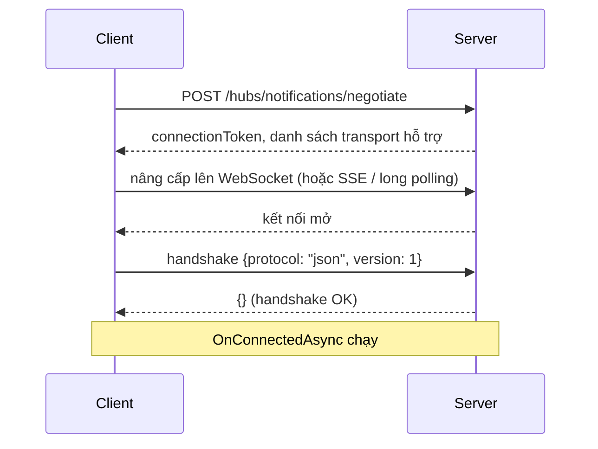

# 11.2 - SignalR Architecture

> **Tóm tắt:** Ba hiểu lầm về kiến trúc SignalR gây ra phần lớn lỗi trong thực tế. **Một: `Hub` là transient** — một instance mới được tạo cho **mỗi lời gọi**, không phải mỗi kết nối, nên field instance trong Hub **không giữ được gì**; đổi lại, mỗi lời gọi có **DI scope riêng**, nên tiêm `DbContext` vào Hub là an toàn. **Hai: `ConnectionId` không ổn định** — nó đổi mỗi lần kết nối lại, và kết nối lại xảy ra thường xuyên trên mạng di động, nên đừng lưu nó vào database như định danh người dùng; hãy dùng `UserIdentifier`. **Ba: một người dùng có nhiều kết nối** — hai tab, điện thoại, laptop. Gửi tới một `ConnectionId` là gửi tới **một tab**, không phải tới một người.

## Mục tiêu bài học

Sau bài này bạn có thể:

- Mô tả bước `negotiate` và vì sao nó tồn tại.
- Giải thích vòng đời của `Hub`, DI scope của mỗi lời gọi, và hệ quả với trạng thái.
- Phân biệt `ConnectionId`, `UserIdentifier` và nhóm.
- Xử lý đúng việc một người dùng có nhiều kết nối.
- Cấu hình hai cặp giữ nhịp và timeout ở server và client cho khớp nhau.

**Cần biết trước:** [bài 11.1](11.1-why-real-time-matters.md), [bài 7.4](../../stage-02-csharp-professional/module-07-dependency-injection/7.4-service-lifetimes.md) (lifetime Transient, Scoped, Singleton), [bài 8.10](../module-08-aspnet-core-fundamentals/8.10-ef-core-minimal.md) (`DbContext`). Bài này giải thích cơ chế; muốn chạy thử ngay thì làm mục 11.3.1 ở [bài 11.3](11.3-setup-signalr-server.md) trước rồi quay lại.

## Nội dung bài học

### 11.2.1 — Bắt tay



Bước `negotiate` tồn tại vì client **không biết trước** transport nào dùng được. Mạng công ty chặn WebSocket, proxy cũ không hỗ trợ nâng cấp giao thức — `negotiate` cho server nói rõ nó hỗ trợ gì.

Hai hệ quả thực tế:

**`negotiate` là một request HTTP riêng**, nên nó đi qua toàn bộ pipeline: CORS, xác thực, rate limit. Nhiều lỗi "SignalR không kết nối được" thực ra là **`negotiate` bị chặn** bởi CORS hoặc bởi rate limit — và thông báo lỗi ở client thì mơ hồ.

**Bỏ qua `negotiate`** được nếu bạn chắc chắn WebSocket dùng được:

```javascript
new signalR.HubConnectionBuilder()
    .withUrl("/hubs/notifications", {
        skipNegotiation: true,
        transport: signalR.HttpTransportType.WebSockets
    })
    .build();
```

Nó bớt một vòng đi về và **bỏ luôn nhu cầu sticky session** ([bài 11.10](11.10-scale-out-and-production.md)) — nhưng không còn dự phòng khi WebSocket bị chặn.

### 11.2.2 — `Hub` là transient, mỗi lời gọi một scope

```csharp
// SAI: field instance không giữ được gì giữa hai lời gọi
public class NotificationHub : Hub<INotificationClient>
{
    private int _messageCount;         // luôn bắt đầu từ 0

    public Task<int> CountCalls()
    {
        _messageCount++;               // instance mới cho mỗi lời gọi
        return Task.FromResult(_messageCount);
    }
}
```

SignalR tạo **một instance Hub mới cho mỗi lời gọi từ client** (và cho mỗi lần chạy `OnConnectedAsync`, `OnDisconnectedAsync`) — không phải mỗi kết nối. Nên:

- **Field instance không giữ được gì** giữa hai lời gọi.
- Trạng thái phải nằm ở service singleton, cache phân tán, hoặc database.
- Hub **không** được lưu tham chiếu tới `Clients` hay `Context` để dùng sau — chúng chỉ hợp lệ trong lời gọi hiện tại.

```csharp
// SAI — Hub đã bị huỷ khi timer chạy
public override Task OnConnectedAsync()
{
    _timer = new Timer(_ => Clients.Caller.Ping(), null, 0, 5000);
    return base.OnConnectedAsync();
}
```

Muốn gửi từ ngoài ngữ cảnh một lời gọi thì dùng `IHubContext<T>` ([bài 11.7](11.7-ihubcontext-server-push-outside-hub.md)).

**Về DI:** mỗi lời gọi Hub method chạy trong **một DI scope riêng**, giống mỗi request HTTP có scope riêng. Service `Scoped` như `DbContext` được tạo cho lời gọi đó và bị huỷ ngay khi lời gọi xong. Vì vậy tiêm `DbContext` thẳng vào constructor Hub là **đúng và an toàn**:

```csharp
// ĐÚNG — CrmDbContext là Scoped, mỗi lời gọi nhận một instance mới
public sealed class NotificationHub(CrmDbContext db) : Hub<INotificationClient>
{
    public async Task MarkAsRead(Guid id)
    {
        var userId = Guid.Parse(Context.UserIdentifier!);
        await db.Notifications
            .Where(n => n.Id == id && n.UserId == userId && n.ReadAt == null)
            .ExecuteUpdateAsync(s => s.SetProperty(n => n.ReadAt, DateTime.UtcNow),
                                Context.ConnectionAborted);
    }
}
```

Kiểm chứng bằng một service Scoped mang một `Guid` riêng: gọi cùng một Hub method hai lần từ một client, hai lần nhận hai `Guid` khác nhau (output thật):

```text
probe1 0d06d500-4cda-487d-9f78-de3fdb553f69
probe2 d0e84aa9-f5e5-4738-a797-ed55e3535023
```

Chỉ có hai trường hợp cần tự tạo scope bằng `IServiceScopeFactory`:

- Code chạy **sau khi** lời gọi đã kết thúc (một `Task` nền, một timer) — scope của lời gọi đã bị huỷ.
- Trong **một** lời gọi bạn muốn chạy **song song** nhiều truy vấn: một `DbContext` không cho hai thao tác cùng lúc ([bài 6.5](../../stage-02-csharp-professional/module-06-async-programming/6.5-task-parallel-library.md)), nên dùng `IDbContextFactory<CrmDbContext>` để mỗi nhánh có context riêng.

### 11.2.3 — Ba cách định danh

| | Là gì | Ổn định | Dùng để |
|---|---|---|---|
| **`ConnectionId`** | Một kết nối (một tab) | **Không** — đổi khi kết nối lại | Trả lời đúng tab vừa gọi |
| **`UserIdentifier`** | Một người dùng | **Có** | Gửi tới **mọi** thiết bị của một người |
| **Group** | Một tập kết nối có tên | Có (tên nhóm) | Broadcast theo chủ đề |

```csharp
await Clients.Caller.Receive(dto);                    // đúng tab vừa gọi
await Clients.User(userId).Receive(dto);              // MỌI thiết bị của người đó
await Clients.Group("tenant:123").Receive(dto);       // cả nhóm (quy ước tên nhóm ở bài 11.6)
await Clients.All.Receive(dto);                       // tất cả — hiếm khi đúng
```

**`ConnectionId` đổi mỗi lần kết nối lại**, và kết nối lại xảy ra liên tục: mạng di động chuyển sóng, laptop mở nắp, Wi-Fi chập chờn. Lưu nó vào database như định danh người dùng là một lỗi phổ biến — sau vài chục giây nó có thể đã sai.

`UserIdentifier` mặc định lấy từ claim `ClaimTypes.NameIdentifier`. Handler JWT mặc định đổi claim `sub` trong token thành `NameIdentifier`, nên với cấu hình mặc định mọi thứ tự khớp. Nhưng [bài 10.2](../module-10-authentication-authorization/10.2-jwt-authentication.md) đặt `MapInboundClaims = false` để giữ nguyên tên claim; khi đó `NameIdentifier` không tồn tại và `UserIdentifier` là `null`. Lúc đó bạn khai báo cách lấy id:

```csharp
// SubUserIdProvider.cs
public sealed class SubUserIdProvider : IUserIdProvider
{
    public string? GetUserId(HubConnectionContext connection)
        => connection.User.FindFirst("sub")?.Value;
}
```

```csharp
// Program.cs
builder.Services.AddSingleton<IUserIdProvider, SubUserIdProvider>();
```

`Clients.User(id)` tự động gửi tới **mọi** kết nối của người đó — SignalR duy trì ánh xạ đó giúp bạn. Đây là lý do gần như luôn nên dùng `Clients.User` thay vì tự quản lý danh sách `ConnectionId`.

### 11.2.4 — Vòng đời kết nối

```csharp
public sealed class NotificationHub(
    IPresenceTracker presence,
    ILogger<NotificationHub> logger) : Hub<INotificationClient>
{
    public override async Task OnConnectedAsync()
    {
        var userId = Context.UserIdentifier;
        if (userId is null)
        {
            Context.Abort();                 // không xác định được người dùng
            return;
        }

        await presence.ConnectAsync(userId, Context.ConnectionId);
        await base.OnConnectedAsync();
    }

    public override async Task OnDisconnectedAsync(Exception? exception)
    {
        var userId = Context.UserIdentifier;
        if (userId is not null)
            await presence.DisconnectAsync(userId, Context.ConnectionId);

        if (exception is not null)
            logger.LogWarning(exception, "Kết nối {Id} ngắt bất thường", Context.ConnectionId);

        await base.OnDisconnectedAsync(exception);
    }
}
```

`IPresenceTracker` là service theo dõi ai đang online, cài đặt ở [bài 11.9](11.9-presence-online-offline-status.md). Không cần nhóm riêng cho từng người: `Clients.User(userId)` đã làm việc đó.

Bốn điều về `OnDisconnectedAsync`:

1. **`exception` khác `null`** nghĩa là ngắt bất thường (lỗi giao thức, mất mạng); `null` nghĩa là đóng bình thường.
2. Client đóng chủ động thì nó chạy **ngay**. Mạng đứt đột ngột thì nó chạy **muộn**: server chỉ biết khi quá `ClientTimeoutInterval` (mặc định 30 giây) mà không nghe gì từ client.
3. Nó **không chạy** nếu chính tiến trình server bị kill — nên trạng thái presence phải tự hết hạn, đừng chỉ dựa vào sự kiện này ([bài 11.9](11.9-presence-online-offline-status.md)).
4. Nhóm được dọn tự động, không cần `RemoveFromGroupAsync`.

Và nhớ: người dùng mở 3 tab thì `OnDisconnectedAsync` chạy **3 lần**, mỗi lần một `ConnectionId`. "Người này đã offline" chỉ đúng khi **kết nối cuối cùng** đóng.

### 11.2.5 — Giữ nhịp và timeout: hai cặp số

TCP không báo ngay khi kết nối chết: rút cáp mạng và socket vẫn "mở" trong nhiều phút. Nên **cả hai phía** gửi ping định kỳ, và mỗi phía có một đồng hồ "bao lâu không nghe gì thì coi như bên kia chết". Có **hai cặp** số, mỗi cặp nằm ở hai phía khác nhau:

| Cặp | Bên gửi ping | Bên chờ | Mặc định | Quy tắc |
|---|---|---|---|---|
| 1 | Server: `KeepAliveInterval` | Client: `serverTimeoutInMilliseconds` (`withServerTimeout`) | 15 giây / 30 giây | Hạn chờ của client ≥ 2 × chu kỳ ping của server |
| 2 | Client: `keepAliveIntervalInMilliseconds` (`withKeepAliveInterval`) | Server: `ClientTimeoutInterval` | 15 giây / 30 giây | Hạn chờ của server ≥ 2 × chu kỳ ping của client |

```csharp
builder.Services.AddSignalR(options =>
{
    options.KeepAliveInterval     = TimeSpan.FromSeconds(15);   // server ping client (cặp 1)
    options.ClientTimeoutInterval = TimeSpan.FromSeconds(30);   // server chờ client (cặp 2)
    options.HandshakeTimeout      = TimeSpan.FromSeconds(15);
    options.MaximumReceiveMessageSize = 32 * 1024;
    options.EnableDetailedErrors  = builder.Environment.IsDevelopment();
});
```

```javascript
new signalR.HubConnectionBuilder()
    .withUrl("/hubs/notifications")
    .withKeepAliveInterval(15000)      // client ping server (cặp 2)
    .withServerTimeout(30000)          // client chờ server (cặp 1)
    .build();
```

Đổi một số ở server thì phải nhìn số tương ứng ở client. Đặt hạn chờ bằng đúng chu kỳ ping gây ra hiện tượng "cứ 30 giây lại mất kết nối" — bài 3 tái hiện chính xác điều này.

`EnableDetailedErrors` chỉ bật ở Development: nó gửi nguyên **tên kiểu và message của exception** cho client, và message thường chứa tên bảng, tên máy chủ ([bài 8.8](../module-08-aspnet-core-fundamentals/8.8-global-exception-handling.md)). Stack trace thì không được gửi; nó chỉ nằm trong log server.

`MaximumReceiveMessageSize` mặc định 32KB. SignalR không dành cho truyền file; dùng HTTP upload thường ([bài 9.5](../module-09-web-api-professional/9.5-file-upload-and-download.md)).

### 11.2.6 — Rà lại code của bạn

**Danh sách rà soát kiến trúc SignalR**

- [ ] Không có field instance nào trong Hub dùng để giữ trạng thái.
- [ ] Không lưu tham chiếu tới Clients hay Context để dùng ngoài lời gọi.
- [ ] Service Scoped (như DbContext) tiêm thẳng vào Hub; chỉ tạo scope riêng cho code chạy sau khi lời gọi kết thúc.
- [ ] Không lưu ConnectionId vào database như định danh người dùng.
- [ ] Dùng Clients.User thay vì tự quản lý danh sách ConnectionId.
- [ ] UserIdentifier khác null (kiểm tra IUserIdProvider khi MapInboundClaims = false).
- [ ] Hiểu rằng một người dùng có nhiều kết nối và OnDisconnected chạy nhiều lần.
- [ ] Trạng thái presence có cơ chế tự hết hạn, không chỉ dựa vào OnDisconnectedAsync.
- [ ] Hạn chờ mỗi phía ít nhất gấp đôi chu kỳ ping của phía kia, ở cả hai cặp.
- [ ] EnableDetailedErrors chỉ bật ở Development.
- [ ] Endpoint negotiate được xem xét trong cấu hình CORS và rate limit.

## Bài tập áp dụng

#### Bài 1 — Hub là transient, và hệ quả của điều đó

Thêm một biến đếm là field instance trong Hub, tăng nó mỗi lời gọi, và in ra. Xác nhận nó luôn là 1.

**Tiêu chí hoàn thành:** bạn nêu được **hai** hệ quả thực tế của việc Hub là transient, không chỉ nói "không lưu state được".

<details>
<summary><strong>Gợi ý và lời giải — Bài 1</strong></summary>

**Gợi ý.** Nếu mỗi lời gọi tạo một Hub mới, thì `this` trong một callback bất đồng bộ trỏ vào cái gì sau khi lời gọi kết thúc?

**Lời giải:**

```csharp
public class NotificationHub : Hub<INotificationClient>
{
    private int _callCount;                    // field instance

    public int Count()
    {
        _callCount++;
        return _callCount;
    }
}
```

```js
for (let i = 0; i < 5; i++) console.log('Count ->', await connection.invoke('Count'));
```

```text
Count -> 1
Count -> 1
Count -> 1
Count -> 1
Count -> 1
```

**Luôn là 1.** SignalR tạo một instance Hub mới cho **mỗi lời gọi** rồi huỷ ngay sau đó — giống hệt cách controller hoạt động.

**Hệ quả 1 — không giữ trạng thái trong Hub.**

```csharp
// SAI
private readonly List<string> _joinedRooms = new();

public async Task JoinRoom(string room)
{
    _joinedRooms.Add(room);                    // mất ngay sau lời gọi
    await Groups.AddToGroupAsync(Context.ConnectionId, room);
}
```

Trạng thái phải nằm ở nơi sống lâu hơn: nhóm của SignalR, Redis, hoặc database. `Context.Items` cũng dùng được — nó sống theo **kết nối**, không theo lời gọi.

**Hệ quả 2 — không dùng `Context` hay `Clients` sau khi lời gọi kết thúc.** Đây là hệ quả hay gây lỗi hơn và ít người biết:

```csharp
// SAI — Hub đã bị huỷ khi Task.Run chạy tới dòng gửi
public Task StartLongJob()
{
    _ = Task.Run(async () =>
    {
        await Task.Delay(1000);
        await Clients.Caller.Receive("done");      // NÉM
    });
    return Task.CompletedTask;
}
```

Bọc dòng gửi trong `try/catch` và log ra, bạn thấy (output thật):

```text
ObjectDisposedException: Cannot access a disposed object.
Object name: 'NotificationHub'.
```

Hub đã bị huỷ trước khi `Task.Delay` xong. Không có `try/catch` thì exception này nằm im trong một `Task` không ai chờ và bạn không thấy gì cả ([bài 6.7](../../stage-02-csharp-professional/module-06-async-programming/6.7-common-pitfalls.md)).

**Cách đỡ tệ hơn — chụp lại giá trị cần dùng rồi gửi qua `IHubContext`:**

```csharp
public sealed class NotificationHub(
    IHubContext<NotificationHub, INotificationClient> hubContext) : Hub<INotificationClient>
{
    public Task StartLongJob()
    {
        var connectionId = Context.ConnectionId;        // chụp GIÁ TRỊ, không giữ Context

        _ = Task.Run(async () =>
        {
            await Task.Delay(1000);
            await hubContext.Clients.Client(connectionId).Receive("done");
        });

        return Task.CompletedTask;
    }
}
```

`IHubContext` là **singleton** và sống độc lập với vòng đời Hub — đó là thứ dùng để gửi tin từ ngoài Hub, như [bài 11.7](11.7-ihubcontext-server-push-outside-hub.md) trình bày. Nếu việc nền cần `DbContext` thì phải tự tạo scope bằng `IServiceScopeFactory`, vì scope của lời gọi đã bị huỷ.

**Nhưng `Task.Run` trong Hub vẫn là mẫu xấu.** Exception không ai thấy, việc mất khi restart, không có retry. Việc dài nên đi vào hàng đợi và một `BackgroundService` xử lý, rồi worker gửi thông báo qua `IHubContext` khi xong ([bài 9.9](../module-09-web-api-professional/9.9-hosted-service-background-jobs.md)).

**Bảng vòng đời cần nhớ:**

| | Sống theo | Dùng để |
|---|---|---|
| Instance Hub và DI scope của nó | Một lời gọi | Xử lý ngay lời gọi đó |
| `Context.Items` | Một kết nối | Lưu dữ liệu nhỏ theo kết nối |
| Nhóm SignalR | Một kết nối | Gửi theo nhóm |
| `IHubContext` | Ứng dụng | Gửi từ bất kỳ đâu |

</details>

---

#### Bài 2 — `ConnectionId` đổi sau mỗi lần kết nối lại

Log `ConnectionId` trong `OnConnectedAsync`, bật tắt mạng vài lần, và ghi lại các giá trị khác nhau cho cùng một người dùng.

**Tiêu chí hoàn thành:** bạn nêu được vì sao **không** được lưu `ConnectionId` vào database làm khoá lâu dài.

<details>
<summary><strong>Gợi ý và lời giải — Bài 2</strong></summary>

**Gợi ý.** `ConnectionId` định danh một **kết nối**, không định danh một **người**.

**Lời giải:**

```csharp
public sealed class NotificationHub(ILogger<NotificationHub> logger) : Hub<INotificationClient>
{
    public override Task OnConnectedAsync()
    {
        logger.LogInformation("Kết nối {ConnectionId} cho user {UserId}",
            Context.ConnectionId, Context.UserIdentifier);
        return base.OnConnectedAsync();
    }
}
```

Bật tắt mạng vài lần, log có dạng:

```text
info: Kết nối vXk3Lm9QwRt2Yb8Nc4Fh1A cho user 8f3a1b2c-...
info: Kết nối Jz7Pq2Wn5Rx8Ty1Ub6Ve3D cho user 8f3a1b2c-...
info: Kết nối Hn4Km8Bz1Qp6Ws3Xr9Td5F cho user 8f3a1b2c-...
```

**Mỗi lần kết nối lại là một `ConnectionId` mới, cùng một người.**

**Vì sao không được lưu làm khoá lâu dài.** Một bảng ánh xạ kiểu này hỏng theo ba cách cùng lúc:

```sql
-- SAI: bảng lưu ConnectionId lâu dài
CREATE TABLE "UserConnections" (
    "UserId"       uuid NOT NULL,
    "ConnectionId" text NOT NULL
);
```

<details>
<summary>SQL Server</summary>

```sql
-- SAI: bảng lưu ConnectionId lâu dài
CREATE TABLE UserConnections (
    UserId       UNIQUEIDENTIFIER NOT NULL,
    ConnectionId NVARCHAR(100)    NOT NULL
);
```

</details>

1. **Rác tích luỹ.** Mỗi lần server bị kill hay crash, `OnDisconnectedAsync` của mọi kết nối trên server đó **không chạy** — các bản ghi nằm lại mãi. Ngay cả khi mạng đứt đột ngột, bản ghi cũng sai trong khoảng `ClientTimeoutInterval` trước khi được dọn.
2. **Gửi vào hư không.** Bạn gửi tới một `ConnectionId` đã chết: không lỗi, không cảnh báo, tin nhắn biến mất.
3. **Không sống sót qua restart.** Khởi động lại server là mọi `ConnectionId` mất hiệu lực, nhưng database vẫn giữ chúng.

**Cách đúng — dùng `Clients.User(userId)`:**

```csharp
await hubContext.Clients.User(userId.ToString()).Receive(dto);
```

SignalR tự quản lý ánh xạ người dùng sang kết nối, tự dọn khi ngắt, và gửi tới **mọi thiết bị** của người đó. Với backplane Redis, nó hoạt động xuyên nhiều instance.

**Khi nào `ConnectionId` vẫn hữu ích:** trả lời đúng **kết nối vừa gọi** — `Clients.Caller` dùng nó nội bộ — hoặc theo dõi trạng thái online trong Redis **có TTL**, để kết nối chết tự biến mất thay vì phải dọn tay. Xem [bài 11.9](11.9-presence-online-offline-status.md).

**Một hệ quả thực tế của việc `ConnectionId` đổi:** **nhóm cũng biến mất**. Nhóm gắn với `ConnectionId`, nên sau khi kết nối lại, client **không còn** trong nhóm nào. Phải join lại trong `onreconnected` — đây là lỗi phổ biến nhất khi dùng SignalR, và là bài 1 của [bài 11.4](11.4-client-side-integration.md).

</details>

---

#### Bài 3 — Hạn chờ bằng đúng chu kỳ ping

Đặt server `KeepAliveInterval = 30s` và client `withServerTimeout(30000)` (cặp 1 trong bảng ở mục 11.2.5). Giữ kết nối mở ba phút, không gửi gì, ghi lại số lần mất kết nối. Sửa về tỷ lệ 2 lần và so sánh.

**Tiêu chí hoàn thành:** bạn nêu được tỷ lệ đúng, **vì sao** nó phải là tỷ lệ đó, và số nào ở server đi cặp với số nào ở client.

<details>
<summary><strong>Gợi ý và lời giải — Bài 3</strong></summary>

**Gợi ý.** Nếu server gửi ping mỗi 30 giây và client bỏ cuộc sau 30 giây không nghe gì, thì chỉ cần ping tới trễ vài mili-giây là đủ.

**Lời giải — cấu hình sai:**

```csharp
builder.Services.AddSignalR(o => o.KeepAliveInterval = TimeSpan.FromSeconds(30));
```

```js
const ts = () => new Date().toISOString().substring(11, 19);
const connection = new signalR.HubConnectionBuilder()
    .withUrl('/hubs/notifications')
    .withServerTimeout(30000)                 // BẰNG chu kỳ ping của server
    .withAutomaticReconnect([0, 0, 0, 0, 0, 0, 0, 0, 0, 0])
    .build();
connection.onreconnecting(e => console.log(ts(), 'reconnecting:', e?.message));
await connection.start();
console.log(ts(), 'connected');
```

Output thật sau hơn ba phút không gửi gì:

```text
02:44:29 connected
02:44:59 reconnecting: Server timeout elapsed without receiving a message from the server.
02:45:29 reconnecting: Server timeout elapsed without receiving a message from the server.
02:45:59 reconnecting: Server timeout elapsed without receiving a message from the server.
02:46:29 reconnecting: Server timeout elapsed without receiving a message from the server.
02:46:59 reconnecting: Server timeout elapsed without receiving a message from the server.
02:47:29 reconnecting: Server timeout elapsed without receiving a message from the server.
```

**Mất kết nối đều đặn mỗi 30 giây**, dù mạng hoàn toàn bình thường.

**Vì sao.** Đồng hồ chờ của client và đồng hồ ping của server cùng chu kỳ 30 giây. Ping luôn tới **sau** lúc đồng hồ của client vừa hết hạn vài mili-giây (thời gian gửi qua mạng, lịch chạy của timer), nên lần nào client cũng kết luận "server chết". Cửa sổ an toàn bằng **0**. Trên ứng dụng thật có tin nhắn qua lại thì đồng hồ được đặt lại thường xuyên hơn, nên triệu chứng xuất hiện lúc có lúc không, rất khó chẩn đoán.

**Cấu hình đúng — hạn chờ gấp đôi chu kỳ ping:**

```csharp
builder.Services.AddSignalR(o =>
{
    o.KeepAliveInterval = TimeSpan.FromSeconds(15);         // server ping mỗi 15s (cặp 1)
    o.ClientTimeoutInterval = TimeSpan.FromSeconds(30);     // server chờ client 30s (cặp 2)
});
```

```js
const connection = new signalR.HubConnectionBuilder()
    .withUrl('/hubs/notifications')
    .withKeepAliveInterval(15000)      // client ping mỗi 15s (cặp 2)
    .withServerTimeout(30000)          // client chờ server 30s (cặp 1)
    .build();
```

Cùng thời gian chạy (khoảng 3 phút 20 giây), output thật chỉ có một dòng `connected` và không dòng `reconnecting` nào.

**Vì sao tỷ lệ phải là 2×.** Với `hạn chờ = 2 × chu kỳ ping`, bên chờ chịu được **mất trọn một ping** rồi mới bỏ cuộc:

```text
t=0    ping 1  -> nhận được, đồng hồ chờ đặt lại, hết hạn ở t=30
t=15   ping 2  -> MẤT
t=30   ping 3  -> tới đúng lúc, đồng hồ đặt lại -> giữ kết nối
```

Với tỷ lệ 1×, như vừa thấy, không cần mất ping nào cũng đã đứt. Với tỷ lệ 3× trở lên, bạn chịu được hai ping mất nhưng phát hiện server chết thật chậm hơn. **2× là mặc định của SignalR** và là cân bằng hợp lý.

**Hai cặp số, đặt ở hai phía.** `KeepAliveInterval` (server) đi cặp với `withServerTimeout` (client). `withKeepAliveInterval` (client) đi cặp với `ClientTimeoutInterval` (server). Bài này làm hỏng cặp 1; làm hỏng cặp 2 thì server đóng kết nối và log ở server.

**Và có một tầng nữa dễ bị bỏ sót:** reverse proxy. Nginx mặc định đóng kết nối không có dữ liệu sau **60 giây** (`proxy_read_timeout`):

```nginx
location /hubs/ {
    proxy_pass http://crm;
    proxy_http_version 1.1;
    proxy_set_header Upgrade $http_upgrade;
    proxy_set_header Connection "upgrade";
    proxy_read_timeout 3600s;              # không cắt kết nối dài
}
```

Ping mỗi 15 giây thì proxy không bao giờ thấy kết nối rỗi. Nhưng nếu bạn nới ping lên 120 giây để "tiết kiệm", proxy sẽ cắt trước — và triệu chứng là mất kết nối đều đặn mỗi 60 giây, chỉ xuất hiện trên môi trường có proxy.

**Ba con số nên nhớ cùng nhau:**

```text
KeepAliveInterval (15s)  <  hạn chờ của client (30s)  <  proxy_read_timeout (3600s)
```

</details>

## Tự kiểm tra

<details>
<summary>Bước negotiate để làm gì?</summary>

Client không biết trước transport nào dùng được vì mạng công ty có thể chặn WebSocket hay proxy cũ không hỗ trợ nâng cấp giao thức, nên negotiate cho server nói rõ nó hỗ trợ gì. Nó là một request HTTP riêng nên đi qua CORS, xác thực và rate limit; nhiều lỗi SignalR không kết nối được thực ra là negotiate bị chặn.

</details>

<details>
<summary>Hub có vòng đời thế nào?</summary>

Nó là transient, một instance mới cho mỗi lời gọi từ client chứ không phải mỗi kết nối. Nên field instance không giữ được gì giữa hai lời gọi, và không được lưu tham chiếu tới Clients hay Context để dùng sau vì chúng chỉ hợp lệ trong lời gọi hiện tại.

</details>

<details>
<summary>Tiêm DbContext vào constructor Hub có sao không?</summary>

Không sao. SignalR tạo một DI scope riêng cho mỗi lời gọi Hub method, nên DbContext được tạo cho lời gọi đó và bị huỷ khi lời gọi kết thúc, giống một request HTTP. Chỉ cần tự tạo scope (IServiceScopeFactory) cho code chạy sau khi lời gọi đã xong, và dùng IDbContextFactory khi muốn chạy song song nhiều truy vấn trong một lời gọi.

</details>

<details>
<summary>Vì sao không lưu ConnectionId vào database?</summary>

Vì nó đổi mỗi lần kết nối lại, và kết nối lại xảy ra liên tục khi mạng di động chuyển sóng, laptop mở nắp hay Wi-Fi chập chờn. Bản ghi cũng không được dọn khi server bị kill. Dùng UserIdentifier, và Clients.User tự gửi tới mọi kết nối của người đó.

</details>

<details>
<summary>OnDisconnectedAsync có đáng tin không?</summary>

Không hoàn toàn. Nó chạy ngay khi client đóng chủ động, chạy muộn (sau ClientTimeoutInterval, mặc định 30 giây) khi mạng đứt đột ngột, và không chạy nếu tiến trình server bị kill. Vì vậy trạng thái presence phải có cơ chế tự hết hạn chứ không chỉ dựa vào sự kiện này.

</details>

<details>
<summary>KeepAliveInterval của server đi cặp với thông số nào?</summary>

Với serverTimeoutInMilliseconds của client (withServerTimeout): client chờ ping của server. Hạn chờ phải ít nhất gấp đôi chu kỳ ping, nếu không client liên tục báo "Server timeout elapsed". Cặp còn lại là keepAliveIntervalInMilliseconds của client với ClientTimeoutInterval của server.

</details>

## Kết luận

Ba điều đáng nhớ nhất:

1. **`Hub` là transient, mỗi lời gọi một DI scope.** Trạng thái thuộc về service singleton hoặc kho dùng chung; `DbContext` tiêm thẳng vào Hub được.
2. **`ConnectionId` là một tab, không phải một người.** Dùng `Clients.User`.
3. **Hai cặp giữ nhịp, mỗi cặp hạn chờ gấp đôi chu kỳ ping** — sai tỷ lệ là mất kết nối định kỳ.

## Tham khảo

- [Use hubs in SignalR for ASP.NET Core](https://learn.microsoft.com/en-us/aspnet/core/signalr/hubs) — mục "Inject services into a hub" và "Create and use hubs" (hub là transient)
- [ASP.NET Core SignalR configuration](https://learn.microsoft.com/en-us/aspnet/core/signalr/configuration)
- [Manage users and groups in SignalR](https://learn.microsoft.com/en-us/aspnet/core/signalr/groups)
- [Logging and diagnostics in ASP.NET Core SignalR](https://learn.microsoft.com/en-us/aspnet/core/signalr/diagnostics)

## Điều hướng

- **Bài trước:** [11.1 — Tại sao cần Real-time?](11.1-why-real-time-matters.md)
- **Bài tiếp theo:** [11.3 — Setup SignalR Server](11.3-setup-signalr-server.md)
- **Về module:** [Trang mục lục](README.md)
