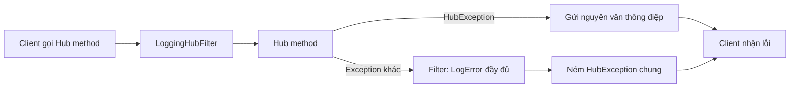

# 11.3 - Setup SignalR Server

> **Tóm tắt:** Bài bắt đầu bằng một Hub chạy được từ đầu tới cuối: project .NET 10, một trang HTML nhận thông báo, và một endpoint để server chủ động đẩy tin. Sau đó là bốn quyết định khi dựng Hub thật. **Một: `Hub<T>` với interface** khiến `Clients.User(id).ReceiveNotification(dto)` được **kiểm tra lúc biên dịch** — không có nó, gõ sai tên hàm client thì server không báo gì, client chỉ in một dòng cảnh báo trong console. **Hai: exception trong Hub method không giống trong controller** — mặc định client chỉ nhận một thông điệp chung; bật `EnableDetailedErrors` thì client nhận cả tên kiểu và message của exception, nên chỉ bật ở Development. **Ba: `HubFilter`** là nơi đặt logging và xử lý lỗi tập trung. **Bốn: các giới hạn cấu hình**, đặc biệt `MaximumParallelInvocationsPerClient` mặc định là 1.

## Mục tiêu bài học

Sau bài này bạn có thể:

- Tạo project, Hub, trang HTML client và chạy thử một luồng thông báo hai chiều.
- Viết strongly-typed Hub và hiểu nó bảo vệ điều gì.
- Xử lý exception trong Hub method đúng cách, dùng `HubException` khi muốn client đọc được lỗi.
- Viết `HubFilter` cho mối quan tâm cắt ngang.
- Đặt các giới hạn cấu hình quan trọng và biết khi nào MessagePack đáng dùng.

**Cần biết trước:** [bài 0.5](../../stage-01-foundation/module-00-setup/0.5-first-web-api.md) (tạo và chạy Web API), [bài 8.2](../module-08-aspnet-core-fundamentals/8.2-request-pipeline-and-middleware.md) (middleware), [bài 8.8](../module-08-aspnet-core-fundamentals/8.8-global-exception-handling.md) (xử lý exception toàn cục), [bài 11.2](11.2-signalr-architecture.md).

## Nội dung bài học

### 11.3.1 — Dựng nhanh: Hub đầu tiên chạy được

SignalR phía server đã có sẵn trong ASP.NET Core, không cần cài gói NuGet nào. Tạo project:

```bash
dotnet new webapi -n CrmRealtime -f net10.0
cd CrmRealtime
```

Tạo thư mục `Hubs` và ba file. Đầu tiên là dữ liệu gửi đi:

```csharp
// Hubs/NotificationDto.cs
namespace CrmRealtime.Hubs;

public enum NotificationType { Info, Warning, LeadAssigned }

public sealed record NotificationDto(Guid Id, string Message, NotificationType Type, DateTime CreatedAt);
```

Tiếp theo là danh sách hàm mà **server gọi trên client**. Mỗi method của interface ứng với một tên sự kiện mà client đăng ký:

```csharp
// Hubs/INotificationClient.cs
namespace CrmRealtime.Hubs;

// Những hàm SERVER gọi trên CLIENT
public interface INotificationClient
{
    Task ReceiveNotification(NotificationDto notification);
}
```

Cuối cùng là Hub. Mỗi method `public` của Hub là một hàm mà **client gọi trên server**:

```csharp
// Hubs/NotificationHub.cs
using Microsoft.AspNetCore.SignalR;

namespace CrmRealtime.Hubs;

public sealed class NotificationHub : Hub<INotificationClient>
{
    // Hàm CLIENT gọi trên SERVER: method public của Hub
    public Task Ping() => Clients.Caller.ReceiveNotification(
        new NotificationDto(Guid.CreateVersion7(), "pong", NotificationType.Info, DateTime.UtcNow));
}
```

Thay toàn bộ `Program.cs` của template bằng:

```csharp
// Program.cs
using CrmRealtime.Hubs;
using Microsoft.AspNetCore.SignalR;

var builder = WebApplication.CreateBuilder(args);
builder.Services.AddOpenApi();
builder.Services.AddSignalR();

var app = builder.Build();
if (app.Environment.IsDevelopment())
    app.MapOpenApi();

app.UseDefaultFiles();   // "/" trả về wwwroot/index.html
app.UseStaticFiles();    // phục vụ file trong wwwroot

app.MapHub<NotificationHub>("/hubs/notifications");

// Endpoint để thử: server chủ động đẩy một thông báo tới mọi trang đang mở
app.MapPost("/api/v1/test/notify",
    async (string message, IHubContext<NotificationHub, INotificationClient> hub) =>
    {
        var dto = new NotificationDto(Guid.CreateVersion7(), message, NotificationType.Info, DateTime.UtcNow);
        await hub.Clients.All.ReceiveNotification(dto);
        return Results.Accepted();
    });

app.Run();
```

`IHubContext` cho phép gửi tin từ bên ngoài Hub, ở đây là từ một endpoint ([bài 11.7](11.7-ihubcontext-server-push-outside-hub.md) đi sâu). `Clients.All` chỉ hợp cho bài thử này; ứng dụng thật gửi theo người dùng hoặc theo nhóm ([bài 11.6](11.6-groups-and-targeting.md)).

Phía client, tạo `wwwroot/index.html`. Thư viện client JavaScript là gói npm `@microsoft/signalr`; trang thử này nạp nó từ CDN và **ghim phiên bản** để không tự đổi theo bản mới:

```html
<!-- wwwroot/index.html -->
<!DOCTYPE html>
<html lang="vi">
<head>
  <meta charset="utf-8">
  <title>CRM - Thông báo</title>
</head>
<body>
  <h1>Thông báo</h1>
  <p id="status">Đang kết nối...</p>
  <button id="ping">Ping</button>
  <ul id="list"></ul>

  <script src="https://cdn.jsdelivr.net/npm/@microsoft/signalr@10.0.11/dist/browser/signalr.min.js"></script>
  <script>
    const connection = new signalR.HubConnectionBuilder()
      .withUrl("/hubs/notifications")
      .withAutomaticReconnect()
      .build();

    // Đăng ký handler TRƯỚC khi start, tên phải khớp tên hàm trong INotificationClient
    connection.on("ReceiveNotification", n => {
      const li = document.createElement("li");
      li.textContent = `${new Date(n.createdAt).toLocaleTimeString()} - ${n.message}`;
      document.getElementById("list").prepend(li);
    });

    document.getElementById("ping").onclick = () => connection.invoke("Ping");

    connection.start()
      .then(() => document.getElementById("status").textContent = "Đã kết nối, id: " + connection.connectionId)
      .catch(err => document.getElementById("status").textContent = "Lỗi kết nối: " + err);
  </script>
</body>
</html>
```

Dùng `textContent` chứ không dùng `innerHTML`: nội dung thông báo có thể chứa dữ liệu người dùng nhập, và `innerHTML` biến nó thành HTML chạy được (lỗi XSS, [bài 10.10](../module-10-authentication-authorization/10.10-security-best-practices.md)). Dự án có bundler (Vite, webpack) thì cài bằng `npm install @microsoft/signalr` và `import * as signalR from "@microsoft/signalr"`.

Chạy:

```bash
dotnet run
```

```text
info: Microsoft.Hosting.Lifetime[14]
      Now listening on: http://localhost:5039
```

Cổng trên máy bạn có thể khác; đọc nó từ dòng `Now listening on`. Mở địa chỉ đó trong trình duyệt, trang hiện "Đã kết nối". Bấm **Ping**: thông báo "pong" hiện ra — đó là chiều client gọi server, server trả lời đúng tab vừa gọi. Mở một cửa sổ terminal khác và gọi:

```bash
curl -X POST "http://localhost:5039/api/v1/test/notify?message=Lead%20m%E1%BB%9Bi"
```

Mọi tab đang mở hiện ngay "Lead mới" mà không cần tải lại trang. Đây là chiều server chủ động đẩy. Một client Node.js chạy cùng kịch bản nhận đúng hai sự kiện (output thật):

```text
ReceiveNotification {"id":"01a14ceb-07bd-78b3-8e32-edc1b3320617","message":"pong","type":0,"createdAt":"2026-10-18T02:50:33.789937Z"}
ReceiveNotification {"id":"01a14ceb-0d24-78fb-b0df-fdcf61bbcfbb","message":"Lead mới","type":0,"createdAt":"2026-10-18T02:50:35.1721932Z"}
```

Hai chi tiết trong output: tên thuộc tính đổi sang camelCase (`createdAt`) như JSON của Web API, và enum được gửi dưới dạng số (`"type":0`).

### 11.3.2 — Strongly-typed Hub

Hub ở mục trên kế thừa `Hub<INotificationClient>`, không phải `Hub`. Khác biệt nằm ở cách gọi client:

```csharp
// KHÔNG strongly-typed — tên hàm là chuỗi
await Clients.User(id).SendAsync("ReceiveNotifcation", dto);   // gõ sai -> server im lặng

// Strongly-typed — kiểm tra lúc biên dịch
await Clients.User(id).ReceiveNotification(dto);
```

Dòng đầu **biên dịch được**, chạy được, và tin nhắn **không bao giờ tới handler** — vì client đăng ký `"ReceiveNotification"` chứ không phải `"ReceiveNotifcation"`. Server không ném exception, không ghi log. Client JavaScript chỉ in một dòng cảnh báo trong console mà ít ai mở ra xem. Bạn thường chỉ biết khi người dùng báo "tôi không nhận được thông báo".

Interface xoá hẳn loại lỗi này: gõ sai tên là lỗi biên dịch.

Đặt interface vào một project **chia sẻ** thì client .NET (Blazor, MAUI) dùng lại được. Với client TypeScript, tên sự kiện vẫn là chuỗi; bài 1 chỉ cách gom chúng về một chỗ.

### 11.3.3 — Exception trong Hub method

Khác với controller, ở đây **không có `IExceptionHandler`**, không có `ProblemDetails`, không có mã trạng thái. Một exception thường trong Hub method, client nhận được (output thật):

```text
An unexpected error occurred invoking 'JoinRoom' on the server.
```

Không có chi tiết — đó là **mặc định đúng**, vì chi tiết sẽ lộ thông tin nội bộ. Server vẫn ghi đầy đủ exception và stack trace vào log.

Muốn client biết lý do thì ném `HubException`. Message của nó được gửi tới client, nối sau câu mặc định:

```text
An unexpected error occurred invoking 'JoinRoom' on the server. HubException: Phòng 'abc' không tồn tại
```

Ví dụ một method kiểm tra quyền trên dữ liệu. `INotificationRepository` là repository bạn tự viết, tiêm qua constructor (service Scoped tiêm vào Hub là an toàn, [bài 11.2](11.2-signalr-architecture.md)):

```csharp
public sealed class NotificationHub(INotificationRepository repo) : Hub<INotificationClient>
{
    public async Task MarkAsRead(Guid notificationId)
    {
        var userId = Guid.Parse(Context.UserIdentifier
            ?? throw new HubException("Chưa xác thực"));

        var notification = await repo.GetAsync(notificationId, Context.ConnectionAborted);

        if (notification is null || notification.UserId != userId)
            throw new HubException("Không tìm thấy thông báo");   // không lộ tồn tại hay không

        await repo.MarkAsReadAsync(notificationId, Context.ConnectionAborted);
    }
}
```

Ba chi tiết:

**`HubException` là kênh duy nhất** để gửi thông điệp có ý nghĩa cho client khi `EnableDetailedErrors` tắt. Mọi exception khác bị che.

**`Context.ConnectionAborted`** là `CancellationToken` của kết nối — truyền nó xuống mọi lời gọi async để công việc dừng khi client ngắt ([bài 6.4](../../stage-02-csharp-professional/module-06-async-programming/6.4-cancellationtoken.md)).

**Cùng một thông điệp** cho "không tồn tại" và "không thuộc về bạn" — tránh lộ thông tin, đúng như IDOR ở [bài 10.6](../module-10-authentication-authorization/10.6-resource-based-authorization.md). Phân quyền trong Hub cũng dễ bị bỏ sót y như trong controller.

`EnableDetailedErrors = true` gửi **tên kiểu và message** của mọi exception cho client (không gửi stack trace) — chỉ bật ở Development.

### 11.3.4 — `HubFilter`

`HubFilter` là tương đương của middleware cho lời gọi Hub: code chạy quanh **mọi** Hub method.

```csharp
// LoggingHubFilter.cs
using System.Diagnostics;
using Microsoft.AspNetCore.SignalR;

public sealed class LoggingHubFilter(ILogger<LoggingHubFilter> logger) : IHubFilter
{
    public async ValueTask<object?> InvokeMethodAsync(
        HubInvocationContext context,
        Func<HubInvocationContext, ValueTask<object?>> next)
    {
        var start = Stopwatch.GetTimestamp();

        try
        {
            return await next(context);
        }
        catch (HubException)
        {
            throw;                                   // lỗi nghiệp vụ dành cho client — để nguyên
        }
        catch (Exception ex)
        {
            logger.LogError(ex, "Lỗi trong {Hub}.{Method} của {User}",
                context.Hub.GetType().Name,
                context.HubMethodName,
                context.Context.UserIdentifier);

            throw new HubException("Đã xảy ra lỗi, vui lòng thử lại");   // che chi tiết
        }
        finally
        {
            logger.LogInformation("{Method} mất {Ms}ms",
                context.HubMethodName,
                Stopwatch.GetElapsedTime(start).TotalMilliseconds);
        }
    }

    public Task OnConnectedAsync(HubLifetimeContext context, Func<HubLifetimeContext, Task> next)
    {
        logger.LogInformation("{User} kết nối ({ConnectionId})",
            context.Context.UserIdentifier, context.Context.ConnectionId);
        return next(context);
    }

    public Task OnDisconnectedAsync(
        HubLifetimeContext context, Exception? exception, Func<HubLifetimeContext, Exception?, Task> next)
        => next(context, exception);
}
```

```csharp
// Program.cs
builder.Services.AddSignalR(options =>
{
    options.AddFilter<LoggingHubFilter>();          // áp cho mọi Hub
});
```

Muốn filter chỉ áp cho một Hub thì đăng ký trong `.AddHubOptions<NotificationHub>(o => o.AddFilter<...>())` thay vì trong `AddSignalR`.

Mẫu bắt lỗi ở trên rất đáng dùng: **log đầy đủ ở server, gửi thông điệp chung cho client**, và bạn không phải lặp `try/catch` trong từng Hub method.



Một ứng dụng khác của filter: **giới hạn tần suất gọi Hub method**. Middleware rate limit và `[EnableRateLimiting]` ([bài 9.6](../module-09-web-api-professional/9.6-rate-limiting.md)) chỉ chạy trên request HTTP, tức là lúc `negotiate` và lúc mở kết nối. Sau khi WebSocket đã mở, mọi lời gọi Hub đi trên kết nối đó và không còn đi qua middleware, nên client gọi một Hub method trong vòng lặp thì không có gì chặn. Muốn chặn thì viết một `IHubFilter` dùng `System.Threading.RateLimiting` theo `UserIdentifier`.

### 11.3.5 — Cấu hình

```csharp
builder.Services.AddSignalR(options =>
{
    options.EnableDetailedErrors      = builder.Environment.IsDevelopment();
    options.KeepAliveInterval         = TimeSpan.FromSeconds(15);
    options.ClientTimeoutInterval     = TimeSpan.FromSeconds(30);
    options.HandshakeTimeout          = TimeSpan.FromSeconds(15);
    options.MaximumReceiveMessageSize = 32 * 1024;
    options.StreamBufferCapacity      = 10;
    options.MaximumParallelInvocationsPerClient = 1;
});

app.MapHub<NotificationHub>("/hubs/notifications")
   .RequireAuthorization();
```

| Tuỳ chọn | Ý nghĩa |
|---|---|
| `MaximumReceiveMessageSize` | Trần tin nhắn từ client. 32KB mặc định — đủ cho tin nhắn, không dành cho file |
| `MaximumParallelInvocationsPerClient` | Mặc định **1**: một client gửi 10 lời gọi thì chúng chạy **tuần tự** |
| `StreamBufferCapacity` | Số item đệm khi stream ([bài 11.11](11.11-advanced-notes.md)) |
| `HandshakeTimeout` | Thời gian chờ handshake sau khi transport mở |

`MaximumParallelInvocationsPerClient = 1` là mặc định đáng biết: nó ngăn một client làm quá tải server, nhưng cũng nghĩa là một Hub method **chậm** sẽ chặn mọi lời gọi khác **của chính client đó** (bài 3 đo điều này). Nếu Hub có method mất vài giây, hãy đẩy việc ra hàng đợi.

`.RequireAuthorization()` trên `MapHub` là cách gọn nhất để bắt buộc xác thực — chi tiết ở [bài 11.5](11.5-signalr-authentication.md).

**MessagePack** là định dạng nhị phân thay cho JSON, thường nhỏ hơn và parse nhanh hơn. Bật nó cần gói NuGet `Microsoft.AspNetCore.SignalR.Protocols.MessagePack` ở server (`.AddMessagePackProtocol()`) và gói npm `@microsoft/signalr-protocol-msgpack` ở client (`.withHubProtocol(new signalR.protocols.msgpack.MessagePackHubProtocol())`). Đánh đổi: tin nhắn **không đọc được** trong DevTools, và MessagePack có vài khác biệt khi tuần tự hoá (ví dụ `DateTime` mất thông tin `Kind`). Khuyến nghị của khoá học: **giữ JSON** cho tới khi đo được băng thông là vấn đề; nếu bật thì bật ở **mọi** môi trường, để lỗi riêng của MessagePack lộ ra ngay lúc phát triển chứ không chỉ trên production.

### 11.3.6 — Rà lại code của bạn

**Danh sách rà soát Hub server**

- [ ] Hub kế thừa `Hub<T>` với interface, không dùng SendAsync với chuỗi.
- [ ] Interface client nằm ở project chia sẻ nếu có client .NET.
- [ ] Chỉ ném HubException khi muốn client thấy thông điệp.
- [ ] EnableDetailedErrors chỉ bật ở Development.
- [ ] Context.ConnectionAborted được truyền xuống mọi lời gọi async.
- [ ] Mọi Hub method đều kiểm tra quyền trên dữ liệu, không chỉ dựa vào [Authorize].
- [ ] Có HubFilter bắt lỗi, log đầy đủ ở server và gửi thông điệp chung cho client.
- [ ] Có cơ chế chặn client gọi Hub method quá nhanh — middleware rate limit không áp cho lời gọi Hub.
- [ ] MaximumReceiveMessageSize được đặt, không dùng SignalR để truyền file.
- [ ] Biết MaximumParallelInvocationsPerClient mặc định là 1.
- [ ] Trang client hiển thị dữ liệu bằng textContent, không dùng innerHTML.

## Bài tập áp dụng

#### Bài 1 — Gõ sai tên hàm và không có gì báo cho bạn

Dùng `IHubContext<NotificationHub>` (bản một tham số generic) gửi `SendAsync("ReceiveNotifcation", dto)` với một chữ sai, xác nhận server không báo lỗi và handler `ReceiveNotification` ở client không chạy. Chuyển sang `IHubContext<NotificationHub, INotificationClient>` và xác nhận code gõ sai không biên dịch được.

**Tiêu chí hoàn thành:** bạn giải thích được vì sao **server** không thể báo lỗi ở đây, và tìm được dấu vết duy nhất của lỗi ở phía client.

<details>
<summary><strong>Gợi ý và lời giải — Bài 1</strong></summary>

**Gợi ý.** Server và client là hai chương trình khác nhau, có thể viết bằng hai ngôn ngữ khác nhau, và client có thể kết nối sau khi server đã chạy hàng tháng.

**Lời giải — bản dùng chuỗi:**

```csharp
// Program.cs của project ở mục 11.3.1
app.MapPost("/api/v1/test/typo", async (IHubContext<NotificationHub> hub) =>
{
    await hub.Clients.All.SendAsync("ReceiveNotifcation", "typo");   // thiếu chữ 'i'
    return Results.Ok();
});
```

Gọi endpoint này khi trang đang mở. Server trả `200`, log server không có dòng nào. Handler `ReceiveNotification` trên trang không chạy. Dấu vết duy nhất là một cảnh báo trong console của trình duyệt (output thật của client JavaScript):

```text
[2026-10-18T02:40:49.310Z] Warning: No client method with the name 'receivenotifcation' found.
```

Để ý tên được in ở dạng chữ thường: client JavaScript so tên sự kiện không phân biệt hoa thường.

**Vì sao server không thể báo lỗi.** Server chỉ gửi đi một thông điệp mang **tên phương thức dưới dạng chuỗi**. Nó không có cách nào biết client đăng ký những tên nào:

- client có thể là JavaScript, C#, Java — server không đọc được code của họ;
- client có thể đăng ký handler **sau** khi thông điệp tới;
- một client có thể cố tình bỏ qua một số thông điệp;
- nhiều client khác nhau đăng ký những tập tên khác nhau.

Nếu server cảnh báo "không ai lắng nghe tên này", nó sẽ cảnh báo sai trong tất cả các trường hợp trên. Nên nó im lặng — đúng như thiết kế, và đó chính là vấn đề.

**Bản strongly-typed:**

```csharp
app.MapPost("/api/v1/test/typo",
    async (IHubContext<NotificationHub, INotificationClient> hub) =>
    {
        await hub.Clients.All.ReceiveNotifcation(dto);      // gõ sai
        return Results.Ok();
    });
```

```text
error CS1061: 'INotificationClient' does not contain a definition for 'ReceiveNotifcation'
```

**Không biên dịch được.** Lỗi chuyển từ "im lặng lúc chạy" sang "đỏ lúc build".

**Ba thứ được thêm cùng lúc:**

| | Chuỗi | Strongly-typed |
|---|---|---|
| Gõ sai tên | Server im lặng | **Lỗi biên dịch** |
| Sai số tham số hoặc kiểu | Server im lặng | **Lỗi biên dịch** |
| Đổi tên phương thức | Tìm và thay bằng tay | `F2` trong IDE, đổi mọi nơi |

**Phía client vẫn còn là chuỗi** — `connection.on('ReceiveNotification', ...)`. Để đóng nốt khoảng trống đó, gom tên sự kiện về một chỗ:

```ts
export const HubEvents = {
  ReceiveNotification: 'ReceiveNotification',
  NotificationRead: 'NotificationRead',
} as const;

connection.on(HubEvents.ReceiveNotification, dto => showToast(dto));
```

Kết hợp với bước sinh client từ OpenAPI ở [bài 9.10](../module-09-web-api-professional/9.10-advanced-notes.md), bạn có được kiểm tra hợp đồng ở cả hai đầu.

**Kết luận:** dùng `Hub<T>` và `IHubContext<THub, T>` cho mọi Hub mới. Chi phí là một interface; đổi lại là cả một lớp lỗi im lặng biến mất.

</details>

---

#### Bài 2 — Exception bị che, và `HubException` thì không

Ném `InvalidOperationException` trong một Hub method và ghi lại thông điệp client nhận. Đổi sang `HubException` và so sánh. Sau đó bật `EnableDetailedErrors` và xem client nhận được gì.

**Tiêu chí hoàn thành:** bạn nêu được vì sao SignalR che thông điệp theo mặc định, và `EnableDetailedErrors` lộ ra đúng những gì (và không lộ gì).

<details>
<summary><strong>Gợi ý và lời giải — Bài 2</strong></summary>

**Gợi ý.** Thông điệp exception thường chứa những thứ không dành cho người ngoài — tên bảng, tên máy chủ, đường dẫn file.

**Lời giải — exception thường:**

```csharp
public Task JoinRoom(string room)
{
    if (room == "khong-ton-tai")
        throw new InvalidOperationException(
            $"Phòng {room} không tồn tại trong bảng ChatRooms trên máy chủ db-prod-02");

    return Groups.AddToGroupAsync(Context.ConnectionId, room);
}
```

```js
try { await connection.invoke('JoinRoom', 'khong-ton-tai'); }
catch (e) { console.log(e.message); }
```

```text
An unexpected error occurred invoking 'JoinRoom' on the server.
```

**Thông điệp bị che.** Client không biết gì, nhưng log server có đầy đủ exception kèm stack trace (`fail: Microsoft.AspNetCore.SignalR.Internal.DefaultHubDispatcher[8] Failed to invoke hub method 'JoinRoom'.`).

**Với `HubException`:**

```csharp
if (room == "khong-ton-tai")
    throw new HubException($"Phòng '{room}' không tồn tại");
```

```text
An unexpected error occurred invoking 'JoinRoom' on the server. HubException: Phòng 'khong-ton-tai' không tồn tại
```

**Thông điệp của bạn tới client**, sau câu mở đầu cố định. `HubException` là cách bạn nói với SignalR: *"thông điệp này tôi cố ý viết cho client đọc"*. Client muốn hiển thị riêng phần của bạn thì cắt sau chuỗi `"HubException: "`.

**Với `EnableDetailedErrors = true`** và lại ném `InvalidOperationException`:

```csharp
builder.Services.AddSignalR(o => o.EnableDetailedErrors = true);
```

```text
An unexpected error occurred invoking 'JoinRoom' on the server. InvalidOperationException: Phòng khong-ton-tai không tồn tại trong bảng ChatRooms trên máy chủ db-prod-02
```

Client nhận **tên kiểu và message** của exception. Stack trace **không** được gửi.

**Vì sao mặc định che.** Thông điệp exception được viết cho **lập trình viên đang gỡ rối**, không cho người dùng cuối. Chúng thường chứa:

- tên bảng, tên cột, tên máy chủ database,
- một phần câu truy vấn hoặc giá trị tham số,
- đôi khi cả chuỗi kết nối khi lỗi ở tầng hạ tầng.

Ghép lại, đó là một bản đồ khá chi tiết về hệ thống của bạn — đúng loại thông tin mà [bài 10.10](../module-10-authentication-authorization/10.10-security-best-practices.md) khuyên không để lọt ra ngoài. Nên chỉ bật ở Development:

```csharp
builder.Services.AddSignalR(o =>
    o.EnableDetailedErrors = builder.Environment.IsDevelopment());
```

**Mẫu xử lý lỗi hợp lý trong Hub** — nếu chưa có `HubFilter` ở mục 11.3.4. `rooms`, `authz` và `logger` tiêm qua primary constructor của Hub:

```csharp
public async Task JoinRoom(string room)
{
    try
    {
        if (!await rooms.ExistsAsync(room, Context.ConnectionAborted))
            throw new HubException($"Phòng '{room}' không tồn tại");   // cho client

        var result = await authz.AuthorizeAsync(Context.User!, room, "CanJoinRoom");
        if (!result.Succeeded)
            throw new HubException("Bạn không có quyền vào phòng này");

        await Groups.AddToGroupAsync(Context.ConnectionId, room);
    }
    catch (HubException) { throw; }                 // đã dành cho client -> để nguyên
    catch (Exception ex)
    {
        logger.LogError(ex, "JoinRoom thất bại cho {Room}", room);
        throw new HubException("Không vào được phòng, vui lòng thử lại");
    }
}
```

`authz` là `IAuthorizationService` với policy dựa trên tài nguyên như [bài 10.6](../module-10-authentication-authorization/10.6-resource-based-authorization.md). Chi tiết vào log, thông điệp chung chung tới client — cùng nguyên tắc với xử lý ngoại lệ toàn cục ở [bài 8.8](../module-08-aspnet-core-fundamentals/8.8-global-exception-handling.md).

</details>

---

#### Bài 3 — Lời gọi từ cùng một client chạy tuần tự

Viết một Hub method mất 3 giây, gọi nó rồi gọi ngay một method nhanh từ cùng client. Đo thời gian method thứ hai hoàn thành và giải thích.

**Tiêu chí hoàn thành:** bạn nêu được vì sao SignalR chọn tuần tự thay vì song song, và cách xử lý việc dài mà không chặn kết nối.

<details>
<summary><strong>Gợi ý và lời giải — Bài 3</strong></summary>

**Gợi ý.** Nếu hai lời gọi từ cùng một client chạy song song, thứ tự hoàn thành sẽ không xác định. Hãy nghĩ tới một client gửi "vào phòng A" rồi "gửi tin vào phòng A".

**Lời giải:**

```csharp
public async Task<string> SlowJob()
{
    await Task.Delay(3000);
    return "xong việc chậm";
}

public string Ping() => "pong";
```

```js
const t0 = performance.now();
const a = connection.invoke('SlowJob').then(() => console.log('SlowJob', Math.round(performance.now() - t0)));
const b = connection.invoke('Ping').then(()    => console.log('Ping',    Math.round(performance.now() - t0)));
await Promise.all([a, b]);
```

Output thật với cấu hình mặc định (mili-giây):

```text
SlowJob 3006
Ping 3007
```

**`Ping` mất hơn 3 giây**, dù bản thân nó trả về tức thì.

**Vì sao SignalR chọn tuần tự.** Mỗi kết nối xử lý các lời gọi **lần lượt theo thứ tự nhận được**, vì rất nhiều luồng nghiệp vụ phụ thuộc vào thứ tự:

```text
invoke('JoinRoom', 'A')
invoke('SendMessage', 'A', 'xin chào')
```

Nếu hai lời gọi này chạy song song, `SendMessage` có thể xong trước `JoinRoom` và tin nhắn gửi vào hư không. Bảo đảm thứ tự làm cho hành vi tất định, và đó là đánh đổi có chủ ý.

**Cho phép song song nếu bạn chắc chắn không cần thứ tự:**

```csharp
builder.Services.AddSignalR(o => o.MaximumParallelInvocationsPerClient = 4);
```

```text
Ping 9
SlowJob 3015
```

Nhưng hãy cân nhắc kỹ: mọi giả định về thứ tự trong code của bạn sẽ im lặng trở thành sai.

**Cách đúng cho việc dài — đừng làm nó trong Hub.** Hub chỉ ghi yêu cầu vào hàng đợi rồi trả về ngay. `IExportQueue` là hàng đợi bạn tự viết, ví dụ bọc một `Channel` như [bài 9.9](../module-09-web-api-professional/9.9-hosted-service-background-jobs.md):

```csharp
// ExportJob.cs
public sealed record ExportJob(Guid Id, string UserId);
```

```csharp
// NotificationHub.cs
public sealed class NotificationHub(IExportQueue queue) : Hub<INotificationClient>
{
    public async Task<Guid> StartExport()
    {
        var job = new ExportJob(Guid.CreateVersion7(), Context.UserIdentifier!);
        await queue.EnqueueAsync(job, Context.ConnectionAborted);
        return job.Id;                        // trả về NGAY
    }
}
```

```csharp
// ExportWorker.cs — gửi kết quả qua IHubContext khi xong
public sealed class ExportWorker(
    IExportQueue queue,
    IReportExporter exporter,
    IHubContext<NotificationHub, INotificationClient> hub) : BackgroundService
{
    protected override async Task ExecuteAsync(CancellationToken ct)
    {
        await foreach (var job in queue.ReadAllAsync(ct))
        {
            var url = await exporter.RunAsync(job, ct);
            await hub.Clients.User(job.UserId).ExportReady(job.Id, url);
        }
    }
}
```

`ExportReady(Guid jobId, string url)` là một method bạn thêm vào `INotificationClient`. Bản worker hoàn chỉnh có `try/catch` quanh từng job và báo cả thất bại cho người dùng, xem [bài 11.7](11.7-ihubcontext-server-push-outside-hub.md).

**Thứ tốt lên:**

1. **Kết nối không bị chặn** — Hub method trả về trong vài mili-giây.
2. **Việc có chỗ để retry** — worker thử lại được, Hub method thì không.
3. **Chỉ sống sót qua restart nếu hàng đợi bền.** `Channel` nằm trong bộ nhớ, nên restart là mất việc đang chờ. Cần bảo đảm thì lưu job vào bảng trong database hoặc dùng một message broker ([Module 17](../../stage-05-senior-engineering/module-17-distributed-systems/README.md)).

**Và nhớ rằng client cũng chịu ảnh hưởng.** Trình duyệt giữ một kết nối cho mọi lời gọi; một method chậm làm mọi tương tác real-time khác của người dùng đó trông như bị treo. Với người dùng, "ứng dụng đơ" và "một nút bấm chậm" là hai cảm nhận rất khác nhau.

</details>

## Tự kiểm tra

<details>
<summary>Cần làm những gì để có một Hub chạy được?</summary>

Viết interface cho các hàm server gọi trên client, một lớp kế thừa Hub với interface đó, gọi AddSignalR khi đăng ký service và MapHub với một đường dẫn như /hubs/notifications. Phía client tạo HubConnectionBuilder với cùng đường dẫn, đăng ký handler bằng connection.on trước khi gọi start.

</details>

<details>
<summary>Strongly-typed Hub bảo vệ điều gì?</summary>

Nó khiến việc gọi hàm trên client được kiểm tra lúc biên dịch. Không có nó, gõ sai tên hàm thì server không ném exception và không ghi log; dấu vết duy nhất là một cảnh báo trong console phía client. Bạn thường chỉ biết khi người dùng báo không nhận được thông báo.

</details>

<details>
<summary>Exception trong Hub method được xử lý thế nào?</summary>

Khác controller, không có IExceptionHandler hay ProblemDetails. Mặc định client chỉ nhận "An unexpected error occurred invoking ...", còn log server có đầy đủ. HubException là kênh để gửi thông điệp có ý nghĩa cho client; message của nó được nối sau câu mặc định. EnableDetailedErrors gửi tên kiểu và message của mọi exception, không gửi stack trace.

</details>

<details>
<summary>Context.ConnectionAborted dùng để làm gì?</summary>

Nó là CancellationToken của kết nối, nên truyền nó xuống mọi lời gọi async để công việc dừng khi client ngắt kết nối. Không truyền thì server vẫn chạy tiếp một việc mà không còn ai chờ kết quả.

</details>

<details>
<summary>HubFilter làm được gì?</summary>

Nó là tương đương của middleware cho Hub, đặt logging, đo thời gian và xử lý lỗi tập trung thay vì lặp try catch trong từng method. Nó cũng là chỗ để giới hạn tần suất gọi Hub method, vì middleware rate limit chỉ chạy trên request HTTP chứ không chạy cho lời gọi Hub đi trên kết nối đã mở.

</details>

<details>
<summary>MaximumParallelInvocationsPerClient mặc định là bao nhiêu và có nghĩa gì?</summary>

Mặc định là 1, nghĩa là các lời gọi từ cùng một client chạy tuần tự. Nó giữ thứ tự và ngăn một client làm quá tải server, nhưng một Hub method chậm sẽ chặn mọi lời gọi khác của chính client đó. Với việc dài thì đẩy ra hàng đợi.

</details>

## Kết luận

Ba điều đáng nhớ nhất:

1. **`Hub<T>` với interface.** Gõ sai tên hàm client thì server im lặng.
2. **Exception bị che theo mặc định.** `HubException` để nói với client; `EnableDetailedErrors` chỉ cho Development.
3. **Lời gọi từ một client chạy tuần tự.** Việc dài đi vào hàng đợi, không nằm trong Hub method.

## Tham khảo

- [Get started with ASP.NET Core SignalR](https://learn.microsoft.com/en-us/aspnet/core/tutorials/signalr)
- [Use hubs in SignalR for ASP.NET Core](https://learn.microsoft.com/en-us/aspnet/core/signalr/hubs)
- [ASP.NET Core SignalR configuration](https://learn.microsoft.com/en-us/aspnet/core/signalr/configuration)
- [Use hub filters in ASP.NET Core SignalR](https://learn.microsoft.com/en-us/aspnet/core/signalr/hub-filters)
- [Use MessagePack Hub Protocol in SignalR](https://learn.microsoft.com/en-us/aspnet/core/signalr/messagepackhubprotocol)

## Điều hướng

- **Bài trước:** [11.2 — SignalR Architecture](11.2-signalr-architecture.md)
- **Bài tiếp theo:** [11.4 — Client-side Integration](11.4-client-side-integration.md)
- **Về module:** [Trang mục lục](README.md)
