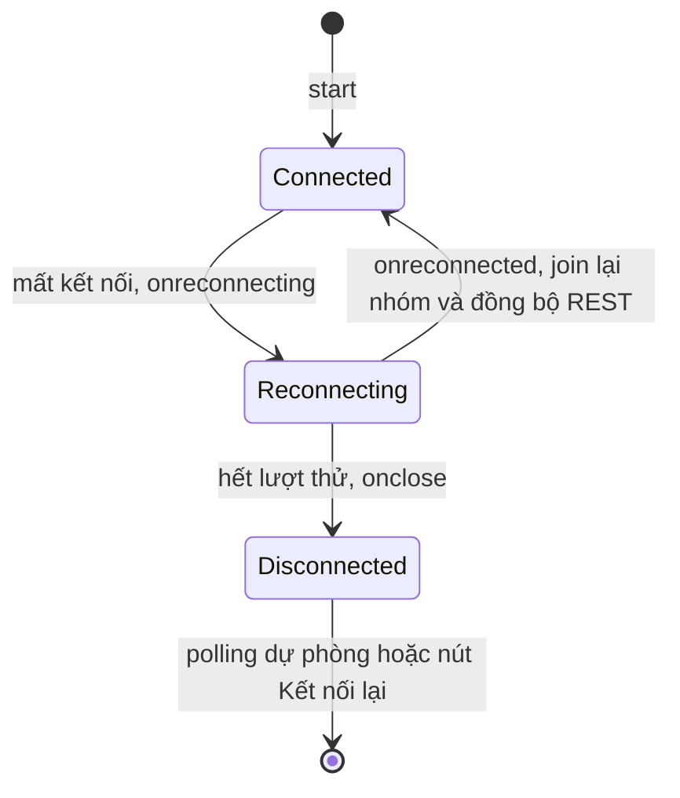

# 11.4 - Client-side Integration

> **Tóm tắt:** Phía client có ba việc mà thiếu cái nào cũng gây lỗi khó chẩn đoán. **Một: `withAutomaticReconnect` không khôi phục nhóm** — kết nối lại tạo `ConnectionId` **mới**, và mọi nhóm gắn với id cũ **biến mất**; bạn phải tự join lại trong `onreconnected`, nếu không người dùng lặng lẽ ngừng nhận thông báo. **Hai: tin nhắn trong lúc mất kết nối bị mất** — mặc định SignalR không đệm tin cho kết nối đã đứt. Stateful reconnect (.NET 8+) cứu được những lần đứt ngắn, nhưng đứt lâu, server restart hay đổi instance thì vẫn mất, nên sau khi kết nối lại bạn phải **gọi REST để đồng bộ** những gì đã bỏ lỡ. **Ba: `accessTokenFactory` được gọi lại mỗi lần kết nối lại**, nên nó phải trả về token **còn hạn** — trả token đã hết hạn là vòng lặp kết nối lại vô tận.

## Mục tiêu bài học

Sau bài này bạn có thể:

- Thiết lập kết nối với backoff hợp lý.
- Join lại nhóm và đồng bộ dữ liệu sau khi kết nối lại.
- Xử lý token hết hạn trong kết nối dài.
- Dọn dẹp kết nối đúng cách trong SPA.
- Bật stateful reconnect và biết giới hạn của nó.
- Gỡ lỗi kết nối SignalR.

**Cần biết trước:** [bài 11.2](11.2-signalr-architecture.md) (`ConnectionId`, nhóm), [bài 11.3](11.3-setup-signalr-server.md) (Hub và trang client đầu tiên), [bài 10.3](../module-10-authentication-authorization/10.3-refresh-token.md) (access token và refresh token). Mục 11.4.5 dùng React; chưa học React thì đọc ý chính: tạo kết nối một lần và dọn dẹp khi không dùng nữa.

## Nội dung bài học

### 11.4.1 — Thiết lập kết nối

```typescript
import * as signalR from "@microsoft/signalr";

export class NotificationHubClient {
  private connection: signalR.HubConnection;

  constructor(private readonly getAccessToken: () => Promise<string>) {
    this.connection = new signalR.HubConnectionBuilder()
      .withUrl("/hubs/notifications", {
        // Được gọi MỖI LẦN kết nối và kết nối lại
        accessTokenFactory: () => this.getAccessToken(),
      })
      .withAutomaticReconnect({
        nextRetryDelayInMilliseconds: ctx => {
          if (ctx.elapsedMilliseconds > 5 * 60 * 1000) return null;  // dừng sau 5 phút
          const delays = [0, 2000, 5000, 10000, 30000];
          return delays[ctx.previousRetryCount] ?? 30000;
        },
      })
      .configureLogging(signalR.LogLevel.Warning)
      .build();
  }
}
```

`accessTokenFactory` **bất đồng bộ** và được gọi lại mỗi lần kết nối, nên nó phải làm mới token nếu sắp hết hạn:

```typescript
private async getAccessToken(): Promise<string> {
  if (this.tokenExpiresAt - Date.now() < 60_000)   // còn dưới 1 phút
    await this.refreshToken();

  return this.accessToken;
}
```

Trả về token **đã hết hạn** cho kết quả rất khó chẩn đoán: server từ chối, client kết nối lại, lại trả token cũ, lại bị từ chối — một vòng lặp mà log client chỉ ghi "reconnecting".

Trả `null` trong `nextRetryDelayInMilliseconds` là **ngừng thử**. Thử mãi mãi khiến tab nền của người dùng gửi request vô tận trong nhiều ngày — nên đặt một trần thời gian.

### 11.4.2 — Nhóm biến mất sau khi kết nối lại

Đây là lỗi phổ biến nhất của SignalR phía client.

```typescript
this.connection.onreconnected(async connectionId => {
  console.info("Đã kết nối lại:", connectionId);

  // BẮT BUỘC — nhóm gắn với ConnectionId CŨ đã biến mất
  await this.connection.invoke("JoinTenantGroup", this.tenantId);

  // BẮT BUỘC — lấy những gì đã bỏ lỡ
  await this.syncMissedNotifications();
});
```

Kết nối lại tạo `ConnectionId` **mới** ([bài 11.2](11.2-signalr-architecture.md)), và nhóm gắn với id cũ. Không join lại thì client **vẫn "đang kết nối"** nhưng **không nhận được gì** từ nhóm — không lỗi, không cảnh báo, người dùng chỉ thấy thông báo ngừng đến.

Cách chắc chắn hơn là để **server** tự join nhóm trong `OnConnectedAsync` dựa trên claim, thay vì trông vào client nhớ gọi lại ([bài 11.5](11.5-signalr-authentication.md)).

**Tin nhắn trong lúc mất kết nối bị mất.** Với cấu hình mặc định, SignalR không đệm tin cho một kết nối đã đứt, không có xác nhận, không gửi lại. Mất mạng 30 giây là mất mọi tin nhắn trong 30 giây đó. Mục 11.4.3 giới thiệu stateful reconnect, thứ cứu được những lần đứt **ngắn**; với mọi trường hợp còn lại, cách chắc chắn là **đồng bộ qua REST** sau khi kết nối lại:

```typescript
private async syncMissedNotifications(): Promise<void> {
  const since = this.lastReceivedAt ?? new Date(Date.now() - 3600_000);
  const missed = await fetch(`/api/v1/notifications?since=${since.toISOString()}`)
    .then(r => r.json());

  missed.forEach(n => this.handleNotification(n));
}
```

Đây là nguyên tắc thiết kế quan trọng nhất của bài: **real-time là lớp tăng tốc, không phải nguồn sự thật**. REST là nguồn sự thật; SignalR chỉ giúp bạn biết sớm hơn. Ứng dụng phải hoạt động đúng — chỉ chậm hơn — khi SignalR hỏng hoàn toàn.

### 11.4.3 — Stateful reconnect (.NET 8+)

Từ .NET 8, SignalR có **stateful reconnect**: khi kết nối WebSocket đứt **ngắn**, client nối lại vào **đúng kết nối cũ** thay vì tạo kết nối mới. Hai phía đều giữ một bộ đệm tin nhắn chưa được bên kia xác nhận, và gửi lại phần còn thiếu khi nối lại.

Bật ở cả hai phía:

```csharp
// Program.cs
builder.Services.AddSignalR(o =>
{
    o.StatefulReconnectBufferSize = 100_000;   // byte đệm mỗi kết nối, đây cũng là giá trị mặc định
});

app.MapHub<NotificationHub>("/hubs/notifications", o => o.AllowStatefulReconnects = true);
```

```typescript
const connection = new signalR.HubConnectionBuilder()
  .withUrl("/hubs/notifications")
  .withStatefulReconnect({ bufferSize: 100_000 })
  .withAutomaticReconnect()
  .build();
```

Kiểm chứng bằng một proxy TCP nhỏ đứng giữa client và server: client join một nhóm, proxy cắt mọi socket, server gửi một tin vào nhóm **trong lúc đứt**, rồi gửi thêm một tin sau khi client đã nối lại. Output thật, so sánh hai client:

```text
thường    onreconnecting
thường    onreconnected, id mới? true
thường    state Connected connectionId giữ nguyên: false
---
stateful  nhận group g-stateful
stateful  state Connected connectionId giữ nguyên: true
stateful  nhận group g-stateful
```

Client thường kết nối lại với `ConnectionId` mới, **mất cả hai tin**: tin gửi lúc đứt và tin gửi sau đó (vì nó không còn trong nhóm). Client stateful giữ nguyên `ConnectionId`, còn trong nhóm, nhận đủ cả hai tin, và `onreconnecting` không hề chạy.

Giới hạn cần biết:

- Chỉ áp dụng cho transport **WebSocket**.
- Chỉ cứu được khi nối lại vào **cùng tiến trình server** còn giữ kết nối cũ. Server restart, deploy, hay load balancer đưa client sang instance khác thì không nối lại được, và client rơi về kết nối lại thông thường: `ConnectionId` mới, mất nhóm, mất tin.
- Bộ đệm có giới hạn. Tin chưa xác nhận vượt `StatefulReconnectBufferSize` thì bên gửi phải chờ, và nếu đứt quá lâu thì kết nối cũ bị đóng hẳn.

Vì vậy stateful reconnect là **tối ưu cho trường hợp phổ biến** (Wi-Fi chập chờn vài giây), không thay được việc join lại nhóm và đồng bộ qua REST trong `onreconnected`.

### 11.4.4 — Bốn trạng thái kết nối

```typescript
this.connection.onreconnecting(error => {
  this.setStatus("reconnecting");          // hiện "Đang kết nối lại..."
});

this.connection.onreconnected(async id => {
  this.setStatus("connected");
  await this.rejoinAndSync();
});

this.connection.onclose(error => {
  this.setStatus("disconnected");          // withAutomaticReconnect ĐÃ BỎ CUỘC
  this.startPollingFallback();             // dự phòng
});
```

`onclose` sau khi `withAutomaticReconnect` hết lượt thử là **trạng thái cuối** — SignalR **không** tự thử lại nữa. Bạn phải tự quyết định: chuyển sang polling, hiện nút "Kết nối lại", hoặc thử lại theo lịch riêng.



Hiển thị trạng thái cho người dùng là chi tiết nhỏ nhưng quan trọng: nó biến "ứng dụng hỏng" thành "đang kết nối lại", và họ biết dữ liệu mình thấy có thể không mới nhất.

### 11.4.5 — Vòng đời trong SPA

```typescript
// React
useEffect(() => {
  const client = new NotificationHubClient(getToken);
  client.onNotification(n => dispatch(addNotification(n)));
  client.start();

  return () => { void client.stop(); };     // BẮT BUỘC
}, []);
```

Quên dọn dẹp là **rò rỉ kết nối**: điều hướng qua lại 10 lần trong SPA tạo 10 kết nối, tất cả vẫn mở và tất cả vẫn nhận tin nhắn. Người dùng thấy **thông báo lặp lại 10 lần**, và server giữ 10 kết nối cho một người.

Với React StrictMode ở Development, `useEffect` chạy **hai lần** — nếu logic dọn dẹp không đúng, bạn sẽ thấy lỗi lạ chỉ ở Development.

Thực tế tốt hơn: đặt kết nối ở **một singleton cấp ứng dụng**, không phải trong component. Một kết nối cho cả ứng dụng, các component chỉ đăng ký và huỷ đăng ký handler.

```typescript
// Huỷ đăng ký từng handler
const handler = (n: NotificationDto) => dispatch(addNotification(n));
connection.on("ReceiveNotification", handler);

return () => connection.off("ReceiveNotification", handler);
```

`connection.off("ReceiveNotification")` **không** truyền handler sẽ gỡ **mọi** handler của sự kiện đó — kể cả của component khác.

### 11.4.6 — Gỡ lỗi

```typescript
.configureLogging(signalR.LogLevel.Debug)     // chỉ khi đang gỡ lỗi
```

Bốn lỗi hay gặp và nguyên nhân thật:

| Triệu chứng | Nguyên nhân thường gặp |
|---|---|
| `negotiate` trả **401** | Token chưa vào query string phía server ([bài 11.5](11.5-signalr-authentication.md)) |
| `negotiate` trả **404** | Sai đường dẫn, hoặc `MapHub` đặt sau `app.Run()` |
| Kết nối được nhưng **không nhận tin** | Tên hàm client không khớp, chưa join nhóm sau reconnect, hoặc `UserIdentifier` là `null` |
| Lỗi **CORS** ở `negotiate` | Thiếu `AllowCredentials`, hoặc origin không nằm trong danh sách |

Hàng thứ ba là hàng tốn thời gian nhất, vì server **không sinh lỗi nào**. Cách kiểm tra nhanh: bật `LogLevel.Information` ở client — tên hàm không khớp sẽ hiện cảnh báo `No client method with the name '...' found.` ([bài 11.3](11.3-setup-signalr-server.md)); và log `Context.UserIdentifier` trong `OnConnectedAsync` ở server ([bài 11.5](11.5-signalr-authentication.md)).

Với CORS cho SignalR, `AllowCredentials()` là **bắt buộc**, nên bạn **không thể** dùng `AllowAnyOrigin()` — đúng ràng buộc ở [bài 10.10](../module-10-authentication-authorization/10.10-security-best-practices.md):

```csharp
options.AddPolicy("signalr", p => p
    .WithOrigins("https://app.example.com")
    .AllowAnyHeader()
    .AllowAnyMethod()
    .AllowCredentials());
```

### 11.4.7 — Rà lại code của bạn

**Danh sách rà soát client SignalR**

- [ ] accessTokenFactory làm mới token nếu sắp hết hạn.
- [ ] Backoff có trần thời gian, trả null để ngừng thử.
- [ ] onreconnected join lại mọi nhóm, hoặc server tự join dựa trên claim.
- [ ] onreconnected gọi REST để đồng bộ tin nhắn đã bỏ lỡ, kể cả khi đã bật stateful reconnect.
- [ ] Ứng dụng hoạt động đúng khi SignalR hỏng hoàn toàn.
- [ ] onclose có phương án dự phòng, không để người dùng treo im lặng.
- [ ] Trạng thái kết nối được hiển thị cho người dùng.
- [ ] Kết nối được dọn dẹp khi component unmount.
- [ ] Kết nối là singleton cấp ứng dụng, không tạo trong từng component.
- [ ] connection.off luôn truyền kèm handler cụ thể.
- [ ] CORS cho SignalR dùng danh sách origin cụ thể với AllowCredentials.

## Bài tập áp dụng

#### Bài 1 — Nhóm biến mất sau khi kết nối lại

Join một nhóm, ngắt mạng 30 giây rồi bật lại. Xác nhận client kết nối lại nhưng **không** nhận tin nhắn của nhóm. Thêm join lại trong `onreconnected` và kiểm chứng.

**Tiêu chí hoàn thành:** bạn nêu được vì sao SignalR **không tự** khôi phục nhóm, dù nó tự kết nối lại.

<details>
<summary><strong>Gợi ý và lời giải — Bài 1</strong></summary>

**Gợi ý.** Nhóm là ánh xạ từ tên nhóm tới **`ConnectionId`**. Kết nối lại sinh ra `ConnectionId` mới.

**Lời giải — bản thiếu sót:**

```js
const connection = new signalR.HubConnectionBuilder()
    .withUrl('/hubs/notifications')
    .withAutomaticReconnect()
    .build();

await connection.start();
await connection.invoke('JoinTenantGroup');      // chỉ gọi MỘT lần
```

Ngắt mạng khoảng 30 giây rồi bật lại (tắt Wi-Fi, hoặc trên Linux `sudo ip link set eth0 down; sleep 30; sudo ip link set eth0 up`). Sau đó gửi một tin vào nhóm từ server.

```text
onreconnecting
onreconnected (ConnectionId mới)
(gửi tin vào nhóm từ server — client KHÔNG nhận được gì)
```

Mục 11.4.3 có output thật của đúng kịch bản này, đo bằng proxy cắt kết nối.

**Kết nối lại thành công, nhưng client im lặng ra khỏi mọi nhóm.**

**Vì sao SignalR không tự khôi phục** (trừ trường hợp stateful reconnect nối lại được kết nối cũ). Nhóm được lưu ở server dưới dạng ánh xạ `tên nhóm -> tập ConnectionId`. Khi kết nối đứt, `OnDisconnectedAsync` chạy và SignalR **xoá `ConnectionId` cũ khỏi mọi nhóm** — đúng đắn, vì id đó không còn tồn tại. Kết nối lại tạo `ConnectionId` mới, và id mới này chưa thuộc nhóm nào.

Để tự khôi phục, SignalR phải nhớ "kết nối trước đó của người này ở những nhóm nào" — nghĩa là phải lưu trạng thái, phải quyết định lưu bao lâu, và phải xử lý trường hợp quyền của người dùng đã đổi trong lúc mất mạng. Nó chọn không làm, và giao quyết định đó cho bạn.

**Bản đã sửa:**

```js
async function joinGroups() {
    await connection.invoke('JoinTenantGroup');
    await connection.invoke('JoinDealRoom', currentDealId);
}

connection.onreconnected(async connectionId => {
    console.log('đã kết nối lại:', connectionId);
    await joinGroups();                       // BẮT BUỘC
    await syncMissedNotifications();          // xem bài 2
});

await connection.start();
await joinGroups();
```

**Cách tốt hơn — để server tự gán nhóm:**

```csharp
public override async Task OnConnectedAsync()
{
    var tenantId = Context.User!.FindFirstValue("tenant_id");
    if (tenantId is not null)
        await Groups.AddToGroupAsync(Context.ConnectionId, GroupNames.Tenant(tenantId));

    await base.OnConnectedAsync();
}
```

`OnConnectedAsync` chạy **mỗi lần** kết nối, kể cả kết nối lại — nên nhóm tự khôi phục mà client không phải làm gì. `GroupNames` là lớp gom mọi tên nhóm về một chỗ, định nghĩa ở [bài 11.6](11.6-groups-and-targeting.md); `GroupNames.Tenant("acme")` trả về `"tenant:acme"`.

**Và nó an toàn hơn.** Client tự gọi `JoinGroup("tenant:acme")` nghĩa là client **chọn** nhóm của mình — kẻ xấu đổi một tham số là nghe được thông báo của tổ chức khác. Server gán nhóm từ claim đã ký thì không có chỗ nào để lách.

**Quy tắc:**

| Loại nhóm | Ai gán |
|---|---|
| Suy ra từ danh tính (tenant, vai trò, phòng ban) | **Server**, trong `OnConnectedAsync` |
| Do người dùng chọn (phòng chat, deal đang mở) | Client gọi, **server kiểm quyền**, và client join lại trong `onreconnected` |

</details>

---

#### Bài 2 — Tin nhắn gửi trong lúc mất kết nối thì mất luôn

Trong lúc client mất kết nối, gửi 5 thông báo từ server. Xác nhận client **không** nhận được cái nào sau khi kết nối lại. Thêm đồng bộ qua REST và kiểm chứng.

**Tiêu chí hoàn thành:** bạn nêu được vì sao SignalR **không** đệm tin nhắn lâu dài (stateful reconnect chỉ đệm cho đứt ngắn), và rút ra được nguyên tắc về nguồn sự thật.

<details>
<summary><strong>Gợi ý và lời giải — Bài 2</strong></summary>

**Gợi ý.** Đệm bao nhiêu tin? Trong bao lâu? Cho bao nhiêu client mất kết nối cùng lúc?

**Lời giải — kiểm chứng:**

Ngắt mạng của máy chạy trình duyệt, rồi từ một máy khác (hoặc từ server) gọi API tạo 5 thông báo cho người dùng đó, sau đó bật mạng lại.

```text
onreconnecting
onreconnected
(không có tin nào hiện ra)
```

**Năm thông báo mất hẳn.**

**Vì sao SignalR không đệm lâu dài.** Đệm nghe đơn giản nhưng kéo theo một chuỗi câu hỏi không có câu trả lời chung:

- Giữ bao nhiêu tin cho mỗi client? 10? 1.000?
- Giữ trong bao lâu? Người dùng đóng máy ba ngày thì sao?
- 10.000 client mất kết nối cùng lúc vì proxy restart — bộ nhớ ở đâu ra?
- Nhiều instance thì đệm nằm ở instance nào?

Mọi lựa chọn đều sai với một nhóm người dùng nào đó. SignalR chọn không đoán, và định vị mình là **kênh truyền**, không phải **kho lưu trữ**. Stateful reconnect là ngoại lệ có giới hạn rõ: một bộ đệm nhỏ trong bộ nhớ, cho một kết nối, trong vài giây.

**Nguyên tắc rút ra — và đây là phần quan trọng nhất của bài:**

```text
Database là nguồn sự thật.
SignalR chỉ là lối tắt để người dùng biết sớm hơn.
```

Nghĩa là mọi thông báo phải **lưu trước, đẩy sau**:

```csharp
// NotificationService.cs — Notification là entity chuẩn của module, xem bài 11.8
public sealed class NotificationService(
    CrmDbContext db,
    IHubContext<NotificationHub, INotificationClient> hub)
{
    public async Task NotifyAsync(Guid userId, string message, CancellationToken ct)
    {
        var notification = new Notification
        {
            UserId = userId,
            Type = NotificationType.Info,
            Message = message
        };                                                    // Id, CreatedAt có giá trị mặc định

        db.Notifications.Add(notification);
        await db.SaveChangesAsync(ct);                        // LƯU TRƯỚC

        await hub.Clients.User(userId.ToString())
            .ReceiveNotification(NotificationDto.From(notification));   // rồi mới đẩy
    }
}
```

Nếu bước đẩy thất bại — client offline, backplane lỗi, instance restart — **không sao cả**: dữ liệu đã an toàn và client sẽ thấy nó ở lần đồng bộ tiếp theo.

**Đồng bộ sau khi kết nối lại:**

```js
let lastSeenId = null;

async function syncMissed() {
    const url = lastSeenId
        ? `/api/v1/notifications?after=${lastSeenId}`
        : '/api/v1/notifications?unreadOnly=true';

    const missed = await fetch(url).then(r => r.json());
    missed.forEach(n => store.add(n));      // trùng thì bị bỏ qua
    if (missed.length) lastSeenId = missed.at(-1).id;
}

connection.onreconnected(async () => {
    await joinGroups();
    await syncMissed();                     // BẮT BUỘC
});

connection.on('ReceiveNotification', n => { store.add(n); lastSeenId = n.id; });
```

```text
onreconnected
GET /api/v1/notifications?after=018f3a1b...
(5 thông báo hiện ra)
```

**Hai chi tiết làm mẫu này hoạt động:**

1. **Id phải sắp xếp được theo thời gian.** `Guid.CreateVersion7()` có phần timestamp ở đầu, và PostgreSQL so sánh `uuid` theo thứ tự byte, nên `WHERE "Id" > @after ORDER BY "Id"` cho đúng thứ tự thời gian. `Guid.NewGuid()` ngẫu nhiên hoàn toàn thì không dùng được cho việc này.
<details>
<summary>SQL Server</summary>

SQL Server so sánh `uniqueidentifier` bắt đầu từ **6 byte cuối**, không phải từ phần timestamp, nên `ORDER BY Id` **không** theo thời gian với GUID v7. Năm GUID v7 sinh cách nhau 5 ms, `ORDER BY` trên PostgreSQL ra `1,2,3,4,5`, trên SQL Server 2022 ra `2,1,5,3,4` (chạy thật). Với SQL Server, làm con trỏ đồng bộ bằng cặp `(CreatedAt, Id)`: `WHERE CreatedAt > @afterTime OR (CreatedAt = @afterTime AND Id > @afterId) ORDER BY CreatedAt, Id`.

</details>

2. **`store.add` phải idempotent.** Trong lúc đồng bộ, một tin có thể tới **cả hai đường** — qua REST và qua SignalR. Khử trùng theo id để người dùng không thấy thông báo lặp.

**Gọi `syncMissed()` ở ba chỗ:** sau `start()` lần đầu, trong `onreconnected`, và khi tab được focus lại. Chỗ thứ ba bắt được trường hợp trình duyệt tạm ngưng tab ở chế độ nền mà không báo mất kết nối.

</details>

---

#### Bài 3 — Rò rỉ kết nối trong component React

Tạo kết nối trong một React component **không** dọn dẹp, điều hướng qua lại 10 lần, và đếm số kết nối trên server cùng số lần thông báo hiện ra.

**Tiêu chí hoàn thành:** bạn nêu được **hai** triệu chứng khác nhau của cùng một lỗi này.

<details>
<summary><strong>Gợi ý và lời giải — Bài 3</strong></summary>

**Gợi ý.** Một triệu chứng người dùng thấy ngay. Triệu chứng kia chỉ lộ ra trên biểu đồ của server.

**Lời giải — component rò rỉ:**

```tsx
function NotificationBell() {
  useEffect(() => {
    const conn = new signalR.HubConnectionBuilder()
      .withUrl('/hubs/notifications')
      .withAutomaticReconnect()
      .build();

    conn.on('ReceiveNotification', n => showToast(n));
    conn.start();

    // THIẾU hàm dọn dẹp
  }, []);

  return <Bell />;
}
```

Điều hướng qua lại 10 lần:

```csharp
// Đếm ở server — NotificationHub.cs
public sealed class NotificationHub(ILogger<NotificationHub> logger) : Hub<INotificationClient>
{
    // Phải là static: Hub là transient, mỗi lần gọi tạo một đối tượng mới (bài 11.2),
    // nên field thường sẽ luôn bắt đầu lại từ 0.
    private static int _connectionCount;

    public override Task OnConnectedAsync()
    {
        var count = Interlocked.Increment(ref _connectionCount);
        logger.LogInformation("Kết nối #{Count} cho user {UserId}", count, Context.UserIdentifier);
        return base.OnConnectedAsync();
    }
}
```

Biến `static` này chỉ đếm trong một tiến trình và không giảm khi kết nối đóng. Nó đủ để quan sát rò rỉ trong bài tập, không phải cách đếm cho production ([bài 11.2](11.2-signalr-architecture.md) nói vì sao không giữ trạng thái trong Hub). Log có dạng sau (minh họa, id người dùng rút gọn):

```text
Kết nối #1 cho user 8f3a1b2c
Kết nối #2 cho user 8f3a1b2c
...
Kết nối #11 cho user 8f3a1b2c
```

**Triệu chứng 1 — người dùng thấy: thông báo hiện 11 lần.** Mười một kết nối, mỗi cái một handler `ReceiveNotification`, nên một thông báo sinh ra mười một hộp thoại chồng lên nhau. Đây là thứ người dùng báo lại, và nó trông giống lỗi ở phía server.

**Triệu chứng 2 — chỉ server thấy: số kết nối tăng tuyến tính theo số lần điều hướng.** Trên dashboard giám sát, nó trông như thế này (số minh họa):

```text
SignalR Current Connections: 4.312
Người dùng đang hoạt động:     380
```

Tỷ lệ hơn 11 kết nối mỗi người. Mỗi WebSocket giữ bộ đệm và một bản ghi trạng thái trên server, nên bộ nhớ tăng đều mà không có nguyên nhân rõ ràng — nhìn giống rò rỉ bộ nhớ hơn là lỗi frontend.

**Hai triệu chứng này thường được báo cho hai đội khác nhau** và không ai nối chúng lại với nhau.

**Bản đã sửa:**

```tsx
function NotificationBell() {
  useEffect(() => {
    const conn = new signalR.HubConnectionBuilder()
      .withUrl('/hubs/notifications')
      .withAutomaticReconnect()
      .build();

    conn.on('ReceiveNotification', showToast);
    conn.start();

    return () => { conn.stop(); };        // DỌN DẸP
  }, []);

  return <Bell />;
}
```

**Nhưng cách tốt hơn: một kết nối cho cả ứng dụng.**

```tsx
const HubContext = createContext<signalR.HubConnection | null>(null);

export function HubProvider({ children }: PropsWithChildren) {
  const [conn, setConn] = useState<signalR.HubConnection | null>(null);

  useEffect(() => {
    const c = new signalR.HubConnectionBuilder()
      .withUrl('/hubs/notifications')
      .withAutomaticReconnect()
      .build();

    c.start().then(() => setConn(c));
    return () => { c.stop(); };
  }, []);

  return <HubContext.Provider value={conn}>{children}</HubContext.Provider>;
}
```

Mọi component dùng chung một kết nối và chỉ đăng ký handler của riêng mình:

```tsx
function NotificationBell() {
  const conn = useContext(HubContext);

  useEffect(() => {
    if (!conn) return;
    conn.on('ReceiveNotification', showToast);
    return () => { conn.off('ReceiveNotification', showToast); };   // gỡ ĐÚNG handler
  }, [conn]);

  return <Bell />;
}
```

**Chú ý `conn.off` phải nhận đúng tham chiếu hàm đã đăng ký.** Truyền một arrow function viết lại tại chỗ thì nó là một hàm khác và không gỡ được gì — cùng cơ chế với `-=` cho event trong C# ở [bài 5.11](../../stage-02-csharp-professional/module-05-advanced-csharp/5.11-quick-real-world-example.md).

**Cảnh báo nên đặt ở server:**

```text
CẢNH BÁO khi: số kết nối SignalR / số người dùng hoạt động > 3
```

Tỷ lệ bình thường là 1–2 (người dùng mở vài tab). Vượt 3 gần như luôn là rò rỉ ở client, và cảnh báo này bắt được nó trước khi có ai phàn nàn về thông báo lặp.

</details>

## Tự kiểm tra

<details>
<summary>Vì sao phải join lại nhóm sau khi kết nối lại?</summary>

Vì kết nối lại tạo ConnectionId mới, và nhóm gắn với id cũ nên biến mất. Không join lại thì client vẫn đang kết nối nhưng không nhận được gì từ nhóm, không lỗi và không cảnh báo. Cách chắc chắn hơn là để server tự join nhóm trong OnConnectedAsync dựa trên claim.

</details>

<details>
<summary>Tin nhắn gửi trong lúc client mất kết nối có tới không?</summary>

Mặc định là không: SignalR không đệm, không xác nhận và không gửi lại. Bật stateful reconnect (.NET 8+, chỉ WebSocket) thì những lần đứt ngắn nối lại được vào kết nối cũ và nhận đủ tin. Đứt lâu, server restart hay đổi instance thì vẫn mất, nên vẫn phải gọi REST để đồng bộ sau khi kết nối lại.

</details>

<details>
<summary>Nguyên tắc thiết kế quan trọng nhất khi dùng real-time là gì?</summary>

Real-time là lớp tăng tốc chứ không phải nguồn sự thật. REST là nguồn sự thật, SignalR chỉ giúp biết sớm hơn. Ứng dụng phải hoạt động đúng, chỉ chậm hơn, khi SignalR hỏng hoàn toàn.

</details>

<details>
<summary>accessTokenFactory cần lưu ý gì?</summary>

Nó được gọi lại mỗi lần kết nối và kết nối lại, nên phải trả về token còn hạn và tự làm mới nếu sắp hết. Trả token đã hết hạn tạo vòng lặp: server từ chối, client kết nối lại, lại trả token cũ, và log client chỉ ghi reconnecting.

</details>

<details>
<summary>onclose xảy ra khi nào?</summary>

Khi withAutomaticReconnect đã hết lượt thử và bỏ cuộc. Đó là trạng thái cuối, SignalR không tự thử lại nữa, nên bạn phải tự quyết định chuyển sang polling, hiện nút kết nối lại, hoặc thử theo lịch riêng.

</details>

<details>
<summary>Quên dọn dẹp kết nối trong SPA gây ra gì?</summary>

Rò rỉ kết nối: điều hướng qua lại 10 lần tạo 10 kết nối vẫn mở và cùng nhận tin nhắn, nên người dùng thấy thông báo lặp 10 lần và server giữ 10 kết nối cho một người. Tốt hơn là đặt kết nối ở một singleton cấp ứng dụng và component chỉ đăng ký rồi huỷ đăng ký handler.

</details>

## Kết luận

Ba điều đáng nhớ nhất:

1. **Kết nối lại thông thường là mất nhóm.** Join lại, hoặc để server tự join theo claim.
2. **Stateful reconnect chỉ cứu đứt ngắn.** Đồng bộ qua REST sau mỗi lần kết nối lại.
3. **Real-time là lớp tăng tốc, REST là nguồn sự thật.**

## Tham khảo

- [ASP.NET Core SignalR JavaScript client](https://learn.microsoft.com/en-us/aspnet/core/signalr/javascript-client)
- [Configure client options in SignalR](https://learn.microsoft.com/en-us/aspnet/core/signalr/configuration#configure-client-options)
- [Configure stateful reconnect](https://learn.microsoft.com/en-us/aspnet/core/signalr/configuration#configure-stateful-reconnect)
- [Manage users and groups in SignalR](https://learn.microsoft.com/en-us/aspnet/core/signalr/groups)
- [Enable CORS in ASP.NET Core](https://learn.microsoft.com/en-us/aspnet/core/security/cors)

## Điều hướng

- **Bài trước:** [11.3 — Setup SignalR Server](11.3-setup-signalr-server.md)
- **Bài tiếp theo:** [11.5 — Authentication trong SignalR](11.5-signalr-authentication.md)
- **Về module:** [Trang mục lục](README.md)
