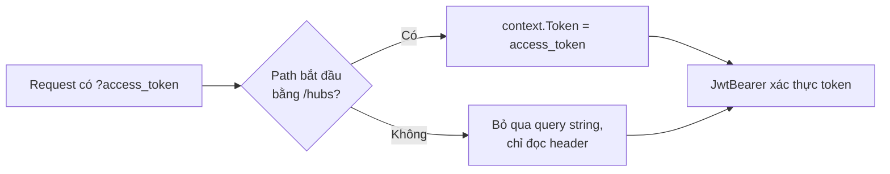

# 11.5 - Authentication trong SignalR

> **Tóm tắt:** Xác thực SignalR có hai đặc điểm gây hệ quả bảo mật thật. **Một: WebSocket API của trình duyệt không cho đặt header tuỳ ý**, nên token phải đi qua **query string** — và query string **lọt vào log của proxy, công cụ APM và file HAR**. **Hai: mặc định token chỉ được kiểm tra một lần, lúc kết nối.** Một kết nối mở 8 tiếng với token 15 phút vẫn hoạt động suốt 8 tiếng. Từ .NET 7 có sẵn `CloseOnAuthenticationExpiration` để server tự đóng kết nối khi token hết hạn; kết hợp với `withAutomaticReconnect` và `accessTokenFactory`, client nối lại ngay bằng token mới. Thêm một bẫy riêng của khoá học: [bài 10.2](../module-10-authentication-authorization/10.2-jwt-authentication.md) đặt `MapInboundClaims = false`, nên phải khai báo `IUserIdProvider` đọc claim `sub`, nếu không `Clients.User` không tới được ai.

## Mục tiêu bài học

Sau bài này bạn có thể:

- Cấu hình JWT đọc token từ query string, chỉ cho đường dẫn hub.
- Giảm rủi ro token lọt vào log.
- Cho server tự đóng kết nối khi token hết hạn, và ngắt kết nối của một người dùng khi thu hồi quyền.
- Khai báo `IUserIdProvider` khớp với claim trong token.
- Kiểm tra quyền trong Hub method và tự động gán nhóm dựa trên claim.

**Cần biết trước:** [bài 10.2](../module-10-authentication-authorization/10.2-jwt-authentication.md) (JWT), [bài 10.6](../module-10-authentication-authorization/10.6-resource-based-authorization.md) (phân quyền theo tài nguyên, IDOR), [bài 11.3](11.3-setup-signalr-server.md), [bài 11.4](11.4-client-side-integration.md) (`accessTokenFactory`, kết nối lại).

## Nội dung bài học

### 11.5.1 — Token qua query string

```csharp
// Program.cs, trong AddJwtBearer(options => { ... }) của bài 10.2
options.Events = new JwtBearerEvents
{
    OnMessageReceived = context =>
    {
        var accessToken = context.Request.Query["access_token"];

        // CHỈ cho đường dẫn hub — không áp dụng cho API thường
        if (!string.IsNullOrEmpty(accessToken)
            && context.HttpContext.Request.Path.StartsWithSegments("/hubs"))
        {
            context.Token = accessToken;
        }

        return Task.CompletedTask;
    }
};
```

**Vì sao phải qua query string:** WebSocket API của trình duyệt chỉ cho phép đặt URL và subprotocol, **không** cho header tuỳ ý. Client SignalR lấy token từ `accessTokenFactory` rồi gửi bằng header `Authorization` cho request `negotiate`, nhưng với kết nối WebSocket (và SSE) thì đành đưa vào `?access_token=...`.

```javascript
const connection = new signalR.HubConnectionBuilder()
    .withUrl("/hubs/notifications", { accessTokenFactory: () => getAccessToken() })
    .withAutomaticReconnect()
    .build();
```

Điều kiện `StartsWithSegments("/hubs")` **không phải** tuỳ chọn. Bỏ nó đi là cho phép **mọi** endpoint nhận token qua query string — frontend sẽ có lúc dùng nó ở nơi lẽ ra phải dùng header, và token của mọi lời gọi API đều nằm trong log và lịch sử trình duyệt.



**Token đi vào URL thì nằm ở đâu:**

| Nơi | Ghi query string? |
|---|---|
| Access log của Nginx | **Có**, biến `$request` theo mặc định chứa cả query |
| Log của load balancer, CDN | Thường có, và bạn ít khi đổi được định dạng |
| Công cụ APM (Application Insights, Datadog...) | Thường ghi URL đầy đủ |
| File HAR người dùng xuất từ DevTools khi báo lỗi | **Có** |
| Serilog request logging | **Không** theo mặc định: nó ghi `RequestPath`, không kèm query |
| `AddHttpLogging` của ASP.NET Core | Chỉ khi bạn bật trường `RequestQuery` |

Ba cách giảm rủi ro:

**1. Che token ở proxy** (bài 1 có cấu hình Nginx), và **không bật** `HttpLoggingFields.RequestQuery` khi dùng HTTP logging.

**2. Access token sống ngắn** (5–15 phút, [bài 10.2](../module-10-authentication-authorization/10.2-jwt-authentication.md)). Token lọt vào log cũng hết hạn trước khi ai kịp dùng. Đây là cách giảm thiệt hại thực tế nhất, vì bạn không thể xoá hết mọi nơi URL đã đi qua.

**3. Cookie thay cho token** khi client và API cùng tên miền: trình duyệt tự gửi cookie trong request nâng cấp WebSocket, nên không có gì trong URL. Đánh đổi là phải xử lý CSRF và CORS chặt hơn.

### 11.5.2 — `UserIdentifier` phải khớp với claim trong token

`Clients.User(id)` tìm kết nối theo `Context.UserIdentifier`. Mặc định giá trị này lấy từ claim `ClaimTypes.NameIdentifier`. Có hai cấu hình JWT dẫn tới hai kết quả khác nhau:

| Cấu hình JWT | Claim `sub` trong token thành | `UserIdentifier` mặc định |
|---|---|---|
| Mặc định (`MapInboundClaims = true`) | `ClaimTypes.NameIdentifier` | Có giá trị |
| Như [bài 10.2](../module-10-authentication-authorization/10.2-jwt-authentication.md) (`MapInboundClaims = false`) | giữ nguyên `"sub"` | **`null`** |

Với cấu hình của khoá học, chạy thử một Hub log `Context.UserIdentifier` mà không khai báo gì thêm (output thật):

```text
User (null) kết nối, ConnectionId 7CyxzpT0s9kslJ39_IwqoQ
```

Kết nối vẫn thành công, và mọi `Clients.User(...)` gửi cho người này đều **không tới**, không lỗi, không log. Sửa bằng một `IUserIdProvider` tường minh:

```csharp
// Hubs/SubUserIdProvider.cs
using Microsoft.AspNetCore.SignalR;

// Bài 10.2 đặt MapInboundClaims = false nên id người dùng nằm ở claim "sub"
public sealed class SubUserIdProvider : IUserIdProvider
{
    public string? GetUserId(HubConnectionContext connection)
        => connection.User.FindFirst("sub")?.Value;
}
```

```csharp
// Program.cs
builder.Services.AddSingleton<IUserIdProvider, SubUserIdProvider>();
```

Thêm một lớp bảo vệ: đóng kết nối khi không xác định được người dùng, để lỗi cấu hình lộ ra ngay thay vì thành "kết nối được nhưng không bao giờ nhận gì":

```csharp
public override async Task OnConnectedAsync()
{
    if (string.IsNullOrEmpty(Context.UserIdentifier))
    {
        logger.LogError("Kết nối không xác định được UserIdentifier — kiểm tra IUserIdProvider");
        Context.Abort();
        return;
    }
    await base.OnConnectedAsync();
}
```

### 11.5.3 — Bảo vệ Hub và gán nhóm theo claim

```csharp
[Authorize]
public sealed class NotificationHub(IPresenceTracker presence) : Hub<INotificationClient>
{
    public override async Task OnConnectedAsync()
    {
        var userId = Context.UserIdentifier;
        var tenantId = Context.User?.FindFirst("tenant_id")?.Value;

        if (userId is null || tenantId is null)
        {
            Context.Abort();                 // không đủ thông tin -> đóng ngay
            return;
        }

        // SERVER tự gán nhóm — client không tự chọn được
        await Groups.AddToGroupAsync(Context.ConnectionId, GroupNames.Tenant(tenantId));

        if (Context.User!.IsInRole(CrmRoles.Manager))
            await Groups.AddToGroupAsync(Context.ConnectionId, GroupNames.Managers(tenantId));

        await presence.ConnectAsync(userId, Context.ConnectionId);
        await base.OnConnectedAsync();
    }
}
```

```csharp
app.MapHub<NotificationHub>("/hubs/notifications").RequireAuthorization();
```

`GroupNames` gom mọi tên nhóm về một chỗ (`GroupNames.Tenant("acme")` là `"tenant:acme"`), định nghĩa đầy đủ ở [bài 11.6](11.6-groups-and-targeting.md). `CrmRoles` là các hằng tên vai trò ở [bài 10.4](../module-10-authentication-authorization/10.4-role-based-authorization.md). `IPresenceTracker` ở [bài 11.9](11.9-presence-online-offline-status.md).

Kết nối không có token thì `negotiate` bị từ chối ngay. Client JavaScript nhận (output thật):

```text
Failed to complete negotiation with the server: Error: Unauthorized: Status code '401'
```

**Server tự gán nhóm** là điểm quan trọng nhất trong đoạn trên. So sánh với cách để client tự gọi:

```csharp
// NGUY HIỂM — client tự chọn nhóm
public async Task JoinTenantGroup(string tenantId)
{
    await Groups.AddToGroupAsync(Context.ConnectionId, GroupNames.Tenant(tenantId));
}
```

Client gọi `JoinTenantGroup("tenant-cua-nguoi-khac")` và nhận **mọi** thông báo của tenant đó. Đây là IDOR ([bài 10.6](../module-10-authentication-authorization/10.6-resource-based-authorization.md)) dưới dạng SignalR, và nó dễ bị bỏ sót hơn vì Hub method không trông giống một endpoint.

Nếu vẫn cần client tự tham gia nhóm, **phải kiểm tra quyền**. `IDealRepository` là repository Scoped, tiêm thẳng vào Hub được vì mỗi lời gọi có DI scope riêng ([bài 11.2](11.2-signalr-architecture.md)):

```csharp
[Authorize]
public sealed class NotificationHub(IDealRepository deals) : Hub<INotificationClient>
{
    public async Task JoinDealRoom(Guid dealId)
    {
        var tenantId = Context.User!.FindFirst("tenant_id")!.Value;
        var userId = Guid.Parse(Context.UserIdentifier!);

        if (!await deals.CanAccessAsync(dealId, userId, Context.ConnectionAborted))
            throw new HubException("Không có quyền truy cập");

        await Groups.AddToGroupAsync(Context.ConnectionId, GroupNames.Deal(tenantId, dealId));
    }
}
```

Kèm theo đó là lợi ích phụ: server tự gán nhóm thì client **không cần join lại** sau reconnect ([bài 11.4](11.4-client-side-integration.md)) — `OnConnectedAsync` chạy lại và tự lo.

### 11.5.4 — Token hết hạn giữa kết nối

> **Mặc định, SignalR kiểm tra token một lần, lúc thiết lập kết nối. Sau đó không kiểm tra lại.**

Với WebSocket, sau lượt bắt tay HTTP ban đầu không còn request HTTP nào để gắn token mới. Kết nối mở 8 tiếng với access token 15 phút vẫn hoạt động **suốt 8 tiếng**. Nghĩa là:

- Thu hồi quyền **không có hiệu lực** trên kết nối đang mở.
- Khoá tài khoản **không** ngắt kết nối của người đó.
- Đăng xuất ở thiết bị khác **không** ảnh hưởng gì.

Ba cách xử lý, từ đơn giản tới chặt chẽ:

**1. Server tự đóng kết nối khi token hết hạn** — có sẵn từ .NET 7:

```csharp
app.MapHub<NotificationHub>("/hubs/notifications",
        options => options.CloseOnAuthenticationExpiration = true)
   .RequireAuthorization();
```

Khi tới thời điểm hết hạn của token (claim `exp`), server gửi thông điệp đóng kết nối. Client có `withAutomaticReconnect` sẽ nối lại **ngay**, gọi `accessTokenFactory` lấy token mới, và người dùng không nhận ra. Bài 3 kiểm chứng điều này. Nhớ để `accessTokenFactory` làm mới token khi sắp hết hạn ([bài 11.4](11.4-client-side-integration.md)), nếu không nó trả lại token cũ đã hết hạn và lần nối lại bị `401`.

**2. Kiểm tra `SecurityStamp` mỗi lời gọi** — dùng lại cơ chế ở [bài 10.8](../module-10-authentication-authorization/10.8-overview.md). `IUserService` là service bạn tự viết so stamp trong token với stamp trong database:

```csharp
public sealed class SecurityStampCheckFilter(IUserService users) : IHubFilter
{
    public async ValueTask<object?> InvokeMethodAsync(
        HubInvocationContext context, Func<HubInvocationContext, ValueTask<object?>> next)
    {
        var userId = context.Context.UserIdentifier;
        var tokenStamp = context.Context.User?.FindFirst("sstamp")?.Value;

        if (userId is null || !await users.IsStampValidAsync(userId, tokenStamp))
        {
            context.Context.Abort();
            throw new HubException("Phiên không còn hiệu lực");
        }

        return await next(context);
    }
}
```

Nó chỉ chạy khi client **gọi** một method, nên không bắt được kết nối chỉ nghe.

**3. Chủ động ngắt kết nối khi thu hồi quyền — ở phía server.** `HubCallerContext` của mỗi kết nối có method `Abort()`. Giữ chúng trong một registry singleton, theo `ConnectionId`:

```csharp
// ConnectionRegistry.cs
using System.Collections.Concurrent;
using Microsoft.AspNetCore.SignalR;

public sealed class ConnectionRegistry
{
    private readonly ConcurrentDictionary<string, HubCallerContext> _connections = new();

    public void Add(HubCallerContext context) => _connections[context.ConnectionId] = context;
    public void Remove(string connectionId) => _connections.TryRemove(connectionId, out _);

    public int AbortUser(string userId)
    {
        var aborted = 0;
        foreach (var context in _connections.Values.Where(c => c.UserIdentifier == userId))
        {
            context.Abort();
            aborted++;
        }
        return aborted;
    }
}
```

```csharp
// NotificationHub.cs — đăng ký và huỷ đăng ký trong vòng đời kết nối
public override Task OnConnectedAsync()
{
    registry.Add(Context);
    return base.OnConnectedAsync();
}

public override Task OnDisconnectedAsync(Exception? exception)
{
    registry.Remove(Context.ConnectionId);
    return base.OnDisconnectedAsync(exception);
}
```

```csharp
// Program.cs
builder.Services.AddSingleton<ConnectionRegistry>();
```

Gọi `registry.AbortUser(userId)` từ chỗ khoá tài khoản. Chạy thử: client có `withAutomaticReconnect` bị `Abort()` thì nhận `onclose` (không lỗi) và **không** tự nối lại. Khi người dùng nối lại thủ công, token cũ vẫn còn hạn thì vẫn vào được, nên phải kết hợp với access token sống ngắn và thu hồi refresh token ([bài 10.3](../module-10-authentication-authorization/10.3-refresh-token.md)).

Registry chỉ biết kết nối **trên instance hiện tại**. Chạy nhiều instance thì phát lệnh "ngắt user X" tới mọi instance qua Redis pub/sub ([bài 11.10](11.10-scale-out-and-production.md)).

Cách này không cần client hợp tác. Cách gửi một sự kiện "hãy tự ngắt kết nối" xuống client thì cần client hợp tác, và người cố tình sửa client sẽ lờ nó đi.

**Khuyến nghị:** cách 1 cho mọi hệ thống, cộng access token ngắn hạn. Thêm cách 3 khi việc "người vừa bị khoá còn nghe thêm vài phút" là không chấp nhận được.

### 11.5.5 — Phân quyền chi tiết

```csharp
[Authorize]
public sealed class AdminHub(IMetricsService metrics) : Hub<IAdminClient>
{
    [Authorize(Roles = CrmRoles.Admin)]         // trên TỪNG method
    public async Task BroadcastSystemMessage(string message)
    {
        await Clients.All.ReceiveSystemMessage(message);
    }

    [Authorize(Policy = "CanViewMetrics")]
    public Task<MetricsDto> GetLiveMetrics() => metrics.GetAsync();
}
```

`[Authorize]` **áp dụng được trên từng Hub method** — không nhiều người biết. Nó hữu ích khi một Hub có cả method thường và method quản trị. Client gọi method mà không đủ quyền thì nhận một lỗi, không phải mã `403`: SignalR không có mã trạng thái cho từng lời gọi.

Nhưng nhớ hai giới hạn:

- Nó chỉ kiểm tra **claim trong token**, nên bị ảnh hưởng bởi vấn đề token cũ ở mục trên.
- Nó **không** kiểm tra được quyền trên dữ liệu — việc đó vẫn phải làm thủ công trong thân method.

**Ba tầng phân quyền trong SignalR:**

| Đặt ở | Chặn khi | Client nhận |
|---|---|---|
| `[Authorize]` trên Hub, `RequireAuthorization()` trên `MapHub` | **Lúc kết nối** | `negotiate` trả `401`, không kết nối được |
| `[Authorize(Roles/Policy)]` trên method | Lúc gọi method | Lỗi khi `invoke` |
| Kiểm tra trong thân method | Lúc gọi, theo tài nguyên | `HubException` do bạn viết |

Tầng thứ ba là tầng không thể bỏ.

### 11.5.6 — Rà lại code của bạn

**Danh sách rà soát xác thực SignalR**

- [ ] OnMessageReceived chỉ đọc token từ query string cho đường dẫn hub.
- [ ] Access log của proxy che access_token; HttpLogging không bật RequestQuery.
- [ ] Access token có TTL ngắn.
- [ ] Hub có [Authorize] và MapHub có RequireAuthorization.
- [ ] IUserIdProvider khớp với claim thật trong token; UserIdentifier không null.
- [ ] Server tự gán nhóm dựa trên claim, client không tự chọn tên nhóm.
- [ ] Mọi Hub method cho phép client tham gia nhóm đều kiểm tra quyền.
- [ ] MapHub bật CloseOnAuthenticationExpiration, accessTokenFactory làm mới token.
- [ ] Thu hồi quyền kéo theo ngắt kết nối SignalR của người dùng đó ở phía server.
- [ ] Hub method nhạy cảm có [Authorize] riêng với vai trò hoặc policy.
- [ ] Quyền trên dữ liệu được kiểm tra trong thân method, không chỉ ở attribute.

## Bài tập áp dụng

#### Bài 1 — Token nằm trong access log của proxy

Đặt Nginx trước ứng dụng, kết nối SignalR với token và tìm token đó trong `access.log`. Cấu hình che token và kiểm chứng lại.

**Tiêu chí hoàn thành:** bạn che được token ở Nginx **và** kể được ba nơi khác token vẫn có thể lọt vào.

<details>
<summary><strong>Gợi ý và lời giải — Bài 1</strong></summary>

**Gợi ý.** API trình duyệt cho WebSocket không cho đặt header tuỳ chỉnh, nên token buộc phải đi vào URL. Mà URL thì được ghi lại ở rất nhiều nơi.

**Lời giải — tìm token trong log:**

```bash
sudo grep -o 'access_token=[^& ]*' /var/log/nginx/access.log | tail -1
```

Dòng log mặc định của Nginx chứa nguyên request line, nên token hiện ra đầy đủ, dạng `access_token=eyJhbGciOiJIUzI1NiIs...`.

**Che ở Nginx:**

```nginx
# Trong khối http { }
map $request_uri $masked_uri {
    ~^(?<path>[^?]*)\?(.*)access_token=[^&]*(.*)$  "$path?***";
    default                                         $request_uri;
}

log_format masked '$remote_addr - [$time_local] '
                  '"$request_method $masked_uri $server_protocol" $status';

server {
    location /hubs/ {
        access_log /var/log/nginx/access.log masked;
        proxy_pass http://crm;
        proxy_http_version 1.1;
        proxy_set_header Upgrade $http_upgrade;
        proxy_set_header Connection "upgrade";
    }
}
```

Dòng log của request nâng cấp WebSocket giờ có dạng `"GET /hubs/notifications?*** HTTP/1.1" 101`.

**Ba nơi khác token vẫn lọt vào:**

1. **File HAR và ảnh chụp DevTools.** URL của request WebSocket không hiện trên thanh địa chỉ, nhưng nằm trong tab Network, trong file HAR mà người dùng xuất ra khi báo lỗi.
2. **Application Insights, Datadog và các công cụ APM.** Chúng thường ghi URL đầy đủ, và hệ thống giám sát thường có nhiều người truy cập hơn production.
3. **Log của CDN hoặc load balancer của nhà cung cấp**, nơi bạn thường không đổi được định dạng log.

Ở phía ứng dụng: Serilog request logging mặc định chỉ ghi `RequestPath` (không có query), còn `AddHttpLogging` chỉ ghi query khi bạn bật `HttpLoggingFields.RequestQuery`. Kiểm tra cấu hình logging của dự án để chắc không ai bật nó.

**Vì vậy biện pháp thật sự hiệu quả là giảm thiệt hại, không phải che hết mọi nơi:** access token sống ngắn (5–15 phút). Token lọt vào log thì cũng hết hạn trước khi ai kịp dùng.

</details>

---

#### Bài 2 — Client tự chọn nhóm và nghe được tổ chức khác

Cài `JoinTenantGroup(string tenantId)` **không** kiểm tra quyền, gọi nó với tenant id của người khác, và xác nhận bạn nhận được thông báo của tenant đó.

**Tiêu chí hoàn thành:** bạn nêu được vì sao lỗ hổng này **không** bị `[Authorize]` trên Hub chặn lại.

<details>
<summary><strong>Gợi ý và lời giải — Bài 2</strong></summary>

**Gợi ý.** `[Authorize]` trả lời "người này đã đăng nhập chưa". Nó không đọc tham số của phương thức.

**Lời giải — Hub dễ tổn thương:**

```csharp
[Authorize]
public class NotificationHub : Hub<INotificationClient>
{
    public Task JoinTenantGroup(string tenantId)
        => Groups.AddToGroupAsync(Context.ConnectionId, GroupNames.Tenant(tenantId));
}
```

```js
// Người dùng của tenant "acme" gọi với tenant id của công ty khác
await connection.invoke('JoinTenantGroup', 'globex');
```

```text
(server đẩy thông báo cho tenant globex)
-> client của acme NHẬN ĐƯỢC
```

**Câu trả lời cho tiêu chí.** `[Authorize]` chạy **trước** khi phương thức bắt đầu và chỉ kiểm tra danh tính: người gọi có token hợp lệ không. Nó hoàn toàn không biết phương thức nhận tham số gì, càng không biết `tenantId` đó có thuộc về người gọi hay không.

Đây đúng cùng một lớp lỗi với IDOR ở [bài 10.6](../module-10-authentication-authorization/10.6-resource-based-authorization.md): xác thực đúng, phân quyền theo tài nguyên thì không có. Chỉ khác là ở đây "tài nguyên" là một nhóm SignalR.

**Bản sửa — server tự gán, không nhận tham số:**

```csharp
[Authorize]
public class NotificationHub : Hub<INotificationClient>
{
    public override async Task OnConnectedAsync()
    {
        var tenantId = Context.User!.FindFirst("tenant_id")?.Value;

        if (string.IsNullOrEmpty(tenantId))
        {
            Context.Abort();                 // không đủ thông tin -> đóng ngay
            return;
        }

        // SERVER tự gán nhóm — client không tự chọn được
        await Groups.AddToGroupAsync(Context.ConnectionId, GroupNames.Tenant(tenantId));
        await base.OnConnectedAsync();
    }
}
```

Không còn phương thức nào nhận `tenantId`, nên không còn gì để giả mạo. Và vì `OnConnectedAsync` chạy mỗi lần kết nối, nhóm tự khôi phục sau reconnect — giải quyết luôn vấn đề ở [bài 11.4](11.4-client-side-integration.md).

**Với nhóm mà người dùng thật sự được chọn** — ví dụ mở một deal cụ thể — thì vẫn nhận tham số, nhưng phải kiểm quyền. `deals` và `authz` (`IAuthorizationService`) tiêm qua primary constructor:

```csharp
public async Task JoinDealRoom(Guid dealId)
{
    var deal = await deals.GetAsync(dealId, Context.ConnectionAborted);
    if (deal is null) throw new HubException("Không tìm thấy deal");

    var authorized = await authz.AuthorizeAsync(Context.User!, deal, "DealAccess");
    if (!authorized.Succeeded) throw new HubException("Không tìm thấy deal");   // cùng thông điệp

    await Groups.AddToGroupAsync(Context.ConnectionId, GroupNames.Deal(deal.TenantId, dealId));
}
```

**Quy tắc chung cho mọi Hub method:**

| Tham số đến từ | Xử lý |
|---|---|
| Claim trong token | Tin được — đã ký |
| Tham số do client truyền | **Kiểm quyền trước khi dùng** |

**Và đừng quên chiều gửi đi.** Kiểm tra lúc join là chưa đủ nếu có chỗ nào đó gửi thẳng theo tham số client đưa lên:

```csharp
// SAI — client chọn luôn người nhận
public Task SendTo(string groupName, string message)
    => Clients.Group(groupName).Receive(message);
```

Phương thức này cho phép bất kỳ ai phát tin vào bất kỳ nhóm nào. Việc gửi nên do server khởi xướng qua `IHubContext`, không do client gọi.

</details>

---

#### Bài 3 — Token hết hạn nhưng kết nối vẫn sống

Phát một token sống **5 giây** (`ClockSkew = TimeSpan.Zero` để dễ quan sát). Map cùng một Hub ở hai đường dẫn: `/hubs/auth` có `CloseOnAuthenticationExpiration = true`, `/hubs/auth-noclose` thì không. Kết nối vào cả hai, chờ 8 giây rồi gọi một method. Sau đó thêm `withAutomaticReconnect` cho client của `/hubs/auth` và quan sát lại.

**Tiêu chí hoàn thành:** bạn giải thích được vì sao mặc định SignalR không ngắt khi token hết hạn, và chỉ ra trong output lúc nào `accessTokenFactory` được gọi lại.

<details>
<summary><strong>Gợi ý và lời giải — Bài 3</strong></summary>

**Gợi ý.** Token được kiểm **một lần**, lúc bắt tay. Sau đó không còn request HTTP nào để kiểm lại, trừ khi server tự hẹn giờ.

**Lời giải — server:**

```csharp
app.MapHub<AuthHub>("/hubs/auth", o => o.CloseOnAuthenticationExpiration = true)
   .RequireAuthorization();
app.MapHub<AuthHub>("/hubs/auth-noclose")
   .RequireAuthorization();
```

```csharp
[Authorize]
public sealed class AuthHub : Hub
{
    public string Ping() => "pong " + DateTime.Now.ToString("HH:mm:ss");
}
```

**Client không tự nối lại:**

```js
const ts = () => new Date().toISOString().substring(11, 19);

async function run(path) {
  const token = await getTokenValidFor5Seconds();
  const c = new signalR.HubConnectionBuilder()
    .withUrl(path, { accessTokenFactory: () => token })
    .build();
  c.onclose(e => console.log(ts(), path, 'onclose', e?.message ?? '(no error)'));
  await c.start(); console.log(ts(), path, 'connected');
  await new Promise(r => setTimeout(r, 8000));
  try { console.log(ts(), path, 'Ping ->', await c.invoke('Ping')); }
  catch (e) { console.log(ts(), path, 'Ping failed', e.message); }
}
await Promise.all([run('/hubs/auth'), run('/hubs/auth-noclose')]);
```

Output thật (giờ UTC ở client, giờ địa phương trong chuỗi `pong`):

```text
02:43:18 /hubs/auth-noclose connected
02:43:18 /hubs/auth connected
02:43:22 /hubs/auth onclose (no error)
02:43:26 /hubs/auth Ping failed Cannot send data if the connection is not in the 'Connected' State.
02:43:26 /hubs/auth-noclose Ping -> pong 09:43:26
```

Kết nối `/hubs/auth-noclose` vẫn chạy dù token đã hết hạn vài giây — đúng hành vi mặc định. Kết nối `/hubs/auth` bị server đóng đúng lúc token hết hạn.

**Thêm `withAutomaticReconnect`** cho client `/hubs/auth`, và để `accessTokenFactory` lấy token mới mỗi lần được gọi:

```js
const c = new signalR.HubConnectionBuilder()
  .withUrl('/hubs/auth', { accessTokenFactory: async () => {
      calls++; console.log(ts(), 'accessTokenFactory #' + calls);
      return await getTokenValidFor5Seconds();
  } })
  .withAutomaticReconnect()
  .build();
```

```text
02:43:58 accessTokenFactory #1
02:43:59 accessTokenFactory #2
02:43:59 connected
02:44:04 onreconnecting undefined
02:44:04 accessTokenFactory #3
02:44:04 accessTokenFactory #4
02:44:04 onreconnected
```

Mỗi lần kết nối, `accessTokenFactory` được gọi hai lần: một cho `negotiate`, một cho kết nối WebSocket. Khi token hết hạn, server đóng kết nối, client nối lại trong cùng giây với token mới. Người dùng không thấy gì.

**Vì sao mặc định SignalR không tự ngắt.** Với WebSocket, xác thực xảy ra trong lượt bắt tay HTTP ban đầu. Sau khi nâng cấp, không còn request HTTP nào nữa — chỉ còn một kênh hai chiều. Server phải **tự** hẹn giờ theo claim `exp` của token mới biết lúc nào cần đóng, và đó chính là việc `CloseOnAuthenticationExpiration` làm. Tuỳ chọn này mặc định là `false`, nên phải bật tường minh.

**Nó giải quyết token hết hạn, không giải quyết thu hồi quyền.** Token còn 10 phút mà tài khoản bị khoá thì kết nối vẫn sống 10 phút. Cho trường hợp đó, dùng registry và `Abort()` ở mục 11.5.4.

</details>

## Tự kiểm tra

<details>
<summary>Vì sao token SignalR phải đi qua query string?</summary>

Vì WebSocket API của trình duyệt chỉ cho phép đặt URL và subprotocol, không cho header tuỳ ý, nên không gửi được Authorization header cho kết nối WebSocket. Hệ quả là token nằm trong URL và có thể lọt vào log proxy, công cụ APM và file HAR.

</details>

<details>
<summary>Vì sao điều kiện StartsWithSegments trong OnMessageReceived là bắt buộc?</summary>

Bỏ nó đi là cho phép mọi endpoint nhận token qua query string, nên token của mọi lời gọi API có thể nằm trong URL, trong log và lịch sử trình duyệt. Chỉ đường dẫn hub mới cần cơ chế này.

</details>

<details>
<summary>Vì sao Clients.User không tới ai dù client đã kết nối thành công?</summary>

Thường vì Context.UserIdentifier là null. Mặc định SignalR đọc claim ClaimTypes.NameIdentifier; nếu cấu hình JWT đặt MapInboundClaims = false như bài 10.2 thì claim giữ tên sub và NameIdentifier không tồn tại. Khai báo một IUserIdProvider đọc claim sub, và Abort kết nối khi UserIdentifier rỗng để lỗi lộ ra sớm.

</details>

<details>
<summary>Vì sao server nên tự gán nhóm thay vì để client gọi?</summary>

Vì client gọi được với tên nhóm của người khác và nhận mọi thông báo của nhóm đó; đó là IDOR dưới dạng SignalR, dễ bị bỏ sót hơn vì Hub method không trông giống endpoint. Lợi ích phụ là client không cần join lại sau reconnect vì OnConnectedAsync tự lo.

</details>

<details>
<summary>SignalR kiểm tra token bao nhiêu lần?</summary>

Mặc định chỉ một lần, lúc thiết lập kết nối, nên kết nối mở 8 tiếng với token 15 phút vẫn hoạt động suốt 8 tiếng. Bật CloseOnAuthenticationExpiration (từ .NET 7) thì server tự đóng kết nối khi token hết hạn, và client có withAutomaticReconnect sẽ nối lại với token mới từ accessTokenFactory.

</details>

<details>
<summary>Làm sao ngắt ngay mọi kết nối của một người dùng khi khoá tài khoản?</summary>

Giữ HubCallerContext của mỗi kết nối trong một registry singleton (thêm ở OnConnectedAsync, gỡ ở OnDisconnectedAsync) rồi gọi Abort() cho các kết nối có UserIdentifier của người đó. Cách này không cần client hợp tác. Với nhiều instance, phát lệnh ngắt tới mọi instance, và kết hợp với thu hồi refresh token, access token ngắn hạn.

</details>

## Kết luận

Ba điều đáng nhớ nhất:

1. **Token nằm trong query string** — chỉ chấp nhận cho đường dẫn hub, che ở proxy và giữ TTL ngắn.
2. **Mặc định token chỉ được kiểm tra một lần.** Bật `CloseOnAuthenticationExpiration`; thu hồi quyền thì `Abort()` từ server.
3. **`UserIdentifier` phải khớp với claim, và server tự gán nhóm theo claim.** Client tự chọn tên nhóm là IDOR.

## Tham khảo

- [Authentication and authorization in ASP.NET Core SignalR](https://learn.microsoft.com/en-us/aspnet/core/signalr/authn-and-authz)
- [`HttpConnectionDispatcherOptions.CloseOnAuthenticationExpiration`](https://learn.microsoft.com/en-us/dotnet/api/microsoft.aspnetcore.http.connections.httpconnectiondispatcheroptions.closeonauthenticationexpiration)
- [Security considerations in ASP.NET Core SignalR](https://learn.microsoft.com/en-us/aspnet/core/signalr/security)
- [Configure JWT bearer authentication in ASP.NET Core](https://learn.microsoft.com/en-us/aspnet/core/security/authentication/configure-jwt-bearer-authentication)

## Điều hướng

- **Bài trước:** [11.4 — Client-side Integration](11.4-client-side-integration.md)
- **Bài tiếp theo:** [11.6 — Groups và Targeting](11.6-groups-and-targeting.md)
- **Về module:** [Trang mục lục](README.md)
