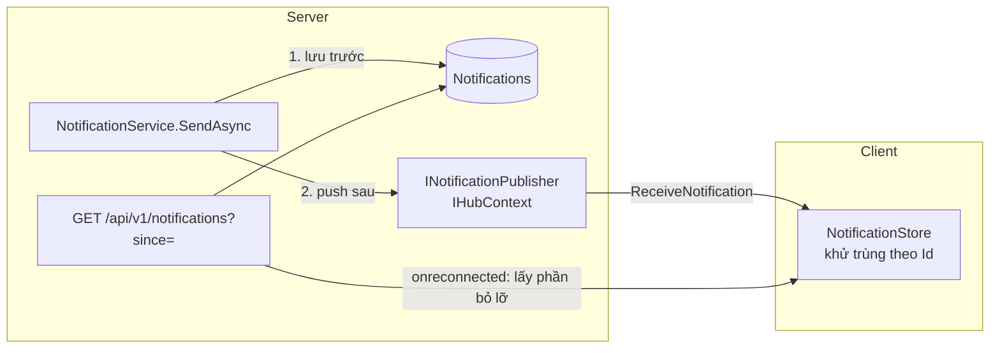

# 11.8 - Notification Center Pattern

> **Tóm tắt:** Trung tâm thông báo là nơi **SignalR và REST phải làm việc cùng nhau**, và ranh giới rất rõ: **database là nguồn sự thật, SignalR chỉ là lớp tăng tốc**. Thứ tự luôn là **ghi trước, push sau** — vì client offline thì push mất, còn bản ghi thì còn. Bài định nghĩa entity `Notification` chuẩn dùng cho cả module, và giải hai vấn đề thực tế: **chống trùng lặp**, khi một thông báo tới cả qua push lẫn qua lần đồng bộ REST kế tiếp — giải bằng cách khử trùng theo `Id` ở client; và **đồng bộ trạng thái đã đọc giữa các thiết bị**, vì đánh dấu đã đọc trên điện thoại phải làm badge trên laptop giảm theo.

## Mục tiêu bài học

Sau bài này bạn có thể:

- Thiết kế mô hình dữ liệu cho thông báo.
- Kết hợp push và REST mà không trùng lặp.
- Đồng bộ trạng thái đã đọc giữa nhiều thiết bị, không làm bộ đếm sai.
- Gom nhóm thông báo để không làm phiền người dùng.
- Dọn dẹp dữ liệu thông báo.

**Cần biết trước:** [bài 11.4](11.4-client-side-integration.md) (đồng bộ sau khi kết nối lại), [bài 11.7](11.7-ihubcontext-server-push-outside-hub.md) (`IHubContext`, `INotificationPublisher`), [bài 8.10](../module-08-aspnet-core-fundamentals/8.10-ef-core-minimal.md) (EF Core). `ExecuteUpdateAsync` và `ExecuteDeleteAsync` (cập nhật, xoá bằng một câu SQL mà không nạp entity) được giải thích ngay trong bài; [bài 13.7](../../stage-04-database-production/module-13-entity-framework-core/13.7-performance.md) đi sâu hơn.

## Nội dung bài học

### 11.8.1 — Mô hình dữ liệu

Đây là entity `Notification` chuẩn mà mọi bài trong module dùng:

```csharp
// Data/Notification.cs
public enum NotificationType { Info, LeadAssigned, Comment }

public class Notification
{
    public Guid Id { get; set; } = Guid.CreateVersion7();   // sắp xếp được theo thời gian
    public Guid UserId { get; set; }                         // người nhận
    public NotificationType Type { get; set; }
    public required string Message { get; set; }

    public string? EntityType { get; set; }                  // "Lead", "Deal"...
    public string? EntityId { get; set; }                    // để client mở đúng trang

    public DateTime CreatedAt { get; set; } = DateTime.UtcNow;
    public DateTime? ReadAt { get; set; }                    // null = chưa đọc

    // Gom nhóm: "3 người đã bình luận"
    public string? GroupKey { get; set; }
    public int Count { get; set; } = 1;
}
```

```csharp
// Data/CrmDbContext.cs, trong OnModelCreating
modelBuilder.Entity<Notification>(e =>
{
    e.HasIndex(n => new { n.UserId, n.CreatedAt }).IsDescending(false, true);
    e.HasIndex(n => new { n.UserId, n.ReadAt });
    e.HasIndex(n => new { n.UserId, n.GroupKey });
});
```

`Guid.CreateVersion7()` (.NET 9 trở lên) sinh GUID có phần thời gian ở đầu, nên giá trị sau lớn hơn giá trị trước. Làm khoá chính, nó tránh được việc chèn vào giữa index như GUID ngẫu nhiên.

`ReadAt` là `DateTime?` thay vì `bool IsRead`: nó cho bạn **cả hai** thông tin — đã đọc chưa, và đọc lúc nào — trong một cột.

Index đầu tiên phục vụ truy vấn chính "thông báo của tôi, mới nhất trước"; index thứ hai phục vụ đếm chưa đọc; index thứ ba phục vụ tìm thông báo cùng nhóm để gom.

DTO gửi cho client chép các trường cần thiết:

```csharp
// Hubs/NotificationDto.cs
public sealed record NotificationDto(
    Guid Id, NotificationType Type, string Message, string? EntityType, string? EntityId,
    DateTime CreatedAt, DateTime? ReadAt, int Count)
{
    public static NotificationDto From(Notification n) =>
        new(n.Id, n.Type, n.Message, n.EntityType, n.EntityId, n.CreatedAt, n.ReadAt, n.Count);
}
```

### 11.8.2 — Ghi trước, push sau

`INotificationPublisher` là interface hẹp bọc `IHubContext` ở [bài 11.7](11.7-ihubcontext-server-push-outside-hub.md), thêm một method báo trạng thái đã đọc:

```csharp
// Services/INotificationPublisher.cs
public interface INotificationPublisher
{
    Task PublishAsync(Guid userId, NotificationDto notification);
    Task PublishReadAsync(Guid userId, Guid notificationId);
}
```

```csharp
// Services/CreateNotificationRequest.cs
public sealed record CreateNotificationRequest(
    Guid UserId, NotificationType Type, string Message,
    string? EntityType = null, string? EntityId = null, string? GroupKey = null);
```

```csharp
// Services/NotificationService.cs
public sealed class NotificationService(CrmDbContext db, INotificationPublisher publisher)
{
    public async Task<NotificationDto> SendAsync(CreateNotificationRequest request, CancellationToken ct)
    {
        // 1. Gom nhóm nếu đã có thông báo tương tự chưa đọc
        if (request.GroupKey is not null)
        {
            var existing = await db.Notifications.FirstOrDefaultAsync(
                n => n.UserId == request.UserId
                  && n.GroupKey == request.GroupKey
                  && n.ReadAt == null, ct);

            if (existing is not null)
            {
                existing.Count++;
                existing.Message = request.Message;
                await db.SaveChangesAsync(ct);

                var updated = NotificationDto.From(existing);
                await publisher.PublishAsync(request.UserId, updated);
                return updated;
            }
        }

        // 2. Tạo mới và LƯU trước
        var notification = new Notification
        {
            UserId = request.UserId,
            Type = request.Type,
            Message = request.Message,
            EntityType = request.EntityType,
            EntityId = request.EntityId,
            GroupKey = request.GroupKey
        };
        db.Notifications.Add(notification);
        await db.SaveChangesAsync(ct);

        // 3. Push sau khi đã lưu
        var dto = NotificationDto.From(notification);
        await publisher.PublishAsync(request.UserId, dto);
        return dto;
    }
}
```

Thứ tự này là bắt buộc ([bài 11.7](11.7-ihubcontext-server-push-outside-hub.md)): client offline thì push mất, nhưng bản ghi vẫn còn và họ thấy khi mở lại ứng dụng.

Vì phụ thuộc vào `INotificationPublisher` chứ không vào `IHubContext`, `NotificationService` test được mà không cần SignalR.

**Gom nhóm** ở bước 1 giải quyết một vấn đề thật: 50 người bình luận vào deal của bạn không nên là 50 thông báo. `GroupKey` kiểu `"deal:{id}:comment"` cho phép gộp thành "50 người đã bình luận". Client nhận lại cùng một `Id` với `Count` mới, nên nó **cập nhật** dòng cũ thay vì thêm dòng mới (mục 11.8.4).

### 11.8.3 — API đồng bộ

```csharp
// Controllers/NotificationsController.cs
[ApiController]
[Route("api/v1/notifications")]
[Authorize]
public sealed class NotificationsController(
    CrmDbContext db, ICurrentUser user, INotificationPublisher publisher) : ControllerBase
{
    private Guid UserId => Guid.Parse(user.Id);    // ICurrentUser.Id là chuỗi

    [HttpGet]
    public async Task<ActionResult<List<NotificationDto>>> GetAll(
        [FromQuery] DateTime? since,
        [FromQuery] bool unreadOnly = false,
        [FromQuery] int limit = 20,
        CancellationToken ct = default)
    {
        var query = db.Notifications.AsNoTracking()
            .Where(n => n.UserId == UserId);

        if (since is { } s)      query = query.Where(n => n.CreatedAt > s);
        if (unreadOnly)          query = query.Where(n => n.ReadAt == null);

        var items = await query
            .OrderByDescending(n => n.CreatedAt).ThenByDescending(n => n.Id)
            .Take(Math.Min(limit, 100))
            .ToListAsync(ct);

        return items.Select(NotificationDto.From).ToList();
    }

    [HttpGet("unread-count")]
    public async Task<ActionResult<int>> GetUnreadCount(CancellationToken ct)
        => await db.Notifications.CountAsync(n => n.UserId == UserId && n.ReadAt == null, ct);

    [HttpPost("{id:guid}/read")]
    public async Task<IActionResult> MarkAsRead(Guid id, CancellationToken ct)
    {
        var affected = await db.Notifications
            .Where(n => n.Id == id && n.UserId == UserId && n.ReadAt == null)
            .ExecuteUpdateAsync(s => s.SetProperty(n => n.ReadAt, DateTime.UtcNow), ct);

        if (affected == 0) return NotFound();

        // Báo cho CÁC THIẾT BỊ KHÁC của chính người đó
        await publisher.PublishReadAsync(UserId, id);
        return NoContent();
    }
}
```

`ICurrentUser` là service đọc thông tin người dùng hiện tại từ claim, định nghĩa ở [bài 10.1](../module-10-authentication-authorization/10.1-authentication-vs-authorization.md). `Id` của nó là chuỗi, nên controller đổi sang `Guid` một lần ở property `UserId`.

Ba chi tiết:

**`since` là tham số then chốt** — nó cho client lấy các thông báo **mới** đã bỏ lỡ sau khi kết nối lại ([bài 11.4](11.4-client-side-integration.md)), thay vì tải lại toàn bộ. Có một chỗ hở: khi gom nhóm ở bước 1, bản ghi cũ được tăng `Count` nhưng giữ nguyên `CreatedAt`, nên `since` không trả lại nó. Vì gom nhóm chỉ áp dụng cho thông báo chưa đọc, client lấy thêm `unreadOnly=true` khi kết nối lại là đủ bắt được các bản cập nhật này (mục 11.8.4). Cách triệt để hơn là thêm cột `UpdatedAt`, gán lại mỗi lần gom, và lọc `since` theo cột đó.

**`ExecuteUpdateAsync`** cập nhật thẳng bằng một câu `UPDATE`, không nạp entity. Điều kiện `n.UserId == UserId` vừa là phân quyền vừa là bộ lọc — không ai đánh dấu đọc thông báo của người khác ([bài 10.6](../module-10-authentication-authorization/10.6-resource-based-authorization.md)). Gọi lần thứ hai cho cùng thông báo thì `affected == 0` và trả `404`; [bài 11.13](11.13-quick-real-world-example.md) chạy thử đúng điều này.

**Push lại trạng thái đã đọc.** Người dùng đọc trên điện thoại thì badge trên laptop phải giảm theo. Đây là chi tiết nhỏ mà thiếu nó thì trải nghiệm trông hỏng.

### 11.8.4 — Chống trùng lặp ở client

Một thông báo có thể tới **hai lần**: qua push, và qua lần đồng bộ REST kế tiếp. Khử trùng theo `Id`:

```typescript
class NotificationStore {
  private readonly items = new Map<string, NotificationDto>();   // id -> thông báo
  unreadCount = 0;

  upsert(n: NotificationDto): void {
    const old = this.items.get(n.id);
    if (!old && !n.readAt) this.unreadCount++;     // chỉ tăng khi là thông báo MỚI
    this.items.set(n.id, { ...old, ...n });        // tới hai lần cũng chỉ một bản
  }

  markRead(id: string): void {
    const item = this.items.get(id);
    if (item && !item.readAt) {                    // đã đọc rồi -> không giảm nữa
      item.readAt = new Date().toISOString();
      this.unreadCount--;
    }
  }
}
```

Client đăng ký **cả hai** nguồn vào cùng một store:

```typescript
connection.on("ReceiveNotification", n => store.upsert(n));
connection.on("NotificationRead", id => store.markRead(id));

connection.onreconnected(async () => {
  const missed = await api.getNotifications({ since: store.lastCreatedAt });
  // Bản ghi gom nhóm giữ CreatedAt cũ nên since bỏ sót; lấy thêm các thông báo chưa đọc
  const unread = await api.getNotifications({ unreadOnly: true });
  [...missed, ...unread].forEach(n => store.upsert(n));   // trùng thì ghi đè, không nhân đôi
});
```

`markRead` kiểm tra `!item.readAt` trước khi giảm bộ đếm — nếu không, thiết bị tự đánh dấu đọc rồi lại nhận sự kiện `NotificationRead` của chính lần đó, và bộ đếm giảm hai lần (bài 2).



`Map` này lớn dần theo phiên. Với ứng dụng chạy nhiều giờ, chỉ giữ N thông báo gần nhất.

### 11.8.5 — Dọn dẹp

Bảng thông báo phình rất nhanh — 1.000 người dùng × 20 thông báo mỗi ngày là 600.000 bản ghi mỗi tháng.

```csharp
public sealed class NotificationCleanupWorker(
    IServiceScopeFactory scopeFactory,
    ILogger<NotificationCleanupWorker> logger) : BackgroundService
{
    protected override async Task ExecuteAsync(CancellationToken ct)
    {
        using var timer = new PeriodicTimer(TimeSpan.FromHours(24));

        while (await timer.WaitForNextTickAsync(ct))
        {
            try
            {
                // BackgroundService là singleton, nên tự tạo scope để lấy DbContext
                await using var scope = scopeFactory.CreateAsyncScope();
                var db = scope.ServiceProvider.GetRequiredService<CrmDbContext>();

                // Đã đọc + quá 30 ngày
                var readCutoff = DateTime.UtcNow.AddDays(-30);
                var removed = await db.Notifications
                    .Where(n => n.ReadAt != null && n.ReadAt < readCutoff)
                    .ExecuteDeleteAsync(ct);

                // Chưa đọc nhưng quá 90 ngày — không ai đọc nữa
                var staleCutoff = DateTime.UtcNow.AddDays(-90);
                removed += await db.Notifications
                    .Where(n => n.ReadAt == null && n.CreatedAt < staleCutoff)
                    .ExecuteDeleteAsync(ct);

                logger.LogInformation("Đã xoá {Count} thông báo cũ", removed);
            }
            catch (Exception ex)
            {
                logger.LogError(ex, "Dọn dẹp thông báo thất bại");
            }
        }
    }
}
```

Hai mốc khác nhau có chủ đích: đã đọc thì xoá sớm, chưa đọc thì giữ lâu hơn — nhưng vẫn phải xoá, vì thông báo 3 tháng tuổi không còn ý nghĩa.

Nhớ khoá phân tán nếu chạy nhiều instance ([bài 9.9](../module-09-web-api-professional/9.9-hosted-service-background-jobs.md)), và `ExecuteDeleteAsync` trên bảng lớn nên chia lô để không giữ khoá quá lâu.

### 11.8.6 — Rà lại code của bạn

**Danh sách rà soát trung tâm thông báo**

- [ ] Thông báo được ghi database trước, push sau.
- [ ] Tầng nghiệp vụ dùng interface hẹp, không phụ thuộc IHubContext.
- [ ] Có index trên (UserId, CreatedAt) và (UserId, ReadAt).
- [ ] Khoá chính sắp xếp được theo thời gian, không phải GUID ngẫu nhiên.
- [ ] API có tham số since để client lấy đúng phần đã bỏ lỡ.
- [ ] Đánh dấu đã đọc có điều kiện UserId, vừa phân quyền vừa lọc.
- [ ] Trạng thái đã đọc được push tới các thiết bị khác của cùng người dùng.
- [ ] Client khử trùng lặp theo Id giữa push và đồng bộ REST.
- [ ] Bộ đếm chưa đọc không giảm hai lần cho cùng một thông báo.
- [ ] Thông báo tương tự được gom nhóm bằng GroupKey.
- [ ] Có job dọn dẹp với hai mốc thời gian cho đã đọc và chưa đọc.

## Bài tập áp dụng

#### Bài 1 — Thông báo hiện hai lần

Đẩy một thông báo qua push **và** để nó xuất hiện trong lần đồng bộ REST kế tiếp. Xác nhận client hiển thị **hai** lần. Thêm khử trùng theo `Id` và kiểm chứng.

**Tiêu chí hoàn thành:** bạn nêu được vì sao trùng lặp là hệ quả **tất yếu** của thiết kế hai đường, chứ không phải một lỗi cần sửa ở phía server.

<details>
<summary><strong>Gợi ý và lời giải — Bài 1</strong></summary>

**Gợi ý.** Server không biết client đã nhận được push hay chưa. Nếu nó biết, bạn đã không cần đường đồng bộ REST.

**Lời giải — tái hiện:**

```js
const list = [];
connection.on('ReceiveNotification', n => list.push(n));    // đường 1

async function sync() {
    const items = await fetch('/api/v1/notifications?unreadOnly=true', { headers }).then(r => r.json());
    items.forEach(n => list.push(n));                        // đường 2
}

setInterval(sync, 30000);
```

Push tới lúc 09:00:00, lần `sync` chạy lúc 09:00:30 trả về đúng thông báo đó. Mảng `list` giờ có **hai phần tử cùng `id`**, và giao diện hiện hai dòng.

**Câu trả lời cho tiêu chí.** Hai đường tồn tại vì chúng bù cho nhau:

```text
Push:  nhanh, nhưng MẤT khi client offline
Sync:  chậm, nhưng KHÔNG BAO GIỜ mất
```

Để tránh trùng, server phải biết client đã nhận push thành công hay chưa — nghĩa là cần cơ chế xác nhận cho từng thông báo, cho từng thiết bị, và phải nhớ trạng thái đó. Đó chính là thứ mà đường đồng bộ REST đang thay thế, chỉ đơn giản hơn nhiều.

Nên trùng lặp không phải lỗi: nó là **cái giá cố ý** của việc chọn "không bao giờ mất" thay vì "không bao giờ trùng". Và giữa hai loại lỗi, trùng là loại **sửa được ở client** bằng vài dòng, còn mất thì không.

**Khử trùng theo `Id`** — dùng `Map` thay cho mảng:

```ts
const items = new Map<string, NotificationDto>();

function upsert(n: NotificationDto) {
    items.set(n.id, { ...items.get(n.id), ...n });     // đến hai lần cũng chỉ một bản
}

connection.on('ReceiveNotification', upsert);
```

**`Map` tốt hơn `Set` ở một chỗ quan trọng:** khi thông báo được **cập nhật** — ví dụ gom nhóm tăng `count` từ 3 lên 4 — bản mới ghi đè bản cũ thay vì bị bỏ qua.

**Hai điều kiện để khử trùng hoạt động:**

1. **`Id` phải do server sinh**, không phải client. Server là nơi duy nhất biết hai đường đang nói về cùng một bản ghi.
2. **`Id` phải ổn định.** Cùng một thông báo phải mang cùng `Id` qua cả push lẫn REST — tức là push phải gửi bản ghi **đã lưu**, không phải một DTO dựng tạm:

```csharp
db.Notifications.Add(notification);
await db.SaveChangesAsync(ct);                        // lưu trước, có Id

await publisher.PublishAsync(userId, NotificationDto.From(notification));   // push CÙNG bản ghi
```

**Dùng `Guid.CreateVersion7()` cho `Id`** vì nó sắp xếp được theo thời gian — trên PostgreSQL, truy vấn `WHERE "Id" > @lastSeen` ở đường đồng bộ cho đúng thứ tự ([bài 11.4](11.4-client-side-integration.md)). SQL Server không sắp `uniqueidentifier` theo phần thời gian; bài 11.4 có cách thay thế.

</details>

---

#### Bài 2 — Bộ đếm chưa đọc xuống dưới 0

Bộ đếm chưa đọc trên thiết bị A đang là 1. Đánh dấu đã đọc thông báo đó trên A, trong khi A cũng đang nghe sự kiện `NotificationRead`. Xác nhận bộ đếm xuống -1. Thêm kiểm tra `!item.readAt` và kiểm chứng.

**Tiêu chí hoàn thành:** bạn nêu được vì sao bài này là một dạng của cập nhật trùng lặp, và vì sao sửa ở client vẫn chưa đủ.

<details>
<summary><strong>Gợi ý và lời giải — Bài 2</strong></summary>

**Gợi ý.** Một thiết bị có thể giảm bộ đếm từ **hai** nguồn cho cùng một hành động.

**Lời giải — tái hiện:**

```ts
// Client giảm bộ đếm VÔ ĐIỀU KIỆN ở cả hai chỗ
async function markRead(id: string) {
    await fetch(`/api/v1/notifications/${id}/read`, { method: 'POST', headers });
    unreadCount.value--;                                   // nguồn 1: hành động của mình
}

connection.on('NotificationRead', () => unreadCount.value--);   // nguồn 2: sự kiện từ server
```

```text
Thiết bị A: unreadCount = 1, người dùng bấm đọc thông báo X
  markRead(X)                         -> 1 - 1 = 0
  server phát NotificationRead(X) tới MỌI kết nối của người dùng, kể cả A
  A nhận sự kiện                      -> 0 - 1 = -1
```

Server phát tới mọi thiết bị của người dùng (`Clients.User`), nên thiết bị vừa bấm cũng nhận lại sự kiện của chính nó. Một thông báo được đọc, bộ đếm giảm hai lần.

**Vì sao đây là cùng họ với lost update.** Mỗi nguồn sửa bộ đếm dựa trên giá trị đang thấy mà không kiểm tra thao tác đó đã được áp dụng chưa — cùng gốc với lỗi "đọc rồi ghi" ở [bài 13.8](../../stage-04-database-production/module-13-entity-framework-core/13.8-concurrency-control.md). Khác biệt là trạng thái nằm trong bộ nhớ trình duyệt, nên không có transaction nào bảo vệ.

**Sửa ở client — kiểm tra trạng thái trước khi giảm:**

```ts
function markReadLocal(id: string) {
    const item = items.get(id);
    if (!item || item.readAt) return;       // đã đọc rồi -> không giảm nữa

    item.readAt = new Date().toISOString();
    unreadCount.value = Math.max(0, unreadCount.value - 1);
}

async function markRead(id: string) {
    markReadLocal(id);                                       // nguồn 1
    await fetch(`/api/v1/notifications/${id}/read`, { method: 'POST', headers });
}

connection.on('NotificationRead', markReadLocal);            // nguồn 2, cùng hàm
```

Giờ thao tác **idempotent**: gọi bao nhiêu lần cho cùng một `id` cũng chỉ giảm một lần.

**Nhưng sửa ở client chưa đủ.** Trạng thái trong bộ nhớ trình duyệt luôn có thể lệch với database vì những lý do nằm ngoài tầm kiểm soát của bạn:

- người dùng mở tab mới, trạng thái bắt đầu từ đầu;
- mất kết nối một lúc rồi quay lại, bỏ lỡ vài sự kiện;
- một thiết bị thứ ba đánh dấu đã đọc hàng loạt.

**Nên bộ đếm phải lấy từ server làm chuẩn** sau mỗi lần kết nối lại (endpoint `GET /api/v1/notifications/unread-count` ở mục 11.8.3):

```ts
connection.onreconnected(async () => {
    unreadCount.value = await fetch('/api/v1/notifications/unread-count', { headers })
        .then(r => r.json());                                // server là nguồn sự thật
});
```

**Và phía server cũng phải idempotent.** Endpoint `MarkAsRead` ở mục 11.8.3 đặt điều kiện `n.ReadAt == null` **trong** câu `UPDATE`, và chỉ phát sự kiện khi `affected > 0`. Hai request đồng thời cho cùng một thông báo thì chỉ một request cập nhật được dòng đó. Thử trực tiếp trên PostgreSQL 16 với hai phiên: phiên 1 chạy `UPDATE ... WHERE "Id" = X AND "ReadAt" IS NULL` trong một transaction chưa commit; phiên 2 chạy cùng câu lệnh thì **chờ**; phiên 1 commit xong thì phiên 2 trả về `UPDATE 0`, vì PostgreSQL kiểm lại điều kiện `WHERE` trên phiên bản dòng mới nhất. Nên chỉ một sự kiện `NotificationRead` được phát. Đây là mẫu "làm tất cả trong một câu lệnh" ở [bài 12.6](../../stage-04-database-production/module-12-sql-deep-dive/12.6-transactions-and-locking.md).

</details>

---

#### Bài 3 — Gom nhóm thông báo

Gọi `SendAsync` 50 lần với cùng `GroupKey` và xác nhận chỉ một bản ghi tồn tại với `Count = 50`. Sau đó thêm ràng buộc để hai lời gọi đồng thời không tạo ra hai nhóm.

**Tiêu chí hoàn thành:** bạn nêu được **hai** lợi ích của gom nhóm, và một trường hợp không nên gom.

<details>
<summary><strong>Gợi ý và lời giải — Bài 3</strong></summary>

**Gợi ý.** Một lợi ích thuộc về người dùng, lợi ích kia thuộc về hệ thống.

**Lời giải — kiểm chứng** với `NotificationService.SendAsync` ở mục 11.8.2:

```csharp
for (var i = 1; i <= 50; i++)
    await notifications.SendAsync(new CreateNotificationRequest(
        userId, NotificationType.Comment, $"{i} người đã bình luận",
        EntityType: "Deal", EntityId: dealId.ToString(),
        GroupKey: $"deal:{dealId}:comment"), ct);
```

```sql
SELECT "Id", "GroupKey", "Count", "Message"
FROM "Notifications"
WHERE "UserId" = @userId;
```

Kết quả mong đợi: **một dòng** với `"Count" = 50` và `"Message"` là "50 người đã bình luận".

**Hai lợi ích:**

**1. Với người dùng — danh sách đọc được.** Không gom thì mở chuông thông báo ra thấy 50 dòng giống hệt nhau, và thông báo quan trọng khác bị đẩy xuống dưới. Gom lại thành "50 người đã bình luận" là đúng thứ người ta muốn biết.

**2. Với hệ thống — số dòng giảm.**

| | Không gom | Có gom |
|---|---|---|
| Dòng trong database | 50 | **1** |
| Tin đẩy qua SignalR | 50 | 50 (cùng `Id`, client cập nhật dòng cũ) |
| Dòng client phải render | 50 | **1** |

Với một deal sôi nổi có 20 người theo dõi, con số là 1.000 dòng thành 20 dòng.

**Thiết kế `GroupKey` quyết định chất lượng việc gom:**

```csharp
$"deal:{dealId}:comment"        // gom bình luận theo từng deal
$"lead:{leadId}:assigned"       // gom việc gán lead
"invoice:overdue"               // gom mọi hoá đơn quá hạn
```

Quá hẹp thì không gom được gì; quá rộng thì gộp nhầm những việc không liên quan.

**Khi nào KHÔNG nên gom.** Khi mỗi sự kiện là một **hành động riêng biệt cần phản hồi riêng**:

```text
KHÔNG gom: "Hợp đồng A cần bạn duyệt", "Hợp đồng B cần bạn duyệt"
```

Gom thành "2 hợp đồng cần duyệt" thì người dùng mất luôn đường dẫn tới từng cái, và phải tự đi tìm. Quy tắc phân biệt: nếu người dùng cần **làm gì đó khác nhau** cho từng thông báo thì đừng gom.

**Race condition khi tìm rồi tạo.** Hai thông báo tới gần như đồng thời thì cả hai cùng thấy chưa có bản ghi và cùng tạo mới. Chặn bằng một **partial unique index**: duy nhất theo `(UserId, GroupKey)` nhưng chỉ trong các dòng chưa đọc.

```sql
CREATE UNIQUE INDEX "UX_Notifications_Group" ON "Notifications" ("UserId", "GroupKey")
    WHERE "ReadAt" IS NULL;
```

```csharp
// EF Core, trong OnModelCreating
e.HasIndex(n => new { n.UserId, n.GroupKey })
 .IsUnique()
 .HasFilter("\"ReadAt\" IS NULL");
```

Chèn dòng thứ hai cùng nhóm khi dòng đầu chưa đọc, PostgreSQL 16 từ chối (output thật):

```text
ERROR:  duplicate key value violates unique constraint "UX_Notifications_Group"
DETAIL:  Key ("UserId", "GroupKey")=(8f3a1b2c-0000-0000-0000-000000000001, deal:7c1d:comment) already exists.
```

Ở C#, `SaveChangesAsync` ném `DbUpdateException`; bắt nó rồi chạy lại nhánh cập nhật — cùng mẫu với idempotency ở [bài 9.12](../module-09-web-api-professional/9.12-quick-real-world-example.md).

<details>
<summary>SQL Server</summary>

SQL Server gọi đây là *filtered index*:

```sql
CREATE UNIQUE INDEX UX_Notifications_Group ON Notifications(UserId, GroupKey)
    WHERE ReadAt IS NULL;
```

EF Core: `.HasFilter("[ReadAt] IS NULL")`. Chèn trùng thì SQL Server 2022 báo (output thật):

```text
Msg 2601, Level 14, State 1
Cannot insert duplicate key row in object 'dbo.Notifications' with unique index 'UX_Notifications_Group'. The duplicate key value is (8f3a1b2c-0000-0000-0000-000000000001, deal:7c1d:comment).
```

Tạo filtered index bằng `sqlcmd` thì cần bật `QUOTED_IDENTIFIER` (tham số `-I`), nếu không câu lệnh bị từ chối với lỗi 1934. EF Core migration tự xử lý việc này.

</details>

</details>

## Tự kiểm tra

<details>
<summary>Vì sao phải ghi database trước rồi mới push?</summary>

Vì client offline thì push mất hoàn toàn, còn bản ghi thì vẫn còn và họ thấy khi mở lại ứng dụng. Database là nguồn sự thật còn SignalR chỉ là lớp tăng tốc.

</details>

<details>
<summary>Vì sao dùng ReadAt kiểu DateTime? thay vì bool IsRead?</summary>

Vì nó cho cả hai thông tin trong một cột: đã đọc chưa, và đọc lúc nào. Thời điểm đọc hữu ích cho việc dọn dẹp (xoá thông báo đã đọc quá 30 ngày) và cho phân tích.

</details>

<details>
<summary>Tham số since trong API thông báo để làm gì?</summary>

Để client lấy đúng những thông báo đã bỏ lỡ trong lúc mất kết nối, thay vì tải lại toàn bộ danh sách. Đó là phần bù cho việc tin nhắn gửi khi client offline thì mất.

</details>

<details>
<summary>Vì sao trùng lặp xảy ra và khử thế nào?</summary>

Vì một thông báo có thể tới hai lần: qua push và qua lần đồng bộ REST kế tiếp. Khử bằng cách lưu thông báo trong một Map theo Id ở client, tới lần nữa thì ghi đè chứ không thêm. Nhớ giới hạn kích thước Map với ứng dụng chạy nhiều giờ.

</details>

<details>
<summary>Vì sao bộ đếm chưa đọc có thể bị âm?</summary>

Vì cùng một lần đọc có thể làm giảm bộ đếm hai lần: một từ hành động của chính người dùng, một từ sự kiện NotificationRead mà server phát lại tới mọi thiết bị của họ, kể cả thiết bị vừa bấm. Phải kiểm tra thông báo đó chưa đọc trước khi giảm, và lấy lại bộ đếm từ server sau khi kết nối lại.

</details>

<details>
<summary>Gom nhóm thông báo giải quyết gì?</summary>

Nó tránh việc 50 người bình luận thành 50 thông báo riêng. Dùng một GroupKey để gộp những thông báo tương tự chưa đọc thành một bản ghi với bộ đếm, vừa đỡ làm phiền người dùng vừa giảm số dòng trong database. Partial unique index chặn hai lời gọi đồng thời tạo hai nhóm.

</details>

## Kết luận

Ba điều đáng nhớ nhất:

1. **Database là nguồn sự thật, push là lớp tăng tốc.** Ghi trước, push sau.
2. **Khử trùng lặp theo `Id`** — push và đồng bộ REST sẽ chồng lên nhau.
3. **Đẩy cả trạng thái đã đọc** để badge đồng bộ giữa các thiết bị, và mọi thao tác giảm bộ đếm phải idempotent.

## Tham khảo

- [Send messages from outside a hub](https://learn.microsoft.com/en-us/aspnet/core/signalr/hubcontext)
- [ExecuteUpdate and ExecuteDelete — EF Core](https://learn.microsoft.com/en-us/ef/core/saving/execute-insert-update-delete)
- [Indexes — EF Core](https://learn.microsoft.com/en-us/ef/core/modeling/indexes) (mục filtered index)
- [PostgreSQL — Partial Indexes](https://www.postgresql.org/docs/16/indexes-partial.html)

## Điều hướng

- **Bài trước:** [11.7 — IHubContext - Server push từ ngoài Hub](11.7-ihubcontext-server-push-outside-hub.md)
- **Bài tiếp theo:** [11.9 — Presence - Online/Offline](11.9-presence-online-offline-status.md)
- **Về module:** [Trang mục lục](README.md)
