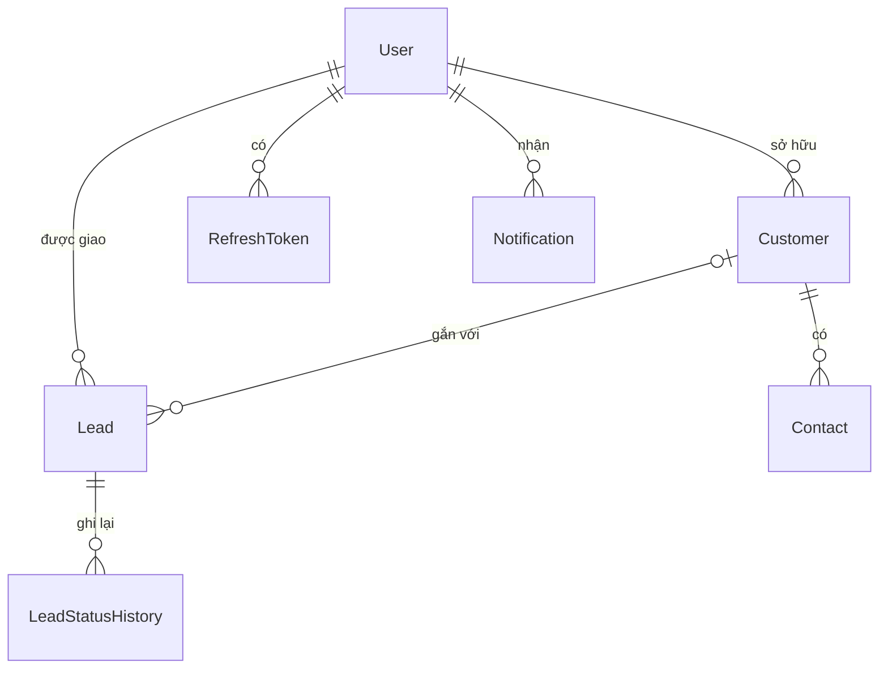
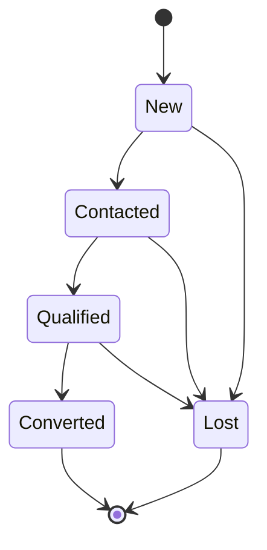
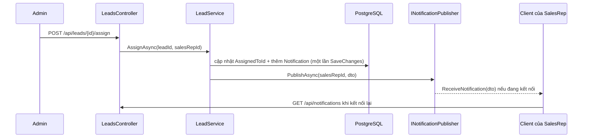

# Project 2 — CRM Backend API

> **Tóm tắt:** Dự án tổng kết Giai đoạn 3. Bạn xây một Web API cho CRM gồm khách hàng (Customer), khách hàng tiềm năng (Lead), đầu mối liên hệ (Contact) và thông báo (Notification), lưu trên PostgreSQL bằng EF Core. API có đăng nhập bằng JWT kèm refresh token, phân quyền theo vai trò và theo chủ sở hữu dữ liệu, và đẩy thông báo thời gian thực bằng SignalR khi một Lead được giao. Điều quan trọng nhất: quy tắc nghiệp vụ (Lead chỉ chuyển trạng thái theo đúng sơ đồ, SalesRep chỉ thấy dữ liệu của mình) nằm ở service, mỗi loại lỗi có đúng một mã HTTP, và integration test chạy trên database thật chứng minh điều đó.

## Mục tiêu bài học

Sau dự án này bạn có thể:

- Thiết kế và cài đặt 25 endpoint REST đúng HTTP method, status code và định dạng lỗi ProblemDetails.
- Cài đăng nhập JWT với access token ngắn hạn và refresh token lưu dạng băm, có thu hồi khi đăng xuất.
- Giới hạn dữ liệu theo người dùng: SalesRep chỉ đọc, sửa được Customer và Lead của mình, kể cả trong danh sách có phân trang.
- Cài state machine cho trạng thái Lead, từ chối chuyển sai bằng mã 422 và ghi lịch sử chuyển trạng thái.
- Lưu thông báo vào database rồi đẩy qua SignalR, để SalesRep nhận được dù đang online hay offline.
- Viết integration test bằng `WebApplicationFactory` trên PostgreSQL thật (Testcontainers) và unit test cho logic thuần.

**Cần biết trước:** [Project 1 — Inventory System](../stage-02-csharp-professional/project-01-inventory-console-api.md), [bài 8.4 - Controllers và Actions](module-08-aspnet-core-fundamentals/8.4-controllers-and-actions.md), [bài 8.5 - Model Validation](module-08-aspnet-core-fundamentals/8.5-model-validation.md), [bài 8.6 - Configuration System](module-08-aspnet-core-fundamentals/8.6-configuration-system.md), [bài 8.8 - Global Exception Handling](module-08-aspnet-core-fundamentals/8.8-global-exception-handling.md), [bài 8.10 - EF Core tối thiểu](module-08-aspnet-core-fundamentals/8.10-ef-core-minimal.md), [bài 9.4 - Pagination](module-09-web-api-professional/9.4-pagination-filtering-sorting.md), [bài 9.8 - API Testing](module-09-web-api-professional/9.8-api-testing.md), [bài 10.2 - JWT](module-10-authentication-authorization/10.2-jwt-authentication.md), [bài 10.3 - Refresh Token](module-10-authentication-authorization/10.3-refresh-token.md), [bài 10.6 - Resource-based Authorization](module-10-authentication-authorization/10.6-resource-based-authorization.md), [bài 11.5 - Authentication trong SignalR](module-11-signalr/11.5-signalr-authentication.md), [bài 11.7 - IHubContext](module-11-signalr/11.7-ihubcontext-server-push-outside-hub.md), [bài 11.8 - Notification Center](module-11-signalr/11.8-notification-center-pattern.md).

---

## 1. Tổng quan dự án

**CRM Backend API v1** phục vụ đội bán hàng của một công ty nhỏ. Có hai vai trò:

- **Admin** (trưởng nhóm): thấy toàn bộ dữ liệu, giao Lead cho nhân viên.
- **SalesRep** (nhân viên bán hàng): quản lý khách hàng của mình, chăm sóc các Lead được giao.

Một ngày làm việc điển hình: Admin nhận một Lead mới từ website và giao cho An. Điện thoại của An hiện thông báo ngay lập tức. An gọi điện cho khách, chuyển Lead sang `Contacted`, rồi `Qualified`. Khi khách ký hợp đồng, An chuyển sang `Converted`. Không ai chuyển thẳng từ `New` sang `Converted` được, và Bình (một SalesRep khác) không xem được khách hàng của An.

### Kiến thức từ đâu, dùng ở đâu

| Module | Nội dung đã học | Dùng trong Project 2 |
|---|---|---|
| [Module 8](module-08-aspnet-core-fundamentals/README.md) | Pipeline, middleware, controller, validation, cấu hình, `IExceptionHandler`, EF Core tối thiểu | Toàn bộ controller, lỗi 400 tự động, ánh xạ exception sang mã HTTP, `CrmDbContext` |
| [Module 9](module-09-web-api-professional/README.md) | Thiết kế REST, OpenAPI, phân trang, integration test | Danh sách có phân trang, tài liệu API với Scalar, test bằng `WebApplicationFactory` |
| [Module 10](module-10-authentication-authorization/README.md) | JWT, refresh token, phân quyền theo vai trò và theo tài nguyên | Đăng ký, đăng nhập, Admin/SalesRep, "SalesRep chỉ thấy dữ liệu của mình" |
| [Module 11](module-11-signalr/README.md) | Hub có kiểu, xác thực SignalR, `IHubContext`, notification center | Thông báo khi Lead được giao, đọc lại qua REST |

Dự án dùng vài tính năng EF Core vượt quá [bài 8.10](module-08-aspnet-core-fundamentals/8.10-ef-core-minimal.md): quan hệ giữa các bảng, query filter, ghi đè `SaveChangesAsync`. Mục 6 giải thích đủ để dùng; Module 13 sẽ dạy kỹ.

---

## 2. Lộ trình và thời gian

Dự kiến **4 tuần**, mỗi tuần khoảng 8 tới 10 giờ. Mỗi mốc kết thúc bằng một commit (hoặc pull request) có `dotnet build` và `dotnet test` xanh.

| Mốc | Việc cần xong | Cách kiểm tra |
|---|---|---|
| Tuần 1 — Nền móng | Mục 5: tạo solution, database, cấu hình bí mật. Mục 6: entity, `CrmDbContext`, migration đầu tiên. CRUD Customer chưa có đăng nhập: `OwnerId` là khóa ngoại bắt buộc, nên tuần này tạm gán bằng id của Admin seed ở mục 5.4 (đọc từ `db.Users`), tuần 2 thay bằng `currentUser.UserId`. Mục 7.2: `GlobalExceptionHandler` | `dotnet ef database update` chạy được. Tạo, đọc, xóa mềm Customer qua Scalar. Body sai trả 400, id không có trả 404 |
| Tuần 2 — Đăng nhập | Đăng ký, đăng nhập, refresh token, đăng xuất. Gắn `[Authorize]` cho mọi controller trừ Auth. Gán `OwnerId` từ người đang đăng nhập | Test luồng: đăng ký → đăng nhập → gọi API → refresh → logout → refresh lại bị 401 |
| Tuần 3 — Phân quyền và Lead | Phân quyền theo chủ sở hữu (mục 7.4). Lead CRUD, state machine (mục 7.3), Contact | Test: SalesRep B đọc Customer của A bị 403, không thấy nó trong danh sách. `New → Converted` trả 422 |
| Tuần 4 — Thời gian thực và hoàn thiện | Giao Lead, Notification, SignalR (mục 7.5). Đủ test theo mục 8. README | Test push nhận được thông báo. Mọi mục trong Definition of Done (mục 12) đạt |

---

## 3. Domain

### Các entity

| Entity | Mô tả | Quan hệ |
|---|---|---|
| `User` | Người dùng hệ thống, vai trò Admin hoặc SalesRep | Sở hữu nhiều Customer, được giao nhiều Lead |
| `Customer` | Khách hàng chính thức | Có một chủ sở hữu (`Owner`), nhiều Contact, nhiều Lead |
| `Lead` | Cơ hội bán hàng | Có thể gắn với một Customer, được giao cho một User |
| `Contact` | Người liên hệ bên phía khách hàng | Thuộc đúng một Customer |
| `RefreshToken` | Refresh token đã phát, lưu dạng băm | Thuộc một User |
| `Notification` | Thông báo cho một người dùng | Gửi tới một User, trỏ tới Lead hoặc Customer liên quan |
| `LeadStatusHistory` | Lịch sử chuyển trạng thái Lead | Thuộc một Lead |

### Sơ đồ quan hệ



Các module sau dùng cùng miền nghiệp vụ nhưng có thể đặt tên cột khác (ví dụ Module 12 viết SQL tay với khóa `int`). Trong dự án này, giữ đúng mô hình ở mục 6. Project 3 sẽ nâng cấp từ chính codebase của bạn.

---

## 4. API Endpoints

Tổng cộng 25 endpoint. "Bearer" nghĩa là cần access token hợp lệ trong header `Authorization`.

### Auth

| Method | Endpoint | Mô tả | Quyền |
|---|---|---|---|
| POST | `/api/auth/register` | Đăng ký tài khoản mới, luôn với vai trò SalesRep | Công khai |
| POST | `/api/auth/login` | Đăng nhập, trả access token và refresh token | Công khai |
| POST | `/api/auth/refresh-token` | Đổi refresh token lấy cặp token mới | Công khai (cần refresh token) |
| POST | `/api/auth/logout` | Thu hồi refresh token hiện tại | Bearer |

### Customers

| Method | Endpoint | Mô tả | Quyền |
|---|---|---|---|
| GET | `/api/customers` | Danh sách có phân trang, lọc theo `name`, `industry` | Bearer: Admin thấy tất cả, SalesRep thấy của mình |
| GET | `/api/customers/{id}` | Chi tiết | Admin hoặc chủ sở hữu |
| POST | `/api/customers` | Tạo mới, người tạo là chủ sở hữu | Bearer |
| PUT | `/api/customers/{id}` | Cập nhật toàn bộ | Admin hoặc chủ sở hữu |
| PATCH | `/api/customers/{id}` | Cập nhật một phần: trường nào có trong body thì đổi, trường `null` giữ nguyên | Admin hoặc chủ sở hữu |
| DELETE | `/api/customers/{id}` | Xóa mềm | Admin hoặc chủ sở hữu |

### Leads

| Method | Endpoint | Mô tả | Quyền |
|---|---|---|---|
| GET | `/api/leads` | Danh sách có phân trang, lọc theo `status`, `assignedTo` | Bearer: Admin thấy tất cả, SalesRep thấy Lead được giao cho mình |
| GET | `/api/leads/{id}` | Chi tiết | Admin hoặc người được giao |
| POST | `/api/leads` | Tạo mới, mặc định giao cho người tạo | Bearer |
| PUT | `/api/leads/{id}` | Cập nhật tiêu đề, giá trị, ghi chú (không đổi trạng thái ở đây) | Admin hoặc người được giao |
| DELETE | `/api/leads/{id}` | Xóa mềm | Admin hoặc người được giao |
| POST | `/api/leads/{id}/assign` | Giao Lead cho một SalesRep | Admin |
| POST | `/api/leads/{id}/status` | Chuyển trạng thái theo state machine | Admin hoặc người được giao |

### Contacts

| Method | Endpoint | Mô tả | Quyền |
|---|---|---|---|
| GET | `/api/customers/{customerId}/contacts` | Danh sách Contact của một Customer | Admin hoặc chủ sở hữu Customer |
| GET | `/api/customers/{customerId}/contacts/{id}` | Chi tiết | Như trên |
| POST | `/api/customers/{customerId}/contacts` | Tạo mới | Như trên |
| PUT | `/api/customers/{customerId}/contacts/{id}` | Cập nhật | Như trên |
| DELETE | `/api/customers/{customerId}/contacts/{id}` | Xóa mềm | Như trên |

### Notifications

| Method | Endpoint | Mô tả | Quyền |
|---|---|---|---|
| GET | `/api/notifications?unreadOnly=true` | Thông báo của người đang đăng nhập, mới nhất trước | Bearer |
| POST | `/api/notifications/{id}/read` | Đánh dấu một thông báo đã đọc | Bearer, chỉ thông báo của mình |
| POST | `/api/notifications/read-all` | Đánh dấu tất cả đã đọc | Bearer |

Ngoài ra có hub SignalR tại `/hubs/notifications` (không tính vào 25 endpoint).

### Quy tắc nghiệp vụ và mã lỗi

Mỗi quy tắc nằm ở service, không ở controller. Cột cuối là mã HTTP khi vi phạm.

| Quy tắc | Mã khi vi phạm |
|---|---|
| Body thiếu trường bắt buộc, sai định dạng email, chuỗi quá dài | 400 (tự động nhờ `[ApiController]`) |
| Không có access token, token hết hạn hoặc sai chữ ký | 401 |
| SalesRep đọc, sửa, xóa Customer hoặc Lead không phải của mình | 403 |
| SalesRep gọi `/assign` | 403 (`[Authorize(Roles = "Admin")]`) |
| Id không tồn tại, hoặc đã bị xóa mềm | 404 |
| Đăng ký bằng email đã có | 409 |
| Chuyển trạng thái Lead sai sơ đồ (ví dụ `New → Converted`) | 422 |
| Giao Lead cho người không phải SalesRep | 404 (không tìm thấy SalesRep đó) |

Đăng ký **luôn** tạo SalesRep. Nếu body đăng ký nhận cả `Role`, ai cũng tự đăng ký làm Admin được. Tài khoản Admin đầu tiên được tạo bằng seed (mục 5.4).

---

## 5. Khởi tạo dự án

### 5.1 — Solution và project

```bash
dotnet new sln -n CrmApi -o CrmApi
cd CrmApi
dotnet new webapi -n CrmApi -o src/CrmApi --use-controllers
dotnet new xunit -n CrmApi.Tests -o tests/CrmApi.Tests
dotnet sln add src/CrmApi tests/CrmApi.Tests
dotnet add tests/CrmApi.Tests reference src/CrmApi
dotnet new gitignore
```

`--use-controllers` tạo project dùng controller thay cho Minimal API, đúng kiểu đã học ở [bài 8.4](module-08-aspnet-core-fundamentals/8.4-controllers-and-actions.md). Xóa `WeatherForecast.cs` và `WeatherForecastController.cs` mà template sinh ra.

Gói NuGet cho project API:

```bash
cd src/CrmApi
dotnet package add Npgsql.EntityFrameworkCore.PostgreSQL
dotnet package add Microsoft.EntityFrameworkCore.Design
dotnet package add Microsoft.EntityFrameworkCore.Relational
dotnet package add Microsoft.AspNetCore.Authentication.JwtBearer
dotnet package add Scalar.AspNetCore
```

Gói cho project test:

```bash
cd ../../tests/CrmApi.Tests
dotnet package add Microsoft.AspNetCore.Mvc.Testing
dotnet package add Testcontainers.PostgreSql
dotnet package add Microsoft.AspNetCore.SignalR.Client
```

Ba điểm cần biết:

- **`Microsoft.EntityFrameworkCore.Relational` thêm vào để các gói EF Core cùng phiên bản.** Khi viết bài này, `Npgsql.EntityFrameworkCore.PostgreSQL` 10.0.3 kéo theo EF Core 10.0.4, còn `Microsoft.EntityFrameworkCore.Design` mới nhất kéo EF Core 10.0.13. Project API dùng 10.0.13, project test chỉ thấy 10.0.4 và báo lỗi `CS1705` (xem mục 10). Thêm gói `Relational` trực tiếp vào project API giúp project test dùng cùng phiên bản.
- **Không dùng FluentAssertions bản 8 trở lên** làm mặc định: từ v8 thư viện này cần giấy phép thương mại cho dự án thương mại. `Assert` của xUnit đủ cho dự án này.
- **Không cần Moq hay thư viện mock.** Logic thuần (state machine, phân quyền) test trực tiếp; phần chạm database test bằng integration test (mục 8).

### 5.2 — Database

Dùng PostgreSQL 16 chạy bằng Docker, theo [docker-compose.yml](../../docker-compose.yml) ở gốc repo khóa học. Trong thư mục repo khóa học:

```bash
docker compose up -d
```

Database cho dự án tên `crm_p2` sẽ được EF Core tự tạo khi chạy migration lần đầu.

### 5.3 — Cấu hình và bí mật

`appsettings.json` được commit lên Git, nên **chỉ chứa giá trị không bí mật**:

```json
{
  "Logging": {
    "LogLevel": {
      "Default": "Information",
      "Microsoft.AspNetCore": "Warning"
    }
  },
  "AllowedHosts": "*",
  "ConnectionStrings": {
    "Crm": ""
  },
  "Jwt": {
    "Issuer": "CrmApi",
    "Audience": "CrmApiClients",
    "SecretKey": "",
    "AccessTokenMinutes": 15
  }
}
```

Chuỗi kết nối và khóa ký JWT đặt bằng **user-secrets**: một file nằm trong thư mục người dùng trên máy bạn, ngoài thư mục project, nên không bao giờ bị commit. ASP.NET Core tự đọc nó khi chạy ở môi trường Development ([bài 8.6](module-08-aspnet-core-fundamentals/8.6-configuration-system.md)).

Chạy từ thư mục gốc solution `CrmApi/` (nếu vẫn đang ở `tests/CrmApi.Tests` từ mục 5.1 thì `cd ../..` trước):

```bash
cd src/CrmApi
dotnet user-secrets init
dotnet user-secrets set "ConnectionStrings:Crm" "Host=localhost;Port=5432;Database=crm_p2;Username=postgres;Password=postgres"
dotnet user-secrets set "Jwt:SecretKey" "$(openssl rand -base64 48)"
dotnet user-secrets set "SeedAdmin:Email" "admin@crm.local"
dotnet user-secrets set "SeedAdmin:Password" "Admin@12345"
```

`openssl rand -base64 48` sinh 48 byte ngẫu nhiên (có sẵn trong Git Bash, macOS, Linux). Trong PowerShell, thay dòng `Jwt:SecretKey` bằng dòng dưới đây. Biểu thức nằm trong ngoặc tròn và **không** bọc trong dấu nháy kép: PowerShell không tính biểu thức `(...)` nằm trong nháy kép, nên khóa sẽ thành đúng chuỗi chữ `([Convert]::...)` mà ai cũng đọc được.

```powershell
dotnet user-secrets set "Jwt:SecretKey" ([Convert]::ToBase64String([Security.Cryptography.RandomNumberGenerator]::GetBytes(48)))
```

Đặt xong, chạy `dotnet user-secrets list` để xem lại: `Jwt:SecretKey` phải là một chuỗi base64 ngẫu nhiên dài 64 ký tự. Khóa HMAC-SHA256 cần tối thiểu 32 byte; khóa kiểu `"your-256-bit-secret-here"` gõ tay vừa ngắn vừa đoán được.

<details>
<summary>SQL Server</summary>

Đổi gói provider và dòng đăng ký `DbContext`; entity, service, controller giữ nguyên.

```bash
dotnet package remove Npgsql.EntityFrameworkCore.PostgreSQL
dotnet package add Microsoft.EntityFrameworkCore.SqlServer
docker compose --profile sqlserver up -d
dotnet user-secrets set "ConnectionStrings:Crm" "Server=localhost,1433;Database=crm_p2;User Id=sa;Password=Crm@123456;TrustServerCertificate=True"
```

```csharp
options.UseSqlServer(builder.Configuration.GetConnectionString("Crm"));
```

Migration phải tạo lại từ đầu cho SQL Server (xóa thư mục `Migrations` rồi `dotnet ef migrations add InitialCreate`), vì kiểu cột khác nhau: `uuid` thành `uniqueidentifier`, `text` thành `nvarchar(max)`, `bytea` thành `varbinary`. Integration test dùng `Testcontainers.MsSql` thay cho `Testcontainers.PostgreSql`.

</details>

### 5.4 — Tài khoản Admin đầu tiên

Vì đăng ký chỉ tạo SalesRep, Admin đầu tiên được tạo lúc khởi động, chỉ ở môi trường Development, từ hai giá trị `SeedAdmin` trong user-secrets. Đặt hàm này ở cuối `Program.cs`, sau `app.Run();` (hàm cục bộ trong file top-level, gọi được từ phía trên):

```csharp
// Program.cs (cuối file)
static async Task SeedAdminAsync(WebApplication app)
{
    var email = app.Configuration["SeedAdmin:Email"];
    var password = app.Configuration["SeedAdmin:Password"];
    if (email is null || password is null) return;

    using var scope = app.Services.CreateScope();
    var db = scope.ServiceProvider.GetRequiredService<CrmDbContext>();
    if (await db.Users.AnyAsync(u => u.Email == email)) return;

    var hasher = scope.ServiceProvider.GetRequiredService<IPasswordHasher<User>>();
    var admin = new User { Email = email, FullName = "Quản trị viên", Role = UserRole.Admin };
    admin.PasswordHash = hasher.HashPassword(admin, password);
    db.Users.Add(admin);
    await db.SaveChangesAsync();
}
```

Gọi nó ngay sau `var app = builder.Build();`:

```csharp
// Program.cs
if (app.Environment.IsDevelopment())
{
    await SeedAdminAsync(app);
}
```

`IPasswordHasher<User>` và `PasswordHasher<User>` có sẵn trong ASP.NET Core (namespace `Microsoft.AspNetCore.Identity`), không cần cài thêm gói. Đăng ký bằng `builder.Services.AddScoped<IPasswordHasher<User>, PasswordHasher<User>>();`. Không tự viết hàm băm mật khẩu bằng SHA-256: mật khẩu cần thuật toán chậm có salt, và `PasswordHasher` đã làm đúng việc đó ([bài 10.8](module-10-authentication-authorization/10.8-overview.md)).

### 5.5 — Cấu trúc thư mục

```text
CrmApi/
├── CrmApi.slnx
├── src/CrmApi/
│   ├── Controllers/        AuthController, CustomersController, LeadsController,
│   │                       ContactsController, NotificationsController
│   ├── Services/           AuthService, TokenService, CustomerService, LeadService,
│   │                       ContactService, NotificationService, ICurrentUser
│   ├── Authorization/      SameOwnerRequirement, CustomerOwnerHandler
│   ├── Hubs/               NotificationHub, INotificationClient, SubClaimUserIdProvider,
│   │                       SignalRNotificationPublisher
│   ├── Models/             Entity và enum (mục 6.1)
│   ├── DTOs/               Request và response record (mục 6.2)
│   ├── Exceptions/         DomainException và các lớp con, GlobalExceptionHandler
│   ├── Data/               CrmDbContext
│   ├── Migrations/         Do dotnet ef sinh ra, có commit
│   └── Program.cs
└── tests/CrmApi.Tests/     CrmApiFactory, integration test, unit test
```

| Tầng | Làm gì | Không làm gì |
|---|---|---|
| Controllers | Nhận request, gọi service, trả mã HTTP | Không có quy tắc nghiệp vụ, không truy vấn database |
| Services | Quy tắc nghiệp vụ, kiểm tra quyền, đọc ghi qua `CrmDbContext` | Không biết về HTTP (`ActionResult`, mã trạng thái) |
| Data | `CrmDbContext`, cấu hình bảng, audit, soft delete | Không chứa quy tắc nghiệp vụ |

Service dùng `CrmDbContext` trực tiếp, giống các bài [10.3](module-10-authentication-authorization/10.3-refresh-token.md) và [11.8](module-11-signalr/11.8-notification-center-pattern.md). `DbSet` đã đóng vai trò repository; thêm một lớp repository nữa cho dự án cỡ này chỉ tăng số file. [Bài 13.9](../stage-04-database-production/module-13-entity-framework-core/13.9-unit-of-work-and-repository-pattern.md) bàn khi nào lớp đó đáng thêm. Muốn tách nhiều project như Project 1 thì vẫn được, nhưng không bắt buộc.

---

## 6. Domain Models, DTOs và EF Core

### 6.1 — Entity

```csharp
// Models/Entities.cs
using System.Text.Json.Serialization;

namespace CrmApi.Models;

[JsonConverter(typeof(JsonStringEnumConverter<UserRole>))]
public enum UserRole { Admin, SalesRep }

[JsonConverter(typeof(JsonStringEnumConverter<LeadStatus>))]
public enum LeadStatus { New, Contacted, Qualified, Converted, Lost }

public abstract class BaseEntity
{
    public Guid Id { get; set; } = Guid.CreateVersion7();
    public DateTime CreatedAt { get; set; }
    public DateTime? UpdatedAt { get; set; }
    public Guid? CreatedBy { get; set; }
    public Guid? UpdatedBy { get; set; }
    public bool IsDeleted { get; set; }
}

public class User : BaseEntity
{
    public string Email { get; set; } = string.Empty;
    public string PasswordHash { get; set; } = string.Empty;
    public string FullName { get; set; } = string.Empty;
    public UserRole Role { get; set; } = UserRole.SalesRep;

    public List<Customer> OwnedCustomers { get; set; } = [];
    public List<Lead> AssignedLeads { get; set; } = [];
}

public class Customer : BaseEntity
{
    public string Name { get; set; } = string.Empty;
    public string Email { get; set; } = string.Empty;
    public string? Phone { get; set; }
    public string? Industry { get; set; }
    public string? Address { get; set; }

    public Guid OwnerId { get; set; }
    public User Owner { get; set; } = null!;

    public List<Contact> Contacts { get; set; } = [];
    public List<Lead> Leads { get; set; } = [];
}

public class Lead : BaseEntity
{
    public string Title { get; set; } = string.Empty;
    public decimal? Value { get; set; }
    public LeadStatus Status { get; set; } = LeadStatus.New;
    public string? Notes { get; set; }

    public Guid? CustomerId { get; set; }
    public Customer? Customer { get; set; }

    public Guid? AssignedToId { get; set; }
    public User? AssignedTo { get; set; }
}

public class Contact : BaseEntity
{
    public string FullName { get; set; } = string.Empty;
    public string? Email { get; set; }
    public string? Phone { get; set; }
    public string? Position { get; set; }

    public Guid CustomerId { get; set; }
    public Customer Customer { get; set; } = null!;
}

public class RefreshToken
{
    public Guid Id { get; set; } = Guid.CreateVersion7();
    public byte[] TokenHash { get; set; } = [];      // SHA-256 của token, không lưu bản thô
    public Guid UserId { get; set; }
    public DateTime CreatedAt { get; set; }
    public DateTime ExpiresAt { get; set; }
    public DateTime? RevokedAt { get; set; }
    public byte[]? ReplacedByHash { get; set; }      // token mới thay thế khi rotate
}

public class Notification
{
    public Guid Id { get; set; } = Guid.CreateVersion7();
    public Guid UserId { get; set; }
    public string Message { get; set; } = string.Empty;
    public string? EntityType { get; set; }          // "Lead", "Customer"
    public Guid? EntityId { get; set; }              // để client mở đúng màn hình
    public DateTime CreatedAt { get; set; } = DateTime.UtcNow;
    public DateTime? ReadAt { get; set; }            // null = chưa đọc
}

public class LeadStatusHistory
{
    public Guid Id { get; set; } = Guid.CreateVersion7();
    public Guid LeadId { get; set; }
    public LeadStatus FromStatus { get; set; }
    public LeadStatus ToStatus { get; set; }
    public string? Reason { get; set; }
    public Guid ChangedBy { get; set; }
    public DateTime ChangedAt { get; set; }
}
```

Giải thích những chỗ mới:

- **`Guid.CreateVersion7()`** (có từ .NET 9) sinh Guid tăng dần theo thời gian, nên index khóa chính không bị phân mảnh như `Guid.NewGuid()` ([bài 11.8](module-11-signalr/11.8-notification-center-pattern.md)).
- **Navigation property** như `Customer.Owner` và `User.OwnedCustomers` là cách EF Core hiểu quan hệ giữa hai bảng. Có `OwnerId` (kiểu `Guid`) cùng `Owner` (kiểu `User`), EF Core tự tạo khóa ngoại `OwnerId` trỏ tới bảng `Users`. `= null!` báo với compiler rằng giá trị sẽ được EF Core gán khi đọc từ database. [Bài 13.3](../stage-04-database-production/module-13-entity-framework-core/13.3-relationships.md) dạy kỹ quan hệ.
- **`[JsonConverter(typeof(JsonStringEnumConverter<LeadStatus>))]`** cho API nhận và trả enum bằng chữ (`"Converted"`) thay vì số (`3`). Thiếu dòng này, body `{"newStatus":"Converted"}` bị từ chối với lỗi 400 `The JSON value could not be converted`.
- **`ReadAt` thay cho `bool IsRead`**: vừa biết đã đọc chưa, vừa biết đọc lúc nào, đúng như [bài 11.8](module-11-signalr/11.8-notification-center-pattern.md).
- **Refresh token là bảng riêng**, không phải cột trong `User`: một người đăng nhập trên điện thoại và laptop cần hai token độc lập, và rotation cần biết token nào thay thế token nào ([bài 10.3](module-10-authentication-authorization/10.3-refresh-token.md)).

### 6.2 — DTO

```csharp
// DTOs/Dtos.cs
using System.ComponentModel.DataAnnotations;
using CrmApi.Models;

namespace CrmApi.DTOs;

public record RegisterRequest(
    [Required, EmailAddress] string Email,
    [Required, MinLength(8)] string Password,
    [Required, MaxLength(100)] string FullName);   // không có Role: đăng ký luôn là SalesRep

public record LoginRequest(
    [Required, EmailAddress] string Email,
    [Required] string Password);

public record TokenResponse(string AccessToken, string RefreshToken, DateTime AccessTokenExpiresAt);

public record CreateCustomerRequest(
    [Required, MaxLength(200)] string Name,
    [Required, EmailAddress] string Email,
    [Phone] string? Phone,
    [MaxLength(100)] string? Industry,
    string? Address);

public record CustomerResponse(
    Guid Id, string Name, string Email, string? Phone, string? Industry,
    Guid OwnerId, string OwnerName, DateTime CreatedAt);

public record CreateLeadRequest(
    [Required, MaxLength(300)] string Title,
    [Range(0, 1_000_000_000)] decimal? Value,
    string? Notes,
    Guid? CustomerId);

public record ChangeLeadStatusRequest(
    [Required] LeadStatus? NewStatus,
    [MaxLength(500)] string? Reason);

public record AssignLeadRequest([Required] Guid? SalesRepId);

public record LeadResponse(Guid Id, string Title, decimal? Value, LeadStatus Status, Guid? AssignedToId);

public record NotificationDto(Guid Id, string Message, string? EntityType, Guid? EntityId, DateTime CreatedAt);

public record PagedResponse<T>(IReadOnlyList<T> Data, int Page, int PageSize, int Total);
```

`NewStatus` và `SalesRepId` khai báo kiểu nullable (`LeadStatus?`, `Guid?`) để `[Required]` có tác dụng. Với kiểu không nullable, client bỏ trống trường thì nó nhận giá trị mặc định (`New`, `Guid.Empty`) và `[Required]` không phát hiện được. API không bao giờ trả entity trực tiếp: `CustomerResponse` không có `IsDeleted`, `User` không bao giờ lộ `PasswordHash`.

Các DTO còn lại (`UpdateCustomerRequest`, `PatchCustomerRequest`, `UpdateLeadRequest`, `ContactRequest`...) bạn tự viết theo cùng khuôn.

### 6.3 — `CrmDbContext`: quan hệ, soft delete, audit

Audit (ai tạo, ai sửa) cần biết người đang đăng nhập. Một interface nhỏ tách `CrmDbContext` khỏi `HttpContext`:

```csharp
// Services/CurrentUser.cs
using System.IdentityModel.Tokens.Jwt;
using System.Security.Claims;
using CrmApi.Models;

namespace CrmApi.Services;

public interface ICurrentUser
{
    Guid? UserId { get; }
    bool IsAdmin { get; }
}

public sealed class HttpCurrentUser(IHttpContextAccessor accessor) : ICurrentUser
{
    public Guid? UserId =>
        Guid.TryParse(accessor.HttpContext?.User.FindFirstValue(JwtRegisteredClaimNames.Sub), out var id)
            ? id : null;

    public bool IsAdmin => accessor.HttpContext?.User.IsInRole(nameof(UserRole.Admin)) ?? false;
}
```

```csharp
// Data/CrmDbContext.cs
using CrmApi.Models;
using CrmApi.Services;
using Microsoft.EntityFrameworkCore;

namespace CrmApi.Data;

public class CrmDbContext(DbContextOptions<CrmDbContext> options, ICurrentUser currentUser)
    : DbContext(options)
{
    public DbSet<User> Users => Set<User>();
    public DbSet<Customer> Customers => Set<Customer>();
    public DbSet<Lead> Leads => Set<Lead>();
    public DbSet<Contact> Contacts => Set<Contact>();
    public DbSet<RefreshToken> RefreshTokens => Set<RefreshToken>();
    public DbSet<Notification> Notifications => Set<Notification>();
    public DbSet<LeadStatusHistory> LeadStatusHistory => Set<LeadStatusHistory>();

    protected override void OnModelCreating(ModelBuilder modelBuilder)
    {
        modelBuilder.Entity<User>().HasIndex(u => u.Email).IsUnique();
        modelBuilder.Entity<RefreshToken>().HasIndex(t => t.TokenHash).IsUnique();
        modelBuilder.Entity<Lead>().Property(l => l.Value).HasPrecision(18, 2);

        // Lưu enum thành chữ ("Qualified") thay vì số (2): đọc database dễ hơn
        modelBuilder.Entity<Lead>().Property(l => l.Status).HasConversion<string>().HasMaxLength(20);
        modelBuilder.Entity<User>().Property(u => u.Role).HasConversion<string>().HasMaxLength(20);

        // Soft delete: mọi truy vấn tự thêm điều kiện "chưa bị xóa"
        modelBuilder.Entity<Customer>().HasQueryFilter(c => !c.IsDeleted);
        modelBuilder.Entity<Lead>().HasQueryFilter(l => !l.IsDeleted);
        modelBuilder.Entity<Contact>().HasQueryFilter(c => !c.IsDeleted);
    }

    public override Task<int> SaveChangesAsync(CancellationToken cancellationToken = default)
    {
        var now = DateTime.UtcNow;
        foreach (var entry in ChangeTracker.Entries<BaseEntity>())
        {
            if (entry.State == EntityState.Added)
            {
                entry.Entity.CreatedAt = now;
                entry.Entity.CreatedBy = currentUser.UserId;
            }
            else if (entry.State == EntityState.Modified)
            {
                entry.Entity.UpdatedAt = now;
                entry.Entity.UpdatedBy = currentUser.UserId;
            }
        }
        return base.SaveChangesAsync(cancellationToken);
    }
}
```

Ba tính năng EF Core mới so với [bài 8.10](module-08-aspnet-core-fundamentals/8.10-ef-core-minimal.md):

- **`OnModelCreating`** là nơi cấu hình những gì EF Core không tự đoán được: index unique cho email, độ chính xác của `decimal`, cách lưu enum.
- **`HasQueryFilter`** gắn một điều kiện vào **mọi** truy vấn trên bảng đó. Sau khi xóa mềm (`IsDeleted = true`), `db.Customers.FirstOrDefaultAsync(c => c.Id == id)` không còn thấy bản ghi, nên API trả 404 mà bạn không phải nhớ thêm `!c.IsDeleted` ở hàng chục chỗ. Khi thật sự cần đọc cả bản ghi đã xóa (trang khôi phục, test), dùng `IgnoreQueryFilters()`. Xem [bài 13.10](../stage-04-database-production/module-13-entity-framework-core/13.10-global-query-filters.md).
- **Ghi đè `SaveChangesAsync`**: `ChangeTracker.Entries<BaseEntity>()` liệt kê mọi entity đang chờ lưu. Dòng mới được gán `CreatedAt`, `CreatedBy`; dòng bị sửa được gán `UpdatedAt`, `UpdatedBy`. Service không phải tự gán, và không thể quên.

Đăng ký trong `Program.cs`:

```csharp
// Program.cs
builder.Services.AddHttpContextAccessor();
builder.Services.AddScoped<ICurrentUser, HttpCurrentUser>();
builder.Services.AddDbContext<CrmDbContext>(options =>
    options.UseNpgsql(builder.Configuration.GetConnectionString("Crm")));
```

Tạo và áp dụng migration đầu tiên:

```bash
dotnet ef migrations add InitialCreate
dotnet ef database update
```

Đọc file migration trước khi `update`. Với PostgreSQL, bảng `Leads` có các cột `"Id" uuid`, `"Value" numeric(18,2)`, `"Status" character varying(20)`, `"CreatedAt" timestamp with time zone`. Lần chạy đầu, log có dòng `fail: ... Failed executing DbCommand ... FROM "__EFMigrationsHistory"`: EF Core thử đọc bảng lịch sử migration trước khi tạo nó. Dòng này vô hại, lệnh vẫn kết thúc bằng `Done.`

`timestamp with time zone` của PostgreSQL chỉ nhận `DateTime` có `Kind = Utc`. Luôn dùng `DateTime.UtcNow`, không dùng `DateTime.Now`, nếu không Npgsql ném lỗi khi lưu.

---

## 7. Hướng dẫn các phần khó

### 7.1 — JWT và refresh token

Cấu hình xác thực theo [bài 10.2](module-10-authentication-authorization/10.2-jwt-authentication.md), cộng ba điểm dự án này cần (giải thích ngay dưới code):

```csharp
// Services/JwtOptions.cs
namespace CrmApi.Services;

public sealed class JwtOptions
{
    public string Issuer { get; set; } = string.Empty;
    public string Audience { get; set; } = string.Empty;
    public string SecretKey { get; set; } = string.Empty;
    public int AccessTokenMinutes { get; set; } = 15;
}
```

```csharp
// Program.cs
var jwtSection = builder.Configuration.GetSection("Jwt");
builder.Services.Configure<JwtOptions>(jwtSection);
var jwt = jwtSection.Get<JwtOptions>()
    ?? throw new InvalidOperationException("Thiếu cấu hình Jwt.");
if (Encoding.UTF8.GetByteCount(jwt.SecretKey) < 32)
    throw new InvalidOperationException("Jwt:SecretKey phải dài ít nhất 32 byte. Đặt bằng dotnet user-secrets.");

builder.Services
    .AddAuthentication(JwtBearerDefaults.AuthenticationScheme)
    .AddJwtBearer(options =>
    {
        options.MapInboundClaims = false;   // giữ nguyên tên claim "sub", "role"
        options.TokenValidationParameters = new TokenValidationParameters
        {
            ValidIssuer = jwt.Issuer,
            ValidAudience = jwt.Audience,
            IssuerSigningKey = new SymmetricSecurityKey(Encoding.UTF8.GetBytes(jwt.SecretKey)),
            ValidAlgorithms = [SecurityAlgorithms.HmacSha256],
            ClockSkew = TimeSpan.FromSeconds(30),
            NameClaimType = "sub",
            RoleClaimType = "role",          // để [Authorize(Roles = "Admin")] đọc đúng claim
        };
        // SignalR qua WebSocket không gửi được header Authorization: token đi trong query string
        options.Events = new JwtBearerEvents
        {
            OnMessageReceived = context =>
            {
                var accessToken = context.Request.Query["access_token"];
                if (!string.IsNullOrEmpty(accessToken) &&
                    context.HttpContext.Request.Path.StartsWithSegments("/hubs"))
                {
                    context.Token = accessToken;
                }
                return Task.CompletedTask;
            }
        };
    });
```

- **Kiểm tra độ dài khóa ngay khi khởi động.** Quên đặt user-secrets thì app dừng với thông báo rõ ràng, thay vì chạy được rồi lỗi khó hiểu ở lần đăng nhập đầu tiên.
- **`RoleClaimType = "role"`**: với `MapInboundClaims = false`, claim vai trò trong token tên là `role`. Không khai báo dòng này thì `User.IsInRole("Admin")` luôn trả `false` và Admin bị 403 ở mọi endpoint chỉ dành cho Admin.
- **`OnMessageReceived`** là phần của [bài 11.5](module-11-signalr/11.5-signalr-authentication.md): chỉ đọc token từ query string cho đường dẫn bắt đầu bằng `/hubs`.

Payload của access token thật mà API phát ra:

```json
{"sub":"01a14ce8-eb9b-7eff-b777-d6177c0f0ef6","email":"admin@crm.local","jti":"6f047c45-8337-4aee-8ab5-35e829efb7ef","role":"Admin","exp":1792292598,"iss":"CrmApi","aud":"CrmApiClients"}
```

Refresh token làm theo [bài 10.3](module-10-authentication-authorization/10.3-refresh-token.md):

1. Sinh 64 byte ngẫu nhiên bằng `RandomNumberGenerator.GetBytes(64)`, trả bản thô cho client **một lần**, lưu `SHA256.HashData(...)` vào bảng `RefreshTokens`.
2. `/refresh-token`: băm token nhận được, tìm bản ghi. Không có, đã thu hồi, hoặc hết hạn thì 401. Hợp lệ thì **rotate**: đặt `RevokedAt` cho token cũ, ghi `ReplacedByHash`, phát cặp token mới.
3. `/logout`: đặt `RevokedAt` cho refresh token client gửi lên. Access token vẫn dùng được tới khi hết hạn (tối đa 15 phút), đó là lý do access token phải ngắn hạn.

Mức Giỏi: phát hiện tái sử dụng (token đã bị rotate mà vẫn được gửi lên thì thu hồi mọi token của người đó), như bài 10.3 mục 10.3.4.

### 7.2 — Lỗi và ProblemDetails

Mọi lỗi trả về theo chuẩn **ProblemDetails** (RFC 9457, bản thay thế RFC 7807): JSON có `type`, `title`, `status`, `detail`. Có hai nguồn lỗi.

**Lỗi validation đầu vào** do `[ApiController]` tự trả **400**, action không chạy. Không cần cấu hình gì thêm. Response thật khi tạo Customer với tên rỗng và email sai:

```text
HTTP/1.1 400 Bad Request
Content-Type: application/problem+json; charset=utf-8

{"type":"https://tools.ietf.org/html/rfc9110#section-15.5.1","title":"One or more validation errors occurred.","status":400,"errors":{"Name":["The Name field is required."],"Email":["The Email field is not a valid e-mail address."]},"traceId":"00-453defd176ef4111f98991fef87b6a21-d23852e94141fe2c-00"}
```

**Lỗi nghiệp vụ** do service ném exception riêng, `IExceptionHandler` ánh xạ sang mã HTTP, theo [bài 8.8](module-08-aspnet-core-fundamentals/8.8-global-exception-handling.md):

```csharp
// Exceptions/DomainExceptions.cs
using CrmApi.Models;

namespace CrmApi.Exceptions;

public abstract class DomainException(string message) : Exception(message);

public sealed class NotFoundException(string entity, object id)
    : DomainException($"Không tìm thấy {entity} với id '{id}'.");

public sealed class ConflictException(string message) : DomainException(message);

public sealed class ForbiddenException()
    : DomainException("Bạn không có quyền với tài nguyên này.");

public sealed class InvalidLeadTransitionException(LeadStatus from, LeadStatus to)
    : DomainException($"Không thể chuyển Lead từ {from} sang {to}.");
```

```csharp
// Exceptions/GlobalExceptionHandler.cs
using System.Diagnostics;
using Microsoft.AspNetCore.Diagnostics;
using Microsoft.AspNetCore.Mvc;

namespace CrmApi.Exceptions;

public sealed class GlobalExceptionHandler(
    ILogger<GlobalExceptionHandler> logger,
    IProblemDetailsService problemDetailsService) : IExceptionHandler
{
    public async ValueTask<bool> TryHandleAsync(
        HttpContext context, Exception exception, CancellationToken ct)
    {
        var (status, title) = exception switch
        {
            NotFoundException              => (StatusCodes.Status404NotFound, "Không tìm thấy"),
            ForbiddenException             => (StatusCodes.Status403Forbidden, "Không đủ quyền"),
            ConflictException              => (StatusCodes.Status409Conflict, "Xung đột dữ liệu"),
            InvalidLeadTransitionException => (StatusCodes.Status422UnprocessableEntity, "Chuyển trạng thái không hợp lệ"),
            DomainException                => (StatusCodes.Status400BadRequest, "Yêu cầu không hợp lệ"),
            _                              => (StatusCodes.Status500InternalServerError, "Lỗi hệ thống")
        };

        if (status >= 500)
            logger.LogError(exception, "Lỗi chưa xử lý tại {Path}", context.Request.Path);
        else
            logger.LogWarning("Lỗi nghiệp vụ tại {Path}: {Message}", context.Request.Path, exception.Message);

        context.Response.StatusCode = status;
        return await problemDetailsService.TryWriteAsync(new ProblemDetailsContext
        {
            HttpContext = context,
            Exception = exception,
            ProblemDetails = new ProblemDetails
            {
                Status = status,
                Title = title,
                // Thông điệp lỗi nghiệp vụ do mình viết, trả cho client được.
                // Lỗi hệ thống (SQL, null...) thì không: có thể lộ cấu trúc bên trong.
                Detail = exception is DomainException ? exception.Message : null,
                Instance = context.Request.Path,
                Extensions = { ["traceId"] = Activity.Current?.Id ?? context.TraceIdentifier }
            }
        });
    }
}
```

```csharp
// Program.cs
builder.Services.AddProblemDetails();
builder.Services.AddExceptionHandler<GlobalExceptionHandler>();
// ...
var app = builder.Build();
app.UseExceptionHandler();   // đứng đầu pipeline
app.UseStatusCodePages();    // 401, 403, 404 không có body cũng được trả dạng ProblemDetails
```

**Vì sao không ném `InvalidOperationException` cho lỗi nghiệp vụ?** EF Core và thư viện .NET cũng ném `InvalidOperationException` khi có lỗi thật: cấu hình sai, `Single()` gặp hai phần tử, `DbContext` bị dùng từ hai luồng. Nếu handler ánh xạ `InvalidOperationException` sang 422, mọi lỗi đó trở thành "lỗi của client": client nhận 422, log chỉ ở mức Warning, không ai biết server đang hỏng. Exception riêng kế thừa `DomainException` tách bạch hai loại: cái gì là `DomainException` thì có mã 4xx, còn lại là 500.

### 7.3 — State machine của Lead



Phần cốt lõi của `LeadService`:

```csharp
// Services/LeadService.cs (trích)
public sealed class LeadService(CrmDbContext db, ICurrentUser currentUser, INotificationPublisher publisher)
{
    private static readonly Dictionary<LeadStatus, LeadStatus[]> AllowedTransitions = new()
    {
        [LeadStatus.New]       = [LeadStatus.Contacted, LeadStatus.Lost],
        [LeadStatus.Contacted] = [LeadStatus.Qualified, LeadStatus.Lost],
        [LeadStatus.Qualified] = [LeadStatus.Converted, LeadStatus.Lost],
        [LeadStatus.Converted] = [],   // trạng thái cuối
        [LeadStatus.Lost]      = [],   // trạng thái cuối
    };

    public static bool CanTransition(LeadStatus from, LeadStatus to) =>
        AllowedTransitions[from].Contains(to);

    public async Task<LeadResponse> ChangeStatusAsync(
        Guid leadId, LeadStatus newStatus, string? reason, CancellationToken ct)
    {
        var lead = await db.Leads.FirstOrDefaultAsync(l => l.Id == leadId, ct)
            ?? throw new NotFoundException(nameof(Lead), leadId);

        if (!currentUser.IsAdmin && lead.AssignedToId != currentUser.UserId)
            throw new ForbiddenException();

        if (!CanTransition(lead.Status, newStatus))
            throw new InvalidLeadTransitionException(lead.Status, newStatus);

        db.LeadStatusHistory.Add(new LeadStatusHistory
        {
            LeadId = lead.Id,
            FromStatus = lead.Status,
            ToStatus = newStatus,
            Reason = reason,
            ChangedBy = currentUser.UserId!.Value,
            ChangedAt = DateTime.UtcNow,
        });
        lead.Status = newStatus;
        await db.SaveChangesAsync(ct);   // lịch sử và trạng thái mới lưu cùng một lần

        return new LeadResponse(lead.Id, lead.Title, lead.Value, lead.Status, lead.AssignedToId);
    }
}
```

`INotificationPublisher` trong constructor là interface gửi thông báo, mục 7.5 giải thích. `CanTransition` là hàm `static` thuần, không đụng database, nên unit test được trực tiếp với mọi cặp trạng thái (mục 8.2). Lịch sử và trạng thái được lưu trong **một** lần `SaveChangesAsync`, tức là một transaction: không có chuyện đổi trạng thái thành công mà mất dòng lịch sử.

Response thật khi chuyển `New → Converted`:

```text
HTTP/1.1 422 Unprocessable Entity
Content-Type: application/problem+json

{"type":"https://tools.ietf.org/html/rfc4918#section-11.2","title":"Chuyển trạng thái không hợp lệ","status":422,"detail":"Không thể chuyển Lead từ New sang Converted.","instance":"/api/leads/01a14ce5-981a-79e2-9234-63bb3fb821e8/status","traceId":"00-4b9e95a4ae15d48a1b817dcc22ecb506-e72ab1a7ac52998d-00"}
```

Trường `type` do `AddProblemDetails()` tự điền: một đường link tới mục định nghĩa mã trạng thái đó trong RFC.

### 7.4 — Phân quyền theo chủ sở hữu

Hai trường hợp, hai công cụ, như [bài 10.6](module-10-authentication-authorization/10.6-resource-based-authorization.md):

**Một bản ghi** (`GET /api/customers/{id}`, `PUT`, `DELETE`): nạp bản ghi trước, rồi hỏi `IAuthorizationService`.

```csharp
// Authorization/CustomerOwnerHandler.cs
public sealed class SameOwnerRequirement : IAuthorizationRequirement;

public sealed class CustomerOwnerHandler : AuthorizationHandler<SameOwnerRequirement, Customer>
{
    protected override Task HandleRequirementAsync(
        AuthorizationHandlerContext context, SameOwnerRequirement requirement, Customer resource)
    {
        if (context.User.IsInRole(nameof(UserRole.Admin)) ||
            context.User.FindFirstValue(JwtRegisteredClaimNames.Sub) == resource.OwnerId.ToString())
        {
            context.Succeed(requirement);
        }
        return Task.CompletedTask;
    }
}
```

```csharp
// Program.cs
builder.Services.AddAuthorizationBuilder()
    .AddPolicy("SameOwner", policy => policy.AddRequirements(new SameOwnerRequirement()));
builder.Services.AddSingleton<IAuthorizationHandler, CustomerOwnerHandler>();
```

```csharp
// Services/CustomerService.cs (trích)
var customer = await db.Customers.AsNoTracking().Include(c => c.Owner)
    .FirstOrDefaultAsync(c => c.Id == id, ct)
    ?? throw new NotFoundException(nameof(Customer), id);

var result = await authorization.AuthorizeAsync(accessor.HttpContext!.User, customer, "SameOwner");
if (!result.Succeeded) throw new ForbiddenException();
```

`Include(c => c.Owner)` bảo EF Core nạp luôn `User` chủ sở hữu trong cùng câu SQL (một phép `JOIN`), để có `OwnerName` cho response.

**Danh sách** (`GET /api/customers`): điều kiện quyền nằm **trong truy vấn**, trước khi đếm và phân trang. Lọc sau khi phân trang làm trang 1 của SalesRep có thể rỗng dù họ có dữ liệu, và `Total` đếm cả khách hàng của người khác.

```csharp
// Services/CustomerService.cs (trích)
var query = db.Customers.AsNoTracking();
if (!currentUser.IsAdmin)
    query = query.Where(c => c.OwnerId == currentUser.UserId);   // lọc quyền TRONG truy vấn

var total = await query.CountAsync(ct);
var items = await query.OrderBy(c => c.Name).ThenBy(c => c.Id)
    .Skip((page - 1) * pageSize).Take(pageSize)
    .Select(c => new CustomerResponse(c.Id, c.Name, c.Email, c.Phone, c.Industry,
        c.OwnerId, c.Owner.FullName, c.CreatedAt))
    .ToListAsync(ct);
```

Giới hạn `pageSize` (ví dụ tối đa 100) như [bài 9.4](module-09-web-api-professional/9.4-pagination-filtering-sorting.md). `ThenBy(c => c.Id)` giữ thứ tự ổn định khi nhiều khách hàng trùng tên.

Lead dùng cùng cách, so sánh `AssignedToId` thay cho `OwnerId`. Contact kiểm tra quyền trên Customer cha.

### 7.5 — Thông báo khi Lead được giao

Thứ tự bắt buộc: **ghi database trước, push sau** ([bài 11.7](module-11-signalr/11.7-ihubcontext-server-push-outside-hub.md), [bài 11.8](module-11-signalr/11.8-notification-center-pattern.md)). Push là "gửi rồi quên": SalesRep đang offline thì mất. Bản ghi trong database thì còn, và client đọc lại qua `GET /api/notifications`.



Hub có kiểu và interface của client, theo [bài 11.3](module-11-signalr/11.3-setup-signalr-server.md):

```csharp
// Hubs/NotificationHub.cs
using System.IdentityModel.Tokens.Jwt;
using CrmApi.DTOs;
using Microsoft.AspNetCore.Authorization;
using Microsoft.AspNetCore.SignalR;

namespace CrmApi.Hubs;

public interface INotificationClient
{
    Task ReceiveNotification(NotificationDto notification);
}

[Authorize]
public sealed class NotificationHub : Hub<INotificationClient>;

public sealed class SubClaimUserIdProvider : IUserIdProvider
{
    public string? GetUserId(HubConnectionContext connection) =>
        connection.User?.FindFirst(JwtRegisteredClaimNames.Sub)?.Value;
}
```

**Vì sao cần `SubClaimUserIdProvider`?** `Clients.User(id)` tìm kết nối theo id do `IUserIdProvider` cung cấp. Bản mặc định đọc claim `ClaimTypes.NameIdentifier`. Vì đã tắt `MapInboundClaims`, token chỉ có claim `sub`, nên bản mặc định trả `null` và **không thông báo nào tới nơi**, không lỗi, không cảnh báo. Khi viết bài này, test ở mục 8.1 hết giờ chờ (`TimeoutException`) đúng như vậy khi bỏ dòng đăng ký provider.

Service nghiệp vụ không phụ thuộc trực tiếp vào SignalR mà qua một interface hẹp, rồi dùng `IHubContext<NotificationHub, INotificationClient>` ở bản cài đặt:

```csharp
// Hubs/SignalRNotificationPublisher.cs
public interface INotificationPublisher
{
    Task PublishAsync(Guid userId, NotificationDto notification, CancellationToken ct);
}

public sealed class SignalRNotificationPublisher(
    IHubContext<NotificationHub, INotificationClient> hub,
    ILogger<SignalRNotificationPublisher> logger) : INotificationPublisher
{
    public async Task PublishAsync(Guid userId, NotificationDto notification, CancellationToken ct)
    {
        try
        {
            await hub.Clients.User(userId.ToString()).ReceiveNotification(notification);
        }
        catch (Exception ex)
        {
            // Push hỏng không được làm hỏng nghiệp vụ: bản ghi đã nằm trong database
            logger.LogWarning(ex, "Push thông báo thất bại cho {UserId}", userId);
        }
    }
}
```

```csharp
// Services/LeadService.cs (trích)
public async Task AssignAsync(Guid leadId, Guid salesRepId, CancellationToken ct)
{
    var lead = await db.Leads.FirstOrDefaultAsync(l => l.Id == leadId, ct)
        ?? throw new NotFoundException(nameof(Lead), leadId);
    if (!await db.Users.AnyAsync(u => u.Id == salesRepId && u.Role == UserRole.SalesRep, ct))
        throw new NotFoundException("SalesRep", salesRepId);

    lead.AssignedToId = salesRepId;
    var notification = new Notification
    {
        UserId = salesRepId,
        Message = $"Bạn vừa được giao Lead \"{lead.Title}\".",
        EntityType = nameof(Lead),
        EntityId = lead.Id,
    };
    db.Notifications.Add(notification);
    await db.SaveChangesAsync(ct);   // 1. ghi Lead và Notification trong cùng một lần lưu

    await publisher.PublishAsync(salesRepId, new NotificationDto(   // 2. lưu xong mới push
        notification.Id, notification.Message, notification.EntityType,
        notification.EntityId, notification.CreatedAt), ct);
}
```

```csharp
// Program.cs
builder.Services.AddSignalR();
builder.Services.AddSingleton<IUserIdProvider, SubClaimUserIdProvider>();
builder.Services.AddScoped<INotificationPublisher, SignalRNotificationPublisher>();
// ...
app.MapHub<NotificationHub>("/hubs/notifications");
```

Để xem thông báo bằng mắt, dựng trang HTML dùng thư viện client JavaScript như [bài 11.4](module-11-signalr/11.4-client-side-integration.md), mở hai tab: một tab đăng nhập Admin gọi `/assign`, tab kia đăng nhập SalesRep và chờ thông báo.

### 7.6 — Tài liệu API

Template .NET 10 đã có `AddOpenApi()` và `MapOpenApi()`, nhưng không kèm giao diện. Thêm Scalar như [bài 9.3](module-09-web-api-professional/9.3-swagger-openapi.md):

```csharp
// Program.cs
if (app.Environment.IsDevelopment())
{
    app.MapOpenApi();
    app.MapScalarApiReference();   // giao diện tại /scalar/v1
}
```

Thêm `/// <summary>` cho action và bật `<GenerateDocumentationFile>true</GenerateDocumentationFile>` trong `.csproj` để mô tả hiện trong tài liệu.

---

## 8. Kiểm thử

### 8.1 — Integration test trên PostgreSQL thật

**Không dùng `UseInMemoryDatabase`.** Provider InMemory không có ràng buộc unique, khóa ngoại, transaction, và không dịch LINQ sang SQL, nên test xanh trong khi production lỗi ([bài 9.8](module-09-web-api-professional/9.8-api-testing.md)). Dự án dùng Testcontainers: mỗi lần chạy test, một container PostgreSQL thật được bật lên, chạy migration thật, rồi bị xóa. Docker phải đang chạy.

```csharp
// tests/CrmApi.Tests/CrmApiFactory.cs
using CrmApi.Data;
using Microsoft.AspNetCore.Hosting;
using Microsoft.AspNetCore.Mvc.Testing;
using Microsoft.EntityFrameworkCore;
using Microsoft.Extensions.DependencyInjection;
using Testcontainers.PostgreSql;

namespace CrmApi.Tests;

public sealed class CrmApiFactory : WebApplicationFactory<Program>, IAsyncLifetime
{
    private readonly PostgreSqlContainer _db = new PostgreSqlBuilder("postgres:16").Build();

    public async Task InitializeAsync()
    {
        await _db.StartAsync();
        using var scope = Services.CreateScope();
        await scope.ServiceProvider.GetRequiredService<CrmDbContext>().Database.MigrateAsync();
    }

    protected override void ConfigureWebHost(IWebHostBuilder builder)
    {
        builder.UseEnvironment("Testing");
        // Cấu hình cho test: database trong container, khóa JWT chỉ dùng khi test
        builder.UseSetting("ConnectionStrings:Crm", _db.GetConnectionString());
        builder.UseSetting("Jwt:SecretKey", "test-only-secret-key-at-least-32-bytes-long!");
    }

    public new async Task DisposeAsync()
    {
        await base.DisposeAsync();
        await _db.DisposeAsync();
    }
}

[CollectionDefinition("api")]
public sealed class ApiCollection : ICollectionFixture<CrmApiFactory>;
```

Cuối `Program.cs` thêm `public partial class Program;` để project test thấy được lớp `Program`. `ICollectionFixture` cho mọi lớp test trong collection `"api"` dùng chung một container, chỉ khởi động một lần.

Một test mẫu, viết theo khuôn chuẩn bị, gọi API, kiểm tra:

```csharp
// tests/CrmApi.Tests/CustomerAuthorizationTests.cs
[Collection("api")]
public sealed class CustomerAuthorizationTests(CrmApiFactory factory)
{
    private async Task<HttpClient> CreateClientForNewUserAsync()
    {
        var client = factory.CreateClient();
        var email = $"{Guid.NewGuid():N}@test.local";   // email riêng, test không giẫm lên nhau
        var response = await client.PostAsJsonAsync("/api/auth/register",
            new RegisterRequest(email, "Passw0rd!", "Test User"));
        var tokens = await response.Content.ReadFromJsonAsync<TokenResponse>();
        client.DefaultRequestHeaders.Authorization = new AuthenticationHeaderValue("Bearer", tokens!.AccessToken);
        return client;
    }

    [Fact]
    public async Task SalesRep_CannotReadOtherRepsCustomer_Returns403()
    {
        var an = await CreateClientForNewUserAsync();
        var binh = await CreateClientForNewUserAsync();
        var created = await (await an.PostAsJsonAsync("/api/customers",
            new CreateCustomerRequest("Cong ty Minh Phat", "lienhe@minhphat.vn", null, "Ban le", null)))
            .Content.ReadFromJsonAsync<CustomerResponse>();

        var response = await binh.GetAsync($"/api/customers/{created!.Id}");
        Assert.Equal(HttpStatusCode.Forbidden, response.StatusCode);

        var list = await binh.GetFromJsonAsync<PagedResponse<CustomerResponse>>("/api/customers");
        Assert.DoesNotContain(list!.Data, c => c.Id == created.Id);
    }
}
```

Test bắt buộc (mỗi dòng ít nhất một test):

| Nhóm | Kịch bản |
|---|---|
| Auth | Đăng ký → đăng nhập → gọi API được bảo vệ → refresh → logout → refresh lại bị 401 |
| Auth | Đăng ký email trùng trả 409; đăng nhập sai mật khẩu trả 401 |
| Validation | Tạo Customer với tên rỗng, email sai trả 400 có `errors.Name`, `errors.Email` |
| Soft delete | Xóa Customer trả 204; không còn trong danh sách; `GET` theo id trả 404; trong database (dùng `IgnoreQueryFilters()`) vẫn còn với `IsDeleted = true` và `UpdatedBy` có giá trị |
| Phân quyền | SalesRep B đọc Customer của A bị 403 và không thấy nó trong danh sách; SalesRep gọi `/assign` bị 403 |
| State machine | `New → Contacted` trả 200; `New → Converted` trả 422 |
| Thông báo | `/assign` tạo bản ghi Notification cho SalesRep, kể cả khi không có kết nối SignalR nào |

Test `/assign` cần token Admin. Trong test, `SeedAdminAsync` không chạy (môi trường là `Testing`), còn đăng ký luôn tạo SalesRep. Cách làm: đăng ký như thường, sửa `Role` thẳng trong database, rồi **đăng nhập lại**. Phải đăng nhập lại vì token cũ đã ghi sẵn claim `role` là `SalesRep` lúc phát ra; đổi database không làm token cũ đổi theo.

```csharp
// tests/CrmApi.Tests/CustomerAuthorizationTests.cs (trích: thêm vào lớp test)
private async Task<HttpClient> CreateAdminClientAsync()
{
    var client = factory.CreateClient();
    var email = $"{Guid.NewGuid():N}@test.local";
    var register = await client.PostAsJsonAsync("/api/auth/register",
        new RegisterRequest(email, "Passw0rd!", "Test Admin"));
    register.EnsureSuccessStatusCode();

    using (var scope = factory.Services.CreateScope())
    {
        var db = scope.ServiceProvider.GetRequiredService<CrmDbContext>();
        await db.Users.Where(u => u.Email == email)
            .ExecuteUpdateAsync(s => s.SetProperty(u => u.Role, UserRole.Admin));
    }

    // Đăng nhập lại để lấy token mới có role = Admin
    var login = await client.PostAsJsonAsync("/api/auth/login", new LoginRequest(email, "Passw0rd!"));
    var tokens = await login.Content.ReadFromJsonAsync<TokenResponse>();
    client.DefaultRequestHeaders.Authorization = new AuthenticationHeaderValue("Bearer", tokens!.AccessToken);
    return client;
}
```

File test cần thêm `using CrmApi.Data;`, `using CrmApi.Models;` và `using Microsoft.EntityFrameworkCore;`. `ExecuteUpdateAsync` chạy thẳng một câu `UPDATE` xuống database, không cần nạp entity vào bộ nhớ trước.

Mức Giỏi: test push thật qua SignalR. Client .NET kết nối vào server test qua `factory.Server.CreateHandler()`. Handler này chỉ gửi được request HTTP thường, không mở được WebSocket, nên chọn kiểu kết nối long polling:

```csharp
// tests/CrmApi.Tests/NotificationPushTests.cs (trích)
var connection = new HubConnectionBuilder()
    .WithUrl(new Uri(factory.Server.BaseAddress, "/hubs/notifications"), o =>
    {
        o.HttpMessageHandlerFactory = _ => factory.Server.CreateHandler();
        o.Transports = HttpTransportType.LongPolling;   // handler của TestServer chỉ đi HTTP
        o.AccessTokenProvider = () => Task.FromResult<string?>(repToken);
    })
    .Build();
var received = new TaskCompletionSource<NotificationDto>();
connection.On<NotificationDto>("ReceiveNotification", n => received.TrySetResult(n));
await connection.StartAsync();

// ... Admin gọi POST /api/leads/{id}/assign cho SalesRep có token repToken ...

var notification = await received.Task.WaitAsync(TimeSpan.FromSeconds(10));
Assert.Equal(lead.Id, notification.EntityId);
```

### 8.2 — Unit test

Logic thuần test trực tiếp, không cần database hay mock:

```csharp
// tests/CrmApi.Tests/LeadStateMachineTests.cs
public sealed class LeadStateMachineTests
{
    [Theory]
    [InlineData(LeadStatus.New, LeadStatus.Contacted, true)]
    [InlineData(LeadStatus.New, LeadStatus.Converted, false)]
    [InlineData(LeadStatus.Qualified, LeadStatus.Converted, true)]
    [InlineData(LeadStatus.Lost, LeadStatus.New, false)]
    public void CanTransition_FollowsStateMachine(LeadStatus from, LeadStatus to, bool expected) =>
        Assert.Equal(expected, LeadService.CanTransition(from, to));
}
```

Yêu cầu tối thiểu 5 unit test: state machine (đủ 25 cặp trạng thái, hoặc mọi cặp hợp lệ và ít nhất 5 cặp không hợp lệ), `CustomerOwnerHandler` (Admin qua, chủ sở hữu qua, người khác không qua; tạo `ClaimsPrincipal` bằng tay), và `TokenService` (token có claim `sub`, `role`, hết hạn đúng số phút).

### 8.3 — Gọi thử bằng tay

Viết file `CrmApi.http` (đã học ở [bài 0.5](../stage-01-foundation/module-00-setup/0.5-first-web-api.md)) hoặc collection Postman, đủ luồng: đăng nhập Admin, đăng ký SalesRep, tạo Customer, tạo Lead, giao Lead, chuyển trạng thái, đọc thông báo. Commit file này để mentor chạy lại được.

---

## 9. Bài mở rộng

Không bắt buộc, chọn sau khi đạt Definition of Done.

### Nhập Customer từ CSV

- `POST /api/customers/import` nhận file `.csv` qua `IFormFile` ([bài 9.5](module-09-web-api-professional/9.5-file-upload-and-download.md)).
- Đọc từng dòng, validate như `CreateCustomerRequest`; trả số dòng thành công và danh sách dòng lỗi kèm lý do.
- Giới hạn kích thước file và số dòng.

### Xuất báo cáo Lead

- `GET /api/reports/leads?from=2026-01-01&to=2026-12-31` trả file CSV (tự viết bằng `StreamWriter`) hoặc Excel (thư viện `ClosedXML`, giấy phép MIT).
- Header `Content-Disposition: attachment; filename="leads-report.csv"`.
- SalesRep chỉ xuất được Lead của mình: đường xuất dữ liệu cũng phải lọc quyền ([bài 10.6](module-10-authentication-authorization/10.6-resource-based-authorization.md) mục 10.6.6).

### Dashboard

`GET /api/dashboard` trả số liệu tổng hợp; Admin thấy toàn hệ thống, SalesRep thấy của mình. Ví dụ hình dạng response (số liệu minh họa):

```json
{
  "totalCustomers": 142,
  "totalLeads": 87,
  "leadsByStatus": { "New": 20, "Contacted": 18, "Qualified": 15, "Converted": 30, "Lost": 4 },
  "conversionRate": 0.882,
  "myOpenLeads": 12
}
```

`conversionRate` = số Lead `Converted` chia số Lead đã kết thúc (`Converted` + `Lost`). Tính bằng `GroupBy` trong truy vấn, không tải toàn bộ Lead về bộ nhớ.

---

## 10. Lỗi thường gặp

**`error CS1705: Assembly 'CrmApi' ... uses 'Microsoft.EntityFrameworkCore, Version=10.0.13.0' which has a higher version than referenced assembly 'Microsoft.EntityFrameworkCore' ... Version=10.0.4.0`** khi build project test. Hai gói EF Core trong project API kéo hai phiên bản khác nhau, và project test chỉ thấy bản cũ. Thêm `dotnet package add Microsoft.EntityFrameworkCore.Relational` vào project API (mục 5.1).

**Body `{"newStatus":"Converted"}` trả 400 với `The JSON value could not be converted to ...ChangeLeadStatusRequest`.** Enum mặc định chỉ nhận số. Thêm `[JsonConverter(typeof(JsonStringEnumConverter<LeadStatus>))]` lên enum (mục 6.1).

**Admin bị 403 ở `/assign`.** Thiếu `RoleClaimType = "role"` trong `TokenValidationParameters`, nên `[Authorize(Roles = "Admin")]` không đọc được vai trò. Giải mã token tại jwt.io (chỉ với token test) để xem claim thật.

**SalesRep không nhận thông báo, không có lỗi nào.** Thiếu `SubClaimUserIdProvider`, hoặc client không gửi `access_token` khi kết nối hub. Kiểm tra `Context.UserIdentifier` trong `OnConnectedAsync` của hub có giá trị không.

**`Cannot write DateTime with Kind=Local to PostgreSQL type 'timestamp with time zone', only UTC is supported`.** Có chỗ dùng `DateTime.Now`. Đổi sang `DateTime.UtcNow`.

**App dừng ngay khi chạy với `Jwt:SecretKey phải dài ít nhất 32 byte`.** Chưa đặt user-secrets, hoặc chạy ở môi trường khác Development (user-secrets chỉ được đọc ở Development). Chạy lại lệnh ở mục 5.3.

**Test chạy riêng thì xanh, chạy chung thì đỏ.** Các test dùng chung database và giẫm lên dữ liệu của nhau, ví dụ test đếm số Customer. Mỗi test tự tạo người dùng riêng (email ngẫu nhiên) và chỉ kiểm tra dữ liệu của chính nó, hoặc dọn database giữa các test bằng Respawn ([bài 9.8](module-09-web-api-professional/9.8-api-testing.md)).

**Đẩy thông báo trước `SaveChangesAsync`.** Nếu lưu thất bại, SalesRep đã nhận thông báo về một việc không xảy ra. Luôn lưu trước, push sau.

---

## 11. Mini case: giao Lead khi SalesRep đang offline

**Tình huống.** 17 giờ, An đã tắt máy. Admin giao cho An một Lead gấp. 8 giờ sáng hôm sau An mở ứng dụng. An có thấy thông báo không? Nếu tối đó Admin giao thêm hai Lead và lỡ tay giao trùng một Lead hai lần thì sao?

**Đầu vào:** ba lời gọi `POST /api/leads/{id}/assign` khi An không có kết nối SignalR nào. **Đầu ra mong đợi:** sáng hôm sau An thấy đủ thông báo, không trùng, badge "chưa đọc" đúng số. **Tiêu chí thành công:** viết được test chứng minh.

<details>
<summary><strong>Gợi ý và đáp án</strong></summary>

1. **Push lúc 17 giờ đi đâu?** `Clients.User(anId)` không tìm thấy kết nối nào, tin nhắn bị bỏ, không lỗi. Đó là hành vi đúng của SignalR, không phải bug.
2. **Vì sao An vẫn thấy?** Bản ghi `Notification` đã được lưu cùng lần `SaveChangesAsync` với `AssignedToId`. Khi mở ứng dụng, client gọi `GET /api/notifications?unreadOnly=true` **trước**, rồi mới kết nối hub để nhận thông báo mới.
3. **Không trùng giữa REST và push.** Nếu một thông báo đến qua push đúng lúc client đang tải danh sách REST, client thấy nó hai lần. Client khử trùng theo `Id` ([bài 11.8](module-11-signalr/11.8-notification-center-pattern.md)).
4. **Giao trùng một Lead hai lần.** Trong `AssignAsync`, nếu `lead.AssignedToId == salesRepId` thì trả về luôn, không tạo thông báo mới. Đây là trường hợp biên đáng có test riêng.
5. **Test:** gọi `/assign` ba lần (hai Lead khác nhau, một Lead lặp lại) mà không mở kết nối SignalR, rồi `GET /api/notifications?unreadOnly=true` bằng token của An: mong đợi đúng 2 thông báo.

</details>

---

## 12. Nộp bài và chấm điểm

### Definition of Done

Bài được nhận chấm khi **tất cả** điều sau đúng. Mentor kiểm bằng cách clone repo và chạy lệnh.

- [ ] `dotnet build` ở thư mục gốc: `0 Error(s)`.
- [ ] `dotnet test` ở thư mục gốc (Docker đang chạy): mọi test xanh, có đủ các nhóm trong bảng ở mục 8.1 và ít nhất 5 unit test ở mục 8.2.
- [ ] Không lộ bí mật: `appsettings*.json` có `"SecretKey": ""` và chuỗi kết nối không có mật khẩu; `git log -p | grep -i "SecretKey"` không ra khóa thật nào. `bin/`, `obj/` không bị commit.
- [ ] Thư mục `Migrations/` được commit; `dotnet ef database update` trên database trống chạy thành công.
- [ ] `README.md` có: yêu cầu cài đặt (.NET 10 SDK, Docker), lệnh bật database, các lệnh `dotnet user-secrets set` cần chạy, lệnh `dotnet ef database update`, lệnh chạy API, lệnh chạy test, địa chỉ tài liệu API (`/scalar/v1`), tài khoản Admin seed.
- [ ] File `CrmApi.http` hoặc collection Postman chạy được luồng ở mục 8.3.

### Rubric (100 điểm)

| Tiêu chí | Chưa đạt | Đạt | Khá | Giỏi |
|---|---|---|---|---|
| **Kiến trúc và code** (15) | 0–6: controller truy vấn database hoặc chứa quy tắc nghiệp vụ; trả entity trực tiếp | 7–9: controller mỏng, quy tắc nằm ở service, response là DTO | 10–12: thêm: mọi lời gọi database có `CancellationToken`; danh sách dùng `AsNoTracking()`; không có chuỗi vai trò rải rác (dùng `nameof(UserRole.Admin)` hoặc hằng) | 13–15: thêm: README giải thích được 2 quyết định thiết kế (ví dụ vì sao không thêm repository, vì sao refresh token là bảng riêng) |
| **API và nghiệp vụ** (25) | 0–11: thiếu nhóm endpoint, hoặc mã HTTP sai nhiều chỗ | 12–17: đủ 25 endpoint; 400/404 đúng; xóa mềm hoạt động | 18–22: thêm: state machine trả 422, email trùng 409, phân trang có giới hạn `pageSize`, audit field tự điền | 23–25: thêm: lịch sử chuyển trạng thái, PATCH đúng nghĩa, xử lý giao trùng Lead (mục 11) |
| **Xác thực và phân quyền** (25) | 0–11: đăng ký cho chọn vai trò, mật khẩu không băm, hoặc SalesRep đọc được dữ liệu người khác | 12–17: đăng nhập JWT, Admin seed, SalesRep bị 403 khi đọc Customer người khác | 18–22: thêm: refresh token băm, rotate, logout thu hồi; danh sách lọc quyền trong truy vấn | 23–25: thêm: phát hiện tái sử dụng refresh token; đường xuất dữ liệu (nếu có) cũng lọc quyền |
| **Thời gian thực** (10) | 0–4: không có hub, hoặc hub không yêu cầu đăng nhập | 5–6: hub có `[Authorize]`, thông báo được lưu và đọc qua REST | 7–8: thêm: push tới đúng người (`IUserIdProvider`), lưu trước push sau, dùng hub có kiểu | 9–10: thêm: test push tự động (mục 8.1), đánh dấu đã đọc |
| **Kiểm thử** (15) | 0–6: không có test, test đỏ, hoặc dùng `UseInMemoryDatabase` | 7–9: integration test trên PostgreSQL thật cho 4 nhóm trở lên | 10–12: đủ 7 nhóm ở mục 8.1 và 5 unit test | 13–15: thêm: test trường hợp biên tự nghĩ ra (pageSize âm, token hết hạn, Lead đã xóa) |
| **README, Git, tài liệu** (10) | 0–4: không có README, hoặc lệnh trong README không chạy | 5–6: README đủ mục trong Definition of Done | 7–8: thêm: commit theo mốc ở mục 2, thông điệp commit rõ; tài liệu API có mô tả | 9–10: thêm: file `.http` hoặc Postman có kiểm tra tự động status code |

Mức tổng: **Đạt** từ 50 điểm (sẵn sàng sang Giai đoạn 4), **Khá** từ 70, **Giỏi** từ 85. Bài mở rộng ở mục 9 không cộng điểm riêng, nhưng là bằng chứng tốt cho mức Giỏi ở tiêu chí liên quan.

**Hướng dẫn cho mentor:** chạy `dotnet build`, `dotnet test`; làm theo README trên máy sạch; đăng nhập hai SalesRep và thử đổi id trên URL để đọc dữ liệu của nhau; gọi `New → Converted`. Hỏi một câu vấn đáp: "Nếu PostgreSQL lưu thành công nhưng push SignalR thất bại thì SalesRep có mất thông báo không?" (đáp án mong đợi: không, thông báo nằm trong database và được đọc lại qua REST; lỗi push chỉ được log).

---

## Tự kiểm tra

<details>
<summary>1. Refresh token chủ yếu giải quyết vấn đề gì?</summary>

Access token không thu hồi được nên phải sống ngắn (15 phút). Refresh token cho phép lấy access token mới mà không bắt người dùng đăng nhập lại, và vì được lưu ở server nên thu hồi được khi đăng xuất hoặc khi nghi bị lộ.

</details>

<details>
<summary>2. "SalesRep không xem được Customer của người khác" thuộc loại kiểm tra nào, và vì sao <code>[Authorize(Roles = "SalesRep")]</code> không đủ?</summary>

Phân quyền theo tài nguyên. Attribute chạy trước khi bản ghi được nạp, nên chỉ biết "người này là SalesRep", không biết "bản ghi này của ai". Phải nạp bản ghi rồi so `OwnerId` với `sub` trong token; với danh sách thì đặt điều kiện vào truy vấn.

</details>

<details>
<summary>3. Vì sao kết nối SignalR gửi token qua query string <code>access_token</code> thay vì header?</summary>

API WebSocket và EventSource của trình duyệt không cho đặt header `Authorization`. Server đọc token từ query string trong `OnMessageReceived`, và chỉ làm vậy với đường dẫn `/hubs` để token không bị nhận qua query string ở các endpoint khác.

</details>

<details>
<summary>4. Chuyển Lead sai sơ đồ trả 422. Vì sao không ném <code>InvalidOperationException</code> rồi ánh xạ nó sang 422?</summary>

`InvalidOperationException` cũng do EF Core và thư viện .NET ném khi có lỗi hệ thống thật. Ánh xạ nó sang 422 khiến lỗi server bị báo như lỗi của client. Exception riêng (`InvalidLeadTransitionException : DomainException`) chỉ được ném khi đúng là vi phạm quy tắc nghiệp vụ.

</details>

<details>
<summary>5. Vì sao integration test không dùng <code>UseInMemoryDatabase</code>?</summary>

InMemory không phải database quan hệ: không có ràng buộc unique (đăng ký email trùng không bị chặn), không có khóa ngoại, không dịch LINQ sang SQL. Test xanh mà production vẫn lỗi. Testcontainers chạy PostgreSQL thật, nên migration, ràng buộc và câu SQL đều được kiểm.

</details>

<details>
<summary>6. Admin giao Lead lúc SalesRep đang offline. SalesRep có mất thông báo không?</summary>

Không. Thông báo được lưu vào database trước khi push. Push thất bại thầm lặng vì không có kết nối, nhưng khi SalesRep mở ứng dụng, client gọi `GET /api/notifications` và thấy đủ.

</details>

---

## Kết luận

Bạn vừa ghép toàn bộ Giai đoạn 3 vào một API: controller, validation và xử lý lỗi tập trung từ Module 8; phân trang, tài liệu API và integration test từ Module 9; JWT, refresh token và phân quyền theo tài nguyên từ Module 10; thông báo thời gian thực từ Module 11. Ba điều đáng giữ lại: mỗi loại lỗi có đúng một exception và một mã HTTP; quyền với danh sách nằm trong truy vấn chứ không lọc sau; và database là nguồn sự thật, SignalR chỉ giúp tới nhanh hơn.

### Cầu nối sang Project 3

[Project 3](../stage-04-database-production/project-03-production-crm-platform.md) nâng cấp chính codebase này, không viết lại:

| Thành phần | Project 2 | Project 3 |
|---|---|---|
| Database | PostgreSQL, migration do EF Core sinh | Thiết kế index, tối ưu truy vấn, concurrency (Module 12, 13) |
| Caching | Không | Redis |
| Background job | Không | Job định kỳ (nhắc việc, dọn refresh token hết hạn) |
| Triển khai | `dotnet run` trên máy | Docker và docker-compose (API, database, Redis) |
| Đo hiệu năng | Không đo | Benchmark, đọc execution plan |

## Tham khảo

- [Handle errors in ASP.NET Core APIs (ProblemDetails, IExceptionHandler)](https://learn.microsoft.com/aspnet/core/fundamentals/error-handling-api)
- [RFC 9457 — Problem Details for HTTP APIs](https://www.rfc-editor.org/rfc/rfc9457)
- [Safe storage of app secrets in development (user-secrets)](https://learn.microsoft.com/aspnet/core/security/app-secrets)
- [Configure JWT bearer authentication](https://learn.microsoft.com/aspnet/core/security/authentication/configure-jwt-bearer-authentication)
- [Resource-based authorization](https://learn.microsoft.com/aspnet/core/security/authorization/resourcebased)
- [Authentication and authorization in SignalR (IUserIdProvider)](https://learn.microsoft.com/aspnet/core/signalr/authn-and-authz)
- [Global query filters](https://learn.microsoft.com/ef/core/querying/filters)
- [Npgsql EF Core provider](https://www.npgsql.org/efcore/)
- [Choosing a testing strategy (vì sao tránh InMemory)](https://learn.microsoft.com/ef/core/testing/choosing-a-testing-strategy)
- [Testcontainers for .NET — PostgreSQL](https://dotnet.testcontainers.org/modules/postgres/)
- [Integration tests in ASP.NET Core](https://learn.microsoft.com/aspnet/core/test/integration-tests)

## Điều hướng

- **Bài trước:** [11.14 — Ôn tập và đánh giá Module 11](module-11-signalr/11.14-review-and-assessment.md)
- **Tiếp theo:** [Module 12 — SQL Deep Dive](../stage-04-database-production/module-12-sql-deep-dive/README.md)
- **Về giai đoạn:** [Giai đoạn 3](README.md)
